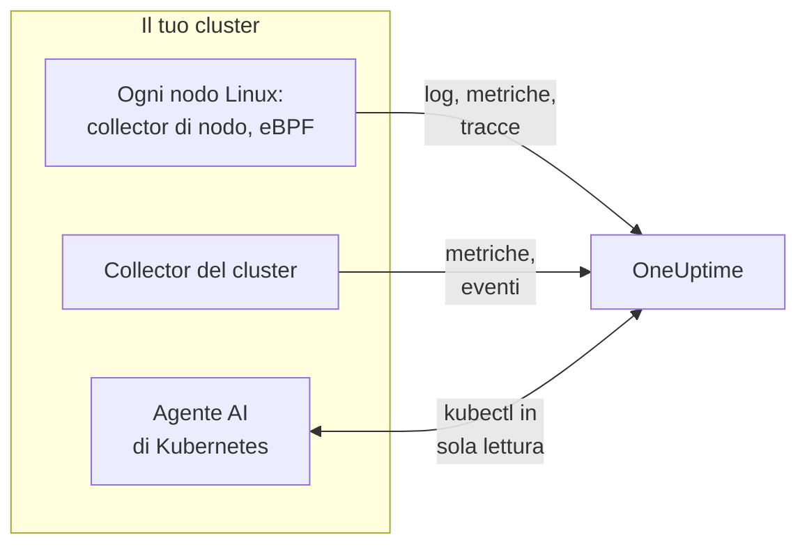

# Agente Kubernetes (installazione Helm)

L'agente Kubernetes di OneUptime è un chart Helm che raccoglie le metriche, gli eventi e i log dei pod del tuo cluster, le tracce applicative catturate con eBPF e le metriche del sistema operativo di ogni nodo, e li invia a OneUptime. Un solo `helm install` lo mette in funzione, senza modifiche al codice delle tue applicazioni. I [monitor Kubernetes](/docs/monitor/kubernetes-monitor) generano avvisi su ciò che invia.

:::cards
- [Installare l'agente](#installare-lagente): Quattro passaggi con Helm.
- [Scegliere un preset](#scegliere-un-preset): Cluster standard, GKE Autopilot o EKS Fargate.
- [Opzioni comuni](#opzioni-comuni): Le impostazioni che la maggior parte dei cluster modifica.
- [Risoluzione dei problemi](#risoluzione-dei-problemi): Uno script di diagnostica e i problemi più comuni.
:::

## Cosa installa il chart

Il chart esegue alcuni workload nel proprio namespace. Ognuno invia ciò che raccoglie al tuo URL di OneUptime tramite OTLP, con la chiave di acquisizione che gli fornisci.



| Workload | Tipo | Cosa fa | Attivo per impostazione predefinita |
| --- | --- | --- | --- |
| Collector del cluster | Deployment | Metriche del cluster, eventi Kubernetes e le specifiche complete di pod, nodi e workload, dall'API di Kubernetes. | Sì |
| Collector di nodo | DaemonSet | Log dei pod da `/var/log/pods`, metriche di kubelet e cAdvisor, e le metriche del sistema operativo del nodo. | Sì |
| Instrumentazione eBPF (OBI) | DaemonSet | Tracce HTTP, gRPC, SQL e Redis e metriche delle richieste di ogni pod, e la mappa dei servizi. | Sì |
| Agente AI di Kubernetes | Deployment | Consente a OneUptime AI di eseguire `kubectl` in sola lettura mentre indaga su un incidente o un avviso di questo cluster. | Sì |
| Lettore di log | Deployment | Log dei pod tramite l'API di Kubernetes, dove il collector di nodo non può leggerli. | Con i preset `gke-autopilot` ed `eks-fargate` |
| Profiler eBPF | DaemonSet | Flame graph continui della CPU di ogni processo. | No |
| kube-state-metrics | Deployment | Fasi dei pod, motivi di attesa dei container e quote di risorse. | No |

Ogni immagine dell'agente è solo per Linux, quindi ogni workload è vincolato ai nodi Linux.

## Prima di iniziare

- **Una chiave di acquisizione.** Creane una in OneUptime in **Impostazioni del progetto → Telemetria e APM → Chiavi di acquisizione**. L'agente la invia come intestazione `x-oneuptime-token`, quindi una chiave API di progetto qui non funziona.
- **Helm 3** e accesso `kubectl` al cluster. Gli aggiornamenti usano `--reset-then-reuse-values`, che richiede Helm 3.14 o successivo.
- **Un nome per il cluster**, univoco nel tuo progetto. Il chart si rifiuta di installarsi senza: due cluster con lo stesso nome apparirebbero come uno solo.
- **HTTPS in uscita** dal cluster verso il tuo URL di OneUptime.

## Installare l'agente

:::steps
### Aggiungere il repository Helm

```bash
helm repo add oneuptime https://helm-chart.oneuptime.com
helm repo update
```

### Installare il chart

Sostituisci l'URL con il tuo URL di OneUptime, e i due segnaposto con la tua chiave di acquisizione e il nome del cluster:

```bash
helm install oneuptime-agent oneuptime/kubernetes-agent \
  --namespace oneuptime-kubernetes-agent \
  --create-namespace \
  --set oneuptime.url=https://oneuptime.com \
  --set oneuptime.apiKey=<YOUR_API_KEY> \
  --set clusterName=<A_UNIQUE_NAME_FOR_THIS_CLUSTER>
```

Questo usa il preset `standard`. Su GKE Autopilot o EKS Fargate, [scegli invece il loro preset](#scegliere-un-preset).

### Verificare che i pod siano in esecuzione

```bash
kubectl get pods -n oneuptime-kubernetes-agent
```

Ogni pod dovrebbe arrivare a `Running` entro un paio di minuti.

### Trovare il cluster in OneUptime

Apri **Prodotti → Infrastruttura → Kubernetes → Tutti i cluster**. Il cluster appare con il suo nome entro pochi minuti, e i suoi nodi, pod e workload si popolano.
:::

## Scegliere un preset

Alcune piattaforme Kubernetes non consentono a un workload di montare un volume `hostPath` o di eseguire un DaemonSet, che è ciò che usa il collector di nodo. L'impostazione `preset` sceglie ciò che funziona sulla tua:

| Preset | Da usare per | Log dei pod | Su ogni nodo |
| --- | --- | --- | --- |
| `standard` (predefinito) | Autogestito, **EKS on EC2**, **GKE Standard**, **AKS**, minikube, kind, k3s | Il collector di nodo legge `/var/log/pods` | Metriche di kubelet, cAdvisor e del sistema operativo |
| `gke-autopilot` | **GKE Autopilot** | Il lettore di log li legge tramite l'API di Kubernetes | Metriche di kubelet e cAdvisor, senza `hostPath` |
| `eks-fargate` | **EKS Fargate** | Il lettore di log li legge tramite l'API di Kubernetes | Niente: Fargate non esegue DaemonSet |

Se non sei sicuro, lascia `preset` non impostato per ottenere `standard`. Se l'installazione fallisce con un errore Pod Security che cita `hostPath`, reinstalla con `gke-autopilot`, oppure con `eks-fargate` su EKS Fargate.

GKE Autopilot ed EKS Fargate rifiutano anche i pod privilegiati, di cui l'instrumentazione eBPF e la profilazione hanno bisogno, quindi i loro preset li lasciano fuori entrambi:

:::tabs
@tab Standard
```bash
helm install oneuptime-agent oneuptime/kubernetes-agent \
  --namespace oneuptime-kubernetes-agent --create-namespace \
  --set oneuptime.url=https://oneuptime.com \
  --set oneuptime.apiKey=<YOUR_API_KEY> \
  --set clusterName=prod
```
@tab GKE Autopilot
```bash
helm install oneuptime-agent oneuptime/kubernetes-agent \
  --namespace oneuptime-kubernetes-agent --create-namespace \
  --set oneuptime.url=https://oneuptime.com \
  --set oneuptime.apiKey=<YOUR_API_KEY> \
  --set clusterName=prod-gke-autopilot \
  --set preset=gke-autopilot
```
@tab EKS Fargate
```bash
helm install oneuptime-agent oneuptime/kubernetes-agent \
  --namespace oneuptime-kubernetes-agent --create-namespace \
  --set oneuptime.url=https://oneuptime.com \
  --set oneuptime.apiKey=<YOUR_API_KEY> \
  --set clusterName=prod-eks-fargate \
  --set preset=eks-fargate
```
:::

## Assegnare etichette al cluster

Le etichette che passi in fase di installazione vengono associate al cluster, e ai servizi e agli host che questo agente riporta. `--set oneuptime.labels.<key>=<value>` diventa un'etichetta di progetto chiamata `<key>:<value>`:

```bash
helm install oneuptime-agent oneuptime/kubernetes-agent \
  --namespace oneuptime-kubernetes-agent \
  --create-namespace \
  --set oneuptime.url=https://oneuptime.com \
  --set oneuptime.apiKey=<YOUR_API_KEY> \
  --set clusterName=prod \
  --set oneuptime.labels.team=payments \
  --set oneuptime.labels.env=production \
  --set oneuptime.labels.region=us-east-1
```

Oppure tienile in un file di valori:

```yaml title="values.yaml"
oneuptime:
  url: https://oneuptime.com
  apiKey: <YOUR_API_KEY>
  labels:
    team: payments
    env: production
    region: us-east-1
clusterName: prod
```

```bash
helm install oneuptime-agent oneuptime/kubernetes-agent \
  --namespace oneuptime-kubernetes-agent --create-namespace \
  -f values.yaml
```

Ogni record che questo agente invia - log, metriche, tracce e profili - porta quindi `team:payments`, `env:production` e `region:us-east-1`. Ogni etichetta è un attributo di risorsa `oneuptime.label.<key>=<value>`, e OneUptime trasforma in etichetta ogni attributo che inizia con `oneuptime.label.`. Le etichette vengono confrontate senza distinguere maiuscole e minuscole, quindi un'etichetta `Production` esistente viene riutilizzata, non duplicata. L'agente non rimuove mai un'etichetta che hai aggiunto in OneUptime.

## Log dei pod

`preset` imposta `logs.mode`, che puoi anche impostare tu:

| `logs.mode` | Come vengono letti i log | Punti di forza | Attenzione a |
| --- | --- | --- | --- |
| `daemonset` | Un collector di nodo per nodo segue i file in `/var/log/pods`. | Overhead minimo, scala con i nodi, nessun carico sul server API di Kubernetes, segue la rotazione dei log. | Richiede `hostPath` e DaemonSet. |
| `api` | Un lettore di log trasmette il log di ogni container dall'API di Kubernetes, come fa `kubectl logs -f`. | Funziona dove `hostPath` è bloccato o si applica il Pod Security Standard `restricted`. | Ogni flusso di container è una connessione di lunga durata al server API. Una replica gestisce qualche migliaio di container. |
| `disabled` | Niente. | Per le applicazioni che inviano già i loro log in un altro modo. | |

Per disattivare la raccolta dei log, imposta `--set logs.enabled=false` e invia invece i log delle applicazioni con gli SDK di [OpenTelemetry](/docs/telemetry/open-telemetry). Le metriche non ne risentono: il collector di nodo continua a funzionare.

### Cluster con più sistemi operativi (pool di nodi Windows)

I nodi Windows non eseguono mai un pod dell'agente. I dati a livello di cluster su di loro e sui loro pod arrivano comunque, perché provengono dall'API di Kubernetes: condizioni dei nodi, fasi dei pod, eventi Kubernetes e kube-state-metrics. Ai nodi Windows manca ciò che viene raccolto sul nodo: metriche del sistema operativo, metriche di kubelet e cAdvisor, tracce eBPF, profili e, nella modalità di log `daemonset`, i log dei pod.

Per raccogliere anche i log dei pod sui nodi Windows, attiva la modalità ibrida:

```bash
helm upgrade oneuptime-agent oneuptime/kubernetes-agent \
  --namespace oneuptime-kubernetes-agent --reset-then-reuse-values \
  --set logs.windowsPods.enabled=true
```

Il lettore di log viene quindi eseguito accanto ai collector di nodo, solo per i pod sui nodi Windows. I pod Linux mantengono la lettura dei file, più economica, e i due si dividono i pod in base al sistema operativo del nodo, così nessuna riga di log viene inviata due volte.

- **Versione dell'immagine del lettore.** La suddivisione solo per Windows è integrata nell'immagine `kubernetes-log-tailer`. Un'immagine più vecchia la ignora e segue *ogni* pod, inviando due volte i log di ogni pod Linux. Non fissare `logs.api.image.tag` a una versione più vecchia del rilascio del chart e, se un nodo potrebbe avere in cache una vecchia immagine `release`, aggiungi `--set logs.api.image.pullPolicy=Always` all'aggiornamento.
- **Filtraggio per severità.** Con `filters.logs.minSeverity` impostato, una riga senza una severità riconoscibile viene scartata nel percorso del collector di nodo ma mantenuta in quello del lettore di log - vedi [Filtraggio per severità dei log](/docs/telemetry/kubernetes-agent#filtraggio-per-severità-dei-log). I pod Windows possono quindi inviare più righe senza livello dei pod Linux.

## Tracce applicative con eBPF

Il chart esegue [OpenTelemetry eBPF Instrumentation (OBI)](https://opentelemetry.io/docs/zero-code/obi/) su ogni nodo. OBI carica programmi eBPF nel kernel Linux e osserva il traffico di rete di ogni pod, così può ricostruire le chiamate HTTP e HTTPS, gRPC, e SQL e Redis senza alcuna modifica alle tue applicazioni: niente SDK, niente sidecar. Le invia a OneUptime come tracce e metriche delle richieste.

I tuoi servizi compaiono in **Prodotti → Tracce** e sulla mappa dei servizi entro un paio di minuti, con `k8s.cluster.name` impostato sul nome del cluster, così puoi filtrare per cluster.

### Quando disattivare eBPF

eBPF è attivo per impostazione predefinita. Disattivalo con `--set ebpf.enabled=false` quando:

- Il cluster è **GKE Autopilot** o **EKS Fargate**. Lo fanno i loro preset per te: quelle piattaforme rifiutano i pod privilegiati, e OBI deve essere privilegiato per caricare i suoi programmi.
- I nodi eseguono un kernel precedente a **Linux 5.8** senza BTF. Debian 11, Ubuntu 20.10, Fedora 34, RHEL 9 e successivi vanno bene.
- Le tue applicazioni inviano già tracce con un SDK OpenTelemetry, e non le vuoi doppie.

### Cosa invia eBPF

OBI invia diversi tipi di segnale. Ognuno può essere disattivato con `--set ebpf.features.<key>=false`:

| Impostazione | Predefinito | Cosa aggiunge |
| --- | --- | --- |
| `ebpf.features.httpMetrics` | attivo | Metriche delle richieste HTTP e gRPC per servizio: frequenza delle richieste, istogrammi di latenza ed errori. |
| `ebpf.features.spanMetrics` | attivo | Metriche degli span: chiamate e durata per servizio, route o operazione, tipo di span e stato - `traces.span.metrics.calls` e `traces.span.metrics.duration` (secondi). |
| `ebpf.features.serviceGraph` | attivo | La frequenza e la latenza di ogni chiamata da un servizio a un altro, che disegnano la mappa dei servizi. |
| `ebpf.features.networkMetrics` | attivo | Byte e pacchetti tra ogni coppia di pod, su TCP e UDP, con i loro nomi Kubernetes. Mostra ogni coppia di pod che comunicano, anche tramite protocolli che OBI non sa leggere. |
| `ebpf.features.networkInterZoneMetrics` | disattivo | Lo stesso tra zone. Raddoppia il numero di serie: attivalo solo se pianifichi per zona. |
| `ebpf.features.tcpStats` | attivo | Statistiche TCP per nodo: tempi di andata e ritorno, connessioni fallite e ritrasmissioni. |

### Collegare le tracce tra i servizi

OBI può anche portare la traccia attraverso una chiamata: quando il pod A chiama il pod B tramite HTTP o gRPC, lo span dal lato di B si unisce alla traccia di A, senza SDK in nessuna delle due applicazioni. **Questa funzione è disattivata per impostazione predefinita.** Attivala con `--set ebpf.contextPropagation=true`, dopo aver letto l'avvertenza qui sotto.

| Opzione | Predefinito | Cosa fa |
| --- | --- | --- |
| `ebpf.contextPropagation` | disattivo | Scrive un `traceparent` W3C nel traffico in uscita, così gli span si collegano tra i servizi. |
| `ebpf.contextPropagationMode` | `headers` | Come: `headers` (intestazioni di richiesta HTTP/1.1, il più ristretto), `tcp` (un'opzione TCP, tramite Linux Traffic Control) o `all` (entrambi). Letto solo quando `contextPropagation` è attivo. |
| `ebpf.trackRequestHeaders` | attivo | Traccia le intestazioni di richiesta nel kernel, così il lato ricevente trova il `traceparent` anche sui server HTTP semplici. Ha effetto solo quando `contextPropagation` è attivo. |

> [!WARNING]
> Ogni modalità di propagazione modifica traffico già in transito. Per l'HTTP semplice, OBI allarga la richiesta in uscita nel kernel per far posto all'intestazione; per TLS e TCP grezzo aggiunge un'opzione TCP da un hook di Traffic Control, riscrivendo il pacchetto e il suo checksum. Se il conteggio dei byte della connessione non viene poi corretto con esattezza, il flusso si **desincronizza**: i trasferimenti attraverso un proxy come nginx si bloccano a metà, non appena una risposta supera circa 64 KB, finché la connessione non va in timeout. Le richieste piccole continuano a funzionare, quindi sembra un bug dell'applicazione o del proxy. Nessuna versione del kernel elimina la riscrittura. Tracce, metriche delle richieste e mappa dei servizi funzionano tutte senza di essa; un SDK OpenTelemetry nei tuoi servizi collega le tracce senza alcuna riscrittura nel kernel. Se la attivi, provala prima su un cluster non di produzione e verifica i trasferimenti grandi attraverso il tuo proxy.

### Collegare i log alle tracce

**Disattivato per impostazione predefinita.** Quando è attivo, OBI aggancia una sonda alla chiamata di sistema `write()` di ogni processo che instrumenta, e:

- Una **riga di log JSON** riceve i campi `trace_id` e `span_id` (i campi che la riga ha già vengono mantenuti). Il collector di nodo li sposta nei campi di traccia propri del record di log, così i log di uno span sono a un clic in OneUptime, come lo è la traccia di una riga di log.
- **Qualsiasi altra riga di log** viene raccolta invariata, senza il collegamento.

```bash
helm upgrade oneuptime-agent oneuptime/kubernetes-agent \
  --namespace oneuptime-kubernetes-agent --reset-then-reuse-values \
  --set ebpf.logToTraceCorrelation=true
```

| Opzione | Predefinito | Cosa fa |
| --- | --- | --- |
| `ebpf.logToTraceCorrelation` | `false` | Attiva l'arricchitore di log di OBI e lo spostamento di `trace_id` nel collector di nodo. |
| `ebpf.logEnricher.services` | `[{service: [{exe_path: "*"}]}]` | Quali processi tocca l'arricchitore. Ogni voce è un selettore [GlobAttributes](https://opentelemetry.io/docs/zero-code/obi/configure/options/#service-discovery) di OBI, con campi come `exe_path`, `languages`, `k8s_pod_labels`, `k8s_pod_annotations`, `open_ports` e `cmd_args`. |

#### Agenti APM che vanno in crash con questa funzione

L'arricchitore riscrive il buffer di output dell'applicazione **all'interno del processo**: quando un processo selezionato chiama `write()`, OBI cancella i byte originali e scrive una copia arricchita. Gli agenti APM che si caricano tramite `LD_PRELOAD` e avvolgono essi stessi `write()` non sopravvivono a questo:

| Agente APM | Libreria | Cosa succede |
| --- | --- | --- |
| Dynatrace OneAgent | `liboneagentproc.so` | L'applicazione va in crash con SIGSEGV (codice di uscita 139). Il `write()` del watchdog di Dynatrace si blocca oltre il suo limite di 10 secondi e il OneAgent si riavvia in loop. |
| New Relic | `libnewrelic*.so` | Lo stesso tipo di crash. |
| AppDynamics | `libappdynamics*.so` | Lo stesso tipo di crash. |
| Datadog | `libdd*.so` | Lo stesso tipo di crash. |
| Instana | `libinstana*.so` | Lo stesso tipo di crash. |

**Le applicazioni .NET sono le più esposte:** l'agente .NET di Dynatrace si carica sempre tramite `LD_PRELOAD`, e il log su console di Microsoft.Extensions.Logging non usa buffer, quindi ogni riga segue quel percorso. Le applicazioni Python e Go di solito non sono interessate.

Per usarlo accanto a uno di questi agenti, indirizza `logEnricher.services` solo ai pod che non ne hanno uno. L'arricchitore non può escludere, quindi elenca quelli da arricchire:

```yaml title="values.yaml"
ebpf:
  logToTraceCorrelation: true
  logEnricher:
    services:
      # Enrich only pods with the apm-agent=none label
      - service:
          - k8s_pod_labels:
              apm-agent: "none"
```

Oppure scegli per runtime. Il caricamento tramite `LD_PRELOAD` di Dynatrace riguarda .NET, quindi arricchire solo Python, Go, Ruby e Node.js lo evita:

```yaml title="values.yaml"
ebpf:
  logToTraceCorrelation: true
  logEnricher:
    services:
      - service:
          - languages: "python,go,ruby,nodejs"
```

#### I log devono essere JSON e senza buffer

- **Solo le righe JSON ricevono un `trace_id`.** Passa il logger a un formato JSON: `structlog`, `pino`, `winston`, `serilog`, `logback-json`, klog `--logging-format=json` e simili.
- **L'output con buffer rompe il collegamento**, perché in quel caso il `write()` avviene su un thread diverso da quello della richiesta. In **Python**, imposta `PYTHONUNBUFFERED=1`. In **.NET**, chiama `Console.SetOut(new StreamWriter(Console.OpenStandardOutput()) { AutoFlush = true })` all'avvio; `AddConsole()` di Microsoft.Extensions.Logging e i sink asincroni di Serilog non funzionano, il semplice `WriteTo.Console()` di Serilog sì.
- Greenlet, gevent, Tornado e gli altri runtime asincroni personalizzati non sono coperti.

### Regolare eBPF

| Opzione | Predefinito | Cosa fa |
| --- | --- | --- |
| `ebpf.enabled` | `true` | Esegue il DaemonSet eBPF. `false` lo esclude. |
| `ebpf.image.tag` | `v0.14.0` | L'immagine di OBI. OBI è precedente alla 1.0: fissa una versione che hai testato, e testa di nuovo prima di cambiarla. |
| `ebpf.autoTargetExe` | `*` | Glob degli eseguibili da instrumentare, separati da virgole. Restringilo, come in `*/python,*/java`, per instrumentare meno runtime. |
| `ebpf.excludeExePaths` | Shell, infrastruttura del cluster, sidecar di service mesh, agenti CNI, browser, ClickHouse, collector e OBI stesso | Glob degli eseguibili da saltare, separati da virgole. Un glob ampio salta anche i tuoi binari. |
| `ebpf.logLevel` | `info` | `debug`, `info`, `warn` o `error`. |
| `ebpf.printTraces` | `false` | Stampa anche gli span nel log di OBI, per verificare cosa cattura. |
| `ebpf.resources.*` | `100m` di CPU e `512Mi` di memoria richiesti, limiti di `2000m` e `2Gi` | Aumentali per nodi con molto traffico o molti processi di breve durata. |

Per verificare che OBI sia in esecuzione e veda traffico:

```bash
kubectl get pods -n oneuptime-kubernetes-agent -l component=ebpf-instrument
kubectl logs -n oneuptime-kubernetes-agent -l component=ebpf-instrument --tail=200
```

## Profilazione continua della CPU

Anche l'[OpenTelemetry eBPF Profiler](https://github.com/open-telemetry/opentelemetry-ebpf-profiler) può essere eseguito su ogni nodo, come immagine `otel/opentelemetry-collector-ebpf-profiler`. Campiona ciò che ogni processo sta eseguendo, 19 volte al secondo, in Go, Java, .NET, Python, Ruby, Node.js, PHP, Perl, C, C++ e Rust, e invia i profili a OneUptime. Compaiono in **Prodotti → Profili di performance**, e come flame graph su ogni span di traccia.

**La profilazione è disattivata per impostazione predefinita:** costa più CPU e memoria per nodo dell'instrumentazione eBPF. Attivala con `--set profiling.enabled=true`.

Con anche l'instrumentazione eBPF attiva (il comportamento predefinito), ogni campione porta la traccia a cui appartiene, quindi uno span ha il proprio flame graph. Per questo il chart chiede a OBI di tenere disponibile il contesto di traccia in corso (`OTEL_EBPF_BPF_POPULATE_TRACE_CONTEXT=true`), il che costa un po' alle applicazioni instrumentate a ogni cambio di contesto asincrono. Imposta `profiling.obiProcessContext=false` per avere flame graph senza il collegamento agli span.

La profilazione richiede **Linux 5.10** o successivo, e un pod privilegiato con gli ID di processo del nodo: non può essere eseguita su GKE Autopilot né su EKS Fargate, e i loro preset la lasciano disattivata. Su nodi che sono essi stessi container, come kind o k3d, non distingue i processi, e quasi nessun campione si collega a uno span.

| Opzione | Predefinito | Cosa fa |
| --- | --- | --- |
| `profiling.enabled` | `false` | Esegue il DaemonSet del profiler. |
| `profiling.image.tag` | `0.152.0` | L'immagine del profiler. È precedente alla 1.0: fissa una versione che hai testato. |
| `profiling.samplesPerSecond` | `19` | Quanti campioni al secondo. 19 evita di allinearsi con le frequenze dei timer più comuni. |
| `profiling.offCpuThreshold` | `0` | Un valore oltre 0 e fino a 1 profila anche il tempo trascorso fuori dalla CPU, che mostra la contesa dei lock e l'I/O bloccante, con un costo aggiuntivo. |
| `profiling.tracers` | `""` (ogni runtime) | I tracer di linguaggio da caricare, separati da virgole, come `go,python`. |
| `profiling.obiProcessContext` | `true` | Collega i campioni alle tracce di OBI, e fa sì che OBI tenga disponibile il contesto di traccia a questo scopo. |

## Altre raccolte di dati

| Opzione | Predefinito | Cosa aggiunge |
| --- | --- | --- |
| `hostMetrics.enabled` | attivo | Le metriche del sistema operativo di ogni nodo da `/proc` e `/sys`: code di I/O dei dischi, inode dei file system, errori delle interfacce di rete, paginazione e carico medio. Viene eseguito nel collector di nodo, senza pod aggiuntivi. |
| `kubeletstats.utilizationMetrics.enabled` | attivo | CPU e memoria di container e pod come percentuale della loro richiesta e del loro limite, lette dai monitor di saturazione di CPU e memoria. Sempre 0 per un pod senza richiesta né limite. |
| `kubeletstats.volumeMetrics.enabled` | attivo | Lo spazio libero e totale di ogni PVC (`k8s.volume.available`, `k8s.volume.capacity`), letto dal monitor PVC Low Disk Space. Una serie per PVC e per pod. |
| `cadvisor.enabled` | attivo | Throttling della CPU e terminazioni OOM dal `/metrics/cadvisor` di ogni kubelet: `container_cpu_cfs_throttled_seconds_total`, `container_cpu_cfs_periods_total` e `container_oom_events_total`, e nient'altro. |
| `kubeStateMetrics.enabled` | disattivo | Fasi dei pod (Pending, Terminating), pod che non possono essere pianificati, motivi di attesa dei container (CrashLoopBackOff, ImagePullBackOff) e uso delle quote di risorse, da kube-state-metrics. `kubeStateMetrics.mode: bundled` (il predefinito) esegue per te un piccolo kube-state-metrics; `external` legge uno che esegui già, su `kubeStateMetrics.endpoint`. |
| `auditLogs.enabled` | disattivo | L'audit log di Kubernetes, `/var/log/kubernetes/audit.log`: ogni richiesta all'API, da chi, su cosa. Solo cluster autogestiti: quelli gestiti (EKS, GKE, AKS, DOKS) lo inviano al cloud provider. |
| `csi.enabled` | disattivo | Le metriche dei driver di storage CSI, dai pod etichettati `app=csi-driver` o `app.kubernetes.io/component=csi-driver`: tempi di collegamento e scollegamento dei volumi, errori di provisioning, IOPS. |
| `coreDns.enabled` | disattivo | Le metriche di CoreDNS su `:9153/metrics`: frequenza delle query, latenza, hit della cache ed errori. |
| `controlPlane.enabled` | disattivo | etcd, il server API, lo scheduler e il controller manager. Solo cluster autogestiti: quelli gestiti non li espongono. |
| `cost.enabled` | disattivo | Quanto costa ogni workload. Vedi [Osservabilità dei costi di Kubernetes](/docs/telemetry/kubernetes-cost). |

## Opzioni comuni

| Opzione | Predefinito | Cosa fa |
| --- | --- | --- |
| `oneuptime.url` | (obbligatorio) | Il tuo URL di OneUptime. |
| `oneuptime.apiKey` | (obbligatorio) | La chiave di acquisizione, da **Impostazioni del progetto → Telemetria e APM → Chiavi di acquisizione**. Inviata come intestazione `x-oneuptime-token`; una chiave API di progetto non funziona. |
| `clusterName` | (obbligatorio) | Il nome del cluster, univoco nel progetto. Ogni record lo porta come `k8s.cluster.name`. |
| `preset` | (vuoto: `standard`) | `standard`, `gke-autopilot` o `eks-fargate`. Vedi [Scegliere un preset](#scegliere-un-preset). |
| `oneuptime.labels` | `{}` | Etichette per ogni record di questo agente. Vedi [Assegnare etichette al cluster](#assegnare-etichette-al-cluster). |
| `namespaceFilters.rules` | Esclude `kube-system` da `podLogs` ed `ebpfDiscovery` | Regole che includono o escludono namespace, per `podLogs`, `ebpfDiscovery`, `metrics` e `traces`. I pattern possono usare `*`, e l'esclusione vince sempre. |
| `filters.logs.minSeverity` | `""` | Scarta le righe di log dei pod sotto questo livello: `TRACE`, `DEBUG`, `INFO`, `WARN`, `ERROR` o `FATAL`. |
| `filters.metrics.exclude` | `[]` | Nomi di metriche da scartare. |
| `sampling.traces.percentage` | `100` | La quota di tracce da conservare, da 0 a 100. Le tracce vengono conservate o scartate per intero. |
| `logs.enabled` | `true` | Raccoglie i log dei pod. |
| `logs.mode` | (da `preset`) | `daemonset`, `api` o `disabled`. Prevale sul preset. |
| `logs.windowsPods.enabled` | `false` | Segue anche i pod sui nodi Windows. Vedi [Cluster con più sistemi operativi](#cluster-con-più-sistemi-operativi-pool-di-nodi-windows). |
| `logs.api.replicas` | `1` | Repliche del lettore di log, in modalità `api`. |
| `ebpf.enabled` | `true` | Tracce eBPF e metriche delle richieste. Vedi [Tracce applicative con eBPF](#tracce-applicative-con-ebpf). |
| `profiling.enabled` | `false` | Flame graph della CPU. Vedi [Profilazione continua della CPU](#profilazione-continua-della-cpu). |
| `kubeStateMetrics.enabled` | `false` | Lo stato del cluster da kube-state-metrics. |
| `aiAgent.enabled` | `true` | L'agente AI di Kubernetes. Vedi [Agente AI di Kubernetes](/docs/telemetry/kubernetes-agent) per cosa può fare. |

Il [`values.yaml`](https://github.com/OneUptime/oneuptime/blob/master/HelmChart/Public/kubernetes-agent/values.yaml) del chart elenca e spiega ogni opzione, e [Agent Kubernetes](/docs/telemetry/kubernetes-agent) tratta filtraggio, campionamento e come contenere il volume dei dati.

## Aggiornamento

```bash
helm repo update
helm upgrade oneuptime-agent oneuptime/kubernetes-agent \
  --namespace oneuptime-kubernetes-agent \
  --reset-then-reuse-values
```

`--reset-then-reuse-values` (Helm 3.14 e successivi) mantiene i valori che hai impostato - il preset, il nome del cluster, i filtri - e prende ogni altro valore dal nuovo chart. Aggiungi qualsiasi nuovo `--set` dopo di esso. Con Helm 3.13 o precedente, aggiorna invece con i valori che hai impostato:

```bash
helm repo update
helm get values oneuptime-agent --namespace oneuptime-kubernetes-agent -o yaml > values.yaml && \
  helm upgrade oneuptime-agent oneuptime/kubernetes-agent \
  --namespace oneuptime-kubernetes-agent -f values.yaml
```

Non aggiornare con `--reuse-values`: mantiene anche i valori predefiniti del chart da cui aggiorni, quindi i valori predefiniti di un chart più recente, tra cui la sua immagine eBPF, non vengono mai applicati. Quando una release funziona con i valori predefiniti di un chart più vecchio, le note che Helm stampa dopo l'installazione o l'aggiornamento terminano con un avviso e il comando che lo risolve.

> [!WARNING]
> **Le metriche degli span eBPF hanno nuovi nomi.** `ebpf.features.spanMetrics` ora invia `traces.span.metrics.calls` e `traces.span.metrics.duration` (secondi) invece di `traces_spanmetrics_calls_total` e `traces_spanmetrics_latency`: le stesse serie, con i nomi che OBI mantiene (ha deprecato quelli vecchi). Una dashboard, un grafico o un monitor delle metriche su un vecchio nome non riceve nuovi dati dopo l'aggiornamento, senza alcun errore - spostalo sul nuovo nome, e aggiorna ogni voce di `filters.metrics` che ne nomina uno vecchio.

## Disinstallazione

```bash
helm uninstall oneuptime-agent --namespace oneuptime-kubernetes-agent
kubectl delete namespace oneuptime-kubernetes-agent
```

## Risoluzione dei problemi

:::details Il cluster risulta Disconnected, o non arrivano dati
Esegui lo script di diagnostica del chart. Controlla i pod, la chiave di acquisizione e la via d'uscita dal cluster, chiede a OneUptime se la chiave è accettata e stampa un unico verdetto. Legge soltanto, e non modifica nulla:

```bash
curl -fsSL https://raw.githubusercontent.com/OneUptime/oneuptime/master/HelmChart/Public/kubernetes-agent/troubleshoot.sh \
  | bash -s -- -n oneuptime-kubernetes-agent
```

La causa più comune, soprattutto dopo una reinstallazione, è una chiave di acquisizione errata o revocata: OneUptime la rifiuta, e il collector scarta ogni batch mentre i suoi pod restano `Running`.
:::

:::details L'installazione fallisce con «hostPath volumes are not allowed»
Il cluster blocca `hostPath`. Passa a un preset che legge i log tramite l'API di Kubernetes; lascia fuori anche eBPF:

```bash
helm upgrade oneuptime-agent oneuptime/kubernetes-agent \
  --namespace oneuptime-kubernetes-agent \
  --reset-then-reuse-values \
  --set preset=gke-autopilot
```

Su EKS Fargate, usa `--set preset=eks-fargate`.
:::

:::details I pod dell'agente sono bloccati in ImagePullBackOff sui nodi Windows
I chart più vecchi pianificavano i DaemonSet dell'agente sui nodi Windows, dove le loro immagini Linux non possono mai essere scaricate. Esegui `helm upgrade`: il chart attuale vincola ogni workload ai nodi Linux, e i pod bloccati scompaiono. Per raccogliere i log dei pod sui nodi Windows, vedi [Cluster con più sistemi operativi](#cluster-con-più-sistemi-operativi-pool-di-nodi-windows).
:::

:::details Non arrivano log in OneUptime
Controlla i pod dell'agente e i loro log:

```bash
kubectl get pods -n oneuptime-kubernetes-agent
kubectl logs -n oneuptime-kubernetes-agent -l app.kubernetes.io/part-of=oneuptime --tail=200
```

In modalità `api`, il lettore di log risponde su `/healthz`, porta 13133, con lo stato delle sue esportazioni: raggiungilo con `kubectl port-forward`.
:::

:::details I pod eBPF sono in CrashLoopBackOff, o non si avviano
Leggi il log di OBI:

```bash
kubectl logs -n oneuptime-kubernetes-agent -l component=ebpf-instrument --tail=200
```

- **Il kernel è troppo vecchio, o non ha BTF.** OBI richiede Linux 5.8 o successivo con BTF; verificalo con `uname -r` su un nodo. Se non puoi aggiornarlo, disattiva eBPF con `--set ebpf.enabled=false`.
- **I pod privilegiati vengono rifiutati.** Alcuni cluster li rifiutano anche al di fuori di Autopilot e Fargate. Disattiva eBPF.
- **OBI è in esecuzione, ma non arrivano tracce.** Imposta `--set ebpf.printTraces=true` e rileggi il log di OBI. Se lì compaiono span, l'esportazione verso OneUptime non riesce: controlla l'URL e la chiave di acquisizione. Se non ne compaiono, il traffico potrebbe essere cifrato da una libreria TLS che OBI non sa leggere, come una collegata staticamente.
:::

:::details I trasferimenti grandi si bloccano dopo aver attivato il collegamento delle tracce
È `ebpf.contextPropagation` che riscrive il traffico: vedi l'avvertenza in [Collegare le tracce tra i servizi](#collegare-le-tracce-tra-i-servizi). Disattivalo con `--set ebpf.contextPropagation=false`.
:::

:::details Le applicazioni vanno in crash con codice di uscita 139 dopo aver attivato il collegamento dei log
Negli stessi pod c'è un agente APM che si carica tramite `LD_PRELOAD`: vedi [Agenti APM che vanno in crash con questa funzione](#agenti-apm-che-vanno-in-crash-con-questa-funzione). Disattiva `ebpf.logToTraceCorrelation`, oppure indirizza `ebpf.logEnricher.services` ai pod senza quell'agente.
:::

:::details Un solo lettore di log non basta per il cluster (modalità api)
Dividi i namespace tra più release, ognuna installata con le proprie regole sui namespace:

```bash
helm install oneuptime-agent-ns-a oneuptime/kubernetes-agent \
  --set preset=gke-autopilot \
  --set-json 'namespaceFilters.rules=[{"action":"include","namespaces":["app-a","app-b"],"scopes":["podLogs"]}]' \
  ...
```

Aumentare `logs.api.replicas` aggiunge lettori, ma ognuno legge ogni namespace consentito, quindi devi comunque dividere i namespace per evitare duplicati.
:::

## Passaggi successivi

:::cards
- [Monitor Kubernetes](/docs/monitor/kubernetes-monitor): Generare avvisi su ciò che l'agente invia.
- [Agent Kubernetes](/docs/telemetry/kubernetes-agent): Filtraggio, campionamento, l'agente AI e come contenere il volume dei dati.
- [Osservabilità dei costi di Kubernetes](/docs/telemetry/kubernetes-cost): Vedere quanto costa ogni workload.
- [Monitor tracce](/docs/monitor/traces-monitor): Generare avvisi sulle tracce che eBPF cattura.
:::
