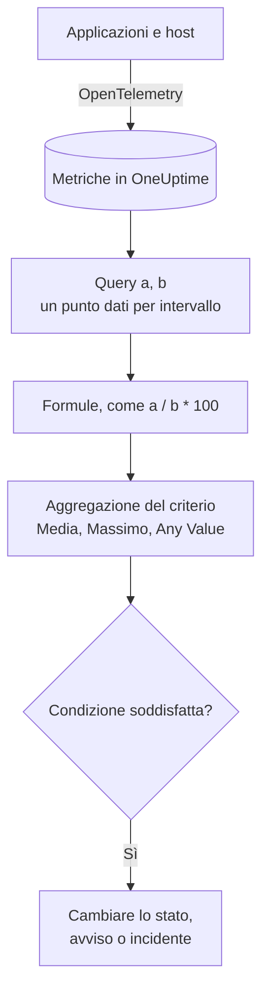

# Monitor metriche

Un monitor metriche interroga le metriche che le vostre applicazioni e la vostra infrastruttura inviano a OneUptime, le combina con formule quando vi serve un rapporto o un totale, e confronta il risultato con i vostri criteri su un intervallo di tempo mobile. Usatelo per tassi di richieste, rapporti di errori, profondità delle code, CPU, memoria e disco (qualsiasi serie numerica), con un avviso per host o per container quando lo raggruppate.

:::cards
- [Creare il monitor](#creare-un-monitor-metriche): Query, formule, un intervallo di tempo e criteri.
- [Come viene valutato](#come-viene-valutato): Punti dati, formule e aggregazione dei criteri.
- [Esempio pratico](#esempio-pratico-una-coda-che-cresce): Gli stessi dati con ogni aggregazione.
- [Avvisi per serie](#avvisi-per-serie-group-by): Un avviso per host, container o punto di montaggio.
:::

## Come funziona

Ogni minuto, OneUptime esegue ogni query di metriche del monitor sul suo intervallo di tempo. Una query restituisce un punto dati per intervallo, e le formule combinano le query intervallo per intervallo. Ogni criterio riduce poi i punti dati della query o della formula che controlla (alla loro media, al loro massimo o a un test di ogni punto) e confronta il risultato con la propria soglia.

## Prima di iniziare

- Le vostre applicazioni o la vostra infrastruttura inviano metriche a OneUptime tramite OpenTelemetry. Vedete [OpenTelemetry](/docs/telemetry/open-telemetry).
- Conoscete il nome della metrica e gli attributi su cui volete filtrare o raggruppare. Gli elenchi **Metrica** e **Raggruppa per** offrono solo nomi e attributi che OneUptime ha ricevuto.

## Creare un monitor metriche

:::steps
### Iniziare un nuovo monitor

Andate in **Monitor** e fate clic su **Crea monitor**. Oppure, nell'esploratore delle metriche, costruite il grafico che volete osservare e fate clic su **Crea monitor da questa vista**: il nuovo monitor parte con le sue query.

### Scegliere Metrics

In **Tipo di monitor**, fate clic su **Altri tipi di monitor** e scegliete **Metriche** sotto **Telemetria**, oppure digitate `metrics` nella casella di ricerca. Inserite un **Nome**, poi fate clic su **Avanti**.

### Aggiungere le query delle metriche

In **Metrica da osservare**, scegliete una **Metrica** e come aggregarla con **Aggregate by**. Aprite **Filters & grouping** per filtrare per attributi o per raggruppare con **Raggruppa per**. Fate clic su **Aggiungi metrica** per un'altra query, o su **Aggiungi formula** per combinarle. Il grafico sotto le query mostra le ultime ore, con il valore della regola come linea rossa, così vedete i valori che la regola controllerà.

### Dire quando avvisare

In **Quando avvisare**, scegliete in **Misurato come** come viene misurata la metrica, poi una **Finestra temporale**, una **Condizione** e un **Valore**. Quando il passaggio ha più di una query o formula, scegliete anche la **Metrica** che la regola legge. La frase sotto di essi ripete la regola con parole semplici.

### Scegliere cosa succede

In **Cosa succede**, scegliete **Crea un avviso**, **Dichiara un incidente** o **Entrambi**, e dategli un titolo e una gravità. Finché la regola corrisponde, il monitor mostra lo stato indicato in **Altri campi**; quando smette di corrispondere, il monitor torna al suo stato predefinito e l'avviso o l'incidente si risolve da solo.

### Creare il monitor

Fate clic su **Crea monitor**. Il monitor si apre sulla sua pagina **Panoramica**, e la sua prima valutazione avviene entro un minuto.
:::

## Cosa interroga

### Query delle metriche

| Campo | Cosa fa | Predefinito |
| --- | --- | --- |
| **Metrica** | La metrica da interrogare. | Obbligatorio |
| **Aggregate by** | Come i valori di ogni intervallo di tempo vengono combinati in un punto dati: Media, Somma, Min, Max, Conteggio, oppure un percentile (P50, P75, P90, P95 o P99). | Media |
| **Filter by attributes** (in **Filters & grouping**) | Solo le serie i cui attributi soddisfano queste condizioni. | Nessun filtro |
| **Raggruppa per** (in **Filters & grouping**) | Una serie per ogni valore unico di questi attributi (vedete [Avvisi per serie](#avvisi-per-serie-group-by)). | Una sola serie |

Ogni query e ogni formula riceve una variabile (`a`, `b`, `c` e così via) nell'ordine in cui le aggiungete.

### Formule

Una formula combina variabili di query con `+`, `-`, `*`, `/`, `%`, `^` e parentesi, intervallo per intervallo. Potete scrivere le variabili con o senza un `$` davanti:

- `a / b * 100`: la quota di `b` rappresentata da `a`, in percentuale
- `a + b`: due metriche sommate
- `a - b`: la differenza tra le due

### Finestra di tempo mobile

La **Finestra temporale** in **Quando avvisare** stabilisce quanto indietro guarda ogni valutazione: **Ultimo minuto**, **Ultimi 5 minuti**, **Ultimi 10 minuti**, **Ultimi 15 minuti**, **Ultimi 30 minuti**, **Ultima ora**, **Ultime 2 ore**, **Ultime 3 ore**, **Ultime 6 ore**, **Ultime 12 ore**, **Ultime 24 ore**, **Ultimi 2 giorni**, **Ultimi 3 giorni**, **Ultimi 7 giorni**, **Ultimi 14 giorni**, **Ultimi 30 giorni**, **Ultimi 60 giorni**, **Ultimi 90 giorni**, **Ultimi 180 giorni** o **Ultimi 365 giorni**.

Più lunga è la finestra, più largo è ogni intervallo di raggruppamento, quindi un punto dati rappresenta più tempo:

| Finestra temporale | Un punto dati per |
| --- | --- |
| Da Ultimo minuto a Ultime 3 ore | minuto |
| Ultime 6 ore, Ultime 12 ore | 5 minuti |
| Ultime 24 ore | 15 minuti |
| Ultimi 2 giorni, Ultimi 3 giorni | 30 minuti |
| Ultimi 7 giorni | ora |
| Ultimi 14 giorni, Ultimi 30 giorni | giorno |
| Da Ultimi 60 giorni a Ultimi 180 giorni | settimana |
| Ultimi 365 giorni | mese |

## Come viene valutato

- **Ogni minuto.** Un monitor metriche non viene controllato da sonde, quindi non ha un intervallo da impostare né una pagina **Sonde e intervallo**.
- **Prima le query, poi le formule.** Ogni query restituisce un punto dati per intervallo di raggruppamento dell'intervallo di tempo, secondo il suo **Aggregate by**. Le formule vengono calcolate per ogni intervallo a partire dai punti dati delle query.
- **Poi la misura della regola.** La regola riduce i punti dati della sua metrica a ciò che confronta con il suo valore, come dice **Misurato come**:

| Misurato come | Nei criteri personalizzati | La condizione viene verificata su… |
| --- | --- | --- |
| La media | Media | la media dei punti dati |
| La somma | Somma | la somma dei punti dati |
| Il valore più alto | Maximum Value | il punto dati più alto |
| Il valore più basso | Minimum Value | il punto dati più basso |
| Ogni valore (l'intera finestra) | All Values | ogni punto dati: tutti devono soddisfare la condizione e coprire tutto l'intervallo di tempo |
| Un valore qualsiasi (in qualsiasi momento) | Any Value | ogni punto dati: basta che uno soddisfi la condizione |

- **Criteri dall'alto verso il basso.** In un monitor senza Group By decide il primo criterio che corrisponde, quindi mettete per primo il più grave. Un monitor raggruppato controlla ogni criterio per ogni serie (vedete [La valutazione dei criteri cambia](#la-valutazione-dei-criteri-cambia)).
- **Nessun dato non è zero.** Quando la query non restituisce punti dati nell'intervallo, la regola fa ciò che dice **Se non ci sono dati**, in **Altri campi** di **Quando avvisare**: **Niente** (il predefinito: la regola non corrisponde), **Contare come zero** o **Avvisare, come se corrispondesse**.
- **Ogni valore richiede tutto l'intervallo di tempo.** Una serie soddisfa una regola misurata come **Ogni valore (l'intera finestra)** solo quando i suoi punti dati coprono l'intervallo di tempo, dal suo inizio a ora, senza un vuoto di più di un punto dati mancante. Quando tutti i dati del monitor arrivano in ritardo, come quelli di CloudWatch, il suo punto dati più recente prende il posto di ora. Un host, un container o un deployment che ha appena iniziato a inviare dati, o che è rimasto in silenzio per un po', attende di avere i dati di un intero intervallo di tempo, e il registro di valutazione indica a che punto è: `Waiting for 15 minutes of data: 2 of 15 minutes so far`. Una serie il cui avviso o incidente è già aperto viene giudicata solo sui suoi punti dati, quindi un breve vuoto nei suoi dati non lo risolve. Se la metrica invia dati meno spesso di quanto duri l'intervallo di tempo, un singolo punto dati vale per tutto l'intervallo una volta che ha qualche minuto; per giudicare quanto dura un valore, l'intervallo di tempo deve coprire almeno due intervalli di invio.
- **L'interruzione di OneUptime stesso non è silenzio.** Finché l'intervallo di tempo contiene un periodo in cui OneUptime stesso non riceveva dati (si stava riavviando, veniva aggiornato o recuperava un arretrato), il controllo attende: lo stato non cambia e nessun incidente o avviso viene aperto o risolto, qualunque cosa dica **Se non ci sono dati**. Vedete [Quando OneUptime non riceve dati](/docs/monitor/when-oneuptime-is-not-receiving).

## Criteri

Questi monitor valutano sempre il **Metric Value**: il valore aggregato della query di metriche o della formula configurata. **Quando avvisare** imposta un criterio a partire da **Misurato come**, **Finestra temporale**, **Condizione** e **Valore**. Quando la metrica ha un'unità, scegliete l'unità del valore accanto. La sua **Condizione** è **Sopra**, **Pari o superiore a**, **Sotto**, **Pari o inferiore a**, **Esattamente**, **Insolitamente alto**, **Insolitamente basso** o **Insolitamente alto o basso**. Per più criteri, come fasce di gravità, fate clic su **Modifica come criteri personalizzati** in **Altri campi** di **Cosa succede**: lì ogni criterio ha una **Metrica**, un'**Aggregazione**, una **Condizione** e una **Soglia**.

| Condizione | Corrisponde quando il valore è… |
| --- | --- |
| **Maggiore di** | sopra la soglia |
| **Maggiore o uguale a** | pari alla soglia o superiore |
| **Minore di** | sotto la soglia |
| **Minore o uguale a** | pari alla soglia o inferiore |
| **Uguale a** | esattamente la soglia |
| **Anomalously High** | sopra l'intervallo atteso per quest'ora della settimana |
| **Anomalously Low** | sotto quell'intervallo |
| **Anomalous** | fuori da quell'intervallo, in un senso o nell'altro |

Le condizioni di anomalia non hanno soglia. **Quando avvisare** mostra invece **Sensibilità** (Basso, Medio, quella predefinita, oppure Alto), e i criteri personalizzati anche una **Finestra di riferimento** (14 giorni, quella predefinita, 28, 60 o 90), e ogni punto dati viene confrontato con il riferimento della stessa ora della settimana costruito su quella finestra. Finché quell'ora della settimana non ha abbastanza storico, il criterio sta ancora imparando e non genera avvisi.

Un monitor metriche creato in Crea monitor parte con una regola sulla sua prima query: **La media** in **Ultimi 5 minuti**, **Sopra** il **Valore** che inserite, e **Crea un avviso**.

Un nuovo monitor metriche creato tramite l'API o Terraform senza criteri parte con due criteri sulla sua prima query, entrambi con l'aggregazione **Any Value**:

| Criterio | Condizione | Effetto |
| --- | --- | --- |
| Check if … is offline | **Uguale a** `0` | Mette il monitor offline e dichiara un incidente, risolto automaticamente |
| Check if … is online | **Maggiore di** `0` | Mette il monitor online |

> [!NOTE]
> Il criterio offline scatta su un valore riportato pari a 0, non sul silenzio. Per essere avvisati quando una metrica smette di arrivare, impostate il suo **Se nessun dato** su **Trigger**.

## Esempio pratico: una coda che cresce

Volete un incidente quando la coda di checkout resta profonda. La query `a` è il gauge `checkout.queue.depth`, con **Aggregate by** Max, e la **Finestra temporale** è **Ultimi 5 minuti**. Una valutazione vede questi cinque punti dati di un minuto:

| Minuto | 10:01 | 10:02 | 10:03 | 10:04 | 10:05 |
| --- | --- | --- | --- | --- | --- |
| `a` | 640 | 980 | 1.500 | 1.620 | 1.100 |

Una regola **Sopra** `1000` dà una risposta diversa per ogni scelta di **Misurato come**:

| Misurato come | Confrontato con 1.000 | Corrisponde? |
| --- | --- | --- |
| La media | 1.168 | Sì |
| La somma | 5.840 | Sì |
| Il valore più alto | 1.620 | Sì |
| Il valore più basso | 640 | No |
| Ogni valore (l'intera finestra) | 640, 980, 1.500, 1.620, 1.100 | No: due punti non superano 1.000 |
| Un valore qualsiasi (in qualsiasi momento) | 640, 980, 1.500, 1.620, 1.100 | Sì: 1.500 lo supera |

**La media** avvisa per un ingorgo prolungato e ignora un singolo minuto profondo; **Ogni valore (l'intera finestra)** aspetta che ogni minuto dell'intervallo sia profondo; **Un valore qualsiasi (in qualsiasi momento)** avvisa al primo minuto profondo.

## Avvisi per serie (Group By)

**Raggruppa per** su una query di metriche divide quella query in una serie per ogni valore unico dell'attributo (una per host, una per container, una per punto di montaggio), e un monitor con Group By impostato valuta ogni serie in modo indipendente. Quest'unica impostazione fa la differenza tra «la flotta non sta bene» e «`prod-db-01` non sta bene».

### Un avviso per gruppo

Con Group By su `host.name`, un monitor dell'uso del disco che sorveglia cinquanta host genera **un avviso (o un incidente) per ogni host oltre la soglia**. L'host A che si riempie apre il proprio avviso; l'host B che si riempie dieci minuti dopo apre un secondo avviso, separato, accanto al primo.

Senza Group By, lo stesso monitor è un singolo scalare: la query riduce tutti gli host a un solo numero e il monitor genera **un solo avviso per l'intero monitor**. Finché quell'avviso è aperto, un secondo host oltre la soglia non produce nulla (il monitor sta già avvisando, quindi non c'è niente di nuovo da generare) e il tecnico reperibile non viene mai a sapere dell'host B. **Impostare Group By è il modo per avere avvisi per host.** Se volete essere avvisati per host, per container o per punto di montaggio, impostatelo.

### Risoluzione indipendente

Ogni avviso per gruppo segue il proprio gruppo. Quando l'host A torna sotto la soglia, il suo avviso si risolve per conto proprio, e quello dell'host B resta aperto finché l'host B non si riprende. Il ripristino di un gruppo non chiude mai l'avviso di un altro.

### La valutazione dei criteri cambia

- **I monitor raggruppati valutano ogni criterio.** Così livelli di gravità diversi possono scattare su gruppi diversi nello stesso momento: con «Critical: maggiore di 95» sopra «Warning: maggiore di 80», un host al 96% apre un avviso critico mentre un host all'85% apre un avviso di warning, nello stesso controllo. Un host che supera entrambi i livelli riceve comunque esattamente un avviso, quello del primo criterio che corrisponde, quindi **ordinate i criteri dal più grave al meno grave**.
- **I monitor non raggruppati si fermano al primo criterio che corrisponde.** Scatta solo quel criterio, un motivo in più per mettere il criterio di avviso sopra quello di buona salute: un criterio di buona salute ampio messo per primo corrisponde quasi a ogni controllo e impedisce che il criterio di avviso sotto venga mai valutato.

| Host | Disco usato | Critical (> 95) | Warning (> 80) | Avviso generato |
| --- | --- | --- | --- | --- |
| `prod-db-01` | 96% | Sì | Sì | Critical |
| `prod-db-02` | 85% | No | Sì | Warning |
| `prod-db-03` | 40% | No | No | Nessuno |

### Scegliere un attributo per raggruppare

Raggruppate per un attributo che identifichi davvero una cosa distinta per cui avvisereste qualcuno: l'attributo dell'host per una metrica di host su tutta la flotta, l'attributo del container o del pod per una metrica di container, l'attributo del punto di montaggio o del dispositivo per una metrica di file system o di I/O del disco, l'attributo dell'interfaccia per una metrica di rete. L'elenco **Raggruppa per** viene riempito con gli attributi che il vostro collector invia davvero, quindi scegliete dall'elenco invece di digitare una chiave a mano.

Non raggruppate una metrica che è già un singolo scalare per l'intero sistema (un flag di leader dell'intero cluster, un arretrato dello scheduler o la CPU di un singolo host in un monitor per un solo host). Raggrupparla produce esattamente una serie e non cambia nulla tranne i titoli degli avvisi.

I valori dell'attributo di raggruppamento sono disponibili anche come [variabili di modello](/docs/monitor/incident-alert-templating) nel titolo, nella descrizione e nelle note di rimedio dell'avviso o dell'incidente: raggruppare per `host.name` permette al titolo di dire `Disk almost full on {{host.name}}`.

## Risoluzione dei problemi

:::details Il grafico mostra un superamento, ma il monitor non ha avvisato
Controllate prima **Misurato come**: **Ogni valore (l'intera finestra)** corrisponde solo quando ogni punto dati dell'intervallo supera il valore, e **La media** smussa un picco breve. **Ogni valore (l'intera finestra)** attende anche che una serie abbia dati per tutto l'intervallo di tempo, quindi un host o un deployment che ha appena iniziato a inviare dati non viene ancora giudicato. Controllate poi che la regola legga la query o la formula che intendete (`a` non è la formula `c`) e che il **Valore** sia nell'unità che pensate.
:::

:::details La metrica ha smesso di arrivare e non è successo nulla
Un intervallo senza punti dati non è un valore pari a 0. Con **Se non ci sono dati** al suo valore predefinito, **Niente**, la regola non corrisponde. Impostatelo su **Avvisare, come se corrispondesse** in **Altri campi** di **Quando avvisare** per essere avvisati del silenzio.
:::

:::details Ricevo un solo avviso per tutta la flotta
La query non ha **Raggruppa per**, quindi tutti gli host vengono ridotti a un solo numero. Raggruppate la query per l'attributo dell'host, del container o del punto di montaggio (vedete [Avvisi per serie](#avvisi-per-serie-group-by)).
:::

:::details Un criterio di anomalia non scatta mai
Sta ancora imparando: l'ora della settimana con cui confronta non ha ancora abbastanza storico nella **Finestra di riferimento**.
:::

## Passaggi successivi

:::cards
- [Modelli di incidenti e avvisi](/docs/monitor/incident-alert-templating): Inserire l'host e il valore nei titoli degli avvisi.
- [Monitor log](/docs/monitor/logs-monitor): Avvisare sul volume e sul contenuto dei log, per gruppo.
- [Monitor host](/docs/monitor/host-monitor): Controlli pronti di CPU, memoria e disco per i vostri host.
- [OpenTelemetry](/docs/telemetry/open-telemetry): Inviare metriche a OneUptime.
:::
