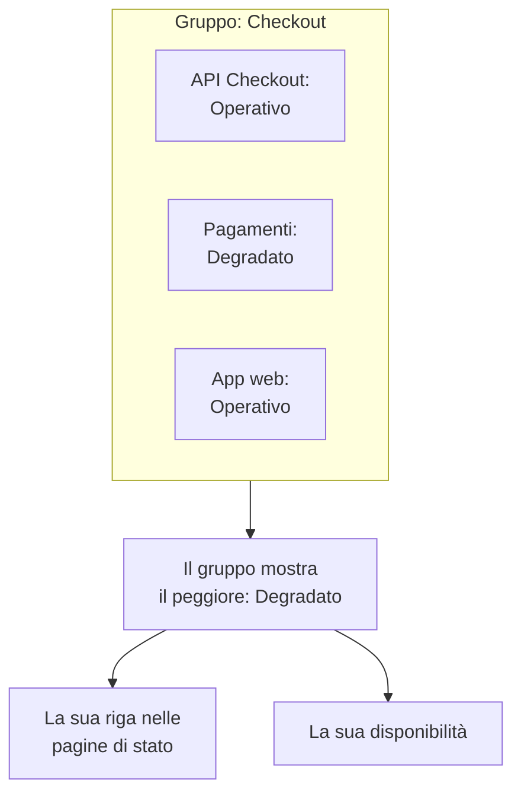

# Gruppi di monitor

Un gruppo di monitor riunisce più monitor in un unico stato. Raggruppate i monitor che insieme formano un servizio, come Checkout: la sua API, il suo servizio di pagamento e la sua app web. Il gruppo mostra lo stato peggiore tra loro, ha una propria disponibilità, e una pagina di stato può mostrare l'intero gruppo come una sola riga.

:::cards
- [Come si calcola lo stato di un gruppo](#come-si-calcola-lo-stato-di-un-gruppo): Lo stato peggiore tra i suoi monitor.
- [Attivare i gruppi di monitor](#attivare-i-gruppi-di-monitor): Un solo interruttore nelle impostazioni del progetto.
- [Creare un gruppo di monitor](#creare-un-gruppo-di-monitor): Dategli un nome, poi aggiungetegli i suoi monitor.
- [Mostrare un gruppo su una pagina di stato](#mostrare-un-gruppo-su-una-pagina-di-stato): Una riga per l'intero gruppo.
:::

## Come si calcola lo stato di un gruppo

Un gruppo parte dal vostro stato operativo e prende lo stato peggiore tra i suoi monitor: quello più in basso nell'elenco degli stati dei monitor del vostro progetto. Un monitor che passa a **Degradato** rende l'intero gruppo **Degradato**; uno che passa a **Offline** lo rende **Offline**.

- **I monitor archiviati non contano.** Un monitor archiviato non viene controllato, quindi il suo stato è congelato; il gruppo lo esclude.
- **Un gruppo vuoto è operativo.** Un gruppo senza monitor, o con soli monitor archiviati, mostra il vostro stato operativo. Finché non aggiungete un monitor, la dashboard mostra **Nessun monitor ancora** al posto del suo stato.
- **L'ordine lo decidete voi.** Quale stato sia il peggiore segue l'ordine di **Monitor → Impostazioni → Stato del monitor**. Vedere [Stati dei monitor](/docs/monitor/criteria-and-statuses#stati-dei-monitor).

Un gruppo di monitor non è un gruppo di una pagina di stato. Un gruppo di una pagina di stato è un'intestazione su una pagina di stato che contiene righe. Un gruppo di monitor è una riga che rappresenta più monitor, e qualsiasi pagina di stato può mostrarla.

## Prima di iniziare

- **Il vostro piano.** Su OneUptime Cloud, i gruppi di monitor richiedono il piano Scale.
- **L'interruttore.** I gruppi di monitor sono nascosti finché **Gruppi di monitor** non viene attivato per il progetto (vedere sotto). Attivarlo richiede il ruolo Project Owner, oppure un ruolo personalizzato con il permesso Edit Project o Manage Billing.
- **Il vostro ruolo.** Creare, modificare ed eliminare gruppi richiede il ruolo Project Owner, Project Admin, Project Member, Monitor Admin o Monitor Member, oppure un ruolo personalizzato con i permessi corrispondenti per i gruppi di monitor. Un Viewer può vedere i gruppi, ma non modificarli.

## Attivare i gruppi di monitor

:::steps
### Aprire i flag delle funzionalità

Andate in **Impostazioni del progetto → Avanzato → Flag delle funzionalità**. **Avanzato** è chiuso nel menu laterale: espandetelo prima.

### Azionare l'interruttore

Attivate l'interruttore **Gruppi di monitor**. Si salva subito: **Gruppi di monitor** compare nel menu laterale di **Monitor**, e la voce **Monitor** di ogni pagina di stato diventa **Risorse**, dove potete aggiungere un gruppo.
:::

Disattivare di nuovo l'interruttore nasconde **Gruppi di monitor** dal menu. Nessun gruppo viene eliminato.

## Creare un gruppo di monitor

:::steps
### Aprire Gruppi di monitor

Andate in **Monitor → Gruppi di monitor**. La scheda **Gruppi di monitor** elenca ogni gruppo con il suo **Stato attuale**, le sue etichette e i suoi proprietari.

### Creare il gruppo

Fate clic su **Crea: Monitor Gruppo**, inserite un **Nome** e, se volete, una **Descrizione**, poi fate clic su **Crea: Monitor Gruppo** in fondo al modulo. Il gruppo parte senza monitor.

### Aggiungere i suoi monitor

Aprite il gruppo: finché non ha un monitor, la sua **Panoramica** offre **Aggiungi monitor**. In seguito, fate clic su **Monitor** nel suo menu laterale, poi su **Aggiungi monitor**. Scegliete ogni monitor del gruppo in **Monitor** e fate clic su **Aggiungi monitor**.

### Controllarne lo stato

Fate clic su **Panoramica**. **Stato attuale** mostra lo stato attuale del gruppo, e **Grafico di uptime** mostra i suoi ultimi 90 giorni, una barra al giorno.
:::

Per togliere un monitor dal gruppo, fate clic su **Rimuovi** nella sua riga in **Monitor nel gruppo**. Il monitor stesso non cambia. Un monitor può appartenere a più di un gruppo.

## Le pagine di un gruppo

Aprite un gruppo per vederne le pagine nel menu laterale:

| Pagina | Cosa mostra |
| --- | --- |
| **Panoramica** | **Dettagli del gruppo di monitor**, **Stato attuale** e **Grafico di uptime** con la percentuale di disponibilità del gruppo negli ultimi 90 giorni. Un gruppo senza monitor offre **Aggiungi monitor** al posto del grafico. |
| **Monitor** | **Monitor nel gruppo**, con **Aggiungi monitor** e **Rimuovi**. |
| **Incidenti** | Gli incidenti su qualsiasi monitor del gruppo. |
| **Avvisi** | Gli avvisi su qualsiasi monitor del gruppo. |
| **Proprietari** | Le persone e i team responsabili del gruppo. Si trova sotto **Avanzato**, che parte chiuso. |
| **Registri di audit** | Chi ha modificato il gruppo, e quando, anche questa sotto **Avanzato**. |
| **Elimina gruppo** | Elimina il gruppo, anche questa sotto **Avanzato**. |

La disponibilità nella **Panoramica** conta come inattività ogni stato tranne quello operativo. Una pagina di stato conta solo gli stati nel proprio elenco **Conta come inattività**: vedere [Scegliere cosa mostra la pagina](/docs/status-pages/index#scegliere-che-cosa-compare-sulla-pagina).

L'elenco **Gruppi di monitor** può filtrare i gruppi per proprietario ed etichetta, impostare etichette e proprietari su molti gruppi insieme, ed esportare o importare gruppi in JSON.

## Mostrare un gruppo su una pagina di stato

:::steps
### Aprire le risorse della pagina di stato

Andate in **Pagine di stato**, aprite la pagina e fate clic su **Risorse** nel suo menu laterale.

### Passare il dialogo a un gruppo

Fate clic su **Aggiungi monitor**. Sotto il menu a discesa dei monitor, fate clic su **Add a Monitor Group instead.** Il menu a discesa diventa **Monitor Gruppo**.

### Scegliere il gruppo e aggiungerlo

Scegliete il gruppo. **Nome visualizzato**, il nome che leggono i visitatori, prende il nome del gruppo finché non ne digitate uno vostro. Fate clic su **Aggiungi monitor**: la riga compare sulla pagina con lo stato del gruppo.
:::

Sulla pagina di stato, la riga rappresenta ogni monitor del gruppo:

- **Il suo stato.** È quello del gruppo: il peggiore dei suoi monitor.
- **I suoi incidenti.** Un incidente su qualsiasi monitor del gruppo compare sulla pagina, con il gruppo tra le risorse interessate.
- **I suoi iscritti.** Un iscritto che sceglie il gruppo riceve notizie su ogni monitor che contiene. Vedere [Lasciare che gli iscritti scelgano risorse e tipi di evento](/docs/status-pages/subscribers#lasciare-che-gli-iscritti-scelgano-risorse-e-tipi-di-evento).

Per le altre opzioni della riga, come la sua disponibilità e il suo grafico storico, vedere [Risorse e gruppi della pagina di stato](/docs/status-pages/resources-and-groups).

> [!WARNING]
> Eliminare un gruppo di monitor elimina anche la sua riga da ogni pagina di stato che lo mostra. I monitor del gruppo, e i loro incidenti, non vengono eliminati.

## API e Terraform

Un gruppo è `/api/monitor-group`, e ogni monitor che contiene è una riga di `/api/monitor-group-resource` che associa un `monitorGroupId` a un `monitorId`. In Terraform sono `oneuptime_monitor_group` e `oneuptime_monitor_group_resource`: vedere [Gruppo di monitor](/docs/terraform/examples#gruppo-di-monitor).

## Risoluzione dei problemi

:::details Gruppi di monitor non è nel menu Monitor
L'interruttore **Gruppi di monitor** è disattivato. Attivatelo in **Impostazioni del progetto → Avanzato → Flag delle funzionalità**. Su OneUptime Cloud, i gruppi richiedono anche il piano Scale.
:::

:::details Il gruppo mostra Offline, ma la maggior parte dei suoi monitor funziona
È la regola: il gruppo mostra il suo monitor peggiore. Aprite **Monitor** nel gruppo per trovare il monitor fuori servizio, oppure rimuovete un monitor che non appartiene al gruppo.
:::

:::details Una pagina di stato non riesce ad aggiungere il gruppo
**Add a Monitor Group instead.** compare nel dialogo solo finché l'interruttore **Gruppi di monitor** è attivo per il progetto.
:::

## Passaggi successivi

:::cards
- [Criteri e stati dei monitor](/docs/monitor/criteria-and-statuses): Cosa imposta lo stato di ogni monitor.
- [Risorse e gruppi della pagina di stato](/docs/status-pages/resources-and-groups): Organizzare le righe di una pagina di stato.
- [Iscritti e annunci](/docs/status-pages/subscribers): Informare i clienti degli incidenti di un gruppo.
:::
