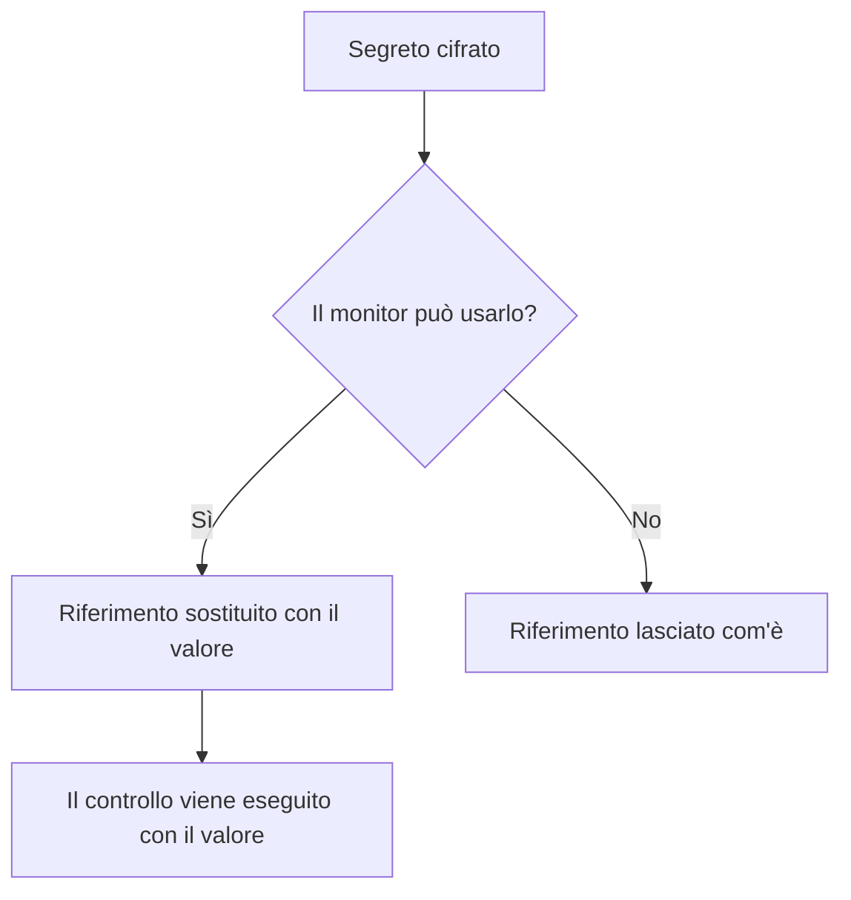

# Segreti del monitor

I segreti del monitor tengono fuori dal monitor stesso le password, le chiavi API e i token di cui hanno bisogno i vostri monitor. Salvate un valore una volta, cifrato, scegliete quali monitor possono usarlo e lo richiamate con `{{monitorSecrets.NAME}}` ovunque il monitor ne abbia bisogno.

:::cards
- [Aggiungere un segreto](#aggiungere-un-segreto): Salvare un valore e scegliere chi può usarlo.
- [Scegliere l'accesso](#scegliere-quali-monitor-possono-usare-un-segreto): Tutti i monitor, monitor specifici o monitor con etichette.
- [Usare un segreto](#usare-un-segreto): Dove funziona `{{monitorSecrets.NAME}}`.
- [Accedere con un codice monouso](#accedere-con-un-codice-monouso): Permettere a un monitor di superare l'autenticazione a due fattori di un sito.
:::

## Come i segreti arrivano a un monitor

Un segreto viene salvato cifrato e non viene più mostrato dopo il salvataggio. Prima di affidare un monitor a una sonda, OneUptime sostituisce ogni riferimento che il monitor può usare con il valore decifrato; un riferimento che il monitor non può usare resta com'è scritto. Un segreto di tipo codice monouso fa eccezione: la sonda genera il suo codice quando viene eseguito il controllo (vedete [Accedere con un codice monouso](#accedere-con-un-codice-monouso)).



La sonda che esegue il controllo riceve il valore, quindi un monitor che usa un segreto dovrebbe essere eseguito su sonde di cui vi fidate: quelle di OneUptime, o una [sonda personalizzata](/docs/probe/custom-probe) che gestite voi.

## Prima di iniziare

- **Il piano Growth o superiore**, su OneUptime Cloud. Le installazioni self-hosted non hanno piani.
- **Un ruolo che può gestire i segreti**: Proprietario del progetto, Amministratore del progetto, oppure un ruolo personalizzato con il permesso Create Monitor Secret.

## Lavorare con i segreti

### Aggiungere un segreto

:::steps
1. Andate in **Monitor → Impostazioni → Segreti** e fate clic su **Crea: Segreto del monitor**.
2. Inserite un **Nome** e il **Valore del segreto**. Il nome è ciò che richiamate, per esempio `ApiKey`. Può contenere solo lettere, numeri, trattini (`-`) e trattini bassi (`_`), e due segreti dello stesso progetto non possono condividerlo. Per la chiave di configurazione dell'autenticazione a due fattori di un sito, scegliete prima **Codice monouso (TOTP)** (vedete [Accedere con un codice monouso](#accedere-con-un-codice-monouso)).
3. Nel passaggio **Accesso**, scegliete quali monitor possono usarlo (vedete la sezione successiva), poi fate clic su **Crea: Segreto del monitor**.
:::

> [!IMPORTANT]
> I segreti vengono cifrati e salvati in modo sicuro. Il valore del segreto non viene più mostrato dopo il salvataggio — né nella tabella, né nel modulo di modifica, né tramite l'API. Se perdete il valore, dovrete recuperarlo da dove proviene e impostarlo di nuovo. Per ruotare un segreto, usate il pulsante **Aggiorna valore segreto** nella sua riga; non serve eliminarlo e ricrearlo.

### Scegliere quali monitor possono usare un segreto

Ogni segreto ha una di tre opzioni di accesso:

| Opzione | Quali monitor possono usare il segreto | Da usare per |
| --- | --- | --- |
| **Tutti i monitor** | Ogni monitor del progetto, compresi quelli che create in seguito. | Una credenziale condivisa da molti monitor. |
| **Monitor specifici** | Solo i monitor che scegliete. È l'opzione predefinita, e i segreti creati prima che esistessero queste opzioni funzionano così. | Una credenziale per uno o pochi monitor. |
| **Monitor con etichette** | I monitor che hanno almeno una delle etichette che scegliete. Aggiungere una di queste etichette a un monitor gli dà accesso, e togliere l'etichetta gli toglie l'accesso alla successiva esecuzione del monitor. | Una credenziale per un gruppo di monitor che cambia nel tempo. |

Potete cambiare l'opzione in qualsiasi momento con **Modifica** nella riga del segreto. Viene mantenuto solo l'elenco dell'opzione scelta: passare a **Tutti i monitor** svuota gli elenchi di monitor e di etichette del segreto, e passare tra **Monitor specifici** e **Monitor con etichette** svuota l'elenco che lasciate.

Un segreto non è mai disponibile per i monitor di un altro progetto.

> [!WARNING]
> Chiunque possa modificare un monitor che può usare un segreto può inviare quel segreto ovunque il monitor si colleghi. Con **Tutti i monitor**, si tratta di chiunque possa creare o modificare monitor nel progetto. Con **Monitor con etichette**, comprende anche chiunque possa aggiungere una di quelle etichette a un monitor.

Tramite l'API, l'opzione di accesso è il campo `monitorAccess`: `All Monitors`, `Specific Monitors` o `Monitors With Labels`. I campi `monitors` e `labels` contengono gli elenchi. Un segreto creato senza `monitorAccess` riceve `Specific Monitors`.

### Usare un segreto

Per usare un segreto, scrivete `{{monitorSecrets.SECRET_NAME}}` in un campo che accetta segreti. Per esempio, un'intestazione della richiesta `Authorization: Bearer {{monitorSecrets.ApiKey}}` invia il valore del segreto `ApiKey`.

Questi tipi di monitor e questi campi accettano segreti:

| Tipo di monitor | Campi |
| --- | --- |
| API | L'URL, le intestazioni e il corpo della richiesta, e il certificato client, la chiave privata e la passphrase (mTLS) |
| Sito web | L'URL, e il certificato client, la chiave privata e la passphrase (mTLS) |
| Ping, IP, Porta, NTP, Certificato SSL | L'host o l'URL da controllare |
| DNS | Il nome di dominio e il server DNS |
| DNSSEC, Dominio | Il nome di dominio |
| Query SQL | L'host, il nome del database, il nome utente, la password e la query |
| Integrità del database | L'host, il nome del database, il nome utente e la password |
| Pagina di stato esterna | L'URL della pagina di stato |
| Monitor sintetico, Codice JavaScript personalizzato | Lo script |
| Dispositivo di rete | La community string SNMP, e le chiavi di autenticazione e di privacy SNMPv3 |

I segreti vengono compilati prima che venga eseguito lo script di un monitor Monitor sintetico o Codice JavaScript personalizzato, quindi un riferimento come `{{monitorSecrets.ApiKey}}` nello script vale il valore decifrato quando viene eseguito.

Se un monitor richiama un segreto che non può usare, il riferimento resta com'è e non viene sostituito con il valore.

Quando testate un monitor prima di salvarlo, vengono compilati solo i segreti disponibili per **Tutti i monitor**, perché un nuovo monitor non è in nessun elenco e non ha ancora etichette. Dopo aver salvato il monitor, i test usano ogni segreto che il monitor può usare.

## Accedere con un codice monouso

Alcuni siti chiedono un codice da un'app di autenticazione quando accedete. Un segreto **Codice monouso (TOTP)** contiene la chiave di configurazione di quel sito, così un monitor può accedere come fate voi: ovunque il monitor usi il segreto, la sonda genera il codice attuale con il proprio orologio, nel momento in cui il controllo ne ha bisogno. La chiave di configurazione viene salvata cifrata e non viene più mostrata, come qualsiasi valore segreto, e non viene mai scritta nel monitor.

1. Attivate l'autenticazione a due fattori per l'account con cui il monitor accede. Dove il sito mostra un codice QR, chiedete invece di inserire la chiave a mano, e copiate la chiave di configurazione o il link `otpauth://`.
2. Andate in **Monitor → Impostazioni → Segreti**, fate clic su **Crea: Segreto del monitor**, scegliete **Codice monouso (TOTP)** e incollate la chiave o il link in **Chiave di configurazione**.
3. Verificate che il **Codice attuale** sotto il campo corrisponda al codice che la vostra app di autenticazione mostra ora, poi scegliete quali monitor possono usare il segreto nel passaggio **Accesso**, come per qualsiasi segreto.

| Cosa incollate | I codici che genera il monitor |
| --- | --- |
| Una chiave di configurazione, come `JBSW Y3DP EHPK 3PXP` | SHA1, 6 cifre e un nuovo codice ogni 30 secondi: ciò che presuppone ogni app di autenticazione |
| Un link `otpauth://totp/` | I parametri del link `algorithm` (`SHA1`, `SHA256` o `SHA512`), `digits` (`6` o `8`) e `period` in secondi (`30` se il link non ne ha uno) |

| Tipo di monitor | Dove va il codice, e quando viene generato |
| --- | --- |
| API | `{{monitorSecrets.NAME}}` nell'URL, in un'intestazione della richiesta o nel corpo della richiesta, subito prima dell'invio di ogni tentativo |
| Monitor sintetico, Codice JavaScript personalizzato | `{{monitorSecrets.NAME}}` nello script, all'avvio dello script, e `await oneuptime.getTotpCode("NAME")`, quando lo script lo chiede |

Ogni altro campo mantiene `{{monitorSecrets.NAME}}` così com'è scritto. In un corpo della richiesta JSON, mettete il riferimento tra virgolette, come in `{"otp": "{{monitorSecrets.LoginCode}}"}`, perché un codice può iniziare con uno zero.

Di solito un accesso arriva alla richiesta del codice qualche pagina dopo l'avvio dello script, quindi chiedete il codice in quel punto. Questo script accede con una password e un codice monouso:

```javascript
await page.goto("https://app.example.com/login");
await page.fill("#email", "monitoring@example.com");
await page.fill("#password", "{{monitorSecrets.AppPassword}}");
await page.click("button[type=submit]");

// The code is made now, when the sign-in asks for it.
await page.waitForSelector("#otp");
await page.fill("#otp", await oneuptime.getTotpCode("AppLoginCode"));
await page.click("button[type=submit]");

await page.waitForSelector(".dashboard", { timeout: 10000 });

return {
  data: { signedIn: true },
};
```

La sonda non consegna mai un codice a cui restano meno di cinque secondi, o meno di un terzo del periodo quando il periodo è più breve: attende invece il codice successivo, al massimo cinque secondi, e non conta quell'attesa nel tempo di esecuzione del controllo. Ogni codice generato da un controllo viene mostrato come asterischi, per esempio `******`, nei suoi messaggi di log, nel suo risultato, nel suo errore e nei nomi dei suoi screenshot. Uno screenshot è un'immagine della pagina, quindi scattatelo prima che il codice venga digitato o dopo che la pagina è andata avanti.

> [!NOTE]
> La sonda genera i codici, quindi aggiornate una sonda personalizzata prima di usare un segreto di tipo codice monouso: una sonda più vecchia invia `{{monitorSecrets.NAME}}` così com'è scritto. Anche l'orologio della sonda deve essere giusto, perché una sonda sfasata di un minuto genera codici che il sito ha già superato.

## Risoluzione dei problemi

:::details Il monitor invia `{{monitorSecrets.NAME}}` alla lettera
Il monitor non può usare il segreto, oppure il nome non corrisponde. Controllate l'opzione di accesso del segreto con **Modifica** nella sua riga, e che il nome nel riferimento sia esattamente il nome del segreto.
:::

:::details Testare un nuovo monitor non compila il segreto
Prima che un monitor venga salvato, vengono compilati solo i segreti disponibili per **Tutti i monitor**. Salvate il monitor, poi testatelo di nuovo.
:::

:::details Un campo ignora il segreto
Solo i campi della tabella sopra accettano segreti. In qualsiasi altro campo, `{{monitorSecrets.NAME}}` viene inviato così com'è scritto.
:::

:::details Il sito rifiuta il codice monouso
Verificate che il **Codice attuale** corrispondesse alla vostra app di autenticazione quando avete salvato il segreto, che l'orologio della sonda sia giusto e che un riferimento in un corpo della richiesta JSON sia tra virgolette. Se l'accesso impiega un po' ad arrivare alla richiesta del codice, chiedete il codice in quel punto con `oneuptime.getTotpCode`.
:::

## Passaggi successivi

:::cards
- [Monitor API](/docs/monitor/api-monitor): Inviare un segreto in un'intestazione della richiesta.
- [Monitor sintetico](/docs/monitor/synthetic-monitor): Usare un segreto in uno script del browser.
- [Monitor query SQL](/docs/monitor/sql-monitor): Tenere cifrata la password di un database.
:::
