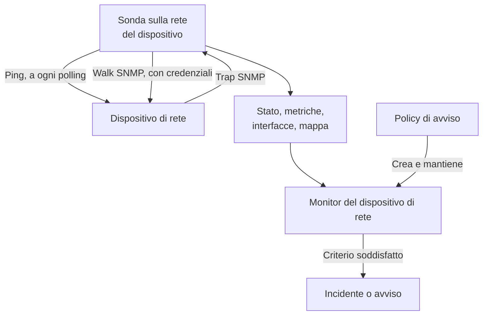
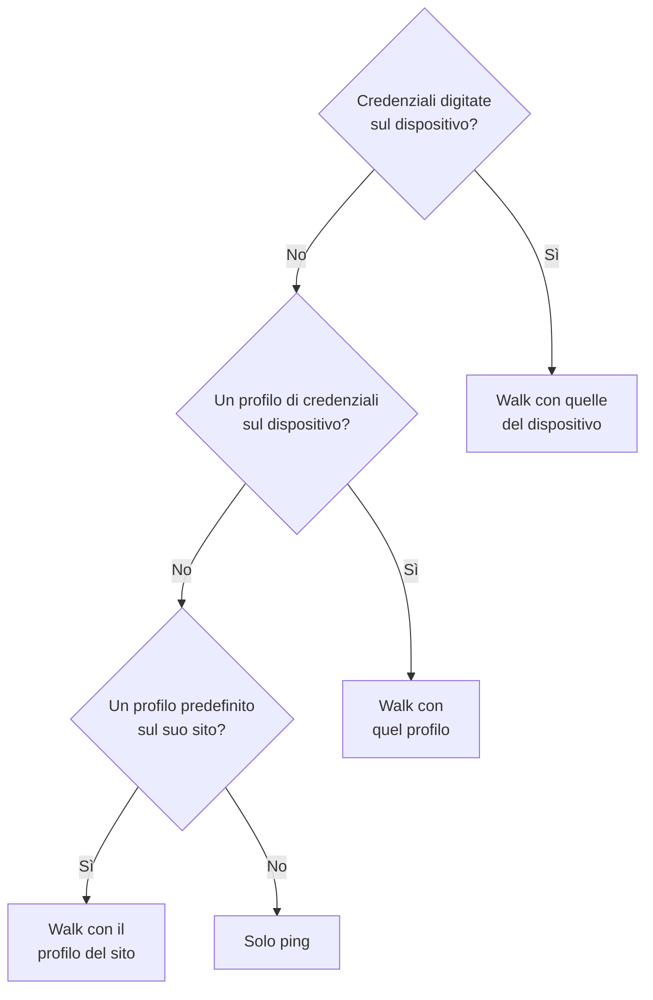
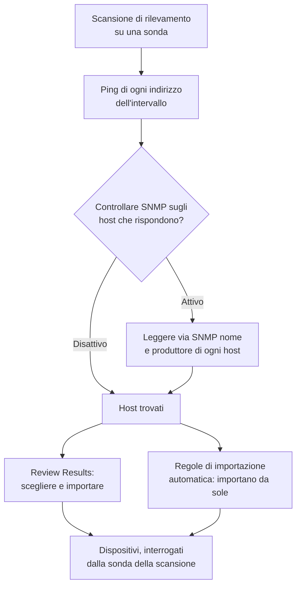
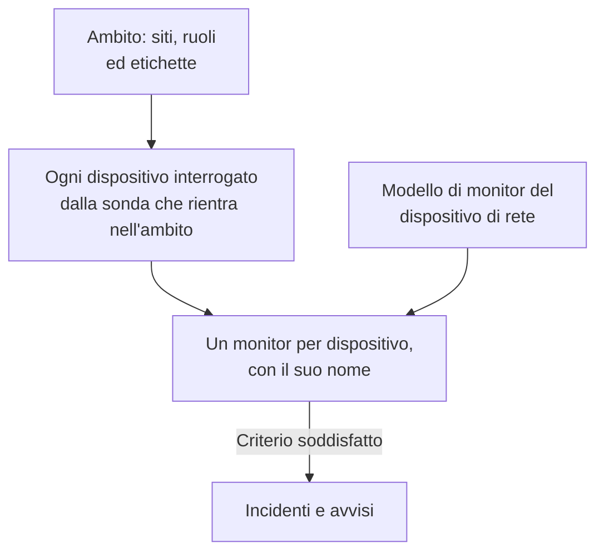
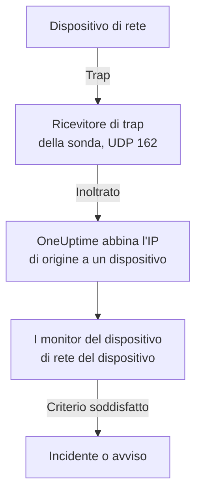

# Monitor dispositivi di rete

Monitora switch, router, firewall, access point, PDU, telecamere e stampanti: tutto ciò che ha un indirizzo sulla tua rete, che parli SNMP oppure no.

Aggiungi un dispositivo con il suo indirizzo e una sonda, e la sonda gli invia un ping a intervalli regolari: il dispositivo ottiene uno stato attivo o inattivo, un posto sulla mappa della rete e un voto nella salute del suo sito. Dagli credenziali SNMP e la stessa sonda esegue anche un walk SNMP: le interfacce e le ottiche al loro interno, l'inventario hardware, i vicini LLDP e CDP e gli OID di salute. Aggiungi un monitor, o una policy di avviso per un'intera flotta, e i suoi polling e i suoi trap aprono incidenti e avvisi.

:::cards
- [Aggiungere un dispositivo](#aggiungere-un-dispositivo-di-rete): Il suo indirizzo e una sonda, in una sola pagina.
- [Rilevare una rete](#rilevare-i-dispositivi-con-una-scansione-di-rete): Scansiona un intervallo di indirizzi e importa ciò che risponde.
- [Leggere i dispositivi via SNMP](#credenziali-snmp-e-profili-di-credenziali): Interfacce, ottiche, inventario e salute.
- [Ricevere avvisi](#avvisi): Un monitor per un dispositivo, una policy per una flotta.
- [Vedere la mappa](#topologia-della-rete): Vicini disegnati in tempo reale, esportati in PDF.
- [Risolvere un problema](#risoluzione-dei-problemi): Dispositivi in sospeso, walk che falliscono, trap che non arrivano.
:::

## Come funziona



Il dispositivo e il monitor svolgono compiti diversi:

| Parte | Cosa fa | Quando ti serve |
| --- | --- | --- |
| Il dispositivo | La sua sonda lo interroga secondo la pianificazione del dispositivo stesso. Ogni polling registra la raggiungibilità, il tempo di andata e ritorno del ping e la perdita di pacchetti; un polling con credenziali SNMP legge anche l'identità, le interfacce, i vicini e gli OID di salute del dispositivo. | Sempre: il dispositivo è ciò che aggiungi. |
| Un monitor | Valuta i criteri su ogni risultato di polling e su ogni trap del dispositivo, e apre incidenti e avvisi. | Solo per incidenti e avvisi. Stato, inventario, grafici e mappa non hanno bisogno di un monitor. |

## Prima di iniziare

- **Una sonda in grado di raggiungere il dispositivo.** La sonda invia il ping e il walk al dispositivo dalla propria rete, quindi un dispositivo con un indirizzo privato richiede una [sonda personalizzata](/docs/probe/custom-probe) all'interno di quella rete: una sonda su internet pubblico non può raggiungerlo.
- **SNMP, per avere più del ping.** Facoltativo. Una community string v1 o v2c, o un utente SNMPv3, configurati sul dispositivo, con UDP 161 aperto dalla sonda. Senza, il dispositivo riceve solo il ping.
- **Trap, syslog e flussi.** Facoltativo. La sonda riceve i trap SNMP su UDP 162, il syslog su UDP 5140 una volta attivato e i record di flusso su UDP 2055, 4739 e 6343: apri queste porte dai tuoi dispositivi verso la sonda.

## La panoramica della rete

**Rete → Panoramica** è il punto in cui si apre l'area Rete, e comincia dalla risposta: una frase che dice se la tua rete è in salute e, quando non lo è, cosa non va, partendo dalla notizia peggiore.

| Cosa dice | Quando |
| --- | --- |
| **3 dispositivi non sono attivi** | La sonda o il monitor di un dispositivo non riesce a raggiungerlo. |
| **2 siti richiedono attenzione** | Ogni dispositivo risponde, ma la salute di un sito non è operativa. |
| **5 interfacce non sono attive** | Ogni dispositivo risponde, ma alcune porte sono spente. |
| **2 dispositivi non riportano i loro dettagli** | Rispondono al ping, ma il loro walk SNMP fallisce, quindi interfacce e salute non vengono aggiornate: di solito sono le credenziali. |
| **In attesa del primo controllo** | Sono stati aggiunti dispositivi e la loro sonda non li ha ancora controllati. |
| **Tutti i 40 dispositivi sono attivi** | Ogni dispositivo risponde. I dispositivi ancora in attesa del primo controllo sono contati su una riga a parte. |

Sotto, una riga dice se qualcosa apre un incidente quando un dispositivo diventa inattivo: quante [policy di avviso](#policy-di-avviso) sono attive, oppure un link **Set up alerts** quando non ce n'è nessuna. I pulsanti **Add Device** e **Discover Devices** accanto aprono quei moduli, e i riquadri e gli elenchi più in basso riportano il dettaglio: i dispositivi e i siti che richiedono attenzione, la flotta per produttore e le scansioni recenti.

Finché non è stato aggiunto nulla, la panoramica mostra invece i due modi per iniziare: **Rileva dispositivi** scansiona un intervallo di indirizzi perché tu scelga cosa aggiungere, ideale per un'intera rete o un nuovo sito, e **Aggiungi un singolo dispositivo** ne aggiunge uno tramite il suo indirizzo IP o hostname.

Il menu Rete tiene in vista ciò che apri ogni giorno: **Panoramica**, **Devices**, **Siti**, **Map**, **Traffic** e **Discovery**. Il resto è raccolto in sezioni, e una sezione si apre da sola su una qualsiasi delle sue pagine:

| Sezione | Pagine |
| --- | --- |
| **Topologia** | **Device Topology**, **Endpoint**, **Latency Matrix**, **Site Links**, **Device Links** |
| **Regole** | **Auto Import Rules**, **Site Assignment Rules**, **Regole del proprietario**, **Regole etichette**, **Link Rules** |
| **Impostazioni** | **Alert Policies**, **Credenziali SNMP**, **Device Roles**, **Site Types**, **OID Collection Templates** |
| **Avanzato** | **Archived Devices** |

## Aggiungere un dispositivo di rete

:::steps
### Aprire l'elenco dei dispositivi
Vai su **Rete → Devices** e fai clic su **Add Device**. **Add Device** nella **Panoramica** di Rete apre lo stesso modulo.

### Digitare l'indirizzo del dispositivo
In **Hostname**, digita il suo indirizzo IP o hostname. Lascia vuoto **Nome** per dare al dispositivo il nome del suo hostname.

### Controllare il sito e la sonda
Scegli il **Site** in cui si trova il dispositivo, se usi i siti. **Sonda** si compila da sola con la sonda predefinita del sito, o con l'unica sonda personalizzata del progetto; assicurati che sia una sonda in grado di raggiungere il dispositivo.

### Aggiungere il dispositivo
Fai clic su **Add Device**. Entro un paio di minuti la sonda invia un ping al dispositivo e il suo stato diventa **Up** o **Down**. Con le credenziali SNMP, anche la sua panoramica si riempie con l'identità, le interfacce e la salute del dispositivo dopo il primo walk riuscito.
:::

Il modulo è una sola pagina — l'hostname, un nome, il sito e la sonda — con **SNMP** e **Altri campi** chiusi sotto. Non chiede nulla su come viene monitorato il dispositivo: ogni dispositivo che aggiungi è interrogato dalla sua sonda, e l'[override con monitor associato](#loverride-con-monitor-associato) si trova nella pagina **Impostazioni** del dispositivo per i pochi dispositivi che ne hanno bisogno.

I dettagli di un dispositivo — nome, descrizione, ruolo, sito, etichette e indirizzi — si modificano poi in un unico punto: la scheda **Device Settings** nella sua pagina **Impostazioni**. La scheda **Dettagli del dispositivo** nella sua panoramica li mostra, con un link **Modifica nelle impostazioni**.

### Il dispositivo

| Campo | Descrizione | Obbligatorio |
| --- | --- | --- |
| Hostname | L'indirizzo IP o l'hostname a cui la sonda invia il ping, e su cui esegue il walk SNMP quando il dispositivo ha le credenziali. | Sì |
| Nome | Un nome descrittivo, come core-switch-01. Lascialo vuoto e il dispositivo prende il nome del suo hostname. L'API fa lo stesso: un dispositivo creato senza nome prende il nome del suo hostname. | No |
| Site | Il [sito di rete](/docs/monitor/network-sites) in cui si trova il dispositivo. La salute del sito si ricava dai suoi dispositivi, e un sito con una sonda predefinita compila la sonda qui sotto. | No |
| Sonda | La sonda che invia il ping a questo dispositivo, esegue il walk SNMP quando ha le credenziali e riceve i suoi trap, il suo syslog e i suoi [record di flusso](/docs/monitor/network-traffic). Deve raggiungere il dispositivo direttamente: una sonda su internet pubblico non può raggiungere un indirizzo privato. | Sì |

**Sonda** si compila da sola quando può: un progetto con esattamente una sonda personalizzata parte da quella, e la scelta di un sito la sostituisce con la [sonda predefinita del sito](/docs/monitor/network-sites#valori-predefiniti-di-monitoraggio). Non sovrascrive mai una sonda che hai scelto tu. Imposta una sonda predefinita sui tuoi siti e potrai aggiungere un dispositivo con il solo indirizzo.

### Altri campi (chiusi)

| Campo | Descrizione | Obbligatorio |
| --- | --- | --- |
| Descrizione | Testo libero. | No |
| Device Role | Switch di core, switch di accesso, firewall e così via. Stabilisce il livello del dispositivo sulla mappa e delimita le policy di avviso. | No |
| Indirizzo MAC | Il MAC del dispositivo stesso. La mappa lo usa per collocare un dispositivo che non parla né LLDP né CDP sulla porta dello switch che lo ha appreso; vedi [Dispositivi solo ping e la loro porta dello switch](#dispositivi-solo-ping-e-la-loro-porta-dello-switch). Di solito viene appreso per te dalla tabella ARP di un router. | No |
| Crea anche un monitor Ping per gli incidenti | La sonda invia già il ping al dispositivo e gli assegna uno stato; un monitor Ping è ciò che trasforma i ping falliti in un incidente. Selezionalo e al salvataggio ne viene creato uno sull'hostname, associato al dispositivo. Conta per il tuo piano, e i suoi incidenti restano disattivati finché non li attivi dalla pagina del monitor. | No |

Selezionare la casella del monitor Ping mostra **Ping from probes**, le sonde proprie del monitor. Devono raggiungere la rete del dispositivo; lascia il campo vuoto per usare le sonde predefinite del progetto. Per ricevere avvisi su molti dispositivi insieme, usa invece le [policy di avviso](#policy-di-avviso).

### SNMP (chiuso, facoltativo)

Lascialo chiuso e il dispositivo riceve solo il ping: la sezione chiusa lo dice in una frase. Il dispositivo ottiene comunque uno stato dal suo primo polling e resta nel suo sito e sulla mappa, ma non ha interfacce, inventario né OID di salute finché non ha le credenziali. Apri la sezione per digitare una community string o un utente v3, o per scegliere un profilo di credenziali salvato.

:::tabs
@tab SNMP v1 / v2c
| Campo | Descrizione | Obbligatorio |
| --- | --- | --- |
| Versione SNMP | V1, V2c o V3. | Sì, parte da V2c |
| SNMP Community String | La community string v1 o v2c, come `public`. | No: vuota significa solo ping |
| SNMP Port | La porta UDP su cui è in ascolto l'agente. | No, 161 per impostazione predefinita |
| SNMP Credential Profile | Un insieme di credenziali salvato da usare invece di digitare qui le credenziali. | No |
@tab SNMPv3
| Campo | Descrizione | Obbligatorio |
| --- | --- | --- |
| SNMP v3 Security Level | No Auth, No Priv; Auth, No Priv; oppure Auth, Priv. | Sì |
| SNMP v3 Username | Il nome di sicurezza (utente) configurato sul dispositivo. | Sì: vuoto significa solo ping |
| SNMP v3 Authentication Protocol | MD5, SHA, SHA-256 o SHA-512. | Con autenticazione |
| SNMP v3 Authentication Key | La passphrase di autenticazione. | Con autenticazione |
| SNMP v3 Privacy Protocol | DES, AES o AES-256. | Con privacy |
| SNMP v3 Privacy Key | La passphrase di privacy (cifratura). | Con privacy |
:::

Le credenziali digitate sul dispositivo prevalgono su un profilo di credenziali scelto accanto a esse, e anche il sito del dispositivo può avere un profilo predefinito. Le credenziali di un profilo sono cifrate a riposo. Le credenziali digitate su un dispositivo sono protette dagli stessi permessi di lettura ma non sono cifrate a riposo: un motivo in più per tenere le credenziali condivise in un profilo.

## Modificare molti dispositivi insieme

Una scansione di rilevamento della rete di un cliente porta dentro decine di dispositivi che appartengono a un solo sito, condividono un ruolo e provengono da un solo produttore. Non li apri uno a uno: selezionali nell'elenco **Devices**, spuntando le righe o selezionando tutti i dispositivi che corrispondono ai filtri, e apri **Azioni di massa**.

| Azione | Cosa fa |
| --- | --- |
| **Imposta sito** / **Rimuovi dal sito** | Sposta ogni dispositivo selezionato nel sito che scegli, dove conta per la salute del sito; un dispositivo senza una sonda propria prende la sonda predefinita del sito. **Rimuovi dal sito** li toglie dai loro siti. Un dispositivo che corrisponde a una regola di assegnazione dei siti torna nel sito della regola al polling successivo, quindi per i dispositivi che il rilevamento continua a trovare aggiungi piuttosto una regola in **Rete → Regole → Site Assignment Rules**; la finestra **Imposta sito** rimanda lì. |
| **Imposta ruolo del dispositivo** / **Rimuovi ruolo del dispositivo** | Assegna lo stesso ruolo a ogni dispositivo selezionato, come i venti switch che sono tutti «Access Switch». I ruoli sono quelli del progetto, in **Rete → Impostazioni → Device Roles**, a cui rimanda la finestra. **Rimuovi ruolo del dispositivo** ricava di nuovo il ruolo di ogni dispositivo dalla sua identità SNMP. |
| **Applica modello del produttore** | Aggiunge gli OID di salute e le tabelle SNMP di un [modello del produttore](#modelli-di-salute-dei-produttori) a ogni dispositivo selezionato. **In base al produttore di ogni dispositivo**, la prima scelta della finestra, sceglie il modello di ciascun dispositivo da ciò che riporta il suo walk SNMP, così una selezione mista riceve ovunque quello giusto; oppure scegli un solo modello per tutti. |

Ogni azione è una finestra e un salvataggio per l'intera selezione, e ogni dispositivo passa per gli stessi controlli di una modifica nella sua pagina Impostazioni: i permessi, l'ambito di etichette e proprietari del tuo ruolo e i limiti su ciò che un dispositivo può raccogliere.

**Applica modello del produttore** mostra cosa farà prima di fare qualsiasi cosa: quanti dispositivi ricevono quale modello, e quanti ne lascia invariati e perché. Aggiunge a ciò che ogni dispositivo già raccoglie e non rimuove nulla, e un dispositivo che ha già tutto il contenuto del modello non viene riscritto. Lascia invariati un dispositivo basato su un monitor (nulla lo interroga), un dispositivo collegato a un [OID Collection Template](#oid-collection-templates) (è il modello a decidere cosa raccoglie, quindi aggiungi lì gli OID del produttore) e, nell'abbinamento, un dispositivo non ancora sottoposto a walk SNMP o il cui produttore non ha un modello.

Al termine, un'azione elenca quanti dispositivi sono cambiati, quali hanno fallito e perché — un dispositivo che il tuo ruolo non può modificare, un elenco oltre il suo limite — e quali non ha cambiato e perché: un dispositivo che era già in quel sito o in quel ruolo, o uno che il modello del produttore lascia invariato.

Le altre azioni di massa sono descritte dove servono: **Set OID Collection Template** in [OID Collection Templates](#oid-collection-templates), **Set SNMP Credential Profile**, **Switch to Probe Polling** e **Create Ping Monitors** in [In blocco](#in-blocco), e **Shorten Names to Hostname** in [Come vengono chiamati i dispositivi rilevati](#come-vengono-chiamati-i-dispositivi-rilevati).

## Cosa fa davvero un polling

Ogni polling di un dispositivo interrogato dalla sonda è un ping. Quando il dispositivo ha credenziali SNMP utilizzabili, la sonda esegue anche un walk SNMP completo. I due procedono in parallelo e il walk non aspetta mai il ping, quindi un apparato SNMP dietro un'ACL che scarta l'ICMP risulta comunque **Up**.

| Risultato | Dispositivo solo ping | Dispositivo con credenziali SNMP |
| --- | --- | --- |
| Stato (Up o Down) | Dal ping | Dal ping o dal walk: basta che uno dei due risponda |
| Tempo di andata e ritorno del ping e perdita di pacchetti | Registrati come metriche del dispositivo | Registrati come metriche del dispositivo |
| Tempo di risposta SNMP | — | La durata del walk, mai quella del ping |
| Interfacce, vicini, endpoint | — | Da un walk riuscito |
| Identità di sistema, produttore, modello, numero di serie | — | Da un walk riuscito |
| OID di salute e tabelle SNMP | — | Da un walk riuscito |

Le credenziali utilizzabili sono un insieme v1 o v2c con una community string, o un insieme v3 con un nome utente, trovati tramite la [catena delle credenziali](#credenziali-snmp-e-profili-di-credenziali). Un insieme vuoto viene saltato, quindi un dispositivo non viene mai sottoposto a walk con una community predefinita tirata a indovinare.

La perdita di pacchetti riusa la serie del [monitor Ping](/docs/monitor/ping-monitor), quindi si legge allo stesso modo in tutto il prodotto. Il tempo di andata e ritorno ha una serie propria, `oneuptime.monitor.ping.round.trip.time`, perché su un dispositivo di rete il semplice tempo di risposta è quello del walk SNMP. La pagina **Metriche** del dispositivo traccia l'utilizzo delle interfacce e gli OID di salute; il tempo di andata e ritorno dell'ultima ora è disegnato nel pannello del dispositivo sulla mappa.

### «SNMP failing» non significa «Down»

Un dispositivo che risponde al ping ma il cui walk fallisce è **Up**, contrassegnato da **SNMP failing**, ed entrambe le metà contano:

- È attivo perché qualcosa risponde a quell'indirizzo. Colorarlo di rosso metterebbe nel conteggio degli incidenti un dispositivo che funziona benissimo.
- È SNMP failing perché le sue interfacce, il suo inventario e i suoi OID di salute hanno smesso di aggiornarsi, quasi sempre per le credenziali, un agente SNMP disattivato o un'ACL. Nient'altro nella pagina ti direbbe che i numeri sono congelati.

Un dispositivo il cui ping e il cui walk falliscono entrambi è semplicemente **Down**, quindi il contrassegno compare sempre e solo accanto a uno stato verde.

### Leggere lo stato di un dispositivo

Ogni punto che mostra un dispositivo — l'elenco Devices, la pagina Devices di un sito, la panoramica, la mappa — usa gli stessi tre verdetti e gli stessi qualificatori accanto.

| Verdetto | Significa |
| --- | --- |
| **Up** | L'ultimo polling (ping o SNMP), o il monitor associato, ha raggiunto il dispositivo. |
| **Down** | L'ultimo polling (ping o SNMP), o il monitor associato, non ha potuto raggiungere il dispositivo. |
| **In sospeso** | Ancora nessun verdetto: mai interrogato, nessuna sonda assegnata o nessun monitor associato. |

| Qualificatore | Compare quando | Cosa fare |
| --- | --- | --- |
| **Stale** | Nessun polling è stato tentato da ben più dell'intervallo del dispositivo. | Controlla che la sonda del dispositivo sia online e stia al passo con la sua flotta. |
| **No probe** | Il dispositivo è interrogato dalla sonda ma non ne ha una, o il suo polling è disattivato. | Assegna una sonda in grado di raggiungerlo; fino ad allora nulla lo interroga. |
| **No monitor** | Il dispositivo usa l'[override con monitor associato](#loverride-con-monitor-associato) e nulla è associato. | Associa un monitor, o riportalo al polling tramite sonda. |
| **SNMP failing** | Attivo al ping, ma l'ultimo walk SNMP è fallito. | Controlla le credenziali, l'agente SNMP o un'ACL. |

L'elenco **Devices** ha un filtro **SNMP** con tre valori: **OK** (l'ultimo walk è riuscito), **Failing** (l'ultimo walk è fallito) e **Not configured** (solo ping, senza credenziali o mai interrogato). «Quali dispositivi hanno credenziali che hanno smesso di funzionare» è a un clic di distanza. La colonna **Interfaces (Up / Down)** dell'elenco riporta **No SNMP** invece di `0 / 0` per un dispositivo che riceve il ping e non viene mai sottoposto a walk: zero porte funzionanti sarebbe un'affermazione diversa, e sbagliata.

## Credenziali SNMP e profili di credenziali

Un dispositivo viene sottoposto a walk con il primo insieme di credenziali utilizzabile trovato in questo ordine, e la ricerca si ferma al primo trovato:



Il passaggio del sito legge il sito del dispositivo e nient'altro: un dispositivo in un'unità non prende un profilo impostato sulla regione sopra di essa. La sonda predefinita di un sito invece scende lungo l'albero, perché una sonda viene copiata una volta sul dispositivo mentre le credenziali vengono rilette a ogni polling; [Siti di rete](/docs/monitor/network-sites#valori-predefiniti-di-monitoraggio) contiene i dettagli.

### La pagina Credenziali SNMP

**Rete → Impostazioni → Credenziali SNMP** contiene i profili di credenziali del progetto. Un profilo è un insieme con un nome — una community string v1 o v2c, o un utente v3 con il suo livello di sicurezza, i suoi protocolli e le sue chiavi — a cui puntano quanti dispositivi e siti vuoi. Nulla viene copiato sui dispositivi, quindi ruotare una community string è una sola modifica qui, e ogni dispositivo che usa il profilo prende il nuovo valore al polling successivo.

I segreti di un profilo sono cifrati a riposo, e solo i ruoli che possono leggere le credenziali proprie di un dispositivo possono leggerli. Un dispositivo o un sito che mostra il suo profilo ne mostra il nome e la versione, mai i segreti.

Un profilo a cui punta ancora un dispositivo o un sito non può essere eliminato: l'eliminazione viene rifiutata con il conteggio di ciò che la blocca. Sposta quei dispositivi e siti su un altro profilo, o rimuovi il profilo da essi, poi eliminalo.

### Riportare un dispositivo a solo ping

Nella pagina **Impostazioni** del dispositivo, **Modifica impostazioni** ha una casella **Ping only — clear this device's own SNMP credentials** nel suo passaggio **Credenziali SNMP**. Al salvataggio cancella la community string e il nome utente v3 propri del dispositivo. Esiste perché svuotare il campo giusto non è ovvio: un dispositivo v3 resta interrogabile con il walk finché esiste il suo nome utente, qualunque altra cosa tu svuoti.

Cancellare le credenziali proprie del dispositivo non cancella un profilo. Se il dispositivo o il suo sito ne indicano ancora uno, il dispositivo continua a essere sottoposto a walk con quello; rimuovi anche il profilo perché il dispositivo riceva solo il ping.

### In blocco

Seleziona i dispositivi nell'elenco **Devices** e usa:

- **Set SNMP Credential Profile** / **Clear SNMP Credential Profile**: assegna un profilo a una selezione, o toglilo.
- **Switch to Probe Polling**: per i dispositivi con l'override con monitor associato. Scegli una sonda, e da quel momento ogni dispositivo selezionato riceve il ping secondo la sua pianificazione, e il walk quando ha le credenziali. Un monitor già associato resta associato; lo stato del dispositivo ora viene dalla sonda.
- **Create Ping Monitors**: per i dispositivi con l'override con monitor associato, crea un monitor Ping sull'hostname di ogni dispositivo e lo associa, così il dispositivo risulta Up o Down.

La pagina **Devices** mostra un banner quando il progetto contiene dispositivi con l'override con monitor associato senza nulla di associato — dispositivi che nulla interroga e su cui nulla riferisce — e rimanda alla selezione che li sistema.

## Impostazioni predefinite di monitoraggio del sito

Un [sito di rete](/docs/monitor/network-sites#valori-predefiniti-di-monitoraggio) porta due impostazioni predefinite per i suoi dispositivi. La sua **Default Probe** viene copiata su un dispositivo creato nel sito, o spostato al suo interno, senza una sonda propria. Il suo **Default SNMP Credential Profile** viene letto a ogni polling di un dispositivo del sito che non ha credenziali proprie. Imposta entrambi su un sito e un dispositivo può esservi aggiunto con il solo indirizzo, ricevendo ping e walk fin dal primo polling. La guida ai siti spiega fin dove scende ciascuna impostazione predefinita lungo l'albero dei siti.

## L'override con monitor associato

Alcuni apparati nessuna sonda può raggiungerli o interrogarli utilmente con il ping: un dispositivo dietro un NAT, un'appliance la cui salute si giudica meglio con un controllo HTTP, un servizio il cui segnale reale è un controllo di porta. Per questi, **Modifica impostazioni** nella pagina **Impostazioni** del dispositivo ha un **Monitoring Method**:

| Metodo | Cosa significa |
| --- | --- |
| **Sonda** | Il predefinito. Riceve il ping dalla sonda assegnata secondo la sua pianificazione, e il walk SNMP quando ha le credenziali. |
| **Bound monitor** | Lo stato di un monitor esistente è lo stato di questo dispositivo. |

Passare un dispositivo a **Bound monitor** ne interrompe il polling. La sonda, l'intervallo e l'interruttore del polling lasciano la scheda **Polling & Data Collection**, i vecchi risultati di polling del dispositivo vengono cancellati e il suo stato viene dal monitor che associ. Associarne uno è facoltativo: finché non lo fai, il dispositivo risulta **In sospeso**, contrassegnato da **No monitor**.

Tornare a **Sonda** ripristina il polling e chiede una sonda. Un monitor che era associato resta associato e continua a inviare avvisi; semplicemente non decide più lo stato del dispositivo.

Alla maggior parte dei dispositivi questo non serve. Ogni dispositivo interrogato dalla sonda ha già uno stato di raggiungibilità, quindi non c'è bisogno di associare un monitor Ping per ottenerlo; associa un monitor quando vuoi gli incidenti di quel monitor.

## Polling e raccolta dei dati

Il polling si trova nella pagina **Impostazioni** del dispositivo, nella scheda **Polling & Data Collection** (**Modifica: Polling**). I valori predefiniti vanno bene per un dispositivo nuovo, che non richiede regolazioni:

| Impostazione | Descrizione | Predefinito |
| --- | --- | --- |
| Sonda | La sonda che interroga il dispositivo. | Impostata quando il dispositivo viene aggiunto |
| Polling Enabled | La sonda interroga il dispositivo secondo la pianificazione qui sotto. Disattivalo per sospendere il polling senza eliminare il dispositivo. | Attivo |
| Polling Interval (Minutes) | Ogni quanto la sonda interroga il dispositivo. Almeno 1 minuto. | 5 |
| Walk Interfaces | Esegue il walk delle tabelle delle interfacce (IF-MIB) a ogni polling: stato, banda, utilizzo ed errori di ogni porta, più i vicini LLDP e CDP per la mappa. | Attivo |
| Collect Connected Endpoints | Esegue anche il walk delle tabelle ARP e di inoltro del bridge per trovare ciò che è collegato al dispositivo: terminali POS, stampanti, telefoni, portatili. Da una tabella ARP compila anche l'indirizzo MAC dei dispositivi registrati a quegli indirizzi. Costa walk aggiuntivi a ogni polling. | Disattivo |
| OID Collection Template | Un elenco di OID condiviso e con un nome che il dispositivo raccoglie. Modificare il modello cambia ogni dispositivo collegato al suo polling successivo. | Nessuno |
| Device-Specific Health OIDs | OID aggiuntivi che solo questo dispositivo raccoglie, oltre a quelli del suo modello. | Nessuno |
| Auto-Apply Vendor Health Template | Quando il produttore del dispositivo viene riconosciuto e il suo elenco di OID è vuoto, riempie l'elenco con il modello del produttore al polling successivo. | Disattivo; attivo per i dispositivi importati dal rilevamento |
| Device-Specific SNMP Tables | [Tabelle SNMP](#tabelle-snmp) aggiuntive su cui solo questo dispositivo esegue il walk, oltre a quelle del suo modello. Una tabella con la stessa chiave di una tabella del modello la sostituisce su questo dispositivo. | Nessuna |

Tutto ciò che va da **Walk Interfaces** in giù richiede credenziali SNMP: su un dispositivo solo ping queste impostazioni vengono conservate e non hanno alcun walk a cui applicarsi.

### Walk delle interfacce

Con **Walk Interfaces** attivo e credenziali trovate, ogni polling segue per ogni interfaccia lo stato operativo e amministrativo, i bit in entrata e in uscita, l'utilizzo e gli errori. Lo stesso walk raccoglie i vicini LLDP e CDP per la mappa.

Silenzia un'interfaccia nella pagina **Interfaces** del dispositivo, per una porta di laboratorio o un collegamento scollegato di proposito, e resta nell'inventario ma esce dagli avvisi e dalle metriche. Un walk fallito non cancella mai a metà ciò che è stato raccolto: l'ultima istantanea delle interfacce resta, e il dispositivo viene contrassegnato da **SNMP failing** perché nessuno la scambi per una attuale.

### Modelli di salute dei produttori

Nell'editor **Health OIDs**, **Vendor Health Template** applica un insieme di OID predefinito per il produttore del dispositivo. Molti modelli includono anche [tabelle SNMP](#tabelle-snmp), aggiunte con **Add a Vendor's Tables** nell'editor **SNMP Tables**.

| Modello del produttore | OID di salute | Tabelle SNMP |
| --- | --- | --- |
| Generic (Host Resources MIB) | Carico della CPU, RAM totale e disponibile, carico medio | Core della CPU (una riga per core, comunque la piattaforma li numeri) |
| Arista EOS | Carico della CPU, carico medio, RAM totale e disponibile | — |
| Cambium Networks cnMatrix | CPU, RAM, flash, temperatura, tensione di alimentazione | Ventole, porte PoE, alimentatore ridondante |
| Cambium Networks Enterprise Wi-Fi (cnPilot, XV, XE, XH) | CPU, memoria libera, client Wi-Fi, connessione a cnMaestro | Radio Wi-Fi (banda, canale, ampiezza, potenza di trasmissione, client, rumore di fondo, airtime, stato), SSID |
| Cisco IOS / IOS-XE | CPU, memoria usata e libera, temperatura, stato delle ventole, stato degli alimentatori | — |
| Dell Force10 / OS9 | CPU, memoria | — |
| Extreme Networks EXOS / Switch Engine | CPU, temperatura, allarme di sovratemperatura, stato dell'alimentazione | Alimentatori, ventole, memoria per slot, membri dello stack |
| Extreme Networks Fabric Engine / VOSS | Sessione vIST, numero di I-SID | Adiacenze del fabric (IS-IS) chiamate con il nome del vicino, CPU e memoria per slot, sensori di temperatura, ventole, alimentatori |
| Extreme Networks IQ Engine (HiveOS) Access Points | CPU, memoria, client Wi-Fi, temperatura | Radio Wi-Fi (canale, potenza di trasmissione, rumore di fondo), SSID |
| Extreme Networks Wireless Controller (XIQ-C, ExtremeWireless) | Access point, access point attivi, client Wi-Fi | Access point (stato, client, indirizzo, software), radio Wi-Fi (banda, canale, ampiezza, rumore di fondo, airtime occupato), WLAN (SSID, client) |
| Fortinet FortiGate | CPU, memoria, disco | — |
| HPE / Aruba ProCurve | CPU, memoria totale e libera | — |
| HPE Aruba Instant (AOS 8) | Nome del cluster, versione del firmware, conductor | Access point (stato, modello, CPU, memoria), radio Wi-Fi chiamate con il nome dell'access point (canale, potenza di trasmissione, rumore di fondo, utilizzo, client, stato), SSID (client) |
| HPE Aruba Mobility Controller (AOS 8) | Access point, client Wi-Fi, ruolo del controller | Access point (stato, modello, gruppo AP), radio Wi-Fi chiamate con il nome dell'access point (banda, canale, potenza di trasmissione, utilizzo, client, modalità), SSID (client, access point attivi e inattivi), processori, memoria |
| Huawei VRP | CPU, memoria, temperatura | — |
| Juniper Junos | CPU, buffer di memoria, temperatura | — |
| MikroTik RouterOS | Carico della CPU, temperatura, tensione | — |
| Palo Alto PAN-OS | CPU di gestione, utilizzo delle sessioni, sessioni attive | — |
| Sophos Firewall (SFOS / XGS) | Memoria, disco, swap, stato HA e stato del peer, servizio IPsec, temperatura della CPU (SFOS v22 e successivi) | Tunnel IPsec (lo stato richiede SFOS v20 e successivi), core della CPU |
| TP-Link Omada Access Points (EAP) | Client Wi-Fi | — |
| Ubiquiti EdgeOS / EdgeSwitch / UniFi Switches | Carico della CPU, RAM totale e disponibile | — |
| Ubiquiti UniFi Access Points | Stato di isolamento, carico medio, RAM totale e disponibile | Radio Wi-Fi (banda, airtime), SSID (banda, canale, client, potenza di trasmissione, qualità della connessione), core della CPU |

Gli OID del modello vengono copiati nell'elenco proprio del dispositivo, dove puoi sfoltirli o ampliarli. Dopo che il primo walk ha identificato il produttore, la pagina del dispositivo suggerisce il modello corrispondente. L'abbinamento legge il `sysObjectID` del dispositivo, e il suo `sysDescr` quando uno stesso numero enterprise ospita due sistemi operativi: Extreme Fabric Engine su hardware universale riporta lo stesso numero enterprise (1916) di EXOS, e solo la sua descrizione (`…-FabricEngine (9.0.4.0)`) li distingue. Gli access point UniFi si distinguono allo stesso modo dai router Ubiquiti (`U6-Pro 6.6.50.15098`), anche quando un firmware più vecchio risponde con il ramo di Net-SNMP, e gli access point IQ Engine dagli switch Aerohive che ne condividono il ramo (`AP230, HiveOS 8.2r1`).

I dispositivi con **Auto-Apply Vendor Health Template** attivo ricevono gli OID e le tabelle del modello al loro primo polling: i dispositivi portati dentro da una regola di importazione automatica, e quelli importati da **Review Results** con l'interruttore del modello del produttore attivo, come è a meno che tu non lo disattivi. Per dare a molti dispositivi il loro modello in una volta, come una flotta rilevata prima che esistesse l'interruttore, selezionali nell'elenco **Devices** e usa **Applica modello del produttore** (vedi [Modificare molti dispositivi insieme](#modificare-molti-dispositivi-insieme)).

Applicare un modello del produttore è una copia una tantum: nulla si propaga quando il modello cambia. Per più di un singolo dispositivo, usa invece un **OID Collection Template**; i modelli dei produttori vengono proposti come punto di partenza quando ne crei uno.

### OID Collection Templates

Un **OID Collection Template** (**Rete → Impostazioni → OID Collection Templates**) è un elenco di OID con un nome, di solito quello di un tipo di dispositivo come «Cisco Catalyst 9300», a cui si collegano quanti dispositivi vuoi. Il collegamento è vivo, non una copia: l'elenco di OID di un dispositivo viene composto a ogni polling, quindi modificare un modello cambia ciò che ogni dispositivo collegato raccoglie al suo polling successivo, senza alcun passaggio di sincronizzazione.

Prima di crearne uno, verifica che ti serva. I bit in entrata e in uscita per porta, lo stato operativo, l'utilizzo e gli errori al secondo vengono raccolti per ogni porta a ogni polling senza alcun OID (vedi [Walk delle interfacce](#walk-delle-interfacce)), e sono già utilizzabili per gli avvisi porta per porta. I modelli servono per ciò che non è per porta: CPU, memoria, temperatura, ventole, alimentatori, peer BGP.

Se arrivi da Zabbix:

| Zabbix | OneUptime |
| --- | --- |
| Template | OID Collection Template |
| Item | Un OID di quel modello |
| Regola di discovery «Network interfaces by SNMP» con prototipi di item | Integrato e sempre attivo per i contatori delle interfacce: nulla da scrivere |
| Trigger | Criteri del monitor |
| Prototipo di trigger, uno per interfaccia rilevata | Un criterio con **Interfaccia** impostata su `*`, che si estende a ogni porta |
| Regola di discovery su qualsiasi altra tabella SNMP (tunnel, radio, ventole) con prototipi di item | Una [tabella SNMP](#tabelle-snmp) nel modello |
| Prototipo di trigger su una tabella simile | Un criterio SNMP Table Value o SNMP Table Row Is Unhealthy con **Row** impostato su `*` |
| Gruppo di host | Etichette |
| Azione «Link template on host discovery» | L'**OID Collection Template** di una regola di importazione automatica |
| Azione su un gruppo di host («avvisa su ogni switch») | Una [policy di avviso](#policy-di-avviso) |

Un OID in un modello viene raccolto così com'è scritto, quindi un OID che indica una riga di una tabella (`…ifSpeed.3`) raccoglie solo quella riga, qualunque cosa si trovi all'indice 3 il giorno del polling. Tutto ciò che è un elenco — tunnel, radio, ventole, vicini — va in una [tabella SNMP](#tabelle-snmp), che esegue il walk di ogni riga e segue le righe man mano che compaiono e scompaiono. I dati delle interfacce per porta non hanno bisogno né dell'uno né dell'altra: il walk delle interfacce registra come serie lo stato operativo, i bit in entrata e in uscita al secondo, l'utilizzo e un tasso combinato di errori al secondo. Gli errori per direzione, gli scarti, lo stato amministrativo e la velocità del collegamento finiscono nell'inventario delle interfacce del dispositivo, ma non sono serie e non possono generare avvisi.

Ci sono tre modi per collegare i dispositivi, e su una flotta che il rilevamento continua a trovare, il terzo è quello che conta di più:

- Un dispositivo alla volta, nella scheda **Polling & Data Collection** del dispositivo.
- In blocco, selezionando i dispositivi nell'elenco **Devices** e usando **Set OID Collection Template**. La colonna **Template** dell'elenco mostra quali dispositivi sono collegati a cosa.
- Automaticamente, impostando un OID Collection Template su una regola di importazione automatica, così ogni dispositivo importato da una scansione viene collegato nel momento in cui viene creato.

Un dispositivo raccoglie prima gli OID del suo modello, poi i propri **Device-Specific Health OIDs**. Quando entrambi indicano lo stesso OID, questo viene raccolto una sola volta, prevalgono il nome e la descrizione del dispositivo e le voci del modello mantengono il loro posto, quindi le aggiunte specifiche del dispositivo non possono mai spingerle fuori.

| Limite | Valore |
| --- | --- |
| OID di salute interrogati da un dispositivo | 200 |
| OID in un modello | 150 |
| OID propri di un dispositivo collegato | 50 |
| OID propri di un dispositivo non collegato | 200 |

I limiti si sommano, quindi un dispositivo collegato non può mai interrogare più di 200 OID. Superarli è un errore di convalida al salvataggio, mai un taglio silenzioso al momento del polling, e collegare un dispositivo che ha già più di 50 OID propri viene rifiutato con un messaggio che dice quanti rimuoverne.

Un modello a cui sono ancora collegati dei dispositivi non può essere eliminato. Scollegali prima, per esempio con l'azione di massa **Clear OID Collection Template**, così un'eliminazione non interrompe mai in silenzio la raccolta su un'intera flotta.

### OID personalizzati

Aggiungi gli OID che vuoi raccogliere a ogni polling, in un modello o come aggiunte specifiche del dispositivo:

| Campo | Descrizione | Obbligatorio |
| --- | --- | --- |
| OID | L'OID numerico, come 1.3.6.1.2.1.1.1.0. | Sì |
| Nome | Un nome descrittivo per l'OID, come sysDescr. | No |
| Descrizione | Ciò che l'OID rappresenta. | No |

I valori raccolti sono tracciati nella pagina **Metriche** del dispositivo, e i criteri **SNMP OID Value** e **SNMP OID Exists** generano avvisi su di essi. Il selettore di OID di questi criteri elenca gli OID che raccoglie il dispositivo scelto, quelli del suo modello e i suoi, quindi non c'è nulla da digitare.

Gli elenchi lunghi di OID vengono suddivisi in più richieste SNMP GET perché ciascuna stia in un solo datagramma UDP. Se tenevi corti i tuoi elenchi di OID perché una versione precedente segnalava come offline un dispositivo che rispondeva `tooBig`, ora non serve più.

### Tabelle SNMP

Parte di ciò che un dispositivo sa è un elenco: una riga per tunnel IPsec, radio Wi-Fi, SSID, vicino del fabric, ventola o alimentatore. Una tabella SNMP è definita dalle sue colonne, e ogni riga viene sottoposta a walk a ogni polling, quindi un tunnel aggiunto, rinominato o eliminato viene seguito senza che nessuno modifichi nulla.

| Campo | Cosa fa |
| --- | --- |
| Nome e chiave | Come si chiama la tabella. La chiave (lettere, cifre e trattini bassi, ricavata dal nome se lasciata vuota) è ciò che usano criteri, metriche e variabili dei modelli, quindi rinominare una tabella non rompe mai un avviso. |
| Tipo | Cosa sono le righe: tunnel VPN, access point Wi-Fi, radio Wi-Fi, SSID Wi-Fi, vicini di routing, hardware o generico. I tipi Wi-Fi alimentano la [pagina Wi-Fi](#la-scheda-wi-fi) del dispositivo. |
| Colonne | Gli OID di colonna da raccogliere (l'OID della voce della tabella più il numero di colonna, come `1.3.6.1.4.1.2604.5.1.6.1.1.1.1.9` per lo stato di un tunnel Sophos), ciascuno con un nome e, facoltativamente, un'unità, un ruolo (stato, banda, canale, ampiezza del canale, potenza di trasmissione, client, rumore di fondo, utilizzo, SSID), etichette dei valori e valori sani. |
| Nomi delle righe | Colonne facoltative i cui valori danno un nome a ogni riga, come il nome della connessione di un tunnel. Senza di esse le righe prendono il nome dal loro indice. Un nome può venire da una tabella sorella che condivide l'indice (Fabric Engine chiama le adiacenze IS-IS a partire da `rcIsisAdjHostName`), o da una tabella madre il cui indice inizia quello di questa tabella (Aruba Instant chiama ogni radio con il nome del suo access point). Una tabella indicizzata per nome (ArubaOS indicizza i suoi SSID per SSID) prende il nome dal suo indice decodificato. |
| Limite di righe | Quante righe conservare: 100 per impostazione predefinita, 250 al massimo. |

I numeri vengono letti come numeri, e il testo che inizia con un numero viene letto come quel numero (`"36"`, `"-95 dBm"`, `"80MHz"`), perché molti produttori mettono i numeri dentro stringhe. Imposta il tipo di valore di una colonna su **Text only** per i valori che sembrano soltanto numerici. Le **Value labels** trasformano i codici in parole (`0=inactive, 1=active`): il valore grezzo resta ciò che viene tracciato e confrontato, l'etichetta è ciò che viene mostrato. Gli **Healthy values** (`1`) dicono quali valori significano che va tutto bene: colorano la riga nella pagina **SNMP Tables** del dispositivo e alimentano il criterio **SNMP Table Row Is Unhealthy**.

Alcune colonne dei modelli dei produttori **regolano** anche il numero che leggono, per le MIB che conservano un valore in un'unità tutta loro: ArubaOS riporta la potenza di trasmissione raddoppiata (letta × 0.5), Aruba Instant il rumore di fondo senza segno (× −1), Aerohive il rumore di fondo più 256 (− 256) e il controller di Extreme l'ampiezza del canale in passi di 20 MHz (× 20). Il numero regolato è ciò che viene mostrato, tracciato e confrontato, quindi **Noise Floor Greater Than -80** significa la stessa cosa per ogni produttore, e l'editor delle tabelle mostra il calcolo sotto la colonna.

Le tabelle vengono da un [OID Collection Template](#oid-collection-templates), condiviso da ogni dispositivo collegato (fino a 10 tabelle), o dal dispositivo stesso in **Device-Specific SNMP Tables** (fino a 10 in più). Si uniscono per chiave a ogni polling, prima il modello, e una tabella del dispositivo con la stessa chiave sostituisce quella del modello. Entrambi gli editor offrono **Add a Vendor's Tables**.

La sonda esegue il walk di ogni colonna come sottoalbero, entro un budget di 30 secondi condiviso da tutte le tabelle del dispositivo. Una tabella su cui non si riesce a eseguire il walk dice perché e non fa mai fallire il polling: la pagina **SNMP Tables** del dispositivo conserva le sue ultime righe valide e indica che l'ultimo walk è fallito, mentre i criteri giudicano solo ciò che ha prodotto questo walk, quindi un timeout non viene mai letto come una tabella vuota. Ogni cella numerica viene registrata come metrica `oneuptime.monitor.snmp.table.value`, con gli attributi `snmpTableKey`, `snmpTableName`, `snmpTableColumn`, `snmpTableColumnOid`, `snmpTableRow` e `snmpTableRowIndex`, così una dashboard può tracciare lo stato di ogni tunnel o la potenza di trasmissione di ogni radio, e un monitor di metriche può raggruppare per `snmpTableRow`.

### La scheda Wi-Fi

Un dispositivo il cui walk include una tabella Wi-Fi — access point, radio o SSID, come li portano i modelli Wi-Fi dei produttori — ottiene una pagina **Wi-Fi**. Si apre con gli access point attivi (su un controller), le radio accese, i client e gli SSID, poi elenca ogni access point gestito da un controller con il suo stato, le sue radio e i suoi client; ogni radio con banda, canale, frequenza, ampiezza del canale, potenza di trasmissione, client, rumore di fondo e airtime; e ogni SSID con la sua banda e i suoi client. Le colonne vengono trovate in base al loro ruolo, quindi le tabelle di qualsiasi produttore che contrassegnano le proprie colonne appaiono allo stesso modo.

I produttori suddividono queste informazioni in modi diversi, e la pagina le rimette insieme:

- La frequenza si ricava dalla banda e dal canale con il piano dei canali 802.11 (2.4, 5 e 6 GHz). Un controller che riporta la frequenza dove la sua MIB dice canale (quello di Extreme) viene letto al contrario.
- Una radio che non riporta la banda viene collocata in base al canale: da 1 a 14 è 2.4 GHz, da 32 a 177 è 5 GHz, e un numero usato solo dai 6 GHz (37, 53, 181…) è 6 GHz.
- UniFi riporta canale, potenza di trasmissione e client per SSID: una radio li prende dagli SSID della sua banda.
- Aruba conta i client per radio: i client di un access point sono quelli delle sue radio.
- Un'interfaccia che non trasmette alcuna rete (IQ Engine elenca ogni interfaccia, con N/A per queste) non viene elencata come SSID.

Su un dispositivo che non riporta ancora il Wi-Fi, la pagina indica il modello del suo produttore, abbinato dall'ultimo polling come fa l'applicazione automatica, e lo applica con **Applica modello**; le radio compaiono dopo il polling successivo.

### Produttori Wi-Fi supportati

Cosa riporta via SNMP ciascun produttore Wi-Fi, e cosa ha solo il suo cloud:

| Produttore | Access point e controller | Modello del produttore | Letto via SNMP | Richiede l'API cloud del produttore (non sviluppata) |
| --- | --- | --- | --- | --- |
| Cambium Networks | Access point Wi-Fi enterprise (cnPilot, XV, XE, XH) | Cambium Networks Enterprise Wi-Fi (cnPilot, XV, XE, XH) | Banda, canale, ampiezza, potenza di trasmissione, client, rumore di fondo, airtime e stato di ogni radio; SSID; CPU, memoria | Viste della flotta in cnMaestro |
| Ubiquiti UniFi | Access point UniFi (UAP, U6, U7, UK) | Ubiquiti UniFi Access Points | Banda e airtime di ogni radio; canale, client e potenza di trasmissione di ogni SSID; CPU per core, memoria | Dati per client e viste per sito nell'applicazione UniFi Network |
| HPE Aruba | Cluster Instant (AOS 8), tramite il loro controller virtuale | HPE Aruba Instant (AOS 8) | Stato, CPU e memoria di ogni access point; canale, potenza di trasmissione, rumore di fondo, utilizzo, client e stato di ogni radio; SSID con i client | — |
| HPE Aruba | Mobility Controller (AOS 8) | HPE Aruba Mobility Controller (AOS 8) | Stato di ogni access point gestito; banda, canale, potenza di trasmissione, utilizzo e client di ogni radio; SSID con i client; CPU e memoria del controller | — |
| HPE Aruba | Access point con AOS 10, gestiti da Aruba Central | — | Raggiungibilità (ping) | Radio, SSID e client: l'API di Aruba Central |
| Extreme Networks | Access point IQ Engine (HiveOS) | Extreme Networks IQ Engine (HiveOS) Access Points | Canale, potenza di trasmissione e rumore di fondo di ogni radio; SSID; CPU, memoria, client, temperatura | Viste dei client e della flotta in ExtremeCloud IQ |
| Extreme Networks | ExtremeCloud IQ Controller (in precedenza Extreme Campus Controller) e controller ExtremeWireless | Extreme Networks Wireless Controller (XIQ-C, ExtremeWireless) | Stato e client di ogni access point; banda, canale, ampiezza, rumore di fondo e airtime occupato di ogni radio; WLAN con i client | — |
| TP-Link | Access point Omada (EAP) | TP-Link Omada Access Points (EAP) | Il numero di client, su firmware con la MIB dei client EAP di TP-Link | Radio, canali e SSID: l'API di Omada Controller |
| Juniper | Access point Mist | — | Raggiungibilità (ping); access point che si attivano e disattivano, tramite i webhook di Mist | Tutto il resto: l'API cloud di Mist |

I modelli vengono abbinati in base al `sysObjectID` e al `sysDescr` di ogni dispositivo, quindi l'applicazione automatica, **In base al produttore di ogni dispositivo** dell'azione di massa **Applica modello del produttore** e la pagina Wi-Fi li scelgono senza che tu debba dirlo, tranne quello di TP-Link, che applichi tu. Per attivare SNMP, per produttore:

- **Cambium**: in cnMaestro, SNMP si imposta per gruppo di AP (Configuration → Wi-Fi Profiles → AP Groups → Management → SNMP), con una community v2c o un utente v3. Aggiungi ogni access point.
- **Ubiquiti UniFi**: attiva SNMP nell'applicazione UniFi Network, che lo imposta sui dispositivi che gestisce. Aggiungi ogni access point.
- **HPE Aruba Instant**: attiva SNMP per il cluster e aggiungi l'indirizzo del suo controller virtuale come un unico dispositivo; risponde per ogni access point.
- **HPE Aruba Mobility Controller**: aggiungi il controller; gli access point campus non rispondono da soli a SNMP.
- **Extreme IQ Engine**: attiva SNMP nella policy di rete che ExtremeCloud IQ invia agli access point, e aggiungi ogni access point.
- **Extreme Wireless Controller**: attiva SNMP nelle impostazioni di amministrazione del controller e aggiungi il controller.
- **TP-Link Omada**: attiva SNMP per il sito in Omada Controller (Network Config → SNMP), aggiungi gli access point e applica il modello dalla loro pagina Impostazioni o con **Applica modello del produttore**.
- **Juniper Mist**: gli access point Mist non rispondono a SNMP. Aggiungili come dispositivi solo ping per la raggiungibilità, e invia il webhook `device-updowns` di Mist a un [monitor delle richieste in arrivo](/docs/monitor/incoming-request-monitor) per trasformare in incidente un access point che va offline.

La tabella di un controller conserva fino a 250 righe: su un controller con più di 250 access point o radio, il resto non viene elencato, e la tabella lo segnala. I suoi conteggi di access point e di client sono OID di salute, quindi contano tutto.

### Transceiver

Le ottiche SFP, SFP+, SFP28 e QSFP nelle porte di un dispositivo vengono lette a ogni polling che esegue il walk delle interfacce: non c'è nulla da attivare e nessun modello da applicare. Per ogni ottica OneUptime conserva:

- Che cos'è: produttore, codice prodotto, numero di serie, revisione, tipo e lunghezza d'onda, come li riporta l'ottica. Le ottiche di terze parti (FS.com, FLEXOPTIX, Carritech e le altre) si leggono come quelle del produttore dello switch.
- Le sue letture: temperatura, tensione di alimentazione, corrente di polarizzazione del laser e potenza trasmessa e ricevuta, dal suo monitoraggio ottico digitale (DOM, chiamato anche DDM). Un QSFP riporta potenza e polarizzazione per corsia.
- Le soglie del dispositivo stesso: i limiti bassi e alti di avviso e di allarme che lo switch riporta per ogni lettura. Un'ottica viene giudicata in base a questi e a nient'altro; OneUptime non inventa mai limiti propri.
- Un mese di potenza ricevuta: la media giornaliera della corsia più debole negli ultimi 30 giorni. Un connettore sporco, una fibra piegata o un'ottica che si consuma si vedono qui settimane prima che il collegamento cada.

La pagina **Interfaces** del dispositivo si apre con una scheda **Transceiver**: prima i problemi, poi una riga per ottica con la sua porta, che cos'è, uno stato a parole e le sue letture. Una lettura oltre una soglia viene colorata e nominata (**Allarme basso**, **Avviso alto**), e un piccolo grafico della potenza ricevuta del mese sta accanto al valore RX; la riga di un QSFP mostra la sua corsia peggiore. Fai clic su una riga per vedere ogni corsia rispetto a ogni soglia, l'andamento della potenza ricevuta con il suo giorno migliore e l'identità dell'ottica. Un dispositivo che non riporta alcuna ottica, con solo porte in rame o un agente che non le espone, non mostra la scheda.

| Stato | Significa |
| --- | --- |
| Sano | Ogni lettura per cui il dispositivo ha soglie è entro di esse. |
| Avviso | Una lettura è pari o oltre una soglia di avviso. |
| Allarme | Una lettura è pari o oltre una soglia di allarme, o il dispositivo segnala una perdita di segnale o un guasto del trasmettitore. |
| Non rilevato | La porta aveva un'ottica e non ne riporta più, mentre la porta è ancora abilitata. La pagina continua a indicare cosa c'era. |
| Nessuna soglia | L'ottica riporta letture, ma il dispositivo non riporta limiti con cui giudicarle. Genera avvisi su di esse con **SNMP Transceiver Reading**. |
| Rilevato | L'ottica non riporta alcuna diagnostica: è normale per gli SFP in rame e i cavi direct-attach. |
| Porta disabilitata | La porta è spenta, quindi il suo laser è spento per scelta: le sue letture vengono mostrate ma mai giudicate. |

Il `sysObjectID` del dispositivo sceglie da dove vengono le letture: prima la tabella del produttore, dove contiene ciò che quella standard non ha, ed ENTITY-SENSOR-MIB come ripiego.

| Dispositivi | Letto da | Soglie |
| --- | --- | --- |
| Cisco | CISCO-ENTITY-SENSOR-MIB, abbinata alle porte tramite ENTITY-MIB | Sì |
| Arista | ENTITY-SENSOR-MIB, con le soglie di ARISTA-ENTITY-SENSOR-MIB | Sì |
| Juniper | JUNIPER-DOM-MIB, con letture per corsia per le ottiche multi-corsia | Sì |
| HPE Comware e H3C | HH3C-TRANSCEIVER-INFO-MIB | Sì |
| HPE Aruba ProCurve / ArubaOS-Switch | HP-ICF-TRANSCEIVER-MIB | Sì |
| MikroTik RouterOS | MIKROTIK-MIB (`mtxrOpticalTable`), con indicatori di perdita di segnale e guasto del trasmettitore | No |
| Cambium Networks cnMatrix (4.5 e successivi) | CAMBIUM-NETWORKS-TRANSCEIVER-MIB | No |
| Ogni altro dispositivo | ENTITY-SENSOR-MIB (RFC 3433), abbinata alle porte tramite ENTITY-MIB | No |

Il primo polling legge tutto. I polling successivi leggono solo ciò che cambia — le letture, e i numeri di serie che distinguono un'ottica sostituita — e il resto (soglie, identità, quale ottica sta in quale porta) viene riletto quando un'ottica viene inserita, rimossa o sostituita, e almeno una volta all'ora. Un dispositivo senza nessuna di queste MIB costa una richiesta per ogni MIB provata. La lettura ha un proprio budget di 20 secondi, e una lettura che va in timeout o viene interrotta conserva le ultime ottiche valide del dispositivo invece di darle per scomparse.

Un'ottica che manca da una porta abilitata compare subito come **Non rilevato** nella pagina, e conta come mancante ai fini degli avvisi dopo due polling consecutivi, quindi un agente che una volta risponde vuoto non sveglia nessuno. Un'ottica estratta da una porta spenta viene semplicemente dimenticata, e un'interfaccia silenziata mantiene la sua ottica nella pagina ma non genera mai avvisi.

Ogni lettura è anche una metrica del dispositivo, una serie per porta e corsia, nelle unità che mostra la pagina: `oneuptime.monitor.snmp.transceiver.temperature` (°C), `oneuptime.monitor.snmp.transceiver.voltage` (V), `oneuptime.monitor.snmp.transceiver.bias.current` (mA), `oneuptime.monitor.snmp.transceiver.tx.power` e `oneuptime.monitor.snmp.transceiver.rx.power` (dBm), con gli attributi `interfaceName`, `interfaceIndex` e `lane`. Una dashboard può tracciare la luce di un collegamento nell'arco di mesi, e un monitor di metriche può generare avvisi su di essa.

Un'indagine di OneUptime AI su un incidente o un avviso di un monitor del dispositivo di rete parte dalle ottiche delle porte interessate: se sono ancora rilevate o no, ogni lettura rispetto alle soglie del dispositivo e la potenza ricevuta delle ultime settimane. L'AI può anche leggere le ottiche di qualsiasi dispositivo quando gliele chiedi.

### Identità del dispositivo

Dopo il primo walk riuscito, OneUptime legge il gruppo di sistema SNMPv2 e, dove il dispositivo lo supporta, ENTITY-MIB, e compila la scheda del dispositivo: nome di sistema, descrizione, posizione, contatto, tempo di attività, produttore, modello, numero di serie e versione del firmware. L'OID enterprise del produttore (`sysObjectID`) è l'impronta del dispositivo: indica il produttore e sceglie il modello del produttore corrispondente. Le stesse informazioni compaiono nell'[inventario](/docs/inventory/cmdb-sync#network-device-asset-attributes) insieme a tutti gli altri asset.

Un dispositivo solo ping mantiene il nome e l'indirizzo che gli hai dato tu, o una scansione di rilevamento: non c'è alcun agente SNMP a cui chiedere di meglio.

## Rilevare i dispositivi con una scansione di rete

Invece di aggiungere i dispositivi uno alla volta, scansiona un intervallo di indirizzi da una sonda e importa ciò che risponde.



:::steps
### Aprire Discovery
Vai su **Rete → Discovery** e fai clic su **Avvia scansione**. **Discover Devices** nella **Panoramica** di Rete apre lo stesso modulo.

### Dire cosa scansionare
Nel passaggio **Destinazione della scansione**, digita l'intervallo, controlla la **Sonda** e decidi se usare **Check SNMP on hosts that answer**.

### Aggiungere le credenziali da provare
Con SNMP attivo, il passaggio **Credenziali SNMP** chiede gli insiemi di credenziali da provare. Con SNMP disattivo non c'è un secondo passaggio: la scansione è una [scansione solo ping](#scansioni-solo-ping), e **Avvia scansione** si trova nella prima pagina.

### Avviare la scansione
Fai clic su **Avvia scansione**. La sonda scansiona l'intervallo e riporta quanti host ha scansionato e quanti hanno risposto: quanti hanno risposto a SNMP o, in una scansione solo ping, quanti hanno risposto al ping.

### Importare ciò che ha trovato
Fai clic su **Review Results** sulla scansione terminata, seleziona i dispositivi che vuoi e fai clic su **Import Selected**.
:::

| Campo | Descrizione | Obbligatorio |
| --- | --- | --- |
| Destinazione della scansione | Gli indirizzi da scansionare, in [notazione CIDR o a intervalli di ottetti](#notazione-della-destinazione-della-scansione). | Sì |
| Sonda | La sonda che esegue la scansione. Deve raggiungere l'intervallo direttamente. Un progetto con esattamente una sonda personalizzata parte da quella. | Sì |
| Check SNMP on hosts that answer | Una scansione invia prima il ping all'intervallo; questo decide se agli host che rispondono vengano poi chiesti via SNMP il nome e il produttore. Disattivalo per una [scansione solo ping](#scansioni-solo-ping). Si sceglie alla creazione della scansione e poi resta fisso. Attivo per impostazione predefinita. | No |
| SNMP Configs | Il secondo passaggio: gli insiemi di credenziali da provare, in ordine. A ogni host si chiede con ciascun insieme finché uno risponde, quindi aggiungi un insieme per ogni gruppo di dispositivi che condividono versione e community o utente v3. | Quando il controllo SNMP è attivo |

Chiusi sotto **Altri campi** nel primo passaggio, per le scansioni che ne hanno bisogno:

| Campo | Descrizione | Predefinito |
| --- | --- | --- |
| Nome | A cosa serve la scansione, per distinguerla dalle altre. L'elenco mostra la destinazione della scansione quando è vuoto. | Vuoto |
| Cerca i nomi Windows (NetBIOS) | Chiede a ogni host senza nome di sistema SNMP il suo nome NetBIOS, il nome del computer Windows, su UDP 137. Quel nome prevale sul nome DNS inverso dell'host. Solo indirizzi privati e sonde personalizzate; vedi [Come vengono chiamati i dispositivi rilevati](#come-vengono-chiamati-i-dispositivi-rilevati). | Attivo |
| Name devices by their short hostname | Dà ai dispositivi importati il nome della prima parte di un hostname completo: `core-sw-01` invece di `core-sw-01.corp.example.com`. | Disattivo |
| Repeat this scan | Esegue di nuovo la scansione a intervalli, il **Rescan Interval (Minutes)**, di almeno 15 minuti, per mantenere attivo il rilevamento; vedi [le regole di importazione automatica](#importare-automaticamente-con-le-regole-di-importazione-automatica). Gli host trovati da una scansione ripetuta attendono la tua revisione a meno che una regola di importazione automatica non li abbini. | Disattivo |

### Notazione della destinazione della scansione

La destinazione della scansione accetta due notazioni, entrambe solo IPv4. CIDR è una sottorete contigua:

```text
192.168.1.0/24
10.0.5.0/28
```

Gli indirizzi di rete e di broadcast vengono saltati, quindi un `/24` scansiona 254 host. `/31` e `/32` non hanno indirizzi di rete o di broadcast da saltare, quindi vengono scansionati tutti i loro indirizzi.

In un intervallo di ottetti, uno qualsiasi dei quattro ottetti può essere un intervallo inclusivo `low-high` invece di un solo numero:

```text
10.16-22.0-255.51-66
10.48-50.0-255.51-66
192.168.1.10-40
10.0.0.5
```

Ogni indirizzo del risultato viene scansionato, e nessuno viene trattato come indirizzo di rete o di broadcast, perché non c'è una lunghezza del prefisso da cui ricavarlo: `10.0.0.0-255` include `10.0.0.0` e `10.0.0.255`.

- Ogni ottetto è un numero da 0 a 255, o un intervallo il cui limite inferiore viene prima. `10.22-16.0.1` viene rifiutato come intervallo invertito invece di non scansionare nulla in silenzio.
- Un indirizzo singolo (`10.0.0.5`) scansiona esattamente quell'host.
- Una scansione copre al massimo 32.768 indirizzi. Una destinazione più ampia viene rifiutata al salvataggio della scansione: dividila in più scansioni o restringi gli intervalli.

Le destinazioni vengono controllate al salvataggio della scansione, quindi un errore di battitura compare nel modulo e non minuti dopo come scansione fallita.

Gli intervalli di ottetti esistono per le reti che non hanno la forma di blocchi CIDR. `10.16-22.0-255.51-66` scansiona da `.51` a `.66` in ogni `/24` da `10.16` a `10.22`: 28.672 indirizzi. Scritto in CIDR servirebbero 1.792 scansioni, e il più piccolo blocco CIDR che lo contiene (`10.16.0.0/13`) ha 512k indirizzi, il 98% dei quali non vale la pena sondare.

### Cosa importa una scansione

Ogni host trovato da una scansione viene importato come dispositivo interrogato dalla sonda, con la sonda della scansione assegnata e il polling attivo, quindi ha uno stato fin dal suo primo polling. Ciò che cambia da un host all'altro è ciò che porta con sé:

- Gli host che hanno risposto a SNMP vengono importati con l'indirizzo che ha risposto come hostname, il nome scelto come descritto sotto e le credenziali che hanno risposto, quindi una scansione v3 importa dispositivi pronti per il walk v3 che iniziano subito a raccogliere interfacce e inventario.
- Gli host che hanno risposto al ping ma non a SNMP — ogni host trovato da una [scansione solo ping](#scansioni-solo-ping), e gli host che una scansione SNMP non ha potuto identificare — vengono importati senza credenziali. La sonda invia loro il ping secondo la loro pianificazione; aggiungi le credenziali in seguito, sul dispositivo o come profilo su di esso o sul suo sito, e la stessa sonda inizia anche a eseguirne il walk.

I dispositivi già registrati vengono segnalati e saltati. Associa un monitor [Ping](/docs/monitor/ping-monitor) o [IP](/docs/monitor/ip-monitor) a un dispositivo importato solo se vuoi gli incidenti di quel monitor; per una flotta, una [policy di avviso](#policy-di-avviso) è di solito la risposta migliore.

Quando una scansione ha trovato host SNMP, **Review Results** offre **Applica il modello del produttore di ogni host SNMP al primo polling (consigliato)**, attivo per impostazione predefinita: ogni dispositivo SNMP importato riceve il [modello del produttore](#modelli-di-salute-dei-produttori) corrispondente a ciò che riporta il suo primo walk, i suoi OID di salute e le sue tabelle SNMP, proprio come i dispositivi portati dentro da una regola di importazione automatica. Un dispositivo il cui produttore non ha un modello resta com'è. Disattiva l'interruttore per un lotto che deve partire senza.

### Come vengono chiamati i dispositivi rilevati

Un host rilevato prende il primo di questi nomi che possiede:

1. Il suo nome di sistema SNMP (`sysName`), il nome che il dispositivo riporta per sé. Un segnaposto come `localhost`, o un indirizzo IP, non conta.
2. Il suo nome NetBIOS, il nome del computer che un host Windows o Samba riporta per sé, quando la scansione ha **Cerca i nomi Windows (NetBIOS)** attivo. Mantiene le maiuscole e minuscole riportate dall'host: `WB0024KDS03`.
3. Il suo nome DNS inverso, il record PTR che la sonda cerca dopo la scansione.
4. Il suo indirizzo IP.

I nomi propri del dispositivo vengono prima perché sono quelli usati dai suoi responsabili: un host Windows chiamato `WB0024KDS03` mantiene quel nome anche quando la sua zona inversa lo chiama `wb-0024-kds03.wbhq.com`. Anche il nome DNS inverso viene conservato: **Review Results** lo mostra accanto all'indirizzo, e il dispositivo lo conserva come suo **DNS Name**. NetBIOS tronca il nome di un computer a 15 caratteri, quindi un nome NetBIOS che è l'inizio di un nome DNS inverso più lungo (`WB-0024-KITCHEN` per `wb-0024-kitchen-display-03.wbhq.com`) cede il passo al nome DNS inverso.

**Review Results** mostra il nome che riceverà un dispositivo, e riceve lo stesso nome sia che tu lo importi da lì, sia che lo importi una [regola di importazione automatica](#importare-automaticamente-con-le-regole-di-importazione-automatica). L'hostname del dispositivo è sempre il suo indirizzo IP. Finché il nome di un dispositivo è ancora quello datogli dal rilevamento, la sua panoramica mostra da dove viene il nome come **Origine del nome**.

**Name devices by their short hostname** tronca un nome completo alla sua prima etichetta: `core-sw-01.corp.example.com` viene importato come `core-sw-01`. Si applica a un nome DNS inverso e a un `sysName` che è un hostname completo; tutto il resto (`Core Switch`, `ubuntu-22.04`, un indirizzo IP) resta com'è. Cambia solo come si chiamano i dispositivi, quindi non serve una nuova scansione: **Review Results** e le regole di importazione automatica lo usano la prossima volta che danno un nome a un host, e i dispositivi già importati mantengono i loro nomi.

Un dispositivo importato da un host con un nome DNS inverso conserva il nome completo come suo **DNS Name**, che la scansione usi i nomi brevi o no. Viene mostrato nella panoramica del dispositivo, la ricerca dell'elenco **Devices** lo trova, e le regole di assegnazione dei siti confrontano con esso i modelli di hostname, così una regola `*.store-0660.corp.example.com` continua a collocare un dispositivo il cui nome ha perso il dominio. Un nome NetBIOS non viene mai salvato come DNS Name: l'host lo riporta su di sé, e non è un record DNS.

> [!WARNING]
> Le regole delle etichette e dei proprietari confrontano il nome del dispositivo. Un modello scritto per i nomi DNS (`*.wbhq.com`) o per i nomi completi (`*.corp.example.com`) non corrisponde a un dispositivo chiamato con il suo nome proprio o con il suo nome breve. Le regole di assegnazione dei siti provano anche il DNS Name, quindi continuano a corrispondere.

Per accorciare i dispositivi che hai già importato, selezionali nell'elenco **Devices** e usa **Shorten Names to Hostname**. La conferma mostra quanti dispositivi verranno rinominati, con degli esempi. Un dispositivo senza DNS Name conserva il suo nome completo come DNS Name, a meno che quel nome non sia anche il suo nome di sistema SNMP o sia abbastanza lungo da essere stato troncato all'importazione. Un dispositivo viene saltato quando un altro dispositivo ha già il suo nome breve, quando due dispositivi selezionati riceverebbero lo stesso nome breve, o quando il suo nome è cambiato dopo che lo hai selezionato. Le regole di assegnazione dei siti vengono rieseguite per ogni dispositivo rinominato; quelle delle etichette e dei proprietari no, quindi usa [Run Now](/docs/configuration/run-rules-now) su una regola che confronta i nomi dei dispositivi. I monitor Ping esistenti mantengono i loro nomi, e le serie di metriche etichettate con il nome del dispositivo iniziano una nuova serie con il nuovo nome.

:::details Nomi NetBIOS: come funziona la ricerca
Gli host Windows e Samba spesso non hanno un agente SNMP, quindi senza questa opzione verrebbero elencati con un nome DNS inverso che i loro responsabili magari non usano, o per indirizzo. Con **Cerca i nomi Windows (NetBIOS)** attivo, dopo la scansione la sonda chiede a ogni host senza nome di sistema SNMP il suo nome NetBIOS, con una query NBSTAT su UDP 137, iniziando dagli host senza nome DNS inverso. L'opzione è attiva per le nuove scansioni e disattiva per quelle create prima che esistesse; attivarla o disattivarla mantiene i risultati della scansione e ha effetto alla successiva esecuzione della scansione. Funziona al meglio delle possibilità:

- Vengono interrogati solo gli host con indirizzi privati (`10.0.0.0/8`, `172.16.0.0/12`, `192.168.0.0/16`) e di NAT di livello operatore (`100.64.0.0/10`). Gli indirizzi pubblici mai.
- Le sonde globali non inviano mai le query, qualunque cosa dica la scansione. Esegui la scansione da una [sonda personalizzata](/docs/probe/custom-probe) all'interno della rete, e consenti UDP 137 dalla sonda e le risposte di ritorno.
- Il nome mantiene le maiuscole e minuscole riportate dall'host (`FILESRV01`), e viene usato solo se ha da 1 a 15 caratteri, è un'etichetta di hostname valida e contiene una lettera.
- La ricerca interroga al massimo 2.000 host per scansione e aggiunge fino a circa un minuto alla fine della scansione. Una sonda personalizzata può aumentare il numero di host con `PROBE_DISCOVERY_NETBIOS_MAX_HOSTS`. Quando il limite o il tempo la interrompono prima della fine, il messaggio di stato della scansione dice quanti host non sono stati interrogati, e un host che non risponde mantiene come nome il suo nome DNS inverso, o il suo indirizzo.
- Le query NBSTAT verso molti host possono far scattare le regole di rilevamento delle intrusioni. Disattiva l'opzione nelle scansioni delle reti in cui questo conta, o avvisa prima il tuo team di sicurezza.
:::

:::details Quando un host non ha un nome
Un host elencato per indirizzo in **Review Results** mostra **No name found** e una (i) accanto. Passa il puntatore sulla (i) o metti a fuoco la (i) per vedere cosa ha restituito ogni modo di dargli un nome:

- SNMP: la scansione non ha controllato SNMP, l'host non ha risposto, o ha risposto senza nome di sistema o con uno che non può essere un nome, come `localhost` o un indirizzo IP.
- NetBIOS: l'opzione è disattiva per la scansione, la scansione è stata eseguita su una sonda globale, l'indirizzo non è stato interrogato (un indirizzo pubblico, o è stato raggiunto il limite di host o di tempo), o l'host non ha risposto su UDP 137.
- DNS inverso: il server DNS della sonda non ha un record PTR per l'indirizzo, ne ha restituito uno che non è un hostname valido, non ha risposto in tempo, ha fallito (SERVFAIL), ha rifiutato la query o non era raggiungibile; oppure l'indirizzo non è mai stato cercato, perché la scansione ha esaurito il tempo per le ricerche dei nomi o il server DNS non rispondeva affatto.

La sonda cerca i nomi tramite i propri server DNS, quelli in `/etc/resolv.conf` dove viene eseguita: quelli dell'host per le sonde Docker Compose incluse, il DNS del cluster per una sonda in Kubernetes. Potrebbero non essere i server a cui chiede la tua postazione, quindi quando un host che sai avere un record PTR non ne mostra nessuno, esegui `nslookup <address>` dall'interno del container o del pod della sonda per confrontare. Una ricerca che va in timeout o fallisce viene ritentata una volta finché dura il tempo della scansione per le ricerche dei nomi, interrogando a turno ogni nameserver configurato (fino a tre), e solo il «nessun record PTR» del primo nameserver è definitivo. Quando le ricerche continuano a fallire, il messaggio di stato della scansione dice per quanti host, e una nuova scansione riprova. I nomi nel file `/etc/hosts` della sonda vengono usati prima di interrogare il DNS.
:::

:::details Nomi migliori trovati in seguito
Una scansione non trova sempre al primo colpo il nome migliore di un host. I risultati parziali che una scansione in corso carica non hanno nomi, perché i nomi DNS inversi e NetBIOS vengono cercati una sola volta, dopo la scansione, quindi un host importato da essi — da una regola di importazione automatica, o da **Review Results** mentre la scansione è ancora in corso — prende all'inizio il nome del suo indirizzo IP. Una risposta NetBIOS può andare persa, e un host può ottenere un agente SNMP dopo essere stato importato.

Per questo un dispositivo a cui il rilevamento ha dato un nome ricorda da dove viene il suo nome. Quando una scansione completata del suo indirizzo trova un nome migliore — il suo nome di sistema SNMP o il suo nome NetBIOS invece del suo nome DNS inverso, un nome qualsiasi invece del suo indirizzo IP —, il dispositivo viene rinominato con il nome che gli darebbe ora un'importazione, e il suo DNS Name viene compilato se non ne ha uno. Se un altro dispositivo ha già quel nome, il dispositivo prende il nome con il suo indirizzo tra parentesi (`FILESRV01 (10.0.0.5)`), e se anche questo è occupato, mantiene il suo nome.

Un nome può solo migliorare: un dispositivo mantiene il suo nome quando cambia il suo record DNS, o quando una scansione successiva non riceve risposta NetBIOS. Un dispositivo con un nome DNS viene rinominato solo da una scansione che trova lo stesso nome DNS al suo indirizzo, quindi quando l'indirizzo ora appartiene a un'altra macchina (un lease DHCP che si è spostato, per esempio) il dispositivo non prende il nome di quella macchina. Un dispositivo che hai rinominato tu — nella sua pagina Impostazioni, tramite l'API o con **Shorten Names to Hostname** — non viene mai rinominato da una scansione. I dispositivi importati prima che il rilevamento registrasse l'origine dei nomi mantengono i loro nomi, tranne uno che una scansione ancora in corso ha importato con il suo indirizzo IP, che viene rinominato quando quella scansione si completa.
:::

### Importare automaticamente con le regole di importazione automatica

Rivedere a mano ogni scansione non regge oltre le prime sottoreti. **Rete → Regole → Auto Import Rules** è il posto in cui scrivi l'importazione una volta per tutte: una regola dice quali host rilevati rivendicare (un intervallo IP, e modelli facoltativi di nome di sistema, descrizione e `sysObjectID`) e, facoltativamente, quale modello di monitor e quale [OID Collection Template](#oid-collection-templates) ricevono i dispositivi che importa. Una regola contrassegnata come esclusione non rivendica nulla e pone il veto sulle altre: è così che stampanti e telefoni vengono esclusi da una regola su una sottorete ampia.

Le regole non hanno una pianificazione propria e non ne hanno bisogno. Le regole abilitate vengono eseguite da sole sui risultati di ogni scansione man mano che arrivano, compresi i risultati parziali che una scansione lunga carica mentre è ancora in corso, quindi gli host vengono importati entro un minuto da quando vengono trovati invece che alla fine dell'intervallo. Attiva **Repeat this scan** su una scansione di rilevamento e la coppia diventa un accordo permanente: la scansione ripercorre il suo intervallo con il tuo intervallo di tempo, e ogni nuovo host che trova viene importato senza che nessuno prema nulla.

Salvare una regola la applica anche ai risultati che il progetto ha già: una regola che scrivi o abiliti oggi raggiunge entro circa un minuto gli host rilevati nelle ultime 24 ore, quindi una regola scritta dopo una scansione occasionale non resta in attesa di una scansione che non verrà più eseguita. I risultati più vecchi restano intatti, perché importare un parco rilevato il mese scorso è una decisione, non un effetto collaterale del salvataggio di una regola. I due pulsanti di una regola sono il modo per prendere quella decisione, e raggiungono ogni scansione del progetto, per quanto vecchia:

- **Dry Run** valuta ogni scansione completata e riporta cosa la regola importerebbe e monitorerebbe. Non viene scritto nulla, quindi è il modo sicuro per vedere cosa rivendicherebbe una regola prima di abilitarla su un parco in produzione. Una regola disabilitata può essere sottoposta a Dry Run; solo un'esecuzione reale richiede che sia abilitata, ed è per questo che una regola creata nella dashboard parte con **Abilitato** disattivo: eseguine il Dry Run, poi attivala.
- **Run Rule** esegue la stessa valutazione e realizza l'importazione.

**Chi può eseguire una regola.** Un'esecuzione raggiunge ogni scansione del progetto, quindi premere **Dry Run** o **Run Rule** richiede permessi che coprano l'intero progetto: il permesso di modificare la regola, di creare dispositivi di rete e - quando la regola ha un modello di monitor - di creare monitor, ciascuno con ambito su tutte le risorse del progetto. Un permesso limitato a etichette o a dispositivi di proprietà non basta, e un blocco di team con etichette sulla creazione di dispositivi o monitor rifiuta l'esecuzione. **Run Now** di una regola di assegnazione dei siti o di etichette dei dispositivi richiede il permesso di modificare la regola e di modificare i dispositivi di rete, con ambito sull'intero progetto allo stesso modo (vedi [Eseguire le regole sulle risorse esistenti](/docs/configuration/run-rules-now#prima-di-iniziare), che indica ogni permesso).

I parchi grandi vengono importati in lotti cadenzati. Creare un dispositivo o un monitor esegue l'intera pipeline — assegnazione del sito, proprietari, etichette e, per i monitor, il piano, lo stato e il lavoro sulle pagine di stato —, quindi un'esecuzione ne crea qualche centinaio di ciascuno alla volta invece di decine di migliaia in un colpo. Una sola pressione di **Run Rule** guida tutti i lotti di cui il parco ha bisogno e riporta il totale, quindi una scansione di 900 router è una sola pressione. Se un'esecuzione si ferma con lavoro rimasto, il resoconto dice esattamente quanto («Stopped at the run cap with 409 active Network Device monitors still to create»), e premere di nuovo il pulsante prosegue: gli host già importati e i monitor già creati vengono saltati, quindi rieseguire non aggiunge mai due volte.

Dispositivi e monitor sono lavori separati con limiti separati: una regola che riceve un modello di monitor dopo che i suoi dispositivi sono stati importati non crea alcun dispositivo, solo monitor, e il suo resoconto lo dice.

### Scansioni solo ping

Disattiva **Check SNMP on hosts that answer** e la scansione è una semplice scansione ICMP: invia il ping a ogni indirizzo dell'intervallo, riporta quelli che hanno risposto e non invia alcun pacchetto SNMP. Il passaggio Credenziali SNMP esce dal modulo, che diventa una sola pagina con **Avvia scansione**, e nella scansione non viene chiesta né salvata alcuna versione, community string o credenziale v3.

La scelta si fa alla creazione della scansione e non si può cambiare: una scansione creata solo ping resta solo ping, compresa ogni esecuzione di una scansione ripetuta. Per scansionare lo stesso intervallo nell'altro modo, crea una seconda scansione.

Usane una quando:

- Non hai credenziali SNMP per l'intervallo: un laboratorio, la rete di un tenant, una sottorete che hai ereditato. Una scansione solo ping ti dice cosa è vivo lì senza dover prima indovinare una community string.
- Vuoi un inventario più che un controllo di identità: cosa risponde in questo intervallo, non che modello è. È anche la più veloce delle due, perché salta la richiesta SNMP e il suo timeout per host sugli host che rispondono al ping ma non ti parleranno in SNMP.

Due cose da sapere prima di eseguirne una:

- La sonda ha bisogno di un ambiente di esecuzione che consenta l'ICMP. La scansione esegue il `ping` del sistema operativo, quindi il container della sonda ha bisogno della capability `NET_RAW` e del binario. I deployment di OneUptime hanno entrambi: `docker-compose.base.yml` e il `probeContainerSecurityContext` del chart Helm aggiungono `NET_RAW`, e l'immagine della sonda installa `iputils-ping`. Un errore qui di solito significa che un `securityContext` Kubernetes irrigidito ha rimosso `NET_RAW`, o che un'immagine di sonda personalizzata ha omesso `ping`. Una scansione solo ping non ha allora nient'altro da provare, quindi fallisce con un messaggio che lo dice, invece di riportare un intervallo vuoto. Se il ping smette di funzionare a metà, la scansione conserva gli host già confermati e indica che l'intervallo non è stato controllato del tutto.
- Tutto ciò che trova viene importato come dispositivo interrogato dalla sonda senza credenziali, che riceve il ping dalla sonda della scansione fin dal suo primo polling. Aggiungi le credenziali, sul dispositivo o come profilo su di esso o sul suo sito, quando le hai, e la sonda inizia anche a eseguire il walk del dispositivo.

Una scansione solo ping trova solo gli host che rispondono all'echo ICMP. Gli host che scartano il ping (gli host Windows per impostazione predefinita, e spesso le VLAN di gestione) le restano invisibili anche quando rispondono a SNMP. Una scansione SNMP copre questo caso: quando il suo passaggio di ping non trova alcun apparato che risponda a SNMP, torna indietro e interroga via SNMP anche gli indirizzi silenziosi. Quindi, se ti aspetti dispositivi gestiti in un intervallo e una scansione solo ping torna vuota, scansionalo di nuovo con **Check SNMP on hosts that answer** attivo.

## Avvisi

Il polling ti dà stato, inventario e grafici. Incidenti, avvisi e chiamate di reperibilità richiedono un monitor, e ci sono due modi per averne uno: una policy di avviso che mantiene un monitor su ogni dispositivo di un insieme, o un monitor che crei per un dispositivo.

### Policy di avviso

**Rete → Impostazioni → Alert Policies** è il posto in cui gli avvisi di una flotta vengono scritti una volta per tutte. Una policy dice quali dispositivi (un ambito di siti, ruoli dei dispositivi ed etichette) e su cosa ricevono avvisi (un modello di monitor del dispositivo di rete), così «ogni switch di magazzino apre un incidente quando diventa irraggiungibile» è una riga invece di duecento monitor.



OneUptime mantiene quindi un monitor del dispositivo di rete per ogni dispositivo corrispondente, creato dal modello, man mano che i dispositivi vengono aggiunti, spostati tra i siti, rietichettati, archiviati e rimossi; il duecentounesimo switch è coperto nel momento in cui viene rilevato. Una modifica su pochi dispositivi viene applicata subito, e un passaggio ogni cinque minuti raccoglie le modifiche più ampie, come lo spostamento di mille dispositivi in un sito.

- **Ambito** è AND tra i tipi e OR all'interno di un tipo: un dispositivo deve corrispondere ai siti e ai ruoli e alle etichette, dove «nel sito A o nel sito B» è soddisfatto da uno dei due. Un tipo vuoto corrisponde a tutto, quindi una policy con tutti i tipi vuoti copre ogni dispositivo del progetto, e la tabella mostra **All devices** accanto.
- Sono coperti solo i dispositivi interrogati dalla sonda che hanno una sonda. Un dispositivo con l'override con monitor associato ha già un monitor proprio, e un dispositivo archiviato viene lasciato da parte.
- I monitor creati prendono il nome del dispositivo e restano allineati al modello: modifica i criteri del modello e ogni monitor li segue; modifica a mano un monitor creato e la sincronizzazione successiva lo sovrascrive. Disabilitare una policy mette a riposo i suoi monitor senza eliminarli; eliminare una policy elimina i monitor che ha creato.
- Un modello può sostenere una sola policy, e non può essere scelto contemporaneamente da una regola di importazione automatica, perché un monitor creato appartiene a un dispositivo e a un modello. Il modulo rifiuta queste scelte con una frase. Una policy sopravvive al suo modello: mantiene nome e ambito, non crea nulla finché non viene scelto un altro modello, e compare senza modello nella tabella.

> [!IMPORTANT]
> Ogni monitor creato da una policy conta per il tuo piano. Una policy su un parco grande sono molti monitor da un solo salvataggio, quindi la conferma della policy consigliata indica il numero di dispositivi del progetto prima di creare qualsiasi cosa.

La colonna **Covered Devices** della tabella riporta **Not counted yet** fino alla prima sincronizzazione della policy, e **Last Sync** dice quando è avvenuta, o perché è fallita.

Finché non ci sono policy, la pagina offre **Create the recommended policy**: un modello di monitor **Network device alert pack (recommended)**, che contiene il [pacchetto di avvisi consigliato](#pacchetto-di-avvisi-consigliato), e una policy **Alert on every device** che lo applica all'intero progetto. Il modello viene ritrovato grazie a un marcatore nella sua descrizione, quindi l'azione non crea mai una seconda copia, ed è un modello di monitor che puoi usare anche per i monitor che crei tu. Restringi poi l'ambito della policy se l'intero progetto è troppo.

### Un dispositivo alla volta

Apri la pagina del dispositivo e fai clic su **Crea monitor** nella scheda **Monitors alerting on this device**. Il modulo del monitor si apre con il tipo Network Device e il dispositivo già scelti, e con il [pacchetto di avvisi consigliato](#pacchetto-di-avvisi-consigliato) compilato: controllalo, imposta le gravità e le policy di reperibilità e salva.

Per crearne uno invece da **Monitor**:

1. Vai su **Monitor** e fai clic su **Crea monitor**.
2. Seleziona **Network Device** come tipo di monitor.
3. Scegli il dispositivo di rete su cui ricevere avvisi. Tutto ciò che riguarda la raccolta dei dati — hostname, credenziali, pianificazione, walk delle interfacce, OID di salute — viene dal dispositivo; il monitor sceglie solo su cosa generare avvisi, tramite i suoi criteri.

Un monitor del dispositivo di rete non ha un intervallo proprio: viene valutato ogni volta che arrivano i risultati di polling del dispositivo, e ogni volta che arriva un trap dal dispositivo.

### Valori predefiniti dei campi personalizzati

Se il tuo progetto definisce campi personalizzati dei monitor — produttore, elemento di configurazione, servizio responsabile, qualunque cosa serva al tuo CMDB —, un modello di monitor può compilarli. Apri il modello da **Monitor → Impostazioni → Modelli** e imposta i suoi **Custom Field Defaults**.

Ogni monitor creato da quel modello in seguito porta quei valori: quelli che crei con **Crea Monitor da modello**, e quelli che crea una regola di importazione automatica o una policy di avviso quando una [scansione di rilevamento](#rilevare-i-dispositivi-con-una-scansione-di-rete) porta dentro mille dispositivi in una volta.

- Un campo lasciato vuoto nel modello non è un valore predefinito: ogni monitor continua a compilarlo per conto suo, così un modello può impostare il produttore per un'intera flotta di switch mentre l'elemento di configurazione resta specifico di ogni dispositivo.
- I valori predefiniti si applicano quando viene creato un monitor, non ai monitor che esistono già. **Sync Custom Fields to Linked Monitors**, nella stessa scheda, li porta sui monitor esistenti. Sovrascrive i campi che il modello imposta, compresi i valori digitati a mano, e la sua conferma indica prima quei campi; i campi che il modello lascia vuoti non vengono mai toccati.

Un semplice **Sincronizza dal modello** lascia stare i campi personalizzati: inviare i criteri o un intervallo non riscrive mai i valori sui tuoi monitor.

## Criteri di monitoraggio

I criteri controllano ogni risultato di polling e ogni trap, e aprono incidenti o avvisi.

### Tipi di filtro disponibili

| Tipo di filtro | Cosa controlla | Su un polling solo ping |
| --- | --- | --- |
| SNMP Device Is Online | Se il dispositivo è raggiungibile, via ping o SNMP: lo stesso verdetto del suo stato. | Valutato |
| SNMP Walk Is Succeeding | Se l'ultimo walk SNMP è riuscito. Falso è lo stato «SNMP failing»: raggiungibile, ma interfacce e inventario hanno smesso di aggiornarsi. | Non valutato |
| SNMP Response Time (in ms) | Il tempo di risposta del walk in millisecondi, mai quello del ping. | Non valutato |
| SNMP OID Value | Il valore restituito da un OID. | Non valutato |
| SNMP OID Exists | Se un OID restituisce un valore. | Non valutato |
| SNMP Interface Is Down | Vero quando un'interfaccia abilitata a livello amministrativo è inattiva a livello operativo. | Non valutato |
| SNMP Interface Utilization (in %) | L'utilizzo del collegamento dell'interfaccia più carica. | Non valutato |
| SNMP Interface Errors (per second) | Il tasso di errori dell'interfaccia peggiore. | Non valutato |
| SNMP Transceiver Not Detected | Vero quando una porta che aveva un'ottica non ne ha riportata nessuna per due polling consecutivi, mentre la porta è abilitata. | Non valutato |
| SNMP Transceiver Past Alarm Threshold | Vero quando la lettura di un'ottica è pari o oltre una soglia di allarme riportata dal dispositivo, o il dispositivo segnala una perdita di segnale o un guasto del trasmettitore. | Non valutato |
| SNMP Transceiver Past Warning Threshold | Lo stesso con le soglie di avviso; conta anche un'ottica oltre una soglia di allarme. | Non valutato |
| SNMP Transceiver RX Power Drop (in dB) | Di quanto la potenza ricevuta di un'ottica è al di sotto della sua migliore media giornaliera degli ultimi 30 giorni. | Non valutato |
| SNMP Transceiver Reading | Una lettura — potenza RX o TX (dBm), temperatura (°C), tensione di alimentazione (V) o corrente di polarizzazione (mA) — rispetto a un valore tuo, per i dispositivi che non riportano soglie. Soddisfatto quando corrisponde una qualsiasi corsia di una qualsiasi ottica nell'ambito. | Non valutato |
| SNMP Table Value | Una colonna di una [tabella SNMP](#tabelle-snmp), riga per riga. Soddisfatto quando corrisponde una qualsiasi riga nell'ambito; Row `*` genera un avviso per riga. | Non valutato |
| SNMP Table Row Is Unhealthy | Vero quando una riga nell'ambito ha uno stato al di fuori dei valori sani della sua colonna. Row `*` genera un avviso per riga. | Non valutato |
| SNMP Table Row Count | Quante righe ha una tabella, o le righe nell'ambito. | Non valutato |
| SNMP Trap Received (Trap OID) | Soddisfatto quando arriva dal dispositivo un trap con l'OID indicato. | Attivato dai trap |
| SNMP Trap Varbind Value | I valori che porta un trap, o uno dei suoi varbind. | Attivato dai trap |

In un polling senza walk, i criteri indicati come «Non valutato» non restituiscono alcun verdetto invece di uno negativo. Un criterio che apre un incidente quando il tempo di risposta SNMP è troppo alto non può scattare su un dispositivo che riceve solo il ping, quindi un dispositivo solo ping sorvegliato da criteri basati sul walk non genera mai falsi allarmi.

I controlli sulle interfacce richiedono **Walk Interfaces** attivo nelle impostazioni di polling del dispositivo, come è per impostazione predefinita. I controlli sugli OID leggono gli OID di salute configurati del dispositivo. Le interfacce disabilitate a livello amministrativo sono spente di proposito e non contano mai come guasti.

I criteri delle tabelle SNMP scelgono una tabella, una colonna (per SNMP Table Value) e un ambito di righe. Vuoto giudica tutte le righe come un unico avviso combinato; `*` genera un avviso separato per ogni riga, ognuno dei quali si risolve da solo e porta il nome della sua riga; qualsiasi altro valore indica una riga per nome o per indice. I numeri si confrontano come numeri, e il testo sia con il valore grezzo sia con la sua etichetta, quindi Not Equal To `active` e Not Equal To `1` intercettano entrambi un tunnel Sophos inattivo. Una tabella il cui walk è fallito in questo polling non viene valutata invece di essere letta come vuota, e i criteri delle tabelle giudicano solo il walk attuale, non un arco di tempo.

I criteri dei transceiver hanno un ambito come i controlli sulle interfacce: vuoto giudica tutte le ottiche come un unico avviso combinato, `*` genera un avviso separato per ogni porta con un'ottica (ognuno si risolve da solo e porta il nome della sua porta), e qualsiasi altro valore indica una porta per nome o per alias. Giudicano i [transceiver](#transceiver) del dispositivo così come sono in questo polling, che contengono già la loro storia — da quanti polling manca un'ottica, un mese di potenza ricevuta —, quindi nemmeno loro vengono valutati su un arco di tempo. Un polling in cui la lettura dei transceiver è fallita li lascia a giudicare l'ultima lettura valida, quindi un avviso aperto non si risolve con un polling che non ha potuto guardare.

### Pacchetto di avvisi consigliato

Fai clic su **Add Recommended Alerts** nel modulo dei criteri per aggiungere un insieme di criteri predefinito: gli avvisi che vuole la maggior parte degli operatori di rete, senza costruirli a mano ogni volta. Il pacchetto viene compilato quando crei un monitor dalla pagina del dispositivo, ed è ciò che contiene il modello della policy di avviso consigliata.

| Criterio | Scatta quando | Crea |
| --- | --- | --- |
| Device unreachable | Il dispositivo smette di rispondere al ping e a SNMP. | Incidente |
| SNMP walk failing | Il dispositivo risponde al ping ma il suo walk SNMP fallisce. | Avviso |
| Interface down | Un'interfaccia abilitata a livello amministrativo diventa inattiva a livello operativo. | Incidente |
| Interface saturated | Un'interfaccia lavora oltre l'80% di utilizzo. | Avviso |
| Interface errors | Un'interfaccia registra più di 1 errore al secondo. | Avviso |
| Transceiver not detected | Un'ottica non viene più rilevata in una porta ancora abilitata, per due polling consecutivi. | Avviso |
| Transceiver past its alarm threshold | La lettura di un'ottica è oltre una soglia di allarme riportata dal dispositivo, o il dispositivo segnala una perdita di segnale o un guasto del trasmettitore. | Avviso |
| Transceiver RX power dropping | Un'ottica riceve almeno 2 dB di luce in meno rispetto al suo giorno migliore degli ultimi 30. | Avviso |

Quando il dispositivo esegue il walk di [tabelle SNMP](#tabelle-snmp) che dichiarano valori sani, il pacchetto aggiunge anche un criterio **SNMP Table Row Is Unhealthy** per ciascuna di queste tabelle, con Row `*`: un incidente per riga per i tunnel, i vicini di routing e gli access point di un controller («IPsec Tunnels: row unhealthy», o «Access Points: row unhealthy» per un access point sparito dal suo controller), e un avviso per riga per le tabelle hardware e le radio.

SNMP walk failing è un avviso e non un incidente di proposito: il dispositivo non è inattivo, quindi svegliare qualcuno alle 2 di notte per questo sarebbe sbagliato, ma il suo inventario ha smesso di aggiornarsi e qualcuno dovrebbe sistemare le credenziali. Non scatta mai su un dispositivo solo ping, perché il criterio non viene valutato quando non c'è stato alcun walk.

I tre criteri dei transceiver generano un avviso per porta (`*`), e sono avvisi e non incidenti per lo stesso motivo: un'ottica spenta porta già giù la sua interfaccia, e Interface down chiama la reperibilità per quello, mentre questi dicono perché, o avvertono prima che succeda. 2 dB sono circa un terzo della luce persa: ben oltre i pochi decimi di dB di cui oscilla da un giorno all'altro un collegamento sano, e abbastanza presto per pulire un connettore prima che il collegamento perda il suo margine. Nessuno di essi può scattare su un dispositivo che non riporta ottiche.

Dopo aver aggiunto il pacchetto, scegli come sempre le gravità e le policy di reperibilità per ogni criterio; le soglie sono modificabili come quelle di qualsiasi criterio che costruisci tu.

## Trap SNMP

Il polling rileva un problema al polling successivo; i trap lo rilevano in pochi secondi. Ogni sonda esegue un ricevitore di trap SNMP che accetta trap e inform v1 e v2c e li inoltra a OneUptime.



### Abilitare il ricevitore di trap

Il ricevitore è attivo per impostazione predefinita e ascolta su UDP 162. Configuralo sulla sonda con variabili d'ambiente:

| Variabile d'ambiente | Descrizione | Predefinito |
| --- | --- | --- |
| `PROBE_SNMP_TRAP_RECEIVER_ENABLED` | Impostala su `false` per disattivare il ricevitore di trap. | `true` |
| `PROBE_SNMP_TRAP_RECEIVER_PORT` | La porta UDP su cui ascolta il ricevitore. | `162` |
| `PROBE_SNMP_TRAP_RATE_LIMIT_PER_MINUTE` | Quanti trap inoltra al minuto prima di scartare il resto. | `300` |

Se la sonda gira in Docker, pubblica la porta UDP perché i trap possano raggiungerla:

```bash
docker run ... -p 162:162/udp oneuptime/probe
```

Fuori da Docker, una porta sotto la 1024 richiede privilegi elevati: esegui la sonda con questi privilegi, oppure imposta `PROBE_SNMP_TRAP_RECEIVER_PORT` su una porta sopra la 1024 e invia lì i trap dei tuoi dispositivi. Un bind fallito viene registrato nei log e non influisce mai sul polling.

Poi punta la destinazione dei trap dei tuoi dispositivi verso la sonda; su Cisco IOS, per esempio:

```text
snmp-server host <probe-ip> traps version 2c <community>
```

### Come i trap vengono abbinati ai monitor

I trap vengono abbinati tramite l'inventario dei dispositivi:

1. Un trap arriva al ricevitore di una sonda e viene inoltrato a OneUptime.
2. OneUptime cerca i dispositivi di rete assegnati a quella sonda il cui hostname, o uno dei cui **Altri indirizzi**, è l'indirizzo IP di origine del trap.
3. Il trap viene registrato nella cronologia dei trap del dispositivo, e ogni monitor del dispositivo di rete su un dispositivo corrispondente lo valuta rispetto ai suoi criteri, di solito un filtro **SNMP Trap Received (Trap OID)**.

L'abbinamento avviene per indirizzo, non per credenziali, quindi anche un dispositivo solo ping può ricevere trap: un dispositivo per cui non hai credenziali di lettura può comunque inviarli. Registra il dispositivo con l'indirizzo da cui invia i trap, o aggiungi quell'indirizzo ai suoi **Altri indirizzi** nella sua pagina **Impostazioni**. I trap generici SNMPv1 (coldStart, linkDown, linkUp e così via) vengono convertiti nei loro OID di notifica SNMPv2 standard, quindi linkDown corrisponde all'OID di trap `1.3.6.1.6.3.1.1.5.3` qualunque sia la versione SNMP.

#### Esempio: aprire un incidente su linkDown

- **Tipo di filtro**: SNMP Trap Received (Trap OID)
- **Condizione del filtro**: Equal To
- **Valore**: `1.3.6.1.6.3.1.1.5.3`

Il filtro offre anche Contains, Starts With ed Ends With, quindi un solo criterio può intercettare una famiglia di trap enterprise tramite il prefisso dell'OID.

#### Esempio: distinguere eventi che condividono lo stesso OID di trap

Alcuni produttori inviano ogni evento come lo stesso trap e mettono l'evento in un varbind di testo: ogni notifica di un Sophos Firewall è `sfosNotification` (`1.3.6.1.4.1.2604.5.1.8.1.1`) con il messaggio in `sfosTrapMessage` (`1.3.6.1.4.1.2604.5.1.8.1.2`). Combina i due in un criterio:

- **SNMP Trap Received (Trap OID)**: Equal To `1.3.6.1.4.1.2604.5.1.8.1.1`
- **SNMP Trap Varbind Value**: OID del varbind `1.3.6.1.4.1.2604.5.1.8.1.2`, Contains `IPSec`

Un filtro negativo (Not Contains, Not Equal To, Is Empty) è soddisfatto solo quando nessun varbind nell'ambito corrisponde alla sua forma positiva. Lascia vuoto l'OID del varbind per cercare in tutti i varbind che porta il trap.

## Variabili dei modelli per gli avvisi

I modelli di incidente e di avviso di un monitor del dispositivo di rete possono usare queste variabili:

| Variabile | Descrizione |
| --- | --- |
| `{{isOnline}}` | Se il dispositivo è raggiungibile via ping o SNMP (true o false) |
| `{{responseTimeInMs}}` | La durata del walk SNMP in millisecondi |
| `{{failureCause}}` | Il messaggio di errore quando il walk SNMP è fallito |
| `{{oidResponses}}` | Le risposte degli OID, come array |
| `{{OID_NAME}}` | Il valore di un OID, per nome: `{{sysUpTime}}` |
| `{{sysName}}` | Il nome del dispositivo dal gruppo di sistema SNMP |
| `{{sysDescr}}` | La descrizione del dispositivo dal gruppo di sistema SNMP |
| `{{sysObjectId}}` | L'OID enterprise del produttore (l'impronta del dispositivo) |
| `{{sysLocation}}` | La posizione del dispositivo dal gruppo di sistema SNMP |
| `{{downInterfaces}}` | Le interfacce attive a livello amministrativo ma inattive a livello operativo, ciascuna con `name`, `alias` e `interfaceIndex` |
| `{{interfacesTotal}}` | Quante interfacce sono state sottoposte a walk |
| `{{interfacesUp}}` | Le interfacce attive a livello amministrativo e operativo |
| `{{interfacesDown}}` | Le interfacce attive a livello amministrativo ma inattive a livello operativo |
| `{{interfaceWalkFailure}}` | Il messaggio di errore quando il walk delle interfacce è fallito |
| `{{trapOid}}` | L'OID del trap, nei controlli attivati da un trap |
| `{{trapSourceIp}}` | L'indirizzo da cui è arrivato il trap, nei controlli attivati da un trap |
| `{{trapVarbinds}}` | I varbind che portava il trap, ciascuno con `oid` e `value` |
| `{{tables.<key>.rowCount}}` | Le righe sottoposte a walk in una [tabella SNMP](#tabelle-snmp), per chiave: `{{tables.ipsec_tunnels.rowCount}}` |
| `{{tables.<key>.unhealthyRowCount}}` / `{{tables.<key>.unhealthyRows}}` | Le righe con uno stato al di fuori dei loro valori sani, ciascuna con `name`, `index` e `values.<column>` |
| `{{tables.<key>.rows}}` | Ogni riga (fino a 50), ciascuna con `name`, `index` e `values.<column>`, con i nomi delle colonne in minuscolo e gli spazi come `_` |
| `{{snmpTable}}` / `{{snmpTableRow}}` | In un avviso per riga (Row `*`), la tabella e la riga di cui si tratta |

`{{isOnline}}` viene compilata a ogni polling. Tutte le altre variabili vengono dal walk SNMP, quindi in un polling solo ping sono tutte vuote: scrivi modelli che inizino con `{{isOnline}}` e il nome del dispositivo se l'ambito di una policy può includere dispositivi senza credenziali. Le variabili delle interfacce e di sistema richiedono anche il walk delle interfacce attivo, e le variabili dei trap vengono impostate solo quando un trap ha attivato il controllo. Un titolo di incidente come questo:

```text
{{downInterfaces.0.name}} on {{sysName}} is down
```

diventa «Gi0/1 on core-switch-01 is down». [Modelli di incidenti e avvisi](/docs/monitor/incident-alert-templating) spiega i modelli in generale.

## Topologia della rete

**Rete → Topologia → Device Topology** è una mappa in tempo reale della tua rete, costruita dai vicini LLDP che raccolgono i walk delle interfacce, con l'aggiunta di CDP nei parchi Cisco. I dispositivi gestiti sono pieni e i peer LLDP non gestiti sono vuoti; il colore di un nodo è lo stato del suo dispositivo, e un clic su un dispositivo gestito lo apre.

Perché la mappa si riempia:

- Dai ai dispositivi le credenziali SNMP. Le tabelle dei vicini vengono dal walk, quindi un dispositivo solo ping compare sulla mappa ma non riporta vicini propri.
- Mantieni **Walk Interfaces** attivo nelle impostazioni di polling dei dispositivi: le tabelle dei vicini vengono sottoposte a walk insieme alle interfacce.
- Attiva LLDP, o CDP sui dispositivi Cisco, sui dispositivi stessi.

Fai clic su un peer non gestito e **Add to Monitoring** lo registra come dispositivo interrogato dalla sonda. Prende la sonda su cui concordano i suoi vicini, quindi riceve il ping fin dal suo primo polling, e puoi aggiungere le credenziali più tardi se risulta che ha SNMP.

### Esportare la mappa in PDF

**Esporta PDF**, in cima alla mappa, scarica la mappa che stai guardando come PDF da allegare a una valutazione, a una richiesta di modifica o a una revisione di un incidente, o da leggere offline. Ogni vista della mappa dei dispositivi lo ha: **Device Topology**, un sito nella **Map** e la scheda **Rete** di **Topologia**.

Il PDF contiene:

- L'intera mappa, non solo la parte sullo schermo, disegnata in vettoriale così resta nitida a qualsiasi zoom. Ogni dispositivo ha il suo nome, la forma del suo tipo e il colore del suo stato (Up, Down o Unknown). Ogni collegamento è disegnato nel suo stato, e i dispositivi senza collegamenti sono raggruppati sotto **Not linked to anything**.
- La tua vista della mappa: il layout che hai scelto, i dispositivi che hai trascinato e i tuoi filtri — tipi di nodo nascosti, la VLAN degli endpoint, un filtro di salute o una ricerca, che attenua i dispositivi che non corrispondono. L'intestazione indica quali filtri erano attivi.
- La legenda, e un'intestazione con il progetto, il sito e l'ora dell'esportazione.
- Due tabelle: ogni dispositivo (tipo, categoria, stato, produttore e modello, indirizzo, interfacce e numero di collegamenti), e ogni connessione (la porta a ciascun capo, il suo stato, il suo utilizzo e come è stata trovata).

Un sito piccolo sta in una pagina A4. Una rete più grande riceve una prima pagina più grande, perché i nomi dei dispositivi restino leggibili quando ingrandisci, e le tabelle seguono su pagine A4. Il PDF è sempre chiaro, qualunque tema tu usi, e viene generato nel tuo browser a partire dalla mappa sullo schermo. Il suo testo è in inglese: i nomi in scritture che il suo font integrato non può disegnare, come cinese, giapponese o cirillico, vengono sostituiti, e il PDF lo segnala.

### Ping e traceroute dalla mappa

Un clic su un dispositivo gestito sulla mappa apre il suo pannello, e la sezione **Connectivity** del pannello risponde alle due domande che di solito seguono «è attivo?»: com'è andato finora, e posso raggiungerlo adesso.

- **Round-trip time, past hour** è un piccolo grafico del tempo di andata e ritorno del ping del dispositivo dai suoi polling, con i valori attuale, medio e massimo sotto e la peggiore perdita di pacchetti dell'ora accanto. **Open metrics** apre la pagina **Metriche** del dispositivo. Un dispositivo che non ha ricevuto ping nell'ultima ora mostra **No ping data in the last hour.**
- **Ping** invia cinque richieste di echo ICMP al dispositivo e riporta se ha risposto, il tempo di andata e ritorno minimo, medio e massimo, il jitter e la perdita di pacchetti. Un dispositivo che risponde ad alcune di esse viene indicato come raggiungibile, con perdita di pacchetti.
- **Traceroute** riporta il percorso dalla sonda al dispositivo salto per salto — il numero del salto, l'host che ha risposto e il suo tempo di andata e ritorno —, con i salti senza risposta indicati come `* * *` e, quando il percorso non ha raggiunto il dispositivo, il salto in cui si è interrotto.

Entrambi partono dalla sonda assegnata al dispositivo, non dal server di OneUptime, quindi la risposta è la vista dal punto in cui il dispositivo viene effettivamente monitorato. La sonda prende in carico la richiesta entro circa dieci secondi e il risultato compare appena risponde. Se la sonda non ha risposto entro due minuti, il pannello lo dice e suggerisce di controllare che la sonda sia online ed esegua una versione che supporta la diagnostica. Un dispositivo senza sonda mostra, al posto dei pulsanti, una nota che rimanda alla sua pagina **Impostazioni**. Eseguire una diagnostica richiede il permesso **Create Network Device Diagnostic**, che hanno i membri del progetto; senza di esso i pulsanti sono nascosti, ma il grafico del tempo di andata e ritorno resta visibile.

I risultati vengono conservati per due giorni e poi eliminati. Gli stessi strumenti si trovano nella panoramica del dispositivo, nella scheda **Connectivity tools**, per quando arrivi al dispositivo invece che alla mappa.

### Dispositivi solo ping e la loro porta dello switch

Una cassa, un telefono, un chiosco o una telecamera non parlano né LLDP né CDP, quindi nulla di ciò che riportano può collocarli sulla mappa. Il loro switch però lo sa: ogni switch sottoposto a walk riporta la sua tabella di inoltro, quale MAC ha appreso su quale porta, e la mappa la usa per disegnare il cavo del dispositivo, dallo switch al nodo del dispositivo stesso, con la porta e la VLAN su cui è stato appreso. Il collegamento viene ricavato dall'ultimo walk ogni volta che la mappa si carica, quindi quando il dispositivo passa a un'altra porta o a un altro switch la mappa lo segue al polling successivo.

Per questo la mappa deve sapere quale MAC appreso è quello del dispositivo. Ci sono due modi, e raramente ti serve uno dei due a mano:

- Da una tabella ARP: quando un router del sito, o qualsiasi dispositivo sottoposto a walk il cui walk restituisce una tabella ARP, ha **Collect Connected Endpoints** attivo, la tabella associa ogni indirizzo a un MAC, e un dispositivo registrato il cui hostname è quell'indirizzo riceve il suo **Indirizzo MAC**. Un MAC appreso in questo modo viene corretto quando un walk successivo associa l'indirizzo a un altro MAC; un MAC digitato da te non viene mai toccato. I dispositivi registrati per indirizzo IP, come li importa il rilevamento, non hanno bisogno d'altro.
- Digitandolo: imposta l'**Indirizzo MAC** sul dispositivo, nella sua pagina **Impostazioni** o nella scheda della panoramica, quando il suo hostname è un nome DNS o nessun router del sito viene sottoposto a walk. Sono accettate tutte le grafie consuete.

Anche lo switch a cui è collegato il dispositivo deve avere **Collect Connected Endpoints** attivo: è da lì che viene la porta. Gli indirizzi vengono abbinati all'interno del sito del dispositivo, perché ogni filiale ha il suo `10.0.0.5`; un MAC corrisponde qualunque sia il sito.

La panoramica del dispositivo ha una scheda **Connected to** che indica lo switch, la porta e la VLAN. Sulla mappa, il pannello del dispositivo mostra lo stesso sotto **Connected to**, e il pannello del collegamento dice che è stato appreso dalla tabella di inoltro dello switch. La vista Parent-Child disegna il dispositivo sotto il suo switch. Un collegamento che hai disegnato a mano in **Device Links** per la stessa coppia si fonde con quello appreso invece di raddoppiarlo: la porta appresa sostituisce una digitata male, e un padre che hai impostato sul collegamento disegnato a mano viene mantenuto.


## Buone pratiche

- **Registra tutto, aggiungi le credenziali dove puoi.** Un dispositivo senza credenziali SNMP ha comunque uno stato, un sito e un posto sulla mappa, quindi non lasciare fuori nulla mentre cerchi una community string.
- **Imposta i valori predefiniti di monitoraggio sui tuoi siti.** Una sonda predefinita e un profilo di credenziali predefinito per sito permettono di aggiungere un nuovo dispositivo con il solo indirizzo, e la rotazione delle credenziali di un intero sito è una sola modifica.
- **Preferisci i profili di credenziali alle credenziali per dispositivo, e SNMPv3 a v2c.** Ruotare una community string tocca allora un solo profilo invece di centinaia di dispositivi, e v3 aggiunge autenticazione e cifratura.
- **Rileva, poi importa.** Una scansione di rilevamento è più veloce e meno soggetta a errori dell'aggiunta manuale dei dispositivi, e tutto ciò che trova viene interrogato dal momento in cui viene importato.
- **Scrivi gli avvisi di una flotta come una policy.** Una policy copre i dispositivi che stai per rilevare oltre a quelli che hai; i monitor costruiti a mano coprono solo quelli che avevi.
- **Registra i dispositivi con l'indirizzo da cui inviano i trap**, o elenca quell'indirizzo in **Altri indirizzi**: i trap vengono abbinati per IP di origine.
- **Mantieni attivo il walk delle interfacce su switch e router, e attiva Collect Connected Endpoints sugli switch e sul router di ogni sito.** Il walk delle interfacce alimenta gli avvisi sulle interfacce, l'utilizzo e la mappa; i walk degli endpoint collocano ogni dispositivo solo ping sulla porta a cui è collegato.
- **Riserva l'override con monitor associato agli apparati che nessuna sonda può raggiungere.** Disattiva il polling, e con esso le interfacce, l'inventario e le metriche proprie del dispositivo.

## Risoluzione dei problemi

:::details Un dispositivo resta In sospeso
Un dispositivo mostra **In sospeso** finché nulla ha ancora riferito su di esso. Leggi il qualificatore accanto allo stato:

- **No probe**: assegna una sonda, o riattiva **Polling Enabled**. Nulla interroga il dispositivo finché non lo fai.
- **No monitor**: il dispositivo è sull'[override con monitor associato](#loverride-con-monitor-associato) senza nulla di associato. Associa un monitor, o usa **Switch to Probe Polling** perché la sua sonda gli invii il ping.
- Nessun qualificatore: il dispositivo ha una sonda e attende il suo primo polling. Su una flotta grande una sonda distribuisce un numero limitato di dispositivi per ciclo, quindi il primo polling può richiedere più tempo dell'intervallo del dispositivo.

Se un dispositivo solo ping resta In sospeso per ore mentre i dispositivi con credenziali sulla stessa sonda vanno bene, controlla la versione di quella sonda. Una sonda precedente al polling basato prima sul ping non può inviare il ping a un dispositivo, e affidarle un dispositivo senza credenziali la porterebbe a eseguire il walk con una community predefinita e a segnalare come Down un dispositivo sano. Per questo il server trattiene i dispositivi solo ping da una sonda vecchia e registra un avviso per lotto con il nome della sonda e quanti dispositivi ha trattenuto. Quei dispositivi restano In sospeso, visibilmente in attesa e mai erroneamente Down, finché la sonda non viene aggiornata; poi riferiscono al ciclo successivo senza bisogno di altro.
:::

:::details Un dispositivo è Up ma contrassegnato «SNMP failing»
Il dispositivo risponde al ping e il suo walk SNMP no. In ordine di probabilità:

- Le credenziali sono sbagliate o sono state ruotate. Controlla la [catena delle credenziali](#credenziali-snmp-e-profili-di-credenziali): le credenziali proprie del dispositivo prevalgono sul suo profilo, che prevale su quello del suo sito.
- SNMP non è abilitato sul dispositivo, o l'agente si è fermato.
- Un'ACL o un firewall blocca UDP 161 dalla sonda.
- Per v3, il nome utente, il protocollo o la chiave di autenticazione, il protocollo o la chiave di privacy, o il livello di sicurezza non corrispondono al dispositivo.

Nel frattempo il dispositivo conserva le sue ultime interfacce e il suo ultimo inventario: sono congelati, non cancellati, ed è esattamente ciò che ti dice il contrassegno.
:::

:::details La colonna Interfaces riporta «No SNMP»
Il dispositivo è stato interrogato e non è stato tentato alcun walk, perché non sono state trovate credenziali utilizzabili in nessun punto della sua catena. Aggiungi le credenziali sul dispositivo, puntalo a un profilo di credenziali o imposta un profilo predefinito sul suo sito. È uno stato normale per un telefono, una telecamera o una PDU: non ogni dispositivo ha bisogno del walk.
:::

:::details Le interfacce non compaiono su un dispositivo con credenziali
- Controlla che **Walk Interfaces** sia attivo nelle impostazioni di polling del dispositivo.
- Controlla la variabile di modello `{{interfaceWalkFailure}}` e i log del monitor: il dispositivo potrebbe limitare il sottoalbero IF-MIB per le tue credenziali.
:::

:::details Un dispositivo solo ping non risulta collegato al suo switch
La mappa disegna il cavo di un dispositivo solo ping dalla tabella di inoltro del suo switch, e per questo devono combaciare tre cose:

- Lo switch raccoglie gli endpoint: **Collect Connected Endpoints** attivo nelle sue impostazioni di polling, con credenziali che permettano al walk di riuscire. La panoramica del dispositivo mostra una scheda **Connected to** appena uno switch lo ha appreso.
- Il MAC del dispositivo è noto: il suo **Indirizzo MAC** è impostato, oppure un router del sito raccoglie gli endpoint e l'hostname del dispositivo è l'indirizzo che la tabella ARP di quel router associa. Un dispositivo registrato per nome DNS senza MAC non può essere abbinato, quindi digita il MAC.
- Lo stesso sito: un indirizzo viene abbinato solo a un dispositivo nello stesso sito dello switch che lo ha appreso. Un dispositivo senza sito viene abbinato per indirizzo solo quando anche quello switch non ha un sito; se lo switch è in un sito, metti il dispositivo nello stesso sito. Un MAC corrisponde qualunque sia il sito.

Se il dispositivo si trova dietro uno switch non gestito o un hub, lo switch gestito apprende su una sola porta ogni MAC che c'è dietro, ed è quella la porta che disegna la mappa: la realtà fisica come la vede lo switch gestito.
:::

:::details Sono stati importati solo alcuni dei dispositivi rilevati
Il resoconto dell'esecuzione risponde a questo, nella finestra che si apre al termine di un'esecuzione e non in un log. Un'esecuzione che si è fermata al suo limite di lotto lo dice e indica cosa resta: premi di nuovo **Run Rule** e riprende da dove si era fermata. Un'esecuzione che è terminata ma ha rivendicato meno host di quanti ti aspettavi dice dove è finito il resto: escluso da una regola di esclusione, già registrato a quell'indirizzo, o non corrispondente ai criteri della regola.

Quando i dispositivi ci sono tutti ma i monitor no: dispositivi e monitor sono lavori separati, quindi una regola che ha ricevuto il suo modello di monitor dopo l'importazione dei suoi dispositivi riporta nessun dispositivo importato e solo monitor creati. È la regola che fa esattamente il lavoro rimasto, non un'importazione fallita; vedi [Importare automaticamente con le regole di importazione automatica](#importare-automaticamente-con-le-regole-di-importazione-automatica).
:::

:::details Una tabella SNMP non mostra righe
- Il dispositivo non ha restituito nulla sotto quegli OID di colonna. Eseguine il walk dalla rete della sonda (`snmpwalk -v2c -c <community> <device> <column OID>`): una colonna che il dispositivo non implementa non ha righe.
- La vista SNMP usata dalle tue credenziali potrebbe non includere quel sottoalbero; un utente v3 limitato spesso vede solo il gruppo di sistema e IF-MIB.
- Lo stato dei tunnel Sophos richiede SFOS v20 o successivo; i conteggi dei client Cambium valgono 0 prima del firmware 6.5.3.
- Una tabella Wi-Fi resta vuota finché SNMP non viene attivato dove lo imposta il produttore (vedi [Produttori Wi-Fi supportati](#produttori-wi-fi-supportati)); gli access point Juniper Mist e gli access point AOS 10 di Aruba Central non rispondono affatto a SNMP.
- Una tabella elencata sotto **Waiting for the first walk** non è ancora stata sottoposta a walk; compare dopo il successivo polling SNMP riuscito del dispositivo.
:::

:::details La scheda Transceiver non compare
- Il dispositivo non riporta ottiche, o nessuna che esponga via SNMP. Esegui il walk di ENTITY-SENSOR-MIB dalla rete della sonda (`snmpwalk -v2c -c <community> <device> 1.3.6.1.2.1.99.1.1.1.1`): nessuna riga significa che l'agente non riporta i sensori in quel modo.
- **Walk Interfaces** è disattivo nelle impostazioni di polling del dispositivo: i transceiver vengono letti con il walk delle interfacce e abbinati alle porte che trova.
- La vista SNMP usata dalle tue credenziali potrebbe non includere ENTITY-MIB o la tabella dei transceiver del produttore; un utente v3 limitato spesso vede solo il gruppo di sistema e IF-MIB.
- Uno switch Cambium cnMatrix riporta i suoi transceiver a partire dal firmware 4.5.
:::

:::details I trap non arrivano
- Pubblica e consenti UDP 162 fino alla sonda, o la porta indicata in `PROBE_SNMP_TRAP_RECEIVER_PORT`.
- Controlla che l'hostname del dispositivo, o uno dei suoi **Altri indirizzi**, sia l'indirizzo da cui invia i trap: è così che i trap vengono abbinati ai dispositivi.
- Controlla nei log della sonda gli errori di bind: la porta già in uso, o nessun privilegio per una porta sotto la 1024.
:::

:::details Testare SNMP dalla rete della sonda
Prima di aggiungere le credenziali a un dispositivo, provale con gli strumenti a riga di comando dalla rete stessa della sonda:

:::tabs
@tab SNMP v2c
```bash
snmpget -v2c -c public 192.168.1.1 1.3.6.1.2.1.1.1.0
```
@tab SNMPv3
```bash
snmpget -v3 -u username -l authPriv -a SHA -A authpassword -x AES -X privpassword 192.168.1.1 1.3.6.1.2.1.1.1.0
```
:::

Una risposta con la descrizione del dispositivo significa che la sonda può eseguirne il walk con quelle credenziali.
:::

## Passaggi successivi

:::cards
- [Siti di rete](/docs/monitor/network-sites): Raggruppa i dispositivi in luoghi e riepiloga la loro salute lungo l'albero.
- [Traffico di rete](/docs/monitor/network-traffic): Vedi chi parla con chi dai record di flusso dei tuoi dispositivi.
- [Guide per fornitore di rete](/docs/monitor/network-vendor-guides): Sophos, Extreme e Cambium, dall'inizio alla fine.
- [Cattura di pacchetti](/docs/probe/packet-capture): Cattura i pacchetti sulla sonda di un dispositivo per Wireshark.
:::
