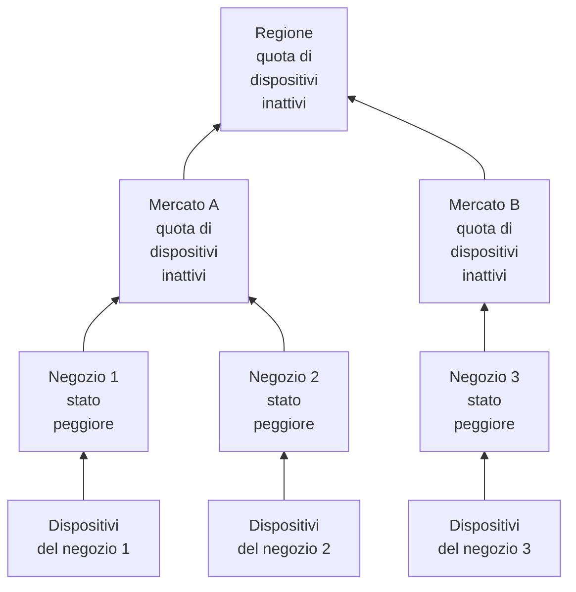

# Siti di rete (riepilogo dello stato e uptime)

Un sito di rete è un luogo: una regione, un mercato, un affiliato, un centro di distribuzione, un negozio. I siti si annidano l'uno nell'altro, i dispositivi di rete vi si collegano, e OneUptime riepiloga la salute dei dispositivi lungo l'albero, così un solo stato su una regione risponde a «c'è qualcosa che non va là fuori?».

Li trovi in **Rete → Siti**, e su una mappa in **Rete → Map**. Questa pagina precisa come si ricava lo stato di un sito da ciò che ha sotto, cosa significa il suo uptime e come la manutenzione programmata cambia entrambi.

:::cards
- [Aggiungere un sito](#aggiungere-un-sito): Tre passaggi, o un file CSV per un intero parco.
- [Impostare i valori predefiniti di monitoraggio](#valori-predefiniti-di-monitoraggio): Una sonda e delle credenziali per ogni dispositivo di un sito.
- [Scegliere come si riepiloga la salute](#come-si-calcola-la-salute-del-padre): Lo stato peggiore per un negozio, una quota per una regione.
- [Leggere l'uptime](#uptime): Cosa contano le percentuali, giorno per giorno.
:::

## Come funziona



Lo stato di ogni sito deriva da tutti i dispositivi del suo sottoalbero, giudicati secondo la [policy di riepilogo](#come-si-calcola-la-salute-del-padre) del sito stesso. L'uptime di un sito deriva dalla sua cronologia di stato, e una [finestra di manutenzione](#manutenzione-programmata-per-i-siti-di-rete) su un sito toglie i suoi dispositivi dal voto dei siti superiori.

## La gerarchia

I siti formano un albero. Ogni sito ha un **Site Type** e, facoltativamente, un sito padre. I tipi di sito sono l'elenco del progetto, in **Rete → Impostazioni → Site Types**, e un nuovo progetto parte con Account Type, Region, Franchisee, Market e Unit, in quest'ordine dall'alto, più Data Center e Other. I tipi formano una propria gerarchia (**Parent Site Type**), che decide quali siti possono essere padre di un sito. Un tipo contrassegnato come **Is Unit Level** è il livello foglia del tuo parco, il singolo negozio o la singola filiale: i suoi siti contengono dispositivi, non altri siti.

Il tipo, il nome, la descrizione, il padre e la posizione di un sito si modificano in un unico punto: la scheda **Site Settings** nella pagina **Impostazioni** del sito. La panoramica del sito li mostra con un link **Modifica nelle impostazioni**, e l'elenco **Siti** aggiunge siti ma non li modifica.

Ogni dispositivo è collegato a un sito. Il sottoalbero di un sito è il sito stesso più ogni sito sotto di esso, e i dispositivi del sottoalbero sono ciò da cui si riepiloga la sua salute, quindi una regione senza dispositivi propri ha comunque uno stato, perché ce l'hanno le unità sotto di essa.

> [!NOTE]
> Un riepilogo viene ricalcolato quando cambia lo stato di un dispositivo, quando un dispositivo passa a un altro sito, quando un sito si sposta nell'albero, e con un passaggio ogni cinque minuti che coglie i casi in cui solo il passare del tempo ha cambiato la risposta.

## Aggiungere un sito

:::steps
### Iniziare un nuovo sito
Vai su **Rete → Siti** e fai clic su **Aggiungi: Site**.

### Dire cos'è il sito
Nel passaggio **Site Details**, scegli il **Site Type** (che tipo di luogo è: una regione, un negozio, un data center) e digita un **Nome**. La descrizione, l'indirizzo e la latitudine e la longitudine che collocano il sito sulla mappa sono chiusi sotto **Altri campi**: compilali ora o più tardi.

### Collocarlo nell'albero
Nel passaggio **Hierarchy**, scegli il **Parent Site** se il sito si trova sotto un altro. Lascialo vuoto per tenere il sito al livello più alto.

### Impostarne i valori predefiniti
Nel passaggio **Monitoring Defaults**, scegli la [sonda e il profilo di credenziali predefiniti](#valori-predefiniti-di-monitoraggio) per i dispositivi aggiunti al sito, e fai clic su **Aggiungi: Site**.
:::

Nella pagina **Child Sites** di un sito, **Aggiungi: Sito figlio** chiede solo il tipo e il nome, in una sola pagina con la posizione chiusa, e colloca il nuovo sito sotto quello.

### Importare i siti da un file CSV

Per portare dentro un intero parco in una volta, apri il menu in cima all'elenco **Siti** e fai clic su **Import from CSV**. Il file richiede una riga di intestazione; le colonne possono essere in qualsiasi ordine e i loro nomi non distinguono tra maiuscole e minuscole:

```csv title="sites.csv"
name,siteType,parentName,address,latitude,longitude
North,Region,,,,
Leeds,Market,North,,,
Store 0660,Unit,Leeds,"1 High Street, Leeds",53.7997,-1.5492
```

- `name` e `siteType` sono obbligatori. `siteType` deve essere uno dei tipi di sito del progetto.
- `parentName` indica il sito padre, che può trovarsi nello stesso file: le righe senza padre, o con un padre che esiste già, vengono importate per prime, poi i loro figli. Lascialo vuoto per un sito di primo livello.
- Una riga il cui padre non si trova viene saltata, e i risultati la elencano. **Preview Import** mostra cosa creerà il file prima che venga scritto qualcosa.

## La mappa

**Rete → Map** mostra i tuoi siti su una mappa, inquadrata ovunque si trovino; fai clic su un sito per entrarci. Un sito con dei siti sotto li mostra, sulla mappa e come grafo dei collegamenti tra di essi. Un sito senza siti sotto ma con dispositivi propri, o un sito il cui tipo è di livello unità, apre la topologia in tempo reale di quei dispositivi.

Un progetto ancora senza siti ha comunque una mappa: la Map mostra invece la topologia dei suoi dispositivi, e raggruppare i dispositivi in siti li colloca sulla mappa in base alla posizione.

## Valori predefiniti di monitoraggio

Un sito è anche il posto in cui dici, una volta sola, come vengono monitorati i suoi dispositivi. **Modifica impostazioni** nella scheda **Site Settings** ha un passaggio **Monitoring Defaults** con due campi:

| Impostazione | Effetto |
| --- | --- |
| **Default Probe** | La sonda che invia il ping ai dispositivi di questo sito, e ne esegue il walk SNMP quando hanno le credenziali. Un dispositivo creato nel sito senza una sonda propria la prende, e così fa un dispositivo spostato nel sito senza averne una. |
| **Default SNMP Credential Profile** | Il [profilo di credenziali](/docs/monitor/network-device-monitor#credenziali-snmp-e-profili-di-credenziali) con cui vengono sottoposti a walk i dispositivi di questo sito quando né il dispositivo né il suo profilo hanno credenziali. |

Imposta entrambi su un sito e un nuovo dispositivo può esservi aggiunto con il solo indirizzo: riceve il ping dal suo primo polling e il walk dal suo primo polling.

I due si comportano in modo diverso, di proposito:

- La sonda viene copiata sul dispositivo quando il dispositivo viene creato nel sito o spostato al suo interno. Cambiare in seguito la sonda predefinita di un sito non sposta i dispositivi che ne hanno già una: quale sonda può raggiungere un dispositivo è un fatto della rete, non una preferenza da riscrivere in blocco da un modulo di sito.
- Il profilo di credenziali viene letto dal vivo, a ogni polling. Impostane uno su un sito e ogni dispositivo senza credenziali di quel sito inizia a essere sottoposto a walk al suo polling successivo, senza modificare alcun dispositivo; rimuovilo e tornano a ricevere solo il ping.

Arrivano anche a profondità diverse nell'albero:

- La sonda raggiunge l'intero albero. Un dispositivo che arriva in un sito senza sonda predefinita prende quella dell'antenato più vicino, quindi una sola sonda impostata su una regione copre ogni mercato e ogni unità sottostante, e un mercato che indica la propria la sostituisce per il suo sottoalbero.
- Il profilo di credenziali viene letto solo dal sito del dispositivo. Un dispositivo in un'unità non prende un profilo impostato sulla sua regione, quindi impostalo sui siti a cui i dispositivi sono effettivamente collegati.

## Come si calcola la salute del padre

Ogni sito sceglie una di due policy di riepilogo, nella scheda **Health Rollup** della sua pagina **Impostazioni** (**Rollup Policy**).

### Lo stato peggiore di qualsiasi dispositivo (predefinito)

Lo stato peggiore riportato da un qualsiasi dispositivo del sottoalbero diventa lo stato del sito. Quanto è grave uno stato dipende dalla sua priorità come stato del monitor: gli stati di un nuovo progetto sono Operational (1), Degraded (2) e Offline (3), e più alto significa peggio. Un solo dispositivo offline rende offline il sito, per quanti dispositivi sani gli stiano accanto.

È la risposta giusta per un'unità. Quattro switch e un firewall nello stesso edificio non sono indipendenti: se uno di loro si spegne è un problema a quell'indirizzo, e farne la media nasconde un disservizio reale.

Di solito è la risposta sbagliata per una regione sopra quattrocento negozi. Uno switch spento nel negozio 12.000 colora di Offline l'intera regione: vero nel senso più stretto e inutile in ogni senso pratico, perché la regione diventa rossa ogni volta che un negozio qualsiasi ha un problema, e smette di dirti qualcosa.

### Percentuale di dispositivi inattivi

Lo stato del sito è deciso dalla quota di dispositivi del sottoalbero che riferiscono e non sono in uno stato operativo:

| Quota di dispositivi inattivi | Stato del sito |
| --- | --- |
| 0% | Operational |
| Sopra lo 0%, sotto la soglia | Degraded: lo stato del progetto che non è né operativo né offline, oppure Offline quando il progetto non ne ha |
| Pari o sopra la soglia | Offline |

La soglia si imposta per sito, come **Offline Threshold (%)**, ed è 50 per impostazione predefinita.

Senza nulla di inattivo il sito è Operational per quanto bassa sia la soglia: una soglia di 0 significa «qualsiasi dispositivo inattivo lo rende offline», non «una regione sana è offline».

### Quali dispositivi votano

Le due policy qui concordano, e conta più di quanto sembri:

- I dispositivi archiviati non votano mai. Sono dismessi: mantengono il loro sito ma vengono esclusi.
- I dispositivi che non hanno mai riferito nulla non votano mai. Un dispositivo in attesa del suo primo polling non è la prova di un disservizio, quindi viene escluso da entrambi i lati della quota, e una regione a metà dell'onboarding viene valutata sulla metà che ha risposto.
- Un dispositivo interrogato dalla sonda, il tipo normale, vota con l'esito del suo ultimo polling: raggiungibile via ping o SNMP, non quanto tempo fa è riuscito l'ultima volta. Un dispositivo che risponde al ping mentre il suo walk SNMP fallisce è raggiungibile e vota così; il sito dice che è attivo, e la riga del dispositivo riporta **SNMP failing** perché qualcuno sistemi le credenziali.
- Un dispositivo basato su un monitor, passato all'override con monitor associato nella sua pagina Impostazioni, vota con lo stato del monitor associato, perché nulla lo interroga. Senza nulla di associato non ha mai riferito, quindi non vota affatto.

Un monitor del dispositivo di rete su un dispositivo interrogato dalla sonda non cambia come vota il dispositivo. Un monitor con un criterio «interfaccia inattiva, quindi Offline» marchierebbe come Offline uno switch che risponde a ogni ping, e una sola porta spenta renderebbe rosso un intero sito mentre ogni riga di dispositivo sotto di esso riporta Up: il sito contraddirebbe l'elenco che riassume. Per un dispositivo interrogato, il polling è la fonte della sua salute; il monitor serve ad aprire incidenti.

### Scegliere una policy

Un punto di partenza ragionevole per un parco in franchising:

| Livello | Policy | Perché |
| --- | --- | --- |
| Unità o negozio | Stato peggiore | Un dispositivo inattivo è un sito in difficoltà. |
| Mercato | Percentuale, soglia intorno al 50% | Un mercato con metà dei suoi negozi inattivi è inattivo. |
| Regione | Percentuale, soglia dal 25% al 50% | Il guasto di un singolo negozio porta la regione in Degraded, non in Offline, e diventa Offline quando succede qualcosa di sistemico. |

La policy si imposta per sito, quindi puoi dare la policy a percentuale alle righe delle regioni e lasciare tutto ciò che sta sotto con quella predefinita.

## Uptime

Ogni sito ha una cronologia di stato: una riga per ogni cambiamento del suo stato riepilogato, aperta quando lo stato cambia e chiusa quando cambia di nuovo. L'uptime si ricava da essa:

- Il tempo trascorso in uno stato non contrassegnato come operativo è tempo di inattività.
- Le righe che si sovrappongono vengono unite, quindi nessun secondo conta due volte.
- Il tempo non coperto da alcuna riga conta come attivo. La cronologia riceve righe solo dopo l'esecuzione di un riepilogo, e l'assenza di prove non è un disservizio.
- Una riga ancora aperta si estende fino alla fine della finestra misurata.

Degraded non è operativo, quindi conta anch'esso come inattivo. Con entrambe le policy, quindi, l'uptime di un sito è la quota di tempo in cui nessun dispositivo che riferisce sotto di esso era inattivo: la policy cambia lo stato che mostra un disservizio parziale, Degraded o Offline, non il fatto che conti.

Un sito senza alcuna riga nella cronologia mostra `—` invece di 100%: un sito su cui non si è mai riepilogato nulla non è monitorato, non è perfetto.

### Uptime giornaliero

Accanto al dato a 30 giorni, la panoramica di ogni sito mostra **Uptime (24h)**, e la sua pagina **Cronologia di stato** mostra le ultime 24 ore, 7, 30 e 90 giorni, e una barra al giorno per gli ultimi 30.

Una media a 30 giorni non può mostrare una brutta giornata. Un giorno intero di disservizio in una finestra di 30 giorni costa 3,3 punti, quindi un sito rimasto spento per un intero martedì riporta comunque il 96,7% per il mese, un numero che sembra un arrotondamento. Le barre giornaliere mettono gli stessi dati dove una brutta giornata è una brutta barra.

I giorni sono finestre mobili di 24 ore che terminano adesso, non giorni di calendario: i dispositivi, chi guarda e il server possono trovarsi ciascuno in un fuso orario diverso, e non c'è un unico «giorno» su cui concorderebbero.

### L'uptime del padre non è la media dell'uptime dei figli

L'uptime di un padre deriva dalla cronologia del padre stesso, prodotta dalla sua policy di riepilogo, non dalla media delle percentuali dei suoi figli.

Una media sui figli pesa un negozio con due dispositivi quanto un centro di distribuzione con duecento. La cronologia del padre dà invece una lettura che si può enunciare in una frase: la quota di tempo in cui nulla di nulla nella regione era inattivo. È severa di proposito, quindi su una regione grande leggila con le barre giornaliere, e con lo stato, che dice se un disservizio parziale era Degraded o Offline.

## Manutenzione programmata per i siti di rete

Collega i siti a un evento di manutenzione programmata in **Altre risorse interessate**, nel passaggio **Risorse interessate** dell'evento, come faresti con un host. La pagina **Manutenzione programmata** di un sito elenca gli eventi collegati, e il suo **Crea evento di manutenzione programmata** apre il modulo con il sito già scelto.

Una finestra su un padre copre tutto ciò che sta sotto: una finestra su una regione copre ogni mercato e ogni unità al suo interno, compresi i siti creati dopo la pianificazione della finestra, quindi un cambio di operatore regionale non deve elencare quattrocento negozi.

La copertura scende solo verso il basso. Una finestra su un'unità non mette in manutenzione la sua regione: ci si aspetta ancora che la regione sia attiva, e un guasto reale in un'altra unità nelle stesse ore conta comunque contro di essa.

### Cosa cambia una finestra di manutenzione

| Durante la finestra | Cosa succede |
| --- | --- |
| Lo stato in tempo reale del sito | Invariato. Un'unità spenta per lavori pianificati risulta ancora Offline sulla mappa e nell'albero, con un badge «In manutenzione» accanto: chi la guarda deve sapere che è spenta. |
| L'uptime del sito | La finestra viene tolta sia dal tempo di inattività sia dal periodo misurato. Due ore di manutenzione rendono la giornata lunga 22 ore, e nulla di quanto accade in quelle due ore conta in un senso o nell'altro. |
| Il riepilogo della salute dei suoi antenati | I dispositivi del sottoalbero in manutenzione smettono di votare, quindi la regione non diventa rossa per un cambio che era in calendario. |
| L'uptime dei suoi antenati | Non toccato, senza nulla da correggere, perché il disservizio pianificato non è mai arrivato nelle loro cronologie. |

Quest'ultima riga è il motivo per cui gli antenati vengono gestiti trattenendo i voti invece di togliere la finestra dal loro uptime: toglierla dal periodo della regione cancellerebbe anche un guasto reale altrove nella regione nelle stesse ore.

L'uptime viene corretto con l'inizio e la fine dichiarati dell'evento, non con il momento in cui un processo lo ha fatto passare da uno stato all'altro, quindi il numero si può verificare a mano rispetto al calendario. Un giorno che cade interamente dentro una finestra viene disegnato come manutenzione nelle barre giornaliere invece che come giornata perfetta, e non aggiunge nulla alla media.

### Interazione con i monitor

Collegare un monitor allo stesso evento fa ancora ciò che ha sempre fatto: il monitoraggio attivo di quel monitor si mette in pausa per la durata della finestra. Le due cose sono indipendenti: collega il sito per tenerlo fuori dal riepilogo e dal suo uptime, e collega i monitor per fermare i loro avvisi.

## Avvisi su un sito

La scheda **Alerting** nella pagina **Impostazioni** di un sito ha **Alert When Unhealthy**: un avviso si apre quando il riepilogo del sito passa a uno stato non operativo, e si risolve da solo quando il sito si riprende. **Gravità avviso** ne imposta la gravità; se lasciato vuoto, è la più grave del progetto.

Genera avvisi solo sul cambiamento: attivarlo su un sito che è già non in salute arma il cambiamento successivo invece di avvisare sul passato. Degraded non è operativo, quindi un sito con la policy a percentuale genera un avviso appena uno dei suoi dispositivi che riferiscono diventa inattivo, come fa un sito con la policy dello stato peggiore; l'avviso resta aperto, senza un secondo, mentre il sito passa tra Degraded e Offline, e il suo titolo indica lo stato raggiunto per primo dal sito.

## Risoluzione dei problemi

:::details Una regione è sempre rossa
Il sito usa la policy dello stato peggiore, quindi un solo dispositivo offline in qualsiasi punto sotto di esso lo rende offline. Passa la regione a **Percentage of devices down** nella sua scheda **Health Rollup**, con una soglia che corrisponda a quanta parte della regione deve essere inattiva perché tu la consideri inattiva.
:::

:::details Un sito mostra — invece di un uptime
Per il sito non è mai stato eseguito un riepilogo, quindi non ha righe nella cronologia: non è monitorato, non è perfetto. Aggiungi dispositivi al sito, o ai siti sotto di esso, e il riepilogo successivo avvia la sua cronologia.
:::

:::details Un dispositivo non conta per il suo sito
I dispositivi archiviati, e i dispositivi che non hanno ancora riferito, non votano mai. Anche un dispositivo basato su un monitor senza alcun monitor associato non ha mai riferito. Controlla lo stato del dispositivo: un dispositivo **In sospeso** inizia a votare dopo il suo primo polling.
:::

:::details L'avviso di un sito non è scattato
**Alert When Unhealthy** scatta su un passaggio da uno stato operativo a qualsiasi altro, quindi un sito che era già non in salute quando lo hai attivato genera un avviso al suo cambiamento successivo, dopo essersi ripreso. Controlla anche che i suoi dispositivi votino: i dispositivi archiviati e quelli in attesa del primo polling non lo fanno mai, e i dispositivi di un sito in manutenzione non votano nei riepiloghi superiori.
:::

## Passaggi successivi

:::cards
- [Monitor dispositivi di rete](/docs/monitor/network-device-monitor): Aggiungi, interroga e ricevi avvisi sui dispositivi collegati a questi siti.
- [Traffico di rete](/docs/monitor/network-traffic): Vedi il traffico di un sito dai record di flusso dei suoi dispositivi.
- [Inventario](/docs/inventory/overview): I dispositivi di rete accanto a tutti gli altri tuoi asset.
:::
