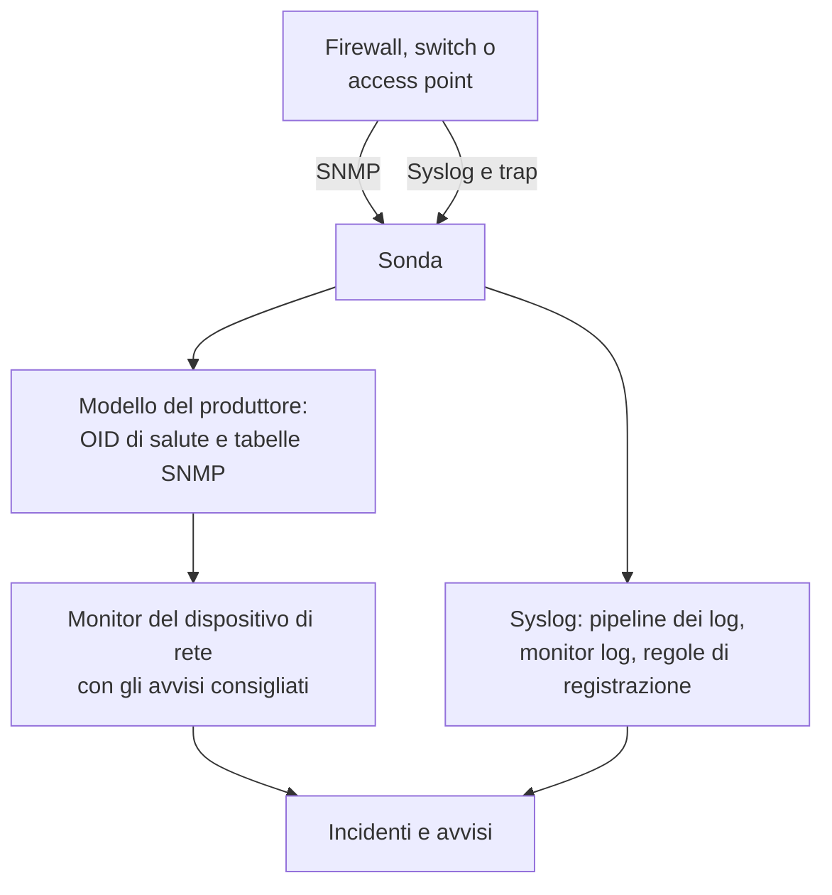

# Guide per fornitore di rete (Sophos, Extreme, Cambium)

Come monitorare dall'inizio alla fine tre parchi comuni con OneUptime: un Sophos Firewall (XGS, SFOS) con i suoi tunnel IPsec, i suoi collegamenti WAN e il suo SD-WAN; gli switch di Extreme Networks (EXOS / Switch Engine e Fabric Engine / VOSS) con il loro fabric; e gli switch cnMatrix e gli access point Wi-Fi enterprise di Cambium Networks, fino al canale e alla potenza di trasmissione di ogni radio.

:::cards
- [Sophos Firewall](#sophos-firewall-xgs-sfos): Tunnel, collegamenti WAN, gateway e SD-WAN.
- [Extreme Networks](#extreme-networks-exos-switch-engine-e-fabric-engine-voss): Gli switch, il fabric e il suo hardware.
- [Cambium Networks](#cambium-networks-wi-fi-enterprise-e-cnmatrix): Gli access point fino a ogni radio, e gli switch cnMatrix.
:::

## Come funziona

Ogni guida usa gli stessi elementi:

- Un [dispositivo di rete](/docs/monitor/network-device-monitor) per apparato, interrogato da una sonda in grado di raggiungerlo, con un modello del produttore che porta gli OID di salute e le [tabelle SNMP](/docs/monitor/network-device-monitor#tabelle-snmp) giusti.
- Un monitor del dispositivo di rete per dispositivo per gli avvisi. Crealo dalla pagina del dispositivo così gli [avvisi consigliati](/docs/monitor/network-device-monitor#pacchetto-di-avvisi-consigliato), compreso un avviso per riga per ogni tabella che sa cosa significa sano, vengono compilati per te. Per una flotta, una [policy di avviso](/docs/monitor/network-device-monitor#policy-di-avviso) ne mantiene uno su ogni dispositivo.
- Per ciò che un produttore riporta solo nei suoi log: il syslog verso la sonda, una [pipeline dei log](/docs/telemetry/log-pipelines) per trasformare ogni riga in attributi, [monitor log con Group By](/docs/monitor/logs-monitor#avvisi-per-gruppo-group-by) per avvisare una volta per tunnel o per gateway, e [regole di registrazione dei log](/docs/telemetry/log-recording-rules) per tracciare i numeri contenuti in quei log.

## Sophos Firewall (XGS / SFOS)

| Cosa vuoi vedere | Da dove viene |
| --- | --- |
| La salute del firewall: memoria, disco, swap, stato HA, servizio IPsec, CPU per core | SNMP, con il modello del produttore **Sophos Firewall (SFOS / XGS)** |
| Lo stato di ogni tunnel IPsec, per nome | La tabella SNMP `ipsec_tunnels` (SFOS v20 e successivi) |
| Lo stato, il throughput, l'utilizzo e gli errori di ogni collegamento WAN | Il walk delle interfacce delle porte WAN |
| La latenza, la perdita di pacchetti e il jitter di ogni collegamento WAN | Monitor Ping e polling del dispositivo dalle sonde di OneUptime |
| Gateway attivi e inattivi, SLA SD-WAN rispettato o no, cambi di percorso SD-WAN | Il syslog del firewall |
| Latenza, jitter e perdita di pacchetti SD-WAN per gateway, come grafici | Regole di registrazione dei log sui log SLA di SD-WAN |

Sophos non riporta la salute dei gateway né quella di SD-WAN via SNMP, in nessuna versione di SFOS: esiste solo nei log del firewall e negli avvisi di Sophos Central, ed è per questo che le ultime tre righe passano dal syslog.

### Registrare il firewall

:::steps
1. Sul firewall, attiva SNMP in **Administration → SNMP**: aggiungi un utente SNMPv3, o una community v2c, e consenti all'indirizzo della sonda di interrogarlo.
2. In OneUptime, vai su **Rete → Devices** e fai clic su **Add Device**. Digita l'indirizzo di gestione del firewall, scegli una sonda in grado di raggiungerlo e aggiungi le credenziali SNMP in **SNMP**.
3. Nella pagina **Impostazioni** del dispositivo, in **Polling & Data Collection**, applica il modello **Sophos Firewall (SFOS / XGS)** da **Vendor Health Template** e aggiungi le sue tabelle da **Add a Vendor's Tables**. Oppure attiva **Auto-Apply Vendor Health Template**, e il primo polling fa entrambe le cose.
:::

Dopo il polling successivo, la pagina **SNMP Tables** del dispositivo elenca ogni connessione IPsec con il suo stato (active, inactive, partially active), e i core della CPU. SFOS numera i suoi core a partire da 196608, ed è per questo che la CPU viene da una tabella e non da un singolo `hrProcessorLoad.1`.

### Avvisare su ogni tunnel IPsec

Nella pagina del dispositivo, fai clic su **Crea monitor**. Gli avvisi consigliati includono **IPsec Tunnels: row unhealthy**, un criterio **SNMP Table Row Is Unhealthy** sulla tabella `ipsec_tunnels` con Row `*`: apre un incidente per ogni tunnel non attivo, con il nome del tunnel, e risolve ciascuno quando il suo tunnel torna attivo.

Un tunnel che Sophos riporta come attivo ha soltanto le sue associazioni di sicurezza attive. Per dimostrare che il traffico lo attraversa, aggiungi un [monitor Ping](/docs/monitor/ping-monitor) da una sonda in un sito verso un host dall'altra parte di ogni tunnel, e disegna il tunnel come collegamento tra siti in **Rete → Topologia → Site Links** tra i due [siti](/docs/monitor/network-sites), associato a quel monitor: il collegamento sulla mappa prende allora il colore del monitor.

### Collegamenti WAN

- **Salute delle porte.** Il walk delle interfacce misura già lo stato, i bit in entrata e in uscita, l'utilizzo e gli errori di ogni porta WAN. Sul monitor del firewall, un criterio **SNMP Interface Is Down** o **SNMP Interface Utilization (in %)** con **Interfaccia** impostata sul nome della porta WAN, o `*` per ogni porta, avvisa per collegamento.
- **Qualità del percorso.** La latenza, la perdita di pacchetti e il jitter di ogni collegamento si misurano dall'esterno del firewall: un monitor Ping dalle sonde cloud di OneUptime verso l'indirizzo pubblico di ogni collegamento WAN, e un monitor Ping da una sonda del sito verso il gateway di ogni provider. I criteri di perdita di pacchetti e di jitter su quei monitor avvisano per collegamento, e **Rete → Topologia → Latency Matrix** mostra a colpo d'occhio ogni sonda rispetto a ogni monitor.
- **Traffico.** SFOS esporta NetFlow v5. Invialo alla sonda su UDP 2055, dove il collettore di flussi della sonda ascolta per impostazione predefinita, e la pagina **Traffic** del dispositivo mostra chi parla con chi su ogni collegamento WAN; [Traffico di rete](/docs/monitor/network-traffic) contiene i dettagli.

### Gateway e SD-WAN dal syslog

:::steps
1. Attiva il ricevitore syslog della sonda: imposta `PROBE_SYSLOG_RECEIVER_ENABLED=true` sulla sonda. Ascolta su UDP 5140 per impostazione predefinita (`PROBE_SYSLOG_RECEIVER_PORT` lo cambia); pubblica la porta se la sonda gira in Docker. I messaggi vengono abbinati al dispositivo di rete il cui hostname, o uno dei cui **Altri indirizzi**, è l'indirizzo del mittente, e compaiono nella pagina **Registri** del dispositivo.
2. Sul firewall, in **System services → Log settings**, aggiungi un server syslog che punti alla sonda e a quella porta, e spunta i tipi di log **Event** per IPsec e i gateway e il tipo di log **SD-WAN**: i log SLA restano disattivati finché non lo spunti.
3. In **Registri → Impostazioni → Pipeline**, crea una pipeline il cui filtro corrisponda ai log del firewall, come `attributes.networkDevice.name = 'hq-firewall'`, e aggiungi un **Key=Value Parser** con **Target Prefix** `sophos`. Incolla una riga del firewall nel suo tester per vedere i nomi esatti degli attributi che produce la tua versione di SFOS; [l'esempio Sophos](/docs/telemetry/log-pipelines#esempio-firewall-sophos-xgs) lo illustra passo per passo.
4. Crea dei [monitor log](/docs/monitor/logs-monitor) sui log del firewall, ciascuno con **Group by Attributes** perché ogni tunnel o gateway avvisi per conto suo, e il criterio **Log Count** **Greater Than** `0` su qualche minuto. Le righe qui sotto sono le tre da cui partire.
5. Traccia la qualità di SD-WAN: con il logging SD-WAN attivo, il firewall scrive un riepilogo SLA per profilo e per gateway (`latency`, `jitter`, `packet_loss`). In **Registri → Impostazioni → Regole di registrazione**, crea una regola per ogni numero, come la media di `sophos.latency` raggruppata per `sophos.gw_name` e `sophos.profile_name`, poi traccia i risultati, o genera avvisi su di essi con un [monitor delle metriche](/docs/monitor/metrics-monitor) che raggruppa per gateway. [Regole di registrazione dei log](/docs/telemetry/log-recording-rules) illustra questo esempio.
:::

| Avviso | Log da contare | Raggruppa per |
| --- | --- | --- |
| Tunnel IPsec terminato | Attributo `sophos.log_component` = `IPSec`, il corpo contiene `terminated` | `sophos.con_name` |
| Gateway inattivo | Attributo `sophos.log_component` = `Gateway`, il corpo contiene `is Down` | `sophos.gatewayname` |
| SLA SD-WAN non rispettato | Attributo `sophos.log_type` = `SD-WAN`, il corpo contiene `SLA not met` | `sophos.gw_name` |

Gli eventi syslog completano la tabella SNMP: arrivano nel momento in cui un tunnel cade, mentre la tabella coglie anche un tunnel che non si è mai attivato.

### Trap

Ogni notifica Sophos è lo stesso trap, `sfosNotification` (`1.3.6.1.4.1.2604.5.1.8.1.1`), con l'evento come testo in `sfosTrapMessage` (`1.3.6.1.4.1.2604.5.1.8.1.2`). Per avvisare su un tipo di evento, combina **SNMP Trap Received (Trap OID)** Equal To `1.3.6.1.4.1.2604.5.1.8.1.1` con **SNMP Trap Varbind Value** su quel varbind, Contains `IPSec` per esempio. Imposta la destinazione dei trap del firewall su SNMP v2c: il ricevitore di trap della sonda accetta trap v1 e v2c.

## Extreme Networks (EXOS / Switch Engine e Fabric Engine / VOSS)

| Cosa vuoi vedere | Da dove viene |
| --- | --- |
| EXOS: CPU, temperatura e il suo allarme, stato dell'alimentazione, alimentatori, ventole, memoria per slot, membri dello stack | Il modello **Extreme Networks EXOS / Switch Engine** |
| Fabric Engine: CPU e memoria per slot, sensori di temperatura, ventole, alimentatori, sessione vIST, numero di I-SID | Il modello **Extreme Networks Fabric Engine / VOSS** |
| Ogni adiacenza Fabric Connect (IS-IS), con il nome del suo vicino | La tabella `isis_adjacencies` del modello Fabric Engine |
| Porte, vicini LLDP, la mappa della rete | Il walk delle interfacce, su entrambi |

### Quale modello

Fabric Engine sull'hardware universale di Extreme (le serie 5000 e 7000) riporta lo stesso numero enterprise di EXOS: solo la sua descrizione di sistema (`7520-48Y-8C-FabricEngine (9.0.4.0)`) dice quale sistema operativo è in esecuzione. OneUptime legge entrambi, quindi l'applicazione automatica e il suggerimento della pagina del dispositivo scelgono il modello giusto, e gli switch VSP più vecchi riportano il ramo Avaya/Nortel e vengono riconosciuti direttamente come Fabric Engine.

### Avvisi sul fabric e sull'hardware

Gli avvisi consigliati su uno switch Fabric Engine includono **Fabric Adjacencies (IS-IS): row unhealthy**, un incidente per ogni vicino la cui adiacenza non è attiva. Fabric Engine invia anche un trap quando un'adiacenza cambia, `rcnIsisPlsbAdjStateTrap` (`1.3.6.1.4.1.2272.1.21.0.281`), e un criterio **SNMP Trap Received (Trap OID)** su di esso avvisa in pochi secondi, prima del polling successivo.

Alimentatori, ventole, sensori di temperatura e membri dello stack sono tabelle che dichiarano i loro valori sani, quindi ognuna riceve un avviso per riga negli avvisi consigliati.

### Flussi e Wi-Fi

EXOS e Fabric Engine esportano i flussi come sFlow e IPFIX. Invia sFlow alla sonda su UDP 6343, o IPFIX su UDP 4739, e la pagina **Traffic** del dispositivo mostra il suo traffico; vedi [Traffico di rete](/docs/monitor/network-traffic).

Gli access point IQ Engine (HiveOS) e ExtremeCloud IQ Controller hanno modelli del produttore propri, che riempiono la pagina **Wi-Fi** del dispositivo. [Produttori Wi-Fi supportati](/docs/monitor/network-device-monitor#produttori-wi-fi-supportati) li tratta, insieme a Ubiquiti UniFi, HPE Aruba, TP-Link Omada e Juniper Mist.

## Cambium Networks (Wi-Fi enterprise e cnMatrix)

### Access point

:::steps
1. Attiva SNMP sugli access point. In cnMaestro, SNMP si imposta per gruppo di AP: **Configuration → Wi-Fi Profiles → AP Groups → Management → SNMP**. Attivalo con una community di lettura v2c o un utente SNMPv3.
2. Aggiungi ogni access point con il suo indirizzo di gestione e quelle credenziali, e applica il modello **Cambium Networks Enterprise Wi-Fi (cnPilot, XV, XE, XH)**, oppure attiva l'applicazione automatica.
3. Apri la pagina **Wi-Fi** del dispositivo. Mostra quante radio sono accese, i client e gli SSID, poi banda, canale, frequenza, ampiezza del canale, potenza di trasmissione, client, rumore di fondo e airtime di ogni radio, e ogni SSID con i suoi client. La frequenza si ricava dalla banda e dal canale; l'access point non la riporta.
:::

Avvisi utili, tutti sulla tabella `wifi_radios` con Row `*`, così ogni radio avvisa per conto suo:

| Avviso | Criterio |
| --- | --- |
| Una radio spenta | **SNMP Table Row Is Unhealthy**, parte degli avvisi consigliati |
| Potenza di trasmissione cambiata | **SNMP Table Value**, colonna TX Power, Not Equal To la potenza che hai pianificato |
| Una radio affollata | **SNMP Table Value**, colonna Clients, Greater Than il tuo limite |
| Un canale rumoroso | **SNMP Table Value**, colonna Noise Floor, Greater Than `-80` |

Ogni valore numerico delle radio è anche una metrica (`oneuptime.monitor.snmp.table.value`, una serie per radio e colonna), quindi canale, potenza e client si possono tracciare nel tempo su una dashboard; un canale che continua a cambiare è il DFS al lavoro.

Cambium riporta il numero totale di client solo dal firmware 6.5.3; i firmware precedenti restituiscono 0.

### Switch cnMatrix

Il modello **Cambium Networks cnMatrix** raccoglie CPU, RAM, flash, temperatura e tensione di alimentazione, e come tabelle le ventole, l'alimentatore ridondante e il consumo PoE di ogni porta. Le porte e i vicini LLDP vengono dal walk delle interfacce, come su qualsiasi switch.

### Allarmi di cnMaestro

cnMaestro può inviare i suoi allarmi, come un access point che va offline, a un webhook HTTPS. Puntalo a un [monitor delle richieste in arrivo](/docs/monitor/incoming-request-monitor) per trasformare quegli allarmi in incidenti di OneUptime accanto ai dati SNMP.

## Risoluzione dei problemi

:::details La tabella IPsec Tunnels non ha uno stato
Lo stato dei tunnel richiede SFOS v20 o successivo. Controlla anche che la vista SNMP delle tue credenziali includa l'albero enterprise di Sophos (`1.3.6.1.4.1.2604`): un utente v3 limitato spesso vede solo il gruppo di sistema e IF-MIB.
:::

:::details Dal firewall non arriva alcun syslog
Il ricevitore syslog della sonda è disattivato per impostazione predefinita: imposta `PROBE_SYSLOG_RECEIVER_ENABLED=true` e pubblica UDP 5140, o la tua `PROBE_SYSLOG_RECEIVER_PORT`, verso la sonda. I messaggi vengono abbinati a un dispositivo in base all'indirizzo del mittente, quindi l'hostname del firewall in OneUptime, o uno dei suoi **Altri indirizzi**, deve essere l'indirizzo da cui invia il syslog.
:::

:::details Uno switch Fabric Engine ha ricevuto il modello EXOS
Il modello viene scelto in base alla descrizione di sistema dello switch. Controlla che la panoramica del dispositivo mostri una descrizione che nomina Fabric Engine (come `7520-48Y-8C-FabricEngine (9.0.4.0)`); se è così, rimuovi gli OID e le tabelle di EXOS e applica **Extreme Networks Fabric Engine / VOSS** da **Vendor Health Template**.
:::

:::details Gli access point Cambium riportano 0 client
Il numero totale di client richiede il firmware 6.5.3 o successivo. Sui firmware più vecchi le radio riportano comunque canale, potenza e rumore di fondo.
:::

## Passaggi successivi

:::cards
- [Monitor dispositivi di rete](/docs/monitor/network-device-monitor): Tutto ciò che raccoglie un dispositivo, e ogni criterio su cui può avvisare.
- [Pipeline dei log](/docs/telemetry/log-pipelines): Scomponi i log del firewall in attributi.
- [Monitor log](/docs/monitor/logs-monitor): Avvisa una volta per tunnel o per gateway.
:::
