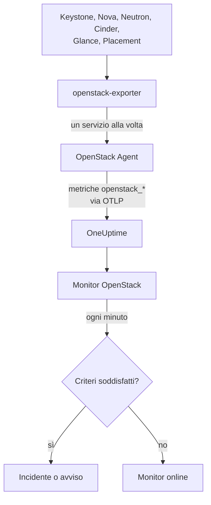

# Monitor OpenStack

Un monitor OpenStack tiene sotto controllo un cloud - le sue API, i worker che le sostengono, gli hypervisor, le istanze, le reti, i pool di storage e le quote dei progetti - e ti avvisa quando un'API smette di rispondere, un worker va giù, un hypervisor non ha più risorse da dare o un pool si riempie. Legge le serie `openstack_*` che l'OneUptime OpenStack Agent raccoglie da openstack-exporter, o che una sonda raccoglie dalle API del cloud.

:::cards
- [Crea il monitor](#crea-un-monitor-openstack): Sei passaggi nella dashboard.
- [Template](#template-di-avviso-predefiniti): Avvisi già pronti, un incidente per ogni worker, istanza, rete o regione.
- [Controlli dall'esterno](#controlli-dallesterno): Verificare se qualcuno riesce davvero ad avviare un'istanza, da una probe esterna al cloud.
- [Attributi di identità](#attributi-di-identità): Come puntare a una regione, un host o un progetto.
- [Metriche](#metriche-raccolte): Tutte le serie su cui il monitor può generare avvisi.
:::

## Come funziona

L'agent è un OpenTelemetry Collector con un openstack-exporter, che esegui su una macchina in grado di raggiungere le API del cloud. Legge ogni servizio OpenStack in una raccolta separata, quindi un Nova in errore costa solo le serie di Nova, e legge con delicatezza: compute, network, volume e placement ogni 2 minuti, identity e image ogni 5.

Ogni serie è marcata con il nome del cloud, `openstack.cloud.name`, e ogni datapoint con `openstack.region.name` e `openstack_service`. Un cloud corrisponde a un Keystone, e un monitor OpenStack è legato a un solo cloud. Ogni minuto esegue la sua query sulle metriche di quel cloud e ne confronta il risultato con i propri criteri.



## Prima di iniziare

- **Raccogli le metriche del cloud** con l'OpenStack Agent, o con [una sonda](/docs/telemetry/openstack-agentless). **Documentazione**, in **Prodotti → Infrastruttura → OpenStack**, ti guida nell'installazione dell'agente.
- **Verifica che il cloud sia registrato.** Dopo la prima raccolta compare in **Prodotti → Infrastruttura → OpenStack**, con il nome dato da `OPENSTACK_CLOUD_NAME` dell'agent.

## Crea un monitor OpenStack

:::steps
### Avvia un nuovo monitor

Vai su **Monitor** e fai clic su **Crea monitor**.

### Scegli OpenStack

In **Tipo di monitor**, fai clic su **Altri tipi di monitor** e scegli **OpenStack** sotto **Infrastruttura**, oppure digita `openstack` nella casella di ricerca. Inserisci un **Nome** - viene usato nei titoli di incidenti e avvisi - e fai clic su **Avanti**.

### Scegli il cloud

In **OpenStack Monitor Configuration**, scegli il cloud da **Cloud OpenStack**. Nell'elenco c'è ogni cloud che ha inviato dati. Dopo la scelta, una riga sotto il campo indica se i dati stanno arrivando.

### Scegli cosa tenere sotto controllo

Un nuovo monitor parte da **Cloud Stopped Reporting**, sotto **Su cosa avvisare**. Per controllare altro:

- **Cambia** - scegli un altro [template](#template-di-avviso-predefiniti). Imposta la metrica, i filtri sugli attributi, l'aggregazione, l'intervallo di tempo, il raggruppamento e le soglie, e sostituisce i criteri sottostanti con i propri. Puoi comunque cambiare l'**Intervallo di tempo**.
- **Custom Metric** (sotto **Altri campi**) - scegli una metrica da **Metrica OpenStack**, poi imposta **Aggregazione** e **Intervallo di tempo**, e restringi con i [filtri](#impostazioni-del-monitor).
- **Avanzato** (sotto **Altri campi**) - costruisci tu stesso query e formule in **Seleziona metriche**, con filtri su attributi come `status`, `adminState` o `resourcetype`. Usa **Raggruppa per** un [attributo di identità](#attributi-di-identità) per valutare ogni parte separatamente.

### Controlla i criteri

Apri ogni criterio sotto **Criteri** e controlla **Metrica**, **Aggregazione**, **Condizione** e **Soglia**. Un template li compila. Con **Custom Metric** o **Avanzato**, il monitor parte con i criteri predefiniti, che si accorgono solo dell'assenza di dati dalla metrica, quindi imposta una soglia tua.

### Crea il monitor

Fai clic su **Crea monitor**. OneUptime apre la pagina del monitor e lo valuta ogni minuto. Gli incidenti e gli avvisi che genera sono elencati anche nelle pagine **Incidenti** e **Avvisi** del cloud.
:::

> [!TIP]
> Per configurare più template in una volta, apri il cloud da **Prodotti → Infrastruttura → OpenStack** e vai su **Raccomandazioni**. Scegli i template che vuoi, decidi chi viene avvisato, e OneUptime crea un monitor per ogni template.

## Impostazioni del monitor

| Campo | Scheda | Cosa fa |
| --- | --- | --- |
| **Cloud OpenStack** | Tutte | Obbligatorio. Limita ogni query a `resource.openstack.cloud.name`. |
| **Regione** | Metrica personalizzata, Avanzato | Facoltativo. Una regione: `openstack.region.name`. Ogni serie la porta con sé. |
| **Zona di disponibilità** | Metrica personalizzata, Avanzato | Facoltativo. Una zona: `availability_zone` su hypervisor, istanze, volumi e agent di Neutron, `zone` sui worker di Nova e Cinder. |
| **Hypervisor** | Metrica personalizzata, Avanzato | Facoltativo. Un host: `hostname` su worker, hypervisor e Placement, `hypervisor_hostname` sulle istanze. I worker di Nova riportano il nome breve dell'host, mentre hypervisor, Placement e istanze il nome completo, quindi usa quello riportato dalla serie. |
| **Servizio** | Metrica personalizzata, Avanzato | Facoltativo. Il binario di un worker, come `nova-compute`: `service`. |
| **ID Progetto** | Metrica personalizzata, Avanzato | Facoltativo. Un progetto: `tenant_id` sulle serie di Nova e Cinder e su reti e subnet, `project_id` su floating IP, router e disponibilità degli indirizzi. |
| **Metrica OpenStack** | Metrica personalizzata | Una metrica dal [catalogo](#metriche-raccolte). |
| **Aggregazione** | Metrica personalizzata | Come vengono combinati i campioni: **Media**, **Massimo**, **Minimo**, **Somma** o **Conteggio**. Parte dall'aggregazione abituale della metrica. |
| **Intervallo di tempo** | Tutte | La finestra mobile letta dalla query, da **Past 1 Minute** a **Past 365 Days**. Un nuovo monitor parte da **Ultimi 15 minuti**; i template impostano il proprio. |
| **Seleziona metriche** | Avanzato | Il generatore di query: **Metrica**, **Aggregate by**, **Filter by attributes**, **Raggruppa per**, più **Aggiungi metrica** e **Aggiungi formula** per combinare le query. |

Un filtro restringe solo una serie che porta la sua etichetta: `openstack_nova_up` non ha un progetto, quindi un filtro sul progetto la lascia com'è.

Mantieni la finestra a tre raccolte o più di ciò che leggi: 6 minuti per compute, network, volume e placement, 15 per identity e image. Una finestra più corta non contiene abbastanza raccolte perché l'opzione **Tutti i valori** valga come durata.

## Attributi di identità

Ogni serie porta `openstack.cloud.name` come **attributo di risorsa**, e `openstack.region.name` e `openstack_service` come attributi del datapoint. Il resto lo dicono le etichette dell'exporter:

| Parte | Serie | Etichette che la identificano |
| --- | --- | --- |
| API | `openstack_*_up` | `openstack.region.name`, `openstack_service` |
| Worker | `openstack_nova_agent_state`, `openstack_neutron_agent_state`, `openstack_cinder_agent_state` | `hostname`, `service`. `adminState` dice se un operatore l'ha lasciato attivo. Non raggruppare mai per `uuid` su quelli di Cinder: l'exporter ne inventa uno a ogni raccolta |
| Hypervisor | `openstack_placement_resource_*`, `openstack_nova_vcpus_*` | `hostname` (il nome completo), `resourcetype` su quelli di Placement |
| Istanza | `openstack_nova_server_status` | `uuid`, `name`, `tenant_id`, `hypervisor_hostname`, `status`. Il valore è un codice: filtra sulla parola di `status` |
| Volume | `openstack_cinder_volume_gb` | `id`, `name`, `tenant_id`, `status` |
| Pool di storage | `openstack_cinder_pool_capacity_*` | `name`, `volume_backend_name` |
| Rete | `openstack_neutron_network_ip_availabilities_*` | `network_id`, `network_name`, `cidr`, `ip_version` |
| Router | `openstack_neutron_l3_agent_of_router` | `router_id`, `agent_host`, `ha_state`, `agent_alive`, `agent_admin_up` |
| Progetto | `openstack_nova_limits_*`, `openstack_cinder_limits_*` | `tenant_id`, `tenant` |

Nei filtri del monitor e nelle chiavi di raggruppamento, un attributo di risorsa inizia con `resource.` (`resource.openstack.cloud.name`), mentre un attributo del datapoint no (`openstack.region.name`, `hostname`, `status`). Un'etichetta vuota non arriva a OneUptime, quindi `disabledReason` c'è solo su un worker che qualcuno ha disabilitato.

## Template di avviso predefiniti

OneUptime include 120 template per i problemi più comuni di OpenStack, e l'elenco **Su cosa avvisare** li propone. La pagina Raccomandazioni di un cloud propone un template per Heat, Magnum, Ironic, Manila, Octavia, Trove, Designate, Gnocchi o Swift solo a un cloud che lo esegue, uno basato su una serie che invia solo una probe solo a un cloud raccolto da una probe, e uno basato su un [controllo dall'esterno](#controlli-dallesterno) solo a un cloud che ha quel controllo attivo: su qualunque altro cloud le sue serie non esistono, quindi non scatterebbe mai. Ognuno costruisce un monitor completo: la query sulla metrica, i suoi filtri sugli attributi, un raggruppamento su ciò di cui parla un incidente, un criterio che scatta e uno che rientra. Le soglie sono le stesse linee che tracciano le pagine del cloud e sono punti di partenza che puoi modificare.

Ogni template legge almeno tre raccolte di ciò che controlla e scatta solo quando la condizione vale per tutta la sua finestra. Una soglia su una percentuale rientra al 10% oltre la propria linea, così un valore che oscilla lì intorno non fa avanti e indietro.

| Template | Categoria | Gravità | Controlla | Scatta quando | Rientra quando |
| --- | --- | --- | --- | --- | --- |
| Cloud Stopped Reporting | Disponibilità | Critica | `openstack_identity_up`, Conteggio su tutto il cloud, **ultimi 15 minuti** | Nessun dato per tutta la finestra: l'agent si è fermato o non raggiunge OneUptime, oppure l'exporter non riesce ad accedere a Keystone | I dati tornano ad arrivare |
| Identity API Down | Disponibilità | Critica | `openstack_identity_up` e `scrape_samples_scraped` per `identity`, Min per regione, **ultimi 15 minuti** | Ogni chiamata è fallita, o la raccolta è tornata vuota perché l'exporter non è riuscito ad accedere | Entrambi valgono 1 o più |
| Compute API Down | Disponibilità | Critica | `openstack_nova_up` e `scrape_samples_scraped` per `compute`, Min per regione, **ultimi 10 minuti** | Ogni chiamata è fallita, o la raccolta è tornata vuota perché l'exporter non ha raggiunto l'API di Nova | Entrambi valgono 1 o più |
| Network API Down | Disponibilità | Critica | `openstack_neutron_up` e `up` per `network`, Min per regione, **ultimi 10 minuti** | Ogni chiamata è fallita, o l'exporter non ha risposto | Entrambi valgono 1 |
| Block Storage API Down | Disponibilità | Critica | `openstack_cinder_up` e `up` per `volume`, Min per regione, **ultimi 10 minuti** | Ogni chiamata è fallita, o l'exporter non ha risposto | Entrambi valgono 1 |
| Image API Down | Disponibilità | Critica | `openstack_glance_up` e `up` per `image`, Min per regione, **ultimi 15 minuti** | Ogni chiamata è fallita, o l'exporter non ha risposto | Entrambi valgono 1 |
| Placement API Down | Disponibilità | Critica | `openstack_placement_up` e `up` per `placement`, Min per regione, **ultimi 10 minuti** | Ogni chiamata è fallita, o l'exporter non ha risposto | Entrambi valgono 1 |
| Compute Service Down | Control Plane | Critica | `openstack_nova_agent_state` filtrato su `service = nova-compute` e `adminState = enabled`, Min per host, **ultimi 10 minuti** | Sotto 1: un nova-compute abilitato è giù. Uno disabilitato da qualcuno non scatta mai | Attivo, o disabilitato |
| Compute Service Disabled | Control Plane | Avviso | `openstack_nova_agent_state` filtrato su `service = nova-compute` e `adminState = disabled`, un Conteggio per host, **ultimi 10 minuti** | Sopra 0: un `nova-compute` è stato disabilitato e nessun evento di manutenzione in corso copre il suo host, la sua zona di disponibilità o il cloud. Uno che si è disabilitato da solo perché libvirt è caduto (il motivo inizia con `AUTO:`) resta in silenzio finché libvirt Service Down è aperto. I progetti non ne vengono informati | Viene riabilitato, o un evento lo copre |
| Scheduler or Conductor Down | Control Plane | Avviso | `openstack_nova_agent_state` filtrato su `nova-scheduler` o `nova-conductor` e `adminState = enabled`, Min per host e binario, **ultimi 10 minuti** | Sotto 1. Gli altri proseguono finché ne resta uno | Attivo, o disabilitato |
| Every Scheduler or Conductor Down | Control Plane | Critica | Lo stesso, Max per regione e binario, **ultimi 10 minuti** | Sotto 1: nessuno è vivo, quindi non si può avviare più nulla di nuovo | Uno è attivo |
| Network Agent Down | Control Plane | Critica | `openstack_neutron_agent_state` filtrato su `adminState = up`, Min per host e binario, **ultimi 10 minuti** | Sotto 1: un agent impostato come attivo non è vivo. Uno impostato come giù da qualcuno non scatta mai | Vivo, o impostato come giù |
| Block Storage Service Down | Control Plane | Critica | `openstack_cinder_agent_state` filtrato su `adminState = enabled`, Min per host e binario, **ultimi 10 minuti** | Sotto 1: un servizio Cinder abilitato è giù. Uno disabilitato da qualcuno non scatta mai | Attivo, o disabilitato |
| vCPU Allocation High | Compute | Avviso | `openstack_placement_resource_*` filtrato su `resourcetype = VCPU`, utilizzo / ((totale - riservato) x rapporto), per hypervisor, **ultimi 10 minuti** | Sopra il 90%: allocazione, non carico | Pari o sotto l'81% |
| Memory Allocation High | Compute | Avviso | Lo stesso, `resourcetype = MEMORY_MB` | Sopra il 90% | Pari o sotto l'81% |
| Local Disk Allocation High | Compute | Avviso | Lo stesso, `resourcetype = DISK_GB` | Sopra il 90% | Pari o sotto l'81% |
| Hypervisor CPU Saturated | Compute | Avviso | `openstack.hypervisor.instances.cpu.utilization`, per hypervisor, **ultimi 15 minuti**. Richiede l'exporter di libvirt o di Ceilometer | Sopra il 90% dei suoi thread CPU: carico, non allocazione. La sua pagina indica le istanze responsabili | Pari o sotto l'81% |
| Hypervisor Memory Pressure | Compute | Avviso | `openstack.hypervisor.instances.memory.utilization`, per hypervisor, **ultimi 15 minuti**. Richiede l'exporter di libvirt, oppure il polling di `memory.resident` di Ceilometer | Sopra il 90% della sua memoria: in uso, non promessa | Pari o sotto l'81% |
| Instance CPU Saturated | Compute | Avviso | `openstack.instance.cpu.utilization`, Max per istanza, **ultimi 15 minuti**. Richiede l'exporter di libvirt o di Ceilometer | Sopra il 95% delle sue vCPU | Pari o sotto l'85,5% |
| Instance Disk Latency High | Compute | Avviso | `openstack.instance.disk.read.latency` e `openstack.instance.disk.write.latency`, Max per istanza e disco, **ultimi 15 minuti**. Richiede l'exporter di libvirt, oppure il polling di `disk.device.read.latency` e `disk.device.write.latency` di Ceilometer | Sopra 50 ms per richiesta. Un disco senza richieste non ha latenza, quindi uno inattivo non scatta mai | Pari o sotto 45 ms, o smette di essere usato |
| Instances in Error | Compute | Avviso | `openstack_nova_server_status` filtrato su `status = ERROR`, Conteggio per regione, **ultimi 10 minuti** | Sopra 0 | Non ne resta nessuna |
| Instance Stuck Building | Compute | Avviso | `openstack_nova_server_status` filtrato su `status = BUILD` o `BUILD(spawning)`, Max per istanza, **ultima ora** | In quello stato a ogni raccolta per un'ora | Ne è uscita |
| Instance Stuck Transitioning | Compute | Avviso | Lo stesso per `REBUILD`, `RESIZE`, `REVERT_RESIZE`, `MIGRATING`, `REBOOT`, `HARD_REBOOT` e `PASSWORD`, **ultima ora** | In uno di questi a ogni raccolta per un'ora | Ne è uscita |
| Instance Stuck in Verify Resize | Compute | Avviso | Lo stesso per `VERIFY_RESIZE`, **ultima ora** | In attesa per un'ora che qualcuno confermi o annulli | Confermata o annullata |
| Router Not Active | Rete | Avviso | `openstack_neutron_routers_not_active`, Max per regione, **ultimi 10 minuti** | Sopra 0 | A 0 |
| Floating IP Not Active | Rete | Avviso | `openstack_neutron_floating_ips_associated_not_active`, Max per regione, **ultimi 10 minuti** | Sopra 0: uno in uso non è ACTIVE. Uno libero è giusto che sia giù | A 0 |
| External IP Pool Nearly Full | Rete | Avviso | `openstack_neutron_network_ip_availabilities_*` per `ip_version = 4`, accanto a `is_external = true` su `openstack_neutron_network`, per rete, **ultimi 10 minuti** | Sopra il 90% degli indirizzi IPv4 di una rete esterna. La rete di un tenant non scatta mai | Pari o sotto l'81% |
| Network Out of IPs | Rete | Critica | Lo stesso | Al 100%: nessun indirizzo libero | Sotto il 90% |
| Router Without Active Agent | Rete | Critica | `openstack_neutron_l3_agent_of_router` filtrato su `agent_admin_up = true`, Max per router, **ultimi 10 minuti** | Sotto 1: nessun agent che lo gestisce è vivo. Silenzioso su OVN, che non ha questi agent | Uno è vivo |
| Router With Two Active Agents | Rete | Critica | Lo stesso filtrato su `ha_state = active` e `agent_alive = true`, Conteggio per router, **ultimi 10 minuti** | Sopra 1: uno split brain. Silenzioso su OVN | Pari o sotto 1 |
| Storage Pool Warning | Storage | Avviso | `openstack_cinder_pool_capacity_*`, (totale - libero) / totale, per pool, **ultimi 10 minuti** | Sopra l'85% | Pari o sotto il 76,5% |
| Storage Pool Critical | Storage | Critica | Lo stesso | Sopra il 95% | Pari o sotto l'85,5% |
| Volumes in Error | Storage | Avviso | `openstack_cinder_volume_status_counter` per ogni parola di errore, Max per regione e parola, **ultimi 10 minuti** | Sopra 0 | A 0 |
| Volume Stuck | Storage | Avviso | `openstack_cinder_volume_gb` per ogni parola di stato ammessa, Max per volume, **ultimi 30 minuti** | In quello stato a ogni raccolta per 30 minuti | Ne è uscito |
| Image Stuck | Storage | Avviso | `openstack_glance_image_created_at` per ogni parola di stato ammessa, Max per immagine, **ultima ora** | In quello stato a ogni raccolta per un'ora | Ne è uscita, o è stata eliminata |
| Orchestration API Down | Disponibilità | Critica | `openstack_heat_up` e `up` per `orchestration`, Min per regione, **ultimi 15 minuti** | Ogni chiamata è fallita, cosa che indica anche un `heat-engine` fermo, oppure l'exporter non ha risposto | Entrambi valgono 1 |
| Kubernetes Clusters API Down | Disponibilità | Critica | `openstack_container_infra_up` e `up` per `container-infra`, Min per regione, **ultimi 15 minuti** | Ogni chiamata è fallita, o l'exporter non ha risposto | Entrambi valgono 1 |
| Rating API Down | Disponibilità | Critica | `openstack_cloudkitty_up` e `up` per `rating`, Min per regione, **ultimi 15 minuti**. Lo invia solo una probe | L'API di CloudKitty non risponde, quindi la tariffazione di ogni progetto non avanza più | Entrambi valgono 1 |
| Heat Engine Down | Control Plane | Avviso | `openstack_heat_agent_state`, Min per host, **ultimi 15 minuti**. Lo invia solo una probe | Heat elenca un `heat-engine` come giù. Con tutti gli engine fermi Heat non riesce a elencarli e scatta invece Orchestration API Down | Vale 1, o Heat elimina il suo record |
| Magnum Conductor Down | Control Plane | Critica | `openstack_container_infra_agent_state` con `adminState=enabled`, Min per host, **ultimi 15 minuti**. Lo invia solo una probe | Magnum elenca un `magnum-conductor` abilitato come giù. L'API di Magnum continua a rispondere, quindi nient'altro lo segnala | Vale 1, o qualcuno lo disabilita |
| Stack Failed | Orchestrazione | Avviso | `openstack_heat_stack_status` con ogni stato `*_FAILED`, per stack, **ultimi 15 minuti** | Uno stack mantiene uno stato di errore per tutta la finestra | Viene aggiornato o eliminato |
| Stack Stuck In Progress | Orchestrazione | Avviso | `openstack_heat_stack_status` con ogni stato `*_IN_PROGRESS`, per stack, **ultime 2 ore** | Uno stack mantiene uno stato in corso per tutta la finestra, oltre l'ora che Heat concede a meno che qualcuno non ne abbia scelta una più lunga | Raggiunge lo stato successivo, o viene eliminato |
| Kubernetes Cluster Failed | Orchestrazione | Avviso | `openstack_container_infra_cluster_status` con ogni stato `*_FAILED`, per cluster, **ultimi 15 minuti** | Un cluster mantiene uno stato di errore per tutta la finestra | Viene aggiornato o eliminato |
| Kubernetes Cluster Stuck | Orchestrazione | Avviso | `openstack_container_infra_cluster_status` con ogni stato `*_IN_PROGRESS`, per cluster, **ultime 2 ore** | Un cluster mantiene uno stato in corso per tutta la finestra. Solo il conductor di Magnum lo fa avanzare | Raggiunge lo stato successivo, o viene eliminato |
| Shared File Systems API Down | Disponibilità | Critica | `openstack_sharev2_up` e `up` per `sharev2`, Min per regione, **ultimi 15 minuti** | Ogni chiamata è fallita, o l'exporter non ha risposto. Ogni credenziale in grado di accedere vale 1, quindi non può trattarsi di una credenziale rifiutata | Entrambi valgono 1 |
| Manila Service Down | Control Plane | Avviso | `openstack_sharev2_agent_state` con `adminState=enabled`, Min per host e servizio, **ultimi 15 minuti**. Lo invia solo una probe | Manila elenca un servizio abilitato come fermo o giù. La sua API continua a rispondere, quindi nient'altro lo segnala | Vale 1, o qualcuno lo disabilita |
| Share in Error | Storage | Avviso | `openstack_sharev2_share_gb` con ogni stato di errore, per share, **ultimi 15 minuti** | Una share mantiene uno stato di errore per tutta la finestra | Viene corretta o eliminata |
| Share Stuck | Storage | Avviso | `openstack_sharev2_share_gb` con ogni stato ammesso, per share, **ultima ora** | Una share mantiene uno stato ammesso per tutta la finestra. Manila non ha un timeout proprio per un backend lento. Una share in migrazione o in backup non viene controllata | Raggiunge lo stato successivo, o viene eliminata |
| Load Balancers API Down | Load Balancer | Critica | `openstack_loadbalancer_up`, Min per regione, **ultimi 15 minuti** | Sotto 1. Un'API di Octavia ferma dà all'exporter dell'agent una risposta vuota anziché uno 0, come un cloud senza Octavia, quindi sul cloud di un agent resta in silenzio e le pagine del cloud indicano quando Octavia è stata sentita l'ultima volta | Vale 1, o è sparita |
| Load Balancer in Error | Load Balancer | Critica | `openstack_loadbalancer_loadbalancer_status` con `provisioning_status=ERROR`, Conteggio per load balancer, **ultimi 15 minuti** | Un load balancer mantiene il provisioning ERROR per tutta la finestra. Octavia non ritenta nessuno di questi | Torna ad ACTIVE, o viene eliminato |
| Load Balancer Stuck Pending | Load Balancer | Avviso | `openstack_loadbalancer_loadbalancer_status` con ogni stato di provisioning `PENDING_*`, Conteggio per load balancer, **ultima ora** | Un load balancer mantiene uno stato PENDING per tutta la finestra: il worker di Octavia è fermo, o ha perso la richiesta | Raggiunge ACTIVE o ERROR, o viene eliminato |
| Load Balancer With Two Masters | Load Balancer | Critica | `openstack_loadbalancer_amphora_status` con `role=MASTER` e `status=ALLOCATED`, Conteggio per load balancer, **ultimi 15 minuti**. Richiede una credenziale autorizzata a elencare le amphorae | Più di un'amphora allocata dichiara MASTER per lo stesso load balancer | Solo una lo dichiara |
| Amphora in Error | Load Balancer | Critica | `openstack_loadbalancer_amphora_status` con `status=ERROR`, Conteggio per amphora, **ultimi 15 minuti**. Richiede una credenziale autorizzata a elencare le amphorae | Un'amphora mantiene ERROR per tutta la finestra: l'health manager non è riuscito a sostituirla | Viene sostituita |
| Pool Has No Healthy Members | Load Balancer | Critica | `openstack_loadbalancer_pool_status` con `operating_status=ERROR`, Conteggio per pool, **ultimi 15 minuti** | Ogni membro di un pool fallisce il proprio health check, mentre il pool e il suo load balancer risultano ancora ACTIVE nel provisioning | Un membro torna sano |
| DNS API Down | Disponibilità | Critica | `openstack_designate_up`, Min per regione, **ultimi 15 minuti**. Lo propone solo una probe | Sotto 1. Un Designate fermo dà all'exporter dell'agent una risposta vuota, come un cloud senza Designate, quindi un cloud raccolto dall'agent può solo dire di essere rimasto in silenzio | Vale 1 |
| DNS Zone in Error | Rete | Avviso | Un conteggio di `openstack_designate_zone_status` con `status=ERROR`, per zona, **ultimi 15 minuti** | Una zona vale `ERROR` per tutta la finestra: il suo worker ha rinunciato a scriverla su un server DNS | Vale qualcos'altro |
| DNS Zone Stuck Pending | Rete | Avviso | Un conteggio di `openstack_designate_zone_status` con `status=PENDING`, per zona, **ultimi 30 minuti** | Una zona vale `PENDING` per tutta la finestra. Il suo worker rinuncia dopo pochi minuti, quindi nessuno ci sta lavorando | Vale qualcos'altro |
| DNS Recordset in Error | Rete | Avviso | Un conteggio di `openstack_designate_recordsets_status` con `status=ERROR` e ogni tipo richiesto da qualcuno, per zona, **ultimi 15 minuti** | Un recordset diverso dai SOA e NS propri di una zona vale `ERROR`. Questi due valgono `ERROR` insieme alla loro zona, quindi lo segnala DNS Zone in Error | Vale qualcos'altro |
| Metrics API Down | Disponibilità | Critica | `openstack_gnocchi_up` e `up` per `gnocchi`, Min per regione, **ultimi 15 minuti** | La lettura di Gnocchi da parte dell'exporter è fallita, o l'exporter non ha risposto. Una credenziale rifiutata da Gnocchi dà lo stesso risultato, quindi a un cloud la cui credenziale non ha mai letto Gnocchi questo non viene proposto | Entrambi valgono 1 |
| Gnocchi No Processors | Metriche | Critica | `openstack_gnocchi_status_metricd_processors`, Max per regione, **ultimi 15 minuti** | Lo stato di Gnocchi non nomina alcun processore. La sua API continua a rispondere e ad accettare misure, quindi **Metrics API Down** non ne dice nulla | Ne nomina uno |
| Gnocchi Backlog Growing | Metriche | Avviso | `openstack_gnocchi_status_measures_to_process`, una retta tracciata sulle **ultime 2 ore** | La retta supera 10.000 misure entro l'ora successiva. Un arretrato oltre quella soglia ma in calo non scatta | La retta non arriva più a 9.000 |
| Object Storage API Down | Disponibilità | Critica | `openstack_object_store_up` e `up` per `object-store`, Min per regione, **ultimi 15 minuti** | La lettura di Swift da parte dell'exporter è fallita, o l'exporter non ha risposto. Una credenziale rifiutata da Swift dà lo stesso risultato, quindi a un cloud la cui credenziale non ha mai letto Swift questo non viene proposto | Entrambi valgono 1 |
| Object Container Growth Forecast | Storage | Avviso | `openstack_object_store_bytes`, una retta tracciata sugli **ultimi 7 giorni**, per container | La retta supera 1 TiB entro la settimana successiva. Cambialo con ciò di cui il tuo cloud deve essere informato | La retta non arriva più al 90% di quel valore |
| Key Manager API Down | Disponibilità | Critica | `openstack_barbican_up`, Min per regione, **ultimi 15 minuti**. Lo propone solo una probe | Sotto 1. L'exporter non ha alcun lettore per Barbican | Vale 1 |
| Swift Storage Server Not Answering | Storage | Avviso | `openstack_object_store_recon_up`, Min per server, **ultimi 15 minuti**. Lo propone solo una probe, dove le impostazioni del cloud nominano i suoi storage server | Il server non risponde a `/recon`. Il proxy di Swift continua a rispondere senza di esso | Risponde |
| Swift Rings Differ | Storage | Avviso | `openstack_object_store_recon_rings_differ`, Min per ring, **ultimi 15 minuti**. Lo propone solo una probe | I server indicati riportano checksum diversi per un ring | Concordano |
| Swift Replication Stale | Storage | Avviso | `openstack_object_store_recon_replication_age_seconds`, Min per server e ring, **ultimi 15 minuti**. Lo propone solo una probe | Un server ha concluso l'ultimo passaggio più di 6 ore fa | Uno lo conclude |
| Databases API Down | Disponibilità | Critica | `openstack_trove_up` e `up` per `database`, Min per regione, **ultimi 15 minuti** | La lettura di Trove da parte dell'exporter è fallita, o l'exporter non ha risposto. Legge l'API mgmt di Trove, quindi una credenziale rifiutata dà lo stesso risultato di un'API ferma, e a un cloud la cui credenziale non ha mai letto Trove questo non viene proposto | Entrambi valgono 1 |
| Database Instance in Error | Database | Avviso | Un conteggio di `openstack_trove_instance_status` con ogni stato di errore, per istanza, **ultimi 15 minuti** | Un'istanza mantiene uno stato di errore per tutta la finestra | Viene corretta o eliminata |
| Database Instance Stuck | Database | Avviso | Un conteggio di `openstack_trove_instance_status` con ogni stato ammesso, per istanza, **ultima ora** | Un'istanza mantiene uno stato ammesso per tutta la finestra. Trove non ha un elenco dei suoi worker, quindi è questo a segnalare che `trove-taskmanager` si è fermato | Raggiunge lo stato successivo, o viene eliminata |
| Database Volume Nearly Full | Database | Avviso | `openstack_trove_instance_volume_used_gb` su `openstack_trove_instance_volume_size_gb`, per istanza, **ultimi 15 minuti** | Pari o oltre l'85%. Un'istanza non in esecuzione risulta con 0 usato. Nessuna registrazione contiene un'istanza in esecuzione | Viene ridimensionato, o si riduce |
| Bare Metal API Down | Bare Metal | Critica | `openstack_ironic_up`, Min per regione, **ultimi 15 minuti** | Sotto 1. Parla solo dove una lettura di Ironic può dirlo: una probe, o l'exporter 1.7.0. Un Ironic fermo non dà all'exporter dell'agent nulla da leggere, come un cloud senza Ironic, quindi lì resta in silenzio e le pagine del cloud indicano quando Ironic è stato sentito l'ultima volta | Vale 1, o è sparito |
| Bare Metal Conductor Down | Bare Metal | Avviso | `openstack_ironic_agent_state`, Min per host, **ultimi 15 minuti**. Lo invia solo una probe, e solo dove la policy del cloud permette alla sua credenziale di leggere i conductor di Ironic: per impostazione predefinita rifiuta quella di un progetto | Ironic elenca un conductor come non vivo. La sua API continua a rispondere e ogni nodo risulta com'era, quindi nient'altro lo segnala | Vale 1, o Ironic elimina il suo record |
| Bare Metal Node in Error | Bare Metal | Avviso | `openstack_ironic_node` per ogni `provision_state` di errore, Max per nodo, **ultimi 15 minuti** | In quello stato a ogni raccolta per 15 minuti, in manutenzione o no | Ne è uscito, o è stato eliminato |
| Bare Metal Node Stuck Transitioning | Bare Metal | Avviso | `openstack_ironic_node` per ogni `provision_state` ammesso con `maintenance = false`, Max per nodo, **ultime 2 ore** | In quello stato a ogni raccolta per 2 ore. Una lunga cancellazione del disco può davvero durare tanto, cosa che la pagina di un nodo sa dire e questo no | Ne è uscito, o è stato eliminato |
| Bare Metal Node in Maintenance Too Long | Bare Metal | Avviso | `openstack_ironic_node` con `maintenance = true`, Max per nodo, **ultimi 7 giorni** | In manutenzione a ogni raccolta per 7 giorni. Richiede che le tue metriche siano conservate per tutto quel tempo | Fuori dalla manutenzione, o è stato eliminato |
| Bare Metal Power State Unexpected | Bare Metal | Avviso | `openstack_ironic_node` con `provision_state = active`, `power_state = power off` e `maintenance = false`, Max per nodo, **ultimi 15 minuti** | A ogni raccolta per 15 minuti. Un'istanza fermata dal suo proprietario risulta uguale, cosa che la pagina di un nodo sa dire e questo no | Acceso, o non più distribuito |
| Project Quota Nearly Reached | Progetti | Avviso | `openstack_nova_limits_*` e `openstack_cinder_limits_volume_*`, usato / massimo per progetto, **ultime 3 ore** | Sopra il 90% della sua quota di vCPU, memoria, istanze o volumi. Richiede le [serie dei limiti attive](#attiva-le-serie-dei-limiti) | Pari o sotto l'81% |
| Token Issue Failing | Disponibilità | Critica | `openstack_check_token_success`, Min per regione, **ultimi 5 minuti**. Richiede i controlli delle API attivi | Sotto 1: Keystone non ha emesso alcun token alla probe | Viene emesso un token |
| Service API Check Failing | Disponibilità | Critica | `openstack_check_api_success`, Min per regione e `service_type`, **ultimi 5 minuti**. Richiede i controlli delle API attivi | Sotto 1: quel servizio non ha risposto, per qualunque servizio del catalogo | Risponde, o esce dal catalogo |
| Public Certificate Expiring in 30 Days | Disponibilità | Avviso | `openstack_check_certificate_expiry_days`, Min per regione, host e porta, **ultimi 5 minuti**. Richiede i controlli delle API attivi | Restano meno di 30 giorni | Restano 33 giorni o più, o l'endpoint esce dal catalogo |
| Public Certificate Expiring in 7 Days | Disponibilità | Critica | Lo stesso | Restano meno di 7 giorni | Restano 7,7 giorni o più, o l'endpoint esce dal catalogo |
| Instance Boot Failing | Compute | Critica | `openstack_check_lifecycle_phase_success` filtrato su `phase = boot`, Min per regione, **ultimi 5 minuti**. Richiede il controllo del ciclo di vita attivo | Sotto 1: l'ultima esecuzione non è riuscita ad avviare un'istanza | Un'esecuzione ne avvia una |
| Instance Boot Slow | Compute | Avviso | `openstack_check_lifecycle_step_duration_seconds` filtrato su `step = server_active`, Max per regione, **ultimi 5 minuti**. Richiede il controllo del ciclo di vita attivo | Sopra 300 secondi, il `build_timeout` di Tempest | Pari o sotto 270 secondi, o un'esecuzione che non ha avviato nulla, cosa di cui risponde Instance Boot Failing |
| Volume Attach Failing | Storage | Critica | `openstack_check_lifecycle_phase_success` filtrato su `phase = volume`, Min per regione, **ultimi 5 minuti**. Richiede la parte volumi del controllo attiva | Sotto 1: l'ultima esecuzione non è riuscita a creare o collegare un volume | Un'esecuzione ne collega uno |
| Floating IP Unreachable | Rete | Critica | `openstack_check_lifecycle_phase_success` filtrato su `phase = floating_ip`, Min per regione, **ultimi 5 minuti**. Richiede la parte floating IP del controllo attiva | Sotto 1: l'ultima esecuzione non è riuscita a raggiungere il suo server tramite un floating IP | Un'esecuzione ne raggiunge uno |
| Flavor Can No Longer Be Placed | Capacità | Avviso | `openstack_capacity_flavor_fits`, **per flavor e per regione** | Nessun host ha spazio per uno in più, per 10 minuti. Solo i flavor che qualcuno può richiedere, e mai uno troppo grande per ogni host, o il cui unico spazio è su un host disabilitato da qualcuno | Un host ha spazio, o il flavor non è più controllato |
| Capacity Forecast Under 14 Days | Capacità | Avviso | `openstack_capacity_days_until_full`, **per zona e classe di risorsa, rete esterna o pool di storage** | Meno di 14 giorni al riempimento, alla crescita dell'ultima settimana, per 10 minuti. Silenzioso con meno di un giorno di storico, o quando non cresce | Oltre 15,4 giorni, o nessuna previsione |
| Reserved Headroom Gone | Capacità | Avviso | `openstack_capacity_can_lose_a_host`, **per zona** | Non poteva perdere il suo host più grande e ospitare comunque ciò che vi gira, per 10 minuti. Silenzioso su una zona di un solo host, o con un host disabilitato da qualcuno | Poteva, o la zona non è più valutata |

**Gravità** è l'etichetta mostrata dal selettore. L'incidente e l'avviso creati da un template partono dalla gravità di incidente e di avviso più alta del tuo progetto; modificale nei criteri.

- **Le serie up, alive e state usano Min**, così basta che una sola sia giù perché il valore sia 0. **Le serie di conteggio e di info usano Max.** Nessuna usa Sum, perché un monitor legge bucket di un minuto su più serie e raccolte, e una Sum li somma tra loro.
- **Ogni template tranne Cloud Stopped Reporting raggruppa per ciò di cui parla un incidente:** host e binario di un worker, regione di un'API, un'istanza, un router, una rete, un pool, un progetto. L'incidente lo riporta, insieme ai [comandi da eseguire subito dopo](#comandi-da-eseguire-subito-dopo).
- **Il valore di una serie di stato è un codice**, non un conteggio: `openstack_nova_server_status` vale 4 per un'istanza in ERROR. I template filtrano sulla parola di `status`.
- **Una serie appena comparsa aspetta una finestra intera,** così un'istanza, un volume o un'immagine vista una sola volta mentre diventa altro non genera nulla. Ogni template sa con che frequenza viene raccolto il suo servizio grazie alla serie `_up` di quel servizio.
- **Una serie che sparisce conta come rientrata:** un worker disabilitato da qualcuno, l'ultima istanza in ERROR eliminata, un pool rimosso. Ogni template legge la serie `_up` del proprio servizio accanto alla propria, così sa distinguere una parte che è sparita da un cloud che è rimasto in silenzio. Quando non arriva proprio nulla, i suoi incidenti restano aperti e parla invece **Cloud Stopped Reporting**.
- **Quando un'API è giù, spariscono anche le sue serie**, quindi gli altri template di quel servizio rientrano, e scattano di nuovo una finestra dopo il ritorno dell'API se il guasto persiste. Se tutte le API risultano giù insieme, guarda prima l'exporter.
- **Un cloud privo di un certo servizio resta in silenzio.** L'exporter risponde con nulla per un servizio che non è nel catalogo del cloud, e **Rete**, **Block Storage**, **Immagine** e **Placement API Down** non lo leggono come un'interruzione. **Identità** e **Compute API Down** invece sì, perché è anche il modo in cui l'exporter segnala che l'API di Keystone o di Nova si è fermata del tutto, e ogni cloud li ha.

### Quando ne scatta uno

Con `nova-compute` fermo, la sua riga nella pagina **Servizi** del cloud passa a giù nel giro di pochi minuti:


Quando questo dura per l'intera finestra del template, **Compute Service Down** apre un incidente, che riporta l'host e si risolve da solo quando il servizio torna attivo:


### Cosa dicono i servizi

Altri sette template leggono i log di un cloud anziché le sue metriche, quindi sono monitor di log, e richiedono il [profilo dei log](/docs/telemetry/openstack#log-dei-servizi) dell'agent. Ognuno legge solo i log di questo cloud, conta ciò che cerca e si risolve da solo quando il conteggio scende.

| Template | Categoria | Gravità | Legge | Scatta quando | Rientra quando |
| --- | --- | --- | --- | --- | --- |
| No Valid Host | Log dei servizi | Avviso | Righe che un servizio ha scritto a livello `WARNING` o peggiore contenenti `No valid host was found`, **ultimi 15 minuti** | Una o più | Nessuna rimasta nella finestra |
| RabbitMQ Connection Lost | Log dei servizi | Critica | `AMQP server on <host> is unreachable`, `Unable to connect to AMQP server`, `Connection failed` o `MessagingTimeout` di oslo.messaging, **ultimi 5 minuti** | 5 o più | Meno di 5 |
| Database Connection Lost | Log dei servizi | Critica | `DBConnectionError`, `SQL connection failed`, oppure `Lost connection` e `Can't connect` di MySQL, **ultimi 5 minuti** | 5 o più | Meno di 5 |
| Too Many Errors from a Service | Log dei servizi | Avviso | Righe `ERROR` e `CRITICAL`, per servizio e macchina, **ultimi 5 minuti** | 50 o più | Meno di 50 |
| Token Validation Failing | Log dei servizi | Critica | `Authorization failed for token` di un servizio, **ultimi 5 minuti** | 10 o più. Una sola è la sessione scaduta di qualcuno. Un controller le cui chiavi Fernet differiscono dagli altri risulta così e nessuna riga dice di più, quindi confronta `/etc/keystone/fernet-keys` su ciascuno | Meno di 10 |
| Instance Action Failed | Eventi | Avviso | `compute.exception` e qualunque `instance.*.error`, per istanza, evento e motivo, **ultimi 15 minuti**. Richiede le [notifiche](/docs/telemetry/openstack#attiva-le-notifiche) o una probe | Una o più | Nessuna rimasta nella finestra |
| Scheduling Failed | Eventi | Avviso | L'errore di un compute task che nomina `NoValidHost`, come `compute_task.build_instances.error`, che è quanto invia Nova. Anche `scheduler.create_volume` di Cinder, e `scheduler.select_destinations.error`, che la documentazione di Nova nomina e i nostri cloud di prova non hanno mai inviato. Per istanza, evento e motivo, **ultimi 15 minuti**. Richiede lo stesso | Una o più | Nessuna rimasta nella finestra |

### Su cosa poggia il cloud

Questi leggono ciò che [l'agent legge sotto il cloud](/docs/telemetry/openstack#su-cosa-poggia-il-cloud), una volta che lo hai indicato. Una finestra legge almeno tre raccolte. Nessuno usa Sum, e una serie che sparisce conta come rientrata. Ognuno è stato scritto a partire da ciò che hanno detto cluster reali rotti di proposito.

| Template | Gravità | Controlla | Scatta quando | Un incidente per |
| --- | --- | --- | --- | --- |
| RabbitMQ Down | Critica | `up`, **ultimi 5 minuti** | Nessun nodo risponde | Regione |
| RabbitMQ Node Down | Avviso | `up`, **ultimi 10 minuti** | Un nodo non risponde | Macchina |
| RabbitMQ Partition Detected | Critica | `erlang_vm_dist_node_state`, **ultimi 5 minuti** | Ogni nodo risponde, e un collegamento tra due non è attivo | Regione |
| RabbitMQ Memory Alarm | Critica | `rabbitmq_alarms_memory_used_watermark`, **ultimi 5 minuti** | Sopra 0: ha smesso di accettare messaggi | Macchina |
| RabbitMQ Disk Alarm | Critica | `rabbitmq_alarms_free_disk_space_watermark`, **ultimi 5 minuti** | Sopra 0: ha smesso di accettare messaggi | Macchina |
| RabbitMQ File Descriptors High | Avviso | Aperti rispetto ai consentiti, **ultimi 5 minuti** | Oltre il 90% | Macchina |
| RabbitMQ Messages Unacknowledged | Avviso | `rabbitmq_queue_messages_unacked`, **ultimi 10 minuti** | Oltre 1000 | Macchina |
| RabbitMQ Queue Without Consumers | Avviso | Ogni coda da `/metrics/detailed`, **ultimi 10 minuti** | Messaggi pronti e nessuno che legge. Una coda di risposta o fanout è esclusa | Coda |
| MariaDB Cluster Down | Critica | `up`, `mysql_up` e `wsrep_cluster_status`, **ultimi 5 minuti** | Nessun nodo risponde, o nessun nodo è nel componente Primary | Regione |
| Galera Cluster Size Dropped | Avviso | Nodi letti rispetto a `wsrep_cluster_size`, **ultimi 10 minuti** | Galera conta meno nodi di quelli che hai indicato | Regione |
| Galera Node Not Ready | Avviso | `wsrep_ready`, **ultimi 10 minuti** | Sotto 1 con Galera attivo | Macchina |
| Galera Node Out of Sync | Avviso | `wsrep_local_state`, **ultimi 10 minuti** | Non Synced, a meno che `wsrep_desync` dica che qualcuno lo ha richiesto, come fa un backup | Macchina |
| MariaDB Too Many Connections | Avviso | Connessi rispetto ai consentiti, **ultimi 5 minuti** | Oltre l'80% | Macchina |
| MariaDB Slow Queries | Avviso | `mysql_slow_queries_increase`, **ultimi 10 minuti** | Oltre 10 al minuto | Macchina |
| Memcached Cluster Down | Avviso | `memcached_up`, **ultimi 5 minuti** | Nessuno risponde. Nulla si ferma, e le API rallentano | Regione |
| Memcached No Connections | Avviso | `memcached_current_connections` e comandi, **ultimi 15 minuti** | Meno di 10 connessioni e nessuno che chiede. Non vale mai 0: i suoi listener e l'exporter ne tengono qualcuna | Regione |
| Memcached Evictions High | Avviso | `memcached_items_evicted_increase`, **ultimi 10 minuti** | Oltre 100 al minuto | Macchina |
| HAProxy Down | Critica | `up`, **ultimi 5 minuti** | Nessuno risponde | Regione |
| HAProxy Backend Down | Critica | `haproxy_backend_status` per `DOWN`, **ultimi 5 minuti** | Giù su ogni load balancer che risponde | Backend |
| HAProxy Server Down | Avviso | `haproxy_server_status` per `DOWN`, **ultimi 10 minuti** | Un server è giù e il suo backend ne ha altri | Backend |
| API 5xx Rate High | Critica | `haproxy_backend_http_responses_increase`, **ultimi 5 minuti** | Oltre il 5%, con server rimasti a rispondere | Backend |
| API 4xx Rate High | Avviso | Lo stesso, **ultimi 5 minuti** | Oltre il 25%. HAProxy conta per classe, quindi è qui che si vede un'ondata di 401 | Backend |
| OVN Controller Not Running | Critica | `ovnc_encap_ip` e `ovnc_rconn_queued`, **ultimi 5 minuti** | Un chassis che ne aveva uno non ne ha più | Macchina |
| Northbound or Southbound Database Without a Leader | Critica | `ovn_raft_cluster_leader`, **ultimi 5 minuti** | Nessun membro dichiara di essere il leader | Database |
| OVN Northd Not Active | Critica | `ovn_northd_status`, **ultimi 10 minuti** | Nessuno è attivo, e così risulta anche quando i database di OVN si fermano tutti | Regione |
| Geneve Transmit Errors | Avviso | `ovs_interface_tx_errors_increase` per `type = geneve`, **ultimi 10 minuti** | Errori in ogni minuto | Macchina |
| Open vSwitch Service Down | Critica | `ovs_memory_rules_total`, **ultimi 5 minuti** | Sparita da una macchina che l'aveva, con l'exporter che risponde | Macchina |
| Exporter Lost Open vSwitch's Database | Avviso | `ovs_build_info`, **ultimi 10 minuti** | Sparita da una macchina che l'aveva, con Open vSwitch che risponde. Riavvia l'exporter | Macchina |
| Network Exporter Target Down | Avviso | `up`, **ultimi 10 minuti** | openstack-network-exporter non risponde | Macchina |
| libvirt Service Down | Critica | `libvirt_up`, **ultimi 5 minuti** | Sotto 1. nova-compute si disabilita da solo, quindi Compute Service Down e Compute Service Disabled restano in silenzio | Macchina |
| libvirt Exporter Target Down | Avviso | `up`, **ultimi 10 minuti** | prometheus-libvirt-exporter non risponde | Macchina |

**Un guasto apre un solo incidente.** Un RabbitMQ fermo si porta dietro `nova-compute` e, su ML2/OVS, gli agent di Neutron, ciascuno con un template proprio. Quindi ciò che dipende da qualcosa aspetta più a lungo di quest'ultimo, e il suo monitor è collegato a quello da cui dipende: una dipendenza tra monitor, che viene creata per te quando entrambi provengono da questi template, qualunque tu crei per primo. Finché RabbitMQ Down è aperto in una regione, ciò che ne dipende non apre nulla lì, e risulta giù nella propria pagina. Continua ad aspettare per 10 minuti dopo che RabbitMQ Down si è risolto, perché l'agent legge quei worker ogni 2-5 minuti, e un worker ancora giù dopo quel tempo ha qualcos'altro che non va.

| Cosa si guasta | Cosa lo aspetta |
| --- | --- |
| RabbitMQ Down | RabbitMQ Node Down, ogni template di worker e API, e dei log RabbitMQ Connection Lost e Too Many Errors from a Service |
| MariaDB Cluster Down | I template di nodo e dimensione di Galera, ogni template di worker e API, Cloud Stopped Reporting, e dei log Database Connection Lost, Token Validation Failing e Too Many Errors from a Service |
| HAProxy Down | Gli altri template di HAProxy, ogni template di API e Cloud Stopped Reporting |
| OVN Controller Not Running, Open vSwitch Service Down | Network Agent Down, per `ovn-controller`, `neutron-ovn-agent` e `neutron-openvswitch-agent` e nessun altro, in quella regione |
| Northbound or Southbound Database Without a Leader | OVN Northd Not Active |

Un exporter identifica una macchina dall'indirizzo con cui la raggiunge e Neutron dal suo nome host, quindi questi due non possono essere abbinati per macchina. Finché l'ovn-controller di una macchina è giù, un agent `ovn-controller` giù su un'altra macchina della regione aspetta insieme a lui.

L'incidente dice cosa trascina con sé, e un avviso su un worker mentre la sua dipendenza è giù dice qual è la causa probabile.

### Attiva le serie dei limiti

I tre template **Capacità** leggono serie che OneUptime scrive da sé a partire dall'inventario del cloud, ogni due minuti finché il cloud è attivo. Nessuna serie dell'exporter contiene una zona o il conteggio di un flavor. Vedi [Capacità](/docs/telemetry/openstack#capacità) per capire cosa significano. Tutti e tre riguardano l'allocazione, ciò che è stato promesso, e nessuno riguarda il carico.

**Project Quota Nearly Reached** legge `openstack_nova_limits_*` e `openstack_cinder_limits_*`, che sono disattivate per impostazione predefinita perché costano chiamate API per ogni progetto. Il template resta in silenzio finché non le attivi: esegui di nuovo l'`install.sh` dell'agent con `OPENSTACK_COLLECT_QUOTAS=true`. Un secondo exporter le legge poi una volta all'ora, e il template aspetta tre di queste letture. Su un cloud letto da una probe, attiva **Limiti del progetto** sotto **Raccolta dati** nella sua pagina **Impostazioni**.

### Comandi da eseguire subito dopo

Un incidente aperto da un template indica cosa eseguire per la parte che nomina, sempre in sola lettura e limitato alla sua regione. Per esempio:

| L'incidente nomina | Suggerisce |
| --- | --- |
| Un nova-compute | `openstack compute service list --host <host> --service nova-compute --long`, `openstack server list --all-projects --host <host>` |
| Un agent Neutron | `openstack network agent list --host <host> --long` |
| Un servizio Cinder | `openstack volume service list --host <host> --service <binary> --long` |
| Un hypervisor | `openstack hypervisor show <hypervisor>` |
| Un'istanza | `openstack server show <instance>`, `openstack server event list <instance> --long` |
| Un router | `openstack router show <router>`, `openstack network agent list --router <router> --long` |
| Una rete | `openstack ip availability show <network>`, `openstack floating ip list --network <network> --long` |
| Un progetto | `openstack limits show --absolute --project <project>` |
| Un nodo bare metal | `openstack baremetal node show <node>`, `openstack baremetal node maintenance unset <node>` una volta terminato |

## Metriche raccolte

Le metriche qui sotto sono il catalogo offerto dal modulo del monitor. **Letture** è la sua aggregazione abituale, da cui parte un modulo. Le dimensioni in GiB e MiB sono quelle contenute nei campi `_gb` e `_mb` di OpenStack.

### Disponibilità

| Metrica | Unità | Letture | Descrizione |
| --- | --- | --- | --- |
| `up` | - | Min | Se l'exporter ha risposto a questa raccolta (1) oppure no (0): era fermo, è andato in timeout o ha risposto con un errore. 1 non dice nulla sull'API stessa, perché l'exporter risponde anche quando non è riuscito a raggiungerla. Riportata dal collector dell'agent, una serie per servizio per regione. |
| `scrape_samples_scraped` | `count` | Min | Con quante serie l'exporter ha risposto a una raccolta. 0 significa che non aveva nulla da dire: non è riuscito ad accedere a Keystone, oppure non ha raggiunto l'API di Nova per concordare una microversione, e questi guasti non lasciano alcuna serie dell'exporter. Riportata dal collector dell'agent, una serie per servizio per regione. |
| `openstack_identity_up` | - | Min | Se l'API di Keystone ha risposto alle chiamate dell'exporter (1) o se sono fallite tutte (0). Quando non è possibile accedere affatto a Keystone, l'exporter risponde con nulla, quindi questa serie sparisce anziché valere 0. |
| `openstack_nova_up` | - | Min | Se l'API di Nova ha risposto alle chiamate dell'exporter (1) o se sono fallite tutte (0). Quando l'API di Nova non è raggiungibile affatto, l'exporter risponde con nulla, quindi questa serie sparisce anziché valere 0. |
| `openstack_neutron_up` | - | Min | Se l'API di Neutron ha risposto alle chiamate dell'exporter (1) o se sono fallite tutte (0). |
| `openstack_cinder_up` | - | Min | Se l'API di Cinder ha risposto alle chiamate dell'exporter (1) o se sono fallite tutte (0). |
| `openstack_glance_up` | - | Min | Se l'API di Glance ha risposto alle chiamate dell'exporter (1) o se sono fallite tutte (0). |
| `openstack_placement_up` | - | Min | Se l'API di Placement ha risposto alle chiamate dell'exporter (1) o se sono fallite tutte (0). |

### Control Plane

| Metrica | Unità | Letture | Descrizione |
| --- | --- | --- | --- |
| `openstack_nova_agent_state` | - | Min | Se un worker di Nova (nova-compute, nova-scheduler, nova-conductor) è attivo (1) o giù (0), una serie per worker. adminState indica abilitato o disabilitato, e uno disabilitato è un lavoro pianificato, con il motivo in disabledReason. hostname è il nome breve dell'host secondo Nova, mentre le serie di hypervisor e Placement riportano il nome completo. forced_down indica che un operatore ha detto a Nova che è giù: lo invia solo una probe. |
| `openstack_neutron_agent_state` | - | Min | Se un agent Neutron è vivo (1) o no (0), una serie per host e binario. adminState indica up o down, e uno impostato come down è un lavoro pianificato. dhcp_network_count indica quante reti serve un agent DHCP: lo invia solo una probe. |
| `openstack_cinder_agent_state` | - | Min | Se un servizio Cinder (cinder-volume, cinder-scheduler, cinder-backup) è attivo (1) o giù (0), una serie per host e binario. adminState indica abilitato o disabilitato, e uno disabilitato è un lavoro pianificato. L'etichetta uuid viene inventata di nuovo a ogni raccolta, quindi non raggruppare mai per essa. |

### RabbitMQ

| Metrica | Unità | Letture | Descrizione |
| --- | --- | --- | --- |
| `erlang_vm_dist_node_state` | - | Min | Lo stato del collegamento di questo nodo con un altro: 3 è attivo, 1 è in sospeso, che è ciò che legge un peer isolato da una partizione. Un peer che si è fermato non ha alcuna serie. |
| `rabbitmq_alarms_memory_used_watermark` | - | Max | 1 finché questo nodo ha superato la sua soglia di memoria. Finché dura, RabbitMQ ferma tutti i publisher del cluster. |
| `rabbitmq_alarms_free_disk_space_watermark` | - | Max | 1 finché questo nodo ha meno disco libero del suo limite. Finché dura, RabbitMQ ferma tutti i publisher del cluster. |
| `rabbitmq_process_open_fds` | `count` | Max | File descriptor che questo nodo ha aperto. Ogni connessione ne occupa uno. |
| `rabbitmq_process_max_fds` | `count` | Max | Quanti file descriptor questo nodo può aprire. |
| `rabbitmq_queue_messages_unacked` | `count` | Max | Messaggi che le code di questo nodo hanno consegnato e di cui non hanno ricevuto conferma. Un conteggio che sale soltanto indica un consumer che ha smesso di funzionare senza lasciarli andare. |
| `rabbitmq_queue_messages` | `count` | Max | Messaggi nelle code di questo nodo, pronti o senza conferma. |
| `rabbitmq_connections` | `count` | Max | Connessioni che questo nodo mantiene. |
| `rabbitmq_detailed_queue_messages_ready` | `count` | Max | Messaggi in attesa in una coda, dall'endpoint dettagliato di RabbitMQ. Le code di risposta e fanout sono escluse. |
| `rabbitmq_detailed_queue_consumers` | `count` | Max | Consumer su una coda, dall'endpoint dettagliato di RabbitMQ. Le code di risposta e fanout sono escluse. |

### MariaDB e Galera

| Metrica | Unità | Letture | Descrizione |
| --- | --- | --- | --- |
| `mysql_up` | - | Min | Se MariaDB ha risposto al suo exporter (1) o no (0). L'exporter le sta accanto, quindi un MariaDB fermo lascia questa serie a 0 anziché farla sparire. |
| `mysql_global_status_wsrep_cluster_status` | - | Max | 1 finché questo nodo è nel componente Primary, 0 altrimenti. Anche un MariaDB che nessuno ha messo in cluster vale 0, quindi leggila insieme a Galera On. |
| `mysql_global_variables_wsrep_on` | - | Max | 1 dove Galera è attivo. I pacchetti di MariaDB includono Galera, quindi anche un server che nessuno ha messo in cluster riporta il resto di queste serie, con questa a 0. |
| `mysql_global_status_wsrep_cluster_size` | `count` | Min | Quanti nodi questo nodo dice che il cluster ha. |
| `mysql_global_status_wsrep_ready` | - | Min | 1 finché questo nodo accetta query, 0 finché le rifiuta. |
| `mysql_global_status_wsrep_local_state` | - | Min | A che punto è questo nodo, come codice anziché come quantità: 4 è Synced, 3 Joined, 2 Donor o Desynced, 1 Joining, e 0 fuori dal componente Primary. |
| `mysql_global_variables_wsrep_desync` | - | Max | 1 finché qualcuno ha detto a questo nodo di uscire dal passo, di solito per un backup. È un lavoro pianificato, e nessun avviso scatta per questo. |
| `mysql_global_status_threads_connected` | `count` | Max | Connessioni che questo nodo mantiene. |
| `mysql_global_variables_max_connections` | `count` | Max | Quante connessioni accetta questo nodo. |
| `mysql_slow_queries_increase` | `count` | Max | Quante query oltre long_query_time questo nodo ha contato dall'ultima raccolta: di quanto è cresciuto mysql_global_status_slow_queries. |

### Memcached

| Metrica | Unità | Letture | Descrizione |
| --- | --- | --- | --- |
| `memcached_up` | - | Min | Se Memcached ha risposto al suo exporter (1) o no (0). L'exporter gli sta accanto, quindi un Memcached fermo lascia questa serie a 0 anziché farla sparire. |
| `memcached_current_connections` | `count` | Max | Connessioni che questo Memcached mantiene. Non vale mai 0, perché i suoi listener e l'exporter ne tengono qualcuna. |
| `memcached_commands_increase` | `count` | Max | Quante volte a questo Memcached è stata chiesta ciascuna operazione dall'ultima raccolta: di quanto è cresciuto memcached_commands_total. |
| `memcached_items_evicted_increase` | `count` | Max | Quanti elementi questo Memcached ha scartato in anticipo per fare spazio dall'ultima raccolta: di quanto è cresciuto memcached_items_evicted_total. |

### HAProxy

| Metrica | Unità | Letture | Descrizione |
| --- | --- | --- | --- |
| `haproxy_backend_status` | - | Max | Una serie per ogni stato in cui un backend può trovarsi, con 1 sullo stato in cui si trova. L'etichetta state è la parola. |
| `haproxy_server_status` | - | Max | Una serie per ogni stato in cui può trovarsi un server di un backend, con 1 sullo stato in cui si trova. L'etichetta state è la parola. La manutenzione non risulta né up né down. |
| `haproxy_backend_active_servers` | `count` | Min | Quanti server ha attivi ciascun backend. Una sezione senza server vale 0 per sempre, quindi questa serie da sola non dice mai che un backend è giù. |
| `haproxy_backend_http_responses_increase` | `count` | Max | Quante risposte ha dato ciascun backend dall'ultima raccolta, per classe: 2xx, 3xx, 4xx e 5xx. HAProxy non le conta con più dettaglio, quindi un 401 è un 4xx. |

### OVN e Open vSwitch

| Metrica | Unità | Letture | Descrizione |
| --- | --- | --- | --- |
| `ovnc_encap_ip` | - | Min | 1 su una macchina configurata come chassis OVN, con l'etichetta del suo indirizzo di tunnel. Viene letta da Open vSwitch, quindi resta mentre ovn-controller è fermo e sparisce insieme a Open vSwitch. |
| `ovnc_rconn_queued` | `count` | Max | Quanti messaggi OpenFlow ovn-controller ha messo in coda da quando è partito. Solo un ovn-controller in esecuzione ha questa serie, ed è per questo che qui viene letta. |
| `ovn_raft_cluster_leader` | - | Max | 1 sul membro di un database OVN che lo guida, e 0 sugli altri. openstack-network-exporter legge Southbound su una macchina con i socket di entrambi i database, quindi Northbound compare solo dove una macchina non ha un Southbound da leggere. |
| `ovn_northd_status` | - | Max | 1 sull'ovn-northd attivo, e 0 su uno in standby. Vale 0 ovunque con i database di OVN fermi. |
| `ovs_memory_rules_total` | `count` | Max | Quante regole OpenFlow ovs-vswitchd mantiene. Viene richiesta sul socket di ovs-vswitchd stesso, quindi sparisce quando si ferma e torna subito quando riparte. |
| `ovs_build_info` | - | Max | 1 finché openstack-network-exporter riesce a leggere il database di Open vSwitch, con l'etichetta della sua versione. La versione 0.3.0 si connette a quel database una volta sola, quindi dopo un riavvio di Open vSwitch questa serie resta assente finché non riparte anche l'exporter. |
| `ovs_interface_tx_errors_increase` | `count` | Max | Quanti errori di trasmissione hanno riportato i tunnel Geneve di una macchina dall'ultima raccolta. L'agent tiene le interfacce di Geneve e nessuna delle altre, perché una macchina ha un'interfaccia per porta. |

### libvirt

| Metrica | Unità | Letture | Descrizione |
| --- | --- | --- | --- |
| `libvirt_up` | - | Min | Se libvirt ha risposto al suo exporter (1) o no (0). L'exporter le sta accanto, quindi un libvirt fermo lo lascia a rispondere con questa serie a 0. |

### Compute

| Metrica | Unità | Letture | Descrizione |
| --- | --- | --- | --- |
| `openstack_placement_resource_total` | - | Max | Quanto di una risorsa ha un hypervisor, prima di qualsiasi rapporto di allocazione: vCPU per VCPU, MiB per MEMORY_MB, GiB per DISK_GB, secondo l'etichetta resourcetype. hostname è il nome completo dell'hypervisor. |
| `openstack_placement_resource_reserved` | - | Max | Quanto di una risorsa Placement tiene da parte rispetto alle istanze su un hypervisor, nelle stesse unità della capacità di Placement. |
| `openstack_placement_resource_allocation_ratio` | `ratio` | Max | Quante volte Placement promette la risorsa di un hypervisor. Ciò che promette è (capacità - riservato) x questo rapporto. |
| `openstack_placement_resource_usage` | - | Max | Quanto di una risorsa Placement ha promesso alle istanze su un hypervisor. È allocazione, non carico: un'istanza inattiva ne occupa tutta la parte. |
| `openstack_placement_resource_generation` | `count` | Max | Quante volte l'inventario di un hypervisor è cambiato, secondo il conteggio di Placement. Sale a ogni modifica, quindi dice che qualcosa è cambiato, non cosa. |
| `openstack_placement_resource_provider_allocations` | - | Max | Quanto di una risorsa un consumer, il suo uuid, occupa su un hypervisor. |
| `openstack_placement_flavor_fits` | `count` | Max | Quanti altri di un flavor Placement dice che ci starebbero, contati host per host, da `GET /allocation_candidates`: una serie per la regione e una per ogni zona e aggregato. Letta a rotazione, qualche flavor a ogni raccolta, e inviata nell'ultima lettura nel frattempo. Solo una probe la richiede. |
| `openstack_nova_vcpus_available` | `count` | Max | Le vCPU che un hypervisor ha, qualunque cosa dica il nome, prima di qualsiasi rapporto di allocazione. Nova ha smesso di riportarla dalla microversione 2.88, quindi le serie di Placement sono quelle di cui fidarsi. |
| `openstack_nova_vcpus_used` | `count` | Max | Le vCPU che Nova ha promesso alle istanze su un hypervisor. Allocazione, non carico. |
| `openstack_nova_memory_available_bytes` | `bytes` | Max | La memoria che un hypervisor ha, qualunque cosa dica il nome, prima di qualsiasi rapporto di allocazione. |
| `openstack_nova_memory_used_bytes` | `bytes` | Max | La memoria che Nova ha promesso alle istanze su un hypervisor. Allocazione, non carico. |
| `openstack_nova_local_storage_available_bytes` | `bytes` | Max | Il disco locale che un hypervisor ha, qualunque cosa dica il nome, prima di qualsiasi rapporto di allocazione. |
| `openstack_nova_local_storage_used_bytes` | `bytes` | Max | Il disco locale che Nova ha promesso alle istanze su un hypervisor. Allocazione, non utilizzo. |
| `openstack_nova_free_disk_bytes` | `bytes` | Min | Il disco locale che Nova considera libero su un hypervisor. Può diventare negativo quando un hypervisor ha promesso più di quanto ha. |
| `openstack_nova_current_workload` | `count` | Max | Quante operazioni di build, resize, snapshot, migrate e rescue sono in corso su un hypervisor. Non è carico della CPU. |
| `openstack_nova_running_vms` | `count` | Max | Quante istanze ACTIVE ha un hypervisor. hostname è il nome completo dell'hypervisor. |
| `openstack_nova_server_status` | - | Max | Una serie per istanza, il cui valore è un codice numerico del suo stato: ACTIVE è 0, BUILD è 1, ERROR è 4. Leggi la parola dall'etichetta status e filtra su quella: il codice non è un conteggio né una gravità. L'exporter dell'agent lascia vuoti address_ipv4 e address_ipv6 su un cloud reale, e una probe li compila dagli indirizzi che Nova elenca. hypervisor_hostname, host_id e availability_zone sono vuoti finché l'istanza non viene schedulata. image_id indica l'immagine da cui è stata avviata: lo invia solo una probe, e non per un'istanza avviata da un volume. network_names elenca le reti su cui ha un indirizzo, come array JSON dei loro nomi: lo invia solo una probe. |
| `openstack_nova_server_local_gb` | `GiB` | Max | Il disco locale che occupa un'istanza. _Disattivata per impostazione predefinita:_ elimina `--disable-metric=nova-server_local_gb` dall'exporter. |
| `openstack_nova_total_vms` | `count` | Max | Quante istanze ha la regione, in qualsiasi stato. |
| `openstack_nova_instances_by_status` | `count` | Max | Quante istanze si trovano in ciascuno stato, una serie per stato in ogni regione. Un cloud oltre la dimensione di riepilogo tiene questa al posto di una serie per istanza. Gli altri cloud non la inviano. |
| `openstack_nova_instances_by_project` | `count` | Max | Quante istanze occupa ciascun progetto, una serie per progetto in ogni regione. Un cloud oltre la dimensione di riepilogo tiene questa al posto di una serie per istanza. Gli altri cloud non la inviano. |
| `openstack_nova_flavors` | `count` | Max | Quanti flavor ha la regione. |
| `openstack_nova_flavor` | `count` | Max | Una serie per flavor, sempre 1, con la sua dimensione nelle etichette vcpus, ram (MiB) e disk (GiB). |
| `openstack_nova_availability_zones` | `count` | Max | Quante zone di disponibilità ha Nova nella regione. |
| `openstack_nova_security_groups` | `count` | Max | Quanti security group riporta Nova nella regione. L'agent la omette con `--disable-metric=nova-security_groups`, perché Nova non ha più questa route. |
| `openstack.instance.cpu.usage` | `{cpu}` | Max | Quanti thread CPU del suo hypervisor sta usando questa istanza, ricavati dal suo tempo CPU cumulativo. Riportata solo dove si legge l'exporter di libvirt o di Ceilometer. |
| `openstack.instance.cpu.utilization` | `%` | Max | Quella CPU come quota delle vCPU dell'istanza stessa. 100 significa ogni vCPU occupata, e può superare 100 mentre i thread di QEMU lavorano per lei. Riportata solo dove si legge l'exporter di libvirt o di Ceilometer. |
| `openstack.instance.cpu.contention` | `%` | Max | Quanto del tempo le vCPU dell'istanza volevano girare e l'hypervisor le ha fatte attendere, come quota delle sue vCPU: il guest lo chiama steal. Dice che il problema è un vicino anziché l'istanza. Dall'exporter di libvirt. Nessun Ceilometer rilasciato ha ancora il suo meter `cpu.delay`, e verrà letto quando ne avrà uno. |
| `openstack.instance.memory.usage` | `By` | Max | Ciò che il guest dice di usare, dal suo balloon driver. Un guest che non ne ha uno non ha questa lettura. Riportata solo dove si legge l'exporter di libvirt o di Ceilometer. |
| `openstack.instance.memory.resident` | `By` | Max | Ciò che l'istanza occupa davvero della memoria del suo hypervisor, qualunque cosa dica il guest di usare, che è più della dimensione del suo flavor perché ci sono dentro anche i processi di QEMU. Riportata dove si legge l'exporter di libvirt, oppure Ceilometer esegue il polling di `memory.resident`. |
| `openstack.instance.disk.read.rate` | `By/s` | Max | Byte al secondo che questa istanza sta leggendo da un disco, il suo `device`. Riportata solo dove si legge l'exporter di libvirt o di Ceilometer. |
| `openstack.instance.disk.write.rate` | `By/s` | Max | Byte al secondo che questa istanza sta scrivendo su un disco. Riportata solo dove si legge l'exporter di libvirt o di Ceilometer. |
| `openstack.instance.disk.read.operations` | `{operation}/s` | Max | Richieste di lettura al secondo su un disco di questa istanza. Riportata solo dove si legge l'exporter di libvirt o di Ceilometer. |
| `openstack.instance.disk.write.operations` | `{operation}/s` | Max | Richieste di scrittura al secondo su un disco di questa istanza. Riportata solo dove si legge l'exporter di libvirt o di Ceilometer. |
| `openstack.instance.disk.read.latency` | `ms` | Max | Quanto è durata in media una lettura su un disco di questa istanza. Un disco senza letture non ha alcuna lettura del valore, anziché valere 0. Riportata solo dove si legge l'exporter di libvirt o di Ceilometer. |
| `openstack.instance.disk.write.latency` | `ms` | Max | Quanto è durata in media una scrittura su un disco di questa istanza. Un disco senza scritture non ha alcuna lettura del valore, anziché valere 0. Riportata solo dove si legge l'exporter di libvirt o di Ceilometer. |
| `openstack.instance.network.receive.rate` | `By/s` | Max | Byte al secondo che raggiungono questa istanza su un'interfaccia di rete, il suo `device`. Riportata solo dove si legge l'exporter di libvirt o di Ceilometer. |
| `openstack.instance.network.transmit.rate` | `By/s` | Max | Byte al secondo che lasciano questa istanza su un'interfaccia di rete. Riportata solo dove si legge l'exporter di libvirt o di Ceilometer. |
| `openstack.hypervisor.instances.cpu.usage` | `{cpu}` | Max | Quanti thread CPU di questo hypervisor le sue istanze stanno usando tra loro. I processi dell'host stesso non ne fanno parte: li ha il prodotto Host, dove l'agent di OneUptime gira su di esso. Riportata solo dove si legge l'exporter di libvirt o di Ceilometer. |
| `openstack.hypervisor.instances.cpu.utilization` | `%` | Max | Quel valore come quota dei thread CPU che questo hypervisor ha, prima di qualsiasi rapporto di allocazione. 100 significa ogni thread occupato. Riportata solo dove si legge l'exporter di libvirt o di Ceilometer, e una volta che l'inventario sa cosa ha l'hypervisor. |
| `openstack.hypervisor.instances.memory.resident` | `By` | Max | Ciò che le istanze di questo hypervisor occupano davvero della sua memoria tra loro, qualunque cosa sia stata loro promessa. Riportata solo dove si legge l'exporter di libvirt o di Ceilometer. |
| `openstack.hypervisor.instances.memory.utilization` | `%` | Max | Quel valore come quota della memoria che questo hypervisor ha, prima di qualsiasi rapporto di allocazione. Riportata solo dove si legge l'exporter di libvirt o di Ceilometer, e una volta che l'inventario sa cosa ha l'hypervisor. |
| `openstack.hypervisor.instances.reporting` | `{instance}` | Max | Quante istanze sommano quelle serie, così un totale si distingue da un totale a cui ne mancano alcune. Riportata solo dove si legge l'exporter di libvirt o di Ceilometer. |

### Rete

| Metrica | Unità | Letture | Descrizione |
| --- | --- | --- | --- |
| `openstack_neutron_routers_not_active` | `count` | Max | Quanti router della regione hanno uno stato diverso da ACTIVE. Vale 0 quando tutto va bene. |
| `openstack_neutron_floating_ips_associated_not_active` | `count` | Max | Quanti floating IP della regione sono collegati a qualcosa e non sono ACTIVE. Uno libero è giusto che sia giù, quindi qui non conta. Vale 0 quando tutto va bene. |
| `openstack_neutron_l3_agent_of_router` | - | Max | Una serie per router e per agent L3 che lo gestisce: 1 finché l'agent è vivo, 0 quando non lo è, con le etichette ha_state (active o standby) e agent_admin_up. Un router sta bene finché un agent qualsiasi è vivo, quindi leggila con Max per router. Un cloud su OVN non ha questi agent, e quindi nemmeno queste serie. |
| `openstack_neutron_network_ip_availabilities_total` | `count` | Max | Quanti indirizzi ha una subnet, una serie per subnet di ogni rete. |
| `openstack_neutron_network_ip_availabilities_used` | `count` | Max | Quanti indirizzi di una subnet sono occupati, una serie per subnet di ogni rete. |
| `openstack_neutron_network` | - | Max | Una serie per rete, il cui valore è un codice numerico del suo stato: ACTIVE è 0, BUILD è 1, DOWN è 2, ERROR è 3. Se sia esterna è nell'etichetta is_external. |
| `openstack_neutron_networks` | `count` | Max | Quante reti ha la regione. |
| `openstack_neutron_subnet` | `count` | Max | Una serie per subnet, sempre 1, con i suoi dettagli nelle etichette. |
| `openstack_neutron_subnets` | `count` | Max | Quante subnet ha la regione. |
| `openstack_neutron_subnets_total` | `count` | Max | Quante subnet di una data lunghezza di prefisso un subnet pool potrebbe contenere in tutto. _Disattivata per impostazione predefinita:_ elimina `--disable-metric=neutron-subnets_total` dall'exporter. |
| `openstack_neutron_subnets_used` | `count` | Max | Quante subnet di una data lunghezza di prefisso un subnet pool ha assegnato. _Disattivata per impostazione predefinita:_ elimina `--disable-metric=neutron-subnets_total` dall'exporter. |
| `openstack_neutron_subnets_free` | `count` | Min | Quante subnet di una data lunghezza di prefisso un subnet pool ha ancora da assegnare. _Disattivata per impostazione predefinita:_ elimina `--disable-metric=neutron-subnets_total` dall'exporter. |
| `openstack_neutron_router` | `count` | Max | Una serie per router, sempre 1, con le etichette status e admin_state_up. |
| `openstack_neutron_routers` | `count` | Max | Quanti router ha la regione. |
| `openstack_neutron_floating_ip` | `count` | Max | Una serie per floating IP, sempre 1, con il suo stato e il router attraverso cui passa nelle etichette. Uno libero vale DOWN senza router_id. |
| `openstack_neutron_floating_ips` | `count` | Max | Quanti floating IP ha la regione. |
| `openstack_neutron_security_groups` | `count` | Max | Quanti security group ha Neutron nella regione. |
| `openstack_neutron_port` | `count` | Max | Una serie per porta, sempre 1, con le etichette status e binding_vif_type. L'agent la tiene disattivata, perché elencare ogni porta con una credenziale di amministratore può saturare Neutron su un cloud grande. _Disattivata per impostazione predefinita:_ elimina `--disable-metric=neutron-port` dall'exporter. |
| `openstack_neutron_ports` | `count` | Max | Quante porte ha la regione. L'agent la tiene disattivata, perché elencare ogni porta con una credenziale di amministratore può saturare Neutron su un cloud grande. _Disattivata per impostazione predefinita:_ elimina `--disable-metric=neutron-ports` dall'exporter. |
| `openstack_neutron_ports_no_ips` | `count` | Max | Quante porte ACTIVE non hanno un indirizzo. L'agent la tiene disattivata, insieme alle altre serie sulle porte. _Disattivata per impostazione predefinita:_ elimina `--disable-metric=neutron-ports_no_ips` dall'exporter. |
| `openstack_neutron_ports_lb_not_active` | `count` | Max | Quante porte di load balancer non sono ACTIVE. L'agent la tiene disattivata, insieme alle altre serie sulle porte. _Disattivata per impostazione predefinita:_ elimina `--disable-metric=neutron-ports_lb_not_active` dall'exporter. |
| `openstack_neutron_vpn_endpoint_groups` | `count` | Max | Quanti gruppi di endpoint VPN ha la regione. |
| `openstack_neutron_vpn_ike_policies` | `count` | Max | Quante policy IKE VPN ha la regione. |
| `openstack_neutron_vpn_ipsec_policies` | `count` | Max | Quante policy IPsec VPN ha la regione. |
| `openstack_neutron_vpn_services` | `count` | Max | Quanti servizi VPN ha la regione. |
| `openstack_neutron_vpn_service` | - | Max | Una serie per servizio VPN, il cui valore è un codice numerico del suo stato: ACTIVE è 0, DOWN è 1, BUILD è 2, ERROR è 3. |
| `openstack_neutron_vpn_siteconnections` | `count` | Max | Quante connessioni site VPN ha la regione. |
| `openstack_neutron_vpn_siteconnection` | - | Max | Una serie per connessione site VPN, il cui valore è un codice numerico del suo stato: ACTIVE è 0, DOWN è 1, BUILD è 2, ERROR è 3. |

### Storage

| Metrica | Unità | Letture | Descrizione |
| --- | --- | --- | --- |
| `openstack_cinder_pool_capacity_total_gb` | `GiB` | Max | Quanto contiene un pool di storage Cinder, secondo il suo backend. |
| `openstack_cinder_pool_capacity_free_gb` | `GiB` | Min | Quanto di un pool di storage Cinder è libero, secondo il suo backend. |
| `openstack_cinder_volume_status_counter` | `count` | Max | Quanti volumi si trovano in ciascuno stato, una serie per parola di stato nell'etichetta status. Uno stato noto senza volumi vale 0. |
| `openstack_cinder_volume_gb` | `GiB` | Max | Una serie per volume, il cui valore è la sua dimensione, con la parola di stato nell'etichetta status. Su un cloud raccolto da una probe, l'etichetta pool indica quale pool lo contiene, per una credenziale che Cinder tratta come amministratore. |
| `openstack_cinder_volume_status` | - | Max | Una serie per volume, il cui valore è un codice numerico del suo stato. L'exporter l'ha deprecata: leggi l'etichetta status di Volume Size, oppure Volumes by Status. |
| `openstack_cinder_volumes` | `count` | Max | Quanti volumi ha la regione. |
| `openstack_cinder_snapshots` | `count` | Max | Quanti snapshot di volume ha la regione. |
| `openstack_cinder_snapshot_gb` | `GiB` | Max | Una serie per snapshot di volume, il cui valore è la sua dimensione, con la parola di stato nell'etichetta status. La invia solo una probe: l'exporter dell'agent si limita a contare gli snapshot. |
| `openstack_cinder_backup_gb` | `GiB` | Max | Una serie per backup di volume, il cui valore è la sua dimensione, con la parola di stato nell'etichetta status, così si può vedere un backup che continua a fallire. La invia solo una probe: l'exporter dell'agent non ha i backup. |

### Capacità

OneUptime le scrive da sé, a partire dall'inventario del cloud, ogni due minuti finché il cloud è attivo. Nessuno le raccoglie. Ognuna è allocazione, ciò che è stato promesso, e nulla di ciò è carico.

| Metrica | Unità | Letture | Cosa contiene |
| --- | --- | --- | --- |
| `openstack_capacity_allocated` | - | Max | Ciò che è allocato di qualcosa che si riempie: una classe di risorsa di una zona, gli indirizzi IPv4 di una rete esterna o i byte di un pool di storage. `capacity_scope`, `capacity_name` e `resourcetype` indicano quale. Conta ciò che contengono gli host persi e disabilitati, perché quelle istanze esistono. |
| `openstack_capacity_total` | - | Max | Quanto se ne può allocare, dagli host in grado di darlo: (totale - riservato) x rapporto di allocazione, per una zona. |
| `openstack_capacity_days_until_full` | `d` | Max | Quanti giorni mancano al riempimento, alla crescita dell'ultima settimana, e 0 quando è pieno. Nessuna serie con meno di un giorno di storico, o quando non cresce. |
| `openstack_capacity_flavor_fits` | `count` | Max | Quanti altri di un flavor ci stanno, contati host per host, in ogni regione. `source` indica se ha risposto Placement o se sono stati sommati gli inventari. Solo i flavor che qualcuno può richiedere, e nessuno troppo grande per ogni host. |
| `openstack_capacity_can_lose_a_host` | - | Min | 1 quando una zona potrebbe perdere il suo host più grande e ospitare comunque ciò che vi gira, e 0 quando non potrebbe, per classe di risorsa. Nessuna serie per una zona di un solo host, o con un host disabilitato da qualcuno. |

### Immagini

| Metrica | Unità | Letture | Descrizione |
| --- | --- | --- | --- |
| `openstack_glance_images` | `count` | Max | Quante immagini ha la regione. |
| `openstack_glance_image_bytes` | `bytes` | Max | Una serie per immagine, il cui valore è la sua dimensione. |
| `openstack_glance_image_created_at` | `seconds` | Max | Una serie per immagine, il cui valore è il momento della sua creazione, come tempo Unix. |

### Identità

| Metrica | Unità | Letture | Descrizione |
| --- | --- | --- | --- |
| `openstack_identity_project_info` | `count` | Max | Una serie per progetto, sempre 1, con le etichette name, domain ed enabled. |
| `openstack_identity_projects` | `count` | Max | Quanti progetti ha il cloud. |
| `openstack_identity_domain_info` | `count` | Max | Una serie per dominio, sempre 1, con le etichette name ed enabled. |
| `openstack_identity_domains` | `count` | Max | Quanti domini ha il cloud. |
| `openstack_identity_users` | `count` | Max | Quanti utenti ha il cloud. |
| `openstack_identity_groups` | `count` | Max | Quanti gruppi ha il cloud. |
| `openstack_identity_regions` | `count` | Max | Quante regioni conosce Keystone. |

### Orchestrazione

Un cloud che esegue Heat o Magnum le ha. Un cloud che non li esegue non ne ha nessuna, e nessuna delle sue pagine o raccomandazioni le menziona.

| Metrica | Unità | Letture | Descrizione |
| --- | --- | --- | --- |
| `openstack_heat_up` | | Min | Se l'API di Heat ha risposto. Anche un `heat-engine` fermo vale 0, perché l'API di Heat chiede a un engine i suoi elenchi. |
| `openstack_heat_stack_status` | | Max | Una serie per stack, con `id`, `name`, `project_id` e `status`. Il suo valore è un codice, quindi leggi l'etichetta `status`. `project_id` è vuoto per tutto ciò che sta sotto un amministratore. |
| `openstack_heat_stack_status_counter` | `count` | Max | Quanti stack hanno ciascuno stato, per regione. |
| `openstack_heat_agent_state` | | Min | Se Heat elenca ogni `heat-engine` come attivo. Lo invia solo una probe. |
| `openstack_container_infra_up` | | Min | Se l'API di Magnum ha risposto. Un `magnum-conductor` fermo la lascia a 1. |
| `openstack_cloudkitty_up` | | Min | Se l'API di CloudKitty ha risposto, su un cloud che lo esegue. La invia solo una probe. |
| `openstack_cloudkitty_rated` | | Max | Quanto CloudKitty ha tariffato un progetto per un mese, una volta all'ora, per progetto e mese. Un numero, nell'unità delle sue tariffe. La invia solo una probe. |
| `openstack_container_infra_total_clusters` | `count` | Max | Quanti cluster Magnum ha elencato per questa credenziale. |
| `openstack_container_infra_cluster_status` | | Max | Una serie per cluster, con `uuid`, `name`, `stack_id`, `status`, `node_count`, `master_count` e `project_id`. Il suo valore è un codice, quindi leggi l'etichetta `status`. `project_id` è vuoto dall'exporter. |
| `openstack_container_infra_cluster_masters` | `count` | Max | Quanti nodi del control plane sono stati richiesti per ogni cluster. |
| `openstack_container_infra_cluster_nodes` | `count` | Max | Quanti nodi worker sono stati richiesti per ogni cluster. |
| `openstack_container_infra_agent_state` | | Min | Se Magnum elenca ogni `magnum-conductor` come attivo. Lo invia solo una probe. |

### Shared File Systems

Solo un cloud che esegue Manila le invia, e un cloud che non lo ha non ne mostra traccia.

| Metrica | Unità | Letture | Descrizione |
| --- | --- | --- | --- |
| `openstack_sharev2_up` | | Min | Se l'API di Manila ha risposto. Un'API ferma vale 0, e ogni credenziale in grado di accedere vale 1. Un `manila-share` fermo la lascia a 1. |
| `openstack_sharev2_share_gb` | `GiB` | Max | Una serie per share, con `id`, `name`, `project_id`, `availability_zone`, `share_proto`, `share_type` e `status`. Il suo valore non è mai 0, quindi dice che una share mantiene uno stato per un po'. |
| `openstack_sharev2_share_status` | | Max | Una serie per share. Il suo valore è un codice, e quello di `creating` è 0, quindi leggi l'etichetta `status`. |
| `openstack_sharev2_share_status_counter` | `count` | Max | Quante share hanno ciascuno stato, per regione. |
| `openstack_sharev2_shares_counter` | `count` | Max | Quante share Manila ha elencato per questa credenziale, per regione. |
| `openstack_sharev2_agent_state` | | Min | Se Manila elenca ogni servizio come attivo, con `state` che indica `stopped` per uno spento in modo pulito e `down` per uno morto. Lo invia solo una probe. |

### Load Balancer

Solo un cloud che esegue Octavia le invia, e un cloud che non lo ha non ne mostra traccia. Le serie di Octavia portano il loro stato nelle etichette e un codice nel valore, e il codice di una serie sana è 0, quindi un template legge quali serie ci sono e mai il valore.

| Metrica | Unità | Letture | Descrizione |
| --- | --- | --- | --- |
| `openstack_loadbalancer_up` | | Min | Se una lettura di Octavia è arrivata abbastanza lontano da poter dire qualcosa. Un'API ferma non dà uno 0, solo una risposta vuota. |
| `openstack_loadbalancer_loadbalancer_status` | | Max | Una serie per load balancer, con `provisioning_status`, `operating_status`, `provider`, `vip_address` e `project_id`. Il suo valore è un codice dello stato operativo: leggi le parole. |
| `openstack_loadbalancer_pool_status` | | Max | Una serie per pool, con `provisioning_status`, `operating_status`, `protocol` e `lb_algorithm`. Un pool i cui membri sono tutti giù vale comunque 0: leggi `operating_status`. |
| `openstack_loadbalancer_amphora_status` | | Max | Una serie per amphora, con `status`, `role`, `compute_id`, `loadbalancer_id` e `cert_expiration`, un testo e non un numero. Solo un amministratore può elencare le amphorae. |
| `openstack_loadbalancer_listener_status` | | Max | Una serie per listener, sempre 1, con `provisioning_status`, `operating_status`, `protocol`, `protocol_port` e `loadbalancer_id`. La invia solo una probe. |
| `openstack_loadbalancer_member_status` | | Max | Una serie per membro del pool, sempre 1, con soprattutto `operating_status`, poi `pool_id`, `address`, `protocol_port` e `weight`. La invia solo una probe. |
| `openstack_loadbalancer_stats_active_connections` | `{connection}` | Max | Connessioni aperte nel momento della lettura, per load balancer. La invia solo una probe: legge l'API di Octavia. |
| `openstack_loadbalancer_stats_connections_per_second` | `{connection}/s` | Max | Connessioni aperte ogni secondo, per load balancer, tra due letture. La invia solo una probe. |
| `openstack_loadbalancer_stats_bytes_in_per_second` | `By/s` | Max | Byte arrivati ogni secondo, per load balancer. La invia solo una probe. |
| `openstack_loadbalancer_stats_bytes_out_per_second` | `By/s` | Max | Byte inviati ogni secondo, per load balancer. La invia solo una probe. |
| `openstack_loadbalancer_stats_request_errors_per_second` | `{request}/s` | Max | Richieste fallite ogni secondo, per load balancer. La invia solo una probe. |
| `openstack_loadbalancer_listener_stats_active_connections` | `{connection}` | Max | Lo stesso, per listener. La invia solo una probe. |
| `openstack_loadbalancer_listener_stats_connections_per_second` | `{connection}/s` | Max | Lo stesso, per listener. La invia solo una probe. |
| `openstack_loadbalancer_listener_stats_bytes_in_per_second` | `By/s` | Max | Lo stesso, per listener. La invia solo una probe. |
| `openstack_loadbalancer_listener_stats_bytes_out_per_second` | `By/s` | Max | Lo stesso, per listener. La invia solo una probe. |
| `openstack_loadbalancer_listener_stats_request_errors_per_second` | `{request}/s` | Max | Lo stesso, per listener. La invia solo una probe. |
| `openstack_loadbalancer_total_loadbalancers` | `count` | Max | Quanti load balancer Octavia ha elencato per questa credenziale, per regione. |
| `openstack_loadbalancer_total_pools` | `count` | Max | Quanti pool Octavia ha elencato per questa credenziale, per regione. |
| `openstack_loadbalancer_total_amphorae` | `count` | Max | Quante amphorae Octavia ha elencato per questa credenziale, per regione. |

### DNS

Solo un cloud che esegue Designate le invia, e un cloud che non lo ha non ne mostra traccia.

| Metrica | Unità | Letture | Descrizione |
| --- | --- | --- | --- |
| `openstack_designate_up` | | Min | 1 quando l'exporter ha letto le zone di Designate. Un'API ferma non dice nulla, quindi questa serie tace anziché valere 0. Quindi 0 significa che Designate ha risposto e ha rifiutato le zone, cosa che accade con qualunque credenziale che non sia di amministratore. |
| `openstack_designate_zones` | `count` | Max | Quante zone Designate ha elencato, per regione. |
| `openstack_designate_zone_status` | | Max | Una serie per zona, con `id`, `name`, `tenant_id`, `type` e `status`. Il suo valore è un codice, e quello di `PENDING` è 0, quindi leggi l'etichetta `status`. |
| `openstack_designate_recordsets` | `count` | Max | Quanti recordset contiene ogni zona. L'exporter fa una chiamata per zona per dirlo, a ogni scrape. |
| `openstack_designate_recordsets_status` | | Max | Una serie per recordset, con `id`, `name`, `type`, `zone_id`, `zone_name` e `status`. Il suo valore è un codice, e quello di `PENDING` è 0, quindi leggi l'etichetta `status`. |
| `openstack_designate_agent_state` | | Min | Se Designate elenca ciascuno dei suoi servizi come attivo. La invia solo una probe. |

### Metriche

Solo un cloud che esegue Gnocchi le invia, e un cloud che non lo ha non ne mostra traccia.

| Metrica | Unità | Letture | Descrizione |
| --- | --- | --- | --- |
| `openstack_gnocchi_up` | | Min | Se la lettura di Gnocchi da parte dell'exporter ha avuto risposta. Legge lo stato di Gnocchi, cosa che può fare solo un amministratore, quindi qualunque credenziale inferiore vale 0 proprio come un'API ferma. |
| `openstack_gnocchi_status_measures_to_process` | `count` | Max | Quante misure `gnocchi-metricd` deve ancora elaborare. |
| `openstack_gnocchi_status_metric_having_measures_to_process` | `count` | Max | Quante metriche hanno misure in attesa. |
| `openstack_gnocchi_status_metricd_processors` | `count` | Max | Quanti processori nomina lo stato di Gnocchi. |

### Object storage

Solo un cloud che esegue Swift le invia, e un cloud che non lo ha non ne mostra traccia.

| Metrica | Unità | Letture | Descrizione |
| --- | --- | --- | --- |
| `openstack_object_store_up` | | Min | Se la lettura di Swift da parte dell'exporter ha avuto risposta. Una credenziale che Swift rifiuta vale 0 proprio come un proxy fermo. |
| `openstack_object_store_bytes` | `bytes` | Max | Quanto contiene un container, con `container_name`. Solo quelli del progetto della credenziale stessa, senza etichetta del progetto. |
| `openstack_object_store_recon_servers` | `count` | Max | Quanti degli storage server di Swift le impostazioni del cloud indicano per `/recon`. La invia solo una probe. |
| `openstack_object_store_recon_up` | | Min | Se un server indicato ha risposto a `/recon`, con `address`. La invia solo una probe. |
| `openstack_object_store_recon_servers_not_answering` | `count` | Max | Quanti dei server indicati non rispondono. La invia solo una probe. |
| `openstack_object_store_recon_replication_age_seconds` | `s` | Min | Quanto tempo fa un server ha concluso l'ultimo passaggio di replica, con `address` e `ring`. La invia solo una probe. |
| `openstack_object_store_recon_replication_failures` | `count` | Max | Quanti tentativi di quel passaggio sono falliti, con `address` e `ring`. La invia solo una probe. |
| `openstack_object_store_recon_oldest_replication_seconds` | `s` | Max | L'attesa più lunga tra tutti quelli. La invia solo una probe. |
| `openstack_object_store_recon_unmounted_drives` | `count` | Max | Quanti drive un server dice di non avere montati, con `address`. La invia solo una probe. |
| `openstack_object_store_recon_rings_differ` | | Min | Se i server indicati riportano checksum diversi per un ring, con `ring`. La invia solo una probe. |
| `openstack_object_store_recon_rings_differing` | `count` | Max | Per quanti ring lo fanno. La invia solo una probe. |
| `openstack_object_store_objects` | `count` | Max | Quanti oggetti contiene un container, con `container_name`. Solo quelli del progetto della credenziale stessa, senza etichetta del progetto. |

### Key manager

Le invia solo una probe, su un cloud il cui catalogo nomina Barbican: l'exporter non ha un lettore per esso. Un cloud che non lo ha non ne mostra traccia, e nemmeno un cloud raccolto dall'agent.

| Metrica | Unità | Letture | Descrizione |
| --- | --- | --- | --- |
| `openstack_barbican_up` | | Min | Se l'API di Barbican ha risposto. Una credenziale che rifiuta vale 1, perché ha risposto. La invia solo una probe. |
| `openstack_barbican_secrets` | `count` | Max | Quanti secret contiene il progetto della credenziale stessa. La invia solo una probe. |
| `openstack_barbican_orders` | `count` | Max | Quanti order contiene il progetto della credenziale stessa. La invia solo una probe. |
| `openstack_barbican_containers` | `count` | Max | Quanti container di secret contiene il progetto della credenziale stessa. La invia solo una probe. |

### Database

Solo un cloud che esegue Trove le invia, e un cloud che non lo ha non ne mostra traccia.

| Metrica | Unità | Letture | Descrizione |
| --- | --- | --- | --- |
| `openstack_trove_up` | | Min | Se la lettura di Trove da parte dell'exporter ha avuto risposta. Legge l'API mgmt di Trove, cosa che può fare solo un amministratore, quindi qualunque credenziale inferiore vale 0 proprio come un'API ferma. Un `trove-taskmanager` fermo la lascia a 1. |
| `openstack_trove_total_instances` | `count` | Max | Quante istanze di database Trove ha elencato, per regione. |
| `openstack_trove_instance_status` | | Max | Una serie per istanza, con `id`, `name`, `tenant_id`, `datastore_type`, `datastore_version` e `status`. Il suo valore è un codice, quindi leggi l'etichetta `status`. |
| `openstack_trove_instance_volume_size_gb` | `GiB` | Max | Quanti GiB contiene il volume di ogni istanza. |
| `openstack_trove_instance_volume_used_gb` | `GiB` | Max | Quanti GiB del volume di ogni istanza il suo database ha usato. Un'istanza non in esecuzione vale 0, qualunque cosa contenga. |

### Bare Metal

Solo un cloud che esegue Ironic le invia, e un cloud che non lo ha non ne mostra traccia.

| Metrica | Unità | Letture | Descrizione |
| --- | --- | --- | --- |
| `openstack_ironic_up` | | Min | 1 quando una lettura di Ironic è arrivata abbastanza lontano da poter dire qualcosa. Da fermo, l'exporter che esegue l'OpenStack Agent risponde con un 200 vuoto, come per un cloud senza Ironic, quindi questa serie tace anziché valere 0: una probe e l'exporter 1.7.0 possono dire 0. |
| `openstack_ironic_node` | | Max | Una serie per nodo che Ironic mostra a questa credenziale, sempre 1: ciò che dice è nelle sue etichette, il suo stato di provisioning, lo stato di alimentazione e se è in manutenzione. Ironic mostra a un progetto solo i nodi che possiede. |
| `openstack_ironic_node_provision_updated_at` | `seconds` | Max | Quando Ironic ha visto l'ultima volta muoversi lo stato di provisioning di questo nodo, come tempo Unix. Anche gli heartbeat di un deploy agent lo spostano, quindi una cancellazione lunga non è un nodo bloccato. Un nodo che non si è mai mosso non ha questa serie. |
| `openstack_ironic_node_updated_at` | `seconds` | Max | Quando il record di questo nodo è cambiato l'ultima volta, come tempo Unix. Un nodo che non è mai cambiato non ha questa serie. |
| `openstack_ironic_agent_state` | | Min | 1 finché Ironic considera vivo un conductor, 0 quando il suo heartbeat è scaduto. La invia solo una probe: l'exporter non ha una serie simile, e a una credenziale limitata a un progetto viene rifiutato l'elenco. |

### Progetti

| Metrica | Unità | Letture | Descrizione |
| --- | --- | --- | --- |
| `openstack_nova_limits_vcpus_max` | `count` | Max | Quante vCPU può usare un progetto, e -1 per nessun limite. _Disattivata per impostazione predefinita:_ esegui l'`install.sh` dell'agent con `OPENSTACK_COLLECT_QUOTAS=true` per leggerla una volta all'ora. |
| `openstack_nova_limits_vcpus_used` | `count` | Max | Quante vCPU occupano le istanze di un progetto. _Disattivata per impostazione predefinita:_ esegui l'`install.sh` dell'agent con `OPENSTACK_COLLECT_QUOTAS=true` per leggerla una volta all'ora. |
| `openstack_nova_limits_memory_max` | `MiB` | Max | Quanta memoria, in MiB, può usare un progetto, e -1 per nessun limite. _Disattivata per impostazione predefinita:_ esegui l'`install.sh` dell'agent con `OPENSTACK_COLLECT_QUOTAS=true` per leggerla una volta all'ora. |
| `openstack_nova_limits_memory_used` | `MiB` | Max | Quanta memoria, in MiB, occupano le istanze di un progetto. _Disattivata per impostazione predefinita:_ esegui l'`install.sh` dell'agent con `OPENSTACK_COLLECT_QUOTAS=true` per leggerla una volta all'ora. |
| `openstack_nova_limits_instances_max` | `count` | Max | Quante istanze può avere un progetto, e -1 per nessun limite. _Disattivata per impostazione predefinita:_ esegui l'`install.sh` dell'agent con `OPENSTACK_COLLECT_QUOTAS=true` per leggerla una volta all'ora. |
| `openstack_nova_limits_instances_used` | `count` | Max | Quante istanze ha un progetto. _Disattivata per impostazione predefinita:_ esegui l'`install.sh` dell'agent con `OPENSTACK_COLLECT_QUOTAS=true` per leggerla una volta all'ora. |
| `openstack_cinder_limits_volume_max_gb` | `GiB` | Max | Quanto spazio di volume può usare un progetto, e -1 per nessun limite. _Disattivata per impostazione predefinita:_ esegui l'`install.sh` dell'agent con `OPENSTACK_COLLECT_QUOTAS=true` per leggerla una volta all'ora. |
| `openstack_cinder_limits_volume_used_gb` | `GiB` | Max | Quanto spazio di volume occupa un progetto. _Disattivata per impostazione predefinita:_ esegui l'`install.sh` dell'agent con `OPENSTACK_COLLECT_QUOTAS=true` per leggerla una volta all'ora. |
| `openstack_cinder_limits_backup_max_gb` | `GiB` | Max | Quanto spazio di backup può usare un progetto, e -1 per nessun limite. _Disattivata per impostazione predefinita:_ esegui l'`install.sh` dell'agent con `OPENSTACK_COLLECT_QUOTAS=true` per leggerla una volta all'ora. |
| `openstack_cinder_limits_backup_used_gb` | `GiB` | Max | Quanto spazio di backup occupa un progetto. _Disattivata per impostazione predefinita:_ esegui l'`install.sh` dell'agent con `OPENSTACK_COLLECT_QUOTAS=true` per leggerla una volta all'ora. |
| `openstack_cinder_volume_type_quota_gigabytes` | `GiB` | Max | Quanto di un tipo di volume può usare un progetto. _Disattivata per impostazione predefinita:_ esegui l'`install.sh` dell'agent con `OPENSTACK_COLLECT_QUOTAS=true` per leggerla una volta all'ora. |
| `openstack_nova_quota_cores` | `count` | Max | La quota di vCPU di un progetto. La sua etichetta type indica di quale numero si tratta: in_use, reserved o limit. _Disattivata per impostazione predefinita:_ elimina `--disable-metric=nova-quota_cores` dall'exporter. |
| `openstack_nova_quota_instances` | `count` | Max | La quota di istanze di un progetto. La sua etichetta type indica di quale numero si tratta: in_use, reserved o limit. _Disattivata per impostazione predefinita:_ elimina `--disable-metric=nova-quota_cores` dall'exporter. |
| `openstack_nova_quota_ram` | `MiB` | Max | La quota di memoria di un progetto in MiB. La sua etichetta type indica di quale numero si tratta: in_use, reserved o limit. _Disattivata per impostazione predefinita:_ elimina `--disable-metric=nova-quota_cores` dall'exporter. |
| `openstack_nova_quota_key_pairs` | `count` | Max | La quota di key pair di un progetto. La sua etichetta type indica di quale numero si tratta: in_use, reserved o limit. _Disattivata per impostazione predefinita:_ elimina `--disable-metric=nova-quota_cores` dall'exporter. |
| `openstack_nova_quota_metadata_items` | `count` | Max | La quota di elementi di metadati per istanza di un progetto. La sua etichetta type indica di quale numero si tratta: in_use, reserved o limit. _Disattivata per impostazione predefinita:_ elimina `--disable-metric=nova-quota_cores` dall'exporter. |
| `openstack_nova_quota_server_groups` | `count` | Max | La quota di server group di un progetto. La sua etichetta type indica di quale numero si tratta: in_use, reserved o limit. _Disattivata per impostazione predefinita:_ elimina `--disable-metric=nova-quota_cores` dall'exporter. |
| `openstack_nova_quota_server_group_members` | `count` | Max | La quota di membri per server group di un progetto. La sua etichetta type indica di quale numero si tratta: in_use, reserved o limit. _Disattivata per impostazione predefinita:_ elimina `--disable-metric=nova-quota_cores` dall'exporter. |
| `openstack_nova_quota_fixed_ips` | `count` | Max | La quota di fixed IP di un progetto in Nova, che i cloud moderni lasciano a Neutron. La sua etichetta type indica di quale numero si tratta: in_use, reserved o limit. _Disattivata per impostazione predefinita:_ elimina `--disable-metric=nova-quota_cores` dall'exporter. |
| `openstack_nova_quota_floating_ips` | `count` | Max | La quota di floating IP di un progetto in Nova, che i cloud moderni lasciano a Neutron. La sua etichetta type indica di quale numero si tratta: in_use, reserved o limit. _Disattivata per impostazione predefinita:_ elimina `--disable-metric=nova-quota_cores` dall'exporter. |
| `openstack_nova_quota_security_groups` | `count` | Max | La quota di security group di un progetto in Nova, che i cloud moderni lasciano a Neutron. La sua etichetta type indica di quale numero si tratta: in_use, reserved o limit. _Disattivata per impostazione predefinita:_ elimina `--disable-metric=nova-quota_cores` dall'exporter. |
| `openstack_nova_quota_security_group_rules` | `count` | Max | La quota di regole dei security group di un progetto in Nova, che i cloud moderni lasciano a Neutron. La sua etichetta type indica di quale numero si tratta: in_use, reserved o limit. _Disattivata per impostazione predefinita:_ elimina `--disable-metric=nova-quota_cores` dall'exporter. |
| `openstack_nova_quota_injected_files` | `count` | Max | La quota di file iniettati per istanza di un progetto. La sua etichetta type indica di quale numero si tratta: in_use, reserved o limit. _Disattivata per impostazione predefinita:_ elimina `--disable-metric=nova-quota_cores` dall'exporter. |
| `openstack_nova_quota_injected_file_content_bytes` | `bytes` | Max | La quota di un progetto sulla dimensione di un file iniettato. La sua etichetta type indica di quale numero si tratta: in_use, reserved o limit. _Disattivata per impostazione predefinita:_ elimina `--disable-metric=nova-quota_cores` dall'exporter. |
| `openstack_nova_quota_injected_file_path_bytes` | `bytes` | Max | La quota di un progetto sulla lunghezza del percorso di un file iniettato. La sua etichetta type indica di quale numero si tratta: in_use, reserved o limit. _Disattivata per impostazione predefinita:_ elimina `--disable-metric=nova-quota_cores` dall'exporter. |
| `openstack_neutron_quota_network` | `count` | Max | La quota di reti di un progetto. La sua etichetta type indica di quale numero si tratta: used, reserved o limit. _Disattivata per impostazione predefinita:_ esegui l'`install.sh` dell'agent con `OPENSTACK_COLLECT_QUOTAS=true` per leggerla una volta all'ora. |
| `openstack_neutron_quota_subnet` | `count` | Max | La quota di subnet di un progetto. La sua etichetta type indica di quale numero si tratta: used, reserved o limit. _Disattivata per impostazione predefinita:_ esegui l'`install.sh` dell'agent con `OPENSTACK_COLLECT_QUOTAS=true` per leggerla una volta all'ora. |
| `openstack_neutron_quota_subnetpool` | `count` | Max | La quota di subnet pool di un progetto. La sua etichetta type indica di quale numero si tratta: used, reserved o limit. _Disattivata per impostazione predefinita:_ esegui l'`install.sh` dell'agent con `OPENSTACK_COLLECT_QUOTAS=true` per leggerla una volta all'ora. |
| `openstack_neutron_quota_port` | `count` | Max | La quota di porte di un progetto. La sua etichetta type indica di quale numero si tratta: used, reserved o limit. _Disattivata per impostazione predefinita:_ esegui l'`install.sh` dell'agent con `OPENSTACK_COLLECT_QUOTAS=true` per leggerla una volta all'ora. |
| `openstack_neutron_quota_router` | `count` | Max | La quota di router di un progetto. La sua etichetta type indica di quale numero si tratta: used, reserved o limit. _Disattivata per impostazione predefinita:_ esegui l'`install.sh` dell'agent con `OPENSTACK_COLLECT_QUOTAS=true` per leggerla una volta all'ora. |
| `openstack_neutron_quota_floatingip` | `count` | Max | La quota di floating IP di un progetto. La sua etichetta type indica di quale numero si tratta: used, reserved o limit. _Disattivata per impostazione predefinita:_ esegui l'`install.sh` dell'agent con `OPENSTACK_COLLECT_QUOTAS=true` per leggerla una volta all'ora. |
| `openstack_neutron_quota_security_group` | `count` | Max | La quota di security group di un progetto. La sua etichetta type indica di quale numero si tratta: used, reserved o limit. _Disattivata per impostazione predefinita:_ esegui l'`install.sh` dell'agent con `OPENSTACK_COLLECT_QUOTAS=true` per leggerla una volta all'ora. |
| `openstack_neutron_quota_security_group_rule` | `count` | Max | La quota di regole dei security group di un progetto. La sua etichetta type indica di quale numero si tratta: used, reserved o limit. _Disattivata per impostazione predefinita:_ esegui l'`install.sh` dell'agent con `OPENSTACK_COLLECT_QUOTAS=true` per leggerla una volta all'ora. |
| `openstack_neutron_quota_rbac_policy` | `count` | Max | La quota di policy RBAC di un progetto. La sua etichetta type indica di quale numero si tratta: used, reserved o limit. _Disattivata per impostazione predefinita:_ esegui l'`install.sh` dell'agent con `OPENSTACK_COLLECT_QUOTAS=true` per leggerla una volta all'ora. |

### Controlli

Ciò che una probe rileva dall'esterno del cloud: vedi [Controlli dall'esterno](#controlli-dallesterno). Nessuno le raccoglie, quindi sono vuote finché qualcuno non attiva i controlli. Ognuna porta `openstack.region.name`.

| Metrica | Unità | Letture | Descrizione |
| --- | --- | --- | --- |
| `openstack_check_token_success` | - | Min | Se Keystone ha emesso un token alla probe che controlla questo cloud dall'esterno: 1 se l'ha fatto, 0 se no. |
| `openstack_check_token_duration_seconds` | `s` | Max | Quanto tempo Keystone ha impiegato a emettere quel token. |
| `openstack_check_api_success` | - | Min | Se un servizio del catalogo ha risposto a una lettura di una riga: 1 quando ha risposto, o ha rifiutato questa credenziale, perché allora la sua API funziona, e 0 quando è fallita, è andata in timeout o non è stata raggiungibile. Etichette `service_type`, `service_name`, `outcome`. |
| `openstack_check_api_duration_seconds` | `s` | Max | Quanto tempo ha impiegato quel servizio a rispondere. Etichette `service_type`, `service_name`. |
| `openstack_check_certificate_expiry_days` | `d` | Min | Giorni alla scadenza del certificato di un endpoint nominato dal catalogo, negativi una volta scaduto. Etichette `host`, `port`. |
| `openstack_check_lifecycle_success` | - | Min | Se l'ultima esecuzione del ciclo di vita conclusa in una regione ha superato ogni passaggio: 1 o 0. Ripetuta ogni minuto finché non finisce l'esecuzione successiva, quindi la sua media su un mese indica quanta parte del mese qualcuno avrebbe potuto avviare un'istanza. |
| `openstack_check_lifecycle_phase_success` | - | Min | Come è finita l'ultima volta ogni parte del controllo del ciclo di vita: etichetta `phase`, una tra `credential`, `boot`, `floating_ip`, `volume` e `cleanup`. Una parte che un'esecuzione non ha raggiunto mantiene l'esito precedente. |
| `openstack_check_lifecycle_step_success` | - | Min | Se ogni passaggio dell'ultima esecuzione è riuscito: etichetta `step`. I passaggi non raggiunti non hanno serie. |
| `openstack_check_lifecycle_step_duration_seconds` | `s` | Max | Quanto è durato ogni passaggio dell'ultima esecuzione, per i passaggi riusciti: etichetta `step`. `server_active` è l'avvio vero e proprio. |
| `openstack_check_lifecycle_run_duration_seconds` | `s` | Max | Quanto è durata l'ultima esecuzione, dalla prima richiesta all'ultima. |
| `openstack_check_lifecycle_run_age_seconds` | `s` | Max | Quanto tempo fa è finita l'ultima esecuzione. |
| `openstack_check_lifecycle_leftovers` | `count` | Max | Quante cose l'ultima esecuzione non è riuscita a eliminare. |
| `openstack_check_lifecycle_janitor_removed` | `count` | Max | Quante cose il janitor ha rimosso all'inizio dell'ultima esecuzione: ciò che ha lasciato un'esecuzione morta. |
| `openstack_check_lifecycle_refused` | - | Max | 1 finché il controllo rifiuta di scrivere con la sua credenziale, quindi nessuna esecuzione ha un verdetto. |

## Controlli dall'esterno

Ogni servizio può risultare sano mentre nessuno riesce ad avviare un'istanza. Il `/healthcheck` di `oslo.middleware` mostra solo che un servizio è raggiungibile, quindi la prova più veritiera è fare ciò che fanno gli utenti. Una probe lo fa dall'esterno del cloud, perché un controllo dall'interno di un cloud in avaria non dice nulla. Attivali dalla pagina **Controlli** del cloud. [La guida](/docs/telemetry/openstack#verifica-il-cloud-dallesterno) spiega come, e cosa crea esattamente il controllo del ciclo di vita e cosa può toccare.

- **I controlli delle API** girano ogni minuto per impostazione predefinita e fanno solo letture. Keystone emette un token, ogni servizio del catalogo risponde a una lettura autenticata di una riga, e il certificato di ogni endpoint viene letto per sapere quando scade. Non c'è nessun elenco da mantenere: un servizio che qualcuno aggiunge al catalogo viene controllato da quel momento.
- **Il controllo del ciclo di vita** gira ogni 30 minuti per impostazione predefinita, e solo se lo scegli. In un progetto tutto suo: crea un server, attende `ACTIVE`, facoltativamente collega un floating IP e lo pinga, facoltativamente crea e collega un volume, poi elimina tutto. La durata di ogni passaggio è una serie.

### Un incidente per regione, da un'esecuzione fallita a una riuscita

Un'esecuzione del ciclo di vita riporta una volta ogni 30 minuti, e un template legge più raccolte. Quindi ciò che ha trovato l'ultima esecuzione viene ripetuto con il controllo delle API di ogni minuto, finché resta l'ultima. Un incidente si apre nel giro di pochi minuti da un'esecuzione fallita, e si chiude nel giro di pochi minuti dall'esecuzione successiva che riesce, qualunque sia l'intervallo. L'incidente di un'esecuzione fallita riporta il passaggio e l'errore dato da Nova o Cinder, letti da ciò che l'esecuzione ha riportato. Un errore è testo libero, quindi non è un'etichetta: un avvio che fallisce in modo diverso la volta dopo resta lo stesso incidente.

Il silenzio non è un rientro. Un verdetto più vecchio di due intervalli e mezzo non viene più ripetuto, e nemmeno nulla una volta che la probe si ferma, così un incidente aperto resta aperto anziché risultare risolto.

### Costruire su queste serie

Questi nomi e queste etichette sono stabili, e SLO e pagine di stato possono poggiare su di essi.

- `openstack_check_lifecycle_success` è il segnale più veritiero che una regione funziona. In ogni momento indica se l'ultima esecuzione è riuscita, quindi la sua media su un mese è la quota del mese in cui qualcuno avrebbe potuto avviare un'istanza.
- `openstack_check_api_success` e `openstack_check_token_success` rispondono alla stessa domanda per ogni API, una volta al minuto.
- Un controllo che rifiuta la propria credenziale, o che è stato saltato perché un'altra esecuzione potrebbe essere in corso, non dice nulla sul cloud, e lascia queste serie com'erano.

## Criteri di monitoraggio

Un criterio confronta una delle query o formule del monitor con una soglia. I criteri di un monitor OpenStack non hanno un **Tipo di filtro**: ogni regola controlla il valore della metrica, con questi campi.

| Campo | Cosa fa |
| --- | --- |
| **Metrica** | La query o formula da controllare, tramite il nome della sua variabile. |
| **Aggregazione** | Come i valori della finestra diventano un'unica risposta: **Media**, **Somma**, **Valore massimo**, **Valore minimo**, **Tutti i valori** (ogni valore deve corrispondere, su tutta la finestra) o **Qualsiasi valore** (ne basta uno). |
| **Condizione** | **Maggiore di**, **Minore di**, **Maggiore o uguale a**, **Minore o uguale a** o **Uguale a** — oppure una condizione di anomalia: **Anomalmente alto**, **Anomalmente basso** o **Anomalo**. **Nessun dato** corrisponde quando la query non ha inviato nulla nella finestra, **Dati presenti** quando ha inviato qualcosa. **Previsto sopra** e **Previsto sotto** corrispondono quando l'andamento della metrica sulla finestra supererà la soglia entro la fine dell'**Orizzonte**. |
| **Soglia** | Il valore con cui confrontare. Accanto compare un elenco di unità quando la metrica ha un'unità. Non mostrata per le condizioni di anomalia. |
| **Sensibilità** | Solo per le condizioni di anomalia. **Bassa** (4σ), **Medio** (3σ, il valore predefinito) o **Alta** (2σ). |
| **Finestra di riferimento** | Solo per le condizioni di anomalia. 14 giorni (il valore predefinito), 28, 60 o 90 giorni di storico. |
| **Se nessun dato** | Sotto **Altri campi**. Cosa succede quando la finestra non ha campioni: **Ignore** (il valore predefinito), **Treat As Zero** o **Trigger**. |

Le condizioni di anomalia confrontano ogni valore con la stessa ora della settimana nel periodo di riferimento. Restano in stato "Apprendimento", e non generano nulla, finché la finestra di riferimento non contiene abbastanza storico. Questo monitor filtra le sue query per attributi, quindi ogni query, e ogni serie di una raggruppata, viene confrontata con il proprio storico, fin dove vengono conservate le tue metriche. Se è meno di due settimane, una Somma, un Conteggio o una query su un istogramma resta in quello stato per sempre, e tutto il resto viene confrontato con ogni serie della metrica. Un percentile di un istogramma resta sempre in quello stato.

Alcuni criteri da cui partire:

- **Il nova-compute di una zona è giù:** `openstack_nova_agent_state` filtrato su `service = nova-compute`, `adminState = enabled` e `zone = nova`, Minimo, raggruppato per `hostname`, **Minore di** `1`, negli ultimi 10 minuti.
- **Un host ospita troppe istanze:** `openstack_nova_running_vms`, Massimo, raggruppato per `hostname`, **Maggiore di** il numero che un host dovrebbe ospitare.
- **Un pool di storage ha poco spazio rimasto:** `openstack_cinder_pool_capacity_free_gb`, Minimo, raggruppato per `name`, **Minore di** `100`.
- **Troppe istanze sono in costruzione contemporaneamente:** `openstack_nova_server_status` filtrato su `status = BUILD`, Conteggio, raggruppato per `openstack.region.name`, **Maggiore di** `20`.

### Criteri predefiniti

Un monitor che non costruisci da un template parte con due criteri:

| Ordine | Criterio | Corrisponde quando | Poi |
| --- | --- | --- | --- |
| 1 | Check if _monitor name_ is offline | La prima query non ha dati per tutta la finestra | Imposta il monitor su **Offline** e dichiara l'incidente "_monitor name_ is offline", che si risolve da solo quando il monitor si riprende. |
| 2 | Check if _monitor name_ is online | La prima query ha dati | Imposta il monitor su **Operativo**. |

> [!IMPORTANT]
> Un valore pari a `0` è un dato, quindi una metrica che spesso vale zero, come riavvii o errori, non manda il monitor offline. Per ricevere un avviso su un valore, parti da un template o aggiungi un criterio con una soglia. Quando non arrivano affatto dati e nessun criterio corrisponde, il monitor mantiene il suo stato e gli incidenti aperti restano aperti: il silenzio non è un rientro. Il tempo in cui OneUptime stesso non riceveva dati non è mai assenza di dati: un controllo la cui finestra lo contiene aspetta, come spiega [Quando OneUptime non riceve dati](/docs/monitor/when-oneuptime-is-not-receiving).

## Terraform

Il [provider Terraform di OneUptime](/docs/terraform/monitor-steps) porta la configurazione di un passaggio di monitor OpenStack nell'attributo `openstack_monitor`: il JSON grezzo della configurazione `openstackMonitor` (`cloudIdentifier`, `resourceFilters`, `metricViewConfig`, `rollingTime`).

```hcl title="main.tf"
monitor_steps = [{
  openstack_monitor = jsonencode({
    cloudIdentifier = "production"
    resourceFilters = { regionName = "RegionOne" }
    rollingTime     = "Past 10 Minutes"
    metricViewConfig = {
      queryConfigs = [{
        metricAliasData = { metricVariable = "compute_service_up", title = "Compute Service", description = "", legend = "" }
        metricQueryData = {
          filterData = {
            metricName     = "openstack_nova_agent_state"
            attributes     = { service = "nova-compute", adminState = "enabled" }
            aggegationType = "Min"
            aggregateBy    = {}
          }
          groupByAttributeKeys = ["openstack.region.name", "hostname", "service"]
        }
      }]
      formulaConfigs = []
    }
  })
  criteria = [ /* ... */ ]
}]
```

`cloudIdentifier` è l'`openstack.cloud.name` del cloud - l'`OPENSTACK_CLOUD_NAME` con cui è stato avviato l'agent - non il suo ID in OneUptime.

## Risoluzione dei problemi

:::details Il cloud non è nell'elenco dei cloud
Un cloud si registra da solo a partire dai dati dell'agent. Verifica che i container dell'agent siano in esecuzione e che possa raggiungere OneUptime con il suo token.
:::

:::details Project Quota Nearly Reached non scatta mai
Le sue serie sono disattivate per impostazione predefinita. Vedi [Attiva le serie dei limiti](#attiva-le-serie-dei-limiti).
:::

:::details Router Without Active Agent non scatta mai
Un cloud su OVN non ha agent L3, quindi `openstack_neutron_l3_agent_of_router` non esiste lì, e i due template sugli agent dei router restano in silenzio.
:::

:::details Block Storage API Down non è scattato quando Keystone è andato giù
Senza Keystone l'exporter non può leggere nulla, per nessun servizio, e risponde a ogni raccolta con nulla. Scattano **Identity API Down** e **Cloud Stopped Reporting**.
:::

:::details Un worker che ho disabilitato compare ancora in un grafico
I template filtrano un worker su `adminState`, quindi uno disabilitato da qualcuno non scatta mai, ma un grafico senza filtro lo disegna comunque. Il suo `disabledReason` dice perché è stato disabilitato.
:::

:::details Un filtro su un host non trova nulla
I worker di Nova riportano in `hostname` il nome breve dell'host, mentre hypervisor, Placement e istanze il nome completo. Usa il nome riportato dalla serie.
:::

## Passi successivi

:::cards
- [Monitor Proxmox](/docs/monitor/proxmox-monitor): Lo stesso tipo di monitor per Proxmox VE.
- [Monitor VMware](/docs/monitor/vmware-monitor): Lo stesso tipo di monitor per vCenter.
- [Incidenti](/docs/incidents/index): Cosa succede dopo che un criterio dichiara un incidente.
:::
