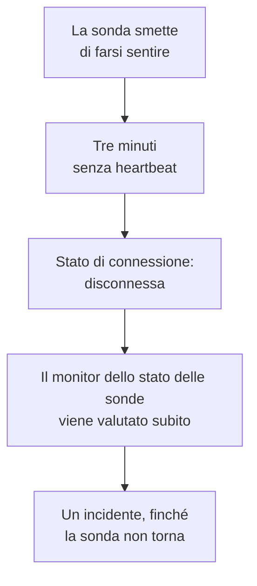

# Monitor dello stato delle sonde

Un monitor dello stato delle sonde ti avvisa quando una sonda smette di farsi sentire: un incidente quando si disconnette, che si risolve da solo quando torna. Puntalo sulle tue sonde personalizzate o, su un OneUptime self-hosted, sulla sonda globale su cui gira ogni monitor, così una sonda che tace non lascia mai i suoi monitor senza controlli all'insaputa di tutti.

:::cards
- [Crearne uno](#creare-un-monitor-dello-stato-delle-sonde): Scegli le sonde e tieni i criteri predefiniti.
- [Criteri](#criteri): Conta le sonde connesse o disconnesse, adesso o su una finestra di tempo.
- [Metriche](#metriche): Quante sonde erano connesse, minuto per minuto.
:::

## Come funziona

OneUptime valuta ogni monitor dello stato delle sonde una volta al minuto, e di nuovo nel momento in cui una delle sue sonde si connette o si disconnette. Legge lo stato di connessione di ogni sonda, quello mostrato dalla pagina della sonda: una sonda è disconnessa quando per tre minuti non si è avuta alcuna sua notizia. Dopo che OneUptime stesso è stato fermo o non ha ricevuto dati, aspetta tre minuti interi prima di dichiarare disconnessa una sonda, quindi aggiornare OneUptime non apre mai un incidente.

Una sonda che resta giù è un solo incidente, non uno al minuto. Il monitor resta offline, con il suo incidente aperto, finché ogni sonda che sorveglia non è di nuovo connessa; allora l'incidente si risolve da solo.

Un monitor può sorvegliare le sonde del proprio progetto e le sonde globali. Una sonda eliminata non viene contata in nessun senso. Quando non resta nessuna delle sonde che un monitor sorveglia, il monitor mantiene il suo stato, e la sua panoramica lo segnala dopo un giorno.

## Creare un monitor dello stato delle sonde

:::steps
### Iniziare un nuovo monitor

Vai su **Monitor** e fai clic su **Crea monitor**.

### Scegliere lo stato della sonda

In **Tipo di monitor**, fai clic su **Altri tipi di monitor** e scegli **Stato della sonda** in **Altro**. Compila il **Nome** e fai clic su **Avanti**.

### Scegliere le sonde

In **Sonde da sorvegliare**, scegli le sonde. Un nuovo monitor parte con le sonde del tuo progetto. Un OneUptime self-hosted senza sonde proprie parte con le sue sonde globali; su OneUptime Cloud le sonde globali sono gestite da OneUptime, quindi un progetto le sceglie da sé se vuole sorvegliarle.

### Creare il monitor

Mantieni i criteri predefiniti, descritti più sotto, e fai clic su **Crea monitor**. Il monitor viene valutato subito, e la sua panoramica elenca ogni sonda che sorveglia, prima quelle disconnesse.
:::

> [!TIP]
> **Monitora questa sonda**, nella pagina di una sonda e nel menu della sua riga in **Monitor → Impostazioni → Sonde**, apre **Crea monitor** con un monitor dello stato delle sonde che sorveglia quella sonda e porta il suo nome.

## Criteri

I filtri di un monitor dello stato delle sonde contano sonde:

| Filtro | Cosa conta |
| --- | --- |
| **Disconnected Probes** | Le sonde sorvegliate che sono disconnesse. |
| **Connected Probes** | Le sonde sorvegliate che sono connesse. |

Entrambi sono numeri interi, confrontati con **Maggiore di**, **Minore di**, **Uguale a** e gli altri confronti. Un nuovo monitor parte con due criteri:

| Criterio | Filtro | Cosa fa |
| --- | --- | --- |
| Check if a probe is disconnected | **Disconnected Probes** maggiore di `0` | Mette il monitor offline e dichiara un incidente intitolato `Probe disconnected: {{disconnectedProbeNames}}`, che si risolve da solo. |
| Check if every probe is connected | **Disconnected Probes** uguale a `0` | Mette il monitor in stato operativo. |

**Connected Probes** è adatto a un monitor che sorveglia più sonde e può perderne una: **Connected Probes** minore di `2` dichiara un incidente solo quando ne restano meno di due.

### Aspettare di più prima di un incidente

Una sonda è disconnessa solo dopo tre minuti di silenzio, quindi un rapido riavvio non apre nulla. Per aspettare di più, spunta **Valuta questo criterio su un periodo di tempo** sotto il filtro, scegli **All Values** in **Valuta** e una finestra in **Per gli ultimi (in minuti)**. Con cinque minuti, una sonda deve restare disconnessa per altri cinque minuti prima che l'incidente venga dichiarato.

## Metriche

Ogni valutazione registra due serie sul monitor: `oneuptime.monitor.probes.connected` e `oneuptime.monitor.probes.disconnected`, il numero di sonde sorvegliate che erano connesse e disconnesse. Sono tracciate nella pagina **Metriche** del monitor, e una dashboard o un monitor di metriche le legge come qualsiasi altra serie.

## Variabili dei modelli

I modelli di incidente e di avviso di un monitor dello stato delle sonde possono usare queste variabili, oltre a quelle di ogni monitor:

| Variabile | Valore |
| --- | --- |
| `{{disconnectedProbeNames}}` | I nomi delle sonde disconnesse, separati da virgole. |
| `{{disconnectedProbeCount}}` | Quante sonde sono disconnesse. |
| `{{connectedProbeNames}}` | I nomi delle sonde connesse, separati da virgole. |
| `{{connectedProbeCount}}` | Quante sonde sono connesse. |
| `{{probeStatusSummary}}` | Una frase che nomina le sonde disconnesse, come `1 of 3 probes is disconnected: EU Probe.`, o che dice che tutte le sonde sono connesse. |
| `{{probes}}` | Ogni sonda, con `probeName`, `isConnected`, `isGlobalProbe` e `lastAliveAt`. |

## Risoluzione dei problemi

:::details Il monitor dice che sta aspettando i dati
Un nuovo monitor mostra la sua prima valutazione entro un minuto o due. Se non sorveglia nessuna sonda, mostra invece **Not set up**: scegli le sonde in **Criteri**.
:::

:::details Una sonda è caduta e non è stato dichiarato alcun incidente
Una sonda è disconnessa dopo tre minuti senza heartbeat, e ancora più tardi dopo che OneUptime stesso è stato fermo. Verifica che il monitor non sia disattivato o in una finestra di manutenzione, e che i suoi criteri dichiarino ancora un incidente.
:::

## Passaggi successivi

:::cards
- [Sonde personalizzate](/docs/probe/custom-probe): Esegui una sonda nella tua rete.
- [Criteri e stati del monitor](/docs/monitor/criteria-and-statuses): Come i criteri decidono lo stato di un monitor.
- [Modelli di incidenti e avvisi](/docs/monitor/incident-alert-templating): Formula l'incidente che un monitor dichiara.
:::
