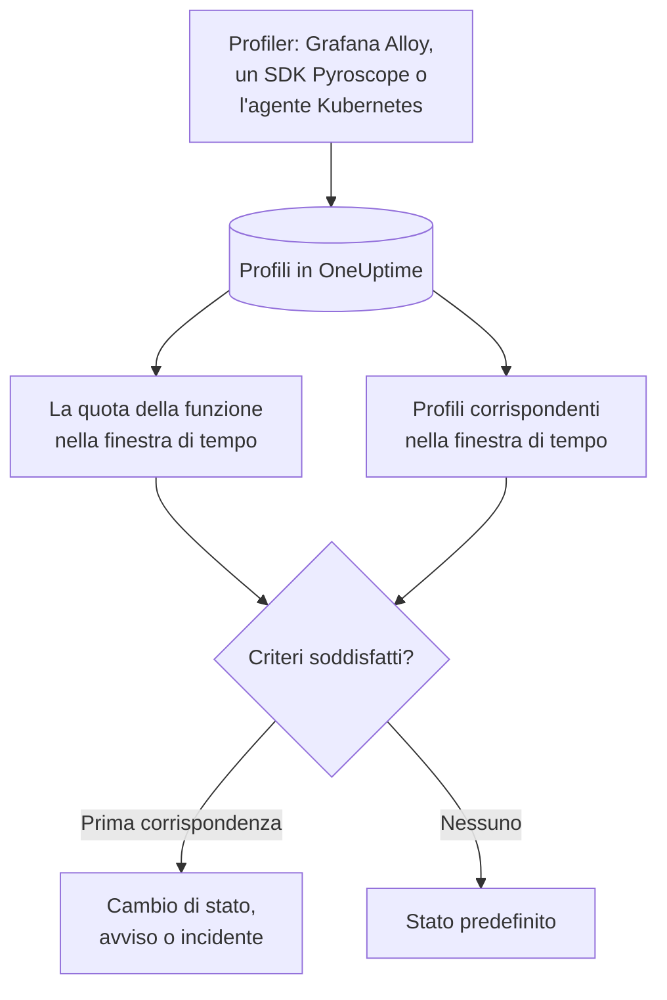

# Monitor profili

Un monitor profili legge i profili continui che i vostri servizi inviano a OneUptime e avvisa su due cose: una funzione che occupa una quota del tempo maggiore del dovuto, come un parser diventato più pesante dopo un deploy, e profili che smettono di arrivare da un servizio. Ogni minuto misura quanta parte della sua finestra di tempo è passata per la funzione che indicate, conta i profili che corrispondono ai suoi filtri, e cambia lo stato del monitor, crea un avviso o dichiara un incidente quando i vostri criteri sono soddisfatti.

:::cards
- [Creare il monitor](#creare-un-monitor-profili): Da una funzione nel Profiler, oppure da Crea monitor.
- [Cosa interroga](#cosa-interroga): La funzione, il tipo di profilo, i servizi e la finestra.
- [Criteri](#criteri): La quota di una funzione nella finestra, oppure il numero di profili.
- [Una funzione diventa più pesante](#esempio-pratico-una-funzione-diventa-più-pesante): Avvisare quando la quota di una funzione balza in alto.
:::

## Come funziona



Ogni minuto, OneUptime legge i profili che corrispondono ai filtri del monitor e sono iniziati entro la sua finestra di tempo. Li conta e, quando il monitor indica una funzione, misura la quota del tempo di quella finestra che è passata per la funzione. Confronta questi numeri con i criteri del monitor dall'alto verso il basso, e il primo criterio che corrisponde decide cosa succede. Quando non ne corrisponde nessuno, il monitor torna al suo stato predefinito.

## Prima di iniziare

- I vostri servizi inviano dati di profilazione continua a OneUptime, tramite Grafana Alloy (eBPF), un SDK Pyroscope o l'agente Kubernetes di OneUptime. Vedete [Profilazione continua](/docs/telemetry/profiles).
- Per osservare una funzione, ne conoscete il nome, o una parte del percorso del suo file o pacchetto, come lo mostra il Profiler.

## Creare un monitor profili

:::steps
### Partire dal Profiler, oppure da Crea monitor

La via più rapida parte dalla funzione stessa: in **Profili di prestazioni**, aprite la funzione e fate clic sul link che propone un avviso sulla sua quota. **Crea monitor** si apre con il monitor già compilato per quella funzione e il suo servizio, con una soglia sopra quanto occupa oggi, come descritto in [Esempio pratico: una funzione diventa più pesante](#esempio-pratico-una-funzione-diventa-più-pesante). Altrimenti andate in **Monitor** e fate clic su **Crea monitor**.

### Scegliere Profiles

In **Tipo di monitor**, fate clic su **Altri tipi di monitor** e scegliete **Profili** sotto **Telemetria**, oppure digitate `profiles` nella casella di ricerca. Inserite un **Nome**, quindi fate clic su **Avanti**.

### Scegliere cosa legge

In **Configurazione del monitor dei profili**, impostate **Funzione** sulla funzione da osservare, **Cosa analizzare** sul tipo di profilo e **Monitora i profili per (tempo)** sulla finestra. Un nuovo monitor legge il **Tempo CPU** degli **Ultimi 5 minuti**. **Cosa legge ora questo monitor**, sotto i campi, mostra quanti profili corrispondono e quanta parte della finestra occupa oggi la funzione, così potete impostare la soglia sopra di essa. Aprite **Altri campi** per filtrare per servizio di telemetria o per entità dell'infrastruttura.

### Impostare i criteri

Un monitor avviato da **Crea monitor** ha due criteri: offline, con un incidente, quando il **Numero di profili** è 0, e online quando è sopra 0. Per avvisare sulla funzione, aggiungete un filtro **Quota della funzione (in %)**: vedete [Criteri](#criteri).

### Creare il monitor

Fate clic su **Crea monitor**. Il monitor si apre sulla sua pagina **Panoramica**, e la sua prima valutazione viene eseguita entro un minuto.
:::

### Crearlo tramite l'API o Terraform

Il passaggio di un monitor contiene le stesse impostazioni della sua configurazione `profileMonitor`. Questa osserva `parseOrder` nei profili CPU di un servizio negli ultimi cinque minuti:

```json
{
  "profileMonitor": {
    "telemetryServiceIds": [],
    "profileTypes": ["cpu"],
    "profileType": "",
    "functionName": "parseOrder",
    "attributes": {},
    "lastXSecondsOfProfiles": 300
  }
}
```

Inserite l'ID del servizio in `telemetryServiceIds`, oppure lasciate vuoto l'elenco per leggere i profili di ogni servizio, e lasciate vuoto `functionName` per contare soltanto i profili. Create un monitor con il tipo di monitor `Profiles` e un passaggio che contenga questa configurazione e almeno un criterio, tramite l'[API](/docs/api-reference/api-reference) o [Terraform](/docs/terraform/monitor-steps). In Terraform, passate la configurazione come attributo `profile_monitor` del passaggio, scritta con `jsonencode()`.

## Cosa interroga

| Campo | Cosa seleziona | Predefinito |
| --- | --- | --- |
| `profileTypes` | Profili di uno qualsiasi di questi tipi, confrontati esattamente, come `cpu`. | Vuoto: ogni tipo |
| `profileType` | Profili il cui tipo contiene questo testo, senza distinzione tra maiuscole e minuscole. Quando è impostato, `profileTypes` viene ignorato. | Vuoto |
| `functionName` | Il codice di cui **Quota della funzione (in %)** misura la quota: i frame dello stack il cui nome di funzione o percorso del file contiene questo testo, senza distinzione tra maiuscole e minuscole. | Vuoto: nessuna quota misurata |
| `telemetryServiceIds` | Profili di uno qualsiasi di questi servizi di telemetria. | Vuoto: ogni servizio |
| `entityKeys` | Profili di uno qualsiasi di questi host, pod, container e altre entità dell'infrastruttura. | Vuoto: ogni entità |
| `attributes` | Profili i cui attributi hanno questi valori. | Vuoto: nessuna condizione |
| `lastXSecondsOfProfiles` | Profili iniziati entro questo numero di secondi prima della valutazione. | Nessuno: impostatelo sempre, altrimenti viene contato ogni profilo memorizzato e il conteggio non scende mai a 0 |

Tutti i filtri che impostate devono corrispondere perché un profilo venga letto. Nel modulo, **Funzione** imposta `functionName`, **Cosa analizzare** imposta `profileTypes` (**Ogni tipo di profilo** lo lascia vuoto), **Monitora i profili per (tempo)** imposta `lastXSecondsOfProfiles`, e **Filtra per servizio di telemetria** e **Filtra per entità dell'infrastruttura** impostano `telemetryServiceIds` ed `entityKeys`.

## Come viene valutato

- **Ogni minuto.** Un monitor profili non viene controllato da sonde, quindi non ha un intervallo da impostare né una pagina **Sonde e intervallo**.
- **Due numeri per valutazione.** Il monitor conta i profili che corrispondono a ogni filtro e sono iniziati entro `lastXSecondsOfProfiles`, e misura la quota della funzione negli stessi profili. Un profiler carica i dati a intervalli regolari, quindi lasciate alla finestra spazio per diversi caricamenti.
- **Un'unità alla volta.** Una quota somma campioni di una sola unità: quando i tipi letti mescolano unità, come il tempo CPU in nanosecondi da un SDK e i conteggi di campioni da eBPF, legge l'unità con più campioni nella finestra.
- **Nessun profilo significa un conteggio di 0 e nessuna quota.** Un servizio il cui profiler smette di caricare dati produce un conteggio di 0, e un criterio **Quota della funzione (in %)** non corrisponde a una finestra vuota: avvisate sul **Numero di profili** per sapere che la profilazione si è fermata.
- **L'interruzione di OneUptime stesso non è silenzio.** Finché la finestra di tempo contiene un periodo in cui OneUptime stesso non riceveva dati (si stava riavviando, veniva aggiornato o recuperava un arretrato), il controllo attende: lo stato non cambia e nessun incidente o avviso viene aperto o risolto. Vedete [Quando OneUptime non riceve dati](/docs/monitor/when-oneuptime-is-not-receiving).
- **Criteri dall'alto verso il basso.** Decide il primo criterio che corrisponde, quindi mettete per primo il più grave.

Ogni cambio di stato, con il suo motivo, viene registrato nella **Cronologia di stato** del monitor.

## Criteri

I criteri di un monitor profili confrontano uno di due numeri con un valore.

**Quota della funzione (in %)** è la quota del tempo della finestra, da 0 a 100, passata per la funzione del monitor: ogni stack con un frame che corrisponde a `functionName` conta una volta, a qualsiasi profondità, quindi comprende sia il codice proprio della funzione sia tutto ciò che chiama.

| Condizione del filtro | Corrisponde quando la quota della funzione è… |
| --- | --- |
| **Maggiore di** | sopra il valore |
| **Maggiore o uguale a** | pari al valore o superiore |
| **Minore di** | sotto il valore |
| **Minore o uguale a** | pari al valore o inferiore |

Il **Numero di profili** è il numero di profili che hanno corrisposto nella finestra:

| Condizione del filtro | Corrisponde quando il conteggio dei profili è… |
| --- | --- |
| **Maggiore di** | sopra il valore |
| **Maggiore o uguale a** | pari al valore o superiore |
| **Minore di** | sotto il valore |
| **Minore o uguale a** | pari al valore o inferiore |
| **Uguale a** | esattamente il valore |
| **Diverso da** | qualsiasi cosa tranne il valore |

I conteggi dei profili non hanno condizioni di anomalia: non c'è un riferimento con cui confrontarli.

## Esempio pratico: una funzione diventa più pesante

Nel servizio di checkout, `parseOrder` occupa il 18% del suo tempo CPU. Un deploy che analizza un payload più grande non deve passare inosservato:

1. In **Profili di prestazioni**, scegliete il servizio di checkout e aprite `parseOrder`.
2. Fate clic sul link che propone un avviso sulla sua quota. Il Profiler suggerisce il 30%: metà in più della quota di oggi, almeno 10 punti in più, arrotondato per eccesso a un multiplo di 5.
3. **Crea monitor** si apre su un monitor profili del servizio di checkout che legge il **Tempo CPU** degli **Ultimi 5 minuti**, con due criteri: **Quota della funzione (in %)** **Maggiore di** `30` genera un avviso, che si risolve da solo, e segna il monitor come degradato; **Minore o uguale a** `30` lo segna come operativo. L'incidente è compilato ma disattivato: attivatelo per chiamare qualcuno.
4. Fate clic su **Crea monitor**.

Quando il deploy fa occupare a `parseOrder` il 45% del tempo CPU, la valutazione successiva genera l'avviso. Quando una correzione la riporta sotto il 30%, l'avviso si risolve da solo.

## Esempio pratico: i profili smettono di arrivare

Il servizio di checkout esegue un SDK Pyroscope che carica profili della CPU. Volete un incidente quando smettono di arrivare per cinque minuti:

- `profileTypes`: `["cpu"]`, `telemetryServiceIds`: il servizio di checkout, `lastXSecondsOfProfiles`: `300`
- Criterio 1: **Numero di profili** **Uguale a** `0`: mettere il monitor offline e dichiarare un incidente
- Criterio 2: **Numero di profili** **Maggiore di** `0`: mettere il monitor online

Finché l'SDK carica dati, ogni valutazione conta alcuni profili e il criterio 2 mantiene il monitor online. Quando il servizio viene rilasciato senza l'SDK, il conteggio scende a 0 cinque minuti dopo l'ultimo caricamento, corrisponde il criterio 1 e viene dichiarato l'incidente. Il primo caricamento dopo la correzione riporta il conteggio sopra 0, e l'incidente si risolve da solo se **Risoluzione automatica dell'incidente** è attiva per esso.

## Risoluzione dei problemi

:::details Il monitor conta 0, ma in OneUptime compaiono profili
Confrontate i filtri con i profili che vedete: `profileTypes` deve corrispondere esattamente al tipo, e `telemetryServiceIds` deve contenere gli ID di servizio giusti. Anche un `lastXSecondsOfProfiles` breve può cadere tra due caricamenti.
:::

:::details La quota della funzione resta allo 0%
Nessun frame nella finestra contiene il testo della funzione. Aprite la funzione nel Profiler e copiatene il nome così come è mostrato; basta una parte del nome, e maiuscole e minuscole non contano. Poi controllate che il servizio invii il tipo di profilo che legge **Cosa analizzare**.
:::

## Passaggi successivi

:::cards
- [Profilazione continua](/docs/telemetry/profiles): Inviare profili e leggerli nel Profiler.
- [Passaggi del monitor](/docs/terraform/monitor-steps): Passare la configurazione del passaggio da Terraform.
- [Monitor tracce](/docs/monitor/traces-monitor): Avvisare sugli span non riusciti.
- [Monitor metriche](/docs/monitor/metrics-monitor): Avvisare su CPU, memoria e altre metriche.
:::
