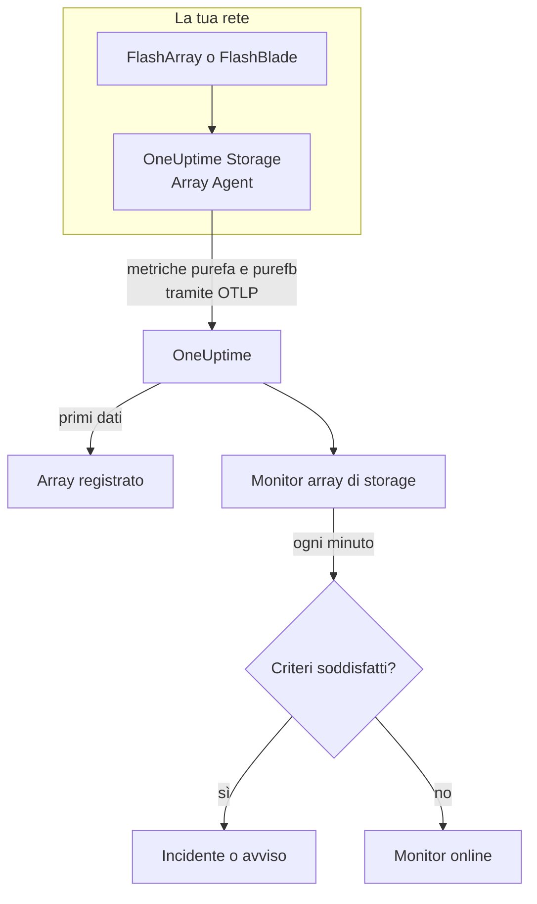

# Monitor array di storage

Un monitor di array di storage osserva un array di storage e ti avvisa quando l'array genera un proprio avviso, esaurisce lo spazio, rallenta, perde hardware o un percorso verso un host, o resta indietro con la replica. Funziona con Pure Storage FlashArray e Pure Storage FlashBlade, le cui serie `purefa_*` e `purefb_*` vengono raccolte dal OneUptime Storage Array Agent, e con Dell PowerMax, le cui serie `powermax_*` vengono lette da una sonda di OneUptime da Unisphere for PowerMax.

Funziona anche con Dell PowerStore (`dell.powerstore`), dalle serie `powerstore_*` di Dell.

:::cards
- [Creare il monitor](#creare-un-monitor-di-array-di-storage): Sei passaggi nella dashboard.
- [Modelli](#modelli-di-avviso-predefiniti): Avvisi pronti, un incidente per volume, host, appliance o componente.
- [Come funzionano le serie di Pure](#come-sono-costruite-le-serie-di-pure): Un nome di metrica, molti valori.
- [Metriche](#metriche-raccolte): Ogni serie su cui il monitor può generare avvisi.
:::

## Come funziona

Il OneUptime Storage Array Agent viene eseguito su una macchina che raggiunge l'interfaccia di gestione dell'array. Legge le metriche dell'array con un token API in sola lettura, le etichetta con il nome dell'array, `storage.array.name`, e la sua piattaforma, `storage.system`, e le invia a OneUptime tramite OTLP. I primi dati registrano l'array.

Un Dell PowerMax non ha bisogno di alcun agente: una sonda di OneUptime accede a Unisphere for PowerMax con un account in sola lettura ogni 5 minuti e invia allo stesso modo ogni array che gestisce, con il nome del suo Symmetrix ID finché non lo rinomini ([Dell PowerMax](/docs/telemetry/storage-arrays#dell-powermax)).

Un monitor di array di storage è legato a un array. Ogni minuto esegue la sua query sulle metriche di quell'array e confronta il risultato con i suoi criteri.



## Prima di iniziare

- **Installa lo Storage Array Agent** dove può raggiungere l'array tramite HTTPS, con il token API di un utente che ha il ruolo **readonly** dell'array. La [guida dello Storage Array Agent](/docs/telemetry/storage-arrays) copre l'utente, il token e l'installazione, tramite `ONEUPTIME_URL`, `ONEUPTIME_TELEMETRY_INGESTION_KEY`, `STORAGE_ARRAY_NAME`, e l'indirizzo e il token dell'array (`PURE_FA_ENDPOINT` e `PURE_FA_API_TOKEN`, oppure `PURE_FB_ENDPOINT` e `PURE_FB_API_TOKEN`).
- **Verifica che l'array sia registrato.** Compare in **Prodotti → Infrastruttura → Array di storage → Tutti gli array di storage**, con il nome dello `STORAGE_ARRAY_NAME` dell'agente, circa un minuto dopo la prima lettura.
- **Per un Dell PowerMax**, connetti invece l'Unisphere for PowerMax che lo gestisce in **Prodotti → Infrastruttura → Array di storage → Connessioni**, come spiega [Dell PowerMax](/docs/telemetry/storage-arrays#dell-powermax).

## Creare un monitor di array di storage

:::steps
### Iniziare un nuovo monitor

Vai su **Monitor** e fai clic su **Crea monitor**.

### Scegliere Array di storage

In **Tipo di monitor**, fai clic su **Altri tipi di monitor** e scegli **Array di storage** sotto **Infrastruttura**, oppure digita `storage` nella casella di ricerca. Inserisci un **Nome** - viene usato nei titoli di incidenti e avvisi - e fai clic su **Avanti**.

### Scegliere l'array

In **Storage Array Monitor Configuration**, scegli l'array da **Array di storage**. Ogni array che ha inviato dati è nell'elenco. La sua piattaforma decide quali metriche e quali modelli offre il modulo. Una volta scelto, una riga sotto il campo dice se arrivano dati. **Aggiungi array di storage** apre i passi di configurazione con le tue chiavi già inserite, che attendono i primi dati.

### Scegliere cosa osservare

Un nuovo monitor parte da **Array Stopped Reporting**, in **Su cosa avvisare**. Per controllare altro:

- **Cambia** - scegli un altro [modello](#modelli-di-avviso-predefiniti). Imposta la metrica, i filtri sulle etichette, l'aggregazione, l'intervallo di tempo e le soglie, e sostituisce i criteri qui sotto con i propri. Puoi comunque cambiare l'**Intervallo di tempo**.
- **Custom Metric** (in **Altri campi**) - scegli una metrica da **Storage Array Metric**, poi imposta **Aggregazione** e **Intervallo di tempo**. I [filtri](#impostazioni-del-monitor) la restringono a un volume, un host, un pod, un componente, un file system o un bucket.
- **Avanzato** (in **Altri campi**) - costruisci tu query e formule in **Seleziona metriche**, per esempio la capacità usata come `purefa_array_space_bytes` filtrata su `space=capacity` meno la stessa metrica filtrata su `space=empty`. Usa **Raggruppa per** con l'etichetta di un oggetto per valutare ogni oggetto separatamente.

### Controllare i criteri

Apri ogni criterio in **Criteri** e controlla **Metrica**, **Aggregazione**, **Condizione** e **Soglia**. Un modello li compila. Con **Custom Metric** o **Avanzato**, il monitor parte con i [criteri predefiniti](#criteri-predefiniti), che notano solo una metrica che non invia dati, quindi imposta la tua soglia.

### Creare il monitor

Fai clic su **Crea monitor**. OneUptime apre la pagina del monitor e lo valuta ogni minuto. Gli incidenti e gli avvisi che genera compaiono anche nelle pagine **Incidenti** e **Avvisi** dell'array.
:::

> [!TIP]
> Per impostare più modelli in una volta, apri l'array da **Prodotti → Infrastruttura → Array di storage** e vai su **Raccomandazioni**. Scegli i modelli che vuoi, decidi chi viene avvisato, e OneUptime crea un monitor per ogni modello.

## Impostazioni del monitor

| Campo | Scheda | Cosa fa |
| --- | --- | --- |
| **Array di storage** | Tutte | Obbligatorio. Limita ogni query a `resource.storage.array.name`, così due array che hanno entrambi un volume chiamato `vol-01` non si mescolano mai. |
| **Volume** | Custom Metric, Avanzato | Solo FlashArray e PowerMax. Un volume: tramite l'etichetta `name` su un FlashArray, come `vol-db-01` (un volume in un pod o in un gruppo di volumi si chiama `pod::volume` o `group/volume`), e tramite l'etichetta `volume` su un PowerMax, il suo ID di dispositivo, come `00847`. |
| **Host** | Custom Metric, Avanzato | Solo FlashArray. Un host come lo conosce l'array, tramite l'etichetta `host`, come `esxi-01`. |
| **Pod** | Custom Metric, Avanzato | Solo FlashArray. Un pod ActiveCluster o ActiveDR, tramite l'etichetta `name`, oppure `local_pod` sulle serie dei collegamenti di replica. |
| **Componente hardware** | Custom Metric, Avanzato | Un componente hardware, come `CH0.BAY1` o `CT0`: l'etichetta `component_name` su un FlashArray, `name` su un FlashBlade e `component` su un PowerMax, un director come `FA-1D` o una porta come `FA-1D:4`. |
| **File system** | Custom Metric, Avanzato | Solo FlashBlade. Un file system, tramite l'etichetta `name`. |
| **Bucket** | Custom Metric, Avanzato | Solo FlashBlade. Un bucket di object storage, tramite l'etichetta `name`. |
| **Storage Array Metric** | Custom Metric | Una metrica del [catalogo](#metriche-raccolte). Il modulo aggiunge il filtro sull'etichetta che le dà il suo significato, e la raggruppa per l'oggetto che descrive, così ogni volume, host o componente viene valutato separatamente. |
| **Aggregazione** | Custom Metric | Come vengono combinati i campioni: **Media**, **Massimo**, **Minimo**, **Somma** o **Conteggio**. Parte dall'aggregazione abituale della metrica. |
| **Intervallo di tempo** | Tutte | La finestra mobile che la query legge, da **Past 1 Minute** a **Past 365 Days**. Un nuovo monitor parte da **Ultimi 5 minuti**; una metrica personalizzata di un file system o di un bucket da **Ultimi 15 minuti**; i modelli impostano la propria. |
| **Seleziona metriche** | Avanzato | Il generatore di query: **Metrica**, **Aggrega per**, **Filtra per attributi**, **Raggruppa per**, più **Aggiungi metrica** e **Aggiungi formula** per combinare le query. |

L'agente legge l'endpoint dell'array ogni 60 secondi, e volumi, host e pod ogni 2 minuti, quindi una finestra di 5 minuti contiene sempre un campione. Legge i file system e i bucket di un FlashBlade ogni 5 minuti, da qui i 15, e le directory di FlashArray ogni 30 minuti: dai a un monitor di directory una finestra di 60 minuti. Una sonda legge un PowerMax ogni 5 minuti, con la stessa frequenza con cui Unisphere ne calcola le prestazioni: dai a un monitor PowerMax una finestra di 10 minuti o più.

Legge un PowerStore ogni 5 minuti, e lo stato del suo cluster ogni 60 secondi: dai a un monitor PowerStore una finestra di 15 minuti.

## Come sono costruite le serie di Pure

Pure mette più valori su **un solo** nome di metrica e li distingue con un'etichetta:

- **`dimension`** sulle serie di prestazioni. `purefa_array_performance_latency_usec` porta la latenza di lettura (`usec_per_read_op`), la latenza di scrittura (`usec_per_write_op`), la latenza di scrittura in mirroring, e il tempo SAN, di coda, QoS e di servizio di ciascuna. Filtra sempre su una sola `dimension`: una media tra tutte mescola una latenza di lettura di 200 µs con un valore di coda.
- **`space`** sulle serie di capacità: `capacity`, `empty`, `snapshots`, `total_provisioned`, `total_physical`, `available_ratio` e altre.

Diverse serie portano il loro stato in un'**etichetta**, con un valore sempre pari a 1:

| Serie | Etichetta di stato | Una serie per |
| --- | --- | --- |
| `purefa_alerts_open` | `severity`, con `summary`, `code` e `component_type` | Avviso aperto |
| `purefa_hw_component_status` | `component_status` | Componente hardware |
| `purefa_host_connectivity_info` | `status`, con `details` | Host |
| `purefa_drive_capacity_bytes` | `component_status` (il valore è la capacità del disco) | Disco |

Una serie filtrata su uno stato negativo esiste solo finché qualcosa è in quello stato, quindi nessuna serie significa tutto in ordine. Per questo **Max sopra 0 scatta e 0 rientra** è la forma giusta per queste serie, ed è così che sono costruiti i modelli: i loro criteri di rientro contano una serie mancante come zero. Quando non resta alcuna serie, un modello di questo tipo rientra solo se `purefa_info`, `purefb_info` o `powermax_array_info` è arrivato nella stessa finestra, quindi un array che ha smesso di riferire non chiude nulla.

Le serie di un PowerMax contengono ciascuna un solo valore, da cui prendono il nome: `powermax_array_response_time_usec` distingue le letture dalle scritture con `operation`. Allo stesso modo, le sue serie di stato esistono solo finché qualcosa non va: `powermax_alert_open` finché Unisphere ha un avviso aperto, `powermax_director_offline` finché un director non è online, `powermax_port_offline` finché una porta da cui qualcuno dipende è inattiva, e `powermax_srdf_group_not_healthy` finché un gruppo SRDF è sospeso o offline.

Nei filtri del monitor e nelle chiavi di raggruppamento, gli attributi dell'agente iniziano con `resource.` (`resource.storage.array.name`, `resource.storage.system`), mentre le etichette proprie di Pure no (`name`, `host`, `component_name`, `dimension`, `space`, `severity`), e nemmeno quelle di PowerMax (`storage_group`, `volume`, `director`, `port_id`, `srdf_group`).

## Come sono fatte le serie di PowerStore

L'exporter di Dell scrive un valore per nome di metrica, quindi una serie PowerStore non ha bisogno di filtri sulle etichette. Le sue etichette indicano l'oggetto: `appliance_id` un'appliance, `name` un componente, un volume o un file system, e `volume_id`, `fc_port_id`, `eth_port_id`, `nas_id` o `volume_group_id` l'oggetto di una serie di prestazioni. Le sue serie di stato valgono 1 finché tutto va bene e 0 altrimenti, quindi i modelli scattano sotto 1. I suoi avvisi arrivano via syslog, e i loro modelli, monitor di log, sono elencati dopo la sua tabella qui sotto.

## Modelli di avviso predefiniti

OneUptime fornisce 49 modelli — 12 per FlashArray, 8 per FlashBlade, 16 per PowerStore e 13 per PowerMax — e l'elenco di **Su cosa avvisare** offre quelli per la piattaforma dell'array. Ognuno costruisce un monitor completo: la query della metrica, i suoi filtri sulle etichette, un raggruppamento sull'etichetta propria dell'oggetto, un criterio che scatta e uno che rientra. Le soglie sono punti di partenza che puoi modificare.

Un criterio scatta solo quando la condizione vale per **ogni** valore della sua finestra. Un monitor scattato su una soglia di capacità, latenza, ritardo o rapporto rientra solo il 10 % oltre di essa, così un valore che oscila attorno alla soglia non va avanti e indietro. I modelli di avvisi, hardware e connettività scattano quando uno stato si è visto per tutta la loro finestra di 5 minuti, e rientrano circa 5 minuti dopo che è scomparso. Quelli di PowerMax usano finestre di 10 e 15 minuti: due e tre delle sue raccolte a 5 minuti.

### FlashArray

| Modello                        | Categoria    | Gravità  | Osserva                                                                                         | Scatta quando                                                                                                                                    |
| ------------------------------ | ------------ | -------- | ----------------------------------------------------------------------------------------------- | ------------------------------------------------------------------------------------------------------------------------------------------------ |
| Array Stopped Reporting        | Disponibilità | Critico  | `purefa_info`, Count, ultimi 10 minuti                                                          | Nessun dato per tutta la finestra — lo Storage Array Agent si è fermato, ha perso la connessione a OneUptime o si è visto revocare il token, oppure l'array ha smesso di rispondergli; rientra quando i dati tornano ad arrivare |
| Critical Array Alert           | Salute dell'array | Critico  | `purefa_alerts_open` filtrata su `severity=critical`, Max per `summary`, ultimi 5 minuti        | > 0 — l'array ha un avviso critico aperto (un componente guasto, un'emergenza di capacità, un errore di replica). Un incidente per avviso; rientra quando l'avviso si chiude |
| Warning Array Alert            | Salute dell'array | Avviso  | `purefa_alerts_open` filtrata su `severity=warning`, Max per `summary`, ultimi 5 minuti         | > 0 — l'array ha un avviso di livello warning aperto. Un incidente per avviso; rientra quando l'avviso si chiude                                 |
| Capacity Above 80%             | Capacità     | Avviso  | `purefa_array_space_utilization`, Max, ultimi 15 minuti                                         | > 80 — la prima soglia di capacità di Pure stessa; rientra a ≤ 72                                                                                |
| Capacity Above 90%             | Capacità     | Critico  | `purefa_array_space_utilization`, Max, ultimi 5 minuti                                          | > 90 — l'array è vicino a rifiutare le scritture; rientra a ≤ 81                                                                                 |
| High Read Latency              | Prestazioni  | Avviso  | `purefa_array_performance_latency_usec` filtrata su `dimension=usec_per_read_op`, Avg, ultimi 10 minuti  | > 5000 µs (5 ms) — le letture di un FlashArray di norma si completano ben sotto 1 ms; rientra a ≤ 4500                                  |
| High Write Latency             | Prestazioni  | Avviso  | `purefa_array_performance_latency_usec` filtrata su `dimension=usec_per_write_op`, Avg, ultimi 10 minuti | > 5000 µs (5 ms); rientra a ≤ 4500                                                                                                     |
| Hardware Component Failed      | Hardware     | Critico  | `purefa_hw_component_status` filtrata su `component_status=critical`, Max per `component_name`, ultimi 5 minuti | > 0 — un controller, un alimentatore, una ventola, un alloggiamento o una porta è critico e la ridondanza è persa. Un incidente per componente; rientra quando segnala ok |
| Hardware Component Degraded    | Hardware     | Avviso  | `purefa_hw_component_status` filtrata su `component_status=degraded`, Max per `component_name`, ultimi 5 minuti | > 0 — un componente è degradato. Un incidente per componente; rientra quando segnala ok                                          |
| Drive Failed                   | Hardware     | Critico  | `purefa_drive_capacity_bytes` filtrata su `component_status=failed`, Max per `component_name`, ultimi 5 minuti | > 0 — un modulo DirectFlash o un SSD si è guastato e l'array ricostruisce sugli altri. Un incidente per disco; rientra quando viene sostituito |
| Host Lost Redundant Paths      | Host         | Avviso  | `purefa_host_connectivity_info` filtrata su `status=critical`, Max per `host`, ultimi 5 minuti  | > 0 — l'host raggiunge l'array tramite un solo controller o nessuno; un failover del controller metterebbe offline il suo storage. Un incidente per host; rientra quando i suoi percorsi tornano |
| Replication Lag Above 1 Minute | Replica  | Avviso  | `purefa_pod_replica_links_lag_max_msec`, Max per `local_pod`, ultimi 10 minuti                  | > 60000 ms (60 s) — un failover adesso perderebbe più scritture recenti del previsto. Un incidente per pod; rientra a ≤ 54000                     |

### FlashBlade

| Modello                      | Categoria    | Gravità  | Osserva                                                                                                        | Scatta quando                                                                                                       |
| ---------------------------- | ------------ | -------- | -------------------------------------------------------------------------------------------------------------- | ------------------------------------------------------------------------------------------------------------------- |
| Array Stopped Reporting      | Disponibilità | Critico  | `purefb_info`, Count, ultimi 10 minuti                                                                         | Nessun dato per tutta la finestra — l'agente, il suo exporter o il FlashBlade ha smesso di rispondere; rientra quando i dati tornano ad arrivare |
| Critical Array Alert         | Salute dell'array | Critico  | `purefb_alerts_open` filtrata su `severity=critical`, Max per `summary`, ultimi 5 minuti                       | > 0 — il FlashBlade ha un avviso critico aperto. Un incidente per avviso; rientra quando l'avviso si chiude         |
| Warning Array Alert          | Salute dell'array | Avviso  | `purefb_alerts_open` filtrata su `severity=warning`, Max per `summary`, ultimi 5 minuti                        | > 0 — il FlashBlade ha un avviso di livello warning aperto. Un incidente per avviso; rientra quando l'avviso si chiude |
| Capacity Above 80%           | Capacità     | Avviso  | `purefb_array_space_utilization` filtrata su `type=array`, Max, ultimi 15 minuti                               | > 80; rientra a ≤ 72                                                                                                |
| Capacity Above 90%           | Capacità     | Critico  | `purefb_array_space_utilization` filtrata su `type=array`, Max, ultimi 5 minuti                                | > 90 — quando si riempie, le scritture falliscono per ogni client; rientra a ≤ 81                                   |
| Hardware Component Unhealthy | Hardware     | Critico  | `purefb_hardware_health`, Min per `name`, ultimi 5 minuti                                                      | < 1 — un blade, un modulo fabric, un alimentatore o una ventola non è in salute (uno slot inutilizzato segnala 2). Un incidente per componente; rientra a ≥ 1 |
| High Read Latency            | Prestazioni  | Avviso  | `purefb_array_performance_latency_usec` filtrata su `dimension=usec_per_read_op` e `protocol=all`, Avg, ultimi 10 minuti | > 10000 µs (10 ms) su tutti i protocolli; rientra a ≤ 9000                                             |
| File System Near Full        | File system | Avviso  | `purefb_file_systems_space_bytes` filtrata su `space=available_ratio`, Min per `name`, ultimi 15 minuti        | < 0.1 — resta meno del 10 % della dimensione assegnata di un file system. Un incidente per file system; rientra a ≥ 0.11 |

### PowerStore

| Modello                      | Categoria    | Gravità  | Osserva                                                                                                        | Scatta quando                                                                                                       |
| --- | --- | --- | --- | --- |
| Array Stopped Reporting | Disponibilità | Critico | `powerstore_cluster`, Count, ultimi 10 minuti | Nessun dato per tutta la finestra — l'agente, l'exporter di Dell o il cluster ha smesso di rispondere; rientra quando tornano ad arrivare dati |
| Capacity Above 80% | Capacità | Avviso | `powerstore_cap_physical_used_percent`, Max per `appliance_id`, ultimi 15 minuti | > 80 — la capacità di un'appliance si sta riempiendo; rientra a ≤ 72 |
| Capacity Above 90% | Capacità | Critico | `powerstore_cap_physical_used_percent`, Max per `appliance_id`, ultimi 15 minuti | > 90 — un'appliance sta per rifiutare le scritture; rientra a ≤ 81 |
| High Read Latency | Prestazioni | Avviso | `powerstore_perf_avg_read_latency`, Avg per `appliance_id`, ultimi 15 minuti | > 5000 µs (5 ms); rientra a ≤ 4500 |
| High Write Latency | Prestazioni | Avviso | `powerstore_perf_avg_write_latency`, Avg per `appliance_id`, ultimi 15 minuti | > 5000 µs (5 ms); rientra a ≤ 4500 |
| Drive Failed | Hardware | Critico | `powerstore_hardware_Drive_state`, Min per `name`, ultimi 10 minuti | < 1 — un'unità si è guastata o è stata rimossa; rientra a ≥ 1 |
| Node Unhealthy | Hardware | Critico | `powerstore_hardware_node_state`, Min per `name`, ultimi 10 minuti | < 1 — un nodo non è Healthy; rientra a ≥ 1 |
| Power Supply Unhealthy | Hardware | Avviso | `powerstore_hardware_Power_Supply_state`, Min per `name`, ultimi 10 minuti | < 1 — un alimentatore si è guastato o ha perso corrente; rientra a ≥ 1 |
| Fan Unhealthy | Hardware | Avviso | `powerstore_hardware_Fan_state`, Min per `name`, ultimi 10 minuti | < 1 — una ventola si è guastata; rientra a ≥ 1 |
| Battery Unhealthy | Hardware | Avviso | `powerstore_hardware_Battery_state`, Min per `name`, ultimi 10 minuti | < 1 — un modulo batteria di backup è guasto; rientra a ≥ 1 |
| Drive Wearing Out | Hardware | Avviso | `powerstore_wear_metrics_by_drive`, Min per `name`, ultimi 15 minuti | < 10 — a un'unità resta meno del 10% della sua durata; rientra a ≥ 11 |
| NAS Server Not Started | File system | Avviso | `powerstore_nas_server_operational_status`, Max per `name`, ultimi 10 minuti | < 1 — un server NAS è fermo o degradato; rientra a ≥ 1 |
| Volume Not Ready | Salute dell'array | Avviso | `powerstore_volume_state`, Max per `name`, ultimi 15 minuti | < 1 — un volume è offline; rientra a ≥ 1 |
| File System Near Full | File system | Avviso | `powerstore_filesystem_logical_used_percent`, Max per `name`, ultimi 15 minuti | > 90 — un file system è quasi pieno; rientra a ≤ 81 |
| Cluster Not Configured | Salute dell'array | Avviso | `powerstore_cluster`, Max, ultimi 10 minuti | < 1 — il cluster non è Configured; rientra a ≥ 1 |
| Metro Witness Not Connected | Replica | Avviso | `powerstore_metro_witness_status`, Min per `name`, ultimi 10 minuti | > 0 — un witness Metro non è connesso; rientra quando torna OK |

### Avvisi PowerStore, via syslog

Gli avvisi di un PowerStore arrivano come log, quindi i loro modelli sono monitor di tipo **Log**, offerti nella pagina **Raccomandazioni** dell'array sotto **Avvisi dell'array**. Ognuno apre un avviso per ogni avviso PowerStore, raggruppato per `powerstore.resource.name` e `powerstore.alert.id`, e lo risolve quando il PowerStore annulla quell'avviso:

| Modello | Gravità | Si apre su una riga con | Si risolve su |
| --- | --- | --- | --- |
| Critical Array Alert | Critico | `powerstore.alert.severity=Critical` | `powerstore.alert.state=Cleared` |
| Major Array Alert | Avviso | `powerstore.alert.severity=Major` | `powerstore.alert.state=Cleared` |
| Port Link Down | Avviso | `powerstore.event.code=0x00307404` | `powerstore.alert.state=Cleared` |

### PowerMax

| Modello | Categoria | Gravità | Osserva | Scatta quando |
| --- | --- | --- | --- | --- |
| Array Stopped Reporting | Disponibilità | Critico | `powermax_array_info`, Count, ultimi 10 minuti | Nessun dato per tutta la finestra — la sonda ha smesso di raccogliere l'array: la sua connessione non riesce (la sua pagina in **Connessioni** spiega perché), la sonda è disconnessa, oppure Unisphere non gestisce più l'array; rientra quando i dati tornano ad arrivare |
| Critical Unisphere Alert | Salute dell'array | Critico | `powermax_alert_open` filtrata su `severity=critical`, Max per `description`, ultimi 10 minuti | > 0 — Unisphere ha un avviso aperto di gravità Critical o Fatal per l'array. Un incidente per avviso; rientra quando l'avviso viene riconosciuto o cancellato in Unisphere |
| Warning Unisphere Alert | Salute dell'array | Avviso | `powermax_alert_open` filtrata su `severity=warning`, Max per `description`, ultimi 10 minuti | > 0 — Unisphere ha un avviso aperto di gravità Warning o Minor. Un incidente per avviso; rientra quando l'avviso viene riconosciuto o cancellato |
| Performance Collection Off | Salute dell'array | Avviso | `powermax_array_performance_collection`, Min, ultimi 15 minuti | < 1 — Unisphere non raccoglie le prestazioni a 5 minuti dell'array, quindi nessun tempo di risposta, IOPS o throughput finisce nei grafici o negli avvisi; rientra a ≥ 1 |
| Storage Resource Pool Above 80% | Capacità | Avviso | `powermax_srp_capacity_used_percent`, Max per `srp`, ultimi 15 minuti | > 80 — i gruppi di storage del pool smettono di accettare nuove scritture quando si riempie. Un incidente per pool; rientra a ≤ 72 |
| Storage Resource Pool Above 90% | Capacità | Critico | `powermax_srp_capacity_used_percent`, Max per `srp`, ultimi 15 minuti | > 90 — le scritture sui suoi gruppi di storage falliscono appena è pieno. Un incidente per pool; rientra a ≤ 81 |
| Storage Group Response Time Above 5 ms | Prestazioni | Avviso | `powermax_storage_group_response_time_usec`, Avg per `storage_group`, ultimi 15 minuti | > 5000 µs (5 ms) — un PowerMax di norma risponde ben sotto il millisecondo. Un incidente per gruppo di storage; rientra a ≤ 4500 |
| High Read Response Time | Prestazioni | Avviso | `powermax_array_response_time_usec` filtrata su `operation=read`, Avg, ultimi 15 minuti | > 3000 µs (3 ms); rientra a ≤ 2700 |
| High Write Response Time | Prestazioni | Avviso | `powermax_array_response_time_usec` filtrata su `operation=write`, Avg, ultimi 15 minuti | > 3000 µs (3 ms) — l'SRDF sincrono aggiunge a ogni scrittura il viaggio di andata e ritorno verso l'array remoto; rientra a ≤ 2700 |
| Director Not Online | Hardware | Critico | `powermax_director_offline`, Max per `component`, ultimi 10 minuti | > 0 — un director non è online e l'array funziona con gli altri. Un incidente per director; rientra quando torna online |
| Port Down | Hardware | Avviso | `powermax_port_offline`, Max per `component`, ultimi 10 minuti | > 0 — una porta di un port group, di una masking view o di un gruppo SRDF non è attiva. Un incidente per porta; rientra quando torna attiva |
| SRDF Group Suspended or Offline | Replica | Critico | `powermax_srdf_group_not_healthy`, Max per `srdf_group`, ultimi 10 minuti | > 0 — il collegamento del gruppo è offline oppure le sue coppie sono sospese, divise o in failover, quindi la copia remota non viene mantenuta aggiornata. Un incidente per gruppo; rientra quando torna sincronizzato |
| SRDF/A Lag Above 2 Minutes | Replica | Avviso | `powermax_srdf_group_lag_seconds`, Avg per `srdf_group`, ultimi 15 minuti | > 120 (2 minuti) — un failover adesso perderebbe più scritture recenti del previsto. Un incidente per gruppo; rientra a ≤ 108 |

**Gravità** è l'etichetta che mostra il selettore. L'incidente e l'avviso creati da un modello partono dalla gravità di incidente e di avviso più alta del tuo progetto; cambiale nel criterio.

- **Array Stopped Reporting** conta la serie di identità della piattaforma (`purefa_info` o `purefb_info`, che ogni endpoint letto dall'agente esporta a ogni lettura, oppure `powermax_array_info`, che ogni raccolta PowerMax scrive). Quando i dati smettono di arrivare, gli altri modelli non hanno nulla da confrontare e mantengono il loro ultimo stato, quindi è questo il modello che te lo segnala.
- **Gli avvisi aperti e gli stati hardware usano Max** di una serie che esiste solo finché l'avviso è aperto o il componente è in quello stato, quindi lo stato supera la soglia quando si è visto per tutta la finestra di 5 minuti.
- **Ogni modello per oggetto raggruppa sull'etichetta propria dell'oggetto** (`summary`, `component_name`, `host`, `local_pod`, `name` e, su un PowerMax, `description`, `component`, `srp`, `srdf_group` e `storage_group`), quindi scatta un incidente per ogni oggetto interessato, e l'incidente lo nomina.
- **I modelli di latenza usano Avg** della media per operazione calcolata dall'array stesso, e i modelli di capacità **Max** della sua percentuale di utilizzo. Le latenze sono fissate in microsecondi e la capacità in percentuale.
- **Hardware Component Unhealthy usa Min** per componente: la sua salute vale 1 quando è in salute e scende a 0 quando non lo è.

Non c'è un modello per la latenza di ogni volume, perché la soglia giusta dipende dal carico di lavoro: costruiscilo dal catalogo con un raggruppamento su `name`. La previsione della capacità richiede un andamento di crescita più che una soglia, e l'usura dei dischi non ha una serie su cui generare avvisi.

## Metriche raccolte

L'agente invia tutto ciò che l'array esporta, e una sonda tutto ciò che legge da un PowerMax, nelle stesse unità (i millisecondi di Unisphere come microsecondi, i suoi MB al secondo come byte al secondo); le serie qui sotto sono il catalogo che offre il modulo del monitor. Ogni valore è un gauge calcolato dall'array stesso - le latenze sono microsecondi per operazione e il throughput è al secondo -, quindi non serve calcolare tassi. **Filtro** è il filtro sull'etichetta che dà alla serie il significato indicato dalla sua riga; il modulo lo applica per te.

### Salute dell'array

| Metrica              | Filtro | Piattaforma | Unità   | Descrizione                                                                                                                                                       |
| -------------------- | ------ | ----------- | ------- | ----------------------------------------------------------------------------------------------------------------------------------------------------------------- |
| `purefa_alerts_open` | —      | FlashArray  | `count` | Una serie per ogni avviso aperto sull'array (valore 1), con le etichette `severity` (`critical`, `warning`, `info`, `hidden`), `category`, `code`, `component_type` e `summary` |
| `purefb_alerts_open` | —      | FlashBlade  | `count` | Una serie per ogni avviso aperto sul FlashBlade (valore 1), con le etichette `severity` (`info`, `warning`, `critical`), `code`, `component_name`, `component_type`, `summary` e `kburl` (l'articolo della knowledge base di Pure) |
| `powerstore_cluster` | — | PowerStore | `count` | 1 finché il cluster PowerStore è Configured (formato e in servizio), 0 in qualsiasi altro stato: Configuring, Expanding, Removing, Clustering_Failed o Unconfigured. |
| `powermax_alert_open` | — | PowerMax | `count` | Una serie per ogni avviso che Unisphere ha aperto per l'array (valore 1): non riconosciuto, non cancellato e di gravità Minor o superiore. La sua etichetta severity è critical (Critical e Fatal) o warning (Warning e Minor); le sue etichette alert_type, object e description dicono di cosa si tratta. Riconosci l'avviso in Unisphere e la serie scompare |
| `powermax_array_health_score` | — | PowerMax | `score` | Il punteggio di integrità dell'array secondo Unisphere, da 0 a 100, per health_metric: complessivo e per ogni area che valuta (capacità, configurazione, prestazioni, conformità al livello di servizio) |
| `powermax_array_performance_collection` | — | PowerMax | `count` | 1 mentre Unisphere raccoglie i dati sulle prestazioni a 5 minuti dell'array, 0 mentre non lo fa. Se è disattivata, OneUptime elenca comunque l'inventario e gli avvisi dell'array, ma non mostra alcun grafico delle prestazioni. Attivala in Unisphere in Settings > Performance > System Registrations |

### Capacità

| Metrica                                   | Filtro                       | Piattaforma | Unità   | Descrizione                                                                                                                           |
| ----------------------------------------- | ---------------------------- | ----------- | ------- | ------------------------------------------------------------------------------------------------------------------------------------- |
| `purefa_array_space_utilization`          | —                            | FlashArray  | `%`     | Quota della capacità utilizzabile dell'array in uso. Pure genera i propri avvisi di capacità all'80 %, al 90 % e al 100 %             |
| `purefa_array_space_bytes`                | `space=capacity`             | FlashArray  | `bytes` | Capacità utilizzabile dell'array                                                                                                      |
| `purefa_array_space_bytes`                | `space=empty`                | FlashArray  | `bytes` | Capacità inutilizzata — seguine l'andamento per prevedere quando l'array si riempirà                                                 |
| `purefa_array_space_bytes`                | `space=snapshots`            | FlashArray  | `bytes` | Spazio fisico occupato solo dagli snapshot; una crescita rapida di solito significa che un gruppo di protezione conserva più snapshot del previsto |
| `purefa_array_space_data_reduction_ratio` | —                            | FlashArray  | `ratio` | Deduplica e compressione sull'intero array, p. es. 4.2 per 4.2:1. Un calo prolungato significa che i nuovi dati si riducono male       |
| `purefb_array_space_utilization`          | `type=array`                 | FlashBlade  | `%`     | Quota della capacità utilizzabile del FlashBlade in uso                                                                               |
| `purefb_array_space_bytes`                | `type=array`, `space=empty`  | FlashBlade  | `bytes` | Capacità inutilizzata del FlashBlade                                                                                                  |
| `purefb_array_space_data_reduction_ratio` | `type=array`                 | FlashBlade  | `ratio` | Riduzione dei dati sull'intero FlashBlade                                                                                             |
| `powerstore_cap_physical_used_percent` | — | PowerStore | `%` | Quota della capacità fisica di ciascuna appliance in uso, in percentuale: il suo spazio fisico usato sul suo totale fisico, dal riepilogo giornaliero dello spazio di PowerStore. PowerStore genera i propri avvisi di capacità dal 70%. Raggruppa per appliance_id. |
| `powerstore_cap_last_physical_total` | — | PowerStore | `bytes` | Capacità fisica utilizzabile di ciascuna appliance in byte. |
| `powerstore_cap_last_physical_used` | — | PowerStore | `bytes` | Capacità fisica che ciascuna appliance usa in byte, dopo deduplica e compressione. Seguine l'andamento per prevedere quando un'appliance si riempirà. |
| `powerstore_cap_last_logical_provisioned` | — | PowerStore | `bytes` | Capacità logica assegnata su ciascuna appliance in byte: la dimensione di ogni volume, file system e vVol che contiene, che può superare di molto la sua capacità fisica. |
| `powerstore_cap_last_logical_used` | — | PowerStore | `bytes` | Dati che gli host hanno scritto su ciascuna appliance in byte, prima della deduplica e della compressione. |
| `powerstore_cap_last_data_reduction` | — | PowerStore | `ratio` | Deduplica e compressione su ciascuna appliance, per esempio 3.4 per 3.4:1. Un calo prolungato significa che i dati appena scritti si riducono male: dati cifrati o già compressi. |
| `powerstore_cap_last_efficiency_ratio` | — | PowerStore | `ratio` | Efficienza complessiva di ciascuna appliance: la riduzione dei dati insieme ai risparmi di snapshot e thin provisioning. |
| `powermax_array_capacity_used_percent` | — | PowerMax | `%` | Quota della capacità utilizzabile dell'array in uso, in percentuale, su tutti i suoi pool di risorse di storage |
| `powermax_array_capacity_usable_bytes` | — | PowerMax | `bytes` | La capacità utilizzabile dell'array, in byte, come la riporta Unisphere |
| `powermax_array_capacity_used_bytes` | — | PowerMax | `bytes` | La capacità utilizzabile in uso dell'array, in byte |
| `powermax_array_capacity_subscribed_bytes` | — | PowerMax | `bytes` | La capacità di tutti i volumi thin dell'array, in byte: ciò che è stato promesso agli host, che può superare la capacità utilizzabile |
| `powermax_array_data_reduction_ratio` | — | PowerMax | `ratio` | Quante volte i dati scritti dagli host sono più grandi dello spazio che occupano dopo compressione e deduplica, secondo quanto riporta Unisphere |
| `powermax_srp_capacity_used_percent` | — | PowerMax | `%` | Quota della capacità utilizzabile in uso di ogni pool di risorse di storage, in percentuale, in base alla sua etichetta srp. Un pool che si riempie smette di accettare nuove scritture per ogni gruppo di storage al suo interno |
| `powermax_srp_capacity_used_bytes` | — | PowerMax | `bytes` | Capacità utilizzabile in uso di ogni pool di risorse di storage, in byte, in base alla sua etichetta srp |

### Prestazioni

| Metrica                                    | Filtro                                         | Piattaforma | Unità     | Descrizione                                                                                                  |
| ------------------------------------------ | ---------------------------------------------- | ----------- | --------- | ------------------------------------------------------------------------------------------------------------ |
| `purefa_array_performance_latency_usec`    | `dimension=usec_per_read_op`                   | FlashArray  | `µs`      | Latenza media di una lettura vista dagli host; le letture di un FlashArray di solito si completano ben sotto 1 ms |
| `purefa_array_performance_latency_usec`    | `dimension=usec_per_write_op`                  | FlashArray  | `µs`      | Latenza media di una scrittura vista dagli host                                                              |
| `purefa_array_performance_latency_usec`    | `dimension=usec_per_mirrored_write_op`         | FlashArray  | `µs`      | Latenza media di una scrittura su un pod esteso ActiveCluster, incluso il viaggio di andata e ritorno verso l'array partner |
| `purefa_array_performance_latency_usec`    | `dimension=san_usec_per_read_op`               | FlashArray  | `µs`      | Tempo che una lettura trascorre nella SAN; una latenza SAN alta con una latenza di servizio bassa indica il fabric o l'host |
| `purefa_array_performance_throughput_iops` | `dimension=reads_per_sec`                      | FlashArray  | `ops/s`   | Operazioni di lettura al secondo                                                                             |
| `purefa_array_performance_throughput_iops` | `dimension=writes_per_sec`                     | FlashArray  | `ops/s`   | Operazioni di scrittura al secondo                                                                           |
| `purefa_array_performance_bandwidth_bytes` | `dimension=read_bytes_per_sec`                 | FlashArray  | `bytes/s` | Byte letti al secondo                                                                                        |
| `purefa_array_performance_bandwidth_bytes` | `dimension=write_bytes_per_sec`                | FlashArray  | `bytes/s` | Byte scritti al secondo                                                                                      |
| `purefa_array_performance_queue_depth_ops` | —                                              | FlashArray  | `ops`     | Operazioni in coda sull'array; una coda che cresce con una latenza in aumento significa che gli host inviano più di quanto possa servire |
| `purefa_array_performance_average_bytes`   | `dimension=bytes_per_op`                       | FlashArray  | `bytes`   | Dimensione media di un'operazione — un I/O grande aumenta la latenza senza che ci sia nulla di sbagliato     |
| `purefb_array_performance_latency_usec`    | `dimension=usec_per_read_op`, `protocol=all`   | FlashBlade  | `µs`      | Latenza media di lettura su tutti i protocolli                                                               |
| `purefb_array_performance_latency_usec`    | `dimension=usec_per_write_op`, `protocol=all`  | FlashBlade  | `µs`      | Latenza media di scrittura su tutti i protocolli                                                             |
| `purefb_array_performance_throughput_iops` | `dimension=reads_per_sec`, `protocol=all`      | FlashBlade  | `ops/s`   | Operazioni di lettura al secondo su tutti i protocolli                                                       |
| `purefb_array_performance_throughput_iops` | `dimension=writes_per_sec`, `protocol=all`     | FlashBlade  | `ops/s`   | Operazioni di scrittura al secondo su tutti i protocolli                                                     |
| `purefb_array_performance_bandwidth_bytes` | `dimension=read_bytes_per_sec`, `protocol=all` | FlashBlade  | `bytes/s` | Byte letti al secondo su tutti i protocolli                                                                  |
| `purefb_array_performance_bandwidth_bytes` | `dimension=write_bytes_per_sec`, `protocol=all` | FlashBlade | `bytes/s` | Byte scritti al secondo su tutti i protocolli                                                               |
| `powerstore_perf_avg_read_latency` | — | PowerStore | `µs` | Latenza media di una lettura su ciascuna appliance, in microsecondi, sull'ultimo campione di cinque minuti di PowerStore. Le letture di PowerStore di solito si completano ben sotto 1 ms. |
| `powerstore_perf_avg_write_latency` | — | PowerStore | `µs` | Latenza media di una scrittura su ciascuna appliance, in microsecondi. |
| `powerstore_perf_avg_read_iops` | — | PowerStore | `ops/s` | Operazioni di lettura al secondo su ciascuna appliance. |
| `powerstore_perf_avg_write_iops` | — | PowerStore | `ops/s` | Operazioni di scrittura al secondo su ciascuna appliance. |
| `powerstore_perf_avg_read_bandwidth` | — | PowerStore | `bytes/s` | Byte letti al secondo su ciascuna appliance. |
| `powerstore_perf_avg_write_bandwidth` | — | PowerStore | `bytes/s` | Byte scritti al secondo su ciascuna appliance. |
| `powerstore_perf_avg_io_workload_cpu_utilization` | — | PowerStore | `%` | Quota dei core CPU che ciascuna appliance dedica all'I/O di storage che sono occupati, in percentuale. Valori alti prolungati significano che l'appliance è vicina al carico che può servire. |
| `powermax_array_response_time_usec` | `operation=read` | PowerMax | `µs` | Tempo medio di una lettura dell'host sull'array, in microsecondi, nell'ultimo intervallo di 5 minuti di Unisphere (operation read) |
| `powermax_array_response_time_usec` | `operation=write` | PowerMax | `µs` | Tempo medio di una scrittura dell'host sull'array, in microsecondi, nell'ultimo intervallo di 5 minuti di Unisphere (operation write) |
| `powermax_array_read_iops` | — | PowerMax | `ops/s` | Letture dell'host al secondo sull'array: gli IO dell'host di Unisphere moltiplicati per la quota di letture |
| `powermax_array_write_iops` | — | PowerMax | `ops/s` | Scritture dell'host al secondo sull'array: gli IO dell'host di Unisphere moltiplicati per la quota di scritture |
| `powermax_array_read_throughput_bytes` | — | PowerMax | `bytes/s` | Byte al secondo che gli host leggono dall'array |
| `powermax_array_write_throughput_bytes` | — | PowerMax | `bytes/s` | Byte al secondo che gli host scrivono sull'array |
| `powermax_array_cache_hit_percent` | — | PowerMax | `%` | Quota dell'I/O degli host a cui l'array ha risposto dalla cache, in percentuale |
| `powermax_array_write_pending_percent` | — | PowerMax | `%` | Quota della cache dell'array che contiene scritture non ancora trasferite sulle sue unità, in percentuale. Vicino al limite, l'array rallenta le scritture degli host |
| `powermax_array_frontend_busy_percent` | — | PowerMax | `%` | Quanto sono occupati i director che servono gli host, in percentuale |
| `powermax_array_backend_busy_percent` | — | PowerMax | `%` | Quanto sono occupati i director che servono le unità, in percentuale |
| `powermax_array_srdf_busy_percent` | — | PowerMax | `%` | Quanto sono occupati i director che replicano verso altri array, in percentuale |
| `powermax_srp_response_time_usec` | — | PowerMax | `µs` | Tempo medio di un I/O in ogni pool di risorse di storage, in microsecondi, in base alla sua etichetta srp |

### Volumi

| Metrica                                     | Filtro                           | Piattaforma | Unità     | Descrizione                                                   |
| ------------------------------------------- | -------------------------------- | ----------- | --------- | ------------------------------------------------------------- |
| `purefa_volume_performance_latency_usec`    | `dimension=usec_per_read_op`     | FlashArray  | `µs`      | Latenza media di lettura di ogni volume — raggruppa per `name` |
| `purefa_volume_performance_latency_usec`    | `dimension=usec_per_write_op`    | FlashArray  | `µs`      | Latenza media di scrittura di ogni volume                     |
| `purefa_volume_performance_throughput_iops` | `dimension=reads_per_sec`        | FlashArray  | `ops/s`   | Operazioni di lettura al secondo di ogni volume               |
| `purefa_volume_performance_throughput_iops` | `dimension=writes_per_sec`       | FlashArray  | `ops/s`   | Operazioni di scrittura al secondo di ogni volume             |
| `purefa_volume_performance_bandwidth_bytes` | `dimension=read_bytes_per_sec`   | FlashArray  | `bytes/s` | Byte letti al secondo da ogni volume                          |
| `purefa_volume_performance_bandwidth_bytes` | `dimension=write_bytes_per_sec`  | FlashArray  | `bytes/s` | Byte scritti al secondo su ogni volume                        |
| `purefa_volume_space_bytes`                 | `space=total_provisioned`        | FlashArray  | `bytes`   | Dimensione di ogni volume vista dagli host                    |
| `purefa_volume_space_bytes`                 | `space=total_physical`           | FlashArray  | `bytes`   | Spazio fisico usato da ogni volume dopo la riduzione dei dati |
| `purefa_volume_space_data_reduction_ratio`  | —                                | FlashArray  | `ratio`   | Rapporto di riduzione dei dati di ogni volume                 |
| `powerstore_volume_state` | — | PowerStore | `count` | 1 finché un volume è Ready, 0 finché è Initializing, Offline o in fase di eliminazione. Raggruppa per name per trovare il volume che gli host non raggiungono. |
| `powerstore_volume_size` | — | PowerStore | `bytes` | Dimensione di ciascun volume come la vedono gli host, in byte. |
| `powerstore_volume_logical_used` | — | PowerStore | `bytes` | Dati che gli host hanno scritto su ciascun volume in byte, prima della deduplica e della compressione. |
| `powerstore_metricVolume_avg_read_latency` | — | PowerStore | `µs` | Latenza media in lettura di ciascun volume in microsecondi. Raggruppa per volume_id, che contiene il nome del volume, per trovare il volume lento. |
| `powerstore_metricVolume_avg_write_latency` | — | PowerStore | `µs` | Latenza media in scrittura di ciascun volume in microsecondi. |
| `powerstore_metricVolume_avg_read_iops` | — | PowerStore | `ops/s` | Operazioni di lettura al secondo di ciascun volume. |
| `powerstore_metricVolume_avg_write_iops` | — | PowerStore | `ops/s` | Operazioni di scrittura al secondo di ciascun volume. |
| `powerstore_metricVolume_avg_read_bandwidth` | — | PowerStore | `bytes/s` | Byte letti al secondo da ciascun volume. |
| `powerstore_metricVolume_avg_write_bandwidth` | — | PowerStore | `bytes/s` | Byte scritti al secondo su ciascun volume. |
| `powerstore_volumegroup_logical_provisioned` | — | PowerStore | `bytes` | Capacità assegnata ai volumi di ciascun gruppo di volumi, in byte. Raggruppa per name. |
| `powerstore_volumegroup_logical_used` | — | PowerStore | `bytes` | Dati che gli host hanno scritto sui volumi di ciascun gruppo di volumi in byte, prima della deduplica e della compressione. |
| `powerstore_metricVg_avg_read_latency` | — | PowerStore | `µs` | Latenza media in lettura sui volumi di ciascun gruppo di volumi, in microsecondi. Raggruppa per volume_group_id, che contiene il nome del gruppo. |
| `powerstore_metricVg_avg_write_latency` | — | PowerStore | `µs` | Latenza media in scrittura sui volumi di ciascun gruppo di volumi, in microsecondi. |
| `powerstore_metricVg_avg_total_iops` | — | PowerStore | `ops/s` | Operazioni di lettura e scrittura al secondo sui volumi di ciascun gruppo di volumi. |
| `powermax_storage_group_response_time_usec` | — | PowerMax | `µs` | Tempo medio di un I/O per ogni gruppo di storage, in microsecondi, in base alla sua etichetta storage_group, nell'ultimo intervallo di 5 minuti di Unisphere |
| `powermax_storage_group_read_response_time_usec` | — | PowerMax | `µs` | Tempo medio di una lettura per ogni gruppo di storage, in microsecondi, in base alla sua etichetta storage_group |
| `powermax_storage_group_write_response_time_usec` | — | PowerMax | `µs` | Tempo medio di una scrittura per ogni gruppo di storage, in microsecondi, in base alla sua etichetta storage_group |
| `powermax_storage_group_iops` | — | PowerMax | `ops/s` | I/O dell'host al secondo per ogni gruppo di storage, in base alla sua etichetta storage_group |
| `powermax_storage_group_throughput_bytes` | — | PowerMax | `bytes/s` | Byte al secondo che gli host leggono e scrivono per ogni gruppo di storage, in base alla sua etichetta storage_group |
| `powermax_storage_group_used_bytes` | — | PowerMax | `bytes` | La capacità usata dai volumi di ogni gruppo di storage, in byte, in base alla sua etichetta storage_group |
| `powermax_storage_group_host_io_limit_exceeded_percent` | — | PowerMax | `%` | Quota dell'intervallo in cui ogni gruppo di storage è stato frenato dal suo limite di I/O dell'host, in percentuale. Solo i gruppi di storage con un limite impostato la riportano |
| `powermax_storage_group_realtime_read_response_time_usec` | — | PowerMax | `µs` | Tempo di risposta in lettura dei gruppi di storage registrati per la raccolta in tempo reale in Unisphere, in microsecondi, ogni 5 secondi. Si possono registrare fino a 100 gruppi di storage per array |
| `powermax_storage_group_realtime_write_response_time_usec` | — | PowerMax | `µs` | Tempo di risposta in scrittura dei gruppi di storage registrati per la raccolta in tempo reale in Unisphere, in microsecondi, ogni 5 secondi |
| `powermax_storage_group_realtime_iops` | — | PowerMax | `ops/s` | I/O dell'host al secondo dei gruppi di storage registrati per la raccolta in tempo reale, ogni 5 secondi |
| `powermax_storage_group_realtime_throughput_bytes` | — | PowerMax | `bytes/s` | Byte al secondo dei gruppi di storage registrati per la raccolta in tempo reale, ogni 5 secondi |
| `powermax_volume_response_time_usec` | — | PowerMax | `µs` | Tempo medio di un I/O per ogni volume, in microsecondi, in base alla sua etichetta volume. Unisphere lo riporta solo per i volumi dei gruppi di storage registrati per la raccolta in tempo reale |
| `powermax_volume_iops` | — | PowerMax | `ops/s` | I/O dell'host al secondo per ogni volume, in base alla sua etichetta volume, per i volumi dei gruppi di storage registrati per la raccolta in tempo reale |
| `powermax_volume_used_bytes` | — | PowerMax | `bytes` | La capacità usata da ogni volume, in byte, in base alla sua etichetta volume |

### Host

| Metrica                                   | Filtro                        | Piattaforma | Unità   | Descrizione                                                                                                                                    |
| ----------------------------------------- | ----------------------------- | ----------- | ------- | ---------------------------------------------------------------------------------------------------------------------------------------------- |
| `purefa_host_connectivity_info`           | —                             | FlashArray  | `count` | Una serie per host (valore 1) con l'etichetta della sua connettività `status` (`healthy`, `critical`, `unused`) e `details` (`Redundant`, `Single Controller`, `None`, ...) |
| `purefa_host_performance_latency_usec`    | `dimension=usec_per_read_op`  | FlashArray  | `µs`    | Latenza media di lettura vista da ogni host — raggruppa per `host`                                                                             |
| `purefa_host_performance_latency_usec`    | `dimension=usec_per_write_op` | FlashArray  | `µs`    | Latenza media di scrittura vista da ogni host                                                                                                  |
| `purefa_host_performance_throughput_iops` | `dimension=reads_per_sec`     | FlashArray  | `ops/s` | Operazioni di lettura al secondo di ogni host                                                                                                  |
| `purefa_host_performance_throughput_iops` | `dimension=writes_per_sec`    | FlashArray  | `ops/s` | Operazioni di scrittura al secondo di ogni host                                                                                                |

### Replica

| Metrica                                              | Filtro                                 | Piattaforma | Unità     | Descrizione                                                                                                                                                  |
| ---------------------------------------------------- | -------------------------------------- | ----------- | --------- | ------------------------------------------------------------------------------------------------------------------------------------------------------------ |
| `purefa_pod_replica_links_lag_max_msec`              | —                                      | FlashArray  | `ms`      | Ritardo di replica massimo di ogni collegamento di replica dei pod (ActiveDR / asincrono), con le etichette `local_pod`, `remote_pod`, `remote`, `direction` e `status` — raggruppa per `local_pod` |
| `purefa_pod_replica_links_lag_average_msec`          | —                                      | FlashArray  | `ms`      | Ritardo di replica medio di ogni collegamento di replica dei pod                                                                                             |
| `purefa_pod_performance_replication_bandwidth_bytes` | `direction=total`                      | FlashArray  | `bytes/s` | Traffico di replica di ogni pod, con le etichette `direction` e `dimension`                                                                                  |
| `purefa_pod_performance_latency_usec`                | `dimension=usec_per_mirrored_write_op` | FlashArray  | `µs`      | Latenza media di scrittura in mirroring di ogni pod ActiveCluster                                                                                            |
| `powerstore_metro_witness_status` | — | PowerStore | `count` | Stato di ciascun witness Metro: 0 OK, 1 parzialmente connesso, 2 disconnesso, 3 in eliminazione, 4 in inizializzazione. Sopra 0, una sessione Metro potrebbe non eseguire il failover da sola. |
| `powermax_srdf_group_not_healthy` | — | PowerMax | `count` | Una serie per ogni gruppo SRDF il cui collegamento è offline o le cui coppie sono sospese, partizionate, divise, in failover o non valide (valore 1), con le sue etichette srdf_group, state e remote_symmetrix_id. La serie è assente finché il gruppo replica |
| `powermax_srdf_group_lag_seconds` | — | PowerMax | `s` | Quanto è indietro la copia remota di ogni gruppo SRDF asincrono, in secondi, in base alla sua etichetta srdf_group. Un failover adesso perderebbe le scritture di quel periodo |
| `powermax_srdf_group_throughput_bytes` | — | PowerMax | `bytes/s` | Byte al secondo che ogni gruppo SRDF invia al suo array remoto, in base alla sua etichetta srdf_group |
| `powermax_srdf_group_response_time_usec` | — | PowerMax | `µs` | Tempo medio impiegato da una scrittura replicata per raggiungere l'array remoto per ogni gruppo SRDF, in microsecondi, in base alla sua etichetta srdf_group |

### Hardware

| Metrica                                       | Filtro                           | Piattaforma | Unità      | Descrizione                                                                                                                                                                                                  |
| --------------------------------------------- | -------------------------------- | ----------- | ---------- | ------------------------------------------------------------------------------------------------------------------------------------------------------------------------------------------------------------ |
| `purefa_hw_component_status`                  | —                                | FlashArray  | `count`    | Una serie per componente hardware (valore 1) — chassis, controller, alloggiamenti di dischi e NVRAM, alimentatori, ventole, sensori di temperatura, porte Ethernet e Fibre Channel — con l'etichetta `component_status` (`ok`, `critical`, `degraded`, `device_off`, `identifying`, `not_installed`, `unknown`) |
| `purefa_hw_component_temperature_celsius`     | —                                | FlashArray  | `°C`       | Temperatura di ogni sensore — raggruppa per `component_name`                                                                                                                                                 |
| `purefa_drive_capacity_bytes`                 | —                                | FlashArray  | `bytes`    | Capacità grezza di ogni disco, con l'etichetta del suo `component_status` (`healthy`, `failed`, `missing`, `recovering`, `unhealthy`, `empty`, ...) e del suo tipo                                           |
| `purefa_network_interface_performance_errors` | `dimension=total_errors_per_sec` | FlashArray  | `errors/s` | Errori al secondo su ogni interfaccia Ethernet e Fibre Channel — errori persistenti di solito indicano un cavo, un'ottica o una porta dello switch difettosi                                                 |
| `purefb_hardware_health`                      | —                                | FlashBlade  | —          | Salute di ogni componente hardware (blade, moduli fabric, alimentatori, ventole, ...): 1 = in salute, 2 = inutilizzato, 0 = non in salute. Prendi il minimo per `name`                                        |
| `powerstore_hardware_node_state` | — | PowerStore | `count` | 1 finché un nodo di un'appliance è Healthy, 0 in qualsiasi altro stato, che la sua etichetta state indica (Failed, Disconnected, Initializing...). Raggruppa per name e appliance_id. |
| `powerstore_hardware_Drive_state` | — | PowerStore | `count` | 1 finché un'unità è Healthy, 0 quando si è guastata, è stata rimossa o non è pronta. Raggruppa per name per aprire un incidente per unità. |
| `powerstore_wear_metrics_by_drive` | — | PowerStore | `%` | Quota della durata in scrittura rimasta a ciascuna unità, in percentuale. Un'unità vicina a 0 è vicina alla fine della sua vita: pianificane la sostituzione. |
| `powerstore_hardware_Fan_state` | — | PowerStore | `count` | 1 finché il modulo ventola di un nodo è Healthy, 0 quando si è guastato o è stato rimosso. |
| `powerstore_hardware_Power_Supply_state` | — | PowerStore | `count` | 1 finché l'alimentatore di un nodo è Healthy, 0 quando si è guastato, ha perso l'alimentazione in ingresso o è stato scollegato. |
| `powerstore_hardware_Battery_state` | — | PowerStore | `count` | 1 finché il modulo batteria di backup di un nodo è Healthy, 0 quando è guasto o scollegato. |
| `powerstore_fc_port_is_link_up` | — | PowerStore | `count` | 1 finché il collegamento di una porta Fibre Channel è attivo, 0 finché è inattivo, come lo è sempre una porta senza cavo. Raggruppa per fc_port_id, che contiene il nome della porta. |
| `powerstore_eth_port_is_link_up` | — | PowerStore | `count` | 1 finché il collegamento di una porta Ethernet è attivo, 0 finché è inattivo. Raggruppa per eth_port_id, che contiene il nome della porta. |
| `powerstore_metricFcPort_avg_read_latency` | — | PowerStore | `µs` | Latenza media di una lettura attraverso ciascuna porta Fibre Channel, in microsecondi. |
| `powerstore_metricFcPort_avg_write_latency` | — | PowerStore | `µs` | Latenza media di una scrittura attraverso ciascuna porta Fibre Channel, in microsecondi. |
| `powerstore_metricFcPort_avg_total_iops` | — | PowerStore | `ops/s` | Operazioni di lettura e scrittura al secondo attraverso ciascuna porta Fibre Channel. |
| `powerstore_metricFcPort_avg_total_bandwidth` | — | PowerStore | `bytes/s` | Byte letti e scritti al secondo attraverso ciascuna porta Fibre Channel. |
| `powerstore_metricFcPort_avg_invalid_crc_count_ps` | — | PowerStore | `errors/s` | Frame ricevuti con un CRC non valido al secondo su ciascuna porta Fibre Channel. Errori prolungati indicano di solito un cavo, un'ottica o una porta dello switch difettosi. |
| `powerstore_metricFcPort_avg_link_failure_count_ps` | — | PowerStore | `errors/s` | Guasti di collegamento al secondo su ciascuna porta Fibre Channel. Ognuno merita un controllo del cavo, dell'ottica e dello switch della porta. |
| `powerstore_metricEthPort_avg_bytes_rx_ps` | — | PowerStore | `bytes/s` | Byte ricevuti al secondo su ciascuna porta Ethernet. |
| `powerstore_metricEthPort_avg_bytes_tx_ps` | — | PowerStore | `bytes/s` | Byte trasmessi al secondo su ciascuna porta Ethernet. |
| `powerstore_metricEthPort_avg_pkt_rx_crc_error_ps` | — | PowerStore | `errors/s` | Pacchetti ricevuti con un errore CRC al secondo su ciascuna porta Ethernet. Errori prolungati indicano di solito un cavo, un'ottica o una porta dello switch difettosi. |
| `powermax_director_offline` | — | PowerMax | `count` | Una serie per ogni director che non è online (valore 1), con le sue etichette director, role e status. La serie è assente finché ogni director è online |
| `powermax_director_busy_percent` | — | PowerMax | `%` | Quanto è occupato ogni director, in percentuale, in base alla sua etichetta component (come FA-1D) |
| `powermax_port_offline` | — | PowerMax | `count` | Una serie per ogni porta che serve host o SRDF (in un port group, una masking view o un gruppo SRDF) ma non è attiva (valore 1), con le sue etichette component, protocol e status. Le porte che nessuno usa sono escluse: potrebbero essere spente di proposito |
| `powermax_port_busy_percent` | — | PowerMax | `%` | Quanto è occupata ogni porta, in percentuale, in base alla sua etichetta component (come FA-1D:4) |
| `powermax_port_read_throughput_bytes` | — | PowerMax | `bytes/s` | Byte al secondo letti attraverso ogni porta, in base alla sua etichetta component |
| `powermax_port_rx_power_milliwatts` | — | PowerMax | `mW` | La potenza luminosa che riceve ogni porta ottica, in milliwatt, in base alla sua etichetta component. Un valore in calo indica un'ottica o un cavo che si sta guastando. Richiede Unisphere 10.3 o successivo |

### File system

| Metrica                                        | Filtro                        | Piattaforma | Unità   | Descrizione                                                                                  |
| ---------------------------------------------- | ----------------------------- | ----------- | ------- | -------------------------------------------------------------------------------------------- |
| `purefb_file_systems_performance_latency_usec` | `dimension=usec_per_read_op`  | FlashBlade  | `µs`    | Latenza media di lettura di ogni file system — raggruppa per `name`                          |
| `purefb_file_systems_performance_latency_usec` | `dimension=usec_per_write_op` | FlashBlade  | `µs`    | Latenza media di scrittura di ogni file system                                               |
| `purefb_file_systems_space_bytes`              | `space=total_physical`        | FlashBlade  | `bytes` | Spazio fisico usato da ogni file system                                                      |
| `purefb_file_systems_space_bytes`              | `space=available_ratio`       | FlashBlade  | `ratio` | Quota della dimensione assegnata di ogni file system ancora disponibile, da 0 a 1 — vicino a 0 sta per riempire la sua quota |
| `powerstore_nas_server_operational_status` | — | PowerStore | `count` | 1 finché un server NAS è Started, 0 finché è Stopped, Starting, Stopping, in failover o Degraded (in funzione senza il suo nodo di riserva). Raggruppa per name. |
| `powerstore_metricNas_avg_read_latency` | — | PowerStore | `µs` | Latenza media di una lettura servita da ciascun server NAS, in microsecondi. Raggruppa per nas_id, che contiene il nome del server. |
| `powerstore_metricNas_avg_write_latency` | — | PowerStore | `µs` | Latenza media di una scrittura servita da ciascun server NAS, in microsecondi. |
| `powerstore_metricNas_avg_total_iops` | — | PowerStore | `ops/s` | Operazioni di lettura e scrittura al secondo servite da ciascun server NAS. |
| `powerstore_filesystem_logical_used_percent` | — | PowerStore | `%` | Quota della dimensione di ciascun file system in uso, in percentuale: il suo spazio logico usato sulla sua dimensione assegnata. Raggruppa per name. |
| `powerstore_filesystem_logical_provisioned` | — | PowerStore | `bytes` | Dimensione di ciascun file system come la vedono i client, in byte. |
| `powerstore_filesystem_logical_used` | — | PowerStore | `bytes` | Dati che i client hanno scritto su ciascun file system, in byte. |
| `powerstore_metricFilesystem_avg_read_latency` | — | PowerStore | `µs` | Latenza media di una lettura da ciascun file system, in microsecondi. Raggruppa per name. |
| `powerstore_metricFilesystem_avg_write_latency` | — | PowerStore | `µs` | Latenza media di una scrittura su ciascun file system, in microsecondi. |
| `powerstore_metricFilesystem_avg_read_iops` | — | PowerStore | `ops/s` | Operazioni di lettura al secondo di ciascun file system. |
| `powerstore_metricFilesystem_avg_write_iops` | — | PowerStore | `ops/s` | Operazioni di scrittura al secondo di ciascun file system. |

### Buckets

| Metrica                                   | Filtro                       | Piattaforma | Unità   | Descrizione                                           |
| ----------------------------------------- | ---------------------------- | ----------- | ------- | ----------------------------------------------------- |
| `purefb_buckets_performance_latency_usec` | `dimension=usec_per_read_op` | FlashBlade  | `µs`    | Latenza media di lettura di ogni bucket — raggruppa per `name` |
| `purefb_buckets_space_bytes`              | `space=total_physical`       | FlashBlade  | `bytes` | Spazio fisico usato da ogni bucket                    |
| `purefb_buckets_object_count`             | —                            | FlashBlade  | `count` | Numero di oggetti in ogni bucket                      |

## Criteri di monitoraggio

Un criterio confronta una delle query o formule del monitor con una soglia. I criteri di un monitor di array di storage non hanno un **Tipo di filtro**: ogni regola controlla il valore della metrica, con questi campi.

| Campo | Cosa fa |
| --- | --- |
| **Metrica** | La query o la formula da controllare, tramite il nome della sua variabile. |
| **Aggregazione** | Come i valori della finestra diventano un'unica risposta: **Media**, **Somma**, **Valore massimo**, **Valore minimo**, **Tutti i valori** (ogni valore deve corrispondere, su tutta la finestra) o **Qualsiasi valore** (ne basta uno). |
| **Condizione** | **Maggiore di**, **Minore di**, **Maggiore o uguale a**, **Minore o uguale a**, **Uguale a** o **Diverso da** — oppure una condizione di anomalia: **Anomalmente alto**, **Anomalmente basso** o **Anomalo**. **Nessun dato** è vera quando la query non ha restituito nulla nella finestra, **Dati presenti** quando ha restituito qualcosa. **Previsto sopra** e **Previsto sotto** corrispondono quando la tendenza della metrica nella finestra avrà superato la soglia alla fine di **Orizzonte**. |
| **Soglia** | Il valore con cui confrontare. Accanto c'è un elenco di unità quando la metrica ha un'unità. Non mostrato per le condizioni di anomalia. |
| **Sensibilità** | Solo condizioni di anomalia. **Bassa** (4σ), **Media** (3σ, il predefinito) o **Alta** (2σ). |
| **Finestra di riferimento** | Solo condizioni di anomalia. 14 giorni (il predefinito), 28, 60 o 90 giorni di storico. |
| **Se nessun dato** | In **Altri campi**. Cosa succede quando la finestra non ha campioni: **Ignore** (il predefinito), **Treat As Zero** o **Trigger**. |

Le condizioni di anomalia confrontano ogni valore con la stessa ora della settimana nel riferimento. Restano in uno stato «Learning», e non generano nulla, finché la finestra di riferimento non contiene abbastanza storico. Questo monitor filtra le sue query per attributi, quindi ogni query, e ogni serie di una query raggruppata, viene confrontata con il proprio storico, fin dove vengono conservate le vostre metriche. Se sono meno di due settimane, una somma, un conteggio o una query su un istogramma resta per sempre in quello stato, e tutto il resto viene confrontato con tutte le serie della metrica. Un percentile di un istogramma resta sempre in quello stato.

Alcuni criteri da cui partire:

- **Un volume è lento:** `purefa_volume_performance_latency_usec` filtrata su `dimension=usec_per_read_op`, Media, raggruppata per `name`, **Maggiore di** `2000`, negli ultimi 10 minuti.
- **L'array si sta riempiendo:** `purefa_array_space_utilization`, Massimo, **Maggiore di** `85`, negli ultimi 15 minuti.
- **Un host funziona su un solo controller:** `purefa_host_connectivity_info` filtrata su `status=critical`, Massimo, raggruppata per `host`, **Maggiore di** `0`.
- **Un file system FlashBlade è quasi pieno:** `purefb_file_systems_space_bytes` filtrata su `space=available_ratio`, Minimo, raggruppata per `name`, **Minore di** `0.05`.

### Criteri predefiniti

Un monitor che non costruisci da un modello parte con due criteri:

| Ordine | Criterio | Corrisponde quando | Poi |
| --- | --- | --- | --- |
| 1 | Verifica se _nome del monitor_ è offline | La prima query non ha dati per l'intera finestra | Segna il monitor come **Offline** e dichiara l'incidente «_nome del monitor_ è offline», che si risolve da solo quando il monitor rientra. |
| 2 | Verifica se _nome del monitor_ è online | La prima query ha dati | Segna il monitor come **Operativo**. |

> [!IMPORTANT]
> Un valore di `0` è un dato: una metrica che spesso vale zero, come i riavvii o gli errori, non porta il monitor offline. Per ricevere un avviso su un valore, parti da un modello o aggiungi un criterio con una soglia. Quando non arriva alcun dato e nessun criterio corrisponde, il monitor mantiene il suo stato e gli incidenti aperti restano aperti: il silenzio non è un ripristino. Il tempo in cui OneUptime stesso non riceveva dati non conta mai come assenza di dati: un controllo la cui finestra lo contiene attende, come spiega [Quando OneUptime non riceve dati](/docs/monitor/when-oneuptime-is-not-receiving).

## Terraform

Il [provider Terraform di OneUptime](/docs/terraform/monitor-steps) porta la configurazione di un passaggio di monitor di array di storage nell'attributo `storage_array_monitor`: il JSON grezzo della configurazione `storageArrayMonitor` (`arrayIdentifier`, `storageSystem`, `resourceFilters`, `metricViewConfig`, `rollingTime`), scritto con `jsonencode()`:

```hcl title="main.tf"
monitor_steps = [{
  storage_array_monitor = jsonencode({
    arrayIdentifier = "my-storage-array"
    storageSystem   = "purestorage.flasharray"
    resourceFilters = {}
    rollingTime     = "Past 15 Minutes"
    metricViewConfig = {
      queryConfigs = [{
        metricAliasData = { metricVariable = "capacity_used_percent", title = "Capacity Used", description = "", legend = "" }
        metricQueryData = {
          filterData = {
            metricName     = "purefa_array_space_utilization"
            attributes     = {}
            aggegationType = "Max"
            aggregateBy    = {}
          }
        }
      }]
      formulaConfigs = []
    }
  })
  criteria = [ /* ... */ ]
}]
```

`arrayIdentifier` è lo `storage.array.name` dell'array - lo `STORAGE_ARRAY_NAME` con cui è stato avviato l'agente, oppure il nome di un PowerMax in OneUptime, il suo Symmetrix ID finché non lo rinomini -, non il suo ID in OneUptime. `storageSystem` è `purestorage.flasharray`, `purestorage.flashblade` o `dell.powermax`. Decide quale catalogo e quali modelli mostra il modulo, e se un filtro hardware legge `component_name`, `name` o `component`.

## Risoluzione dei problemi

:::details L'array non è nell'elenco Array di storage
Gli array si registrano da soli a partire dai dati dell'agente. Verifica che l'agente sia in esecuzione e invii dati (vedi la [guida dello Storage Array Agent](/docs/telemetry/storage-arrays)), e che `STORAGE_ARRAY_NAME` sia impostato.
:::

:::details Un modello di avvisi o di hardware non scatta mai
È il caso in cui tutto è in ordine. `purefa_alerts_open`, `purefa_hw_component_status`, `purefa_drive_capacity_bytes` e `purefa_host_connectivity_info` portano il loro stato in un'etichetta, e una serie filtrata su uno stato negativo (`severity=critical`, `component_status=failed`) esiste solo finché qualcosa è in quello stato. Per vedere la serie dietro un modello, esegui la sua query senza il filtro nella pagina **Metriche**.
:::

:::details Un monitor di latenza mostra valori sbagliati
Pure mette i valori di lettura, scrittura, scrittura in mirroring, SAN, coda e QoS su un solo nome di metrica, distinti solo dall'etichetta `dimension`, e una query senza filtro su `dimension` ne fa la media tutti insieme. Filtra su una sola dimensione, come fanno i modelli e il catalogo del modulo. Le serie per volume e per host mantengono solo `usec_per_read_op`, `usec_per_write_op` e `usec_per_mirrored_write_op`: l'agente scarta il resto per risparmiare serie, e solo `purefa_array_performance_latency_usec`, a livello di intero array, le mantiene tutte.
:::

:::details Una finestra di 1 minuto non mostra dati
L'agente legge volumi, host e pod ogni 2 minuti, i file system e i bucket di un FlashBlade ogni 5, e le directory di FlashArray ogni 30, quindi una finestra di 1 minuto può non contenere alcun campione. Usa 5 minuti o più: 15 per file system e bucket, 60 per le directory.
:::

:::details Un monitor PowerMax non mostra dati
Una sonda legge un PowerMax ogni 5 minuti, quindi usa una finestra di 10 minuti o più. Tempi di risposta, IOPS e throughput richiedono la raccolta delle prestazioni di Unisphere, che il modello **Performance Collection Off** tiene d'occhio, e i valori di un volume richiedono che il suo gruppo di storage sia registrato per il tempo reale in Unisphere. La pagina della connessione in **Prodotti → Infrastruttura → Array di storage → Connessioni** dice cosa la sua ultima raccolta non è riuscita a leggere.
:::

:::details Gli incidenti scattano una volta per l'intero array invece che una volta per volume
Raggruppa la query per l'etichetta dell'oggetto: `name` per volumi, pod, directory, file system e bucket, `host` per gli host, e `component_name` per l'hardware FlashArray; su un PowerMax, `storage_group`, `volume`, `component` o `srdf_group`. Le etichette di Pure e di PowerMax non hanno prefisso, quindi `resource.name` non corrisponde a nulla.
:::

## Passaggi successivi

:::cards
- [Agent per array di storage](/docs/telemetry/storage-arrays): Installare l'agente che invia le metriche.
- [Monitor Ceph](/docs/monitor/ceph-monitor): Lo stesso tipo di monitor per i cluster di storage Ceph.
- [Monitor metriche](/docs/monitor/metrics-monitor): Generare avvisi su qualsiasi metrica, da qualsiasi fonte.
- [Panoramica degli incidenti](/docs/incidents/index): Cosa succede dopo che un criterio dichiara un incidente.
:::
