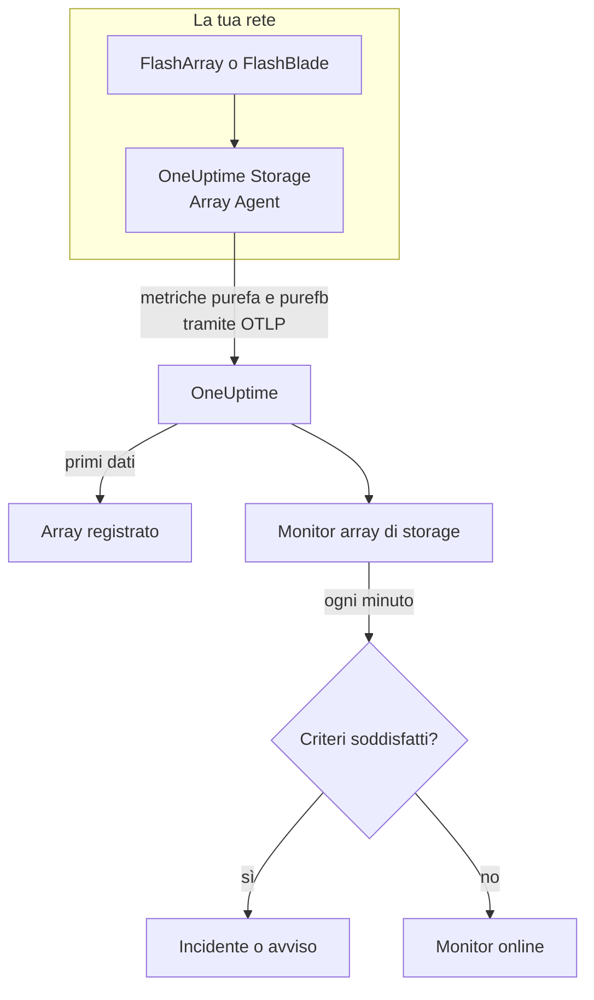

# Monitor array di storage

Un monitor di array di storage osserva un array di storage e ti avvisa quando l'array genera un proprio avviso, esaurisce lo spazio, rallenta, perde hardware o un percorso verso un host, o resta indietro con la replica. Funziona con Pure Storage FlashArray e Pure Storage FlashBlade, e legge le metriche che l'array esporta da sé - le serie `purefa_*` e `purefb_*` di Pure -, raccolte dal OneUptime Storage Array Agent.

:::cards
- [Creare il monitor](#creare-un-monitor-di-array-di-storage): Sei passaggi nella dashboard.
- [Modelli](#modelli-di-avviso-predefiniti): Diciotto avvisi pronti, un incidente per volume, host o componente.
- [Come funzionano le serie di Pure](#come-sono-costruite-le-serie-di-pure): Un nome di metrica, molti valori.
- [Metriche](#metriche-raccolte): Ogni serie su cui il monitor può generare avvisi.
:::

## Come funziona

Il OneUptime Storage Array Agent viene eseguito su una macchina che raggiunge l'interfaccia di gestione dell'array. Legge le metriche dell'array con un token API in sola lettura, le etichetta con il nome dell'array, `storage.array.name`, e la sua piattaforma, `storage.system`, e le invia a OneUptime tramite OTLP. I primi dati registrano l'array.

Un monitor di array di storage è legato a un array. Ogni minuto esegue la sua query sulle metriche di quell'array e confronta il risultato con i suoi criteri.



## Prima di iniziare

- **Installa lo Storage Array Agent** dove può raggiungere l'array tramite HTTPS, con il token API di un utente che ha il ruolo **readonly** dell'array. La [guida dello Storage Array Agent](/docs/telemetry/storage-arrays) copre l'utente, il token e l'installazione, tramite `ONEUPTIME_URL`, `ONEUPTIME_TELEMETRY_INGESTION_KEY`, `STORAGE_ARRAY_NAME`, e l'indirizzo e il token dell'array (`PURE_FA_ENDPOINT` e `PURE_FA_API_TOKEN`, oppure `PURE_FB_ENDPOINT` e `PURE_FB_API_TOKEN`).
- **Verifica che l'array sia registrato.** Compare in **Prodotti → Infrastruttura → Storage Arrays → All Storage Arrays**, con il nome dello `STORAGE_ARRAY_NAME` dell'agente, circa un minuto dopo la prima lettura.

## Creare un monitor di array di storage

:::steps
### Iniziare un nuovo monitor

Vai su **Monitor** e fai clic su **Crea monitor**.

### Scegliere Array di storage

In **Tipo di monitor**, fai clic su **Altri tipi di monitor** e scegli **Array di storage** sotto **Infrastruttura**, oppure digita `storage` nella casella di ricerca. Inserisci un **Nome** - viene usato nei titoli di incidenti e avvisi - e fai clic su **Avanti**.

### Scegliere l'array

In **Storage Array Monitor Configuration**, scegli l'array da **Array di storage**. Ogni array che ha inviato dati è nell'elenco. La sua piattaforma decide quali metriche e quali modelli offre il modulo.

### Scegliere cosa osservare

Scegli una delle tre schede:

- **Quick Setup** - fai clic su un [modello](#modelli-di-avviso-predefiniti). Imposta la metrica, i filtri sulle etichette, l'aggregazione, l'intervallo di tempo e le soglie, e sostituisce i criteri qui sotto con i propri. Puoi comunque cambiare l'**Intervallo di tempo**.
- **Custom Metric** - scegli una metrica da **Storage Array Metric**, poi imposta **Aggregazione** e **Intervallo di tempo**. I [filtri](#impostazioni-del-monitor) la restringono a un volume, un host, un pod, un componente, un file system o un bucket.
- **Avanzato** - costruisci tu query e formule in **Seleziona metriche**, per esempio la capacità usata come `purefa_array_space_bytes` filtrata su `space=capacity` meno la stessa metrica filtrata su `space=empty`. Usa **Group by** con l'etichetta di un oggetto per valutare ogni oggetto separatamente.

### Controllare i criteri

Apri ogni criterio in **Criteri del monitor** e controlla **Metrica**, **Aggregazione**, **Condizione** e **Threshold**. Un modello li compila. Con **Custom Metric** o **Avanzato**, il monitor parte con i [criteri predefiniti](#criteri-predefiniti), che notano solo una metrica che scende a zero, quindi imposta la tua soglia.

### Creare il monitor

Fai clic su **Crea monitor**. OneUptime apre la pagina del monitor e lo valuta ogni minuto. Gli incidenti e gli avvisi che genera compaiono anche nelle pagine **Incidenti** e **Avvisi** dell'array.
:::

> [!TIP]
> Per impostare più modelli in una volta, apri l'array da **Prodotti → Infrastruttura → Storage Arrays** e vai su **Recommendations**. Scegli i modelli che vuoi, decidi chi viene avvisato, e OneUptime crea un monitor per ogni modello.

## Impostazioni del monitor

| Campo | Scheda | Cosa fa |
| --- | --- | --- |
| **Array di storage** | Tutte | Obbligatorio. Limita ogni query a `resource.storage.array.name`, così due array che hanno entrambi un volume chiamato `vol-01` non si mescolano mai. |
| **Volume** | Custom Metric, Avanzato | Solo FlashArray. Un volume, tramite l'etichetta `name`, come `vol-db-01`. Un volume in un pod o in un gruppo di volumi si chiama `pod::volume` o `group/volume`. |
| **Host** | Custom Metric, Avanzato | Solo FlashArray. Un host come lo conosce l'array, tramite l'etichetta `host`, come `esxi-01`. |
| **Pod** | Custom Metric, Avanzato | Solo FlashArray. Un pod ActiveCluster o ActiveDR, tramite l'etichetta `name`, oppure `local_pod` sulle serie dei collegamenti di replica. |
| **Hardware Component** | Custom Metric, Avanzato | Un componente hardware, come `CH0.BAY1` o `CT0`: l'etichetta `component_name` su un FlashArray, `name` su un FlashBlade. |
| **File System** | Custom Metric, Avanzato | Solo FlashBlade. Un file system, tramite l'etichetta `name`. |
| **Bucket** | Custom Metric, Avanzato | Solo FlashBlade. Un bucket di object storage, tramite l'etichetta `name`. |
| **Storage Array Metric** | Custom Metric | Una metrica del [catalogo](#metriche-raccolte). Il modulo aggiunge il filtro sull'etichetta che le dà il suo significato, e la raggruppa per l'oggetto che descrive, così ogni volume, host o componente viene valutato separatamente. |
| **Aggregazione** | Custom Metric | Come vengono combinati i campioni: **Media**, **Massimo**, **Minimo**, **Somma** o **Conteggio**. Parte dall'aggregazione abituale della metrica. |
| **Intervallo di tempo** | Tutte | La finestra mobile che la query legge, da **Past 1 Minute** a **Past 365 Days**. Un nuovo monitor parte da **Past 5 Minutes**; una metrica personalizzata di un file system o di un bucket da **Past 15 Minutes**; i modelli impostano la propria. |
| **Seleziona metriche** | Avanzato | Il generatore di query: **Metrica**, **Aggregate by**, **Filter by attributes**, **Group by**, più **Aggiungi metrica** e **Aggiungi formula** per combinare le query. |

L'agente legge l'endpoint dell'array ogni 60 secondi, e volumi, host e pod ogni 2 minuti, quindi una finestra di 5 minuti contiene sempre un campione. Legge i file system e i bucket di un FlashBlade ogni 5 minuti, da qui i 15, e le directory di FlashArray ogni 30 minuti: dai a un monitor di directory una finestra di 60 minuti.

## Come sono costruite le serie di Pure

Pure mette più valori su **un solo** nome di metrica e li distingue con un'etichetta:

- **`dimension`** sulle serie di prestazioni. `purefa_array_performance_latency_usec` porta la latenza di lettura (`usec_per_read_op`), la latenza di scrittura (`usec_per_write_op`), la latenza di scrittura in mirroring, e il tempo SAN, di coda, QoS e di servizio di ciascuna. Filtra sempre su una sola `dimension`: una media tra tutte mescola una latenza di lettura di 200 µs con un valore di coda.
- **`space`** sulle serie di capacità: `capacity`, `empty`, `snapshots`, `total_provisioned`, `total_physical`, `available_ratio` e altre.

Diverse serie portano il loro stato in un'**etichetta**, con un valore sempre pari a 1:

| Serie | Etichetta di stato | Una serie per |
| --- | --- | --- |
| `purefa_alerts_open` | `severity`, con `summary`, `code` e `component_type` | Avviso aperto |
| `purefa_hw_component_status` | `component_status` | Componente hardware |
| `purefa_host_connectivity_info` | `status`, con `details` | Host |
| `purefa_drive_capacity_bytes` | `component_status` (il valore è la capacità del disco) | Disco |

Una serie filtrata su uno stato negativo esiste solo finché qualcosa è in quello stato, quindi nessuna serie significa tutto in ordine. Per questo **Max sopra 0 scatta e 0 rientra** è la forma giusta per queste serie, ed è così che sono costruiti i modelli: i loro criteri di rientro contano una serie mancante come zero.

Nei filtri del monitor e nelle chiavi di raggruppamento, gli attributi dell'agente iniziano con `resource.` (`resource.storage.array.name`, `resource.storage.system`), mentre le etichette proprie di Pure no (`name`, `host`, `component_name`, `dimension`, `space`, `severity`).

## Modelli di avviso predefiniti

OneUptime fornisce 18 modelli — 11 per FlashArray e 7 per FlashBlade — e **Quick Setup** offre quelli per la piattaforma dell'array. Ognuno costruisce un monitor completo: la query della metrica, i suoi filtri sulle etichette, un raggruppamento sull'etichetta propria dell'oggetto, un criterio che scatta e uno che rientra. Le soglie sono punti di partenza che puoi modificare.

Un criterio scatta solo quando la condizione vale per **ogni** valore della sua finestra. Un monitor scattato su una soglia di capacità, latenza, ritardo o rapporto rientra solo il 10 % oltre di essa, così un valore che oscila attorno alla soglia non va avanti e indietro; i modelli di avvisi e hardware rientrano non appena lo stato scompare.

### FlashArray

| Modello                        | Categoria    | Gravità  | Osserva                                                                                         | Scatta quando                                                                                                                                    |
| ------------------------------ | ------------ | -------- | ----------------------------------------------------------------------------------------------- | ------------------------------------------------------------------------------------------------------------------------------------------------ |
| Critical Array Alert           | Array Health | Critico  | `purefa_alerts_open` filtrata su `severity=critical`, Max per `summary`, ultimi 5 minuti        | > 0 — l'array ha un avviso critico aperto (un componente guasto, un'emergenza di capacità, un errore di replica). Un incidente per avviso; rientra quando l'avviso si chiude |
| Warning Array Alert            | Array Health | Warning  | `purefa_alerts_open` filtrata su `severity=warning`, Max per `summary`, ultimi 5 minuti         | > 0 — l'array ha un avviso di livello warning aperto. Un incidente per avviso; rientra quando l'avviso si chiude                                 |
| Capacity Above 80%             | Capacità     | Warning  | `purefa_array_space_utilization`, Max, ultimi 15 minuti                                         | > 80 — la prima soglia di capacità di Pure stessa; rientra a ≤ 72                                                                                |
| Capacity Above 90%             | Capacità     | Critico  | `purefa_array_space_utilization`, Max, ultimi 5 minuti                                          | > 90 — l'array è vicino a rifiutare le scritture; rientra a ≤ 81                                                                                 |
| High Read Latency              | Performance  | Warning  | `purefa_array_performance_latency_usec` filtrata su `dimension=usec_per_read_op`, Avg, ultimi 10 minuti  | > 5000 µs (5 ms) — le letture di un FlashArray di norma si completano ben sotto 1 ms; rientra a ≤ 4500                                  |
| High Write Latency             | Performance  | Warning  | `purefa_array_performance_latency_usec` filtrata su `dimension=usec_per_write_op`, Avg, ultimi 10 minuti | > 5000 µs (5 ms); rientra a ≤ 4500                                                                                                     |
| Hardware Component Failed      | Hardware     | Critico  | `purefa_hw_component_status` filtrata su `component_status=critical`, Max per `component_name`, ultimi 5 minuti | > 0 — un controller, un alimentatore, una ventola, un alloggiamento o una porta è critico e la ridondanza è persa. Un incidente per componente; rientra quando segnala ok |
| Hardware Component Degraded    | Hardware     | Warning  | `purefa_hw_component_status` filtrata su `component_status=degraded`, Max per `component_name`, ultimi 5 minuti | > 0 — un componente è degradato. Un incidente per componente; rientra quando segnala ok                                          |
| Drive Failed                   | Hardware     | Critico  | `purefa_drive_capacity_bytes` filtrata su `component_status=failed`, Max per `component_name`, ultimi 5 minuti | > 0 — un modulo DirectFlash o un SSD si è guastato e l'array ricostruisce sugli altri. Un incidente per disco; rientra quando viene sostituito |
| Host Lost Redundant Paths      | Host         | Warning  | `purefa_host_connectivity_info` filtrata su `status=critical`, Max per `host`, ultimi 5 minuti  | > 0 — l'host raggiunge l'array tramite un solo controller o nessuno; un failover del controller metterebbe offline il suo storage. Un incidente per host; rientra quando i suoi percorsi tornano |
| Replication Lag Above 1 Minute | Replication  | Warning  | `purefa_pod_replica_links_lag_max_msec`, Max per `local_pod`, ultimi 10 minuti                  | > 60000 ms (60 s) — un failover adesso perderebbe più scritture recenti del previsto. Un incidente per pod; rientra a ≤ 54000                     |

### FlashBlade

| Modello                      | Categoria    | Gravità  | Osserva                                                                                                        | Scatta quando                                                                                                       |
| ---------------------------- | ------------ | -------- | -------------------------------------------------------------------------------------------------------------- | ------------------------------------------------------------------------------------------------------------------- |
| Critical Array Alert         | Array Health | Critico  | `purefb_alerts_open` filtrata su `severity=critical`, Max per `summary`, ultimi 5 minuti                       | > 0 — il FlashBlade ha un avviso critico aperto. Un incidente per avviso; rientra quando l'avviso si chiude         |
| Warning Array Alert          | Array Health | Warning  | `purefb_alerts_open` filtrata su `severity=warning`, Max per `summary`, ultimi 5 minuti                        | > 0 — il FlashBlade ha un avviso di livello warning aperto. Un incidente per avviso; rientra quando l'avviso si chiude |
| Capacity Above 80%           | Capacità     | Warning  | `purefb_array_space_utilization` filtrata su `type=array`, Max, ultimi 15 minuti                               | > 80; rientra a ≤ 72                                                                                                |
| Capacity Above 90%           | Capacità     | Critico  | `purefb_array_space_utilization` filtrata su `type=array`, Max, ultimi 5 minuti                                | > 90 — quando si riempie, le scritture falliscono per ogni client; rientra a ≤ 81                                   |
| Hardware Component Unhealthy | Hardware     | Critico  | `purefb_hardware_health`, Min per `name`, ultimi 5 minuti                                                      | < 1 — un blade, un modulo fabric, un alimentatore o una ventola non è in salute (uno slot inutilizzato segnala 2). Un incidente per componente; rientra a ≥ 1 |
| High Read Latency            | Performance  | Warning  | `purefb_array_performance_latency_usec` filtrata su `dimension=usec_per_read_op` e `protocol=all`, Avg, ultimi 10 minuti | > 10000 µs (10 ms) su tutti i protocolli; rientra a ≤ 9000                                             |
| File System Near Full        | File Systems | Warning  | `purefb_file_systems_space_bytes` filtrata su `space=available_ratio`, Min per `name`, ultimi 15 minuti        | < 0.1 — resta meno del 10 % della dimensione assegnata di un file system. Un incidente per file system; rientra a ≥ 0.11 |

**Gravità** è l'etichetta che mostra il selettore. L'incidente e l'avviso creati da un modello partono dalla gravità di incidente e di avviso più alta del tuo progetto; cambiale nel criterio.

- **Gli avvisi aperti e gli stati hardware usano Max** di una serie che esiste solo finché l'avviso è aperto o il componente è in quello stato, quindi una sola lettura che la mostra supera la soglia.
- **Ogni modello per oggetto raggruppa sull'etichetta propria dell'oggetto** (`summary`, `component_name`, `host`, `local_pod`, `name`), quindi scatta un incidente per ogni oggetto interessato, e l'incidente lo nomina.
- **I modelli di latenza usano Avg** della media per operazione calcolata dall'array stesso, e i modelli di capacità **Max** della sua percentuale di utilizzo. Le latenze sono fissate in microsecondi e la capacità in percentuale.
- **Hardware Component Unhealthy usa Min** per componente: la sua salute vale 1 quando è in salute e scende a 0 quando non lo è.

Non c'è un modello per la latenza di ogni volume, perché la soglia giusta dipende dal carico di lavoro: costruiscilo dal catalogo con un raggruppamento su `name`. La previsione della capacità richiede un andamento di crescita più che una soglia, e l'usura dei dischi non ha una serie su cui generare avvisi.

## Metriche raccolte

L'agente invia tutto ciò che l'array esporta; le serie qui sotto sono il catalogo che offre il modulo del monitor. Ogni valore è un gauge calcolato dall'array stesso - le latenze sono microsecondi per operazione e il throughput è al secondo -, quindi non serve calcolare tassi. **Filtro** è il filtro sull'etichetta che dà alla serie il significato indicato dalla sua riga; il modulo lo applica per te.

### Array Health

| Metrica              | Filtro | Piattaforma | Unità   | Descrizione                                                                                                                                                       |
| -------------------- | ------ | ----------- | ------- | ----------------------------------------------------------------------------------------------------------------------------------------------------------------- |
| `purefa_alerts_open` | —      | FlashArray  | `count` | Una serie per ogni avviso aperto sull'array (valore 1), con le etichette `severity` (`critical`, `warning`, `info`, `hidden`), `category`, `code`, `component_type` e `summary` |
| `purefb_alerts_open` | —      | FlashBlade  | `count` | Una serie per ogni avviso aperto sul FlashBlade (valore 1), con le etichette `severity` (`info`, `warning`, `critical`), `code`, `component_name`, `component_type`, `summary` e `kburl` (l'articolo della knowledge base di Pure) |

### Capacity

| Metrica                                   | Filtro                       | Piattaforma | Unità   | Descrizione                                                                                                                           |
| ----------------------------------------- | ---------------------------- | ----------- | ------- | ------------------------------------------------------------------------------------------------------------------------------------- |
| `purefa_array_space_utilization`          | —                            | FlashArray  | `%`     | Quota della capacità utilizzabile dell'array in uso. Pure genera i propri avvisi di capacità all'80 %, al 90 % e al 100 %             |
| `purefa_array_space_bytes`                | `space=capacity`             | FlashArray  | `bytes` | Capacità utilizzabile dell'array                                                                                                      |
| `purefa_array_space_bytes`                | `space=empty`                | FlashArray  | `bytes` | Capacità inutilizzata — seguine l'andamento per prevedere quando l'array si riempirà                                                 |
| `purefa_array_space_bytes`                | `space=snapshots`            | FlashArray  | `bytes` | Spazio fisico occupato solo dagli snapshot; una crescita rapida di solito significa che un gruppo di protezione conserva più snapshot del previsto |
| `purefa_array_space_data_reduction_ratio` | —                            | FlashArray  | `ratio` | Deduplica e compressione sull'intero array, p. es. 4.2 per 4.2:1. Un calo prolungato significa che i nuovi dati si riducono male       |
| `purefb_array_space_utilization`          | `type=array`                 | FlashBlade  | `%`     | Quota della capacità utilizzabile del FlashBlade in uso                                                                               |
| `purefb_array_space_bytes`                | `type=array`, `space=empty`  | FlashBlade  | `bytes` | Capacità inutilizzata del FlashBlade                                                                                                  |
| `purefb_array_space_data_reduction_ratio` | `type=array`                 | FlashBlade  | `ratio` | Riduzione dei dati sull'intero FlashBlade                                                                                             |

### Performance

| Metrica                                    | Filtro                                         | Piattaforma | Unità     | Descrizione                                                                                                  |
| ------------------------------------------ | ---------------------------------------------- | ----------- | --------- | ------------------------------------------------------------------------------------------------------------ |
| `purefa_array_performance_latency_usec`    | `dimension=usec_per_read_op`                   | FlashArray  | `µs`      | Latenza media di una lettura vista dagli host; le letture di un FlashArray di solito si completano ben sotto 1 ms |
| `purefa_array_performance_latency_usec`    | `dimension=usec_per_write_op`                  | FlashArray  | `µs`      | Latenza media di una scrittura vista dagli host                                                              |
| `purefa_array_performance_latency_usec`    | `dimension=usec_per_mirrored_write_op`         | FlashArray  | `µs`      | Latenza media di una scrittura su un pod esteso ActiveCluster, incluso il viaggio di andata e ritorno verso l'array partner |
| `purefa_array_performance_latency_usec`    | `dimension=san_usec_per_read_op`               | FlashArray  | `µs`      | Tempo che una lettura trascorre nella SAN; una latenza SAN alta con una latenza di servizio bassa indica il fabric o l'host |
| `purefa_array_performance_throughput_iops` | `dimension=reads_per_sec`                      | FlashArray  | `ops/s`   | Operazioni di lettura al secondo                                                                             |
| `purefa_array_performance_throughput_iops` | `dimension=writes_per_sec`                     | FlashArray  | `ops/s`   | Operazioni di scrittura al secondo                                                                           |
| `purefa_array_performance_bandwidth_bytes` | `dimension=read_bytes_per_sec`                 | FlashArray  | `bytes/s` | Byte letti al secondo                                                                                        |
| `purefa_array_performance_bandwidth_bytes` | `dimension=write_bytes_per_sec`                | FlashArray  | `bytes/s` | Byte scritti al secondo                                                                                      |
| `purefa_array_performance_queue_depth_ops` | —                                              | FlashArray  | `ops`     | Operazioni in coda sull'array; una coda che cresce con una latenza in aumento significa che gli host inviano più di quanto possa servire |
| `purefa_array_performance_average_bytes`   | `dimension=bytes_per_op`                       | FlashArray  | `bytes`   | Dimensione media di un'operazione — un I/O grande aumenta la latenza senza che ci sia nulla di sbagliato     |
| `purefb_array_performance_latency_usec`    | `dimension=usec_per_read_op`, `protocol=all`   | FlashBlade  | `µs`      | Latenza media di lettura su tutti i protocolli                                                               |
| `purefb_array_performance_latency_usec`    | `dimension=usec_per_write_op`, `protocol=all`  | FlashBlade  | `µs`      | Latenza media di scrittura su tutti i protocolli                                                             |
| `purefb_array_performance_throughput_iops` | `dimension=reads_per_sec`, `protocol=all`      | FlashBlade  | `ops/s`   | Operazioni di lettura al secondo su tutti i protocolli                                                       |
| `purefb_array_performance_throughput_iops` | `dimension=writes_per_sec`, `protocol=all`     | FlashBlade  | `ops/s`   | Operazioni di scrittura al secondo su tutti i protocolli                                                     |
| `purefb_array_performance_bandwidth_bytes` | `dimension=read_bytes_per_sec`, `protocol=all` | FlashBlade  | `bytes/s` | Byte letti al secondo su tutti i protocolli                                                                  |
| `purefb_array_performance_bandwidth_bytes` | `dimension=write_bytes_per_sec`, `protocol=all` | FlashBlade | `bytes/s` | Byte scritti al secondo su tutti i protocolli                                                               |

### Volumes

| Metrica                                     | Filtro                           | Piattaforma | Unità     | Descrizione                                                   |
| ------------------------------------------- | -------------------------------- | ----------- | --------- | ------------------------------------------------------------- |
| `purefa_volume_performance_latency_usec`    | `dimension=usec_per_read_op`     | FlashArray  | `µs`      | Latenza media di lettura di ogni volume — raggruppa per `name` |
| `purefa_volume_performance_latency_usec`    | `dimension=usec_per_write_op`    | FlashArray  | `µs`      | Latenza media di scrittura di ogni volume                     |
| `purefa_volume_performance_throughput_iops` | `dimension=reads_per_sec`        | FlashArray  | `ops/s`   | Operazioni di lettura al secondo di ogni volume               |
| `purefa_volume_performance_throughput_iops` | `dimension=writes_per_sec`       | FlashArray  | `ops/s`   | Operazioni di scrittura al secondo di ogni volume             |
| `purefa_volume_performance_bandwidth_bytes` | `dimension=read_bytes_per_sec`   | FlashArray  | `bytes/s` | Byte letti al secondo da ogni volume                          |
| `purefa_volume_performance_bandwidth_bytes` | `dimension=write_bytes_per_sec`  | FlashArray  | `bytes/s` | Byte scritti al secondo su ogni volume                        |
| `purefa_volume_space_bytes`                 | `space=total_provisioned`        | FlashArray  | `bytes`   | Dimensione di ogni volume vista dagli host                    |
| `purefa_volume_space_bytes`                 | `space=total_physical`           | FlashArray  | `bytes`   | Spazio fisico usato da ogni volume dopo la riduzione dei dati |
| `purefa_volume_space_data_reduction_ratio`  | —                                | FlashArray  | `ratio`   | Rapporto di riduzione dei dati di ogni volume                 |

### Hosts

| Metrica                                   | Filtro                        | Piattaforma | Unità   | Descrizione                                                                                                                                    |
| ----------------------------------------- | ----------------------------- | ----------- | ------- | ---------------------------------------------------------------------------------------------------------------------------------------------- |
| `purefa_host_connectivity_info`           | —                             | FlashArray  | `count` | Una serie per host (valore 1) con l'etichetta della sua connettività `status` (`healthy`, `critical`, `unused`) e `details` (`Redundant`, `Single Controller`, `None`, ...) |
| `purefa_host_performance_latency_usec`    | `dimension=usec_per_read_op`  | FlashArray  | `µs`    | Latenza media di lettura vista da ogni host — raggruppa per `host`                                                                             |
| `purefa_host_performance_latency_usec`    | `dimension=usec_per_write_op` | FlashArray  | `µs`    | Latenza media di scrittura vista da ogni host                                                                                                  |
| `purefa_host_performance_throughput_iops` | `dimension=reads_per_sec`     | FlashArray  | `ops/s` | Operazioni di lettura al secondo di ogni host                                                                                                  |
| `purefa_host_performance_throughput_iops` | `dimension=writes_per_sec`    | FlashArray  | `ops/s` | Operazioni di scrittura al secondo di ogni host                                                                                                |

### Replication

| Metrica                                              | Filtro                                 | Piattaforma | Unità     | Descrizione                                                                                                                                                  |
| ---------------------------------------------------- | -------------------------------------- | ----------- | --------- | ------------------------------------------------------------------------------------------------------------------------------------------------------------ |
| `purefa_pod_replica_links_lag_max_msec`              | —                                      | FlashArray  | `ms`      | Ritardo di replica massimo di ogni collegamento di replica dei pod (ActiveDR / asincrono), con le etichette `local_pod`, `remote_pod`, `remote`, `direction` e `status` — raggruppa per `local_pod` |
| `purefa_pod_replica_links_lag_average_msec`          | —                                      | FlashArray  | `ms`      | Ritardo di replica medio di ogni collegamento di replica dei pod                                                                                             |
| `purefa_pod_performance_replication_bandwidth_bytes` | —                                      | FlashArray  | `bytes/s` | Traffico di replica di ogni pod, con le etichette `direction` e `dimension`                                                                                  |
| `purefa_pod_performance_latency_usec`                | `dimension=usec_per_mirrored_write_op` | FlashArray  | `µs`      | Latenza media di scrittura in mirroring di ogni pod ActiveCluster                                                                                            |

### Hardware

| Metrica                                       | Filtro                           | Piattaforma | Unità      | Descrizione                                                                                                                                                                                                  |
| --------------------------------------------- | -------------------------------- | ----------- | ---------- | ------------------------------------------------------------------------------------------------------------------------------------------------------------------------------------------------------------ |
| `purefa_hw_component_status`                  | —                                | FlashArray  | `count`    | Una serie per componente hardware (valore 1) — chassis, controller, alloggiamenti di dischi e NVRAM, alimentatori, ventole, sensori di temperatura, porte Ethernet e Fibre Channel — con l'etichetta `component_status` (`ok`, `critical`, `degraded`, `device_off`, `identifying`, `not_installed`, `unknown`) |
| `purefa_hw_component_temperature_celsius`     | —                                | FlashArray  | `°C`       | Temperatura di ogni sensore — raggruppa per `component_name`                                                                                                                                                 |
| `purefa_drive_capacity_bytes`                 | —                                | FlashArray  | `bytes`    | Capacità grezza di ogni disco, con l'etichetta del suo `component_status` (`healthy`, `failed`, `missing`, `recovering`, `unhealthy`, `empty`, ...) e del suo tipo                                           |
| `purefa_network_interface_performance_errors` | `dimension=total_errors_per_sec` | FlashArray  | `errors/s` | Errori al secondo su ogni interfaccia Ethernet e Fibre Channel — errori persistenti di solito indicano un cavo, un'ottica o una porta dello switch difettosi                                                 |
| `purefb_hardware_health`                      | —                                | FlashBlade  | —          | Salute di ogni componente hardware (blade, moduli fabric, alimentatori, ventole, ...): 1 = in salute, 2 = inutilizzato, 0 = non in salute. Prendi il minimo per `name`                                        |

### File Systems

| Metrica                                        | Filtro                        | Piattaforma | Unità   | Descrizione                                                                                  |
| ---------------------------------------------- | ----------------------------- | ----------- | ------- | -------------------------------------------------------------------------------------------- |
| `purefb_file_systems_performance_latency_usec` | `dimension=usec_per_read_op`  | FlashBlade  | `µs`    | Latenza media di lettura di ogni file system — raggruppa per `name`                          |
| `purefb_file_systems_performance_latency_usec` | `dimension=usec_per_write_op` | FlashBlade  | `µs`    | Latenza media di scrittura di ogni file system                                               |
| `purefb_file_systems_space_bytes`              | `space=total_physical`        | FlashBlade  | `bytes` | Spazio fisico usato da ogni file system                                                      |
| `purefb_file_systems_space_bytes`              | `space=available_ratio`       | FlashBlade  | `ratio` | Quota della dimensione assegnata di ogni file system ancora disponibile, da 0 a 1 — vicino a 0 sta per riempire la sua quota |

### Buckets

| Metrica                                   | Filtro                       | Piattaforma | Unità   | Descrizione                                           |
| ----------------------------------------- | ---------------------------- | ----------- | ------- | ----------------------------------------------------- |
| `purefb_buckets_performance_latency_usec` | `dimension=usec_per_read_op` | FlashBlade  | `µs`    | Latenza media di lettura di ogni bucket — raggruppa per `name` |
| `purefb_buckets_space_bytes`              | `space=total_physical`       | FlashBlade  | `bytes` | Spazio fisico usato da ogni bucket                    |
| `purefb_buckets_object_count`             | —                            | FlashBlade  | `count` | Numero di oggetti in ogni bucket                      |

## Criteri di monitoraggio

Un criterio confronta una delle query o formule del monitor con una soglia. I criteri di un monitor di array di storage non hanno un **Tipo di filtro**: ogni regola controlla il valore della metrica, con questi campi.

| Campo | Cosa fa |
| --- | --- |
| **Metrica** | La query o la formula da controllare, tramite il nome della sua variabile. |
| **Aggregazione** | Come i valori della finestra diventano un'unica risposta: **Media**, **Somma**, **Maximum Value**, **Minimum Value**, **All Values** (ogni valore deve corrispondere) o **Any Value** (ne basta uno). |
| **Condizione** | **Greater Than**, **Less Than**, **Greater Than Or Equal To**, **Less Than Or Equal To** o **Equal To** — oppure una condizione di anomalia: **Anomalously High**, **Anomalously Low** o **Anomalous**. |
| **Threshold** | Il valore con cui confrontare. Accanto c'è un elenco di unità quando la metrica ha un'unità. Non mostrato per le condizioni di anomalia. |
| **Sensibilità** | Solo condizioni di anomalia. **Bassa** (4σ), **Media** (3σ, il predefinito) o **Alta** (2σ). |
| **Finestra di riferimento** | Solo condizioni di anomalia. 14 giorni (il predefinito), 28, 60 o 90 giorni di storico. |
| **Se nessun dato** | In **Altri campi**. Cosa succede quando la finestra non ha campioni: **Ignore** (il predefinito), **Treat As Zero** o **Trigger**. |

Le condizioni di anomalia confrontano ogni valore con la stessa ora della settimana nel riferimento. Restano in uno stato «Learning», e non generano nulla, finché la finestra di riferimento non contiene abbastanza storico.

Alcuni criteri da cui partire:

- **Un volume è lento:** `purefa_volume_performance_latency_usec` filtrata su `dimension=usec_per_read_op`, Media, raggruppata per `name`, **Greater Than** `2000`, negli ultimi 10 minuti.
- **L'array si sta riempiendo:** `purefa_array_space_utilization`, Massimo, **Greater Than** `85`, negli ultimi 15 minuti.
- **Un host funziona su un solo controller:** `purefa_host_connectivity_info` filtrata su `status=critical`, Massimo, raggruppata per `host`, **Greater Than** `0`.
- **Un file system FlashBlade è quasi pieno:** `purefb_file_systems_space_bytes` filtrata su `space=available_ratio`, Minimo, raggruppata per `name`, **Less Than** `0.05`.

### Criteri predefiniti

Un monitor che non costruisci da un modello parte con due criteri:

| Ordine | Criterio | Corrisponde quando | Poi |
| --- | --- | --- | --- |
| 1 | Check if _monitor name_ is offline | Un valore qualsiasi della prima query è `0` | Segna il monitor come **Offline** e dichiara l'incidente «_monitor name_ is offline», che si risolve da solo quando il monitor rientra. |
| 2 | Check if _monitor name_ is online | Un valore qualsiasi è sopra `0` | Segna il monitor come **Operativo**. |

> [!IMPORTANT]
> Il silenzio non corrisponde a nessuno dei due criteri: un array che smette di inviare dati lascia il monitor com'era. Per essere avvisato quando i dati si fermano, imposta **Se nessun dato** su **Trigger** in un criterio. Il tempo in cui OneUptime stesso non stava ricevendo non conta mai come assenza di dati: un controllo la cui finestra lo contiene aspetta invece, come spiega [Quando OneUptime non riceve dati](/docs/monitor/when-oneuptime-is-not-receiving).

## Terraform

Il [provider Terraform di OneUptime](/docs/terraform/monitor-steps) porta la configurazione di un passaggio di monitor di array di storage nell'attributo `storage_array_monitor`: il JSON grezzo della configurazione `storageArrayMonitor` (`arrayIdentifier`, `storageSystem`, `resourceFilters`, `metricViewConfig`, `rollingTime`), scritto con `jsonencode()`:

```hcl title="main.tf"
monitor_steps = [{
  storage_array_monitor = jsonencode({
    arrayIdentifier = "my-storage-array"
    storageSystem   = "purestorage.flasharray"
    resourceFilters = {}
    rollingTime     = "Past 15 Minutes"
    metricViewConfig = {
      queryConfigs = [{
        metricAliasData = { metricVariable = "capacity_used_percent", title = "Capacity Used", description = "", legend = "" }
        metricQueryData = {
          filterData = {
            metricName     = "purefa_array_space_utilization"
            attributes     = {}
            aggegationType = "Max"
            aggregateBy    = {}
          }
        }
      }]
      formulaConfigs = []
    }
  })
  criteria = [ /* ... */ ]
}]
```

`arrayIdentifier` è lo `storage.array.name` dell'array - lo `STORAGE_ARRAY_NAME` con cui è stato avviato l'agente -, non il suo ID in OneUptime. `storageSystem` è `purestorage.flasharray` o `purestorage.flashblade`. Decide quale catalogo e quali modelli mostra il modulo, e se un filtro hardware legge `component_name` o `name`.

## Risoluzione dei problemi

:::details L'array non è nell'elenco Array di storage
Gli array si registrano da soli a partire dai dati dell'agente. Verifica che l'agente sia in esecuzione e invii dati (vedi la [guida dello Storage Array Agent](/docs/telemetry/storage-arrays)), e che `STORAGE_ARRAY_NAME` sia impostato.
:::

:::details Un modello di avvisi o di hardware non scatta mai
È il caso in cui tutto è in ordine. `purefa_alerts_open`, `purefa_hw_component_status`, `purefa_drive_capacity_bytes` e `purefa_host_connectivity_info` portano il loro stato in un'etichetta, e una serie filtrata su uno stato negativo (`severity=critical`, `component_status=failed`) esiste solo finché qualcosa è in quello stato. Per vedere la serie dietro un modello, esegui la sua query senza il filtro nella pagina **Metriche**.
:::

:::details Un monitor di latenza mostra valori sbagliati
Pure mette i valori di lettura, scrittura, scrittura in mirroring, SAN, coda e QoS su un solo nome di metrica, distinti solo dall'etichetta `dimension`, e una query senza filtro su `dimension` ne fa la media tutti insieme. Filtra su una sola dimensione, come fanno i modelli e il catalogo del modulo. Le serie per volume e per host mantengono solo `usec_per_read_op`, `usec_per_write_op` e `usec_per_mirrored_write_op`: l'agente scarta il resto per risparmiare serie, e solo `purefa_array_performance_latency_usec`, a livello di intero array, le mantiene tutte.
:::

:::details Una finestra di 1 minuto non mostra dati
L'agente legge volumi, host e pod ogni 2 minuti, i file system e i bucket di un FlashBlade ogni 5, e le directory di FlashArray ogni 30, quindi una finestra di 1 minuto può non contenere alcun campione. Usa 5 minuti o più: 15 per file system e bucket, 60 per le directory.
:::

:::details Gli incidenti scattano una volta per l'intero array invece che una volta per volume
Raggruppa la query per l'etichetta dell'oggetto: `name` per volumi, pod, directory, file system e bucket, `host` per gli host, e `component_name` per l'hardware FlashArray. Le etichette di Pure non hanno prefisso, quindi `resource.name` non corrisponde a nulla.
:::

## Passaggi successivi

:::cards
- [Agent per array di storage](/docs/telemetry/storage-arrays): Installare l'agente che invia le metriche.
- [Monitor Ceph](/docs/monitor/ceph-monitor): Lo stesso tipo di monitor per i cluster di storage Ceph.
- [Monitor metriche](/docs/monitor/metrics-monitor): Generare avvisi su qualsiasi metrica, da qualsiasi fonte.
- [Panoramica degli incidenti](/docs/incidents/index): Cosa succede dopo che un criterio dichiara un incidente.
:::
