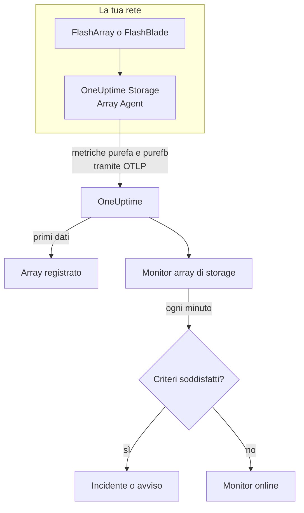

# Monitor array di storage

Un monitor di array di storage osserva un array di storage e ti avvisa quando l'array genera un proprio avviso, esaurisce lo spazio, rallenta, perde hardware o un percorso verso un host, o resta indietro con la replica. Funziona con Pure Storage FlashArray, Pure Storage FlashBlade e NetApp ONTAP (Amazon FSx for NetApp ONTAP incluso), e legge le metriche raccolte dal OneUptime Storage Array Agent: le serie `purefa_*` e `purefb_*` di Pure, e le serie `netapp_*` che NetApp Harvest legge da un cluster ONTAP.

:::cards
- [Creare il monitor](#creare-un-monitor-di-array-di-storage): Sei passaggi nella dashboard.
- [Modelli](#modelli-di-avviso-predefiniti): Cinquantuno avvisi pronti, un incidente per volume, host o componente.
- [Come funzionano le serie di Pure](#come-sono-costruite-le-serie-di-pure): Un nome di metrica, molti valori. Quelle di ONTAP [hanno una sezione a parte](#come-sono-costruite-le-serie-di-ontap).
- [Metriche](#metriche-raccolte): Ogni serie su cui il monitor può generare avvisi.
:::

## Come funziona

Il OneUptime Storage Array Agent viene eseguito su una macchina che raggiunge l'interfaccia di gestione dell'array. Legge le metriche dell'array con un token API in sola lettura, le etichetta con il nome dell'array, `storage.array.name`, e la sua piattaforma, `storage.system`, e le invia a OneUptime tramite OTLP. I primi dati registrano l'array.

Un monitor di array di storage è legato a un array. Ogni minuto esegue la sua query sulle metriche di quell'array e confronta il risultato con i suoi criteri.



## Prima di iniziare

- **Installa lo Storage Array Agent** dove può raggiungere l'array tramite HTTPS, con il token API di un utente che ha il ruolo **readonly** dell'array. La [guida dello Storage Array Agent](/docs/telemetry/storage-arrays) copre l'utente, il token e l'installazione, tramite `ONEUPTIME_URL`, `ONEUPTIME_TELEMETRY_INGESTION_KEY`, `STORAGE_ARRAY_NAME`, e l'indirizzo e il token dell'array (`PURE_FA_ENDPOINT` e `PURE_FA_API_TOKEN`, oppure `PURE_FB_ENDPOINT` e `PURE_FB_API_TOKEN`), oppure per ONTAP l'indirizzo del cluster e un utente REST in sola lettura (`NETAPP_ONTAP_ENDPOINT`, `NETAPP_ONTAP_USERNAME` e `NETAPP_ONTAP_PASSWORD`).
- **Verifica che l'array sia registrato.** Compare in **Prodotti → Infrastruttura → Array di storage → Tutti gli array di storage**, con il nome dello `STORAGE_ARRAY_NAME` dell'agente, circa un minuto dopo la prima lettura.

## Creare un monitor di array di storage

:::steps
### Iniziare un nuovo monitor

Vai su **Monitor** e fai clic su **Crea monitor**.

### Scegliere Array di storage

In **Tipo di monitor**, fai clic su **Altri tipi di monitor** e scegli **Array di storage** sotto **Infrastruttura**, oppure digita `storage` nella casella di ricerca. Inserisci un **Nome** - viene usato nei titoli di incidenti e avvisi - e fai clic su **Avanti**.

### Scegliere l'array

In **Storage Array Monitor Configuration**, scegli l'array da **Array di storage**. Ogni array che ha inviato dati è nell'elenco. La sua piattaforma decide quali metriche e quali modelli offre il modulo. Una volta scelto, una riga sotto il campo dice se arrivano dati. **Aggiungi array di storage** apre i passi di configurazione con le tue chiavi già inserite, che attendono i primi dati.

### Scegliere cosa osservare

Un nuovo monitor parte da **Array Stopped Reporting**, in **Su cosa avvisare**. Per controllare altro:

- **Cambia** - scegli un altro [modello](#modelli-di-avviso-predefiniti). Imposta la metrica, i filtri sulle etichette, l'aggregazione, l'intervallo di tempo e le soglie, e sostituisce i criteri qui sotto con i propri. Puoi comunque cambiare l'**Intervallo di tempo**.
- **Custom Metric** (in **Altri campi**) - scegli una metrica da **Storage Array Metric**, poi imposta **Aggregazione** e **Intervallo di tempo**. I [filtri](#impostazioni-del-monitor) la restringono a un volume, un host, un pod, un componente, un file system o un bucket.
- **Avanzato** (in **Altri campi**) - costruisci tu query e formule in **Seleziona metriche**, per esempio la capacità usata come `purefa_array_space_bytes` filtrata su `space=capacity` meno la stessa metrica filtrata su `space=empty`. Usa **Raggruppa per** con l'etichetta di un oggetto per valutare ogni oggetto separatamente.

### Controllare i criteri

Apri ogni criterio in **Criteri** e controlla **Metrica**, **Aggregazione**, **Condizione** e **Soglia**. Un modello li compila. Con **Custom Metric** o **Avanzato**, il monitor parte con i [criteri predefiniti](#criteri-predefiniti), che notano solo una metrica che non invia dati, quindi imposta la tua soglia.

### Creare il monitor

Fai clic su **Crea monitor**. OneUptime apre la pagina del monitor e lo valuta ogni minuto. Gli incidenti e gli avvisi che genera compaiono anche nelle pagine **Incidenti** e **Avvisi** dell'array.
:::

> [!TIP]
> Per impostare più modelli in una volta, apri l'array da **Prodotti → Infrastruttura → Array di storage** e vai su **Raccomandazioni**. Scegli i modelli che vuoi, decidi chi viene avvisato, e OneUptime crea un monitor per ogni modello.

## Impostazioni del monitor

| Campo | Scheda | Cosa fa |
| --- | --- | --- |
| **Array di storage** | Tutte | Obbligatorio. Limita ogni query a `resource.storage.array.name`, così due array che hanno entrambi un volume chiamato `vol-01` non si mescolano mai. |
| **Volume** | Custom Metric, Avanzato | Un volume: su un FlashArray tramite l'etichetta `name`, come `vol-db-01` (un volume in un pod o in un gruppo di volumi si chiama `pod::volume` o `group/volume`); su ONTAP tramite l'etichetta `volume`, che due SVM possono condividere. |
| **Host** | Custom Metric, Avanzato | Solo FlashArray. Un host come lo conosce l'array, tramite l'etichetta `host`, come `esxi-01`. |
| **Pod** | Custom Metric, Avanzato | Solo FlashArray. Un pod ActiveCluster o ActiveDR, tramite l'etichetta `name`, oppure `local_pod` sulle serie dei collegamenti di replica. |
| **Componente hardware** | Custom Metric, Avanzato | Un componente hardware, come `CH0.BAY1` o `CT0`: l'etichetta `component_name` su un FlashArray, `name` su un FlashBlade, e su ONTAP l'etichetta con cui lo identifica la sua serie (`node`, `disk`, `shelf` o `port`). |
| **File system** | Custom Metric, Avanzato | Solo FlashBlade. Un file system, tramite l'etichetta `name`. |
| **Bucket** | Custom Metric, Avanzato | Solo FlashBlade. Un bucket di object storage, tramite l'etichetta `name`. |
| **Storage Array Metric** | Custom Metric | Una metrica del [catalogo](#metriche-raccolte). Il modulo aggiunge il filtro sull'etichetta che le dà il suo significato, e la raggruppa per l'oggetto che descrive, così ogni volume, host o componente viene valutato separatamente. |
| **Aggregazione** | Custom Metric | Come vengono combinati i campioni: **Media**, **Massimo**, **Minimo**, **Somma** o **Conteggio**. Parte dall'aggregazione abituale della metrica. |
| **Intervallo di tempo** | Tutte | La finestra mobile che la query legge, da **Past 1 Minute** a **Past 365 Days**. Un nuovo monitor parte da **Ultimi 5 minuti**; una metrica personalizzata di un file system o di un bucket da **Ultimi 15 minuti**; i modelli impostano la propria. |
| **Seleziona metriche** | Avanzato | Il generatore di query: **Metrica**, **Aggrega per**, **Filtra per attributi**, **Raggruppa per**, più **Aggiungi metrica** e **Aggiungi formula** per combinare le query. |

L'agente legge l'endpoint dell'array ogni 60 secondi, e volumi, host e pod ogni 2 minuti, quindi una finestra di 5 minuti contiene sempre un campione. Legge i file system e i bucket di un FlashBlade ogni 5 minuti, da qui i 15, e le directory di FlashArray ogni 30 minuti: dai a un monitor di directory una finestra di 60 minuti. Su ONTAP, Harvest legge le prestazioni del cluster ogni minuto e la sua configurazione, il suo stato e i suoi eventi EMS ogni 3 minuti, quindi una finestra di 5 minuti contiene sempre un campione.

## Come sono costruite le serie di Pure

Pure mette più valori su **un solo** nome di metrica e li distingue con un'etichetta:

- **`dimension`** sulle serie di prestazioni. `purefa_array_performance_latency_usec` porta la latenza di lettura (`usec_per_read_op`), la latenza di scrittura (`usec_per_write_op`), la latenza di scrittura in mirroring, e il tempo SAN, di coda, QoS e di servizio di ciascuna. Filtra sempre su una sola `dimension`: una media tra tutte mescola una latenza di lettura di 200 µs con un valore di coda.
- **`space`** sulle serie di capacità: `capacity`, `empty`, `snapshots`, `total_provisioned`, `total_physical`, `available_ratio` e altre.

Diverse serie portano il loro stato in un'**etichetta**, con un valore sempre pari a 1:

| Serie | Etichetta di stato | Una serie per |
| --- | --- | --- |
| `purefa_alerts_open` | `severity`, con `summary`, `code` e `component_type` | Avviso aperto |
| `purefa_hw_component_status` | `component_status` | Componente hardware |
| `purefa_host_connectivity_info` | `status`, con `details` | Host |
| `purefa_drive_capacity_bytes` | `component_status` (il valore è la capacità del disco) | Disco |

Una serie filtrata su uno stato negativo esiste solo finché qualcosa è in quello stato, quindi nessuna serie significa tutto in ordine. Per questo **Max sopra 0 scatta e 0 rientra** è la forma giusta per queste serie, ed è così che sono costruiti i modelli: i loro criteri di rientro contano una serie mancante come zero. Quando non resta alcuna serie, un modello di questo tipo rientra solo se `purefa_info` o `purefb_info` è arrivato nella stessa finestra, quindi un array che ha smesso di riferire non chiude nulla.

Nei filtri del monitor e nelle chiavi di raggruppamento, gli attributi dell'agente iniziano con `resource.` (`resource.storage.array.name`, `resource.storage.system`), mentre le etichette proprie di Pure no (`name`, `host`, `component_name`, `dimension`, `space`, `severity`).

## Come sono costruite le serie di ONTAP

NetApp Harvest chiama ogni serie `netapp_<object>_<counter>` e identifica l'oggetto con le sue etichette: un volume con `volume` all'interno della sua `svm`, un aggregato con `aggr`, una LUN con `lun` all'interno del suo `volume` e della sua `svm`, un nodo con `node`, un disco con `disk`, uno shelf con `shelf`, una relazione SnapMirror con `destination_location`. Le latenze sono microsecondi per operazione, `_ops` operazioni al secondo, `_data` byte al secondo.

Gli stati di ONTAP arrivano in tre modi:

| Serie | Stato | Una serie per |
| --- | --- | --- |
| `netapp_*_new_status` | 1 integro, online, attivo o in esecuzione, 0 altrimenti | Oggetto, a ogni interrogazione |
| `netapp_health_*_alerts` | Valore 1, con `severity` (`error` o `warning`) e il motivo nelle sue etichette | Problema aperto: un disco rotto, un guasto di uno shelf, un nodo che non può eseguire il takeover del suo partner, una porta inattiva, un avviso di integrità del sistema |
| `netapp_ems_events` | Valore 1, con `message`, `severity` e i parametri dell'evento | Evento EMS, per l'unica interrogazione che lo ha raccolto; quando un evento accoppiato si risolve, viene esportato ancora una volta come 0 |

Uno stato come numero scatta quando ogni lettura della finestra è sotto 1, e rientra non appena una lettura torna a 1. Un problema aperto scatta finché la sua serie è presente e rientra non appena scompare, purché `netapp_cluster_new_status` continui ad arrivare, così un agente fermo non chiude nulla. Un evento EMS scatta alla sua unica lettura e resta aperto finché è nell'ora del modello; rientra quando passa un'ora senza un altro.

## Modelli di avviso predefiniti

OneUptime fornisce 51 modelli — 12 per FlashArray, 8 per FlashBlade e 31 per ONTAP — e l'elenco di **Su cosa avvisare** offre quelli per la piattaforma dell'array. Ognuno costruisce un monitor completo: la query della metrica, i suoi filtri sulle etichette, un raggruppamento sull'etichetta propria dell'oggetto, un criterio che scatta e uno che rientra. Le soglie sono punti di partenza che puoi modificare.

Un criterio scatta solo quando la condizione vale per **ogni** valore della sua finestra, tranne quello di un modello EMS di ONTAP: Harvest esporta un evento per una sola interrogazione, quindi basta una lettura. Un monitor scattato su una soglia di capacità, latenza, ritardo o rapporto rientra solo il 10 % oltre di essa, così un valore che oscila attorno alla soglia non va avanti e indietro. I modelli di avvisi, hardware e connettività scattano quando uno stato si è visto per tutta la loro finestra di 5 minuti, e rientrano circa 5 minuti dopo che è scomparso.

### FlashArray

| Modello                        | Categoria    | Gravità  | Osserva                                                                                         | Scatta quando                                                                                                                                    |
| ------------------------------ | ------------ | -------- | ----------------------------------------------------------------------------------------------- | ------------------------------------------------------------------------------------------------------------------------------------------------ |
| Array Stopped Reporting        | Disponibilità | Critico  | `purefa_info`, Count, ultimi 10 minuti                                                          | Nessun dato per tutta la finestra — lo Storage Array Agent si è fermato, ha perso la connessione a OneUptime o si è visto revocare il token, oppure l'array ha smesso di rispondergli; rientra quando i dati tornano ad arrivare |
| Critical Array Alert           | Salute dell'array | Critico  | `purefa_alerts_open` filtrata su `severity=critical`, Max per `summary`, ultimi 5 minuti        | > 0 — l'array ha un avviso critico aperto (un componente guasto, un'emergenza di capacità, un errore di replica). Un incidente per avviso; rientra quando l'avviso si chiude |
| Warning Array Alert            | Salute dell'array | Avviso  | `purefa_alerts_open` filtrata su `severity=warning`, Max per `summary`, ultimi 5 minuti         | > 0 — l'array ha un avviso di livello warning aperto. Un incidente per avviso; rientra quando l'avviso si chiude                                 |
| Capacity Above 80%             | Capacità     | Avviso  | `purefa_array_space_utilization`, Max, ultimi 15 minuti                                         | > 80 — la prima soglia di capacità di Pure stessa; rientra a ≤ 72                                                                                |
| Capacity Above 90%             | Capacità     | Critico  | `purefa_array_space_utilization`, Max, ultimi 5 minuti                                          | > 90 — l'array è vicino a rifiutare le scritture; rientra a ≤ 81                                                                                 |
| High Read Latency              | Prestazioni  | Avviso  | `purefa_array_performance_latency_usec` filtrata su `dimension=usec_per_read_op`, Avg, ultimi 10 minuti  | > 5000 µs (5 ms) — le letture di un FlashArray di norma si completano ben sotto 1 ms; rientra a ≤ 4500                                  |
| High Write Latency             | Prestazioni  | Avviso  | `purefa_array_performance_latency_usec` filtrata su `dimension=usec_per_write_op`, Avg, ultimi 10 minuti | > 5000 µs (5 ms); rientra a ≤ 4500                                                                                                     |
| Hardware Component Failed      | Hardware     | Critico  | `purefa_hw_component_status` filtrata su `component_status=critical`, Max per `component_name`, ultimi 5 minuti | > 0 — un controller, un alimentatore, una ventola, un alloggiamento o una porta è critico e la ridondanza è persa. Un incidente per componente; rientra quando segnala ok |
| Hardware Component Degraded    | Hardware     | Avviso  | `purefa_hw_component_status` filtrata su `component_status=degraded`, Max per `component_name`, ultimi 5 minuti | > 0 — un componente è degradato. Un incidente per componente; rientra quando segnala ok                                          |
| Drive Failed                   | Hardware     | Critico  | `purefa_drive_capacity_bytes` filtrata su `component_status=failed`, Max per `component_name`, ultimi 5 minuti | > 0 — un modulo DirectFlash o un SSD si è guastato e l'array ricostruisce sugli altri. Un incidente per disco; rientra quando viene sostituito |
| Host Lost Redundant Paths      | Host         | Avviso  | `purefa_host_connectivity_info` filtrata su `status=critical`, Max per `host`, ultimi 5 minuti  | > 0 — l'host raggiunge l'array tramite un solo controller o nessuno; un failover del controller metterebbe offline il suo storage. Un incidente per host; rientra quando i suoi percorsi tornano |
| Replication Lag Above 1 Minute | Replica  | Avviso  | `purefa_pod_replica_links_lag_max_msec`, Max per `local_pod`, ultimi 10 minuti                  | > 60000 ms (60 s) — un failover adesso perderebbe più scritture recenti del previsto. Un incidente per pod; rientra a ≤ 54000                     |

### FlashBlade

| Modello                      | Categoria    | Gravità  | Osserva                                                                                                        | Scatta quando                                                                                                       |
| ---------------------------- | ------------ | -------- | -------------------------------------------------------------------------------------------------------------- | ------------------------------------------------------------------------------------------------------------------- |
| Array Stopped Reporting      | Disponibilità | Critico  | `purefb_info`, Count, ultimi 10 minuti                                                                         | Nessun dato per tutta la finestra — l'agente, il suo exporter o il FlashBlade ha smesso di rispondere; rientra quando i dati tornano ad arrivare |
| Critical Array Alert         | Salute dell'array | Critico  | `purefb_alerts_open` filtrata su `severity=critical`, Max per `summary`, ultimi 5 minuti                       | > 0 — il FlashBlade ha un avviso critico aperto. Un incidente per avviso; rientra quando l'avviso si chiude         |
| Warning Array Alert          | Salute dell'array | Avviso  | `purefb_alerts_open` filtrata su `severity=warning`, Max per `summary`, ultimi 5 minuti                        | > 0 — il FlashBlade ha un avviso di livello warning aperto. Un incidente per avviso; rientra quando l'avviso si chiude |
| Capacity Above 80%           | Capacità     | Avviso  | `purefb_array_space_utilization` filtrata su `type=array`, Max, ultimi 15 minuti                               | > 80; rientra a ≤ 72                                                                                                |
| Capacity Above 90%           | Capacità     | Critico  | `purefb_array_space_utilization` filtrata su `type=array`, Max, ultimi 5 minuti                                | > 90 — quando si riempie, le scritture falliscono per ogni client; rientra a ≤ 81                                   |
| Hardware Component Unhealthy | Hardware     | Critico  | `purefb_hardware_health`, Min per `name`, ultimi 5 minuti                                                      | < 1 — un blade, un modulo fabric, un alimentatore o una ventola non è in salute (uno slot inutilizzato segnala 2). Un incidente per componente; rientra a ≥ 1 |
| High Read Latency            | Prestazioni  | Avviso  | `purefb_array_performance_latency_usec` filtrata su `dimension=usec_per_read_op` e `protocol=all`, Avg, ultimi 10 minuti | > 10000 µs (10 ms) su tutti i protocolli; rientra a ≤ 9000                                             |
| File System Near Full        | File system | Avviso  | `purefb_file_systems_space_bytes` filtrata su `space=available_ratio`, Min per `name`, ultimi 15 minuti        | < 0.1 — resta meno del 10 % della dimensione assegnata di un file system. Un incidente per file system; rientra a ≥ 0.11 |

### ONTAP

| Modello | Categoria | Gravità | Osserva | Scatta quando |
| --- | --- | --- | --- | --- |
| Array Stopped Reporting | Disponibilità | Critico | `netapp_cluster_new_status`, Count, ultimi 10 minuti | Nessun dato per tutta la finestra — l'agente o Harvest si è fermato, oppure il cluster ha smesso di rispondere a Harvest; rientra quando i dati tornano ad arrivare |
| Cluster Not Healthy | Salute dell'array | Avviso | `netapp_cluster_new_status`, Max, ultimi 10 minuti | < 1 — ONTAP segnala il cluster come non integro; rientra a ≥ 1 |
| System Health Alert | Salute dell'array | Avviso | `netapp_health_support_alerts`, Max per `name`, ultimi 5 minuti | > 0 — il monitor di integrità del sistema di ONTAP ha generato un avviso (un percorso mancante verso uno shelf, un problema di connettività di un nodo). Un incidente per avviso; rientra quando ONTAP lo risolve |
| Emergency EMS Event | Salute dell'array | Critico | `netapp_ems_events` filtrata su `severity=emergency`, Max per `message`, ultima 1 ora, qualsiasi lettura | > 0 — ONTAP ha registrato un evento di emergenza. Un incidente per evento; rientra quando passa un'ora senza un altro |
| Alert EMS Event | Salute dell'array | Critico | `netapp_ems_events` filtrata su `severity=alert`, Max per `message`, ultima 1 ora, qualsiasi lettura | > 0 — ONTAP ha registrato un evento di allerta (una ventola guasta); rientra quando passa un'ora senza un altro |
| Disk Out of Service | Hardware | Avviso | `netapp_ems_events` filtrata su `message=disk.outOfService`, Max per `disk`, ultima 1 ora, qualsiasi lettura | > 0 — ONTAP ha messo un disco fuori servizio; rientra quando passa un'ora senza un altro |
| Node Panic | Hardware | Critico | `netapp_ems_events` filtrata su `message=sk.panic`, Max per `node`, ultima 1 ora, qualsiasi lettura | > 0 — un nodo è andato in panic e si è riavviato, e il suo partner ha eseguito il takeover del suo storage; rientra quando passa un'ora senza un altro |
| Aggregate Above 80% | Capacità | Avviso | `netapp_aggr_space_used_percent`, Max per `aggr`, ultimi 15 minuti | > 80; rientra a ≤ 72 |
| Aggregate Above 90% | Capacità | Critico | `netapp_aggr_space_used_percent`, Max per `aggr`, ultimi 5 minuti | > 90 — i volumi che contiene non possono più crescere; rientra a ≤ 81 |
| Volume Above 90% | Capacità | Avviso | `netapp_volume_size_used_percent`, Max per `volume` e `svm`, ultimi 15 minuti | > 90; rientra a ≤ 81 |
| Volume Above 98% | Capacità | Critico | `netapp_volume_size_used_percent`, Max per `volume` e `svm`, ultimi 5 minuti | > 98 — i client ricevono errori di spazio esaurito, e una LUN che contiene può andare offline; rientra a ≤ 88.2 |
| High Read Latency | Prestazioni | Avviso | `netapp_cluster_read_latency`, Avg, ultimi 15 minuti | > 10000 µs (10 ms); rientra a ≤ 9000 |
| High Write Latency | Prestazioni | Avviso | `netapp_cluster_write_latency`, Avg, ultimi 15 minuti | > 10000 µs (10 ms); rientra a ≤ 9000 |
| Volume Latency Above 20 ms | Prestazioni | Avviso | `netapp_volume_read_latency`, Avg per `volume` e `svm`, ultimi 15 minuti | > 20000 µs; rientra a ≤ 18000 |
| Node Not Healthy | Hardware | Critico | `netapp_node_new_status`, Max per `node`, ultimi 10 minuti | < 1 — ONTAP segnala il nodo come non integro; rientra a ≥ 1 |
| Takeover Not Possible | Hardware | Critico | `netapp_health_ha_alerts`, Max per `node`, ultimi 5 minuti | > 0 — un nodo non può eseguire il takeover del suo partner HA, quindi un guasto metterebbe offline lo storage di quel partner; rientra quando torna a poterlo fare |
| Disk Failed | Hardware | Critico | `netapp_health_disk_alerts` filtrata su `container_type=broken`, Max per `disk`, ultimi 5 minuti | > 0 — un disco è rotto; rientra quando viene sostituito |
| Shelf Fault | Hardware | Critico | `netapp_health_shelf_alerts` filtrata su `severity=error`, Max per `shelf`, ultimi 5 minuti | > 0 — ONTAP segnala un errore su uno shelf di dischi (un alimentatore, un modulo, un percorso); rientra quando ONTAP lo risolve |
| Node Fan Failed | Hardware | Avviso | `netapp_node_failed_fan`, Max per `node`, ultimi 10 minuti | > 0 ventole guaste; rientra a ≤ 0 |
| Node Power Supply Failed | Hardware | Critico | `netapp_node_failed_power`, Max per `node`, ultimi 10 minuti | > 0 alimentatori guasti; rientra a ≤ 0 |
| Shelf Power Supply Failed | Hardware | Critico | `netapp_shelf_psu_status`, Max per `shelf`, ultimi 10 minuti | < 1 — un alimentatore di uno shelf non è in stato normale; rientra a ≥ 1 |
| Shelf Fan Failed | Hardware | Avviso | `netapp_shelf_fan_status`, Max per `shelf`, ultimi 10 minuti | < 1 — una ventola di uno shelf non è in stato normale; rientra a ≥ 1 |
| Ethernet Port Down | Hardware | Avviso | `netapp_health_network_ethernet_port_alerts`, Max per `port` e `node`, ultimi 5 minuti | > 0 — una porta Ethernet abilitata è inattiva; rientra quando il suo collegamento torna attivo |
| FC Port Link Failures | Hardware | Avviso | `netapp_fcp_link_failure`, Max per `port` e `node`, ultimi 15 minuti | > 0 — il collegamento di una porta Fibre Channel si è interrotto nella finestra; rientra a ≤ 0 |
| SnapMirror Behind Schedule | Replica | Avviso | `netapp_snapmirror_lag_time` diviso per `netapp_snapmirror_schedule_seconds`, Max per `destination_location`, ultimi 15 minuti | > 1.5 — il ritardo di una relazione supera una volta e mezza l'intervallo della sua pianificazione (per una oraria, 90 minuti); rientra a ≤ 1.35 |
| SnapMirror Relationship Unhealthy | Replica | Critico | `netapp_snapmirror_labels` filtrata su `healthy=false`, Max per `destination_location`, ultimi 5 minuti | > 0 — ONTAP segnala la relazione come non integra, con il motivo nella sua etichetta `unhealthy_reason`; rientra quando ONTAP la segnala come integra |
| SnapMirror Lag Above 1 Day | Replica | Avviso | `netapp_snapmirror_lag_time`, Max per `destination_location`, ultimi 15 minuti | > 86400 s, qualunque sia la sua pianificazione; rientra a ≤ 77760 |
| Aggregate Offline | Disponibilità | Critico | `netapp_aggr_new_status`, Max per `aggr`, ultimi 10 minuti | < 1 — un aggregato non è online, quindi nessuno dei suoi volumi è raggiungibile; rientra a ≥ 1 |
| Volume Offline | Disponibilità | Avviso | `netapp_volume_new_status`, Max per `volume` e `svm`, ultimi 10 minuti | < 1 — un volume non è online; rientra a ≥ 1 |
| LUN Offline | Disponibilità | Critico | `netapp_lun_new_status`, Max per `lun`, `volume` e `svm`, ultimi 10 minuti | < 1 — una LUN non è online, e i suoi host hanno perso il disco; rientra a ≥ 1 |
| SVM Stopped | Disponibilità | Avviso | `netapp_svm_labels` filtrata su `state=stopped` e `type=data`, Max per `svm`, ultimi 10 minuti | > 0 — una SVM di dati è arrestata; rientra quando torna in esecuzione. Le SVM che ONTAP tiene per sé non vengono mai osservate |

**Gravità** è l'etichetta che mostra il selettore. L'incidente e l'avviso creati da un modello partono dalla gravità di incidente e di avviso più alta del tuo progetto; cambiale nel criterio.

- **Array Stopped Reporting** conta la serie di identità della piattaforma (`purefa_info` o `purefb_info`), che ogni endpoint letto dall'agente esporta a ogni lettura. Quando i dati smettono di arrivare, gli altri modelli non hanno nulla da confrontare e mantengono il loro ultimo stato, quindi è questo il modello che te lo segnala.
- **Gli avvisi aperti e gli stati hardware usano Max** di una serie che esiste solo finché l'avviso è aperto o il componente è in quello stato, quindi lo stato supera la soglia quando si è visto per tutta la finestra di 5 minuti.
- **Ogni modello per oggetto raggruppa sull'etichetta propria dell'oggetto** (`summary`, `component_name`, `host`, `local_pod`, `name`), quindi scatta un incidente per ogni oggetto interessato, e l'incidente lo nomina.
- **I modelli di latenza usano Avg** della media per operazione calcolata dall'array stesso, e i modelli di capacità **Max** della sua percentuale di utilizzo. Le latenze sono fissate in microsecondi e la capacità in percentuale.
- **Hardware Component Unhealthy usa Min** per componente: la sua salute vale 1 quando è in salute e scende a 0 quando non lo è.

Non c'è un modello FlashArray per la latenza di ogni volume, perché la soglia giusta dipende dal carico di lavoro: costruiscilo dal catalogo con un raggruppamento su `name`. La previsione della capacità richiede un andamento di crescita più che una soglia, e l'usura dei dischi non ha una serie su cui generare avvisi.

## Metriche raccolte

L'agente invia tutto ciò che l'array esporta; le serie qui sotto sono il catalogo che offre il modulo del monitor. Ogni valore è un gauge calcolato dall'array stesso - le latenze sono microsecondi per operazione e il throughput è al secondo -, quindi non serve calcolare tassi. **Filtro** è il filtro sull'etichetta che dà alla serie il significato indicato dalla sua riga; il modulo lo applica per te.

### Salute dell'array

| Metrica              | Filtro | Piattaforma | Unità   | Descrizione                                                                                                                                                       |
| -------------------- | ------ | ----------- | ------- | ----------------------------------------------------------------------------------------------------------------------------------------------------------------- |
| `purefa_alerts_open` | —      | FlashArray  | `count` | Una serie per ogni avviso aperto sull'array (valore 1), con le etichette `severity` (`critical`, `warning`, `info`, `hidden`), `category`, `code`, `component_type` e `summary` |
| `purefb_alerts_open` | —      | FlashBlade  | `count` | Una serie per ogni avviso aperto sul FlashBlade (valore 1), con le etichette `severity` (`info`, `warning`, `critical`), `code`, `component_name`, `component_type`, `summary` e `kburl` (l'articolo della knowledge base di Pure) |
| `netapp_cluster_new_status` | — | ONTAP | — | 1 finché ONTAP segnala il cluster come integro; indica anche che l'agente lo legge ancora |
| `netapp_cluster_subsystem_outstanding_alerts` | — | ONTAP | `count` | Avvisi aperti in ciascuno dei sottosistemi di integrità di ONTAP, per `subsystem` |
| `netapp_health_support_alerts` | — | ONTAP | `count` | Una serie per ogni avviso aperto dal monitor di integrità del sistema di ONTAP, finché è aperto |
| `netapp_ems_events` | — | ONTAP | `count` | Una serie per ogni evento EMS, per l'interrogazione che lo ha raccolto; quando un evento accoppiato si risolve, viene esportato ancora una volta come 0 |

### Capacità

| Metrica                                   | Filtro                       | Piattaforma | Unità   | Descrizione                                                                                                                           |
| ----------------------------------------- | ---------------------------- | ----------- | ------- | ------------------------------------------------------------------------------------------------------------------------------------- |
| `purefa_array_space_utilization`          | —                            | FlashArray  | `%`     | Quota della capacità utilizzabile dell'array in uso. Pure genera i propri avvisi di capacità all'80 %, al 90 % e al 100 %             |
| `purefa_array_space_bytes`                | `space=capacity`             | FlashArray  | `bytes` | Capacità utilizzabile dell'array                                                                                                      |
| `purefa_array_space_bytes`                | `space=empty`                | FlashArray  | `bytes` | Capacità inutilizzata — seguine l'andamento per prevedere quando l'array si riempirà                                                 |
| `purefa_array_space_bytes`                | `space=snapshots`            | FlashArray  | `bytes` | Spazio fisico occupato solo dagli snapshot; una crescita rapida di solito significa che un gruppo di protezione conserva più snapshot del previsto |
| `purefa_array_space_data_reduction_ratio` | —                            | FlashArray  | `ratio` | Deduplica e compressione sull'intero array, p. es. 4.2 per 4.2:1. Un calo prolungato significa che i nuovi dati si riducono male       |
| `purefb_array_space_utilization`          | `type=array`                 | FlashBlade  | `%`     | Quota della capacità utilizzabile del FlashBlade in uso                                                                               |
| `purefb_array_space_bytes`                | `type=array`, `space=empty`  | FlashBlade  | `bytes` | Capacità inutilizzata del FlashBlade                                                                                                  |
| `purefb_array_space_data_reduction_ratio` | `type=array`                 | FlashBlade  | `ratio` | Riduzione dei dati sull'intero FlashBlade                                                                                             |
| `netapp_aggr_space_used_percent` | — | ONTAP | `%` | Quota dello spazio utilizzabile di ogni aggregato in uso — raggruppa per `aggr` |
| `netapp_aggr_space_total` | — | ONTAP | `bytes` | Spazio utilizzabile di ogni aggregato; la capacità del cluster è la loro somma |
| `netapp_aggr_space_used` | — | ONTAP | `bytes` | Spazio che ogni aggregato ha in uso o riservato |
| `netapp_aggr_space_available` | — | ONTAP | `bytes` | Spazio rimasto su ogni aggregato — seguine l'andamento per prevedere quando si riempirà |
| `netapp_aggr_inode_used_percent` | — | ONTAP | `%` | Quota dei file (inode) di ogni aggregato in uso |
| `netapp_aggr_new_status` | — | ONTAP | — | 1 finché un aggregato è online |
| `netapp_aggr_logical_used_wo_snapshots_flexclones` | — | ONTAP | `bytes` | Ciò che i dati di ogni aggregato occuperebbero senza l'efficienza dello storage, esclusi snapshot e FlexClone |
| `netapp_aggr_physical_used_wo_snapshots_flexclones` | — | ONTAP | `bytes` | Ciò che i dati di ogni aggregato occupano su disco dopo l'efficienza dello storage |

### Prestazioni

| Metrica                                    | Filtro                                         | Piattaforma | Unità     | Descrizione                                                                                                  |
| ------------------------------------------ | ---------------------------------------------- | ----------- | --------- | ------------------------------------------------------------------------------------------------------------ |
| `purefa_array_performance_latency_usec`    | `dimension=usec_per_read_op`                   | FlashArray  | `µs`      | Latenza media di una lettura vista dagli host; le letture di un FlashArray di solito si completano ben sotto 1 ms |
| `purefa_array_performance_latency_usec`    | `dimension=usec_per_write_op`                  | FlashArray  | `µs`      | Latenza media di una scrittura vista dagli host                                                              |
| `purefa_array_performance_latency_usec`    | `dimension=usec_per_mirrored_write_op`         | FlashArray  | `µs`      | Latenza media di una scrittura su un pod esteso ActiveCluster, incluso il viaggio di andata e ritorno verso l'array partner |
| `purefa_array_performance_latency_usec`    | `dimension=san_usec_per_read_op`               | FlashArray  | `µs`      | Tempo che una lettura trascorre nella SAN; una latenza SAN alta con una latenza di servizio bassa indica il fabric o l'host |
| `purefa_array_performance_throughput_iops` | `dimension=reads_per_sec`                      | FlashArray  | `ops/s`   | Operazioni di lettura al secondo                                                                             |
| `purefa_array_performance_throughput_iops` | `dimension=writes_per_sec`                     | FlashArray  | `ops/s`   | Operazioni di scrittura al secondo                                                                           |
| `purefa_array_performance_bandwidth_bytes` | `dimension=read_bytes_per_sec`                 | FlashArray  | `bytes/s` | Byte letti al secondo                                                                                        |
| `purefa_array_performance_bandwidth_bytes` | `dimension=write_bytes_per_sec`                | FlashArray  | `bytes/s` | Byte scritti al secondo                                                                                      |
| `purefa_array_performance_queue_depth_ops` | —                                              | FlashArray  | `ops`     | Operazioni in coda sull'array; una coda che cresce con una latenza in aumento significa che gli host inviano più di quanto possa servire |
| `purefa_array_performance_average_bytes`   | `dimension=bytes_per_op`                       | FlashArray  | `bytes`   | Dimensione media di un'operazione — un I/O grande aumenta la latenza senza che ci sia nulla di sbagliato     |
| `purefb_array_performance_latency_usec`    | `dimension=usec_per_read_op`, `protocol=all`   | FlashBlade  | `µs`      | Latenza media di lettura su tutti i protocolli                                                               |
| `purefb_array_performance_latency_usec`    | `dimension=usec_per_write_op`, `protocol=all`  | FlashBlade  | `µs`      | Latenza media di scrittura su tutti i protocolli                                                             |
| `purefb_array_performance_throughput_iops` | `dimension=reads_per_sec`, `protocol=all`      | FlashBlade  | `ops/s`   | Operazioni di lettura al secondo su tutti i protocolli                                                       |
| `purefb_array_performance_throughput_iops` | `dimension=writes_per_sec`, `protocol=all`     | FlashBlade  | `ops/s`   | Operazioni di scrittura al secondo su tutti i protocolli                                                     |
| `purefb_array_performance_bandwidth_bytes` | `dimension=read_bytes_per_sec`, `protocol=all` | FlashBlade  | `bytes/s` | Byte letti al secondo su tutti i protocolli                                                                  |
| `purefb_array_performance_bandwidth_bytes` | `dimension=write_bytes_per_sec`, `protocol=all` | FlashBlade | `bytes/s` | Byte scritti al secondo su tutti i protocolli                                                               |
| `netapp_cluster_read_latency` | — | ONTAP | `µs` | Latenza media di una lettura sull'intero cluster |
| `netapp_cluster_write_latency` | — | ONTAP | `µs` | Latenza media di una scrittura sull'intero cluster |
| `netapp_cluster_read_ops` | — | ONTAP | `ops/s` | Operazioni di lettura al secondo sull'intero cluster |
| `netapp_cluster_write_ops` | — | ONTAP | `ops/s` | Operazioni di scrittura al secondo sull'intero cluster |
| `netapp_cluster_total_ops` | — | ONTAP | `ops/s` | Tutte le operazioni al secondo sull'intero cluster, metadati compresi |
| `netapp_cluster_read_data` | — | ONTAP | `bytes/s` | Byte letti al secondo sull'intero cluster |
| `netapp_cluster_write_data` | — | ONTAP | `bytes/s` | Byte scritti al secondo sull'intero cluster |
| `netapp_aggr_read_latency` | — | ONTAP | `µs` | Latenza media di una lettura su ogni aggregato |
| `netapp_aggr_write_latency` | — | ONTAP | `µs` | Latenza media di una scrittura su ogni aggregato |
| `netapp_aggr_read_ops` | — | ONTAP | `ops/s` | Operazioni di lettura al secondo su ogni aggregato |
| `netapp_aggr_write_ops` | — | ONTAP | `ops/s` | Operazioni di scrittura al secondo su ogni aggregato |
| `netapp_svm_vol_read_latency` | — | ONTAP | `µs` | Latenza media di una lettura sui volumi di ogni SVM |
| `netapp_svm_vol_write_latency` | — | ONTAP | `µs` | Latenza media di una scrittura sui volumi di ogni SVM |
| `netapp_svm_vol_read_ops` | — | ONTAP | `ops/s` | Operazioni di lettura al secondo sui volumi di ogni SVM |
| `netapp_svm_vol_write_ops` | — | ONTAP | `ops/s` | Operazioni di scrittura al secondo sui volumi di ogni SVM |
| `netapp_svm_vol_read_data` | — | ONTAP | `bytes/s` | Byte letti al secondo dai volumi di ogni SVM |
| `netapp_svm_vol_write_data` | — | ONTAP | `bytes/s` | Byte scritti al secondo sui volumi di ogni SVM |

### Volumi

| Metrica                                     | Filtro                           | Piattaforma | Unità     | Descrizione                                                   |
| ------------------------------------------- | -------------------------------- | ----------- | --------- | ------------------------------------------------------------- |
| `purefa_volume_performance_latency_usec`    | `dimension=usec_per_read_op`     | FlashArray  | `µs`      | Latenza media di lettura di ogni volume — raggruppa per `name` |
| `purefa_volume_performance_latency_usec`    | `dimension=usec_per_write_op`    | FlashArray  | `µs`      | Latenza media di scrittura di ogni volume                     |
| `purefa_volume_performance_throughput_iops` | `dimension=reads_per_sec`        | FlashArray  | `ops/s`   | Operazioni di lettura al secondo di ogni volume               |
| `purefa_volume_performance_throughput_iops` | `dimension=writes_per_sec`       | FlashArray  | `ops/s`   | Operazioni di scrittura al secondo di ogni volume             |
| `purefa_volume_performance_bandwidth_bytes` | `dimension=read_bytes_per_sec`   | FlashArray  | `bytes/s` | Byte letti al secondo da ogni volume                          |
| `purefa_volume_performance_bandwidth_bytes` | `dimension=write_bytes_per_sec`  | FlashArray  | `bytes/s` | Byte scritti al secondo su ogni volume                        |
| `purefa_volume_space_bytes`                 | `space=total_provisioned`        | FlashArray  | `bytes`   | Dimensione di ogni volume vista dagli host                    |
| `purefa_volume_space_bytes`                 | `space=total_physical`           | FlashArray  | `bytes`   | Spazio fisico usato da ogni volume dopo la riduzione dei dati |
| `purefa_volume_space_data_reduction_ratio`  | —                                | FlashArray  | `ratio`   | Rapporto di riduzione dei dati di ogni volume                 |
| `netapp_svm_new_status` | — | ONTAP | — | 1 finché una SVM è in esecuzione — raggruppa per `svm` |
| `netapp_svm_labels` | `state=stopped`, `type=data` | ONTAP | — | Una serie per ogni SVM di dati arrestata |
| `netapp_volume_size_used_percent` | — | ONTAP | `%` | Quota dello spazio di ogni volume in uso, come lo riporta `volume show` — raggruppa per `volume` e `svm` |
| `netapp_volume_size_total` | — | ONTAP | `bytes` | Dimensione utilizzabile di ogni volume, esclusa la riserva snapshot |
| `netapp_volume_size_used` | — | ONTAP | `bytes` | Spazio che ogni volume ha in uso |
| `netapp_volume_size_available` | — | ONTAP | `bytes` | Spazio rimasto in ogni volume |
| `netapp_volume_snapshots_size_used` | — | ONTAP | `bytes` | Spazio occupato dagli snapshot di ogni volume |
| `netapp_volume_inode_used_percent` | — | ONTAP | `%` | Quota dei file (inode) di ogni volume in uso |
| `netapp_volume_sis_total_saved_percent` | — | ONTAP | `%` | Quota dei dati di ogni volume risparmiata da deduplica e compressione |
| `netapp_volume_new_status` | — | ONTAP | — | 1 finché un volume è online |
| `netapp_volume_read_latency` | — | ONTAP | `µs` | Latenza media di una lettura su ogni volume |
| `netapp_volume_write_latency` | — | ONTAP | `µs` | Latenza media di una scrittura su ogni volume |
| `netapp_volume_read_ops` | — | ONTAP | `ops/s` | Operazioni di lettura al secondo su ogni volume |
| `netapp_volume_write_ops` | — | ONTAP | `ops/s` | Operazioni di scrittura al secondo su ogni volume |
| `netapp_volume_read_data` | — | ONTAP | `bytes/s` | Byte letti al secondo da ogni volume |
| `netapp_volume_write_data` | — | ONTAP | `bytes/s` | Byte scritti al secondo su ogni volume |
| `netapp_lun_size_used_percent` | — | ONTAP | `%` | Quota della dimensione di ogni LUN scritta dal suo host |
| `netapp_lun_size` | — | ONTAP | `bytes` | La dimensione che ogni LUN presenta ai suoi host |
| `netapp_lun_size_used` | — | ONTAP | `bytes` | Spazio occupato da ogni LUN nel suo volume |
| `netapp_lun_new_status` | — | ONTAP | — | 1 finché una LUN è online |
| `netapp_lun_avg_read_latency` | — | ONTAP | `µs` | Latenza media di una lettura su ogni LUN |
| `netapp_lun_avg_write_latency` | — | ONTAP | `µs` | Latenza media di una scrittura su ogni LUN |
| `netapp_lun_read_ops` | — | ONTAP | `ops/s` | Operazioni di lettura al secondo su ogni LUN |
| `netapp_lun_write_ops` | — | ONTAP | `ops/s` | Operazioni di scrittura al secondo su ogni LUN |
| `netapp_lun_read_data` | — | ONTAP | `bytes/s` | Byte letti al secondo da ogni LUN |
| `netapp_lun_write_data` | — | ONTAP | `bytes/s` | Byte scritti al secondo su ogni LUN |

### Host

| Metrica                                   | Filtro                        | Piattaforma | Unità   | Descrizione                                                                                                                                    |
| ----------------------------------------- | ----------------------------- | ----------- | ------- | ---------------------------------------------------------------------------------------------------------------------------------------------- |
| `purefa_host_connectivity_info`           | —                             | FlashArray  | `count` | Una serie per host (valore 1) con l'etichetta della sua connettività `status` (`healthy`, `critical`, `unused`) e `details` (`Redundant`, `Single Controller`, `None`, ...) |
| `purefa_host_performance_latency_usec`    | `dimension=usec_per_read_op`  | FlashArray  | `µs`    | Latenza media di lettura vista da ogni host — raggruppa per `host`                                                                             |
| `purefa_host_performance_latency_usec`    | `dimension=usec_per_write_op` | FlashArray  | `µs`    | Latenza media di scrittura vista da ogni host                                                                                                  |
| `purefa_host_performance_throughput_iops` | `dimension=reads_per_sec`     | FlashArray  | `ops/s` | Operazioni di lettura al secondo di ogni host                                                                                                  |
| `purefa_host_performance_throughput_iops` | `dimension=writes_per_sec`    | FlashArray  | `ops/s` | Operazioni di scrittura al secondo di ogni host                                                                                                |

### Replica

| Metrica                                              | Filtro                                 | Piattaforma | Unità     | Descrizione                                                                                                                                                  |
| ---------------------------------------------------- | -------------------------------------- | ----------- | --------- | ------------------------------------------------------------------------------------------------------------------------------------------------------------ |
| `purefa_pod_replica_links_lag_max_msec`              | —                                      | FlashArray  | `ms`      | Ritardo di replica massimo di ogni collegamento di replica dei pod (ActiveDR / asincrono), con le etichette `local_pod`, `remote_pod`, `remote`, `direction` e `status` — raggruppa per `local_pod` |
| `purefa_pod_replica_links_lag_average_msec`          | —                                      | FlashArray  | `ms`      | Ritardo di replica medio di ogni collegamento di replica dei pod                                                                                             |
| `purefa_pod_performance_replication_bandwidth_bytes` | `direction=total`                      | FlashArray  | `bytes/s` | Traffico di replica di ogni pod, con le etichette `direction` e `dimension`                                                                                  |
| `purefa_pod_performance_latency_usec`                | `dimension=usec_per_mirrored_write_op` | FlashArray  | `µs`      | Latenza media di scrittura in mirroring di ogni pod ActiveCluster                                                                                            |
| `netapp_snapmirror_lag_time` | — | ONTAP | `s` | Quanto la destinazione di ogni relazione SnapMirror è indietro rispetto alla sua origine |
| `netapp_snapmirror_schedule_seconds` | — | ONTAP | `s` | Ogni quanto trasferisce la pianificazione di ogni relazione; l'agente la scrive a partire dal nome della pianificazione |
| `netapp_snapmirror_last_transfer_duration` | — | ONTAP | `s` | Quanto è durato l'ultimo trasferimento di ogni relazione |
| `netapp_snapmirror_last_transfer_size` | — | ONTAP | `bytes` | Quanto ha inviato l'ultimo trasferimento di ogni relazione |
| `netapp_snapmirror_update_failed_count` | — | ONTAP | `count` | Quanti aggiornamenti di ogni relazione non sono riusciti; cresce soltanto |
| `netapp_snapmirror_labels` | `healthy=false` | ONTAP | — | Una serie per ogni relazione che ONTAP segnala come non integra, con il motivo in `unhealthy_reason` |

### Hardware

| Metrica                                       | Filtro                           | Piattaforma | Unità      | Descrizione                                                                                                                                                                                                  |
| --------------------------------------------- | -------------------------------- | ----------- | ---------- | ------------------------------------------------------------------------------------------------------------------------------------------------------------------------------------------------------------ |
| `purefa_hw_component_status`                  | —                                | FlashArray  | `count`    | Una serie per componente hardware (valore 1) — chassis, controller, alloggiamenti di dischi e NVRAM, alimentatori, ventole, sensori di temperatura, porte Ethernet e Fibre Channel — con l'etichetta `component_status` (`ok`, `critical`, `degraded`, `device_off`, `identifying`, `not_installed`, `unknown`) |
| `purefa_hw_component_temperature_celsius`     | —                                | FlashArray  | `°C`       | Temperatura di ogni sensore — raggruppa per `component_name`                                                                                                                                                 |
| `purefa_drive_capacity_bytes`                 | —                                | FlashArray  | `bytes`    | Capacità grezza di ogni disco, con l'etichetta del suo `component_status` (`healthy`, `failed`, `missing`, `recovering`, `unhealthy`, `empty`, ...) e del suo tipo                                           |
| `purefa_network_interface_performance_errors` | `dimension=total_errors_per_sec` | FlashArray  | `errors/s` | Errori al secondo su ogni interfaccia Ethernet e Fibre Channel — errori persistenti di solito indicano un cavo, un'ottica o una porta dello switch difettosi                                                 |
| `purefb_hardware_health`                      | —                                | FlashBlade  | —          | Salute di ogni componente hardware (blade, moduli fabric, alimentatori, ventole, ...): 1 = in salute, 2 = inutilizzato, 0 = non in salute. Prendi il minimo per `name`                                        |
| `netapp_node_new_status` | — | ONTAP | — | 1 finché ONTAP segnala un nodo come integro — raggruppa per `node` |
| `netapp_node_avg_processor_busy` | — | ONTAP | `%` | Quanto sono occupati i processori di ogni nodo |
| `netapp_node_failed_fan` | — | ONTAP | `count` | Ventole guaste di ogni nodo |
| `netapp_node_failed_power` | — | ONTAP | `count` | Alimentatori guasti di ogni nodo |
| `netapp_node_uptime` | — | ONTAP | `s` | Da quanto tempo è attivo ogni nodo; un calo è un riavvio o un giveback |
| `netapp_disk_new_status` | — | ONTAP | — | 1 finché un disco non segnala alcuna interruzione — raggruppa per `disk` |
| `netapp_health_disk_alerts` | — | ONTAP | `count` | Una serie per ogni disco che ONTAP segnala come rotto o non assegnato, finché lo è |
| `netapp_shelf_new_status` | — | ONTAP | — | 1 finché uno shelf di dischi è online |
| `netapp_health_shelf_alerts` | — | ONTAP | `count` | Una serie per ogni guasto che ONTAP segnala su uno shelf di dischi, finché dura |
| `netapp_shelf_psu_status` | — | ONTAP | — | 1 finché l'alimentatore di uno shelf è in stato normale |
| `netapp_shelf_fan_status` | — | ONTAP | — | 1 finché la ventola di uno shelf è in stato normale |
| `netapp_shelf_temperature_status` | — | ONTAP | — | 1 finché il sensore di temperatura di uno shelf è entro le sue soglie |
| `netapp_shelf_temperature_reading` | — | ONTAP | `°C` | Ciò che legge ogni sensore di temperatura degli shelf |
| `netapp_environment_sensor_status` | — | ONTAP | — | 1 finché un sensore ambientale di un nodo è entro le sue soglie |
| `netapp_health_node_alerts` | — | ONTAP | `count` | Una serie per ogni nodo che ONTAP segnala come non integro, finché lo è |
| `netapp_health_ha_alerts` | — | ONTAP | `count` | Una serie per ogni nodo che non può eseguire il takeover del suo partner HA, finché non può |
| `netapp_net_port_status` | — | ONTAP | — | 1 finché il collegamento di una porta Ethernet è attivo |
| `netapp_health_network_ethernet_port_alerts` | — | ONTAP | `count` | Una serie per ogni porta Ethernet abilitata inattiva, finché lo è |
| `netapp_nic_rx_bytes` | — | ONTAP | `bytes/s` | Byte ricevuti al secondo da ogni porta Ethernet |
| `netapp_nic_tx_bytes` | — | ONTAP | `bytes/s` | Byte inviati al secondo da ogni porta Ethernet |
| `netapp_nic_util_percent` | — | ONTAP | `%` | Quanta parte della velocità di ogni porta Ethernet è in uso |
| `netapp_nic_rx_total_errors` | — | ONTAP | `count` | Errori di ricezione contati da ogni porta Ethernet nell'ultimo minuto |
| `netapp_fcp_read_data` | — | ONTAP | `bytes/s` | Byte letti al secondo attraverso ogni porta Fibre Channel |
| `netapp_fcp_write_data` | — | ONTAP | `bytes/s` | Byte scritti al secondo attraverso ogni porta Fibre Channel |
| `netapp_fcp_util_percent` | — | ONTAP | `%` | Quanta parte della velocità di ogni porta Fibre Channel è in uso |
| `netapp_fcp_link_failure` | — | ONTAP | `count` | Interruzioni del collegamento contate da ogni porta Fibre Channel nell'ultimo minuto |

### File system

| Metrica                                        | Filtro                        | Piattaforma | Unità   | Descrizione                                                                                  |
| ---------------------------------------------- | ----------------------------- | ----------- | ------- | -------------------------------------------------------------------------------------------- |
| `purefb_file_systems_performance_latency_usec` | `dimension=usec_per_read_op`  | FlashBlade  | `µs`    | Latenza media di lettura di ogni file system — raggruppa per `name`                          |
| `purefb_file_systems_performance_latency_usec` | `dimension=usec_per_write_op` | FlashBlade  | `µs`    | Latenza media di scrittura di ogni file system                                               |
| `purefb_file_systems_space_bytes`              | `space=total_physical`        | FlashBlade  | `bytes` | Spazio fisico usato da ogni file system                                                      |
| `purefb_file_systems_space_bytes`              | `space=available_ratio`       | FlashBlade  | `ratio` | Quota della dimensione assegnata di ogni file system ancora disponibile, da 0 a 1 — vicino a 0 sta per riempire la sua quota |

### Buckets

| Metrica                                   | Filtro                       | Piattaforma | Unità   | Descrizione                                           |
| ----------------------------------------- | ---------------------------- | ----------- | ------- | ----------------------------------------------------- |
| `purefb_buckets_performance_latency_usec` | `dimension=usec_per_read_op` | FlashBlade  | `µs`    | Latenza media di lettura di ogni bucket — raggruppa per `name` |
| `purefb_buckets_space_bytes`              | `space=total_physical`       | FlashBlade  | `bytes` | Spazio fisico usato da ogni bucket                    |
| `purefb_buckets_object_count`             | —                            | FlashBlade  | `count` | Numero di oggetti in ogni bucket                      |

## Criteri di monitoraggio

Un criterio confronta una delle query o formule del monitor con una soglia. I criteri di un monitor di array di storage non hanno un **Tipo di filtro**: ogni regola controlla il valore della metrica, con questi campi.

| Campo | Cosa fa |
| --- | --- |
| **Metrica** | La query o la formula da controllare, tramite il nome della sua variabile. |
| **Aggregazione** | Come i valori della finestra diventano un'unica risposta: **Media**, **Somma**, **Valore massimo**, **Valore minimo**, **Tutti i valori** (ogni valore deve corrispondere, su tutta la finestra) o **Qualsiasi valore** (ne basta uno). |
| **Condizione** | **Maggiore di**, **Minore di**, **Maggiore o uguale a**, **Minore o uguale a**, **Uguale a** o **Diverso da** — oppure una condizione di anomalia: **Anomalmente alto**, **Anomalmente basso** o **Anomalo**. **Nessun dato** è vera quando la query non ha restituito nulla nella finestra, **Dati presenti** quando ha restituito qualcosa. **Previsto sopra** e **Previsto sotto** corrispondono quando la tendenza della metrica nella finestra avrà superato la soglia alla fine di **Orizzonte**. |
| **Soglia** | Il valore con cui confrontare. Accanto c'è un elenco di unità quando la metrica ha un'unità. Non mostrato per le condizioni di anomalia. |
| **Sensibilità** | Solo condizioni di anomalia. **Bassa** (4σ), **Media** (3σ, il predefinito) o **Alta** (2σ). |
| **Finestra di riferimento** | Solo condizioni di anomalia. 14 giorni (il predefinito), 28, 60 o 90 giorni di storico. |
| **Se nessun dato** | In **Altri campi**. Cosa succede quando la finestra non ha campioni: **Ignore** (il predefinito), **Treat As Zero** o **Trigger**. |

Le condizioni di anomalia confrontano ogni valore con la stessa ora della settimana nel riferimento. Restano in uno stato «Learning», e non generano nulla, finché la finestra di riferimento non contiene abbastanza storico. Questo monitor filtra le sue query per attributi, quindi ogni query, e ogni serie di una query raggruppata, viene confrontata con il proprio storico, fin dove vengono conservate le vostre metriche. Se sono meno di due settimane, una somma, un conteggio o una query su un istogramma resta per sempre in quello stato, e tutto il resto viene confrontato con tutte le serie della metrica. Un percentile di un istogramma resta sempre in quello stato.

Alcuni criteri da cui partire:

- **Un volume è lento:** `purefa_volume_performance_latency_usec` filtrata su `dimension=usec_per_read_op`, Media, raggruppata per `name`, **Maggiore di** `2000`, negli ultimi 10 minuti.
- **L'array si sta riempiendo:** `purefa_array_space_utilization`, Massimo, **Maggiore di** `85`, negli ultimi 15 minuti.
- **Un host funziona su un solo controller:** `purefa_host_connectivity_info` filtrata su `status=critical`, Massimo, raggruppata per `host`, **Maggiore di** `0`.
- **Un file system FlashBlade è quasi pieno:** `purefb_file_systems_space_bytes` filtrata su `space=available_ratio`, Minimo, raggruppata per `name`, **Minore di** `0.05`.

### Criteri predefiniti

Un monitor che non costruisci da un modello parte con due criteri:

| Ordine | Criterio | Corrisponde quando | Poi |
| --- | --- | --- | --- |
| 1 | Verifica se _nome del monitor_ è offline | La prima query non ha dati per l'intera finestra | Segna il monitor come **Offline** e dichiara l'incidente «_nome del monitor_ è offline», che si risolve da solo quando il monitor rientra. |
| 2 | Verifica se _nome del monitor_ è online | La prima query ha dati | Segna il monitor come **Operativo**. |

> [!IMPORTANT]
> Un valore di `0` è un dato: una metrica che spesso vale zero, come i riavvii o gli errori, non porta il monitor offline. Per ricevere un avviso su un valore, parti da un modello o aggiungi un criterio con una soglia. Quando non arriva alcun dato e nessun criterio corrisponde, il monitor mantiene il suo stato e gli incidenti aperti restano aperti: il silenzio non è un ripristino. Il tempo in cui OneUptime stesso non riceveva dati non conta mai come assenza di dati: un controllo la cui finestra lo contiene attende, come spiega [Quando OneUptime non riceve dati](/docs/monitor/when-oneuptime-is-not-receiving).

## Terraform

Il [provider Terraform di OneUptime](/docs/terraform/monitor-steps) porta la configurazione di un passaggio di monitor di array di storage nell'attributo `storage_array_monitor`: il JSON grezzo della configurazione `storageArrayMonitor` (`arrayIdentifier`, `storageSystem`, `resourceFilters`, `metricViewConfig`, `rollingTime`), scritto con `jsonencode()`:

```hcl title="main.tf"
monitor_steps = [{
  storage_array_monitor = jsonencode({
    arrayIdentifier = "my-storage-array"
    storageSystem   = "purestorage.flasharray"
    resourceFilters = {}
    rollingTime     = "Past 15 Minutes"
    metricViewConfig = {
      queryConfigs = [{
        metricAliasData = { metricVariable = "capacity_used_percent", title = "Capacity Used", description = "", legend = "" }
        metricQueryData = {
          filterData = {
            metricName     = "purefa_array_space_utilization"
            attributes     = {}
            aggegationType = "Max"
            aggregateBy    = {}
          }
        }
      }]
      formulaConfigs = []
    }
  })
  criteria = [ /* ... */ ]
}]
```

`arrayIdentifier` è lo `storage.array.name` dell'array - lo `STORAGE_ARRAY_NAME` con cui è stato avviato l'agente -, non il suo ID in OneUptime. `storageSystem` è `purestorage.flasharray`, `purestorage.flashblade` o `netapp.ontap`. Decide quale catalogo e quali modelli mostra il modulo, e quale etichetta legge un filtro di volume o hardware.

## Risoluzione dei problemi

:::details L'array non è nell'elenco Array di storage
Gli array si registrano da soli a partire dai dati dell'agente. Verifica che l'agente sia in esecuzione e invii dati (vedi la [guida dello Storage Array Agent](/docs/telemetry/storage-arrays)), e che `STORAGE_ARRAY_NAME` sia impostato.
:::

:::details Un modello di avvisi o di hardware non scatta mai
È il caso in cui tutto è in ordine. `purefa_alerts_open`, `purefa_hw_component_status`, `purefa_drive_capacity_bytes` e `purefa_host_connectivity_info` portano il loro stato in un'etichetta, e una serie filtrata su uno stato negativo (`severity=critical`, `component_status=failed`) esiste solo finché qualcosa è in quello stato. Per vedere la serie dietro un modello, esegui la sua query senza il filtro nella pagina **Metriche**.
:::

:::details Un monitor di latenza mostra valori sbagliati
Pure mette i valori di lettura, scrittura, scrittura in mirroring, SAN, coda e QoS su un solo nome di metrica, distinti solo dall'etichetta `dimension`, e una query senza filtro su `dimension` ne fa la media tutti insieme. Filtra su una sola dimensione, come fanno i modelli e il catalogo del modulo. Le serie per volume e per host mantengono solo `usec_per_read_op`, `usec_per_write_op` e `usec_per_mirrored_write_op`: l'agente scarta il resto per risparmiare serie, e solo `purefa_array_performance_latency_usec`, a livello di intero array, le mantiene tutte.
:::

:::details Un modello ONTAP su un evento EMS non scatta mai
Un modello EMS scatta solo finché un evento del suo tipo è nella sua finestra: Harvest esporta un evento una sola volta, per l'interrogazione che lo ha raccolto. Verifica che lo Harvest dell'agente esegua il collector `Ems` (lo fa così come viene fornito) e che l'evento sia nell'elenco predefinito di Harvest: `sk.panic`, `disk.outOfService` e gli eventi di allerta e di emergenza lo sono. Un guasto di ONTAP che dura (un disco rotto, un errore di uno shelf, un nodo che non può eseguire il takeover del suo partner) è sorvegliato anche dal suo modello di problema aperto, che resta aperto finché ONTAP non lo risolve.
:::

:::details Una finestra di 1 minuto non mostra dati
L'agente legge volumi, host e pod ogni 2 minuti, i file system e i bucket di un FlashBlade ogni 5, e le directory di FlashArray ogni 30, quindi una finestra di 1 minuto può non contenere alcun campione. Usa 5 minuti o più: 15 per file system e bucket, 60 per le directory.
:::

:::details Gli incidenti scattano una volta per l'intero array invece che una volta per volume
Raggruppa la query per l'etichetta dell'oggetto: `name` per volumi, pod, directory, file system e bucket, `host` per gli host, e `component_name` per l'hardware FlashArray. Le etichette di Pure non hanno prefisso, quindi `resource.name` non corrisponde a nulla.
:::

## Passaggi successivi

:::cards
- [Agent per array di storage](/docs/telemetry/storage-arrays): Installare l'agente che invia le metriche.
- [Monitor Ceph](/docs/monitor/ceph-monitor): Lo stesso tipo di monitor per i cluster di storage Ceph.
- [Monitor metriche](/docs/monitor/metrics-monitor): Generare avvisi su qualsiasi metrica, da qualsiasi fonte.
- [Panoramica degli incidenti](/docs/incidents/index): Cosa succede dopo che un criterio dichiara un incidente.
:::
