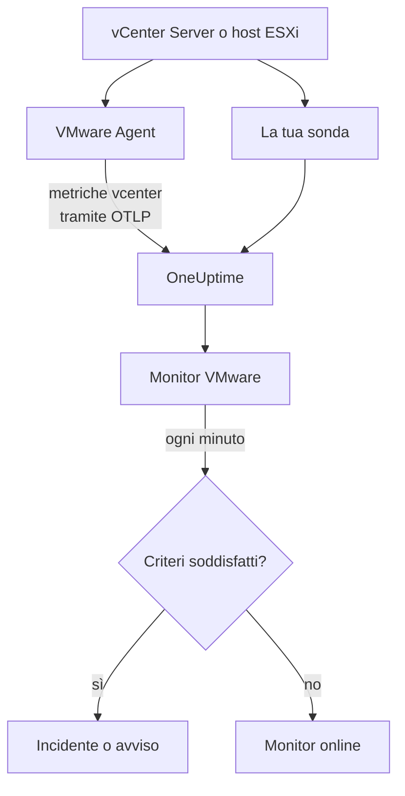

# Monitor VMware

Un monitor VMware osserva un vCenter - i suoi datacenter, cluster, host ESXi, macchine virtuali, datastore, resource pool e vSAN - e ti avvisa quando un host si satura, a una VM mancano CPU o memoria, un datastore si riempie o vSphere genera un allarme. Legge le metriche `vcenter.*` raccolte dal OneUptime VMware Agent, oppure da una delle tue sonde senza agente.

:::cards
- [Creare il monitor](#creare-un-monitor-vmware): Sei passaggi nella dashboard.
- [Modelli](#modelli-di-avviso-predefiniti): Ventitré avvisi pronti, un incidente per host, VM o datastore.
- [Attributi di identità](#attributi-di-identità): Come puntare a un host, una VM o un datastore.
- [Metriche](#metriche-raccolte): Ogni serie `vcenter.*` su cui il monitor può generare avvisi.
:::

## Come funziona

Le metriche provengono dall'API di vCenter, lette con un account in sola lettura in uno di due modi:

- **Il VMware Agent**, un OpenTelemetry Collector con il suo receiver `vcenter`, che esegui su una macchina in grado di raggiungere vCenter. Vedi [Agent VMware](/docs/telemetry/vmware).
- **Una sonda**, senza nulla da installare: colleghi il vCenter in OneUptime e scegli la sonda che lo raggiunge. Vedi [VMware senza agent](/docs/telemetry/vmware-agentless).

Entrambi inviano le stesse serie a ogni intervallo di raccolta (2 minuti per impostazione predefinita), contrassegnate con il nome del vCenter, `vmware.vcenter.name`. Un vCenter è un endpoint vSphere: un vCenter Server o un host ESXi autonomo. Un monitor VMware è legato a un vCenter. Ogni minuto esegue la sua query sulle metriche di quel vCenter e confronta il risultato con i suoi criteri.



## Prima di iniziare

- **Raccogli le metriche del vCenter**, con il [VMware Agent](/docs/telemetry/vmware) o [senza agent](/docs/telemetry/vmware-agentless). Entrambi usano un utente vSphere con il ruolo **Read-Only** sull'oggetto vCenter di livello più alto, con **Propagate to children** selezionato. L'agente legge `ONEUPTIME_URL`, `ONEUPTIME_TELEMETRY_INGESTION_KEY`, `VMWARE_VCENTER_NAME`, `VCENTER_ENDPOINT`, `VCENTER_USERNAME` e `VCENTER_PASSWORD`.
- **Verifica che il vCenter sia registrato.** Compare in **Prodotti → Infrastruttura → VMware → Tutti i vCenter**: tramite l'agente, con il nome del suo `VMWARE_VCENTER_NAME`, dopo la sua prima raccolta completa; senza agente, dal momento in cui lo colleghi.

## Creare un monitor VMware

:::steps
### Iniziare un nuovo monitor

Vai su **Monitor** e fai clic su **Crea monitor**.

### Scegliere VMware

In **Tipo di monitor**, fai clic su **Altri tipi di monitor** e scegli **VMware** sotto **Infrastruttura**, oppure digita `vmware` nella casella di ricerca. Inserisci un **Nome** - viene usato nei titoli di incidenti e avvisi - e fai clic su **Avanti**.

### Scegliere il vCenter

In **VMware Monitor Configuration**, scegli il vCenter da **vCenter**. Ogni vCenter che ha inviato dati, o che hai collegato senza agente, è nell'elenco.

### Scegliere cosa osservare

Scegli una delle tre schede:

- **Quick Setup** - fai clic su un [modello](#modelli-di-avviso-predefiniti). Imposta la metrica, i filtri sugli attributi, l'aggregazione, l'intervallo di tempo, il raggruppamento e le soglie, e sostituisce i criteri qui sotto con i propri. Puoi comunque cambiare l'**Intervallo di tempo**.
- **Custom Metric** - scegli una metrica da **VMware Metric**, poi imposta **Aggregazione** e **Intervallo di tempo**. Il modulo la raggruppa per l'oggetto che descrive, così ogni host, VM o datastore viene valutato separatamente, e i [filtri](#impostazioni-del-monitor) la restringono a un datacenter, un cluster, un host, una VM, un datastore o un resource pool.
- **Avanzato** - costruisci tu query e formule in **Seleziona metriche**, con filtri su attributi come `disk_state`, `power_state` o `status`. Usa **Group by** con un [attributo di identità](#attributi-di-identità) per valutare ogni oggetto separatamente.

### Controllare i criteri

Apri ogni criterio in **Criteri del monitor** e controlla **Metrica**, **Aggregazione**, **Condizione** e **Threshold**. Un modello li compila. Con **Custom Metric** o **Avanzato**, il monitor parte con i [criteri predefiniti](#criteri-predefiniti), che notano solo una metrica che scende a zero, quindi imposta la tua soglia.

### Creare il monitor

Fai clic su **Crea monitor**. OneUptime apre la pagina del monitor e lo valuta ogni minuto. Gli incidenti e gli avvisi che genera compaiono anche nelle pagine **Incidenti** e **Avvisi** del vCenter.
:::

> [!TIP]
> Per impostare più modelli in una volta, apri il vCenter da **Prodotti → Infrastruttura → VMware** e vai su **Recommendations**. Scegli i modelli che vuoi, decidi chi viene avvisato, e OneUptime crea un monitor per ogni modello.

## Impostazioni del monitor

| Campo | Scheda | Cosa fa |
| --- | --- | --- |
| **vCenter** | Tutte | Obbligatorio. Limita ogni query a `resource.vmware.vcenter.name`. |
| **Datacenter** | Custom Metric, Avanzato | Facoltativo. Un datacenter: `resource.vcenter.datacenter.name`. Ogni serie lo porta. |
| **Cluster** | Custom Metric, Avanzato | Facoltativo. Un cluster: `resource.vcenter.cluster.name`. Corrisponde alle serie del cluster stesso e a quelle di host, VM e resource pool che contiene; un host ESXi autonomo non ne ha. |
| **ESXi Host** | Custom Metric, Avanzato | Facoltativo. Un host ESXi: `resource.vcenter.host.name`. Corrisponde alle serie dell'host stesso **e** a quelle di ogni VM che esegue, perché una VM porta il nome del suo host. |
| **Virtual Machine** | Custom Metric, Avanzato | Facoltativo. Una VM: `resource.vcenter.vm.name`. I nomi delle VM non devono essere univoci: aggiungi un host o un cluster quando due VM condividono lo stesso nome. |
| **Datastore** | Custom Metric, Avanzato | Facoltativo. Un datastore: `resource.vcenter.datastore.name`. |
| **Resource Pool Path** | Custom Metric, Avanzato | Facoltativo. Un resource pool, tramite il suo percorso di inventario (`/DC/host/Cluster/Resources/pool`): `resource.vcenter.resource_pool.inventory_path`. Un percorso, perché i nomi dei pool sono univoci solo all'interno del loro oggetto padre. |
| **VMware Metric** | Custom Metric | Una metrica del [catalogo](#metriche-raccolte). |
| **Aggregazione** | Custom Metric | Come vengono combinati i campioni: **Media**, **Massimo**, **Minimo**, **Somma** o **Conteggio**. Parte dall'aggregazione abituale della metrica. |
| **Intervallo di tempo** | Tutte | La finestra mobile che la query legge, da **Past 1 Minute** a **Past 365 Days**. Un nuovo monitor parte da **Past 5 Minutes**; i modelli impostano la propria. |
| **Seleziona metriche** | Avanzato | Il generatore di query: **Metrica**, **Aggregate by**, **Filter by attributes**, **Group by**, più **Aggiungi metrica** e **Aggiungi formula** per combinare le query. |

vCenter viene letto una volta per intervallo di raccolta, 2 minuti per impostazione predefinita, quindi una finestra di 1 minuto può non contenere alcun campione. Mantieni la finestra a 5 minuti o più, e più lunga se hai aumentato l'intervallo di raccolta per un inventario grande.

## Attributi di identità

Il receiver `vcenter` invia una risorsa OpenTelemetry per ogni oggetto vSphere, e la nomina con **attributi di risorsa**. Quali di questi porta una serie ti dice che tipo di oggetto descrive:

| Oggetto vSphere     | Attributi di risorsa di identità                                                                                               |
| ------------------- | ------------------------------------------------------------------------------------------------------------------------------ |
| Datacenter          | `vcenter.datacenter.name`                                                                                                      |
| Cluster             | `vcenter.datacenter.name`, `vcenter.cluster.name`                                                                              |
| Host ESXi           | `vcenter.datacenter.name`, `vcenter.host.name` (+ `vcenter.cluster.name` quando è in un cluster)                               |
| Macchina virtuale   | `vcenter.datacenter.name`, `vcenter.host.name`, `vcenter.vm.name`, `vcenter.vm.id` (+ `vcenter.cluster.name`; `vcenter.resource_pool.*` o `vcenter.virtual_app.*`) |
| Modello di VM       | `vcenter.datacenter.name`, `vcenter.host.name`, `vcenter.vm_template.name`, `vcenter.vm_template.id`                           |
| Datastore           | `vcenter.datacenter.name`, `vcenter.datastore.name`                                                                            |
| Resource pool       | `vcenter.datacenter.name`, `vcenter.resource_pool.name`, `vcenter.resource_pool.inventory_path` (+ `vcenter.cluster.name` o `vcenter.host.name`) |

Nei filtri del monitor e nelle chiavi di raggruppamento, gli attributi di risorsa iniziano con `resource.` (`resource.vcenter.host.name`), mentre gli attributi dei datapoint no (`disk_state`, `power_state`, `status`, `effective`, `direction`, `object`, `type`). L'attributo booleano `effective` è memorizzato come testo `"true"` o `"false"`, quindi filtralo con il testo. Filtra su un attributo di identità per puntare a un oggetto, e raggruppa per esso per valutare ogni oggetto separatamente.

## Modelli di avviso predefiniti

OneUptime fornisce 23 modelli per i problemi VMware più comuni, e **Quick Setup** li offre tutti. Ognuno costruisce un monitor completo: la query della metrica, i suoi filtri sugli attributi, un raggruppamento sull'attributo di identità proprio dell'oggetto, un criterio che scatta e uno che rientra. Le soglie sono punti di partenza che puoi modificare.

I modelli leggono gli ultimi 5 minuti, salvo diversa indicazione nella tabella. Un criterio scatta solo quando la condizione vale per ogni minuto della sua finestra, e un criterio di soglia rientra il 10 % oltre la sua soglia, così un valore che oscila attorno alla linea non va avanti e indietro.

| Modello | Categoria | Gravità | Osserva | Scatta quando | Rientra quando |
| --- | --- | --- | --- | --- | --- |
| Host CPU Saturation | Host | Warning | `vcenter.host.cpu.utilization`, Avg per `resource.vcenter.host.name` | Sopra il 90 %: ogni VM sull'host si contende i core e mostra tempo di CPU ready | All'81 % o meno |
| Host Memory Saturation | Host | Warning | `vcenter.host.memory.utilization`, Avg per host | Sopra il 90 %: l'host inizia a recuperare memoria con ballooning, compressione e swapping | All'81 % o meno |
| Host Disk Latency High | Host | Warning | `vcenter.host.disk.latency.max`, Max per host | Sopra 50 ms: ogni VM i cui dischi sono su quel percorso attende lo storage. Richiede il livello 3 dei contatori di prestazioni | A 45 ms o meno |
| Host Network Packet Errors | Host | Warning | `vcenter.host.network.packet.error.rate`, Max per host | Sopra 0: quasi sempre un guasto di cavo, SFP o porta dello switch | A 0 |
| Host Network Packet Drops | Host | Warning | `vcenter.host.network.packet.drop.rate`, Max per host | Sopra 0: un uplink sovraccarico, o buffer ad anello delle NIC che traboccano | A 0 |
| VM CPU Saturation | Virtual Machine | Warning | `vcenter.vm.cpu.utilization`, Avg per `resource.vcenter.vm.name`, **ultimi 15 minuti** | Sopra il 90 % delle vCPU della VM per tutti i 15 minuti: una VM può usare ciò che le è stato dato, quindi avvisa solo una che non scende mai | All'81 % o meno |
| VM CPU Ready Contention | Virtual Machine | Warning | `vcenter.vm.cpu.readiness`, Avg per VM | Sopra il 10 %: la VM era pronta a essere eseguita, ma l'host non aveva un core fisico per lei. Invisibile dall'interno del guest | Al 9 % o meno |
| VM Memory Saturation | Virtual Machine | Warning | `vcenter.vm.memory.utilization`, Avg per VM | Sopra il 90 % della sua memoria: il guest sta per iniziare a paginare | All'81 % o meno |
| VM Memory Ballooning | Virtual Machine | Warning | `vcenter.vm.memory.ballooned`, Max per VM | Sopra 0: l'host è a corto di memoria e la riprende da questo guest | A 0 |
| VM Memory Swapping | Virtual Machine | Critico | `vcenter.vm.memory.swapped`, Max per VM | Sopra 0: l'host fa lo swap della memoria della VM, l'ultima risorsa dopo ballooning e compressione | A 0 |
| VM Disk Latency High | Virtual Machine | Warning | `vcenter.vm.disk.latency.max`, Max per VM | Sopra 50 ms: le applicazioni nel guest vanno in timeout sull'I/O | A 45 ms o meno |
| VM Disk Usage High | Virtual Machine | Warning | `vcenter.vm.disk.utilization`, Avg per VM | Sopra il 90 % del suo storage assegnato già impegnato: una VM thin-provisioned sta per reclamare la sua dimensione completa | All'81 % o meno |
| Datastore Capacity Warning | Datastore | Warning | `vcenter.datastore.disk.utilization`, Avg per `resource.vcenter.datastore.name` | Sopra l'80 %: un avviso precoce, perché i dischi thin e gli snapshot consumano in fretta il resto | Al 72 % o meno |
| Datastore Capacity Critical | Datastore | Critico | `vcenter.datastore.disk.utilization`, Avg per datastore | Sopra il 90 %: un datastore pieno mette in pausa ogni VM che ha un disco su di esso | All'81 % o meno |
| Cluster Host Not Effective | Cluster | Critico | `vcenter.cluster.host.count` filtrata su `effective = false`, Max per `resource.vcenter.cluster.name` | Sopra 0: un host è in modalità manutenzione, disconnesso o non risponde, quindi il cluster funziona con meno capacità di quella prevista | A 0 |
| Datacenter Hosts Unhealthy | Datacenter | Critico | `vcenter.datacenter.host.count` filtrata su `status = red`, Max per `resource.vcenter.datacenter.name` | Sopra 0: un host ha un allarme critico, come un sensore hardware, un percorso di storage perso o un errore dell'agente HA | A 0 |
| Datacenter Hosts Degraded | Datacenter | Warning | `vcenter.datacenter.host.count` filtrata su `status = yellow`, Max per datacenter | Sopra 0: un host ha un allarme di avviso | A 0 |
| Datacenter Hosts Powered Off | Datacenter | Warning | `vcenter.datacenter.host.count` filtrata su `power_state = off`, Max per datacenter | Sopra 0: un host è spento - si è bloccato, ha perso l'alimentazione o è stato messo in standby da DPM | A 0 |
| Datacenter VMs Unhealthy | Datacenter | Warning | `vcenter.datacenter.vm.count` filtrata su `status = red`, Max per datacenter | Sopra 0: una VM ha un allarme critico, come un riavvio HA fallito, un datastore perso o un heartbeat dei Tools perso | A 0 |
| Datacenter Clusters Unhealthy | Datacenter | Critico | `vcenter.datacenter.cluster.count` filtrata su `status = red`, Max per datacenter | Sopra 0: un cluster ha un allarme critico, come risorse di failover HA insufficienti, un'elezione HA fallita o un controllo di integrità vSAN critico | A 0 |
| vSAN Latency High | vSAN | Warning | `vcenter.cluster.vsan.latency.avg`, Avg per cluster | Sopra 20 000 µs (20 ms): lo storage rallenta per ogni VM sul datastore vSAN. Silenzioso sui cluster senza vSAN | A 18 000 µs o meno |
| vSAN Congestion | vSAN | Warning | `vcenter.cluster.vsan.congestions`, Max per cluster | Sopra 0: un gruppo di dischi non riesce a tenere il passo, e vSAN rallenta l'I/O dei suoi client | A 0 |
| Resource Pool Memory Swapped | Cluster | Warning | `vcenter.resource_pool.memory.swapped`, Max per `resource.vcenter.resource_pool.inventory_path` | Sopra 0: le VM del pool prendono memoria dallo swap dell'host, di solito perché il limite o le share di memoria del pool sono troppo bassi | A 0 |

**Gravità** è l'etichetta che mostra il selettore. L'incidente e l'avviso creati da un modello partono dalla gravità di incidente e di avviso più alta del tuo progetto; cambiale nel criterio.

- **I modelli di utilizzo usano Avg:** il receiver riporta una vera percentuale da 0 a 100 per ogni oggetto, quindi la media in un minuto è l'utilizzo sostenuto.
- **I modelli di latenza usano Max:** la metrica è già la latenza peggiore tra i dischi dell'oggetto, quindi il suo campione più alto è quello onesto.
- **I modelli di conteggio e di stato usano Max**, così una sola raccolta che mostra la condizione li fa scattare: errori di pacchetto, ballooning, swapping, stato rosso e giallo, host non effettivi, congestione.
- **Ogni modello raggruppa sull'attributo di identità proprio dell'oggetto**, quindi scatta un incidente per ogni oggetto interessato, e l'incidente lo nomina.
- **Le soglie sono fissate nella loro unità** (`%`, `ms`, `us`), così mantengono il loro significato qualunque unità mostri un grafico.

## Metriche raccolte

Le metriche qui sotto sono il catalogo che offre il modulo del monitor. Le unità sono quelle del receiver stesso: `MHz`, `%`, `MiBy` (mebibyte), `By` (byte), `KiBy`, `ms`, `us` (microsecondi), `{KiBy/s}`, `By/s` e conteggi. Una metrica indicata come _disattivata per impostazione predefinita_ non viene raccolta finché non la attivi nel `otel-collector-config.yaml` dell'agente; la configurazione fornita attiva già `vcenter.host.memory.capacity`.

### Datacenter

| Metrica                              | Unità               | Descrizione                                                                                                                                                    |
| ------------------------------------ | ------------------- | -------------------------------------------------------------------------------------------------------------------------------------------------------------- |
| `vcenter.datacenter.cluster.count`   | `{clusters}`        | Cluster nel datacenter, suddivisi per `status` (`red` / `yellow` / `green` / `gray`). Somma per il totale; filtra `status = red` per i cluster con un allarme critico |
| `vcenter.datacenter.cpu.limit`       | `MHz`               | CPU totale disponibile per il datacenter su tutti gli host ESXi                                                                                                |
| `vcenter.datacenter.datastore.count` | `{datastores}`      | Datastore nel datacenter                                                                                                                                       |
| `vcenter.datacenter.disk.space`      | `By`                | Spazio dei datastore nell'intero datacenter, suddiviso per `disk_state` (`used` / `available`). used ÷ (used + available) è l'utilizzo dello storage dell'intero datacenter |
| `vcenter.datacenter.host.count`      | `{hosts}`           | Host ESXi nel datacenter, suddivisi per `status` e `power_state` (`on` / `off` / `standby` / `unknown`). Filtra `status = red` o `power_state = off`          |
| `vcenter.datacenter.memory.limit`    | `By`                | Memoria fisica totale disponibile per il datacenter su tutti gli host ESXi                                                                                     |
| `vcenter.datacenter.vm.count`        | `{virtual_machines}` | Macchine virtuali nel datacenter, suddivise per `status` e `power_state` (`on` / `off` / `suspended` / `unknown`). Filtra `power_state = on` per le VM in esecuzione |

### Cluster

| Metrica                             | Unità                         | Descrizione                                                                                                                                                  |
| ----------------------------------- | ----------------------------- | ------------------------------------------------------------------------------------------------------------------------------------------------------------ |
| `vcenter.cluster.cpu.effective`     | `MHz`                         | CPU che il cluster può effettivamente pianificare — esclude gli host in modalità manutenzione o che non rispondono. Confrontala con `vcenter.cluster.cpu.limit` per la capacità fuori servizio |
| `vcenter.cluster.cpu.limit`         | `MHz`                         | CPU totale di ogni host ESXi del cluster, indipendentemente dallo stato dell'host                                                                            |
| `vcenter.cluster.host.count`        | `{hosts}`                     | Host ESXi del cluster, suddivisi per `effective` (`"true"` / `"false"`). Un host non è effettivo finché è in modalità manutenzione, disconnesso o non risponde |
| `vcenter.cluster.memory.effective`  | `By`                          | Memoria che il cluster può effettivamente assegnare alle VM — esclude gli host in manutenzione o che non rispondono e la memoria riservata da ESXi stesso    |
| `vcenter.cluster.memory.limit`      | `By`                          | Memoria fisica totale di ogni host ESXi del cluster                                                                                                          |
| `vcenter.cluster.vm.count`          | `{virtual_machines}`          | Macchine virtuali nel cluster, suddivise per `power_state`. Somma per il totale; filtra `power_state = on` per le VM in esecuzione                           |
| `vcenter.cluster.vm_template.count` | `{virtual_machine_templates}` | Modelli di macchine virtuali nel cluster                                                                                                                     |

### Host (ESXi)

| Metrica                                  | Unità         | Descrizione                                                                                                                                                       |
| ---------------------------------------- | ------------- | ----------------------------------------------------------------------------------------------------------------------------------------------------------------- |
| `vcenter.host.cpu.capacity`              | `MHz`         | Capacità totale di CPU dell'host ESXi (core × frequenza) — il denominatore di `vcenter.host.cpu.usage`                                                            |
| `vcenter.host.cpu.reserved`              | `MHz`         | CPU riservata alle macchine virtuali, suddivisa per `cpu_reservation_type` (`total` / `used`). Un `used` che si avvicina a `total` significa che le nuove prenotazioni non supereranno l'admission control |
| `vcenter.host.cpu.usage`                 | `MHz`         | CPU attualmente consumata sull'host da tutte le VM e dall'hypervisor stesso                                                                                       |
| `vcenter.host.cpu.utilization`           | `%`           | Utilizzo della CPU dell'host come percentuale (0–100) della sua capacità                                                                                          |
| `vcenter.host.disk.latency.avg`          | `ms`          | Latenza media del disco (tempo del dispositivo + del kernel), suddivisa per `direction` (`read` / `write`) e `object` (dispositivo disco). Richiede il livello 2 dei contatori di prestazioni |
| `vcenter.host.disk.latency.max`          | `ms`          | Latenza più alta osservata su tutti i dischi usati dall'host, per `object`, nell'ultimo intervallo di 20 s. Richiede il livello 3 dei contatori di prestazioni     |
| `vcenter.host.disk.throughput`           | `{KiBy/s}`    | Kilobyte al secondo letti dai dischi dell'host o scritti su di essi, per `direction` e `object`. Richiede il livello 4 dei contatori di prestazioni               |
| `vcenter.host.memory.active`             | `MiBy`        | Memoria che le VM accese dell'host stanno usando attivamente. _Disattivata per impostazione predefinita_ — attiva `vcenter.host.memory.active` nella configurazione dell'agente |
| `vcenter.host.memory.ballooned`          | `MiBy`        | Memoria del guest recuperata dalle VM dell'host dal driver di ballooning; sopra 0 indica pressione sulla memoria dell'host. _Disattivata per impostazione predefinita_ |
| `vcenter.host.memory.capacity`           | `MiBy`        | Memoria fisica totale dell'host — il denominatore di `vcenter.host.memory.usage`. Disattivata per impostazione predefinita a monte; la configurazione dell'agente fornita la attiva |
| `vcenter.host.memory.granted`            | `MiBy`        | Memoria macchina concessa alle VM accese sull'host. _Disattivata per impostazione predefinita_                                                                    |
| `vcenter.host.memory.usage`              | `MiBy`        | Memoria attualmente consumata sull'host, incluso l'overhead dell'hypervisor stesso                                                                                |
| `vcenter.host.memory.utilization`        | `%`           | Utilizzo della memoria dell'host come percentuale (0–100) della sua capacità fisica                                                                               |
| `vcenter.host.network.packet.drop.rate`  | `{packets/s}` | Pacchetti al secondo scartati su ogni NIC fisica, per `direction` (`transmitted` / `received`) e `object` (p. es. `vmnic0`) — un uplink sovraccarico o una NIC che si sta guastando |
| `vcenter.host.network.packet.error.rate` | `{errors/s}`  | Errori di pacchetto al secondo sulle NIC fisiche dell'host, per `direction` e `object` — quasi sempre un guasto di cavo, SFP o porta dello switch                  |
| `vcenter.host.network.packet.rate`       | `{packets/s}` | Pacchetti al secondo trasmessi o ricevuti su ogni NIC fisica, per `direction` e `object`                                                                         |
| `vcenter.host.network.throughput`        | `{KiBy/s}`    | Kilobyte al secondo trasmessi o ricevuti dall'host, per `direction` e `object`                                                                                   |
| `vcenter.host.network.usage`             | `{KiBy/s}`    | Velocità combinata di trasmissione e ricezione sulle NIC dell'host, per `object`                                                                                  |

### Macchina virtuale

| Metrica                                    | Unità         | Descrizione                                                                                                                                                                   |
| ------------------------------------------ | ------------- | ----------------------------------------------------------------------------------------------------------------------------------------------------------------------------- |
| `vcenter.vm.cpu.readiness`                 | `%`           | Percentuale del tempo in cui la VM era pronta a essere eseguita ma non ha potuto essere pianificata su una CPU fisica (CPU ready). Sopra il 5 % il guest risulta lento; sopra il 10 % l'host è sovraccarico. Solo VM accese |
| `vcenter.vm.cpu.time`                      | `%`           | Tempo trascorso dalle vCPU della VM in ogni stato, per `cpu_state` (`idle` / `ready` / `wait`) e `object` (vCPU). _Disattivata per impostazione predefinita_ — attiva `vcenter.vm.cpu.time` |
| `vcenter.vm.cpu.usage`                     | `MHz`         | CPU consumata dalla VM. Solo VM accese — la sua presenza è il modo in cui OneUptime deduce lo stato di alimentazione di una VM                                                 |
| `vcenter.vm.cpu.utilization`               | `%`           | Utilizzo della CPU della VM come percentuale (0–100) delle sue vCPU configurate. Solo VM accese                                                                               |
| `vcenter.vm.disk.latency.avg`              | `ms`          | Latenza media del disco, per `direction` (`read` / `write`), `disk_type` (`virtual` / `physical`) e `object` (disco virtuale). Richiede il livello 2 dei contatori di prestazioni |
| `vcenter.vm.disk.latency.max`              | `ms`          | Latenza totale più alta (tempo del dispositivo + del kernel) vista dalla VM su un disco in un intervallo di 20 s, per `object`                                                  |
| `vcenter.vm.disk.throughput`               | `{KiBy/s}`    | Kilobyte al secondo letti dai dischi della VM o scritti su di essi, per `direction` e `object`. Richiede il livello 2 dei contatori di prestazioni                              |
| `vcenter.vm.disk.usage`                    | `By`          | Spazio di datastore consumato dai file della VM, suddiviso per `disk_state` (`used` / `available`). Emessa anche per i modelli di VM. Filtra `disk_state = used` per la dimensione impegnata |
| `vcenter.vm.disk.utilization`              | `%`           | Percentuale (0–100) dello storage assegnato alla VM che è impegnato sul datastore — una VM thin-provisioned vicina al 100 % sta per reclamare la sua dimensione completa       |
| `vcenter.vm.memory.ballooned`              | `MiBy`        | Memoria del guest recuperata dalla VM dal driver di ballooning (VMware Tools). Sopra 0 significa che l'host ESXi è a corto di memoria                                          |
| `vcenter.vm.memory.granted`                | `MiBy`        | Memoria macchina concessa alla VM dall'host. _Disattivata per impostazione predefinita_ — attiva `vcenter.vm.memory.granted`                                                  |
| `vcenter.vm.memory.swapped`                | `MiBy`        | Memoria concessa alla VM dal file di swap dell'host — l'ultima risorsa dopo ballooning e compressione; qualsiasi valore sopra 0 significa che la VM paga latenza del disco per la RAM |
| `vcenter.vm.memory.swapped_ssd`            | `KiBy`        | Memoria della VM spostata nella cache di swap flash dell'host — meno pesante del file di swap, ma comunque pressione sulla memoria                                             |
| `vcenter.vm.memory.usage`                  | `MiBy`        | Memoria usata attivamente dal guest della VM. Emessa allo stesso modo per VM accese e spente (0 quando è spenta)                                                               |
| `vcenter.vm.memory.utilization`            | `%`           | Utilizzo della memoria della VM come percentuale (0–100) della sua memoria configurata                                                                                         |
| `vcenter.vm.network.broadcast.packet.rate` | `{packets/s}` | Pacchetti broadcast al secondo per vNIC, per `direction` e `object`. _Disattivata per impostazione predefinita_                                                               |
| `vcenter.vm.network.multicast.packet.rate` | `{packets/s}` | Pacchetti multicast al secondo per vNIC, per `direction` e `object`. _Disattivata per impostazione predefinita_                                                               |
| `vcenter.vm.network.packet.drop.rate`      | `{packets/s}` | Pacchetti al secondo scartati da ogni vNIC, per `direction` e `object`. Gli scarti in ricezione di solito significano che il guest non svuota abbastanza in fretta il suo buffer ad anello |
| `vcenter.vm.network.packet.rate`           | `{packets/s}` | Pacchetti al secondo trasmessi o ricevuti da ogni vNIC, per `direction` e `object`                                                                                           |
| `vcenter.vm.network.throughput`            | `By/s`        | Byte al secondo trasmessi o ricevuti sulla rete della VM, per `direction` e `object`                                                                                         |
| `vcenter.vm.network.usage`                 | `{KiBy/s}`    | Velocità combinata di trasmissione e ricezione della VM, per `object`                                                                                                          |

### Datastore

| Metrica                              | Unità | Descrizione                                                                                                                                  |
| ------------------------------------ | ----- | -------------------------------------------------------------------------------------------------------------------------------------------- |
| `vcenter.datastore.disk.usage`       | `By`  | Spazio sul datastore, suddiviso per `disk_state` (`used` / `available`). used + available è la capacità del datastore                      |
| `vcenter.datastore.disk.utilization` | `%`   | Percentuale (0–100) della capacità del datastore in uso. Un datastore pieno mette in pausa ogni VM che vi scrive, quindi genera avvisi ben prima del 100 % |

### Resource pool

| Metrica                                  | Unità      | Descrizione                                                                                                                                                              |
| ---------------------------------------- | ---------- | ------------------------------------------------------------------------------------------------------------------------------------------------------------------------ |
| `vcenter.resource_pool.cpu.shares`       | `{shares}` | Share di CPU configurate sul pool — la sua priorità relativa rispetto ai pool fratelli quando il padre è conteso                                                         |
| `vcenter.resource_pool.cpu.usage`        | `MHz`      | CPU consumata da tutte le VM del pool (e dei suoi pool figli)                                                                                                            |
| `vcenter.resource_pool.memory.ballooned` | `MiBy`     | Memoria recuperata dal driver di ballooning su tutte le VM del pool                                                                                                      |
| `vcenter.resource_pool.memory.granted`   | `MiBy`     | Memoria dell'host concessa alle VM del pool, suddivisa per `type` (`private` / `shared` — le pagine condivise sono deduplicate dal transparent page sharing)             |
| `vcenter.resource_pool.memory.shares`    | `{shares}` | Share di memoria configurate sul pool                                                                                                                                    |
| `vcenter.resource_pool.memory.swapped`   | `MiBy`     | Memoria concessa alle VM del pool dallo spazio di swap degli host ESXi — qualsiasi valore sopra 0 significa che almeno una VM del pool subisce lo swap dell'host         |
| `vcenter.resource_pool.memory.usage`     | `MiBy`     | Memoria usata dal pool, suddivisa per `type` (`guest` / `host` / `overhead`) nelle versioni recenti del collector; quelle più vecchie emettono una sola serie senza tipo. Filtra `type = guest` |

### vSAN

Inviate solo per i cluster con vSAN, i loro host e le VM su un datastore vSAN. Le latenze sono in **microsecondi** (`us`), a differenza delle latenze in millisecondi di host e VM:

| Metrica                             | Unità             | Descrizione                                                                                                                                     |
| ----------------------------------- | ----------------- | ----------------------------------------------------------------------------------------------------------------------------------------------- |
| `vcenter.cluster.vsan.congestions`  | `{congestions/s}` | Eventi di congestione al secondo generati contro l'I/O di ogni client vSAN del cluster — il segnale di contropressione di vSAN stesso           |
| `vcenter.cluster.vsan.latency.avg`  | `us`              | Latenza media vista dal cluster nell'accesso allo storage vSAN, per `type` (`read` / `write`). 20 000 µs = 20 ms                                |
| `vcenter.cluster.vsan.operations`   | `{operations/s}`  | Operazioni di I/O vSAN al secondo nell'intero cluster, per `type` (`read` / `write` / `unmap`)                                                  |
| `vcenter.cluster.vsan.throughput`   | `By/s`            | Throughput vSAN del cluster, per `direction` (`read` / `write`)                                                                                 |
| `vcenter.host.vsan.cache.hit_rate`  | `%`               | Percentuale dell'I/O di lettura vSAN dell'host servita dalla sua cache client locale nell'ultimo intervallo di 5 min — un tasso in calo significa che le letture arrivano al livello di capacità |
| `vcenter.host.vsan.congestions`     | `{congestions/s}` | Eventi di congestione al secondo generati contro l'I/O vSAN dell'host                                                                           |
| `vcenter.host.vsan.latency.avg`     | `us`              | Latenza media vista dall'host nell'accesso allo storage vSAN, per `type`                                                                        |
| `vcenter.host.vsan.operations`      | `{operations/s}`  | Operazioni di I/O vSAN al secondo emesse dall'host, per `type`                                                                                  |
| `vcenter.host.vsan.throughput`      | `By/s`            | Throughput vSAN dell'host, per `direction`                                                                                                      |
| `vcenter.vm.vsan.latency.avg`       | `us`              | Latenza media vista dalla VM nell'accesso allo storage vSAN, per `type`                                                                         |
| `vcenter.vm.vsan.operations`        | `{operations/s}`  | Operazioni di I/O vSAN al secondo emesse dalla VM, per `type`                                                                                   |
| `vcenter.vm.vsan.throughput`        | `By/s`            | Throughput vSAN della VM, per `direction`                                                                                                       |

> [!NOTE]
> Lo stato di alimentazione di una VM non è una metrica. Il receiver invia `vcenter.vm.cpu.*` solo per le VM accese, quindi OneUptime distingue **Powered on** da **Powered off** in base al fatto che i dati di CPU siano arrivati nella stessa raccolta dei dati di memoria e disco della VM; la pagina **Virtual Machines** del vCenter mostra il risultato. Per generare avvisi sugli host spenti o su quante VM sono in esecuzione, usa l'attributo `power_state` di `vcenter.datacenter.host.count`, `vcenter.datacenter.vm.count` o `vcenter.cluster.vm.count`.

## Criteri di monitoraggio

Un criterio confronta una delle query o formule del monitor con una soglia. I criteri di un monitor VMware non hanno un **Tipo di filtro**: ogni regola controlla il valore della metrica, con questi campi.

| Campo | Cosa fa |
| --- | --- |
| **Metrica** | La query o la formula da controllare, tramite il nome della sua variabile. |
| **Aggregazione** | Come i valori della finestra diventano un'unica risposta: **Media**, **Somma**, **Maximum Value**, **Minimum Value**, **All Values** (ogni valore deve corrispondere) o **Any Value** (ne basta uno). |
| **Condizione** | **Greater Than**, **Less Than**, **Greater Than Or Equal To**, **Less Than Or Equal To** o **Equal To** — oppure una condizione di anomalia: **Anomalously High**, **Anomalously Low** o **Anomalous**. |
| **Threshold** | Il valore con cui confrontare. Accanto c'è un elenco di unità quando la metrica ha un'unità. Non mostrato per le condizioni di anomalia. |
| **Sensibilità** | Solo condizioni di anomalia. **Bassa** (4σ), **Media** (3σ, il predefinito) o **Alta** (2σ). |
| **Finestra di riferimento** | Solo condizioni di anomalia. 14 giorni (il predefinito), 28, 60 o 90 giorni di storico. |
| **Se nessun dato** | In **Altri campi**. Cosa succede quando la finestra non ha campioni: **Ignore** (il predefinito), **Treat As Zero** o **Trigger**. |

Le condizioni di anomalia confrontano ogni valore con la stessa ora della settimana nel riferimento. Restano in uno stato «Learning», e non generano nulla, finché la finestra di riferimento non contiene abbastanza storico.

Alcuni criteri da cui partire:

- **Un host è saturo:** `vcenter.host.cpu.utilization`, Media, raggruppata per `resource.vcenter.host.name`, **Greater Than** `90`, negli ultimi 5 minuti.
- **Un datastore si sta riempiendo:** `vcenter.datastore.disk.utilization`, Media, raggruppata per `resource.vcenter.datastore.name`, **Greater Than** `80`.
- **Un cluster ha perso un host:** `vcenter.cluster.host.count` filtrata su `effective = false`, Massimo, raggruppata per `resource.vcenter.cluster.name`, **Greater Than** `0`.
- **Sono in esecuzione meno VM del previsto:** `vcenter.cluster.vm.count` filtrata su `power_state = on` e `resource.vcenter.cluster.name = Production`, Somma, **Less Than** il numero che ti aspetti.
- **L'host sta facendo lo swap di una VM:** `vcenter.vm.memory.swapped`, Massimo, raggruppata per `resource.vcenter.vm.name`, **Greater Than** `0`.

### Criteri predefiniti

Un monitor che non costruisci da un modello parte con due criteri:

| Ordine | Criterio | Corrisponde quando | Poi |
| --- | --- | --- | --- |
| 1 | Check if _monitor name_ is offline | Un valore qualsiasi della prima query è `0` | Segna il monitor come **Offline** e dichiara l'incidente «_monitor name_ is offline», che si risolve da solo quando il monitor rientra. |
| 2 | Check if _monitor name_ is online | Un valore qualsiasi è sopra `0` | Segna il monitor come **Operativo**. |

> [!IMPORTANT]
> Il silenzio non corrisponde a nessuno dei due criteri: un vCenter che smette di inviare dati lascia il monitor com'era. Per essere avvisato quando i dati si fermano, imposta **Se nessun dato** su **Trigger** in un criterio. Il tempo in cui OneUptime stesso non stava ricevendo non conta mai come assenza di dati: un controllo la cui finestra lo contiene aspetta invece, come spiega [Quando OneUptime non riceve dati](/docs/monitor/when-oneuptime-is-not-receiving).

## Terraform

Il [provider Terraform di OneUptime](/docs/terraform/monitor-steps) porta la configurazione di un passaggio di monitor VMware nell'attributo `vmware_monitor`: il JSON grezzo della configurazione `vmwareMonitor` (`vcenterIdentifier`, `resourceFilters`, `metricViewConfig`, `rollingTime`), scritto con `jsonencode()`:

```hcl title="main.tf"
monitor_steps = [{
  vmware_monitor = jsonencode({
    vcenterIdentifier = "prod-vcenter"
    resourceFilters   = { clusterName = "Production" }
    rollingTime       = "Past 5 Minutes"
    metricViewConfig = {
      queryConfigs = [{
        metricAliasData = { metricVariable = "host_cpu", title = "Host CPU", description = "", legend = "" }
        metricQueryData = {
          filterData = {
            metricName     = "vcenter.host.cpu.utilization"
            attributes     = {}
            aggegationType = "Avg"
            aggregateBy    = {}
          }
          groupByAttributeKeys = ["resource.vcenter.host.name"]
        }
      }]
      formulaConfigs = []
    }
  })
  criteria = [ /* ... */ ]
}]
```

`vcenterIdentifier` è il `vmware.vcenter.name` del vCenter - il `VMWARE_VCENTER_NAME` con cui è stato avviato l'agente -, non il suo ID in OneUptime.

## Risoluzione dei problemi

:::details Il vCenter non è nell'elenco vCenter
Un vCenter raccolto dall'agente si registra da solo a partire dai dati dell'agente. Verifica che l'agente sia in esecuzione e invii dati (vedi [Verificare l'installazione](/docs/telemetry/vmware#verify-the-installation)), che `VMWARE_VCENTER_NAME` sia impostato e che sia trascorso un intervallo di raccolta: non viene inviato nulla finché non si completa la prima scansione completa dell'inventario.
:::

:::details Gli host hanno metriche, ma VM, datastore o cluster no
L'utente vSphere in sola lettura ha ricevuto il suo ruolo senza **Propagate to children**, oppure su un oggetto sotto la radice del vCenter. Gli oggetti che l'utente non può vedere mancano semplicemente dalle metriche. Imposta il permesso sull'oggetto vCenter di livello più alto, con la propagazione selezionata.
:::

:::details Host CPU Saturation non scatta mai
Il modello calcola la media di `vcenter.host.cpu.utilization` per `resource.vcenter.host.name`, quindi ogni host viene controllato separatamente. Se hai costruito la tua query, raggruppala per l'attributo di identità con il suo prefisso `resource.`: il semplice `vcenter.host.name` non corrisponde a nulla, e una media su tutti gli host viene abbassata da quelli inattivi.
:::

:::details I modelli vSAN non scattano mai
`vcenter.cluster.vsan.*`, `vcenter.host.vsan.*` e `vcenter.vm.vsan.*` vengono inviate solo per i cluster con vSAN, i loro host e le VM su un datastore vSAN. Senza vSAN le serie non esistono, e i modelli restano silenziosi.
:::

:::details Un criterio filtrato su effective non corrisponde a nulla
L'attributo booleano `effective` del receiver è memorizzato come testo `"true"` o `"false"`. Filtralo con il testo, non con un booleano.
:::

:::details Mancano le metriche di latenza o di throughput del disco
`vcenter.host.disk.latency.avg` e `vcenter.vm.disk.*` richiedono il livello di statistiche 2 di vCenter, `vcenter.host.disk.latency.max` il livello 3, e `vcenter.host.disk.throughput` il livello 4. Aumenta il livello di statistiche dell'intervallo di 5 minuti in _vCenter → Configure → General → Statistics_.
:::

:::details Una finestra di 1 minuto non mostra dati
vCenter viene letto una volta per intervallo di raccolta, 2 minuti per impostazione predefinita e spesso di più per un inventario grande, quindi una finestra di 1 minuto può non contenere alcun campione. Usa 5 minuti o più.
:::

## Passaggi successivi

:::cards
- [Agent VMware](/docs/telemetry/vmware): Installare l'agente che raccoglie da vCenter.
- [VMware senza agent](/docs/telemetry/vmware-agentless): Lasciare invece che sia una sonda a raccogliere.
- [Monitor Proxmox](/docs/monitor/proxmox-monitor): Lo stesso tipo di monitor per Proxmox VE.
- [Panoramica degli incidenti](/docs/incidents/index): Cosa succede dopo che un criterio dichiara un incidente.
:::
