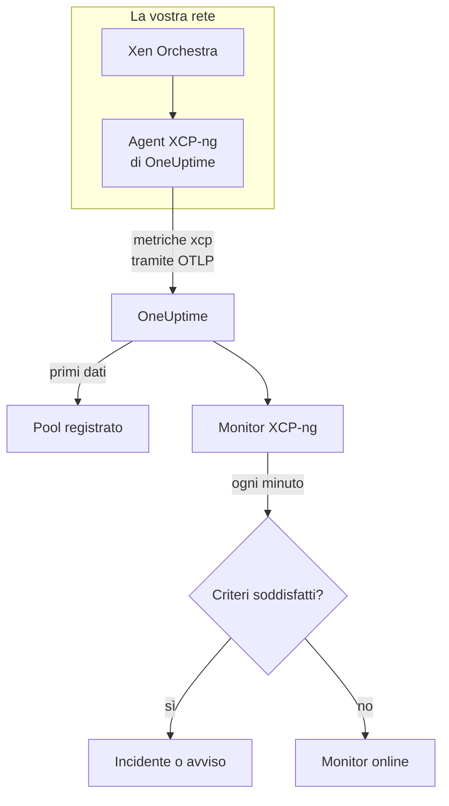

# Monitor XCP-ng

Un monitor XCP-ng sorveglia un pool XCP-ng – i suoi host, le VM, i repository di storage e i dischi virtuali – e vi avvisa quando Xen Orchestra perde il pool, un host va offline o resta disabilitato, una VM che era in esecuzione si ferma o resta senza CPU, oppure un repository di storage si riempie o rallenta. Legge le serie `xcp_*` del plugin OpenMetrics di Xen Orchestra, che l'agent XCP-ng di OneUptime raccoglie, e le serie di salute che OneUptime ne ricava, quindi nulla viene sondato dall'esterno.

:::cards
- [Creare il monitor](#creare-un-monitor-xcp-ng): Sei passaggi nella dashboard.
- [Modelli](#modelli-di-avviso-pronti): Dieci avvisi pronti, un incidente per host, VM o repository di storage.
- [Identità delle risorse](#identità-delle-risorse): Come puntare a un solo host, VM o repository di storage.
- [Metriche](#metriche-raccolte): Ogni serie su cui il monitor può generare avvisi.
:::

## Come funziona

L'agent XCP-ng di OneUptime gira su una macchina che raggiunge Xen Orchestra. Ogni 60 secondi legge il plugin OpenMetrics di Xen Orchestra, che legge ogni host di ogni pool gestito da Xen Orchestra, e invia le serie a OneUptime tramite OTLP, una risorsa per pool, con l'UUID del pool, `xcp_ng.pool.id`. I primi dati registrano ogni pool.

Un monitor XCP-ng è legato a un pool. Ogni minuto esegue la sua query sulle metriche di quel pool e confronta il risultato con i suoi criteri.



## Prima di iniziare

- **Installate l'agent XCP-ng** dove può raggiungere Xen Orchestra, con il secret del plugin OpenMetrics di Xen Orchestra. La [guida all'agent XCP-ng](/docs/telemetry/xcp-ng) tratta il plugin, il certificato di Xen Orchestra e l'installazione.
- **Verificate che il pool sia registrato.** Compare in **Prodotti → Infrastruttura → XCP-ng → Tutti i pool**, con il nome che gli dà Xen Orchestra, circa un minuto dopo la prima lettura.

## Creare un monitor XCP-ng

:::steps
### Iniziare un nuovo monitor

Andate in **Monitor** e fate clic su **Crea monitor**.

### Scegliere XCP-ng

In **Tipo di monitor**, fate clic su **Altri tipi di monitor** e scegliete **XCP-ng** sotto **Infrastruttura**, oppure digitate `xcp` nella casella di ricerca. Inserite un **Nome** – viene usato nei titoli di incidenti e avvisi – e fate clic su **Avanti**.

### Scegliere il pool

In **XCP-ng Monitor Configuration**, scegliete il pool da **Pool XCP-ng**. Ogni pool che ha inviato dati è nell'elenco. Una volta scelto, una riga sotto il campo dice se i dati stanno arrivando. **Aggiungi pool XCP-ng** apre i passaggi di configurazione con le vostre chiavi già compilate, che attendono i primi dati.

### Scegliere cosa sorvegliare

Un nuovo monitor parte da **Pool Disconnected**, sotto **Su cosa avvisare**. Per sorvegliare altro:

- **Cambia** – scegliete un altro [modello](#modelli-di-avviso-pronti). Imposta le metriche, i filtri, l'aggregazione, l'intervallo di tempo e le soglie, e sostituisce i criteri più sotto con i propri. Potete comunque cambiare l'**Intervallo di tempo**.
- **Custom Metric** (in **Altri campi**) – scegliete una metrica da **XCP-ng Metric**, poi impostate **Aggregazione** e **Intervallo di tempo**. I [filtri](#impostazioni-del-monitor) la restringono a un tipo di oggetto o a un solo oggetto.
- **Avanzato** (in **Altri campi**) – costruite voi query e formule in **Seleziona metriche**, ad esempio la quota usata di un repository di storage da `xcp_sr_physical_usage_bytes / xcp_sr_physical_size_bytes`. Usate **Raggruppa per** `xcp_ng.id` per giudicare ogni oggetto a sé.

### Rivedere i criteri

Aprite ogni criterio in **Criteri** e verificatene **Metrica**, **Aggregazione**, **Condizione** e **Soglia**. Un modello li compila. Con **Custom Metric** o **Avanzato**, il monitor parte con i [criteri predefiniti](#criteri-predefiniti), che notano solo una metrica che non invia dati, quindi impostate la vostra soglia.

### Creare il monitor

Fate clic su **Crea monitor**. OneUptime apre la pagina del monitor e lo valuta ogni minuto. Gli incidenti e gli avvisi che genera compaiono anche nelle pagine **Incidenti** e **Avvisi** del pool.
:::

> [!TIP]
> Per configurare più modelli in una volta, aprite il pool da **Prodotti → Infrastruttura → XCP-ng** e andate in **Raccomandazioni**. Scegliete i modelli che volete, decidete chi viene avvisato, e OneUptime crea un monitor per modello.

## Impostazioni del monitor

| Campo | Scheda | Cosa fa |
| --- | --- | --- |
| **Pool XCP-ng** | Tutte | Obbligatorio. Limita ogni query a `resource.xcp_ng.pool.id`, l'UUID del pool, così due pool con lo stesso nome non si mescolano mai. |
| **Ambito della risorsa** | Custom Metric, Avanzato | Facoltativo. **Host**, **VM**, **Repository di storage**, **Disco virtuale**, **XOSTOR** o **Pool XCP-ng** – una corrispondenza esatta su `xcp_ng.scope`. |
| **UUID** | Custom Metric, Avanzato | Facoltativo. Corrispondenza esatta su `xcp_ng.id`: l'UUID di un host, di una VM, di un repository di storage o di un disco virtuale, come lo mostra Xen Orchestra. Abbinatelo a un ambito per puntare a un solo oggetto. |
| **Nome dell'host** | Custom Metric, Avanzato | Facoltativo. Corrispondenza esatta sull'etichetta `host_name` di Xen Orchestra: le serie dell'host stesso e quelle delle VM che vi girano. |
| **XCP-ng Metric** | Custom Metric | Una metrica del [catalogo](#metriche-raccolte). |
| **Aggregazione** | Custom Metric | Come vengono combinati i campioni: **Media**, **Massimo**, **Minimo**, **Somma** o **Conteggio**. Parte dall'aggregazione abituale della metrica. |
| **Intervallo di tempo** | Tutte | La finestra mobile che la query legge, da **Past 1 Minute** a **Past 365 Days**. Un nuovo monitor parte da **Past 1 Minute**; i modelli impostano la propria. |
| **Seleziona metriche** | Avanzato | Il costruttore di query: **Metrica**, **Aggrega per**, **Filtra per attributi**, **Raggruppa per**, più **Aggiungi metrica** e **Aggiungi formula** per combinare le query. |

L'agent legge Xen Orchestra ogni 60 secondi, e Xen Orchestra legge i suoi host con una risoluzione di 60 secondi, quindi una finestra di 1 minuto contiene circa un campione; i modelli leggono 5 minuti o più.

## Identità delle risorse

Xen Orchestra indica un host o una VM con la sua etichetta `uuid`, un repository di storage con `sr_uuid` e un disco virtuale con `vdi_uuid`. OneUptime appone due attributi su ogni punto al suo arrivo, così un solo filtro legge ogni serie di un oggetto, qualunque etichetta l'abbia indicato. I modelli si basano su di essi:

| Attributo | Valori | Per una VM |
| --- | --- | --- |
| `xcp_ng.scope` | `pool`, `host`, `vm`, `sr` (un repository di storage), `vdi` (un disco virtuale), `xostor` | `vm` |
| `xcp_ng.id` | L'UUID dell'oggetto, in minuscolo: l'`uuid` di un host o di una VM, lo `sr_uuid` di un repository di storage o di un cluster XOSTOR, il `vdi_uuid` di un disco virtuale, e l'UUID del pool stesso sulle serie del pool | `5c6d7e8f-1a2b-4c3d-9e8f-0a1b2c3d4e5f` |

Filtrate su `xcp_ng.scope` per un tipo di oggetto, su `xcp_ng.id` per un oggetto, e raggruppate per `xcp_ng.id` per giudicare ogni oggetto a sé. Le etichette proprie di Xen Orchestra restano come le invia: `host_name` indica un host sulle sue serie e l'host di una VM su quelle della VM, `vm_name`, `sr_name` e `vdi_name` indicano il resto, `power_state` ed `enabled` portano lo stato di un host o di una VM sulle serie di stato, e `is_control_domain` vale `true` sulle serie VM di un dominio di controllo.

Il pool stesso è la risorsa su cui arrivano le serie, quindi i suoi attributi prendono il prefisso `resource.` nei filtri e nelle chiavi di raggruppamento: `resource.xcp_ng.pool.id` (il suo UUID), `resource.xcp_ng.pool.name` (il suo nome in Xen Orchestra) e `resource.xen_orchestra.name` (il Xen Orchestra da cui viene letto).

## Modelli di avviso pronti

L'elenco **Su cosa avvisare** offre 10 modelli. Ognuno costruisce un monitor completo – query, filtri di attributi, un raggruppamento, un criterio che scatta e uno che rientra. La maggior parte raggruppa per `xcp_ng.id`, così ogni host, VM o repository di storage ha il proprio incidente e il proprio avviso. Le soglie sono punti di partenza che potete modificare.

Un criterio scatta solo quando la condizione vale in ogni minuto della sua finestra, e un criterio a soglia rientra solo al 10% oltre la sua soglia, così un valore che oscilla sulla linea non fa alternare lo stato. Una serie 0/1 rientra all'altro valore.

| Modello | Categoria | Gravità | Osserva | Scatta quando | Rientra quando |
| --- | --- | --- | --- | --- | --- |
| Pool Disconnected | Disponibilità | Critico | `xcp_pool_connected`, Count sull'intero pool, ultimi 10 minuti | Nessun dato per l'intera finestra | I dati tornano ad arrivare |
| Host Offline | Disponibilità | Critico | `xcp_ng.host.running` per `xcp_ng.scope = host`, Min per `xcp_ng.id`, ultimi 5 minuti | Sotto 1 | A 1 |
| VM Stopped | VM | Avviso | `xcp_ng.vm.stopped_after_running` per `xcp_ng.scope = vm`, Min per `xcp_ng.id`, ultimi 5 minuti | Sopra 0 | A 0 |
| Storage Repository Near Full | Archiviazione | Critico | `xcp_sr_physical_usage_bytes` ÷ `xcp_sr_physical_size_bytes` × 100 per `xcp_ng.scope = sr` (entrambi Somma), per `xcp_ng.id`, ultimi 5 minuti | Sopra il 90% | All'81% o meno |
| Host Disabled | Host | Avviso | `xcp_ng.host.enabled` per `xcp_ng.scope = host`, Max per `xcp_ng.id`, ultimi 30 minuti | Sotto 1 | A 1 |
| Host Restarted | Host | Avviso | `xcp_host_uptime_seconds` e `xcp_ng.host.running` per `xcp_ng.scope = host`, Min per `xcp_ng.id`, ultimi 5 minuti | `xcp_host_uptime_seconds` è sotto 900 (15 minuti) mentre `xcp_ng.host.running` è 1 | `xcp_host_uptime_seconds` è a 990 o più, oppure `xcp_ng.host.running` è 0 |
| High Host CPU Usage | Host | Avviso | `xcp_host_cpu_average` per `xcp_ng.scope = host`, Avg per `xcp_ng.id`, ultimi 10 minuti | Sopra 0,9 (il 90% della CPU dell'host) | A 0,81 o meno |
| High Host Memory Usage | Host | Avviso | (`xcp_host_memory_total_bytes` − `xcp_host_memory_free_bytes`) ÷ `xcp_host_memory_total_bytes` × 100 per `xcp_ng.scope = host` (entrambi Somma), per `xcp_ng.id`, ultimi 10 minuti | Sopra il 95% | All'85,5% o meno |
| VM Starved of CPU | VM | Avviso | `xcp_vm_runstate_full_contention` per `xcp_ng.scope = vm`, Avg per `xcp_ng.id`, ultimi 15 minuti | Sopra 0,1 (il 10% del tempo) | A 0,09 o meno |
| Storage Repository Slow | Archiviazione | Avviso | `xcp_host_disk_latency_seconds` per `xcp_ng.scope = host`, Avg per `sr`, ultimi 15 minuti | Sopra 0,05 (50 ms) | A 0,045 o meno |

**Gravità** è l'etichetta che mostra il selettore. L'incidente e l'avviso creati da un modello partono dalla gravità di incidente e di avviso più alta del vostro progetto; cambiatele nei criteri.

- **Pool Disconnected** scatta quando `xcp_pool_connected` smette di arrivare per dieci minuti. Xen Orchestra la invia a ogni lettura finché è connesso al pool, e smette di inviarla, invece di inviare 0, quando perde il master del pool; smette anche quando si fermano Xen Orchestra, il suo plugin o l'agent XCP-ng, o quando l'agent perde il suo percorso verso OneUptime. Si risolve quando la serie torna. Quando i dati si fermano, gli altri modelli non hanno nulla da confrontare e mantengono il loro ultimo stato, quindi è questo a dirvelo.
- **Host Offline** legge `xcp_ng.host.running`, che OneUptime ricava da `xcp_host_status`: 0 finché Xen Orchestra riporta l'host Halted, o il suo stato Unknown perché il master del pool ha perso il contatto con esso. Anche le VM che giravano sull'host sono ferme, a meno che HA non le abbia riavviate altrove.
- **VM Stopped** legge `xcp_ng.vm.stopped_after_running`: 1 finché una VM che ha girato nelle ultime 24 ore è Halted o Paused. Una VM spenta da più di un giorno conta come spenta di proposito e smette di generare avvisi, una VM sospesa (Suspended) non genera mai avvisi, e i domini di controllo e i template sono esclusi.
- **Host Disabled** scatta per un host che resta disabilitato per 30 minuti: in modalità manutenzione, o lasciato disabilitato da un'evacuazione. XAPI non avvia alcuna VM su di esso e HA non può fare failover verso di esso. Trenta minuti lasciano passare un riavvio o un aggiornamento pianificati senza avvisi.
- **Host Restarted** scatta per un host in esecuzione ma acceso da meno di 15 minuti: si è riavviato, oppure si è bloccato ed è tornato. Si risolve quando l'host è acceso da 16,5 minuti, il 10% oltre la soglia; un host fermo genera invece **Host Offline**.
- Le **formule di rapporto** prendono la **Somma** di entrambi i lati. Vengono entrambi dalla stessa lettura, quindi il risultato è una vera percentuale. Un repository di storage che riporta una dimensione di 0, come fanno alcune librerie ISO e alcuni supporti rimovibili, non scatta mai.
- **VM Starved of CPU** legge la contesa piena: la quota di tempo in cui tutte le vCPU di una VM erano pronte a girare ma aspettavano una CPU fisica. Il suo host ha più vCPU eseguibili che thread di CPU, quindi la VM gira più lentamente di quanto suggerisca il suo stesso uso della CPU.
- **Storage Repository Slow** raggruppa per `sr`, l'identificativo breve di un repository di storage in Xen Orchestra, presente su ogni serie disco di un host, quindi ogni repository di storage ha un incidente, con la latenza media sugli host che vi leggono e scrivono.

Il plugin non riporta allarmi tranne quelli di XOSTOR, né stato HA, né master del pool, né patch mancanti, né backup, quindi nessun modello li sorveglia ancora: vedete [Cosa il plugin non copre ancora](/docs/telemetry/xcp-ng#cosa-il-plugin-non-copre-ancora).

## Metriche raccolte

L'agent legge ogni serie del plugin OpenMetrics di Xen Orchestra ogni 60 secondi; le serie qui sotto sono il catalogo che offre il modulo del monitor. Xen Orchestra converte già i KiB, i MiB/s e i microsecondi di XAPI in byte, byte al secondo e secondi. Otto serie che chiama `_total` e tipizza come contatori contengono tassi al secondo, e OneUptime le memorizza come i tassi che sono, come spiega la [guida all'agent XCP-ng](/docs/telemetry/xcp-ng#cosa-raccoglie-lagent). Le quattro serie `xcp_ng.*` sono di OneUptime, ricavate dalle serie di stato di Xen Orchestra al loro arrivo.

### Disponibilità

| Metrica | Unità | Descrizione |
| --- | --- | --- |
| `xcp_pool_connected` | — | 1 finché Xen Orchestra è connesso al pool. Xen Orchestra smette di inviarla quando perde il pool, invece di inviare 0: badate a quando smette. |
| `xcp_ng.host.running` | — | 1 finché Xen Orchestra riporta un host Running, 0 finché è Halted o il suo stato è Unknown. Ricavata da OneUptime dallo stato dell'host. |
| `xcp_ng.host.enabled` | — | 1 finché un host è abilitato, 0 finché è in modalità manutenzione o in evacuazione, quando XAPI non avvia alcuna VM su di esso. Ricavata da OneUptime dallo stato dell'host. |
| `xcp_ng.vm.running` | — | 1 finché una VM è Running, 0 finché è Halted, Paused o Suspended. I domini di controllo sono esclusi. Ricavata da OneUptime dallo stato della VM. |
| `xcp_ng.vm.stopped_after_running` | — | 1 finché una VM che ha girato nelle ultime 24 ore è Halted o Paused, altrimenti 0. Una VM che nessuno ha visto girare da un giorno conta come spenta di proposito, e una VM sospesa non conta mai. Ricavata da OneUptime. |
| `xcp_host_status` | count | Sempre 1 per ogni host, in esecuzione o no; lo stato dell'host è nelle etichette `power_state` (Running, Halted, Unknown) ed `enabled`. |
| `xcp_vm_status` | count | Sempre 1 per ogni VM tranne domini di controllo e template; lo stato della VM è nell'etichetta `power_state` (Running, Halted, Paused, Suspended). |
| `xcp_host_uptime_seconds` | seconds | Da quanto tempo un host è acceso dal suo avvio. |
| `xcp_vm_uptime_seconds` | seconds | Da quanto tempo una VM in esecuzione è accesa dal suo avvio. Riportata solo mentre la VM gira. |

### Host

| Metrica | Unità | Descrizione |
| --- | --- | --- |
| `xcp_host_cpu_average` | ratio | L'uso della CPU di un host, in media sui suoi core, come rapporto da 0 a 1. |
| `xcp_host_cpu_core_usage` | ratio | L'uso di un thread di CPU su un host, come rapporto da 0 a 1; l'etichetta `core` dice quale. |
| `xcp_host_load` | — | Le vCPU in esecuzione o in attesa di eseguire su un host, per CPU fisica. Sopra 1, le VM aspettano una CPU. |
| `xcp_host_load_average` | — | Il load average del dominio di controllo (dom0) di un host. |
| `xcp_host_memory_total_bytes` | bytes | La memoria fisica di un host. |
| `xcp_host_memory_free_bytes` | bytes | La memoria di un host non assegnata ad alcuna VM. Confrontatela con `xcp_host_memory_total_bytes` per vedere quanto è pieno l'host. |
| `xcp_host_memory_reclaimed_bytes` | bytes | La memoria recuperata dalle VM di un host dal controllo dinamico della memoria. |
| `xcp_host_memory_reclaimed_max_bytes` | bytes | La memoria massima che il controllo dinamico della memoria potrebbe recuperare dalle VM di un host. |
| `xcp_host_running_vcpus` | count | Le vCPU delle VM in esecuzione su un host, sommate. |
| `xcp_host_power_consumption_watts` | W | La potenza assorbita da un host, letta dal suo sensore DCMI. Dove Xen Orchestra la legge invece via IPMI, invia quella lettura senza il suo pool, quindi l'agent non la tiene; la quota stimata di ogni VM viene tenuta. |

### VM

| Metrica | Unità | Descrizione |
| --- | --- | --- |
| `xcp_vm_cpu_usage` | ratio | L'uso della CPU di una VM, in media sulle sue vCPU, come rapporto da 0 a 1. |
| `xcp_vm_cpu_core_usage` | ratio | L'uso di una vCPU, come rapporto da 0 a 1; l'etichetta `core` dice quale. |
| `xcp_vm_runstate_full_contention` | ratio | La quota di tempo in cui tutte le vCPU di una VM erano pronte a girare ma aspettavano una CPU fisica, da 0 a 1. Un valore alto significa che le vicine lasciano la VM senza CPU. |
| `xcp_vm_runstate_partial_contention` | ratio | La quota di tempo in cui alcune vCPU di una VM aspettavano una CPU fisica mentre le altre erano bloccate, da 0 a 1. |
| `xcp_vm_runstate_concurrency_hazard` | ratio | La quota di tempo in cui alcune vCPU di una VM giravano mentre altre aspettavano una CPU fisica, da 0 a 1. |
| `xcp_vm_runstate_fullrun` | ratio | La quota di tempo in cui tutte le vCPU di una VM giravano, da 0 a 1. |
| `xcp_vm_runstate_partial_run` | ratio | La quota di tempo in cui alcune vCPU di una VM giravano e le altre erano bloccate, da 0 a 1. |
| `xcp_vm_runstate_blocked` | ratio | La quota di tempo in cui tutte le vCPU di una VM erano bloccate, senza nulla da fare o in attesa di I/O, da 0 a 1. |
| `xcp_vm_memory_bytes` | bytes | La memoria assegnata a una VM. |
| `xcp_vm_memory_target_bytes` | bytes | La memoria che il controllo dinamico della memoria mira ad assegnare a una VM. |
| `xcp_vm_memory_internal_free_bytes` | bytes | La memoria che il sistema guest dichiara libera. Richiede i guest tools nella VM. |
| `xcp_vm_power_consumption_watts` | W | La stima di Xen Orchestra della quota di una VM sulla potenza del suo host, ripartita per carico della CPU. La sua etichetta `data_complete` è `false` quando mancava la lettura della CPU della VM. |

### Archiviazione

| Metrica | Unità | Descrizione |
| --- | --- | --- |
| `xcp_sr_physical_size_bytes` | bytes | La dimensione fisica di un repository di storage. Alcune librerie ISO e alcuni supporti rimovibili riportano 0. |
| `xcp_sr_physical_usage_bytes` | bytes | Lo spazio usato su un repository di storage. Dividetelo per la sua dimensione per vedere quanto è pieno. |
| `xcp_sr_virtual_size_bytes` | bytes | La dimensione virtuale di tutti i dischi su un repository di storage, sommata. Oltre la sua dimensione, il repository è in thin provisioning oltre ciò che può contenere. |
| `xcp_vdi_virtual_size_bytes` | bytes | La dimensione di un disco virtuale come la vede la sua VM. |
| `xcp_vdi_physical_usage_bytes` | bytes | Lo spazio che un disco virtuale occupa sul suo repository di storage. |
| `xcp_host_disk_iops_read` | ops/s | Operazioni di lettura al secondo da un host verso un repository di storage; l'etichetta `sr_name` dice quale. |
| `xcp_host_disk_iops_write` | ops/s | Operazioni di scrittura al secondo da un host verso un repository di storage. |
| `xcp_host_disk_iops_total` | ops/s | Operazioni di lettura e scrittura al secondo da un host verso un repository di storage. |
| `xcp_host_disk_throughput_read_bytes` | bytes/s | Byte al secondo che un host legge da un repository di storage. |
| `xcp_host_disk_throughput_write_bytes` | bytes/s | Byte al secondo che un host scrive su un repository di storage. |
| `xcp_host_disk_throughput_total_bytes` | bytes/s | Byte al secondo che un host legge da un repository di storage e vi scrive. |
| `xcp_host_disk_read_latency_seconds` | seconds | Quanto durano le letture di un host da un repository di storage. |
| `xcp_host_disk_write_latency_seconds` | seconds | Quanto durano le scritture di un host su un repository di storage. |
| `xcp_host_disk_latency_seconds` | seconds | Quanto durano le letture e le scritture di un host su un repository di storage. |
| `xcp_host_disk_iowait` | ratio | La quota di tempo in cui un host ha atteso un repository di storage, da 0 a 1. |
| `xcp_vm_disk_read_bytes_total` | bytes/s | Byte al secondo che una VM legge da uno dei suoi dischi; l'etichetta `device` dice quale. Un tasso, anche se Xen Orchestra la chiama `_total` e la tipizza come contatore. |
| `xcp_vm_disk_write_bytes_total` | bytes/s | Byte al secondo che una VM scrive su uno dei suoi dischi. Un tasso, anche se Xen Orchestra la chiama `_total` e la tipizza come contatore. |
| `xcp_vm_disk_iops_read` | ops/s | Operazioni di lettura al secondo sul disco di una VM. |
| `xcp_vm_disk_iops_write` | ops/s | Operazioni di scrittura al secondo sul disco di una VM. |
| `xcp_vm_disk_iops_total` | ops/s | Operazioni di lettura e scrittura al secondo sul disco di una VM. |
| `xcp_vm_disk_throughput_read_bytes` | bytes/s | Byte al secondo letti dal disco di una VM. |
| `xcp_vm_disk_throughput_write_bytes` | bytes/s | Byte al secondo scritti sul disco di una VM. |
| `xcp_vm_disk_throughput_total_bytes` | bytes/s | Byte al secondo letti dal disco di una VM e scritti su di esso. |
| `xcp_vm_disk_read_latency_seconds` | seconds | Quanto durano le letture dal disco di una VM. |
| `xcp_vm_disk_write_latency_seconds` | seconds | Quanto durano le scritture sul disco di una VM. |
| `xcp_vm_disk_latency_seconds` | seconds | Quanto durano in media le letture e le scritture sul disco di una VM. |
| `xcp_vm_disk_iowait` | ratio | La quota di tempo in cui una VM ha atteso uno dei suoi dischi, da 0 a 1. |
| `xcp_vm_disk_inflight` | count | Le richieste sul disco di una VM non ancora evase. |
| `xcp_vm_disk_queue_size` | count | La coda media delle richieste sul disco di una VM. |

### Rete

| Metrica | Unità | Descrizione |
| --- | --- | --- |
| `xcp_host_network_receive_bytes_total` | bytes/s | Byte al secondo che un host riceve su un'interfaccia fisica; l'etichetta `interface` dice quale. Un tasso, anche se Xen Orchestra la chiama `_total` e la tipizza come contatore. |
| `xcp_host_network_transmit_bytes_total` | bytes/s | Byte al secondo che un host invia su un'interfaccia fisica. Un tasso, anche se Xen Orchestra la chiama `_total` e la tipizza come contatore. |
| `xcp_host_network_aggregated_receive_bytes` | bytes/s | Byte al secondo che un host riceve su tutte le sue interfacce fisiche. |
| `xcp_host_network_aggregated_transmit_bytes` | bytes/s | Byte al secondo che un host invia su tutte le sue interfacce fisiche. |
| `xcp_vm_network_receive_bytes_total` | bytes/s | Byte al secondo che una VM riceve su una delle sue interfacce di rete; l'etichetta `vif` dice quale. Un tasso, anche se Xen Orchestra la chiama `_total` e la tipizza come contatore. |
| `xcp_vm_network_transmit_bytes_total` | bytes/s | Byte al secondo che una VM invia su una delle sue interfacce di rete. Un tasso, anche se Xen Orchestra la chiama `_total` e la tipizza come contatore. |
| `xcp_vm_network_receive_errors_total` | errors/s | Errori di ricezione al secondo su una delle interfacce di rete di una VM. Un tasso, anche se Xen Orchestra la tipizza come contatore. |
| `xcp_vm_network_transmit_errors_total` | errors/s | Errori di invio al secondo su una delle interfacce di rete di una VM. Un tasso, anche se Xen Orchestra la tipizza come contatore. |

### XOSTOR

Inviate solo per i pool che eseguono XOSTOR, lo storage replicato di Vates costruito su LINSTOR.

| Metrica | Unità | Descrizione |
| --- | --- | --- |
| `xcp_xostor_up` | — | 1 quando Xen Orchestra ha letto la salute di un cluster XOSTOR, 0 quando non ci è riuscito. |
| `xcp_xostor_node_status` | count | Sempre 1 per ogni nodo di un cluster XOSTOR; il suo ruolo e il suo stato sono nelle etichette `role` e `state`. |
| `xcp_xostor_resource_total` | count | Le risorse LINSTOR che un cluster XOSTOR definisce. |
| `xcp_xostor_resource_state_count` | count | Le repliche delle risorse di un cluster XOSTOR in ogni stato del disco; l'etichetta `state` dice quale. |
| `xcp_xostor_alarms_up` | — | 1 quando Xen Orchestra ha letto gli allarmi di un cluster XOSTOR, 0 quando non ci è riuscito. |
| `xcp_xostor_alarms_count` | count | Gli allarmi XAPI attivi su un repository di storage XOSTOR o sui suoi host, per `alarm_name` e `target_type`. Assente quando non ne è sollevato nessuno. |
| `xcp_xostor_smart_up` | — | 1 quando Xen Orchestra ha letto i dati SMART di un host per XOSTOR, 0 quando non ci è riuscito. |
| `xcp_xostor_disk_smart_status` | count | Sempre 1 per ogni disco di un host XOSTOR; la sua salute SMART è nell'etichetta `status`. |
| `xcp_xostor_updates_up` | — | 1 quando il controllo degli aggiornamenti XOSTOR di un host ha risposto, 0 quando è fallito. |
| `xcp_xostor_package_update_available` | count | 1 per ogni pacchetto XOSTOR con un aggiornamento in attesa su un host; l'etichetta `package` dice quale. |

## Criteri di monitoraggio

Un criterio confronta una delle query o formule del monitor con una soglia. I criteri di un monitor XCP-ng non hanno **Tipo di filtro**: ogni regola controlla il valore della metrica, con questi campi.

| Campo | Cosa fa |
| --- | --- |
| **Metrica** | La query o la formula da controllare, tramite il suo nome di variabile. |
| **Aggregazione** | Come i valori della finestra diventano un'unica risposta: **Media**, **Somma**, **Valore massimo**, **Valore minimo**, **Tutti i valori** (ogni valore deve corrispondere, su tutta la finestra) o **Qualsiasi valore** (ne basta uno). |
| **Condizione** | **Maggiore di**, **Minore di**, **Maggiore o uguale a**, **Minore o uguale a**, **Uguale a** o **Diverso da**, oppure una condizione di anomalia: **Anomalmente alto**, **Anomalmente basso** o **Anomalo**. **Nessun dato** è vera quando la query non ha restituito nulla nella finestra, **Dati presenti** quando ha restituito qualcosa. **Previsto sopra** e **Previsto sotto** corrispondono quando la tendenza della metrica nella finestra avrà superato la soglia alla fine di **Orizzonte**. |
| **Soglia** | Il valore con cui confrontare. Accanto c'è un elenco di unità quando la metrica ha un'unità. Non viene mostrato per le condizioni di anomalia. |
| **Sensibilità** | Solo condizioni di anomalia. **Bassa** (4σ), **Media** (3σ, il predefinito) o **Alta** (2σ). |
| **Finestra di riferimento** | Solo condizioni di anomalia. 14 giorni (il predefinito), 28, 60 o 90 giorni di storico. |
| **Se nessun dato** | In **Altri campi**. Cosa succede quando la finestra non ha campioni: **Ignore** (predefinito), **Treat As Zero** o **Trigger**. |

Le condizioni di anomalia confrontano ogni valore con la stessa ora della settimana nella baseline. Restano in uno stato «Learning», e non generano nulla, finché la finestra di riferimento non contiene abbastanza storico. Questo monitor filtra le sue query per attributi, quindi ogni query, e ogni serie di una query raggruppata, viene confrontata con il proprio storico, fin dove vengono conservate le vostre metriche. Se sono meno di due settimane, una somma, un conteggio o una query su un istogramma resta per sempre in quello stato, e tutto il resto viene confrontato con tutte le serie della metrica. Un percentile di un istogramma resta sempre in quello stato.

Ogni criterio indica anche cosa fare quando corrisponde: cambiare lo stato del monitor, creare un avviso o dichiarare un incidente. I criteri vengono controllati dall'alto verso il basso, e decide il primo che corrisponde.

### Criteri predefiniti

Un monitor che non create da un modello parte con due criteri:

| Ordine | Criterio | Corrisponde quando | Poi |
| --- | --- | --- | --- |
| 1 | Verifica se _nome del monitor_ è offline | La prima query non ha dati per l'intera finestra | Segna il monitor come **Offline** e dichiara l'incidente «_nome del monitor_ è offline», che si risolve da solo quando il monitor si riprende. |
| 2 | Verifica se _nome del monitor_ è online | La prima query ha dati | Segna il monitor come **Operativo**. |

> [!IMPORTANT]
> Un valore `0` è un dato, quindi una metrica che spesso vale zero, come gli errori di rete di una VM, non mette il monitor offline. Per generare avvisi su un valore, partite da un modello o aggiungete un criterio con una soglia. Quando non arriva alcun dato e nessun criterio corrisponde, il monitor mantiene il suo stato e gli incidenti aperti restano aperti: il silenzio non è un ripristino. Il tempo in cui OneUptime stesso non riceveva non è mai assenza di dati: un controllo la cui finestra lo contiene attende, come spiega [Quando OneUptime non riceve dati](/docs/monitor/when-oneuptime-is-not-receiving).

## Terraform

Il [provider Terraform di OneUptime](/docs/terraform/monitor-steps) porta la configurazione di un passaggio di monitor XCP-ng nell'attributo `xcp_ng_monitor`: il JSON grezzo della configurazione `xcpNgMonitor` (`poolIdentifier`, `resourceFilters`, `metricViewConfig`, `rollingTime`), scritto con `jsonencode()`:

```hcl title="main.tf"
monitor_steps = [{
  xcp_ng_monitor = jsonencode({
    poolIdentifier  = "b7569d99-30f8-178a-7d94-801de3e29b5b"
    resourceFilters = { scope = "host" }
    rollingTime     = "Past 10 Minutes"
    metricViewConfig = {
      queryConfigs = [{
        metricAliasData = { metricVariable = "host_cpu", title = "Host CPU", description = "", legend = "" }
        metricQueryData = {
          filterData = {
            metricName     = "xcp_host_cpu_average"
            attributes     = {}
            aggegationType = "Avg"
            aggregateBy    = {}
          }
          groupByAttributeKeys = ["xcp_ng.id"]
        }
      }]
      formulaConfigs = []
    }
  })
  criteria = [ /* ... */ ]
}]
```

`poolIdentifier` è l'UUID del pool, il suo `xcp_ng.pool.id` come lo mostrano le **Impostazioni** del pool, non il suo ID di OneUptime. `resourceFilters` contiene i [filtri](#impostazioni-del-monitor) che il modulo chiama **Ambito della risorsa**, **UUID** e **Nome dell'host**: `scope` (`host`, `vm`, `sr`, `vdi`, `xostor` o `pool`), `xcpNgId` e `hostName`.

## Risoluzione dei problemi

:::details Il pool non è nell'elenco Pool XCP-ng
I pool si registrano dai dati dell'agent. Verificate che l'agent sia in esecuzione e invii dati (vedete la [guida all'agent XCP-ng](/docs/telemetry/xcp-ng)), e che Xen Orchestra sia connesso al pool: un pool che Xen Orchestra non riporta non raggiunge mai OneUptime.
:::

:::details Host Offline o VM Stopped non scatta mai
Leggono `xcp_ng.host.running` e `xcp_ng.vm.stopped_after_running`, che OneUptime ricava da `xcp_host_status` e `xcp_vm_status`. Entrambe le serie di stato vengono dal plugin OpenMetrics di Xen Orchestra 6.9 o successivo: su un Xen Orchestra più vecchio, aggiornatelo. **VM Stopped** resta inoltre in silenzio per una VM che nessuno ha visto girare nelle ultime 24 ore, e per una VM sospesa.
:::

:::details Gli incidenti scattano una volta per tutto il pool invece che una volta per host
Raggruppate la query per `xcp_ng.id`, come fanno i modelli. Senza raggruppamento, la query legge ogni host, VM o repository di storage del pool come una sola serie, e una media su tutti nasconde quello in difficoltà.
:::

:::details Un grafico di throughput mostra valori troppo alti, o scende sotto zero
Le otto serie `_total` che contengono tassi sono memorizzate come gauge in byte o errori al secondo, i valori che serve Xen Orchestra. Leggetele così come sono, con **Media** o **Massimo**: **Converti in tasso al secondo** nel costruttore di query prenderebbe un tasso di un tasso. Un collector che avete configurato voi deve trasformarle anch'esso in gauge, come fa il processore `transform/xcp-ng-rates` dell'agent; OneUptime converte anche quelle che arrivano ancora come contatori.
:::

:::details Pool Disconnected scatta per tutti i pool di un Xen Orchestra insieme
L'agent, Xen Orchestra o il suo plugin OpenMetrics si è fermato, oppure l'agent ha perso il suo percorso verso OneUptime: tutti i pool di quel Xen Orchestra sono rimasti in silenzio insieme. Lo `troubleshoot.sh` dell'agent indica il passaggio che fallisce, come spiega la [guida all'agent XCP-ng](/docs/telemetry/xcp-ng#risoluzione-dei-problemi).
:::

## Passaggi successivi

:::cards
- [Agent XCP-ng](/docs/telemetry/xcp-ng): Installate l'agent che invia le metriche.
- [Monitor Proxmox](/docs/monitor/proxmox-monitor): Lo stesso tipo di monitor per Proxmox VE.
- [Monitor VMware](/docs/monitor/vmware-monitor): Lo stesso tipo di monitor per vSphere.
- [Panoramica degli incidenti](/docs/incidents/index): Cosa succede dopo che un criterio ha dichiarato un incidente.
:::
