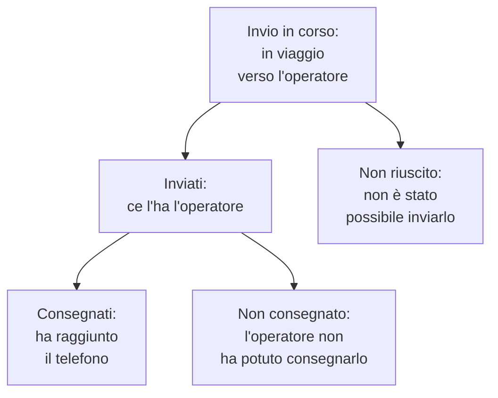

# Log di notifica

I log di notifica elencano ogni messaggio che OneUptime ha inviato per il tuo progetto, una scheda per canale, e che fine ha fatto ciascuno: se è partito, se è arrivato e, se no, perché. Aprili in **Impostazioni del progetto → Notifiche → Log di notifica**, oppure in **Log di notifica** di un incidente, un avviso, un evento di manutenzione, una pagina di stato o una policy di reperibilità, per ciò che è stato inviato al riguardo.

:::cards
- [Leggere uno stato](#leggere-uno-stato): Il suo colore dice dove si trova il messaggio, e puntarlo dice cosa significa.
- [SMS](#sms): Invio in corso, poi Inviati, poi Consegnati, come lo segnala l'operatore.
- [Chiamate](#chiamate): In chiamata, poi come è terminata la chiamata.
- [WhatsApp e Telegram](#whatsapp-e-telegram): Cosa segnala ogni app dopo aver preso un messaggio.
- [Email, push, webhook e aree di lavoro](#email-push-webhook-e-aree-di-lavoro): Successo, oppure Errore e perché.
- [Quando un SMS resta Inviati](#quando-un-sms-resta-inviati): Gli operatori che non rispondono mai, e le segnalazioni che non arrivano mai.
:::

## Leggere uno stato

Ogni stato è una pillola il cui colore dice dove si trova il messaggio:

| Colore | Dove si trova il messaggio |
| --- | --- |
| Grigio | Consegnato al fornitore, e non è ancora tornato nulla, come **Invio in corso**. |
| Blu | Il fornitore lo ha, e deve ancora dire come è finito, come **Inviati** per un SMS o **In chiamata** per una chiamata. |
| Verde | Ha raggiunto la persona, come **Consegnati**, oppure questo è l'ultimo stato che avrà. |
| Giallo | Ha raggiunto il telefono e nessuno ha risposto, come **Chiamata persa**, oppure è partito con un avviso. |
| Rosso | Non ha raggiunto la persona, come **Non consegnato**, **Non riuscito**, **Errore** o **Saldo insufficiente**. |

Punta uno stato, toccalo o raggiungilo con il tasto Tab, e ti dirà cosa significa e cosa viene dopo. **Visualizza messaggio di stato**, nel menu della riga, mostra cosa ha risposto il fornitore, come l'ID del messaggio o il motivo del fallimento. Il filtro **Stato** di ogni scheda elenca tutti gli stati che la scheda può mostrare, nell'ordine in cui un messaggio li attraversa.

## SMS

| Stato | Cosa significa |
| --- | --- |
| **Invio in corso** | OneUptime ha passato l'SMS a Twilio, che lo sta inoltrando all'operatore. |
| **Inviati** | L'operatore ha accettato l'SMS. Passa a **Consegnati** o **Non consegnato** non appena l'operatore risponde. |
| **Consegnati** | L'operatore ha confermato che l'SMS ha raggiunto il telefono. È l'ultimo stato di un SMS arrivato. |
| **Non consegnato** | L'operatore non è riuscito a consegnarlo. **Codice di errore** indica il motivo: `30003` è un telefono spento o irraggiungibile, `30005` un numero che non esiste, `30006` un telefono fisso, e `30007` un messaggio filtrato dall'operatore. |
| **Non riuscito** | Twilio non è riuscito a inviarlo. **Codice di errore** indica il motivo. |
| **Errore** | Non è stato inviato, per esempio perché gli SMS sono disattivati per il progetto, o perché Twilio ha rifiutato il numero. **Visualizza messaggio di stato** indica il motivo. |
| **Saldo insufficiente** | Non è stato inviato: il saldo del progetto non bastava a pagarlo. |
| **Successo** | È stato inviato prima che OneUptime tracciasse la consegna, e Twilio lo ha accettato. |

Un SMS che il gateway per SMS e chiamate del server ha preso resta **Inviati**, in verde: il gateway non segnala la consegna, quindi questo è il suo ultimo stato.

Twilio segnala a OneUptime ogni cambiamento non appena avviene, firmato con il token di autenticazione dell'account da cui è partito l'SMS, e OneUptime rifiuta ogni segnalazione che non sia di Twilio. Per questo Twilio deve poter raggiungere il tuo server: vedi [Integrazione Twilio](/docs/self-hosted/twilio-integration).

## Chiamate

| Stato | Cosa significa |
| --- | --- |
| **In chiamata** | Twilio ha effettuato la chiamata. Cambia non appena Twilio comunica come è terminata la chiamata. |
| **Successo** | La chiamata ha ricevuto risposta, e **Visualizza messaggio di stato** indica quanto è durata. Una chiamata che il gateway per SMS e chiamate del server ha preso è **Successo** non appena il gateway la accetta. |
| **Chiamata persa** | La chiamata ha squillato a vuoto: nessuno ha risposto. |
| **Occupato** | La linea era occupata, oppure la chiamata è stata rifiutata. |
| **Segreteria telefonica** | La segreteria telefonica ha risposto a una chiamata di reperibilità. **Visualizza messaggio di stato** indica se è stato lasciato un messaggio. |
| **Errore** | Non è stato possibile effettuare o collegare la chiamata. |
| **Saldo insufficiente** | Non è stata effettuata: il saldo del progetto non bastava a pagarla. |

## WhatsApp e Telegram

Un messaggio WhatsApp è **In coda** mentre OneUptime lo consegna, **Inviati** non appena WhatsApp lo accetta, **Consegnati** non appena raggiunge il telefono, e **Letto** non appena viene aperto, se la persona condivide le conferme di lettura. **Non riuscito** è un messaggio che WhatsApp non è riuscito a consegnare, e **Avviso** uno che ha inviato con un avviso: **Visualizza messaggio di stato** indica cosa ha segnalato WhatsApp. **Errore** e **Saldo insufficiente** significano che non è stato inviato, come per un SMS.

Telegram non segnala più nulla dopo aver preso un messaggio, quindi lo stato **Inviati** di un messaggio Telegram è verde: Telegram lo ha pubblicato nella chat, e questo è il suo ultimo stato.

## Email, push, webhook e aree di lavoro

Queste schede dicono **Successo** o **Errore**. **Successo** è l'ultimo stato: il server di posta ha accettato l'email, il servizio push ha accettato la notifica, l'indirizzo del webhook ha risposto di aver preso la richiesta, oppure l'area di lavoro ha fatto ciò che era richiesto. OneUptime non segue più un'email dopo che il server di posta l'ha accettata, e una notifica push passa a **Errore** se il servizio push segnala in seguito che non è stata consegnata. **Visualizza messaggio di stato** indica perché un messaggio è **Errore**, come fa **Motivo** nella scheda **Area di lavoro**.

## Quando un SMS resta Inviati

**Inviati** significa che l'operatore ha l'SMS e non ha ancora risposto. La maggior parte degli operatori risponde in pochi secondi o minuti, ma alcuni non lo fanno mai: allora anche Twilio lascia l'SMS su `sent`, come mostrano i suoi log dei messaggi, e OneUptime non può sapere se è arrivato.

Un SMS che resta **Invio in corso** è un'altra cosa: le segnalazioni di Twilio non raggiungono OneUptime. Controlla che Twilio possa raggiungere il tuo server, e cerca nel log del server le righe che iniziano con `Twilio callback refused`: vedi [Integrazione Twilio](/docs/self-hosted/twilio-integration).

## Passi successivi

:::cards
- [Integrazione Twilio](/docs/self-hosted/twilio-integration): Collega Twilio, e lascia che le sue segnalazioni di consegna raggiungano OneUptime.
- [Gateway per SMS e chiamate](/docs/self-hosted/sms-and-call-gateway): Invia SMS e chiamate tramite un gateway tuo.
- [Metriche di consegna delle notifiche](/docs/self-hosted/notification-delivery-metrics): Conta ciò che è stato consegnato in tutta l'installazione.
:::
