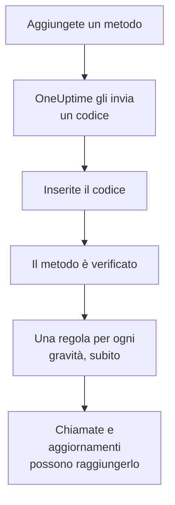

# Metodi di notifica

Un metodo di notifica è un indirizzo su cui OneUptime può raggiungervi in un progetto: un indirizzo e-mail, un numero di telefono per SMS o chiamate, un numero WhatsApp, un account Telegram, il vostro account Slack o Microsoft Teams, un telefono o un browser per le notifiche push, oppure un webhook. Li aggiungete in **Impostazioni utente → Metodi di notifica**, li verificate, e OneUptime inizia subito a usarli per le vostre chiamate.

:::cards
- [Scegliere un metodo](#scegliere-un-metodo): Cosa serve a ogni metodo, e come viene verificato.
- [Aggiungere e verificare un metodo](#aggiungere-e-verificare-un-metodo): E-mail, SMS, chiamate e WhatsApp, con un codice di 6 cifre.
- [Webhook](#webhook): Inviate le chiamate al vostro endpoint, firmate se volete.
- [Attivare un canale per il progetto](#attivare-un-canale-per-il-progetto): Perché SMS, chiamate, WhatsApp o Telegram possono mancare.
:::

## Come un metodo diventa attivo



Un metodo che non avete verificato non viene mai usato. Dispositivi push, Slack, Microsoft Teams e webhook non richiedono un codice: registrare un dispositivo o collegare il vostro account dimostra che è vostro, e un webhook non ha bisogno di prove. Verificare un metodo aggiunge subito le vostre [regole predefinite](/docs/notifications/on-call-rules#le-regole-con-cui-partite) per esso, quindi un nuovo numero di telefono vi chiama per ogni gravità finché non cambiate le sue regole.

## Scegliere un metodo

Ogni scheda dei **Metodi di notifica** contiene uno o più riquadri, uno per tipo di metodo:

| Riquadro | Scheda | Cosa aggiungete | Come viene verificato |
| --- | --- | --- | --- |
| **Email per le notifiche** | **Direct Contact** | Un indirizzo e-mail | Un codice via e-mail |
| **Numeri di telefono per le notifiche SMS** | **Direct Contact** | Un numero di telefono | Un codice via SMS |
| **Numeri di telefono per le notifiche tramite chiamata** | **Direct Contact** | Un numero di telefono | Un codice letto in una chiamata, o nessuno per un numero verificato per gli SMS |
| **Numeri WhatsApp per le notifiche** | **Direct Contact** | Un numero WhatsApp | Un codice su WhatsApp |
| **Account Telegram per le notifiche** | **Direct Contact** | Il vostro account Telegram | Un messaggio al bot di OneUptime |
| **Slack Account for Notifications** | **Workspace Apps** | Il vostro account Slack | Collegare il vostro account all'area di lavoro del progetto |
| **Microsoft Teams Account for Notifications** | **Workspace Apps** | Il vostro account Microsoft Teams | Collegare il vostro account all'area di lavoro del progetto |
| **Dispositivi per notifiche push** | **Push Notifications** | Un telefono con l'app OneUptime On-Call, o un browser | Registrare il dispositivo |
| **Webhook per le notifiche** | **Webhooks** | Un endpoint HTTPS vostro | Nessuno |

**Workspace Apps** compare solo se il progetto ha collegato Slack o Microsoft Teams, e contiene solo quelli collegati. SMS, chiamate, WhatsApp e Telegram possono essere disattivati per l'intero progetto; vedete [Attivare un canale per il progetto](#attivare-un-canale-per-il-progetto).

## Aggiungere e verificare un metodo

Indirizzi e-mail, numeri per SMS, numeri per chiamate e numeri WhatsApp vengono verificati con un codice di 6 cifre.

:::steps
### Aprite i vostri metodi

Andate in **Impostazioni utente → Metodi di notifica**. **Direct Contact** è la prima scheda.

### Aggiungete l'indirizzo

Nel riquadro del metodo, fate clic sul suo pulsante per aggiungere, per esempio **Aggiungi: Numero di telefono per le notifiche SMS**. Inserite l'**E-mail**, oppure il **Numero di telefono** in formato internazionale, per esempio `+11234567890`, e salvate.

### Inserite il codice

La finestra di verifica si apre da sola, e dice dove è andato il codice e fino a quando vale. Digitate il codice in **Codice di verifica** e fate clic su **Verifica**.

### Controllate la riga

La riga ora risulta **Verificato**. Avete chiuso la finestra troppo presto? Fate clic su **Verifica** nella riga per riaprirla.
:::

- Un codice vale 15 minuti. Cinque tentativi sbagliati lo annullano, e ne serve uno nuovo.
- **Send a new code**, oppure **Call me with a new code** per un numero per chiamate, si trova nella finestra. Potete chiederne uno un minuto dopo il precedente.
- Un numero verificato per gli SMS è verificato anche per le chiamate. Aggiungerlo in **Numeri di telefono per le notifiche tramite chiamata** non richiede un codice, e verificare un numero SMS verifica anche il numero per chiamate che avete aggiunto per esso.
- La vostra e-mail di accesso è già lì, verificata, dal giorno in cui siete entrati nel progetto.

## Collegare Telegram

:::steps
### Aggiungete l'account

In **Account Telegram per le notifiche**, fate clic su **Aggiungi: Account Telegram**. **Handle Telegram (facoltativo)** è solo un'etichetta per voi, e può restare vuoto.

### Scrivete al bot

Fate clic su **Verifica** nella nuova riga. La finestra **Verifica account Telegram** vi offre tre modi per raggiungere il bot di OneUptime: scansionare il codice QR con il telefono, fare clic su **Open in Telegram**, oppure cercare il bot in Telegram e inviargli il comando `/start` mostrato nella finestra.

### Confermate

Tornati in OneUptime, fate clic su **I've sent the message — check**. Appena il bot riceve il vostro messaggio, l'account è verificato.
:::

**Ruota il codice** crea un nuovo codice per un account non ancora verificato. Il codice QR e il link aperti prima smettono di funzionare. Su un OneUptime self-hosted, l'amministratore del server collega un bot Telegram prima che chiunque possa collegare un account.

## Slack e Microsoft Teams

1. Collegate il vostro account all'area di lavoro del progetto: **Impostazioni utente → Area di lavoro → Slack**, oppure **Microsoft Teams**. Vedete [Slack](/docs/workspace-connections/slack) e [Microsoft Teams](/docs/workspace-connections/microsoft-teams).
2. Nella scheda **Workspace Apps**, fate clic su **Add Slack Account** o **Add Microsoft Teams Account**. L'account risulta verificato appena viene aggiunto.
3. Fate clic su **Send Test Message** nella sua riga. Le chiamate arrivano come messaggi diretti dall'app di OneUptime.

## Notifiche push

La scheda **Push Notifications** elenca i vostri **Dispositivi per notifiche push**.

- **Un telefono.** Installate l'app OneUptime On-Call, collegatela al vostro OneUptime, accedete e consentite le notifiche: il telefono si aggiunge da solo a questo elenco. Vedete [Panoramica delle app](/docs/mobile-desktop-apps/index).
- **Questo browser.** Fate clic su **Registra dispositivo**, compilate **Nome del dispositivo** e consentite le notifiche quando il browser lo chiede.
- **Notifica di test** nella riga di un dispositivo gli invia subito una notifica push.
- **Avvisi critici** indica se le chiamate del telefono suonano anche in modalità silenziosa e Non disturbare. Si attiva nell'app, mai qui, e un browser non può farlo. Vedete [Avvisi di reperibilità critici](/docs/self-hosted/push-notifications#avvisi-critici-di-reperibilità-superare-la-modalità-silenziosa).
- A un dispositivo segnato come **Non riceve notifiche** non viene inviato nulla. Aprite l'app su quel telefono, o registrate di nuovo il browser, e torna disponibile.

## Webhook

Un webhook invia ogni chiamata come JSON a un vostro endpoint HTTPS, perché un vostro strumento possa agire.

:::steps
### Aggiungete il webhook

Nella scheda **Webhooks**, fate clic su **Aggiungi: Webhook**. Compilate **Nome** con un nome che riconoscerete, poi **URL del webhook** e **Segreto di firma (facoltativo)**.

### Inviate una prova

Fate clic su **Invia prova** nella sua riga. Il vostro endpoint riceve un evento il cui `eventType` è `test`.

### Controllate cosa arriva

Una chiamata è un `POST` JSON come quello qui sotto. Rispondete con un qualsiasi stato `2xx` entro 10 secondi; i reindirizzamenti non vengono seguiti.
:::

```json title="A page, as your endpoint receives it"
{
  "eventType": "on-call.incident.created",
  "timestamp": "2026-10-15T09:30:00.000Z",
  "projectId": "6a3f0d2e-1c4b-4e8a-9b7d-2f5c8e1a0b3c",
  "userId": "0c9e8d7f-6b5a-4c3d-8e2f-1a0b9c8d7e6f",
  "incident": {
    "id": "5b4a3c2d-1e0f-4a9b-8c7d-6e5f4a3b2c1d",
    "title": "Checkout API is down",
    "description": "Health check failed from 3 probes.",
    "incidentNumber": 42,
    "incidentNumberWithPrefix": "INC-42",
    "severity": "Critical Incident",
    "state": "Identified"
  },
  "onCallPolicyId": "7d6c5b4a-3e2f-4d1c-9b8a-7f6e5d4c3b2a",
  "onCallPolicyEscalationRuleId": "8e7d6c5b-4a3f-4e2d-8c1b-9a8f7e6d5c4b"
}
```

| `eventType` | Inviato per | La chiave dell'elemento |
| --- | --- | --- |
| `on-call.incident.created` | Un incidente | `incident` |
| `on-call.alert.created` | Un avviso | `alert` |
| `on-call.incidentEpisode.created` | Un episodio di incidente | `incidentEpisode` |
| `on-call.alertEpisode.created` | Un episodio di avviso | `alertEpisode` |

Gli aggiornamenti che attivate per Webhook nelle **Impostazioni notifiche** arrivano allo stesso endpoint, con l'evento dell'impostazione in `eventType` e un breve riepilogo in `subject` e `message`.

Ogni richiesta porta `X-OneUptime-Event`, il tipo di evento. Con un segreto di firma, porta anche `X-OneUptime-Signature`: `sha256=` seguito dall'HMAC-SHA256 del corpo grezzo, in esadecimale. Controllatelo prima di fidarvi della richiesta:

```javascript title="verify-signature.js"
const crypto = require("crypto");

// rawBody: the request body exactly as it arrived, before any JSON parsing.
function isFromOneUptime(rawBody, signatureHeader, secret) {
  const expected =
    "sha256=" + crypto.createHmac("sha256", secret).update(rawBody).digest("hex");
  const received = Buffer.from(signatureHeader || "");
  const wanted = Buffer.from(expected);
  return received.length === wanted.length && crypto.timingSafeEqual(received, wanted);
}
```

Un webhook non richiede verifica, quindi aggiungerlo aggiunge subito le sue regole. Gli indirizzi privati e interni vengono rifiutati, a meno che l'amministratore di un server self-hosted non li consenta: vedete [Accesso alla rete privata](/docs/self-hosted/private-network-access#webhook-e-workflow).

## Attivare un canale per il progetto

**SMS**, **Chiamate telefoniche**, **WhatsApp** e **Telegram** partono disattivati in ogni nuovo progetto, perché ogni messaggio costa: su OneUptime Cloud si paga con il saldo del progetto, mentre SMS e chiamate passano dall'account Twilio del progetto quando quello predefinito li invia. E-mail, push, Slack, Microsoft Teams e webhook sono sempre attivi.

Finché un canale è disattivato, nessuno nel progetto può aggiungervi un metodo: il suo riquadro non ha un pulsante per aggiungere, e dice chi può attivarlo. Lo attiva un proprietario del progetto, un **Amministratore della fatturazione** o qualcuno con **Manage Billing**, nel riquadro **Canali di notifica** di **Impostazioni del progetto → Notifiche → Impostazioni notifiche**. Un amministratore del progetto non può. Su un OneUptime self-hosted, SMS e chiamate richiedono inoltre un account Twilio, e Telegram un bot collegato dall'amministratore del server; vedete [Integrazione Twilio](/docs/self-hosted/twilio-integration).

## Eliminare un metodo

Fate clic su **Elimina** nella riga del metodo. Eliminare un metodo elimina ogni regola di reperibilità che lo usa, quindi la finestra prima conta queste regole e nomina ogni gravità che l'eliminazione lascerebbe senza alcuna regola.

## Risoluzione dei problemi

:::details Un riquadro non ha un pulsante per aggiungere
Quel canale è disattivato in questo progetto. Il riquadro dice chi può attivarlo; vedete [Attivare un canale per il progetto](#attivare-un-canale-per-il-progetto).
:::

:::details Il codice non è mai arrivato
Le e-mail possono richiedere qualche minuto, e a volte finiscono nello spam; gli SMS possono richiedere un minuto. Aspettate un minuto, poi fate clic su **Send a new code** nella finestra. **Impostazioni del progetto → Notifiche → Registri di notifica** mostra cosa è successo al messaggio.
:::

:::details L'aggiunta del mio account Slack non riesce
Collegate prima il vostro account in **Impostazioni utente → Area di lavoro → Slack**, poi fate di nuovo clic su **Add Slack Account**. La finestra di errore ha un pulsante che vi porta lì.
:::

:::details Il mio telefono non riceve notifiche push
Controllate che il telefono compaia in **Dispositivi per notifiche push**, e inviategli una **Notifica di test**. Vedete [FAQ e risoluzione dei problemi](/docs/mobile-desktop-apps/faq-troubleshooting#notifiche).
:::

## Passi successivi

:::cards
- [Regole di reperibilità personali](/docs/notifications/on-call-rules): Decidete quale metodo prova ogni chiamata, e quando.
- [Impostazioni notifiche](/docs/notifications/notification-settings): Scegliete gli aggiornamenti di cui venite a sapere, e su quali canali.
- [Panoramica delle app](/docs/mobile-desktop-apps/index): Ricevete le chiamate sul telefono o sul computer.
- [Come OneUptime vi raggiunge](/docs/notifications/index): Come si combinano metodi, regole e impostazioni.
:::
