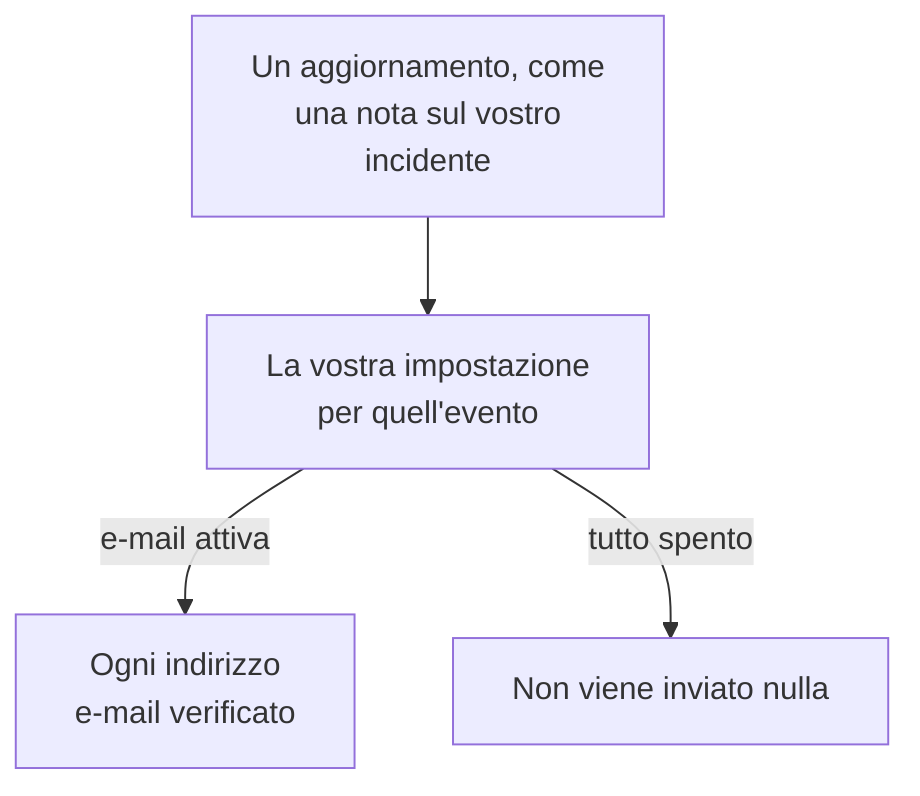

# Impostazioni notifiche

Le impostazioni delle notifiche decidono quali aggiornamenti vi raggiungono sugli elementi vostri, come un incidente, un monitor o una pagina di stato, e sui vostri turni di reperibilità, e su quali canali. Non vi chiamano mai: chiamare è compito delle vostre regole di reperibilità. Le impostate in **Impostazioni utente → Impostazioni notifiche**, con un interruttore per evento e canale.

:::cards
- [Come funzionano le impostazioni](#come-funzionano-le-impostazioni): Un interruttore per evento e canale, inviato a ogni metodo verificato.
- [Cambiare un'impostazione](#cambiare-unimpostazione): Tre clic, salvati subito.
- [Cosa è attivo per un nuovo membro](#cosa-è-attivo-per-un-nuovo-membro): Le impostazioni predefinite, scheda per scheda.
- [Meno e-mail](#meno-e-mail): Raggruppare le raffiche, o lasciar perdere quelle di routine.
:::

## Come funzionano le impostazioni

- Ogni riga è un evento, e ogni colonna un canale: E-mail, SMS, Chiamata, Push, WhatsApp, Telegram, Slack e Microsoft Teams, e Webhook. Slack e Microsoft Teams sono colonne solo se il progetto li ha collegati.
- Un canale attivo invia a ogni metodo verificato che avete su di esso in questo progetto, non a uno solo.
- Un canale attivo senza un metodo verificato dietro non invia nulla. **Your setup checklist** lo segnala in **Staying informed**.
- Un aggiornamento va ai proprietari dell'elemento: le persone indicate come proprietari e i membri dei suoi team proprietari. Quando un elemento non ha proprietari, va invece ai proprietari del progetto. Un evento sull'essere stati aggiunti come proprietari va solo alla persona aggiunta.
- I casi di sicurezza non hanno proprietari. Un nuovo caso va a tutti coloro che possono vedere i casi del progetto, a partire dalla priorità che ciascuno sceglie, e un caso assegnato alle persone a cui è assegnato. Vedete [Casi di sicurezza](/docs/telemetry/security-cases#notifiche).
- Ogni e-mail ai proprietari termina con un link "Manage notification preferences" che riporta a questa pagina.

## Cambiare un'impostazione

:::steps
### Aprite le vostre impostazioni

Andate in **Impostazioni utente → Impostazioni notifiche**. Le schede sono **Incidenti**, **Avvisi**, **Monitoraggio**, **Pagine di stato**, **Manutenzione programmata**, **Reperibilità** e **Sicurezza**.

### Trovate l'evento

Ogni scheda contiene uno o più riquadri, come **Incidente Episodi** nella scheda **Incidenti**. Ogni riga è un evento, con una frase che dice quando viene inviato.

### Fate clic su un canale

Fate clic sul cerchio di un canale per attivarlo, e di nuovo per disattivarlo. Un segno di spunta significa attivo. Le modifiche si salvano automaticamente.
:::

## Cosa è attivo per un nuovo membro

Quando entrate in un progetto, questi eventi partono attivi, via e-mail. Tutto il resto parte disattivato, e non invia nulla finché non attivate un canale.

| Scheda | Attivi via e-mail | Disattivati finché non li attivate |
| --- | --- | --- |
| **Incidenti** | **Incidente creato**, **Stato dell'incidente modificato**, **Incident reminder**, **SLA dell'incidente violato**, **Episodio dell'incidente creato**, **Stato dell'episodio dell'incidente modificato**, **Incidente aggiunto all'episodio dell'incidente** | **Nota dell'incidente pubblicata**, **Aggiunto come proprietario dell'incidente**, **Assegnato a un incidente**, **Nota dell'episodio dell'incidente pubblicata**, **Aggiunto come proprietario dell'episodio di incidente** |
| **Avvisi** | **Avviso creato**, **Stato dell'avviso modificato**, **Alert reminder**, **Episodio di avviso creato**, **Stato dell'episodio di avviso modificato**, **Avviso aggiunto all'episodio di avviso** | **Nota dell'avviso pubblicata**, **Aggiunto come proprietario dell'avviso**, **Nota dell'episodio di avviso pubblicata**, **Aggiunto come proprietario dell'episodio di avviso** |
| **Monitoraggio** | **Stato della sonda modificato per il tuo monitor**, **Il monitor non ha sonde attive**, **SLO status changed**, **Added as SLO owner**, **Stato della sonda modificato**, **Aggiunto come proprietario della sonda** | **Monitor creato**, **Stato del monitor modificato**, **Aggiunto come proprietario del monitor**, **Stato dell'agente IA modificato**, **Aggiunto come proprietario dell'agente IA** |
| **Pagine di stato** | Nessuno | **Pagina di stato creata**, **Annuncio della pagina di stato pubblicato**, **Aggiunto come proprietario della pagina di stato** |
| **Manutenzione programmata** | **Maintenance reminder** | **Evento di manutenzione creato**, **Stato della manutenzione modificato**, **Nota di manutenzione pubblicata**, **Aggiunto come proprietario della manutenzione** |
| **Reperibilità** | **Inizi la reperibilità**, **Sei il prossimo in reperibilità**, **Termini la reperibilità**, **Aggiunto al criterio di reperibilità**, **Rimosso dal criterio di reperibilità**, **Chiamata persa**, e anche via push: **Prima dell'inizio del mio turno di reperibilità**, **Il mio prossimo turno di reperibilità viene riassegnato** | Nessuno |
| **Sicurezza** | Anche via push: **Nuovo caso di sicurezza** (casi con priorità Alta e Critica), **Caso di sicurezza assegnato a me**, **Passaggio di playbook in attesa della mia approvazione** | Nessuno |

> [!IMPORTANT]
> **Stato del monitor modificato** parte disattivato. Per sapere quando un monitor vostro va giù o torna su, attivatelo nella scheda **Monitoraggio**.

## I vostri turni

La scheda **Reperibilità** riguarda voi, non gli elementi vostri:

- **Inizi la reperibilità**, **Sei il prossimo in reperibilità** e **Termini la reperibilità** seguono i vostri turni nelle pianificazioni di reperibilità di cui fate parte.
- **Aggiunto al criterio di reperibilità** e **Rimosso dal criterio di reperibilità** vi dicono quando una politica di reperibilità inizia o smette di nominarvi.
- **Prima dell'inizio del mio turno di reperibilità** invia promemoria agli orari che scegliete in **Impostazioni utente → Calendario → Feed calendario**, e **Il mio prossimo turno di reperibilità viene riassegnato** vi dice quando qualcun altro copre un turno di cui avevate ricevuto il promemoria. Vedete [Feed calendario](/docs/on-call/calendar-feeds#promemoria-e-avvisi-di-riassegnazione).
- **Chiamata persa**, nel riquadro **Policy chiamate in entrata**, dice ai proprietari di una policy di chiamate in entrata che chi ha chiamato non ha raggiunto nessuno. Vedete [Politica chiamate in arrivo](/docs/on-call/incoming-call-policy#chiamate-perse).

## Casi di sicurezza

La scheda **Sicurezza** riguarda i casi di sicurezza che potete vedere:

- **Nuovo caso di sicurezza** ha una priorità sotto il suo nome: la priorità minima dei casi che vi vengono notificati. È **Alta e superiori**, a meno che non scegliate **Solo Critica**, **Media e superiori**, **Bassa e superiori** o **Ogni caso**.
- **Caso di sicurezza assegnato a me** segue i casi assegnati a voi e ai team di cui fate parte.
- **Passaggio di playbook in attesa della mia approvazione** vi chiede di approvare o rifiutare un passo di playbook su un caso in cui potete approvare.

Vedete [Casi di sicurezza](/docs/telemetry/security-cases#notifiche).

## Meno e-mail

Questi interruttori decidono quali aggiornamenti vi raggiungono, non quante e-mail ne risultano. **Impostazioni utente → Preferenze e-mail** ha due riquadri per questo, entrambi solo per voi, in questo progetto:

- **Email Rollup** raccoglie una raffica di aggiornamenti in un'unica e-mail: i primi arrivano ancora uno alla volta, il resto insieme qualche minuto dopo.
- **Fewer routine emails** disattiva, con **Reduce routine emails**, le e-mail su note, nuovi proprietari, nuovi monitor e pagine di stato, aggiunte agli episodi e modifiche alle politiche di reperibilità.

Vedete [Riepilogo delle notifiche](/docs/emails/notification-rollup).

## Risoluzione dei problemi

:::details Un interruttore è attivo, ma non arriva nulla
Controllate di avere un metodo verificato su quel canale in **Impostazioni utente → Metodi di notifica**. Per SMS, chiamate, WhatsApp e Telegram, anche il progetto deve avere il canale attivo.
:::

:::details Sono proprietario di un monitor, ma non so mai quando va giù
**Stato del monitor modificato** parte disattivato. Attivate un canale per esso, nella scheda **Monitoraggio**.
:::

:::details Ricevo ancora e-mail dopo aver disattivato tutto
Le chiamate seguono le vostre regole di reperibilità, non questi interruttori, e le e-mail di accesso, sicurezza e fatturazione non sono aggiornamenti su elementi. Ogni progetto ha le sue impostazioni, quindi controllate il progetto da cui è arrivata l'e-mail. Vedete [Regole di reperibilità personali](/docs/notifications/on-call-rules).
:::

## Passi successivi

:::cards
- [Metodi di notifica](/docs/notifications/notification-methods): Aggiungete i metodi a cui inviano le vostre impostazioni.
- [Regole di reperibilità personali](/docs/notifications/on-call-rules): Decidete come una chiamata vi raggiunge.
- [Riepilogo delle notifiche](/docs/emails/notification-rollup): Meno e-mail, più complete, durante una raffica.
- [Come OneUptime vi raggiunge](/docs/notifications/index): Come si combinano metodi, regole e impostazioni.
:::
