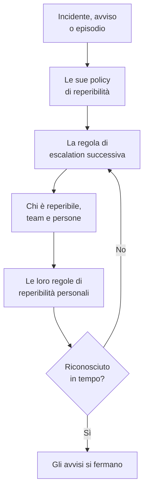

# Panoramica della reperibilità

La reperibilità è il modo in cui OneUptime porta una persona su un problema, a qualsiasi ora. Quando un incidente, un avviso o un episodio ha bisogno di qualcuno, le sue policy di reperibilità avvisano le persone livello per livello finché qualcuno non riconosce, e ogni persona viene raggiunta come ha scelto: una notifica push, un SMS, una chiamata, un'e-mail o un messaggio in chat. Questa pagina mostra come si incastrano i pezzi e dove si trova ciascuno.

:::cards
- [Come un avviso raggiunge qualcuno](#come-un-avviso-raggiunge-qualcuno): Da un nuovo incidente alla persona che risponde.
- [Gli elementi di base](#gli-elementi-di-base): Policy, regole di escalation, pianificazioni, sostituzioni e regole personali.
- [Impostare la reperibilità](#impostare-la-reperibilità): Da zero a un team che viene avvisato, in cinque passi.
- [Dove si trova la reperibilità](#dove-si-trova-la-reperibilità): Il menu Reperibilità, sezione per sezione.
:::

## Come un avviso raggiunge qualcuno

1. Un nuovo incidente, avviso o episodio esegue subito le sue policy di reperibilità: quelle scelte su di esso e quelle che aggiungono le sue regole di reperibilità. Ogni policy viene eseguita per conto suo. Una regola di reperibilità impostata su **Solo durante l'orario di lavoro** fa attendere le policy che aggiunge finché quell'orario non inizia.
2. La prima regola di escalation di una policy avvisa subito: chi è reperibile in questo momento nelle sue pianificazioni, ogni membro dei suoi team e le persone che nomina.
3. Se una di loro è assente, una sostituzione utente invia il suo avviso alla persona che la sostituisce, oppure la salta.
4. Ogni persona viene raggiunta tramite le sue regole di reperibilità personali: quale metodo viene provato e dopo quanto tempo. Un avviso senza regola la raggiunge comunque sui metodi che ha verificato.
5. Se nessuno riconosce prima che scada l'attesa della regola, avvisa la regola successiva. Dopo l'ultima, la policy ricomincia se si ripete, altrimenti si ferma.

Riconoscere o risolvere l'incidente, l'avviso o l'episodio ferma ogni policy che sta ancora avvisando per esso. OneUptime fa avanzare le policy in corso ogni minuto e registra ogni esecuzione, regola per regola, nei **Registri di esecuzione**.

La prima volta che una chiamata raggiunge qualcuno, OneUptime la registra sull'incidente, sull'avviso o sull'episodio come `First Paged At`. Una misurazione può contare da quel momento: **Tempo di riconoscimento dopo la chiamata** misura quanto ci hanno messo le persone a rispondere una volta chiamate, non quanto si è atteso prima che qualcuno lo fosse. Vedi [Tempo di riconoscimento dopo la chiamata](/docs/incidents/settings#tempo-di-riconoscimento-dopo-la-chiamata).

> [!NOTE]
> Un incidente, un avviso o un episodio creato già riconosciuto o risolto non esegue nessuna delle sue policy, e il suo feed lo dice. Vedi [Creato già riconosciuto o risolto](/docs/alerts/index#creato-già-riconosciuto-o-risolto).

## Gli elementi di base

| Elemento | Che cosa decide | Per saperne di più |
| --- | --- | --- |
| Policy di reperibilità | Chi viene avvisato per un incidente o un avviso, livello per livello | [Policy di reperibilità](/docs/on-call/policies) |
| Regola di escalation | Un livello di una policy: chi avvisa e quanto attende un riconoscimento | [Regole di escalation](/docs/on-call/escalation-rules) |
| Pianificazione di reperibilità | Chi è reperibile in ogni momento, a turno | [Pianificazioni di reperibilità](/docs/on-call/schedules) |
| Sostituzione utente | Chi sostituisce qualcuno mentre è assente | [Sostituzioni utente](/docs/on-call/user-overrides) |
| Regole di reperibilità personali | Come viene raggiunta una persona: con quale metodo e dopo quanto tempo | [Regole di reperibilità personali](/docs/notifications/on-call-rules) |
| Politica chiamate in arrivo | Un numero di telefono che fa squillare chi è reperibile | [Politica chiamate in arrivo](/docs/on-call/incoming-call-policy) |

Le policy, le regole di escalation, le pianificazioni e le sostituzioni appartengono al progetto, in **Reperibilità**. I metodi di notifica e le regole di reperibilità personali appartengono a ciascuna persona, in **Impostazioni utente**: un amministratore può vedere la configurazione di qualcuno, ma solo quella persona può verificare il proprio telefono o la propria e-mail. Vedi [Come OneUptime vi raggiunge](/docs/notifications/index).

## Impostare la reperibilità

:::steps
### Creare una pianificazione

Aprite **Reperibilità** dal menu **Prodotti** e andate in **Pianificazioni di reperibilità**. Fate clic su **Crea pianificazione di reperibilità**, dategli un nome e in **Chi si alterna?** scegliete le persone nell'ordine in cui si alternano. Vedi [Pianificazioni di reperibilità](/docs/on-call/schedules).

### Creare una policy

Andate in **Policy di reperibilità** e fate clic su **Crea: Policy di reperibilità**. In **Chi viene avvisato per primo?** scegliete la pianificazione. Diventa la prima regola di escalation della policy, **Level 1**, che attende 30 minuti un riconoscimento.

### Aggiungere i livelli successivi

Nella pagina **Regole di escalation** della policy, fate clic su **Aggiungi regola di escalation** per ogni livello dopo il primo: la persona successiva nella rotazione della stessa pianificazione, un team lead, un manager. Vedi [Regole di escalation](/docs/on-call/escalation-rules).

### Eseguire la policy automaticamente

Andate in **Incidenti → Regole → Regole di reperibilità** o **Avvisi → Regole → Regole di reperibilità** e aggiungete una regola che esegua la policy per gli incidenti o gli avvisi corrispondenti, per esempio ogni incidente critico. Vedi [Che cosa esegue una policy](/docs/on-call/policies#che-cosa-esegue-una-policy).

### Verificare che tutti siano raggiungibili

Aprite **Reperibilità → Prontezza**. Ogni persona che le vostre policy possono avvisare compare come **Pronto**, **Da configurare** o **Irraggiungibile**, con ciò che manca. Vedi [Prontezza e report](/docs/on-call/readiness).
:::

> [!NOTE]
> Su OneUptime Cloud, le policy di reperibilità e le regole di escalation sono incluse in tutti i piani. Le pianificazioni di reperibilità, le sostituzioni utente, i registri di esecuzione e il report sul tempo di reperibilità richiedono il piano **Growth**.

## Dove si trova la reperibilità

Aprite **Reperibilità** dal menu **Prodotti** nella barra superiore. Si apre su **Policy di reperibilità**, all'indirizzo `/dashboard/{projectId}/on-call-duty/policies`, e il suo menu laterale contiene il resto:

| Sezione | Pagine |
| --- | --- |
| **Policy** | **Policy di reperibilità** e **Prontezza**: chi le vostre policy raggiungono davvero |
| **Pianificazioni** | **Pianificazioni di reperibilità**, **Cronologia delle reperibilità** e **Feed calendario** |
| **Chiamate in entrata** | **Policy chiamate in entrata**: un numero di telefono che fa squillare chi è reperibile |
| **Avanzato** | **Sostituzioni utente**, **Registri di esecuzione** e **Policy archiviate** |
| **Report** | **Tempo di reperibilità dell'utente**: per quanto tempo ogni persona è stata reperibile |
| **Area di lavoro** | **Slack** e **Microsoft Teams**: regole che pubblicano gli eventi di reperibilità in un canale |
| **Impostazioni** | **Campi personalizzati**, **Regole etichette** e **Regole del proprietario** |
| **Sviluppatori** | **Terraform**, **API** e **Assistenti IA**: la reperibilità configurata dal codice |

**Policy**, **Pianificazioni** e **Chiamate in entrata** sono aperte; le altre sezioni partono chiuse, e una sezione si apre da sola quando siete su una delle sue pagine. **Area di lavoro** elenca gli strumenti di chat che il progetto ha collegato, oppure **Collega Slack o Teams** se non ne ha nessuno.

Quando siete reperibili per una policy, la campanella in alto a destra lo indica. Fateci clic per aprire **I miei criteri di reperibilità**: ogni policy per cui siete reperibili, in tutti i vostri progetti, e se vi siete nominati direttamente, tramite un team o tramite una pianificazione.

## Risoluzione dei problemi

:::details Nessuno è stato avvisato per un nuovo incidente
Aprite la pagina **Esecuzioni di reperibilità** dell'incidente. Se è vuota, l'incidente non aveva nessuna policy di reperibilità: non ne è stata scelta nessuna e nessuna regola di reperibilità corrispondeva. Un'esecuzione con **Execution Completed - No One Notified** ha percorso ogni regola di escalation senza trovare nessuno: di solito una pianificazione in cui nessuno è reperibile. Vedi [Registri di esecuzione](/docs/on-call/policies#registri-di-esecuzione). Un'esecuzione **In attesa** attende l'orario di lavoro, per una regola di reperibilità impostata su **Solo durante l'orario di lavoro**, e non chiama nessuno finché non inizia.
:::

:::details Qualcuno è stato avvisato sul canale sbagliato, o per niente
Aprite **Reperibilità → Prontezza** e fate clic su **Coverage** nella sua riga. Vedrete i metodi che ha verificato e ogni gravità per cui non ha una regola. Solo quella persona può sistemare la cosa, in **Impostazioni utente**: inviatele un promemoria di configurazione dalla stessa pagina. Vedi [Prontezza e report](/docs/on-call/readiness). Su OneUptime Cloud, un telefono che blocca i chiamanti sconosciuti può silenziare una chiamata: aggiungete [i numeri di OneUptime](/docs/on-call/phone-number-whitelist) al suo elenco consentiti.
:::

:::details Una persona in ferie viene ancora avvisata
Aggiungete una sostituzione utente con lei in **Chi è assente?**. Una sostituzione in **Reperibilità → Avanzato → Sostituzioni utente** copre tutte le policy; una sulla pagina **Sostituzioni utente** di una policy copre solo quella policy. Vedi [Sostituzioni utente](/docs/on-call/user-overrides).
:::

## Passi successivi

:::cards
- [Policy di reperibilità](/docs/on-call/policies): Creare una policy, decidere cosa la esegue e leggere che cosa ha fatto.
- [Regole di escalation](/docs/on-call/escalation-rules): Avvisare le persone livello per livello finché qualcuno risponde.
- [Pianificazioni di reperibilità](/docs/on-call/schedules): Turni, livelli e passaggi di consegne.
- [Come OneUptime vi raggiunge](/docs/notifications/index): I metodi e le regole che decidono come viene raggiunta ogni persona.
:::
