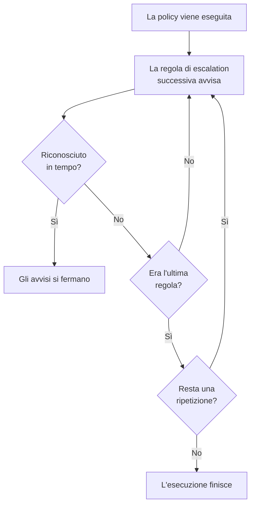

# Policy di reperibilità

Una policy di reperibilità decide chi viene avvisato per un incidente o un avviso, e chi è il prossimo se nessuno riconosce. Le sue regole di escalation sono i suoi livelli, e a eseguirla sono gli incidenti, gli avvisi e gli episodi che la usano. Questa pagina spiega come creare una policy, che cosa la esegue, che cosa mostrano le sue pagine e come viene registrata ogni esecuzione.

:::cards
- [Creare una policy](#creare-una-policy): Un nome, e chi viene avvisato per primo.
- [Che cosa esegue una policy](#che-cosa-esegue-una-policy): Regole, modelli, monitor, chat e voi stessi.
- [Registri di esecuzione](#registri-di-esecuzione): Ogni esecuzione, regola per regola, e perché si è fermata.
- [Archiviare o eliminare una policy](#archiviare-o-eliminare-una-policy): Togliere una policy dal servizio.
:::

## Creare una policy

:::steps
1. Andate in **Reperibilità → Policy di reperibilità** e fate clic su **Crea: Policy di reperibilità**.
2. Inserite un **Nome**, per esempio «Pagamenti primaria».
3. In **Chi viene avvisato per primo?**, fate clic su **Aggiungi destinatario** e scegliete le pianificazioni di reperibilità, i team e le persone da avvisare per primi.
4. Fate clic su **Crea: Policy di reperibilità**. La policy si apre sulla sua pagina **Regole di escalation**, con **Level 1** già al suo posto.
:::

**Chi viene avvisato per primo?** è facoltativo, e viene chiesto solo a chi può aggiungere regole di escalation: se resta vuoto, la policy non avvisa nessuno finché non ha una regola. **Descrizione** ed **Etichette** si trovano in **Altri campi**. Per aggiungere i livelli successivi, vedi [Regole di escalation](/docs/on-call/escalation-rules).

L'elenco **Policy di reperibilità** mostra per ogni policy **Nome**, **Descrizione**, **Etichette** e **Proprietari**. Selezionate delle policy per **Aggiungi etichette**, **Rimuovi etichette**, **Aggiungi proprietario**, **Rimuovi proprietario**, **Archivia**, **Esporta JSON** o per eliminarle. **Importa JSON** crea policy da un'esportazione: un'esportazione contiene le impostazioni proprie di una policy, non le sue regole di escalation né i suoi proprietari.

## Che cosa esegue una policy

Una policy non avvisa nessuno finché qualcosa non la esegue. Ogni incidente, avviso ed episodio esegue le policy che ha appena viene creato:

| Che cosa | Come aggiunge la policy | Per saperne di più |
| --- | --- | --- |
| Il record stesso | Il campo **Policy di reperibilità** alla creazione di un incidente o di un avviso, un modello di incidente, o la sezione chiusa **Reperibilità** nei criteri di un monitor | [Dichiarare un incidente](/docs/incidents/declaring-incidents) |
| Regole di reperibilità | **Incidenti → Regole → Regole di reperibilità** e **Avvisi → Regole → Regole di reperibilità** aggiungono le policy di ogni regola che corrisponde | [Regole di reperibilità degli incidenti](/docs/incidents/settings#regole-di-reperibilità-degli-incidenti) |
| Regole di raggruppamento | Una regola di raggruppamento esegue le sue policy quando apre un episodio | [Episodi di avvisi e regole di raggruppamento](/docs/alerts/episodes) |
| A mano | **Esegui criterio di reperibilità**, nel menu **Azioni** di un feed, o su un messaggio di Slack o Microsoft Teams | [Il feed dell'incidente](/docs/incidents/notes-owners-and-feed#il-feed-dellincidente) |
| Chat e workflow | `/oneuptime page` in Slack o Microsoft Teams, e il passo **Page an On-Call Policy** di un workflow | [Paging](/docs/workflows/components#paging) |

Una policy che più regole aggiungono viene eseguita una sola volta. Una gravità non esegue mai una policy da sola: lo fa una regola di reperibilità che corrisponde a quella gravità. Un incidente o un avviso creato già riconosciuto o risolto non esegue nessuna delle sue policy. Una regola di reperibilità impostata su **Solo durante l'orario di lavoro** fa attendere le policy che aggiunge finché quell'orario non inizia.

## Le pagine di una policy

Aprite una policy dall'elenco. Il suo menu laterale contiene tutto ciò che la riguarda:

| Sezione | Pagine |
| --- | --- |
| **Base** | **Panoramica**, **Regole di escalation** e **Proprietari** |
| **Registri** | **Registri di esecuzione** e **Registri di notifica** |
| **Sviluppatori** | **Terraform**, **API** e **Assistenti IA** |
| **Avanzato** | **Sostituzioni utente**, **Campi personalizzati**, **Impostazioni**, **Registri di audit** ed **Elimina policy** |

**Base** è aperta; le altre sezioni partono chiuse finché non ci fate clic.

- **Panoramica** mostra i **Dettagli del criterio di reperibilità**, poi **La policy in breve**: quanti livelli e destinatari ha la policy, quanto manca al suo ultimo livello e quante volte si ripete. **Prontezza dei destinatari** dice se ogni persona che può avvisare è raggiungibile adesso, e **Feed della policy di reperibilità** elenca che cosa è cambiato: persone, team e pianificazioni aggiunti o rimossi, sostituzioni e passaggi di consegne.
- I **Proprietari** sono le persone e i team responsabili della policy. Quando un avviso che invia non trova una regola per qualcuno, o non può essere consegnato, ricevono un'e-mail; una policy senza proprietari scrive invece ai proprietari del progetto.
- **Registri di notifica** elenca ogni messaggio che la policy ha inviato, con una scheda per canale.
- **Sostituzioni utente** sostituisce persone solo in questa policy. Vedi [Sostituzioni utente](/docs/on-call/user-overrides).
- **Impostazioni** contiene **Esporta: Policy di reperibilità** e la scheda che archivia la policy.

## Ripetere una policy

Quando l'attesa dell'ultimo livello scade senza che nessuno riconosca, una policy si ferma, a meno che non si ripeta. Per scegliere, aprite la pagina **Regole di escalation** della policy e fate clic su **Modifica** nella scheda **Criterio di ripetizione** sotto le regole. **Modifica criterio di ripetizione** chiede **Se nessuno riconosce dopo l'ultimo livello**:

| Risposta | Che cosa fa |
| --- | --- |
| **Interrompi gli avvisi** | Nessuno viene avvisato di nuovo, quindi la policy viene eseguita una sola volta. Una nuova policy parte con questa risposta. |
| **Ricomincia da Level 1** | Ogni livello viene avvisato di nuovo, in ordine. **Quante volte ancora?** dice quante volte: 1 o più. |

Una policy che ricomincia altre tre volte percorre i suoi livelli quattro volte in tutto. La riga **Dopo l'ultimo livello** della scheda dice che cosa fa la policy, e **La policy in breve** nella **Panoramica** dice la stessa cosa a parole.

## Avvisare di nuovo se non è risolto

Il riconoscimento interrompe definitivamente gli avvisi di una policy, anche se poi nessuno risolve l'incidente o l'avviso. Una policy può invece avvisare di nuovo: aprite la sua pagina **Regole di escalation**, aprite **Altre impostazioni** in fondo e fate clic su **Modifica** nella scheda **Timeout dopo il riconoscimento**. **Modifica timeout dopo il riconoscimento** chiede **Se è riconosciuto ma non risolto**:

| Risposta | Che cosa fa |
| --- | --- |
| **Non avvisare di nuovo** | Il riconoscimento interrompe gli avvisi definitivamente. Una nuova policy parte con questa risposta. |
| **Avvisa di nuovo** | Avvisa chi l'ha riconosciuto e chi è reperibile ora. **Dopo quanti minuti?** indica quando: da 5 a 1440, 30 all'inizio. |

I minuti si contano da ogni riconoscimento, e una policy avvisa di nuovo al massimo 5 volte per uno stesso incidente, avviso o episodio. Un nuovo avviso parte dal livello che stava avvisando al momento del riconoscimento, avvisa chi è reperibile ora a quel livello e prosegue per i livelli come la prima esecuzione. L'incidente o l'avviso resta riconosciuto: il nuovo avviso è un'esecuzione a sé, nel suo feed e nei registri di esecuzione della policy, dove il suo **Stato** dice «Avvisato di nuovo (1 di 5)».

Chi viene avvisato di nuovo lo riconosce dal suo messaggio, o con **Riconosci di nuovo** nella pagina dell'incidente o dell'avviso, e i minuti ripartono; **Escala** lo passa al livello successivo. Risolvere o eliminare l'incidente o l'avviso, archiviare o eliminare la policy, o scegliere **Non avvisare di nuovo** lo ferma. La riga **Dopo un riconoscimento** della scheda dice che cosa fa la policy, e **Altre impostazioni** mostra i minuti mentre è chiusa. **La policy in breve** nella **Panoramica** ed **Riepilogo dell'escalation** dicono la stessa cosa a parole.

## Registri di esecuzione

Ogni volta che una policy viene eseguita, scrive un registro di esecuzione, e il registro attraversa i suoi stati man mano che l'esecuzione prosegue:

| Stato | Che cosa significa |
| --- | --- |
| **In attesa** | Una regola di reperibilità impostata su **Solo durante l'orario di lavoro** fa attendere l'esecuzione finché quell'orario non inizia: dice quando iniziano le chiamate, e fino ad allora non chiama nessuno. Termina senza chiamare se l'incidente o l'avviso viene riconosciuto o risolto prima. Inizia a chiamare in quel momento se l'incidente o l'avviso cambia e ora corrisponde a una regola di reperibilità che chiama subito. |
| **Programmato**, **Iniziata** | L'esecuzione è in preparazione. Una che è ancora qui dopo 5 minuti viene fermata come **Errore**. |
| **Executing** | L'esecuzione sta avvisando. OneUptime la fa avanzare ogni minuto. |
| **Execution Completed** | Qualcuno ha riconosciuto, l'incidente o l'avviso è stato risolto, sono state usate tutte le regole e le ripetizioni, oppure la policy è stata archiviata. |
| **Execution Completed - No One Notified** | L'esecuzione ha percorso ogni regola senza avvisare nessuno: di solito una pianificazione in cui nessuno è reperibile. |
| **Errore** | L'esecuzione non è riuscita. **Visualizza messaggio di stato** dice perché. |

Trovate i registri di esecuzione in tre posti:

- nei **Registri di esecuzione** della policy stessa, in **Registri**;
- in **Reperibilità → Avanzato → Registri di esecuzione**, per tutte le policy, dove le chiamate dirette da workflow e chat compaiono come **Chiamata diretta**;
- nella pagina **Esecuzioni di reperibilità** di un incidente o di un avviso.

Ogni riga mostra che cosa ha avviato l'esecuzione, quando, il suo **Stato** e chi l'ha riconosciuta. **Visualizza cronologia** apre la sua **Cronologia di esecuzione**: ogni regola di escalation, chi ha avvisato, tramite quale pianificazione e come è finito ogni avviso. Una pianificazione in cui nessuno è reperibile mostra **Nessuno era di turno** al posto di una persona. Su OneUptime Cloud, i registri di esecuzione richiedono il piano **Growth**.

## Archiviare o eliminare una policy

Archiviare toglie una policy dal servizio e conserva tutto: aprite le **Impostazioni** della policy e fate clic su **Archivia** nella sua scheda di archiviazione, oppure selezionate delle policy nell'elenco e scegliete **Archivia**.

- Una policy archiviata non avvisa nessuno. Gli incidenti e gli avvisi che la usano la saltano, e un'esecuzione ancora in escalation si ferma al passo successivo.
- Esce dall'elenco **Policy di reperibilità** e passa in **Reperibilità → Avanzato → Policy archiviate**, dove **Annulla archiviazione** la rimette in servizio.

**Elimina policy**, in **Avanzato**, elimina la policy insieme alle sue regole di escalation e alle sue sostituzioni utente. L'eliminazione dall'elenco chiede prima conferma e propone di archiviare invece.

## Chi può modificare una policy

**Proprietario del progetto**, **Amministratore del progetto**, **Membro del progetto**, **Amministratore della reperibilità** e **Membro della reperibilità** possono creare, modificare ed eliminare le policy; **Visualizzatore** e **Visualizzatore della reperibilità** possono leggerle. In un ruolo personalizzato, i permessi sono **Create On-Call Duty Policy**, **Edit On-Call Duty Policy**, **Delete On-Call Duty Policy** e **Read On-Call Duty Policy**, e un ruolo limitato ad alcune etichette raggiunge solo le policy che le portano. Aggiungere proprietari e campi personalizzati richiede il piano **Growth** su OneUptime Cloud.

## API e Terraform

Le policy di reperibilità sono la risorsa `/api/on-call-duty-policy`, e la risorsa `oneuptime_on_call_policy` in Terraform:

| Impostazione | Campo dell'API |
| --- | --- |
| **Nome** | `name` |
| **Descrizione** | `description` |
| **Se nessuno riconosce dopo l'ultimo livello** | `repeatPolicyIfNoOneAcknowledges` |
| **Quante volte ancora?** | `repeatPolicyIfNoOneAcknowledgesNoOfTimes` |
| **Dopo quanti minuti?** | `acknowledgementTimeoutInMinutes` |
| Archiviata | `isArchived` |

`repeatPolicyIfNoOneAcknowledges` è `false` per **Interrompi gli avvisi** e `true` per **Ricomincia da Level 1**. Con `true`, `repeatPolicyIfNoOneAcknowledgesNoOfTimes` deve essere un numero intero pari ad almeno 1: OneUptime rifiuta `0`. Una policy più vecchia salvata con `0` non si ripete mai, e la dashboard la mostra come **Interrompi gli avvisi**.

`acknowledgementTimeoutInMinutes` è `null` per **Non avvisare di nuovo**, e un numero intero di minuti da 5 a 1440 per **Avvisa di nuovo**. OneUptime rifiuta qualsiasi altro valore.

Per creare una policy con il suo primo livello in una sola richiesta, vedi [Creare regole con l'API o Terraform](/docs/on-call/escalation-rules#creare-regole-con-lapi-o-terraform).

## Risoluzione dei problemi

:::details Una policy è stata eseguita, ma nessuno è stato avvisato
La sua esecuzione indica **Execution Completed - No One Notified**. Aprite **Visualizza cronologia**: una riga con **Nessuno era di turno** indica una pianificazione con un buco, e il messaggio di stato di una riga **Saltato** dice perché, per esempio qualcuno assente senza nessuno che lo sostituisca. **Reperibilità → Prontezza** mostra chi non è stato possibile raggiungere.
:::

:::details Il livello successivo è stato avvisato un minuto dopo la sua attesa
OneUptime fa avanzare le policy in corso una volta al minuto, quindi un livello viene avvisato al primo controllo dopo la fine della sua attesa.
:::

:::details Un incidente mostra una policy che non ha avvisato nessuno
La policy è archiviata: una policy archiviata resta sugli incidenti e sugli avvisi che la usano, non avvisa nessuno, e il suo registro di esecuzione dice che non è stata eseguita. Ripristinatela in **Reperibilità → Avanzato → Policy archiviate**.
:::

## Passi successivi

:::cards
- [Regole di escalation](/docs/on-call/escalation-rules): Aggiungere i livelli che una policy avvisa, e quanto attende ciascuno.
- [Sostituzioni utente](/docs/on-call/user-overrides): Inviare gli avvisi di qualcuno a un collega mentre è assente.
- [Prontezza e report](/docs/on-call/readiness): Verificare che ogni persona che una policy avvisa sia raggiungibile.
:::
