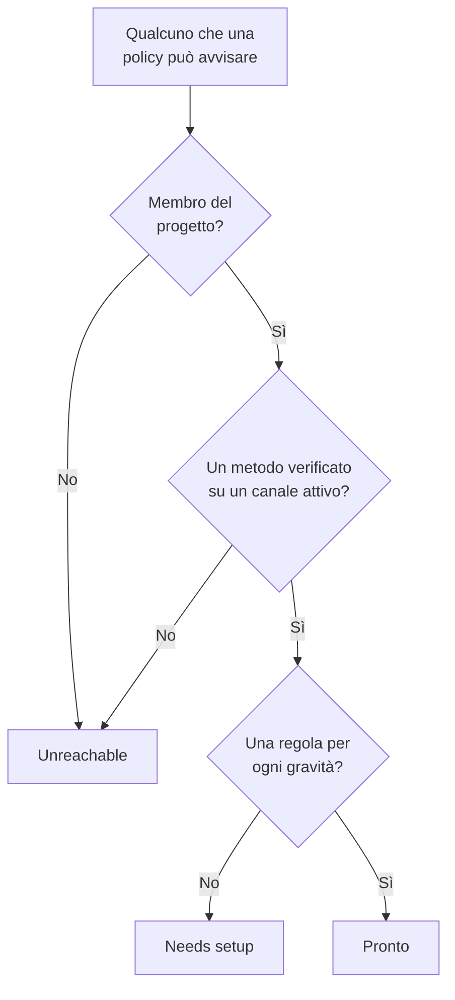

# Prontezza e report

La prontezza risponde a una domanda prima che lo faccia un incidente: se qualcosa scattasse adesso, ogni persona che le vostre policy di reperibilità avvisano verrebbe davvero raggiunta? Elenca ogni destinatario del progetto, dice chi è pronto e chi no, e vi permette di ricordare alle persone di completare la loro configurazione. Il report **Tempo di reperibilità dell'utente** mostra poi per quanto tempo ogni persona è stata reperibile.

:::cards
- [Come viene stabilito uno stato](#come-viene-stabilito-uno-stato): Pronto, Needs setup o Unreachable, e perché.
- [La pagina Prontezza](#la-pagina-prontezza): Ogni destinatario del progetto, in un solo elenco.
- [Ricordare alle persone di completare la configurazione](#ricordare-alle-persone-di-completare-la-configurazione): Un'e-mail che nomina ciò che manca.
- [Tempo di reperibilità dell'utente](#tempo-di-reperibilità-dellutente): Per quanto tempo ogni persona è stata reperibile.
:::

## Come viene stabilito uno stato

Un destinatario è chiunque una policy di reperibilità possa avvisare: una persona nominata in una regola di escalation, un membro di un team che una regola avvisa, qualcuno in un livello di una pianificazione che una regola avvisa, e il sostituto in una sostituzione utente non ancora finita. Una pianificazione che nessuna policy avvisa non aggiunge nessuno.

| Stato | Che cosa significa |
| --- | --- |
| **Pronto** | Ha un metodo verificato su un canale che il progetto ha attivato, e una regola per ogni gravità, su ogni scheda delle sue regole di reperibilità. |
| **Da configurare** | È raggiungibile, ma alcune gravità non hanno una regola. La riga conta queste lacune. |
| **Irraggiungibile** | Niente lo raggiunge: nessun metodo verificato, ogni metodo verificato è su un canale che il progetto ha disattivato, oppure non è membro del progetto. |

Una lacuna è una gravità senza regola, sulla scheda degli incidenti, degli episodi di incidenti, degli avvisi o degli episodi di avvisi. Una regola che disattiva di proposito una gravità non è una lacuna. Un avviso che trova una lacuna raggiunge comunque la persona sui suoi metodi verificati, a meno che il progetto non abbia disattivato questo ripiego: vedi [Quando nessuna regola corrisponde](/docs/notifications/index#quando-nessuna-regola-corrisponde).

## La pagina Prontezza

Aprite **Reperibilità → Prontezza**. La scheda **On-call readiness** elenca ogni persona che una policy di reperibilità del progetto può raggiungere, prima quelle che hanno bisogno di qualcosa. Chiunque nel progetto può aprirla.

Sopra l'elenco, i riquadri contano **Destinatari**, **Pronto**, **Da configurare** e **Irraggiungibile**. Fate clic su **Pronto**, **Da configurare** o **Irraggiungibile** per elencare solo quei destinatari, e fate di nuovo clic per elencare tutti.

| Colonna | Che cosa mostra |
| --- | --- |
| **Destinatario** | La persona, con il suo indirizzo e-mail. |
| **Stato** | **Pronto**, **Irraggiungibile** o quante lacune ha. |
| **Canali** | Un segmento per canale: pieno per un metodo verificato, vuoto per uno non ancora verificato. |
| **Coverage** | Quante gravità hanno una regola, su ogni scheda, sul totale. |
| **Reached via** | Come la raggiungono le policy: ogni team che la avvisa tramite una regola di escalation, con il suo nome, oppure **Direct**, **Pianificazione** o **Sostituzione**. |

**Coverage** su una riga mostra i metodi di notifica della persona, perché ha il suo stato e una griglia di ogni gravità con o senza regola. L'imbuto filtra l'elenco per **Destinatario**, **Stato**, **Team** o **Reached via**. La risposta può avere un minuto: **Aggiorna** la ricalcola.

## Ricordare alle persone di completare la configurazione

Solo la persona stessa può aggiungere e verificare i propri metodi di notifica e le proprie regole, quindi la soluzione è chiederglielo.

:::steps
1. Nella pagina Prontezza, spuntate i destinatari a cui inviare un promemoria. I destinatari pronti non si possono spuntare: non c'è niente da ricordare loro.
2. Fate clic su **Invia promemoria di configurazione**. La conferma nomina ogni persona a cui sta per scrivere.
3. Confermate. Ogni persona riceve un'e-mail che nomina ciò che manca nella sua configurazione, con un link alla pagina che lo sistema.
:::

Un banner indica poi quanti promemoria sono stati inviati, saltati o non riusciti, e perché per ciascuno di quelli non inviati. Nessuno riceve più di un promemoria ogni 24 ore, e un invio raggiunge al massimo 250 persone. Inviare promemoria richiede **Proprietario del progetto**, **Amministratore del progetto** o **Amministratore della reperibilità**, oppure **Edit On-Call Duty Policy** in un ruolo personalizzato.

## La prontezza in altre pagine

- Nella **Panoramica** di una policy, **Prontezza dei destinatari** elenca ogni persona che quella policy può avvisare e che richiede attenzione, e **Ricontrolla** la rilegge. La vostra riga ha un pulsante verso la pagina che sistema il problema; quella di un'altra persona apre un'e-mail per lei nel vostro programma di posta, con la soluzione dentro.
- Nelle **Regole di escalation** di una policy, un livello i cui destinatari non possono essere avvisati tutti lo indica sulla sua scheda. Vedi [Il riepilogo dell'escalation](/docs/on-call/escalation-rules#il-riepilogo-dellescalation).
- In **Utenti**, aprite un membro e poi **Prontezza** nella sezione **Reperibilità**: il suo stato, i suoi metodi e la sua griglia di copertura.
- Per la vostra configurazione, **Impostazioni utente → Elenco di configurazione** vi guida. Vedi [L'elenco di configurazione](/docs/notifications/index#lelenco-di-configurazione).

## L'e-mail settimanale sulla prontezza

Una volta a settimana, OneUptime controlla ogni progetto che ha una policy di reperibilità. Quando qualcuno è **Irraggiungibile** o **Da configurare**, i proprietari del progetto ricevono un'e-mail che elenca queste persone in due gruppi, chi non può essere avvisato affatto e chi è raggiungibile con lacune, fino a 20 nomi ciascuno, con un link alla pagina Prontezza.

Una settimana in cui tutti sono pronti non invia niente, quindi l'e-mail significa sempre che c'è qualcosa da sistemare. Quando qualcuno non può essere avvisato affatto, il suo oggetto inizia con `[Action Required]`.

## Tempo di reperibilità dell'utente

**Reperibilità → Report → Tempo di reperibilità dell'utente** mostra per quanto tempo ogni persona è stata reperibile, in un periodo che scegliete: all'inizio **Ultimo mese**.

| Colonna | Che cosa mostra |
| --- | --- |
| **Utente** | La persona. |
| **Tempo in cui l'utente era reperibile** | Il suo tempo di reperibilità nel periodo, in ore e minuti. |

Il tempo viene registrato man mano che le persone entrano ed escono dalla reperibilità: da quando una pianificazione che una regola avvisa passa loro un turno, o vengono aggiunte a una regola direttamente o tramite un team, fino al passaggio di consegne o fino a quando vengono rimosse. La reperibilità tramite due policy contemporaneamente conta una sola volta, e il tempo ancora in corso conta fino ad adesso.

La **Cronologia delle reperibilità** e i feed del calendario mostrano i turni passati secondo la rotazione come è configurata oggi. Questo report invece viene scritto mentre accade, quindi usatelo per le verifiche di equità e per il compenso della reperibilità.

> [!NOTE]
> Su OneUptime Cloud, il report richiede il piano **Growth**, e il tempo terminato da più di 200 giorni viene eliminato. Un'installazione self-hosted lo conserva tutto.

## Risoluzione dei problemi

:::details Qualcuno è irraggiungibile, ma ha un numero di telefono verificato
I suoi metodi potrebbero essere tutti su canali che il progetto ha disattivato: SMS, chiamate, WhatsApp e Telegram partono disattivati in un nuovo progetto. Vedi [Attivare un canale per il progetto](/docs/notifications/notification-methods#attivare-un-canale-per-il-progetto).
:::

:::details Qualcuno manca dall'elenco
L'elenco contiene solo persone che una policy di reperibilità può avvisare. Ne restano fuori un membro di un team che non ha accettato l'invito, qualcuno in una pianificazione che nessuna policy avvisa e un sostituto la cui sostituzione è finita.
:::

:::details I proprietari non ricevono mai l'e-mail settimanale
Viene inviata solo in una settimana in cui qualcuno è **Irraggiungibile** o **Da configurare**, e solo ai proprietari del progetto.
:::

## Passi successivi

:::cards
- [Come OneUptime vi raggiunge](/docs/notifications/index): I metodi, le regole e il ripiego dietro ogni stato.
- [Metodi di notifica](/docs/notifications/notification-methods): Aggiungere e verificare i modi in cui OneUptime raggiunge qualcuno.
- [Regole di reperibilità personali](/docs/notifications/on-call-rules): Colmare le lacune, gravità per gravità.
:::
