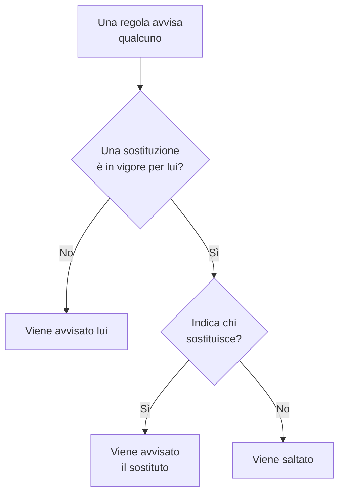

# Sostituzioni utente

Mentre qualcuno è assente, una sostituzione utente invia gli avvisi che lo raggiungerebbero alla persona che lo sostituisce, per un periodo stabilito. Se nessuno è indicato come sostituto, invece lo salta: ogni suo turno in una pianificazione di reperibilità passa alla persona successiva nella rotazione. Usatela per una vacanza, un giorno di malattia o un turno scambiato.

:::cards
- [Come una sostituzione cambia un avviso](#come-una-sostituzione-cambia-un-avviso): Chi viene avvisato al suo posto, e quando.
- [Aggiungere una sostituzione](#aggiungere-una-sostituzione): Chi è assente, chi sostituisce, da quando e fino a quando.
- [Modificare una sostituzione](#modificare-una-sostituzione): Cambiare chi sostituisce, o quando inizia e termina.
- [Terminare prima una sostituzione](#terminare-prima-una-sostituzione): Far tornare qualcuno prima che la sua sostituzione termini.
- [Tutte le policy, o una](#tutte-le-policy-o-una): Dove aggiungere una sostituzione, e quale prevale.
- [Altri modi per aggiungerne una](#altri-modi-per-aggiungerne-una): Da una pianificazione, e dai vostri prossimi turni.
:::

## Come una sostituzione cambia un avviso



Finché una sostituzione è in vigore, dal suo inizio alla sua fine:

- Con qualcuno in **Chi sostituisce?**, quella persona riceve tutti gli avvisi della persona assente, da ogni pianificazione, team e regola a cui la sostituzione si applica. L'avviso la raggiunge tramite le sue regole di reperibilità personali.
- Senza sostituto, la persona viene saltata. In una pianificazione di reperibilità, ogni suo turno passa alla persona successiva nella rotazione che non è assente; se tutti in un livello sono assenti, subentrano i livelli sottostanti. Una regola che la nomina direttamente, o tramite un team, non la avvisa, e l'esecuzione della policy dice che è assente, e fino a quando.
- Le sostituzioni non si concatenano. Se anche il sostituto è assente, viene comunque avvisato lui per la persona che sostituisce.
- Si può scegliere in **Chi sostituisce?** una persona invitata che non è ancora entrata nel progetto, ma nulla la avvisa finché non accetta il suo invito, quindi fino ad allora nessuno viene avvisato al posto della persona assente. Il modulo lo dice appena la scegli, e lo dice anche la riga che ricevono i canali e il feed della policy: "🔁 Added an override on Payments: Ivy covers for @ana from Mon at 9:00 AM to Fri at 5:00 PM, but Ivy hasn't joined the project yet, so nobody is paged in place of @ana until they do."

Quando la sostituzione finisce, gli avvisi tornano alla persona. La **Cronologia delle reperibilità**, i livelli di una pianificazione e i feed del calendario mostrano tutti chi ha ogni turno sostituito.

## Aggiungere una sostituzione

:::steps
### Aprire le sostituzioni

Andate in **Reperibilità → Pianificazioni → Sostituzioni utente** per sostituire qualcuno in tutte le policy di reperibilità, oppure nella pagina **Sostituzioni utente** di una policy, in **Avanzato**, per sostituirlo solo in quella policy. Fate clic su **Aggiungi: Sostituzione utente**.

### Indicare chi è assente

**Chi è assente?** parte da voi, perché registrare la propria assenza è il caso più comune. Scegliete qualcun altro per organizzare la sua sostituzione.

### Indicare chi sostituisce

Lasciate **Chi sostituisce?** su **Persona successiva nella rotazione** per saltare la persona, oppure scegliete il collega che prende tutti i suoi avvisi. La persona assente non viene proposta.

### Impostare gli orari

**Inizia** è adesso, a meno che non scegliate un altro orario. Impostate **Termina** al momento del suo rientro: deve venire dopo l'inizio. Fate clic su **Aggiungi: Sostituzione utente**.
:::

Ogni sostituzione è una riga: **Assente**, **Sostituito da**, **Inizia** e **Termina**, filtrabile per inizio e fine. **Sostituito da** mostra **Persona successiva nella rotazione** per un salto.

## Modificare una sostituzione

Fate clic su **Modifica** sulla riga di una sostituzione, in una delle due pagine **Sostituzioni utente** o nell'elenco delle sostituzioni utente nella pagina **Livelli** di una pianificazione. Il modulo si apre con la sostituzione così come è stata salvata: modificatela e fate clic su **Salva modifiche**.

- **Chi sostituisce?** si può cambiare finché la sostituzione non termina. Riportatelo su **Persona successiva nella rotazione** per saltare invece la persona.
- **Inizia** si può spostare finché la sostituzione non inizia, poi resta com'è. **Termina** si può spostare finché la sostituzione non termina: per terminarla adesso, usate **Termina ora**. Nessuno dei due si può spostare nel passato.
- **Chi è assente?** non si può cambiare. Per qualcun altro, aggiungete una nuova sostituzione.

Una sostituzione già terminata non si può più modificare: il suo **Modifica** è bloccato e dice perché. L'app mobile di OneUptime modifica le sostituzioni con le stesse regole.

## Terminare prima una sostituzione

Per far tornare qualcuno prima che la sua sostituzione termini, fate clic su **Termina ora**: nel menu della riga della sostituzione in una delle due pagine **Sostituzioni utente**, accanto a essa nell'elenco delle sostituzioni utente nella pagina **Livelli** di una pianificazione, oppure sotto **Termina** nel suo modulo di modifica. Prima chiede conferma e dice che cosa succede al tempo rimasto: chi sostituisce smette di sostituire la persona, oppure la persona smette di essere saltata, e da quel momento gli avvisi tornano a lei. La sostituzione poi termina subito.

**Termina ora** è offerto solo mentre una sostituzione è in corso: una che non è ancora iniziata non ha nulla da terminare, quindi eliminatela. L'app mobile termina allo stesso modo una sostituzione in corso.

## Tutte le policy, o una

| Aggiunta in | Scheda | Si applica a |
| --- | --- | --- |
| **Reperibilità → Pianificazioni → Sostituzioni utente** | **Sostituzioni utente globali** | Tutte le policy di reperibilità del progetto |
| **Sostituzioni utente** di una policy | **Sostituzioni utente della policy di reperibilità** | Solo quella policy |

Due sostituzioni per la stessa persona non possono sovrapporsi sulla stessa policy, né quando sono entrambe globali. Il modulo, e **Salta fino a…** nei livelli di una pianificazione, lo dicono accanto agli orari appena vengono scelti, con **Modifica quella sostituzione** per modificare invece quella. Una può terminare quando inizia la successiva.

La sostituzione propria di una policy può sovrapporsi a una globale della stessa persona: su quella policy si usa la sua finché valgono entrambe, e il modulo lo dice. Un avviso inviato senza policy, da un flusso di lavoro o dalla chat, segue solo le sostituzioni globali.

Le sostituzioni che si sovrapponevano già prima di questa regola restano come sono. Entrambe sono segnate con **Si sovrappone**, che dice quale si usa: quella che indica un sostituto prima di un salto, poi quella che inizia prima, poi quella aggiunta per prima. Entrambe si possono comunque accorciare, o terminare con **Termina ora**: solo una modifica che aggiunge tempo è soggetta alla regola.

## Altri modi per aggiungerne una

- Da una pianificazione: nella pagina **Livelli** di una pianificazione, espandete un livello e fate clic su **Salta fino a…** accanto a una persona. Si apre lo stesso modulo con lei assente e la rotazione che sostituisce, come sostituzione globale. Vedi [Quando qualcuno è assente](/docs/on-call/schedules#quando-qualcuno-è-assente).
- Dai vostri prossimi turni: **Trova una copertura** su uno dei vostri turni, in **Impostazioni utente → Profilo e calendario → Feed calendario**, apre il modulo con voi assenti per gli orari di quel turno, così resta solo **Chi sostituisce?**. Vedi [Turni in arrivo e sostituzioni](/docs/on-call/calendar-feeds#turni-in-arrivo-e-sostituzioni).

Quando qualcuno lascia il progetto, ogni sostituzione che lo nomina e che non è ancora finita viene eliminata, da entrambi i lati.

## Chi può aggiungere sostituzioni

**Proprietario del progetto**, **Amministratore del progetto**, **Membro del progetto**, **Amministratore della reperibilità** e **Membro della reperibilità** possono aggiungere, modificare ed eliminare sostituzioni; **Visualizzatore** e **Visualizzatore della reperibilità** possono vederle. In un ruolo personalizzato, i permessi sono **Create On-Call Policy User Override**, **Edit On-Call Policy User Override**, **Delete On-Call Policy User Override** e **Read On-Call Policy User Override**. Nella **Cronologia delle reperibilità**, solo chi può leggere le sostituzioni vede di chi è il turno sostituito.

Una sostituzione su una policy segue l'ambito della policy. Date a un team **Membro della reperibilità** limitato alle policy di sua proprietà, o alla sua etichetta, e i suoi membri aggiungono, modificano ed eliminano sostituzioni solo su quelle policy. Una sostituzione globale si applica a ogni policy, comprese quelle di un altro team, quindi aggiungerla, modificarla o eliminarla richiede il permesso per le sostituzioni sull'intero progetto. Con uno più ristretto, **Aggiungi: Sostituzione utente**, **Modifica**, **Termina ora** ed **Elimina** in **Reperibilità → Pianificazioni → Sostituzioni utente** sono bloccati e dicono perché. **Salta fino a…** nei livelli di una pianificazione e **Trova una copertura** sui vostri prossimi turni, che aggiungono sostituzioni globali, offrono invece le policy su cui potete aggiungere sostituzioni, con una sostituzione per policy, e così fa la copertura dell'app mobile; dove non potete su nessuna, sono bloccati e dicono perché. Il team aggiunge le sue sostituzioni nella pagina **Sostituzioni utente** di ciascuna policy. Lo stesso vale per l'API: una sostituzione senza `onCallDutyPolicyId` viene rifiutata per un permesso limitato a etichette o alle policy possedute.

Per lasciare che un team organizzi le sostituzioni solo tra le proprie persone, dagli **Manage On-Call Policy User Overrides for Own Team**, direttamente o tramite un ruolo personalizzato. I suoi membri aggiungono, modificano ed eliminano sostituzioni solo quando la persona assente e la persona che sostituisce sono ciascuna in uno dei loro team a cui è dato questo permesso; i loro altri team non contano. **Chi è assente?** e **Chi sostituisce?** elencano solo le persone di quei team e dicono perché, e **Modifica**, **Termina ora** ed **Elimina** sono bloccati, dicendo perché, su una sostituzione che nomina chiunque altro. **Salta fino a…** nei livelli di una pianificazione è bloccato accanto a chiunque altro, dicendo perché, e l'app mobile elenca e blocca allo stesso modo. Per vedere le sostituzioni serve comunque **Read On-Call Policy User Override**, o un ruolo che lo includa, come **Visualizzatore della reperibilità**. L'API, Terraform e l'app mobile seguono la stessa regola; una chiave API, che non fa parte di alcun team, non raggiunge nessuno con esso. Chi ha anche **Membro della reperibilità**, o un altro permesso che raggiunge tutti, non ne è limitato.

Su OneUptime Cloud, le sostituzioni utente richiedono il piano **Growth**.

## API

Le sostituzioni utente sono la risorsa `/api/on-call-duty-policy-user-override`:

| Campo | Che cosa contiene |
| --- | --- |
| `overrideUserId` | La persona assente. Obbligatorio. |
| `routeAlertsToUserId` | La persona che sostituisce. Omettetelo per saltare invece la persona. |
| `startsAt`, `endsAt` | Quando la sostituzione inizia e finisce. Sono entrambi obbligatori, e la fine viene dopo l'inizio. |
| `onCallDutyPolicyId` | La policy a cui si applica. Omettetelo per una sostituzione globale. |

```bash
curl -X POST https://oneuptime.com/api/on-call-duty-policy-user-override \
  -H "apikey: $ONEUPTIME_API_KEY" \
  -H "Content-Type: application/json" \
  -d '{
    "data": {
      "projectId": "<project-id>",
      "overrideUserId": "<away-user-id>",
      "routeAlertsToUserId": "<cover-user-id>",
      "startsAt": "2026-12-22T09:00:00Z",
      "endsAt": "2027-01-05T09:00:00Z"
    }
  }'
```

Una sostituzione in cui la persona assente e il sostituto coincidono viene rifiutata, e così una che finisce prima di iniziare. Lo stesso vale per una che si sovrappone a un'altra sostituzione della stessa persona sulla stessa policy, o quando sono entrambe globali: il rifiuto nomina quella a cui si sovrappone.

Per modificare una sostituzione, inviate `PUT /api/on-call-duty-policy-user-override/<override-id>` con i campi da cambiare in `data`: `routeAlertsToUserId` (`null` per saltare invece la persona), `startsAt` e `endsAt`. `overrideUserId` e `onCallDutyPolicyId` non si possono cambiare. Una sostituzione già terminata non si può modificare, né l'inizio di una già iniziata, e un orario modificato non si può spostare nel passato.

Per terminare una sostituzione in corso, inviate `POST /api/on-call-duty-policy-user-override/<override-id>/end-now`. Termina secondo l'orologio del server, e la risposta indica il suo nuovo `endsAt`. Una che non è ancora iniziata, o che è già terminata, viene rifiutata.

## Risoluzione dei problemi

:::details La persona in ferie è stata avvisata lo stesso
Controllate dove è stata aggiunta la sostituzione. Una sulla pagina **Sostituzioni utente** di una policy copre solo quella policy, e le altre policy la avvisano ancora: aggiungetela in **Reperibilità → Pianificazioni → Sostituzioni utente** per coprire tutte le policy. Controllate anche **Inizia** e **Termina**: gli orari sono mostrati nel vostro fuso orario.
:::

:::details Neanche il sostituto è stato avvisato
Viene raggiunto tramite le sue regole di reperibilità personali e i suoi metodi verificati. Cercatelo in **Reperibilità → Prontezza** e controllate l'esecuzione nei **Log di esecuzione** della policy.
:::

:::details Non riesco ad aggiungere una sostituzione
Serve uno dei ruoli qui sopra e, su OneUptime Cloud, il piano **Growth**. Una sostituzione globale richiede il ruolo sull'intero progetto: se il ruolo del vostro team è limitato alle sue policy o ad alcune etichette, aggiungete la sostituzione nella pagina **Sostituzioni utente** della policy stessa. **Salta fino a…**, **Trova una copertura** e l'app mobile offrono allora solo le policy su cui potete aggiungere sostituzioni, e sono bloccati dove non potete su nessuna.
:::

:::details Una sostituzione non si può salvare perché si sovrappone a un'altra
La persona ha già una sostituzione in alcuni di quegli orari: sulla stessa policy, o una globale quando anche questa è globale. Fate clic su **Modifica quella sostituzione** sotto **Termina** per modificare invece quella, o scegliete orari che non vi si sovrappongano.
:::

## Passi successivi

:::cards
- [Pianificazioni di reperibilità](/docs/on-call/schedules): Turni, livelli e come saltare qualcuno in un livello.
- [Cronologia delle reperibilità](/docs/on-call/schedule-timeline): Vedere ogni turno sostituito in tutte le pianificazioni.
- [Feed calendario](/docs/on-call/calendar-feeds): Trovare una copertura per uno dei vostri turni.
:::
