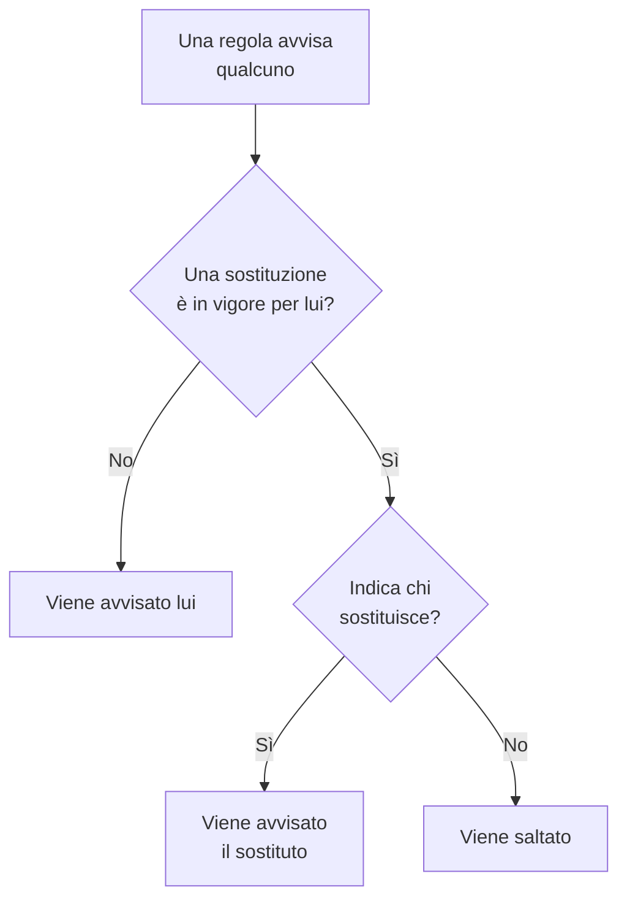

# Sostituzioni utente

Mentre qualcuno è assente, una sostituzione utente invia gli avvisi che lo raggiungerebbero alla persona che lo sostituisce, per un periodo stabilito. Se nessuno è indicato come sostituto, invece lo salta: ogni suo turno in una pianificazione di reperibilità passa alla persona successiva nella rotazione. Usatela per una vacanza, un giorno di malattia o un turno scambiato.

:::cards
- [Come una sostituzione cambia un avviso](#come-una-sostituzione-cambia-un-avviso): Chi viene avvisato al suo posto, e quando.
- [Aggiungere una sostituzione](#aggiungere-una-sostituzione): Chi è assente, chi sostituisce, da quando e fino a quando.
- [Tutte le policy, o una](#tutte-le-policy-o-una): Dove aggiungere una sostituzione, e quale prevale.
- [Altri modi per aggiungerne una](#altri-modi-per-aggiungerne-una): Da una pianificazione, e dai vostri prossimi turni.
:::

## Come una sostituzione cambia un avviso



Finché una sostituzione è in vigore, dal suo inizio alla sua fine:

- Con qualcuno in **Chi sostituisce?**, quella persona riceve tutti gli avvisi della persona assente, da ogni pianificazione, team e regola a cui la sostituzione si applica. L'avviso la raggiunge tramite le sue regole di reperibilità personali.
- Senza sostituto, la persona viene saltata. In una pianificazione di reperibilità, ogni suo turno passa alla persona successiva nella rotazione che non è assente; se tutti in un livello sono assenti, subentrano i livelli sottostanti. Una regola che la nomina direttamente, o tramite un team, non la avvisa, e l'esecuzione della policy dice che è assente, e fino a quando.
- Le sostituzioni non si concatenano. Se anche il sostituto è assente, viene comunque avvisato lui per la persona che sostituisce.

Quando la sostituzione finisce, gli avvisi tornano alla persona. La **Cronologia delle reperibilità**, i livelli di una pianificazione e i feed del calendario mostrano tutti chi ha ogni turno sostituito.

## Aggiungere una sostituzione

:::steps
### Aprire le sostituzioni

Andate in **Reperibilità → Avanzato → Sostituzioni utente** per sostituire qualcuno in tutte le policy di reperibilità, oppure nella pagina **Sostituzioni utente** di una policy, in **Avanzato**, per sostituirlo solo in quella policy. Fate clic su **Aggiungi: Sostituzione utente**.

### Indicare chi è assente

**Chi è assente?** parte da voi, perché registrare la propria assenza è il caso più comune. Scegliete qualcun altro per organizzare la sua sostituzione.

### Indicare chi sostituisce

Lasciate **Chi sostituisce?** su **Persona successiva nella rotazione** per saltare la persona, oppure scegliete il collega che prende tutti i suoi avvisi. La persona assente non viene proposta.

### Impostare gli orari

**Inizia** è adesso, a meno che non scegliate un altro orario. Impostate **Termina** al momento del suo rientro: deve venire dopo l'inizio. Fate clic su **Aggiungi: Sostituzione utente**.
:::

Ogni sostituzione è una riga: **Assente**, **Sostituito da**, **Inizia** e **Termina**, filtrabile per inizio e fine. **Sostituito da** mostra **Persona successiva nella rotazione** per un salto. Una sostituzione non si può modificare: eliminatela e aggiungetene una nuova, oppure eliminatela per far rientrare qualcuno prima.

## Tutte le policy, o una

| Aggiunta in | Scheda | Si applica a |
| --- | --- | --- |
| **Reperibilità → Avanzato → Sostituzioni utente** | **Sostituzioni utente globali** | Tutte le policy di reperibilità del progetto |
| **Sostituzioni utente** di una policy | **Sostituzioni utente della policy di reperibilità** | Solo quella policy |

Quando due sostituzioni per la stessa persona si sovrappongono, quella della policy prevale su una globale, e quella che indica un sostituto prevale su un salto. Un avviso inviato senza policy, da un workflow o dalla chat, segue solo le sostituzioni globali.

## Altri modi per aggiungerne una

- Da una pianificazione: nella pagina **Livelli** di una pianificazione, espandete un livello e fate clic su **Salta fino a…** accanto a una persona. Si apre lo stesso modulo con lei assente e la rotazione che sostituisce, come sostituzione globale. Vedi [Quando qualcuno è assente](/docs/on-call/schedules#quando-qualcuno-è-assente).
- Dai vostri prossimi turni: **Trova una copertura** su uno dei vostri turni, in **Impostazioni utente → Calendario → Feed calendario**, apre il modulo con voi assenti per gli orari di quel turno, così resta solo **Chi sostituisce?**. Vedi [Turni in arrivo e sostituzioni](/docs/on-call/calendar-feeds#turni-in-arrivo-e-sostituzioni).

Quando qualcuno lascia il progetto, ogni sostituzione che lo nomina e che non è ancora finita viene eliminata, da entrambi i lati.

## Chi può aggiungere sostituzioni

**Proprietario del progetto**, **Amministratore del progetto**, **Membro del progetto**, **Amministratore della reperibilità** e **Membro della reperibilità** possono aggiungere ed eliminare sostituzioni; **Visualizzatore** e **Visualizzatore della reperibilità** possono vederle. In un ruolo personalizzato, i permessi sono **Create On-Call Duty Policy User Override**, **Delete On-Call Duty Policy User Override** e **Read On-Call Duty Policy User Override**. Nella **Cronologia delle reperibilità**, solo chi può leggere le sostituzioni vede di chi è il turno sostituito.

Su OneUptime Cloud, le sostituzioni utente richiedono il piano **Growth**.

## API

Le sostituzioni utente sono la risorsa `/api/on-call-duty-policy-user-override`:

| Campo | Che cosa contiene |
| --- | --- |
| `overrideUserId` | La persona assente. Obbligatorio. |
| `routeAlertsToUserId` | La persona che sostituisce. Omettetelo per saltare invece la persona. |
| `startsAt`, `endsAt` | Quando la sostituzione inizia e finisce. Sono entrambi obbligatori, e la fine viene dopo l'inizio. |
| `onCallDutyPolicyId` | La policy a cui si applica. Omettetelo per una sostituzione globale. |

```bash
curl -X POST https://oneuptime.com/api/on-call-duty-policy-user-override \
  -H "apikey: $ONEUPTIME_API_KEY" \
  -H "Content-Type: application/json" \
  -d '{
    "data": {
      "projectId": "<project-id>",
      "overrideUserId": "<away-user-id>",
      "routeAlertsToUserId": "<cover-user-id>",
      "startsAt": "2026-12-22T09:00:00Z",
      "endsAt": "2027-01-05T09:00:00Z"
    }
  }'
```

Una sostituzione in cui la persona assente e il sostituto coincidono viene rifiutata, e così una che finisce prima di iniziare.

## Risoluzione dei problemi

:::details La persona in ferie è stata avvisata lo stesso
Controllate dove è stata aggiunta la sostituzione. Una sulla pagina **Sostituzioni utente** di una policy copre solo quella policy, e le altre policy la avvisano ancora: aggiungetela in **Reperibilità → Avanzato → Sostituzioni utente** per coprire tutte le policy. Controllate anche **Inizia** e **Termina**: gli orari sono mostrati nel vostro fuso orario.
:::

:::details Neanche il sostituto è stato avvisato
Viene raggiunto tramite le sue regole di reperibilità personali e i suoi metodi verificati. Cercatelo in **Reperibilità → Prontezza** e controllate l'esecuzione nei **Registri di esecuzione** della policy.
:::

:::details Non riesco ad aggiungere una sostituzione
Serve uno dei ruoli qui sopra e, su OneUptime Cloud, il piano **Growth**.
:::

## Passi successivi

:::cards
- [Pianificazioni di reperibilità](/docs/on-call/schedules): Turni, livelli e come saltare qualcuno in un livello.
- [Cronologia delle reperibilità](/docs/on-call/schedule-timeline): Vedere ogni turno sostituito in tutte le pianificazioni.
- [Feed calendario](/docs/on-call/calendar-feeds): Trovare una copertura per uno dei vostri turni.
:::
