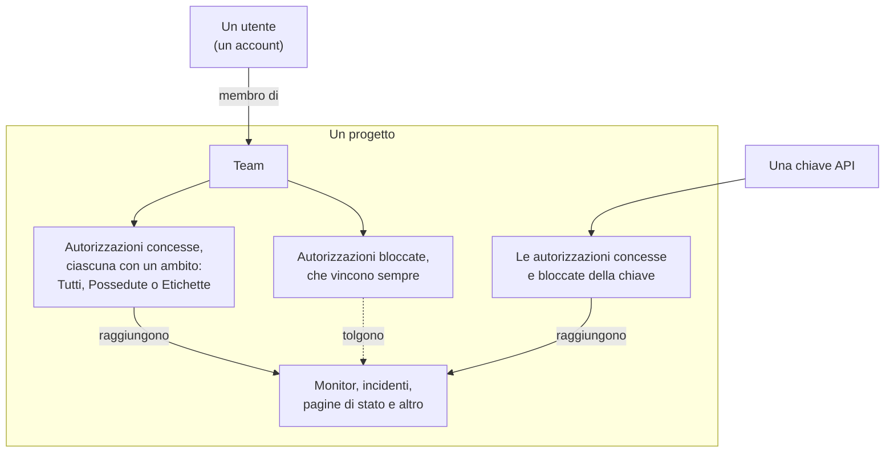
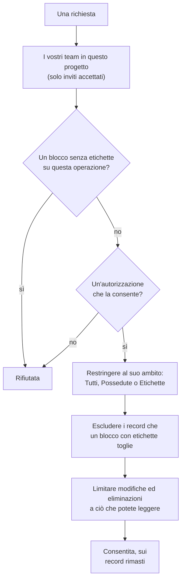

# Utenti, team e autorizzazioni

Tutto in OneUptime vive all'interno di un **progetto**. Chi può fare cosa in quel progetto dipende da tre cose: gli **utenti** che ne fanno parte, i **team** a cui appartengono e le **autorizzazioni** concesse a quei team.

> [!IMPORTANT]
> **Gli utenti non detengono mai autorizzazioni direttamente.** L'accesso di un utente è l'unione delle autorizzazioni di tutti i team a cui appartiene in quel progetto. Per cambiare ciò che qualcuno può fare, cambiate la sua appartenenza a un team o le autorizzazioni di quel team.

I **proprietari** sono un concetto a parte. Un proprietario è chi è responsabile di una risorsa specifica: un monitor, un incidente, una dashboard. I proprietari ricevono notifiche sulle loro risorse, e le autorizzazioni possono essere ristrette, se lo volete, a «solo le cose che possiedo».

## Come funziona l'accesso

| Concetto | Che cos'è |
| --- | --- |
| Utente | Un singolo account OneUptime. Un accesso, un numero qualsiasi di progetti. |
| Progetto | Il confine del tenant. Monitor, incidenti, team e dati appartengono a un solo progetto. |
| Team | Un gruppo con nome all'interno di un progetto che porta le autorizzazioni. |
| Membro del team | Un utente invitato in un team che ha accettato. |
| Autorizzazione | Una singola capacità, ad es. `CreateProjectMonitor`, o un ruolo che ne raggruppa molte, ad es. `MonitorAdmin`. |
| Ambito | Fin dove arriva un'autorizzazione concessa: tutte le risorse, solo quelle possedute o solo quelle etichettate. |
| Proprietario | Un utente o un team indicato come responsabile di una risorsa specifica. |
| Etichetta | Un'etichetta che mettete sulle risorse, usata per restringere le autorizzazioni e per organizzare. |

## Utenti

Un account utente è globale per l'istanza OneUptime: lo stesso accesso funziona in tutti i progetti in cui l'utente è stato invitato.

Un utente è «in» un progetto quando è membro di **almeno un team** al suo interno. Non esiste un passaggio separato «aggiungi utente al progetto»: invitare qualcuno in un progetto significa invitarlo in un team.

:::steps
1. Aprite **Utenti** dal menu **Prodotti**, sotto **Impostazioni**, e fate clic su **Invita utente**. L'elenco mostra tutte le persone del progetto e lo stato del loro invito.
2. Inserite la sua **E-mail**. A chi non ha ancora un account OneUptime viene chiesto anche un **Nome**.
3. Scegliete il suo **Team**, che decide cosa può fare, e fate clic su **Invita**.
4. La persona accetta dalla campanella in alto a destra, su **Inviti al progetto**, e da quel momento fa parte del progetto.
:::

- Gli inviti creano un membro del team in attesa. L'utente conta come membro del progetto — e ottiene una qualsiasi autorizzazione — **solo dopo aver accettato l'invito.**
- **Invita utente** parte dal team dei membri del progetto: il team che detiene `ProjectMember` per l'intero progetto, cioè **Members** se non l'avete rinominato. Scegliete un altro team per dare alla persona più o meno accesso. Non è selezionato nulla quando voi stessi non potreste invitare in quel team — invitare qualcuno gli trasmette le autorizzazioni del team, e potete trasmettere solo autorizzazioni che detenete — o quando il progetto non ha un team del genere. La dashboard di amministrazione parte dallo stesso team ovunque un amministratore dell'istanza aggiunga qualcuno a un progetto: **Invita utente** su un progetto, **Aggiungi al progetto** su un utente e su più utenti insieme, e i progetti collegati a un [provider SSO globale](/docs/identity/global-sso).
- Rimuovere un utente da tutti i team di un progetto gli toglie l'accesso a quel progetto, dalla sua richiesta successiva, anche mentre ha effettuato l'accesso. Il suo account e i suoi altri progetti non ne risentono. Viene tolto dai turni di reperibilità, dalle regole di escalation e dalle sostituzioni del progetto, dai ruoli dei suoi incidenti ed episodi aperti e dai proprietari delle sue risorse; gli incidenti risolti conservano la traccia di chi li possedeva e li ha gestiti.
- Chi lascia un progetto smette di riceverne le notifiche. I suoi metodi, regole e impostazioni di notifica per il progetto vengono rimossi insieme all'ultimo team — email, SMS, chiamata, WhatsApp, Telegram, push, webhook, Slack e Microsoft Teams, il riepilogo email e l'email non ancora inviata, il numero per le chiamate in arrivo e i promemoria dei turni —, quindi chi rientra riparte dalle impostazioni predefinite. Ciò che lo nomina ancora, come l'utente chiamato da una regola delle chiamate in arrivo o un proprietario mantenuto su un incidente risolto, non lo notifica più: nulla viene inviato per conto di un progetto a chi non ne è membro, e un invito in sospeso non è ancora un'appartenenza. Questi punti mostrano **Non è più membro** accanto al nome, così potete mettere qualcun altro. Chi è stato invitato e non ha ancora accettato mostra invece **Invito non ancora accettato**. Se una sostituzione inoltra le chiamate di qualcuno a una persona che ha lasciato il progetto, viene chiamata invece la persona che la sostituzione copre. Lasciare il progetto scollega anche i client MCP che la persona aveva collegato al progetto, e il suo link personale al calendario di reperibilità mostra da quel momento un calendario vuoto. Su OneUptime Cloud, chi ritorna tramite il single sign-on del progetto lo conferma di nuovo dalla propria casella di posta.
- Se il progetto impone l'SSO e un utente non si è ancora autenticato tramite l'identity provider, viene trattato come utente SSO non autorizzato e non vede nulla finché non lo fa. Vedi [SSO](/docs/identity/sso).
- Con SCIM configurato, l'identity provider può creare, aggiornare e rimuovere automaticamente utenti e loro appartenenze ai team. Vedi [SCIM](/docs/identity/scim).

## Team

I team sono il modo in cui le autorizzazioni arrivano alle persone. Ogni nuovo progetto parte con tre team:

| Team | Autorizzazione che detiene | Modificabile |
| --- | --- | --- |
| Owners | `ProjectOwner` | No. Ha sempre almeno un membro. |
| Admin | `ProjectAdmin` | No |
| Members | `ProjectMember` | Sì — è un punto di partenza, modificatelo liberamente |

I team **Owners** e **Admin** sono bloccati di proposito: le loro autorizzazioni non si possono modificare e i team non si possono eliminare né rinominare. È questo che impedisce a un progetto di chiudersi fuori da solo per errore. Il team Owners deve sempre mantenere almeno un membro.

`ProjectOwner` è il livello di accesso più alto: fatturazione, eliminazione del progetto e tutto ciò che può fare un amministratore. `ProjectAdmin` copre tutto tranne la fatturazione e l'eliminazione del progetto.

Attivare o disattivare SMS, chiamate telefoniche, WhatsApp o Telegram per il progetto rientra nella fatturazione, perché ogni messaggio costa denaro. Solo `ProjectOwner`, il ruolo `BillingAdmin` (**Billing Admin**) e l'autorizzazione `ManageProjectBilling` (**Manage Billing**) possono cambiare questi interruttori, in **Impostazioni del progetto > Notifiche > Impostazioni notifiche** — non `ProjectAdmin`.

Ricaricare i saldi prepagati del progetto rientra anch'esso nella fatturazione. Su OneUptime Cloud SMS, chiamate telefoniche, WhatsApp e Telegram sono pagati dal saldo in **Impostazioni del progetto > Notifiche > Impostazioni notifiche**, e l'IA dai crediti IA in **Impostazioni del progetto > IA > Crediti IA**. Solo un proprietario del progetto o qualcuno con **Manage Billing** può ricaricarli o cambiarne la **Ricarica automatica** — non un amministratore del progetto. Un messaggio su un saldo in esaurimento dice chi può ricaricarlo, e solo queste persone hanno un pulsante **Ricarica saldo** funzionante o un link alla pagina.

Create tutti i team aggiuntivi che volete — «Reperibilità Frontend», «Supporto», «Revisori in sola lettura» — e date a ciascuno le autorizzazioni di cui ha bisogno. Su OneUptime Cloud, creare un team e cambiarne le autorizzazioni richiede il piano Scale.

**Creare un team** chiede un nome e il suo **Accesso**, cioè cosa possono fare i membri del team:

| Accesso | Cosa possono fare i membri del team |
| --- | --- |
| Amministratore del progetto | Creare, modificare ed eliminare qualsiasi cosa nel progetto, impostazioni comprese. Non la fatturazione, né l'eliminazione del progetto. |
| Membro del progetto | Creare, modificare ed eliminare monitor, incidenti, pagine di stato e le altre risorse del progetto. |
| Visualizzatore | Leggere tutto nel progetto e non modificare nulla. |
| Scegli le autorizzazioni più tardi | Ancora niente. Selezionato all'inizio. |

:::steps
1. Aprite **Team** dal menu **Prodotti**, sotto **Impostazioni**, e fate clic su **Crea team**.
2. Inserite il **Nome** del team e scegliete il suo **Accesso**. La descrizione si trova sotto **Altri campi**.
3. Create il team. Un team con un ruolo si apre sulla sua pagina **Membri**, pronto per invitare persone; con **Scegli le autorizzazioni più tardi** si apre sulla sua pagina **Autorizzazioni**, dove aggiungete un ruolo più ristretto come `IncidentMember`, o singole autorizzazioni.
:::

Il ruolo che scegliete diventa la prima autorizzazione del team, per tutte le risorse del progetto, appena il team esiste — esattamente come se lo aveste aggiunto con **Aggiungi ruolo** nella pagina Autorizzazioni del team. Vi vengono proposti solo i ruoli che detenete voi stessi, perché chiunque invitiate nel team riceve le sue autorizzazioni, e a chi può creare team ma non cambiare ciò che possono fare non viene chiesto. Se il ruolo non può essere aggiunto, il team viene creato comunque e un avviso sopra l'elenco vi rimanda a esso.

Dove trovarlo: aprite un team da **Team** per raggiungere **Membri** e **Autorizzazioni**; **Blocca autorizzazioni** si trova sotto **Altre impostazioni** in fondo alla pagina Autorizzazioni, la cui intestazione chiusa mostra quante ne ha il team.

## Autorizzazioni

Un'autorizzazione è una singola capacità. Ci sono due modi di assegnarle, ed entrambi si trovano nella scheda **Autorizzazioni** del team.

### Ruoli

Un ruolo raggruppa un'intera area del prodotto a uno di tre livelli:

- **Admin** — ciò che fa il Member, più la configurazione propria dell'area, come le gravità e gli stati di incidenti e avvisi, gli stati dei monitor e gli stati di manutenzione.
- **Member** — il lavoro quotidiano: creare, modificare ed eliminare le risorse dell'area, con le loro note, proprietari e modelli. Per le pagine di stato e la reperibilità, il Member fa tutto ciò che fa l'Admin.
- **Viewer** — sola lettura.

`MonitorAdmin`, `IncidentMember`, `StatusPageViewer` e così via. I ruoli sono ciò che vi serve quasi sempre: restano corretti man mano che OneUptime aggiunge funzionalità, perché una nuova tabella legata ai monitor viene aggiunta ai ruoli monitor esistenti invece di richiedere una nuova concessione da parte vostra.

Workflow e runbook sono l'eccezione. Entrambi eseguono codice nel vostro progetto — un workflow i suoi passi, un runbook i suoi script sui vostri Runner —, quindi `WorkflowMember` apre i workflow e le loro esecuzioni e li esegue a mano, e `RunbookMember` apre i runbook e le loro esecuzioni e li esegue: avvia un'esecuzione, completa o salta i suoi passi e la annulla. Nessuno dei due crea, modifica o elimina ciò che esegue; `WorkflowAdmin` e `RunbookAdmin` li costruiscono. Un ruolo esegue solo i runbook che il suo ambito raggiunge, quindi un `RunbookMember` limitato ad alcune etichette esegue i runbook che le portano. Vedi [Autorizzazioni dei workflow](/docs/workflows/configuration#autorizzazioni) e [Autorizzazioni dei runbook](/docs/runbooks/configuration#autorizzazioni).

Le regole di un'area (regole di etichette, di proprietari, di reperibilità, di raggruppamento e di promemoria), i campi personalizzati, gli SLA e i segreti sono configurazione del progetto: richiedono `ProjectAdmin`, qualunque ruolo d'area abbia la persona. Lo stesso vale per chiavi API, team e loro autorizzazioni, etichette, SSO e domini — i ruoli Settings si occupano di servizi, probe, infrastruttura e integrazioni del progetto, non di chi può fare cosa.

La fatturazione ha tre ruoli propri. `BillingViewer` legge la fatturazione del progetto — il piano e l'abbonamento, le fatture, l'utilizzo, i saldi, i crediti IA, i metodi di pagamento e i recapiti di fatturazione — e non modifica nulla. `BillingMember` scarica anche le fatture e modifica i recapiti di fatturazione. `BillingAdmin` fa ciò che fa `BillingMember` e attiva e disattiva SMS, chiamate telefoniche, WhatsApp e Telegram. Cambiare il piano, i metodi di pagamento o i saldi, e pagare le fatture, richiede `ProjectOwner` o **Manage Billing**; nelle pagine di fatturazione quei pulsanti sono bloccati per tutti gli altri e indicano chi può usarli.

Tutti i {{PERMISSION_ROLE_COUNT}} ruoli sono elencati nel [Riferimento delle autorizzazioni](/docs/permissions/reference).

### Autorizzazioni granulari

Ogni singola capacità si può assegnare anche da sola — `CreateProjectMonitor`, `ReadProjectIncident`, `DeleteProjectStatusPage` e altre {{PERMISSION_TOTAL_COUNT}}. Usatele quando un ruolo è troppo ampio e dovete concedere esattamente una cosa.

Un'autorizzazione a modificare o eliminare qualcosa raggiunge solo ciò che potete anche leggere, quindi concedete con essa l'autorizzazione di lettura corrispondente: `EditProjectIncident` non modifica alcun incidente senza `ReadProjectIncident`. Un record letto attraverso un altro, come la nota di un incidente, richiede anche un'autorizzazione a leggere quell'altro record: `ReadIncidentInternalNote` non raggiunge alcuna nota senza un'autorizzazione a leggere gli incidenti, e `CreateIncidentInternalNote` aggiunge una nota solo a un incidente che potete leggere. I ruoli comprendono già entrambe.

Sono anche le chiavi da usare quando create chiavi API, e quelle che si aspettano l'API e il provider Terraform.

L'elenco completo è nel [Riferimento delle autorizzazioni](/docs/permissions/reference).

### Concedere e bloccare

Ogni team ha due elenchi:

- **Autorizzazioni** (concedere) — ciò che questo team può fare.
- **Blocca autorizzazioni** — ciò che questo team non può mai fare, a prescindere da qualsiasi voce concessa.

Entrambi si trovano nella pagina **Autorizzazioni** del team. Pochi team hanno bisogno di un blocco, perciò le autorizzazioni bloccate sono chiuse sotto **Altre impostazioni** in fondo alla pagina.

> [!WARNING]
> **Il blocco vince sempre.** Una voce di blocco senza etichette toglie del tutto quella capacità al team. Una voce di blocco con etichette la toglie solo per le risorse che portano quelle etichette — utile per «questo team può modificare i monitor, tranne quelli etichettati Production».

Un'autorizzazione non può portare etichette di restrizione in entrambi gli elenchi contemporaneamente; OneUptime rifiuta la seconda con una spiegazione.

Le voci concesse a un utente si sommano su tutti i suoi team, ma un blocco si applica a tutto ciò che l'utente fa: un blocco senza etichette su un team toglie la capacità anche dove un altro team la concede, e una voce di blocco non concede mai nulla. Se qualcuno ha meno accesso del previsto, cercate un blocco in ciascuno dei suoi team; se ne ha di più, cercate una concessione in ciascun team.

### Cambiare uno stato

Un incidente, un avviso, un episodio di avvisi o di incidenti e una manutenzione pianificata cambiano stato, e un monitor cambia il suo stato, con una nuova riga nella loro cronologia degli stati. **Riconosci**, **Risolvi**, **Cambia stato**, la pagina **Cronologia stato**, l'API e i workflow ne aggiungono tutti una. Aggiungerla richiede l'autorizzazione di creazione di quella cronologia, insieme a un'autorizzazione a leggere il record che modifica:

| Per cambiare lo stato di | Serve |
| --- | --- |
| Un incidente | **Create Incident State Timeline** |
| Un avviso | **Create Alert State Timeline** |
| Un episodio di avvisi | **Create Alert Episode State Timeline** |
| Un episodio di incidenti | **Create Incident Episode State Timeline** |
| Una manutenzione pianificata | **Create Scheduled Maintenance State Timeline** |
| Un monitor (il suo stato) | **Create Monitor Status Timeline** |

Il record prende poi il nuovo stato da OneUptime stessa, con ciò che lo accompagna, come il momento in cui un episodio è stato risolto o quello in cui una manutenzione ricorderà di nuovo ai suoi iscritti. Un cambio quindi non richiede anche un'autorizzazione a modificare il record: un ruolo personalizzato con **Create Incident State Timeline** ma senza **Edit Incident** cambia lo stato di un incidente. Per impedire a un team di cambiare stati, bloccate l'autorizzazione di creazione della cronologia; un blocco su **Edit Incident** lascia stare i cambi di stato. Le etichette, i proprietari e i record privati restringono l'autorizzazione di creazione della cronologia come restringono qualsiasi altra, attraverso il record di cui cambia lo stato: vedete le regole sull'ambito più sotto.

Solo lo stato viene scritto per voi. Una nota pubblicata con un cambio viene pubblicata a vostro nome e richiede l'autorizzazione propria della nota, come descritto in [Avvisare gli iscritti alla pagina di stato di un cambio di stato](/docs/incidents/states-and-severities#informare-gli-iscritti-alla-pagina-di-stato-di-un-cambio-di-stato). Riconoscere gli avvisi di un incidente mentre lo dichiarate richiede lo stesso che riconoscere ciascuno di essi nella sua pagina: **Create Alert State Timeline**, ristretta attraverso ogni avviso, e nessun **Edit Alert**. Vedi [Riconoscere gli avvisi mentre dichiarate](/docs/incidents/linked-alerts#riconoscere-gli-avvisi-mentre-dichiarate).

## Ambito: fin dove arriva un'autorizzazione concessa

Ogni autorizzazione concessa ha un ambito, scelto sotto **Ambito** quando la aggiungete:

| Ambito | Significato |
| --- | --- |
| Tutte le risorse del progetto | Il valore predefinito. L'autorizzazione si applica a ogni risorsa corrispondente. |
| Possedute da questo team o dai suoi membri | L'autorizzazione si applica solo alle risorse di cui questo team, o l'utente che agisce, è indicato come proprietario. |
| Limita per etichette (avanzato) | L'autorizzazione si applica solo alle risorse che portano almeno una delle etichette selezionate. |

**Possedute** è il modo più semplice di costruire un modello «ognuno si occupa dei propri servizi»: date a un team `MonitorAdmin` con ambito Possedute, poi rendete quel team proprietario dei monitor di cui è responsabile. Restringe solo le risorse che possono davvero avere proprietari — monitor, incidenti, dashboard, servizi e simili. La configurazione del progetto (stati degli incidenti, etichette, i team stessi) non ha proprietari, quindi lì un ruolo con ambito Possedute si comporta normalmente.

**Etichette** è la versione più manuale della stessa idea: etichettate le risorse, poi concedete autorizzazioni limitate a quelle etichette.

**Agire sull'intero progetto richiede un'autorizzazione che lo raggiunga.** **Run Now** di una regola applica la regola a ogni risorsa del progetto, e le regole di assegnazione del sito, di etichetta dei dispositivi e di importazione automatica di una rete a ogni dispositivo di rete o scansione, quindi richiede autorizzazioni con ambito su tutte le risorse del progetto: un'autorizzazione limitata a etichette o alle risorse possedute non basta, e un blocco con etichette sulle risorse che un'esecuzione modifica rifiuta l'esecuzione, perché modificherebbe anche le risorse che portano quelle etichette.

Alcuni ruoli sono per definizione validi su tutto il progetto e non offrono alcun ambito, perché restringerli non avrebbe senso — «Billing Admin, ma solo per la fatturazione che possiedo» non descrive nulla:

{{PERMISSION_SCOPE_EXEMPT_ROLES}}

## Proprietari

Un proprietario è un utente o un team associato a una risorsa specifica. La maggior parte delle risorse che rappresentano qualcosa che gestite — monitor, incidenti, avvisi, manutenzioni pianificate, policy di reperibilità, dashboard, servizi, pagine di stato, workflow, runbook e SLO — ha una scheda **Proprietari**.

I proprietari svolgono due compiti:

1. **Notifica.** I proprietari sono coloro che OneUptime avvisa quando succede qualcosa alla risorsa — un monitor va giù, viene creato un incidente, uno SLO inizia a consumare il suo budget di errore.
2. **Accesso, quando lo chiedete.** La proprietà è ciò su cui si risolve l'ambito di autorizzazione `Owned` (Possedute). Un utente corrisponde se è personalmente proprietario, o se lo è uno dei team a cui appartiene.

La proprietà da sola non concede nulla. Essere proprietari di un monitor non vi permette di modificarlo a meno che un vostro team non detenga anche un'autorizzazione sui monitor. La proprietà restringe l'accesso; non lo amplia mai.

Chi possiede una risorsa si legge attraverso la risorsa. I proprietari di un monitor o di qualsiasi altra risorsa vengono elencati, letti, aggiunti e rimossi solo da chi può leggere quella risorsa, e un'autorizzazione sui soli proprietari non raggiunge i proprietari di nessuna risorsa che non potete leggere.

## Etichette

Le etichette sono contrassegni validi in tutto il progetto che applicate alle risorse. Servono a due scopi: filtrare e raggruppare nella dashboard, e restringere le autorizzazioni come descritto sopra.

Una restrizione per etichette è soddisfatta se la risorsa porta **almeno una** delle etichette dell'autorizzazione. Una risorsa senza alcuna etichetta non soddisfa nessuna autorizzazione limitata per etichette.

Un record senza etichette proprie, come la nota di un incidente, un annuncio di una pagina di stato o un insight IA su un servizio, porta le etichette dei record a cui appartiene o di cui tratta. Un'autorizzazione limitata a etichette lo raggiunge quando uno di quei record porta una delle etichette dell'autorizzazione, e un blocco con etichette lo esclude quando uno di essi porta un'etichetta bloccata, per la lettura, la modifica e l'eliminazione allo stesso modo. Un record che non riguarda nessuno di essi, come un insight IA che non riguarda alcun servizio, appartiene al progetto: una restrizione per etichette non lo restringe, e un blocco con etichette non lo esclude.

Dove trovarlo: **Impostazioni del progetto > Base > Etichette**. Il colore di una nuova etichetta è già scelto quando si apre il suo modulo, uno che le etichette elencate nella pagina non usano ancora; sceglietene un altro se volete. Su OneUptime Cloud, creare e modificare etichette richiede il piano Growth.

## Telemetria

Log, trace, metriche, eccezioni, profili e riproduzioni di sessione appartengono alla risorsa che li ha inviati: un servizio, un host, un cluster Kubernetes, un monitor, un'applicazione RUM e simili. Un'autorizzazione di telemetria legge fin dove arriva il suo ambito:

- **Tutte le risorse** legge la telemetria di ogni risorsa del progetto.
- **Possedute** legge la telemetria delle risorse che voi o uno dei vostri team possedete, e la telemetria che non nomina alcuna risorsa.
- **Etichette** legge la telemetria delle risorse che portano una delle etichette dell'autorizzazione.

Un blocco con etichette su un'autorizzazione di telemetria esclude la telemetria delle risorse che portano quelle etichette, qualunque altra cosa deteniate. Questo vale ovunque si legga la telemetria: negli explorer e nei loro grafici, filtri ed elenchi di attributi, nelle esportazioni, nelle riproduzioni di sessione e in ciò che l'assistente IA legge per voi. L'elenco dei nomi delle metriche mostra le metriche che riporta un servizio che potete leggere, e le metriche che nessun servizio riporta, come quelle di host e cluster. Se potete leggere anche la telemetria di altri tipi di risorse, come host o cluster, mostra tutti i nomi delle metriche.

L'eliminazione della telemetria si attiene alle stesse risorse: un'eliminazione raggiunge le righe delle risorse che raggiungono sia la vostra autorizzazione a leggere il segnale sia quella a eliminarlo, meno quelle che un blocco con etichette su una delle due esclude, e avviene in un progetto alla volta.

I log dei monitor, la cronologia degli SLO, i flussi di rete e le allocazioni dei costi Kubernetes si leggono allo stesso modo, attraverso il monitor, lo SLO, il dispositivo di rete o il cluster a cui appartengono: Possedute ed Etichette raggiungono le righe dei record che potete leggere, e un blocco con etichette esclude le righe dei record che portano quelle etichette. Il registro di audit e gli indicatori di threat intelligence li legge in tutto il progetto chi può leggerli.

## Chiavi API

Le chiavi API ricevono le autorizzazioni direttamente, sulla chiave stessa — non appartengono a team e non sono influenzate dall'appartenenza ai team.

- Assegnate le stesse autorizzazioni granulari e gli stessi ruoli che dareste a un team.
- Le chiavi supportano le **autorizzazioni bloccate** e le **restrizioni per etichette**, come i team.
- Le chiavi **non** supportano l'ambito Possedute. La proprietà si risolve rispetto a un utente, e una chiave non è un utente, quindi concedete alle chiavi l'accesso di cui hanno bisogno in modo esplicito.

**Creare una chiave** chiede un nome e il suo **Accesso**:

| Accesso | Cosa può fare la chiave |
| --- | --- |
| Amministratore del progetto | Creare, modificare ed eliminare qualsiasi cosa nel progetto, impostazioni comprese. Non la fatturazione, né l'eliminazione del progetto. |
| Membro del progetto | Creare, modificare ed eliminare monitor, incidenti, pagine di stato e le altre risorse del progetto, come può un membro del progetto. |
| Visualizzatore | Leggere tutto nel progetto e non modificare nulla. |
| Scegli le autorizzazioni più tardi | Ancora niente. Selezionato all'inizio. |

:::steps
1. Aprite **Impostazioni del progetto > Avanzato > Chiavi API** e fate clic su **Crea: Chiave API**. Su OneUptime Cloud, le chiavi API richiedono il piano Growth.
2. Inserite il **Nome** della chiave e scegliete il suo **Accesso**. La descrizione e la data di scadenza si trovano sotto **Altri campi**; una chiave scade un anno dopo il giorno in cui viene creata, a meno che non scegliate un'altra data, e la sezione chiusa lo indica.
3. Create la chiave. Si apre sulla sua pagina, dove la copiate.
:::

Il ruolo che scegliete diventa la prima autorizzazione della chiave appena la chiave esiste, esattamente come se lo aveste aggiunto nella pagina della chiave. Vi vengono proposti solo i ruoli che detenete voi stessi — una chiave non può mai ricevere più di quanto abbia la persona che la concede — e a chi può creare chiavi ma non cambiare ciò che possono fare non viene chiesto.

Nella pagina di una chiave, **Aggiungi ruolo** aggiunge un ruolo dallo stesso elenco che offre la scheda Autorizzazioni di un team, e **Aggiungi autorizzazione** (nel menu **⋯** della scheda) aggiunge una singola autorizzazione granulare. **Blocca autorizzazioni** si trova sotto **Altre impostazioni** in fondo alla pagina, la cui intestazione chiusa mostra quante ne ha la chiave.

> [!TIP]
> Date a ogni integrazione la sua chiave, con l'insieme di autorizzazioni più ristretto che funzioni, così potete revocarne una senza disturbare le altre.

## Come OneUptime decide se una richiesta è consentita

Per un utente che ha effettuato l'accesso, in ordine:

1. Trovare i team a cui l'utente appartiene in questo progetto, contando solo gli inviti accettati. Una richiesta raggiunge solo i record di questo progetto: un record di un altro progetto, indicato tramite il suo id o in un filtro, viene trattato come se non esistesse.
2. Raccogliere tutte le righe di autorizzazione di quei team — concesse e bloccate, ciascuna con le sue etichette e il suo ambito.
3. Controllare prima l'elenco dei blocchi. Un blocco senza etichette su qualsiasi autorizzazione che la tabella di destinazione accetta per questa operazione rifiuta subito la richiesta, qualunque sia il team su cui si trova.
4. Controllare l'elenco delle concessioni. La richiesta ha bisogno di almeno un'autorizzazione che la tabella di destinazione accetta per questa operazione. Su una risorsa operativa — un monitor, un incidente, una dashboard e simili — conta anche l'autorizzazione **All Operational Resources** corrispondente (Create, Read, Edit o Delete), a meno che non sia bloccata essa stessa.
5. Applicare l'ambito. Le concessioni con ambito Possedute restringono la query alle risorse possedute; quelle per etichette la restringono alle etichette corrispondenti. Se un'altra concessione per la stessa operazione è più ampia, vince quella più ampia. Un record senza etichette proprie, come una nota di un incidente, soddisfa una concessione per etichette quando uno dei record a cui appartiene porta una delle sue etichette. Un'autorizzazione **All Operational Resources** limitata a etichette restringe allo stesso modo: raggiunge le risorse operative che portano una delle sue etichette, come farebbe l'autorizzazione propria della risorsa limitata alle stesse etichette. Una creazione si restringe allo stesso modo: un'autorizzazione a creare pagine di stato limitata a etichette crea solo pagine di stato che portano una delle sue etichette, e un'autorizzazione a creare note degli incidenti limitata a etichette aggiunge note solo agli incidenti che ne portano una, a meno che un'altra autorizzazione per la creazione raggiunga l'intero progetto; una creazione al di fuori di esse viene rifiutata con un messaggio che indica le etichette consentite. Un'autorizzazione a creare con ambito Possedute crea una risorsa con propri proprietari, come un monitor o una pagina di stato, solo per una persona, che ne diventa proprietaria, e una nota solo su un incidente di cui voi o uno dei vostri team siete proprietari. Una modifica delle etichette che porta un record si restringe allo stesso modo: con un'autorizzazione a modificarlo limitata a etichette, il record conserva almeno una di esse, a meno che un'altra autorizzazione a modificarlo raggiunga l'intero progetto, e una modifica che toglie l'ultima viene rifiutata con un messaggio che nomina le etichette consentite. Quando la vostra autorizzazione a creare un tipo di record raggiunge solo ciò che possedete, diventate proprietari di ciò che create prima che gli accada qualsiasi altra cosa, e se non potete diventarlo la creazione viene rifiutata senza lasciare nulla.
6. Applicare i blocchi per etichette. Un blocco con etichette rifiuta la richiesta se la risorsa di destinazione ne porta una. Un blocco con etichette su un'autorizzazione **All Operational Resources** toglie le risorse che portano quelle etichette da ciò che quell'autorizzazione concede. Quando un record non ha etichette proprie, come una nota di un incidente o un annuncio di una pagina di stato, un blocco con etichette lo esclude dalle letture, dalle modifiche e dalle eliminazioni se un record a cui appartiene porta una di quelle etichette. Un elenco di record di tutti i vostri progetti insieme, come gli incidenti della vostra pagina iniziale, restringe i record di ciascun progetto secondo i vostri blocchi e le vostre concessioni in quel progetto. Un blocco con etichette su un'autorizzazione a creare rifiuta un nuovo record che porta una delle sue etichette o, se non ha etichette proprie, che appartiene a un record che ne porta una. Un blocco con etichette su un'autorizzazione a modificare vi impedisce di dare a un record una delle sue etichette o, se non ha etichette proprie, di collegarlo a un record che ne porta una.
7. Limitare modifiche ed eliminazioni a ciò che potete leggere. Una modifica o un'eliminazione è ristretta dalle vostre autorizzazioni di lettura oltre che dall'autorizzazione alla modifica: un record che non potete leggere — fuori dalle vostre etichette o dai vostri proprietari, o con un'etichetta che un blocco sulla lettura esclude — non è un record che potete modificare o eliminare, e un blocco senza etichette sulla lettura di un tipo di record toglie anche la sua modifica e la sua eliminazione. Un record letto attraverso un altro, come una nota di un incidente o un annuncio di una pagina di stato, si raggiunge solo attraverso un record che potete leggere: senza autorizzazione a leggere gli incidenti, un'autorizzazione sulle note non raggiunge alcuna nota, un blocco con etichette sulla lettura degli incidenti esclude le note degli incidenti che le portano, e quando la vostra autorizzazione a leggere gli incidenti ha l'ambito Possedute, un'autorizzazione sulle note raggiunge solo le note degli incidenti di cui voi o uno dei vostri team siete proprietari. Un record di questo tipo si crea anche solo sotto un record che potete leggere: una nota solo su un incidente che potete leggere, e un annuncio solo su pagine di stato che potete leggere, ciascuna di esse; indicarne uno che non potete leggere viene rifiutato come se non esistesse. Una modifica segue la stessa regola: un record spostato sotto un altro, come un annuncio messo su un'altra pagina di stato, va solo sotto un record che potete leggere, e ciò sotto cui si trova già resta com'è. I record che una creazione o una modifica elenca, come i monitor di un incidente o i servizi di un avviso, si attengono alla vostra autorizzazione a leggerli quando ne avete una, e in ogni caso a un blocco con etichette sulla loro lettura: un record al di fuori di essi viene rifiutato come se non esistesse, mentre uno che il record elenca già resta. L'unico record che una creazione o una modifica nomina in un campo a sé, come il monitor di un avviso o il monitor che una pagina di stato mostra, segue la stessa regola, e così i record che un modello compila, come i monitor e le pagine di stato che un modello di incidente aggiunge a un incidente dichiarato a partire da esso; le probe globali e gli agenti AI di OneUptime restano aperti a tutti i progetti. Una modifica o un'eliminazione di un singolo record, indicato con il suo ID, che non raggiunge nulla riceve la stessa risposta di un record inesistente (`404`) quando non potete leggerlo, e viene rifiutata quando potete leggerlo ma non modificarlo. Una lettura di un singolo record tramite il suo ID risponde `404` allo stesso modo quando il record non esiste o non potete leggerlo.

Ogni campo di un record si legge con l'autorizzazione di lettura del record stesso: un'autorizzazione per un altro tipo di record non lo apre mai. Alcuni campi sono volutamente più ristretti. I segreti li leggono solo le persone che possono modificare o amministrare il record a cui appartengono, come le chiavi delle richieste in arrivo e delle email in arrivo di un monitor e la chiave del suo agente server, o le chiavi webhook e delle email in arrivo di un workflow. Guardare la registrazione di una riproduzione di sessione richiede **Watch Session Replays**, non solo **List Session Replays**. La telemetria si legge segnale per segnale: **Read Telemetry Service Log** legge i log, **Read Telemetry Service Traces** legge le trace e **Read Telemetry Service Metrics** legge le metriche, grafici delle metriche compresi.

I campi seguono la stessa regola. Un blocco senza etichette sull'autorizzazione di un campo toglie quel campo, e su una risorsa operativa l'autorizzazione **All Operational Resources** corrispondente apre ogni campo che può aprire chiunque possa leggere o modificare il record — ma non un campo volutamente più ristretto, come una chiave segreta.

Un'impostazione che contiene credenziali la nomina solo chi può leggerla. Una creazione o una modifica nomina un server SMTP, un fornitore di chiamate e SMS, una credenziale di runbook, credenziali SNMP, una connessione per videochiamate o una chiave API — come il server SMTP con cui una pagina di stato invia email, o la credenziale con cui viene eseguito un passo di runbook — solo quando potete leggere quel tipo di impostazione; una che non potete leggere viene rifiutata come se non esistesse, mentre un record conserva quella che nomina già. Cercare numeri da acquistare presso un fornitore di chiamate e SMS, o elencare i numeri che possiede, richiede la stessa lettura. Approvare un piano di comandi IA con un comando SSH, che viene eseguito con una credenziale di runbook che OneUptime AI ha scelto tra quelle del suo Runner, richiede la lettura delle credenziali di runbook (**Read Runbook Credential**; i Project Owner e i Project Admin possono farlo), e lo stesso vale per salvare una regola di rimedio automatico che lascia OneUptime AI eseguire i suoi comandi senza chiedere, quando il salvataggio attiva questa possibilità o aggiunge pattern alla allowlist o Runner, per attivare **Esegue i comandi di rimedio AI** per un Runner che detiene credenziali SSH, o per assegnare una credenziale SSH a un Runner che esegue i comandi di OneUptime AI. Un passo di workflow agisce come un Project Admin ma non riceve mai in prestito la lettura di un'impostazione che contiene credenziali: non ne nomina nessuna e non fa nessuna di queste modifiche; deve farlo una persona che può leggerle.

La stessa regola decide tutto il resto che chiede se detenete un'autorizzazione: le azioni che non sono una semplice lettura o scrittura — aggiungere credito per SMS, chiamate o IA, pagare una fattura o testare una regola di notifica — e i pulsanti che OneUptime vi mostra. Un pulsante che non potete usare appare bloccato e dice perché; quando il motivo è un blocco su uno dei vostri team, nomina l'autorizzazione bloccata.

Gli aggiornamenti in tempo reale seguono la stessa regola. Quando un record viene creato, modificato o eliminato, OneUptime avvisa le pagine aperte delle persone che possono leggere quel record, e nessun altro. Ciò che limita ciò che potete leggere limita anche i vostri aggiornamenti in tempo reale: etichette, proprietari, un blocco con etichette, un incidente privato o la conversazione IA di qualcun altro. Quando una modifica vi toglie un record, ad esempio rendendolo privato, vengono avvisate anche le vostre pagine aperte, così smettono di mostrarlo. Una modifica delle vostre autorizzazioni, un blocco o il fatto di non essere più master admin raggiunge subito le vostre pagine aperte.

Gli aggiornamenti in tempo reale terminano anche con l'accesso che li ha aperti. Disconnettersi, cambiare la password o essere bloccati interrompe subito gli aggiornamenti in tempo reale delle vostre pagine aperte. Una pagina aperta rinnova il suo accesso ogni 15 minuti e riprende i suoi aggiornamenti in tempo reale; quando l'accesso non può essere rinnovato, vi porta alla pagina di accesso. Un progetto che richiede l'SSO invia aggiornamenti in tempo reale solo alle pagine che hanno effettuato l'accesso con l'SSO, come per tutto il resto.

Ogni utente che ha effettuato l'accesso detiene inoltre un piccolo insieme di autorizzazioni automatiche che coprono cose come leggere il proprio profilo e le proprie regole di notifica. Non sono autorizzazioni di amministrazione e non danno accesso ai dati di nessun altro.

Le autorizzazioni risolte vengono memorizzate nella cache per utente e progetto, e aggiornate quando cambiano l'appartenenza ai team o le autorizzazioni dei team. Se cambiate le autorizzazioni e un utente non vede subito il cambio, chiedetegli di ricaricare.

## Ricette

**Un team che si limita a osservare.** Create il team con **Visualizzatore** sotto **Accesso**. Solo per alcune aree, scegliete **Scegli le autorizzazioni più tardi** e aggiungete i ruoli `*Viewer` per area che deve vedere.

**Ingegneri di reperibilità che gestiscono i propri servizi.** Date al team `MonitorAdmin`, `IncidentMember` e `OnCallMember` con ambito **Possedute**, poi aggiungete il team come proprietario dei monitor che gestisce.

**Collaboratori esterni tenuti lontani dalla produzione.** Date al team i ruoli di cui ha bisogno con ambito **Tutti**, poi aggiungete un'**autorizzazione bloccata** (sotto **Altre impostazioni** nella pagina Autorizzazioni del team) per le capacità sensibili, limitata all'etichetta `Production`.

**Una pipeline CI che segnala solo i deploy.** Create una chiave API con **Scegli le autorizzazioni più tardi**, poi aggiungete nella sua pagina solo le autorizzazioni granulari di cui ha bisogno — nessun ruolo.

**Qualcuno che non deve modificare la fatturazione né vedere le fatture.** Dategli `ProjectMember`, non `ProjectAdmin`: un amministratore del progetto non può cambiare il piano, i metodi di pagamento né i saldi, ma legge e scarica le fatture. Per far leggere le pagine di fatturazione senza modificare nulla, dategli `BillingViewer`.

Quando l'accesso non è quello che vi aspettate:

:::details Qualcuno non vede o non può modificare qualcosa che dovrebbe
Verificate che abbia accettato l'invito: un membro del team in attesa non ha autorizzazioni. Poi aprite ciascuno dei suoi team: un blocco senza etichette su qualsiasi team toglie la capacità, e un ambito Possedute o per etichette raggiunge solo le risorse possedute o etichettate. Un pulsante bloccato nomina l'autorizzazione che richiede, o il blocco che lo rifiuta.
:::

:::details Qualcuno può fare più del previsto
Il suo accesso è l'unione di tutti i team di cui fa parte, quindi cercate una concessione in ogni team, compresi **Admin** e **Owners**. Per togliere una capacità qualunque cosa concedano i suoi team, aggiungete un'autorizzazione bloccata su uno dei suoi team.
:::

## Prossimi passi

:::cards
- [Riferimento delle autorizzazioni](/docs/permissions/reference): Ogni ruolo e ogni autorizzazione granulare, generati dal codice sorgente di OneUptime.
- [SSO](/docs/identity/sso): Fate accedere le persone con il vostro identity provider.
- [SCIM](/docs/identity/scim): Create utenti e appartenenze ai team dal vostro identity provider.
- [Riferimento dell'API](/docs/api-reference/api-reference): Chiamate l'API con una chiave API e le sue autorizzazioni.
:::
