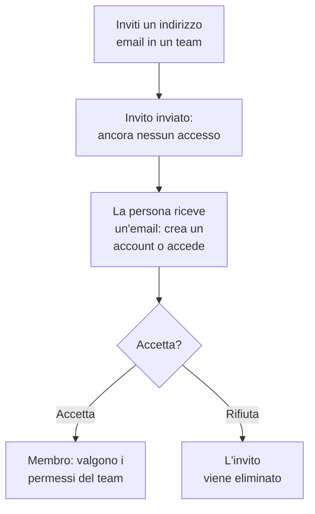

# Invitare persone

Le persone entrano in un progetto su invito. Inviti l'indirizzo email di qualcuno in un team, la persona accetta e da quel momento il suo team decide che cosa può fare. Questa pagina mostra come invitare le persone, che cosa vedono e come cambiare o togliere il loro accesso in seguito.

:::cards
- [Invitare qualcuno](#invitare-qualcuno): Un indirizzo email e un team.
- [Accettare un invito](#accettare-un-invito): Che cosa vede e fa la persona invitata.
- [Cambiare i team di qualcuno](#cambiare-i-team-di-qualcuno): Dare più accesso, o meno.
- [Rimuovere qualcuno](#rimuovere-qualcuno-dal-progetto): Che cosa porta via l'uscita dal progetto.
:::

## Come funziona un invito

- **Il team decide che cosa può fare.** Nessuno ha permessi propri: una persona può fare ciò che consentono i team di cui fa parte. Vedi [Utenti, team e autorizzazioni](/docs/permissions/index).
- **Nulla viene concesso finché non accetta.** Un invito in sospeso compare come **Invito inviato** e non dà accesso al progetto.
- **Un'accettazione vale per tutto il progetto.** Accettare un invito accetta tutti gli altri inviti che la persona ha nello stesso progetto. Un membro che aggiungi in seguito a un altro team ci entra subito, senza nulla da accettare.

## Prima di iniziare

- **Un ruolo che può invitare.** Project Owner, Project Admin o un ruolo con l'autorizzazione **Invite New Members**. Puoi invitare persone solo in un team di cui hai tu stesso le autorizzazioni, perché un invito dà loro l'accesso del team.
- **Su OneUptime Cloud, spazio nel tuo piano.** Ogni persona del progetto è una postazione sulla sua fattura, dal momento in cui viene invitata. Il piano Free ha spazio per una persona. Vedi [Fatturazione e utilizzo](/docs/configuration/billing#il-tuo-piano-e-le-postazioni).
- **Niente SCIM Push Groups.** Finché il tuo provider di identità gestisce i team del progetto tramite SCIM Push Groups, inviti e rimuovi le persone lì, non in OneUptime.

## Invitare qualcuno

:::steps
### Aprire Utenti

Vai a **Prodotti → Impostazioni → Utenti**. L'elenco **Utenti** mostra tutte le persone del progetto, i loro team e se sono entrate.

### Fare clic su Invita utente

Fai clic su **Invita utente**. Si apre la finestra **Invita nuovo utente**.

### Inserire l'indirizzo email

Scrivi il suo indirizzo in **E-mail**. Se nessun account OneUptime lo usa ancora, la finestra chiede anche un **Nome**, con cui inizia il suo nuovo account.

### Scegliere il team

**Team** parte dal team dei membri del progetto: il team che ha Project Member per tutto il progetto, oppure quello chiamato Members. Scegli un altro team per dare più accesso, o meno. **Team** resta vuoto quando il progetto non ha un team del genere, o quando tu stesso non potresti invitarvi nessuno.

### Inviare l'invito

Fai clic su **Invita**. OneUptime invia l'invito per email e apre la pagina della persona. Compare come **Invito inviato** finché non accetta.
:::

> [!TIP]
> Invita le persone nel team più ristretto che permetta loro di lavorare. Potrai aggiungerle ad altri team in seguito, e ogni team in cui entrano amplia ciò che possono fare.

## Accettare un invito

L'email di invito nomina il progetto. Il suo pulsante è **Create Your Account** per chi non ha ancora un account OneUptime, e **Sign In to OneUptime** per chi ne ha già uno. Dopo l'accesso, la persona accetta in uno di due posti:

| Dove si trova | Che cosa vede | Dove fa clic |
| --- | --- | --- |
| Ancora in nessun progetto | L'invito, sulla pagina in cui arriva dopo l'accesso | **Accept & Join**, oppure **Decline** |
| Già in un altro progetto | L'invito in sospeso sulla campanella in alto a destra, che apre **Inviti al progetto** | **Accetta**, oppure **Rifiuta** |

Accettando entra subito nel progetto, con le autorizzazioni del suo team e la configurazione delle notifiche con cui parte ogni membro: vedi [Con che cosa inizi](/docs/notifications/index#con-cosa-partite). Rifiutare elimina l'invito, quindi per entrare più tardi ne serve uno nuovo.

## Vedere chi è nel progetto

**Utenti** ha una riga per persona:

| Colonna | Che cosa mostra |
| --- | --- |
| **Utente** | Il suo nome e il suo indirizzo email. |
| **Team** | Ogni team del progetto di cui fa parte, o in cui è invitata. |
| **Stato** | **Membro** una volta entrata, con il numero degli inviti ad altri team che non ha ancora accettato. **Invito inviato** fino ad allora. |

Filtra l'elenco per **Utente**, **Stato** o **Team**. Fai clic su una riga per aprire la pagina della persona:

| Pagina | A che cosa serve |
| --- | --- |
| **Profilo** | Il suo nome, l'indirizzo email, la foto e l'ID utente. |
| **Team** | I team di cui fa parte. Qui aggiungi o rimuovi un team. |
| **Prontezza**, **Metodi di notifica**, **Regole di reperibilità** | Se può essere chiamata, e come. Visibile ai Project Owner, ai Project Admin, alla persona stessa e a chi può leggere le regole di notifica degli altri. Vedi [Prontezza e report](/docs/on-call/readiness). |
| **Campi personalizzati** | I campi personalizzati del progetto per le persone, se ne ha. |
| **Rimuovi dal progetto** | Toglierla dal progetto. |

## Cambiare i team di qualcuno

:::steps
### Aprire la sua pagina Team

In **Utenti**, fai clic sulla persona e poi su **Team**.

### Aggiungerla a un team

Fai clic su **Invita**, scegli il **Team** e fai clic su **Invita** nella finestra. Un membro entra subito nel nuovo team. Chi non è ancora entrato riceve un invito in più, e accettarne uno li accetta entrambi.

### Toglierla da un team

Fai clic su **Rimuovi** nella riga del team. Se è l'ultimo team in cui è entrata, rimuoverlo la toglie dal progetto, e la finestra lo dice prima che cambi qualcosa.
:::

Il team Owners mantiene sempre almeno un membro entrato, così un progetto non perde mai il suo ultimo proprietario.

## Rimuovere qualcuno dal progetto

In **Utenti**, apri il menu della riga della persona, **⋯**, e fai clic su **Rimuovi dal progetto**. Oppure apri la persona e scegli **Rimuovi dal progetto** nel suo menu laterale. Per rimuovere più persone insieme, seleziona le loro righe ed elimina la selezione: ognuna viene rimossa nello stesso modo.

Rimuovere qualcuno lo toglie da ogni team del progetto. Perde subito l'accesso, anche se ha una sessione aperta, viene tolto dai turni di reperibilità e dalle regole di escalation e smette di ricevere le notifiche del progetto. Il suo account OneUptime non viene eliminato, e puoi invitarlo di nuovo. [Utenti, team e autorizzazioni](/docs/permissions/index#utenti) elenca tutto ciò che l'uscita da un progetto porta con sé.

## Altri modi per entrare

- **Single sign-on.** Chi accede per la prima volta con il provider di identità del progetto entra nei team indicati dal provider. Vedi [Ruoli e team per gli utenti SSO](/docs/identity/sso#ruoli-e-team-degli-utenti-sso).
- **SCIM.** Il tuo provider di identità crea le persone e le aggiunge ai team predefiniti della connessione. Vedi [SCIM](/docs/identity/scim#come-avviene-il-provisioning-di-un-utente-di-progetto).
- **L'Admin Dashboard.** In un'installazione self-hosted, un amministratore principale può aggiungere qualcuno a un progetto e accettare l'invito per lui. Vedi [Utenti, team e autorizzazioni](/docs/permissions/index#utenti).

## Risoluzione dei problemi

:::details "This user has already been invited to this team"
La persona è già in quel team, come membro o con un invito che non ha accettato. Aprila in **Utenti** per vedere i suoi team, oppure invitala in un altro team.
:::

:::details "You have reached the user limit for the free plan"
Su OneUptime Cloud, un progetto con il piano Free ha spazio per una persona. Cambia piano, poi invita di nuovo. Vedi [Cambiare il piano](/docs/configuration/billing#cambiare-il-piano).
:::

:::details "Too many invitations were sent to this email address in the last hour"
A un indirizzo si possono inviare 10 inviti all'ora, a progetti e pagine di stato private insieme, chiunque li invii. Attendete un'ora, poi invitate di nuovo la persona.
:::

:::details L'email di invito non è arrivata, o il suo link è scaduto
L'invito non dipende dall'email. Chiedi alla persona di registrarsi con l'indirizzo invitato: OneUptime invia a quell'indirizzo un nuovo link per completare la creazione dell'account. Chi ha già un account accede e trova l'invito ad aspettarlo.
:::

:::details Invita utente dice che gli utenti sono gestiti da SCIM Push Groups
Il tuo provider di identità gestisce i team del progetto. Invita o rimuovi le persone nel provider di identità, oppure disattiva Push Groups in **Impostazioni del progetto → Sicurezza → SCIM** per gestirle qui.
:::

## Passi successivi

:::cards
- [Utenti, team e autorizzazioni](/docs/permissions/index): Decidere che cosa può fare ogni team.
- [Impostazioni del progetto](/docs/configuration/project-settings): Tutto ciò che vale per l'intero progetto.
- [Il tuo account](/docs/introduction/your-account): Accesso, profilo e i progetti di cui fai parte.
- [SCIM](/docs/identity/scim): Lasciare che il tuo provider di identità gestisca persone e team.
:::
