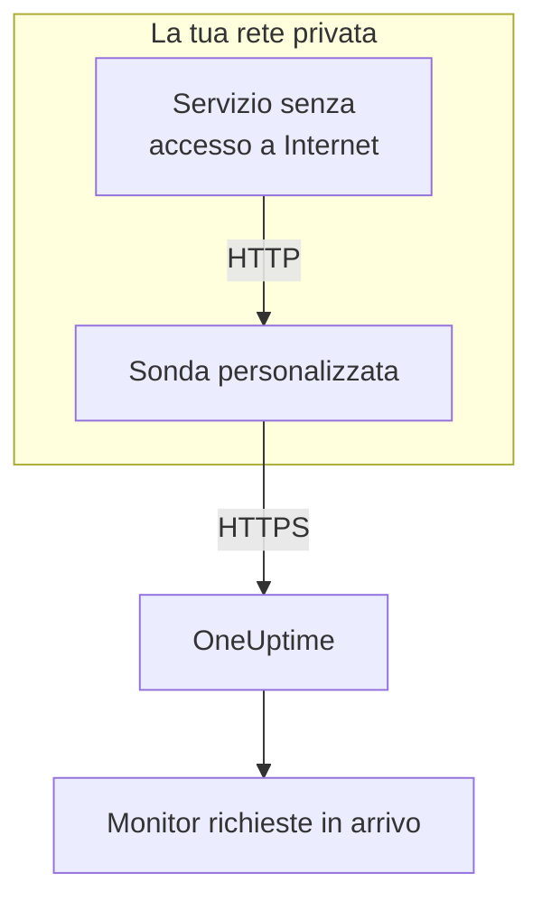

# Ingress richieste in arrivo

Un servizio senza accesso a Internet può comunque inviare heartbeat a un [monitor richieste in arrivo](/docs/monitor/incoming-request-monitor). Li invia invece a una [sonda personalizzata](/docs/probe/custom-probe) nella sua rete, e la sonda li inoltra a OneUptime.

:::cards
- [Come funziona](#come-funziona): Dal tuo servizio al monitor, passando per la sonda.
- [Attivare il listener](#attivare-il-listener): Una sola impostazione sulla sonda, per Docker, Docker Compose o Kubernetes.
- [Inviare le richieste alla sonda](#inviare-le-richieste-alla-sonda): Cambiare l'URL a cui invia il tuo servizio, e nient'altro.
- [Risoluzione dei problemi](#risoluzione-dei-problemi): Cosa registra la sonda quando una richiesta non passa.
:::

## Come funziona



1. **Il tuo servizio invia la richiesta alla sonda.** Lo stesso `GET` o `POST`, con la stessa chiave segreta, che invierebbe a OneUptime, a una porta su cui la sonda è in ascolto.
2. **La sonda risponde subito.** Risponde `200` prima di inoltrare la richiesta, così il tuo servizio non aspetta mai OneUptime.
3. **La sonda la inoltra.** Invia la richiesta a OneUptime con il metodo, le intestazioni e il corpo, e aggiunge un'intestazione `OneUptime-Probe-Id` che indica la sonda.
4. **OneUptime la legge come al solito.** I criteri del monitor vedono la richiesta come se il servizio l'avesse inviata direttamente.

Il listener gira su una porta tutta sua, separata dai controlli di salute della sonda, così puoi aprirlo alla tua rete privata senza aprire nient'altro.

## Quando usarlo

Usa il listener quando:

- I tuoi servizi girano in un segmento di rete isolato senza accesso HTTPS in uscita
- Devi mantenere tutto il traffico di monitoraggio nella tua VPC o nella tua rete on-premise
- Vuoi un unico punto di uscita, la sonda, autorizzato a raggiungere OneUptime
- Hai già distribuito una [sonda personalizzata](/docs/probe/custom-probe) e vuoi riutilizzarla per gli heartbeat in arrivo

Se i tuoi servizi raggiungono già direttamente `https://oneuptime.com` (o il tuo URL self-hosted), **non** ti serve questa funzione: chiama l'URL di heartbeat direttamente dal servizio.

## Prima di iniziare

- **Una sonda personalizzata in funzione.** Il suo **Stato** indica **Connesso**. Vedi [Sonde personalizzate](/docs/probe/custom-probe) per installarne una.
- **Un monitor richieste in arrivo.** Il suo URL di heartbeat contiene la chiave segreta che il tuo servizio invia: vedi [Monitor richieste in arrivo](/docs/monitor/incoming-request-monitor).
- **Una porta dell'host della sonda raggiungibile dai tuoi servizi.** Gli esempi usano `3875`.

## Attivare il listener

Imposta `PROBE_INGRESS_PORT` sulla porta che il listener deve usare. Qualsiasi valore maggiore di `0` lo attiva; non impostata, o a `0`, lo lascia disattivato.

:::tabs
@tab Docker
```bash
docker run --name oneuptime-probe --network host \
  -e PROBE_KEY=<probe-key> \
  -e PROBE_ID=<probe-id> \
  -e ONEUPTIME_URL=https://oneuptime.com \
  -e PROBE_INGRESS_PORT=3875 \
  -d oneuptime/probe:release
```

Senza `--network host`, pubblica la porta con `-p 3875:3875`.
@tab Docker Compose
```yaml title="docker-compose.yml"
services:
  oneuptime-probe:
    image: oneuptime/probe:release
    container_name: oneuptime-probe
    environment:
      - PROBE_KEY=<probe-key>
      - PROBE_ID=<probe-id>
      - ONEUPTIME_URL=https://oneuptime.com
      - PROBE_INGRESS_PORT=3875
    network_mode: host
    restart: always
```

Senza `network_mode: host`, pubblica la porta sotto `ports:` come `"3875:3875"`.
@tab Kubernetes
```yaml title="oneuptime-probe.yaml"
apiVersion: apps/v1
kind: Deployment
metadata:
  name: oneuptime-probe
spec:
  selector:
    matchLabels:
      app: oneuptime-probe
  template:
    metadata:
      labels:
        app: oneuptime-probe
    spec:
      containers:
        - name: oneuptime-probe
          image: oneuptime/probe:release
          env:
            - name: PROBE_KEY
              value: "<probe-key>"
            - name: PROBE_ID
              value: "<probe-id>"
            - name: ONEUPTIME_URL
              value: "https://oneuptime.com"
            - name: PROBE_INGRESS_PORT
              value: "3875"
          ports:
            - name: ingress
              containerPort: 3875
---
apiVersion: v1
kind: Service
metadata:
  name: oneuptime-probe-ingress
spec:
  selector:
    app: oneuptime-probe
  ports:
    - name: ingress
      port: 3875
      targetPort: 3875
  type: ClusterIP
```

I servizi del cluster inviano quindi a `http://oneuptime-probe-ingress.<namespace>.svc.cluster.local:3875/heartbeat/<secret-key>`.
:::

Quando il listener è attivo, il log della sonda dice `Probe ingress listener started on port 3875 (heartbeat / incoming-request endpoints)`.

## Inviare le richieste alla sonda

Il tuo servizio invia alla sonda invece che a OneUptime. Sostituisci l'URL pubblico di heartbeat:

```text
https://oneuptime.com/heartbeat/<secret-key>
```

con l'URL di ingress della sonda:

```text
http://<probe-host>:<PROBE_INGRESS_PORT>/heartbeat/<secret-key>
```

Percorso, metodo, corpo e intestazioni restano per il resto identici, quindi il codice client esistente deve cambiare solo l'URL di base. La sonda accetta anche `/incoming-request/<secret-key>`, che funziona allo stesso modo.

```bash
# GET heartbeat
curl http://probe.internal:3875/heartbeat/YOUR_SECRET_KEY

# POST heartbeat with JSON body
curl -X POST http://probe.internal:3875/heartbeat/YOUR_SECRET_KEY \
  -H "Content-Type: application/json" \
  -d '{"status": "healthy", "version": "1.2.3"}'

# Cron job
*/5 * * * * curl -s http://probe.internal:3875/heartbeat/YOUR_SECRET_KEY > /dev/null
```

## Come vengono inoltrate le richieste

| Cosa | Come la sonda lo gestisce |
| --- | --- |
| La risposta | `200` con un oggetto JSON vuoto (`{}`), inviata prima di inoltrare la richiesta. Come su OneUptime, viene inviata qualunque cosa accada dopo: anche una chiave segreta sbagliata la riceve. |
| I metodi | `POST` viene inoltrato come `POST`. `GET`, e `HEAD`, vengono inoltrati come `GET`. Gli altri metodi ricevono un `404` dalla sonda. |
| Le intestazioni | Tutte tranne quelle hop-by-hop (`Host`, `Connection`, `Content-Length`, `Transfer-Encoding`, `Keep-Alive`, `Proxy-Authenticate`, `Proxy-Authorization`, `TE`, `Trailer`, `Upgrade`) e `Content-Encoding`, perché la sonda inoltra il corpo non compresso. La sonda aggiunge `OneUptime-Probe-Id`. |
| Il corpo | Corpi JSON e di form fino a 50 MB, come quando invii direttamente a OneUptime. Come lì, qualsiasi altro corpo arriva vuoto al monitor. |
| I nuovi tentativi | Quando un inoltro fallisce, la sonda riprova fino a `PROBE_INGRESS_FORWARD_RETRY_LIMIT` volte, aspettando 2 s, poi 4 s, poi 8 s, e mai più di 15 s. Poi registra l'errore e scarta la richiesta. |
| I proxy | L'inoltro passa dal proxy della sonda quando `HTTP_PROXY_URL` o `HTTPS_PROXY_URL` è impostata. |
| Dove va | `ONEUPTIME_URL` seguito da `/incoming-request-ingest/incoming-request/<secret-key>`. |

## Variabili d'ambiente

| Variabile | Predefinito | Cosa fa |
| --- | --- | --- |
| `PROBE_INGRESS_PORT` | non impostata (disattivato) | La porta che usa il listener. Qualsiasi valore maggiore di `0` lo attiva. |
| `PROBE_INGRESS_FORWARD_TIMEOUT_MS` | `10000` | Quanto può durare ogni inoltro a OneUptime, in millisecondi. Un valore inferiore a `1000` torna al valore predefinito. |
| `PROBE_INGRESS_FORWARD_RETRY_LIMIT` | `3` | Quante volte viene ritentato un inoltro fallito. `0` disattiva i nuovi tentativi. |

Le normali variabili della sonda (`PROBE_KEY`, `PROBE_ID`, `ONEUPTIME_URL` e le variabili del proxy) valgono tutte: vedi [Sonde personalizzate](/docs/probe/custom-probe) per l'elenco completo.

## Considerazioni sulla sicurezza

- **L'endpoint è senza autenticazione per scelta**: la chiave segreta nel percorso dell'URL *è* l'autenticazione, esattamente come sull'endpoint pubblico `oneuptime.com`. Tratta la chiave segreta come una credenziale.
- **Tieni il listener nella tua rete privata.** Non deve essere raggiungibile da Internet. Usa una network policy, una regola del firewall o un servizio `ClusterIP` per limitare chi può raggiungerlo.
- **Metti TLS davanti se ti serve la cifratura nella tua rete.** Il listener parla HTTP semplice. Mettilo dietro un bilanciatore di carico interno o un ingress controller per avere TLS su quel tratto. L'inoltro dalla sonda a OneUptime usa HTTPS quando `ONEUPTIME_URL` inizia con `https://`.
- **Limita tu la dimensione del corpo se 50 MB sono troppi.** Metti davanti al listener un reverse proxy con un limite più basso.

## Risoluzione dei problemi

:::details Il log della sonda non dice mai che il listener è partito
`PROBE_INGRESS_PORT` non è impostata, vale `0` o non è un numero. Impostala su un numero di porta e riavvia la sonda. La riga di log è `Probe ingress listener started on port <port> (heartbeat / incoming-request endpoints)`.
:::

:::details La sonda registra `Probe ingress: failed to forward to <url> after N attempts`
La sonda non è riuscita a raggiungere OneUptime, nemmeno dopo i nuovi tentativi. Controlla la connettività in uscita della sonda, le impostazioni del proxy e il valore di `ONEUPTIME_URL`. Se la sonda mostra anche **Disconnesso**, vedi [Sonde personalizzate](/docs/probe/custom-probe) per trovare dove si fermano le sue richieste.
:::

:::details La sonda registra `Probe ingress: probe ID not available, forwarding without it`
La sonda non ha ancora finito di connettersi a OneUptime, quindi inoltra la richiesta senza l'intestazione `OneUptime-Probe-Id`. La richiesta raggiunge comunque il monitor.
:::

:::details Il monitor riceve le richieste, ma non attraverso la sonda
Il tuo servizio invia ancora all'URL pubblico. Verifica che invii a `http://<probe-host>:<port>/...`: un nome DNS o una voce di `/etc/hosts` che punta altrove è la causa abituale.
:::

:::details Il monitor non riceve nulla e la sonda non registra nulla
La richiesta non ha mai raggiunto la sonda. Verifica che il servizio raggiunga l'host della sonda sulla porta: una regola del firewall, una porta non pubblicata o un Service di Kubernetes che non seleziona il pod della sonda.
:::

## Prossimi passi

:::cards
- [Monitor richieste in arrivo](/docs/monitor/incoming-request-monitor): Decidere cosa conta come un heartbeat sano.
- [Sonde personalizzate](/docs/probe/custom-probe): Installare la sonda, e ogni impostazione che legge.
:::
