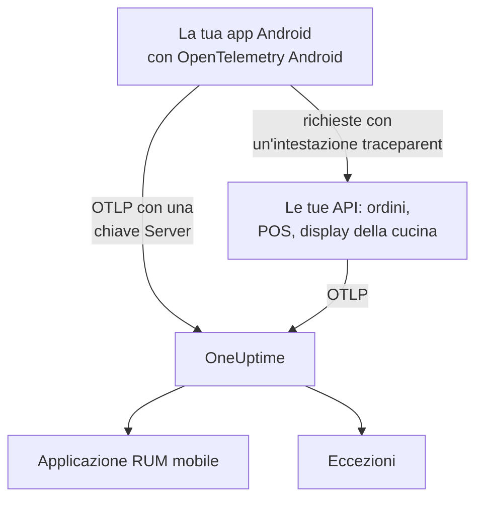

# Configurazione Android

Strumenta un'app Android nativa con OpenTelemetry Android in modo che si presenti a OneUptime come applicazione RUM mobile: i suoi crash e ANR, i frame lenti e bloccati, gli avvii dell'app, le schermate, le sessioni e le richieste di rete, tracciati fino al tuo backend.

:::cards
- [Aggiungere OpenTelemetry Android](#aggiungere-opentelemetry-android): Una dipendenza Gradle e poche righe all'avvio dell'app.
- [Cosa segnala l'agente](#cosa-segnala-lagente): Crash, ANR, frame bloccati, avvii e sessioni, e dove arriva ciascuno.
- [Tracciare le richieste fino al backend](#tracciare-le-richieste-fino-al-backend): Uno span per ogni chiamata OkHttp, e su ciascuna un `traceparent`.
- [Tracciare i propri flussi di lavoro](#tracciare-i-propri-flussi-di-lavoro): Un ordine dal menu alla cucina, un terminale di pagamento, una stampante.
- [Chioschi e altri dispositivi di proprietà](#chioschi-e-altri-dispositivi-di-proprietà): Dare un nome a ogni dispositivo, configurarlo dal tuo MDM, conservare i dati offline.
:::

## Come funziona

OpenTelemetry Android viene eseguito dentro la tua app. Invia tracce, log e metriche a OneUptime tramite OTLP con una chiave di acquisizione **Server**, e aggiunge un'intestazione W3C `traceparent` alle richieste che la tua app effettua, così gli span del tuo backend si uniscono alle tracce dell'app.



## Prima di iniziare

- Un'app Android il cui `minSdk` è 23 o superiore, compilata con `compileSdk` 34 o superiore. Con un `minSdk` inferiore a 26, attiva il [desugaring delle librerie core](https://developer.android.com/studio/write/java8-support#library-desugaring), con Android Gradle Plugin 8.3.0 o successivo e `android.useFullClasspathForDexingTransform=true` in `gradle.properties`.
- Una chiave di acquisizione **Server**, creata in **Impostazioni del progetto → Telemetria e APM → Chiavi di acquisizione** con **Crea chiave di acquisizione**. Una chiave **Browser** viene rifiutata da un'app: è verificata rispetto all'intestazione `Origin`, che un'app non invia.
- Queste impostazioni OTLP. Se ospiti OneUptime in proprio, sostituisci `https://oneuptime.com` con il tuo host.

| Impostazione | Valore |
| --- | --- |
| Endpoint OTLP | `https://oneuptime.com/otlp` |
| Intestazione | `x-oneuptime-token: YOUR_TELEMETRY_INGESTION_TOKEN` |

> [!WARNING]
> La chiave viaggia dentro la tua app, e un'app si può spacchettare: dai quindi per scontato che qualcuno la copierà. Nella pagina della chiave, imposta un **Nome del servizio fissato**, un **Requests Per Minute Limit** e una data in **Scade il**, e ruota la chiave a ogni rilascio.

## Aggiungere OpenTelemetry Android

:::steps
### Aggiungere la dipendenza

```kotlin title="app/build.gradle.kts"
dependencies {
    implementation("io.opentelemetry.android:android-agent:1.8.1")
}
```

L'agente porta con sé la strumentazione per crash, ANR, rendering lento, activity, fragment, rete e sessioni. Controlla [le sue release](https://github.com/open-telemetry/opentelemetry-android/releases) per una versione più recente.

### Avviare l'agente con l'app

```kotlin title="KioskApplication.kt"
import android.app.Application
import io.opentelemetry.android.OpenTelemetryRum
import io.opentelemetry.android.agent.OpenTelemetryRumInitializer

class KioskApplication : Application() {
    lateinit var otelRum: OpenTelemetryRum

    override fun onCreate() {
        super.onCreate()

        otelRum = OpenTelemetryRumInitializer.initialize(this) {
            httpExport {
                baseUrl = "https://oneuptime.com/otlp"
                baseHeaders = mapOf("x-oneuptime-token" to BuildConfig.ONEUPTIME_TOKEN)
            }
            resource {
                put("service.name", "kiosk-ordering")
                put("deployment.environment.name", "production")
            }
        }
    }
}
```

`baseUrl` è l'endpoint senza segnale: l'agente vi aggiunge `/v1/traces`, `/v1/logs` e `/v1/metrics`. Imposta `service.name`, altrimenti l'app prende il nome della sua etichetta nel launcher. Questo nome è l'identità dell'applicazione in OneUptime, quindi mantienilo uguale da un rilascio all'altro.

Indica la classe nell'attributo `android:name` dell'elemento `<application>` del tuo manifest. `BuildConfig.ONEUPTIME_TOKEN` sta per il punto in cui la tua build conserva la chiave; una flotta può invece riceverla dal suo MDM, come mostra [Chioschi e altri dispositivi di proprietà](#chioschi-e-altri-dispositivi-di-proprietà).

### Avviare l'app e verificare che arrivi

```bash
curl -i https://oneuptime.com/otlp/v1/validate \
  -H "x-oneuptime-token: YOUR_TELEMETRY_INGESTION_TOKEN"
```

`200` con `"valid": true` significa che la chiave è accettata. Poi avvia l'app e usala per un momento: compare in **Prodotti → Risorse → Monitoraggio degli utenti reali**, con il nome del suo `service.name`. L'agente scrive la telemetria su disco prima di inviarla, quindi il primo lotto può impiegare un minuto ad arrivare.
:::

## Cosa segnala l'agente

OpenTelemetry Android registra tutto questo da solo. Gli attributi del dispositivo che imposta, `device.model.identifier`, `device.model.name` e `device.manufacturer`, classificano l'app come applicazione RUM mobile e riempiono la sua pagina **Client**. Imposta anche `os.name`, `os.version` e un `app.installation.id` per ogni installazione, e nessun `device.id`.

| Cosa | Come lo invia l'agente | Dove compare in OneUptime |
| --- | --- | --- |
| Crash | Un evento `app.crash` con il tipo, il messaggio e lo stack trace dell'eccezione | **Eccezioni**, come non gestiti |
| ANR | Un evento `device.anr` con lo stack del thread principale, quando l'app smette di rispondere per circa 5 secondi | **Eccezioni**, come non gestiti, con il tipo `ANR` |
| Frame lenti e bloccati | Un evento `app.jank` con `app.jank.frame_count`, i frame più lenti di 16 ms (`app.jank.threshold` è `0.016`) o di 700 ms (`0.7`) | **Log**, con `@event.name:app.jank` |
| Avvii dell'app | Uno span `AppStart`, con `start.type` impostato su `cold`, `warm` o `hot` | **Tracce** |
| Schermate | Uno span per ogni fase del ciclo di vita di un'activity o di un fragment, e `app.screen.name` su ogni span e log | **Tracce** |
| Sessioni | `session.id` su ogni span e log, e gli eventi `session.start` e `session.end` | **Tracce** e **Log**, cercati con `@session.id:` |
| Cambi di rete | Un evento `network.change`, e `network.connection.type` su ogni span e log | **Log** |

Crash e ANR arrivano in **Eccezioni** come non gestiti, raggruppati per stack trace, con la sessione in cui sono avvenuti. L'agente salva un crash su disco mentre l'app muore e lo invia da lì, quindi un crash avvenuto offline arriva comunque quando l'app torna a girare con una rete.

La **Panoramica** dell'applicazione li riassume per te: **Sessioni**, **Sessioni senza crash**, **Crash**, **ANR**, **Avvii dell'app**, **Avvio a freddo (p95)** e **Frame bloccati**, e ognuno apre le eccezioni, gli span o gli eventi che conta. Finché l'app non invia avvii o frame, i loro grafici dicono cosa li attiva. Le sue **Raccomandazioni** offrono monitor per crash, ANR, avvii a freddo lenti, frame bloccati e un'app che smette di inviare dati.

Una sessione termina dopo 15 minuti in background, o dopo 4 ore. Un'app che non va mai in background, come un chiosco, mantiene una sola sessione per 4 ore, quindi traccia la visita di ogni cliente come uno span a sé, come mostra [Tracciare i propri flussi di lavoro](#tracciare-i-propri-flussi-di-lavoro).

Anche le chiamate `android.util.Log` della tua app diventano log quando aggiungi `android-log-library` e `android-log-agent` accanto ai moduli OkHttp qui sotto: il tag di ogni chiamata va in `android.log.tag`, e una chiamata con un throwable è un'eccezione in **Eccezioni**. OpenTelemetry Android non legge Logcat.

## Tracciare le richieste fino al backend

Aggiungi la strumentazione OkHttp e il plugin ByteBuddy con cui viene compilata:

```kotlin title="app/build.gradle.kts"
plugins {
    // ...the plugins your app already applies, then:
    id("net.bytebuddy.byte-buddy-gradle-plugin") version "1.18.15"
}

dependencies {
    implementation("io.opentelemetry.android:android-agent:1.8.1")
    implementation("io.opentelemetry.android.instrumentation:okhttp3-library:1.8.1-alpha")
    byteBuddy("io.opentelemetry.android.instrumentation:okhttp3-agent:1.8.1-alpha")
}
```

Il plugin strumenta la classe `OkHttpClient` stessa, quindi ogni client dell'app viene tracciato, anche quelli creati dalle librerie. Ogni richiesta diventa uno span client con il nome del suo metodo, con il suo URL, il codice di stato e la durata, e porta un'intestazione W3C `traceparent`. Un backend strumentato con [OpenTelemetry](/docs/telemetry/open-telemetry) prosegue la traccia da quell'intestazione, così l'API degli ordini, il bridge verso il POS e il servizio del display della cucina aggiungono i loro span alla stessa traccia del tocco sul chiosco.

- `HttpURLConnection` ha la stessa coppia di moduli: `httpurlconnection-library` e `httpurlconnection-agent`.
- Senza il plugin, avvolgi tu un client: `OkHttpTelemetry.builder(otelRum.openTelemetry).build().createCallFactory(client)`, da `io.opentelemetry.instrumentation:opentelemetry-okhttp-3.0`.
- Uno span aperto nel tuo codice, come nella sezione successiva, è il padre delle richieste fatte al suo interno.

## Tracciare i propri flussi di lavoro

Ottieni un tracer dall'agente e crea uno span per l'ordine di un cliente, con uno span figlio per ciascuna delle sue fasi. Ogni fase ha così la propria durata e i propri errori, e l'ordine dice come è finito:

```kotlin title="OrderTrace.kt"
import io.opentelemetry.api.trace.Span
import io.opentelemetry.api.trace.StatusCode
import io.opentelemetry.api.trace.Tracer
import io.opentelemetry.context.Context

class OrderTrace(private val tracer: Tracer) {
    // order.session: from the first tap to the order reaching the kitchen.
    private val order: Span = tracer.spanBuilder("order.session").startSpan()
    private val parent: Context = Context.current().with(order)

    // One step: menu.browse, cart.customize, payment.process, pos.inject.
    fun <T> step(name: String, block: (Span) -> T): T {
        val span = tracer.spanBuilder(name).setParent(parent).startSpan()
        return try {
            span.makeCurrent().use { block(span) }
        } catch (error: Throwable) {
            span.recordException(error)
            span.setStatus(StatusCode.ERROR)
            throw error
        } finally {
            span.end()
        }
    }

    fun complete() = finish("completed")

    fun abandon(reason: String) {
        order.setAttribute("order.abandon_reason", reason)
        finish("abandoned")
    }

    private fun finish(outcome: String) {
        order.setAttribute("order.outcome", outcome)
        order.end()
    }
}
```

```kotlin title="CheckoutFlow.kt"
val order = OrderTrace(otelRum.openTelemetry.getTracer("kiosk.ordering"))

order.step("cart.customize") { span ->
    span.setAttribute("cart.items", cart.size.toLong())
}
order.step("payment.process") { terminal.charge(cart.total) }
order.step("pos.inject") { posApi.submit(cart) } // its OkHttp span is a child
order.complete()
```

Avvolgi allo stesso modo ogni chiamata all'SDK di un terminale di pagamento, di una stampante, di uno scanner o di un lettore NFC, e indica di quale dispositivo si trattava, così un dispositivo lento o guasto è uno span lento o in errore:

```kotlin title="ReceiptPrinter.kt"
order.step("printer.print") { span ->
    span.setAttribute("peripheral.type", "printer")
    span.setAttribute("peripheral.model", printer.model)
    span.setAttribute("peripheral.connection", "usb")
    printer.print(receipt, timeoutMillis = 10_000)
}
```

I nomi degli attributi li scegli tu: mantienili uguali in ogni app, così un solo filtro trova tutte le stampanti. Dai un timeout a ogni chiamata, perché uno span termina solo quando la sua chiamata ritorna. Una fase che copre più schermate, come la consultazione del menu, è uno span che avvii quando la schermata si apre e termini quando si chiude, con lo stesso padre. Per un fatto senza durata, come una stampante che resta senza carta, invia un evento: `otelRum.emitEvent("printer.paper_low")`.

In **Tracce**, filtra per il nome di una fase per vedere quanto dura e quanto spesso fallisce, e per `@order.outcome:abandoned` per trovare gli ordini che non sono mai stati completati.

## Chioschi e altri dispositivi di proprietà

### Dare un nome a ogni dispositivo

OneUptime archivia un'app mobile per applicazione, mai per dispositivo, quindi un'app su migliaia di telefoni non elenca mai i telefoni dei suoi utenti. Per i dispositivi di tua proprietà, dai un nome a ciascuno in `host.name`. Ogni dispositivo compare allora in **Inventario** come host, accanto alle tue altre macchine, con la marca, il modello e la versione del sistema operativo che l'agente segnala, ciò che aggiungi qui sotto e quando è stato visto l'ultima volta:

```kotlin title="KioskApplication.kt"
resource {
    put("service.name", "kiosk-ordering")
    put("host.name", deviceName)
    put("host.serial_number", serialNumber)
    put("device.type", "kiosk")
    put("device.location", "Store 0412")
}
```

La telemetria dell'app resta con la sua applicazione RUM, e il dispositivo non diventa un host in **Host**: un'app non invia metriche di host, quindi non ci sarebbe nulla da mostrare lì. La pagina del dispositivo in **Inventario** mostra i suoi log, le sue tracce e le sue eccezioni, e `@resource.host.name:` li trova in **Tracce** e **Log**. Un dispositivo che non invia nulla per 30 giorni esce da **Inventario**.

### Configurare la flotta dal tuo MDM

Un'app può leggere le configurazioni gestite di Android, che ogni servizio di gestione dei dispositivi invia ai suoi dispositivi. Leggi da lì la chiave e il nome del dispositivo, invece di incorporarli nell'app:

```kotlin title="KioskApplication.kt"
import android.content.RestrictionsManager

val restrictions = (getSystemService(RESTRICTIONS_SERVICE) as RestrictionsManager)
    .applicationRestrictions
val token = restrictions.getString("oneuptime_token").orEmpty()
val deviceName = restrictions.getString("device_name") ?: android.os.Build.MODEL
val serialNumber = restrictions.getString("device_serial").orEmpty()
```

Poi passa `token` a `baseHeaders` al posto di `BuildConfig.ONEUPTIME_TOKEN`, e `deviceName` e `serialNumber` alla risorsa qui sopra. In Esper, incolla la configurazione qui sotto in **Managed Configuration** dell'app, in un blueprint. Esper compila i segnaposto su ogni dispositivo, con Esper Agent 8.00.0764 o successivo:

```json title="Managed configuration"
{
  "oneuptime_token": "YOUR_TELEMETRY_INGESTION_TOKEN",
  "device_name": "${esper.deviceName}",
  "device_serial": "${esper.serialNumber}"
}
```

Dopo una modifica, esegui un Converge dei dispositivi, così leggono i nuovi valori. Dichiara le stesse chiavi in un `app_restrictions.xml` se il tuo MDM richiede uno schema. Esper rifiuta un APK senza firma v1, quindi firma il rilascio con lo schema v1 oltre che con v2 o v3.

### Importare la flotta da Esper

Collega il tuo tenant Esper all'inventario, e ogni dispositivo registrato da Esper compare nell'elenco, compresi i dispositivi la cui app non è mai partita, con ciò che solo Esper sa: il suo gruppo, la versione di Android, il livello patch di sicurezza, il numero di serie, la batteria, l'archiviazione, le app installate e l'ultimo contatto. Un dispositivo che smette di contattare Esper risulta offline, con il tempo trascorso dal suo ultimo contatto. Vedi [Importare dispositivi da Esper](/docs/inventory/overview#importare-dispositivi-da-esper).

Un dispositivo a cui la sua app dà un nome come sopra è un unico elemento con ciò che l'app invia: `host.name` è il suo nome in Esper. OneUptime trova l'elemento di un dispositivo per `host.name`, poi per `host.serial_number`, quindi dai a ogni dispositivo lo stesso nome e lo stesso numero di serie in ogni app che invia dati da esso, e nelle impostazioni `device_name` e `device_serial` dell'Agent Android.

### Conservare ciò che viene registrato offline

L'agente scrive ogni span, log e metrica su disco prima di inviarli. Mentre la rete è assente li tiene lì, e li invia quando torna, fino a 18 ore dopo. Conserva 10 MB; aumenta questo valore per un dispositivo che è spesso offline:

```kotlin title="KioskApplication.kt"
diskBuffering {
    maxCacheSize = 50 * 1024 * 1024
}
```

## Risoluzione dei problemi

:::details L'app compare in Servizi invece che in Monitoraggio degli utenti reali
OpenTelemetry Android imposta `device.model.identifier` da sé, quindi l'app è stata configurata con un altro SDK, oppure la sua risorsa è stata sostituita con `resource(Resource)`, che scarta gli attributi propri dell'agente. Usa il blocco `resource { }`, che vi si aggiunge. Il servizio già creato non diventa un'applicazione RUM, quindi eliminalo in **Prodotti → Servizi** quando arriva la telemetria RUM.
:::

:::details Non arriva nulla, o la chiave viene rifiutata
Esegui la verifica della chiave descritta in [Aggiungere OpenTelemetry Android](#aggiungere-opentelemetry-android). Un `401` significa che la chiave è sconosciuta, revocata, disattivata o scaduta. Una chiave **Browser** viene rifiutata da un'app: usa una chiave **Server**. Verifica che `baseUrl` finisca con `/otlp`, senza `/v1/traces`: l'agente aggiunge il percorso da sé.
:::

:::details Un crash o un ANR non è in Eccezioni
Un crash viene salvato mentre l'app muore, e un ANR quando il thread principale è bloccato da circa 5 secondi. Entrambi attendono su disco finché il dispositivo non può inviarli, quindi ricontrolla dopo che l'app ha girato per un minuto con una rete. Avvia l'agente all'inizio dell'`onCreate` della tua `Application`, prima di qualsiasi cosa possa andare in crash, così il suo gestore dei crash è pronto per primo.
:::

:::details Manca un dispositivo in Inventario
Viene elencato solo un dispositivo la cui app imposta `host.name`. Controlla il valore negli attributi di risorsa di uno span: un valore vuoto non dà il nome ad alcun dispositivo, e due dispositivi con lo stesso nome sono una sola riga.
:::

## Passaggi successivi

:::cards
- [Configurazione mobile](/docs/rum/mobile-setup): iOS, React Native e le altre piattaforme.
- [Eccezioni](/docs/telemetry/exceptions): Smistare i crash e gli ANR che la tua app segnala.
- [Esploratore tracce](/docs/telemetry/traces-explorer): Seguire un ordine dal chiosco alla cucina.
- [Gestire le applicazioni](/docs/rum/applications): Nomi, etichette, proprietari e conservazione.
:::
