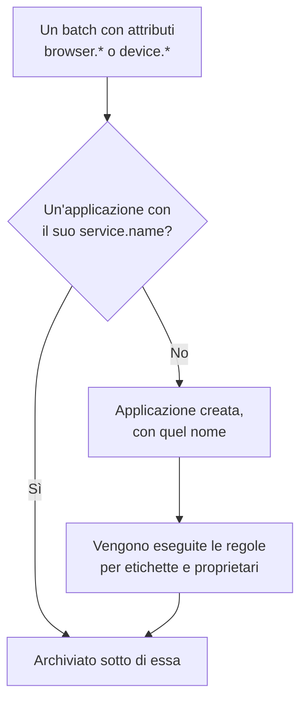

# Gestire le applicazioni

OneUptime crea un'applicazione RUM la prima volta che arriva la telemetria della tua app. Questa pagina copre ciò che gestisci da quel momento: il nome dell'applicazione, le sue etichette e i suoi proprietari, per quanto tempo vengono conservati i suoi dati, l'archiviazione, chi può vederla e gli avvisi.

:::cards
- [Come viene creata un'applicazione](#come-viene-creata-unapplicazione): Riconosciuta dal suo `service.name` e creata con il suo primo batch.
- [Etichette](#etichette): Raggruppa le applicazioni e decidi chi può accedervi.
- [Conservazione](#conservazione): Per quanto tempo vengono conservate telemetria e registrazioni.
- [Autorizzazioni](#autorizzazioni): Chi può vedere le applicazioni e chi può guardare le registrazioni.
:::

## Come viene creata un'applicazione

Non devi creare un'applicazione RUM. Quando arriva un batch di telemetria con attributi del browser o del dispositivo e un `service.name`, OneUptime lo archivia sotto l'applicazione con quel `service.name`, e crea l'applicazione se il progetto non ne ha una.



- Il `service.name` è l'identità dell'applicazione e viene confrontato senza distinguere maiuscole e minuscole: `Storefront-Web` e `storefront-web` sono un'unica applicazione.
- Un nuovo `service.name` avvia una nuova applicazione. Quella vecchia conserva la sua cronologia e passa a **Disconnesso**, quella nuova parte vuota, e le due non vengono mai unite.
- Usa un `service.name` per app, non uno per ambiente. Distingui gli ambienti con un'etichetta come `oneuptime.label.env=production`, così condividono un'applicazione e una cronologia.

### Rinominare un'applicazione

Il **Nome visualizzato** all'inizio è il `service.name`. Per cambiarlo, apri la pagina **Impostazioni** dell'applicazione e fai clic su **Modifica dettagli** nella scheda **Dettagli dell'applicazione**, dove modifichi anche la sua descrizione e le sue etichette. La telemetria viene associata tramite il **Nome dell'app (service.name)**, che la scheda mostra e che non cambia mai, quindi rinominare è sicuro.

### Aggiungere un'applicazione manualmente

Crea un'applicazione manualmente quando vuoi che le sue etichette, i suoi proprietari o la sua policy di riproduzione siano pronti prima che arrivi il primo visitatore.

:::steps
#### Aprire l'elenco delle applicazioni

Vai a **Prodotti → Risorse → Monitoraggio degli utenti reali** e fai clic su **Crea: Applicazione RUM**.

#### Inserire il nome dell'app

Compila **Nome dell'app (service.name)** con il `service.name` che la tua app invierà, esattamente come lo invia.

#### Assegnare un nome e salvare

L'applicazione prende il nome della sua app, proprio come una scoperta. Per mostrare un nome diverso, apri **Altri campi** e inserisci un **Nome visualizzato**; lì si trovano anche la descrizione e le etichette. Poi salva il modulo.
:::

Si apre quindi da sola la sua guida di configurazione, con il nome dell'app come `service.name` dello snippet. Il suo ultimo passaggio, **Attendi che si connetta**, indica quando arrivano i primi dati.

Se il progetto ha già un'applicazione con quel `service.name`, scoperta, aggiunta in precedenza o archiviata, il modulo lo segnala invece di crearne una seconda.

## Stato della connessione

Un'applicazione mostra **Connesso** mentre arriva telemetria e **Disconnesso** dopo 15 minuti senza. Contano sia la telemetria OpenTelemetry sia il traffico della riproduzione delle sessioni.

**Visto l'ultima volta** si aggiorna ogni pochi minuti anziché a ogni batch, quindi può restare indietro fino a circa cinque minuti rispetto al traffico reale, e i 15 minuti lasciano margine per questo. Il tempo in cui OneUptime stesso era inattivo o stava smaltendo la sua coda di acquisizione non conta.

**Disconnesso** di per sé non è un errore: uno strumento interno senza visitatori di notte è davvero disconnesso. Se ci sono persone che usano l'app, consulta [Risoluzione dei problemi RUM](/docs/rum/troubleshooting).

## Etichette

Le etichette raggruppano le applicazioni in elenchi e filtri. Decidono anche a cosa può accedere un membro limitato ad alcune etichette: quel membro vede solo le applicazioni che portano una di quelle etichette. Un'applicazione ottiene le sue etichette in tre modi:

| Come | Dove |
| --- | --- |
| A mano | Nel modulo di creazione, sotto **Altri campi**, o in seguito con **Modifica dettagli** nella scheda **Dettagli dell'applicazione** della pagina **Impostazioni** dell'applicazione. Per più applicazioni insieme, selezionale nell'elenco e scegli **Add Labels** in **Azioni di massa**. |
| Dalla telemetria | Un attributo di risorsa chiamato `oneuptime.label.<name>` aggiunge l'etichetta `<name>:<value>`, come mostrato sotto. |
| Da una regola per le etichette | Una regola aggiunge etichette a ogni nuova applicazione che corrisponde. Vedi [Regole per le etichette e regole per i proprietari](#regole-per-le-etichette-e-regole-per-i-proprietari). |

Imposta gli attributi sulla stessa risorsa di `service.name`, per esempio nel file `src/telemetry.ts` della [Configurazione browser](/docs/rum/browser-setup):

```ts
const resource = defaultResource().merge(
  resourceFromAttributes({
    [ATTR_SERVICE_NAME]: "storefront-web",
    "oneuptime.label.team": "payments",
    "oneuptime.label.env": "production",
  }),
);
```

Questo aggiunge le etichette `team:payments` e `env:production`, e le crea nel progetto se non esistono. Scrivere il nome dell'attributo nell'etichetta tiene separati `oneuptime.label.team=prod` e `oneuptime.label.env=prod`. Un'etichetta più lunga di 100 caratteri viene troncata a 100, e un valore vuoto o che non è una stringa non aggiunge nulla.

## Regole per le etichette e regole per i proprietari

Una regola aggiunge etichette o proprietari a ogni nuova applicazione che corrisponde. Apri **Monitoraggio degli utenti reali → Impostazioni → Regole etichette**, oppure **Regole del proprietario**, e crea la regola in due passaggi:

1. In **Corrispondenza**, **Tutte le applicazioni RUM**, da cui parte una nuova regola, corrisponde a tutte le applicazioni. Per restringerla, scegli **Solo le applicazioni RUM che soddisfano le condizioni** e aggiungi condizioni su **Etichette dell'applicazione** (ha almeno una, tutte o nessuna delle etichette che scegli), **Nome dell'applicazione** o **Descrizione dell'applicazione** (è uguale a, contiene, inizia con, termina con o corrisponde a un pattern).
2. In **Etichette**, o **Proprietari** per una regola per i proprietari, scegli cosa aggiunge la regola. Una nuova regola deve aggiungere almeno un'etichetta o un proprietario. Il **Nome** si compila a partire da ciò che scegli, come _Add team:payments_ o _Add Payments as owners_, finché non ne scrivi uno tuo. La **Descrizione**, e **Notifica ai proprietari** in una regola per i proprietari, si trovano sotto **Altri campi**.

Le regole vengono eseguite quando viene creata un'applicazione, comprese quelle scoperte. Per applicare una regola alle applicazioni che hai già, apri il menu **⋯** della sua riga e scegli **Run Now**: vedi [Eseguire le regole sulle risorse esistenti](/docs/configuration/run-rules-now). Una regola a cui una modifica ha lasciato niente da aggiungere è contrassegnata da **Non aggiunge nulla** nell'elenco. [Regole per etichette e proprietari](/docs/configuration/label-and-owner-rules) copre i moduli completi.

### Proprietari

I proprietari sono le persone e i team responsabili di un'applicazione. Le regole per i proprietari li aggiungono alle nuove applicazioni. Per aggiungerli o rimuoverli a mano, seleziona le applicazioni nell'elenco e scegli **Add Owner** o **Remove Owner** in **Azioni di massa**; l'API li aggiunge tramite `/rum-application-owner-user` e `/rum-application-owner-team`. Con **Notifica ai proprietari** attivo, che è il valore predefinito, ogni proprietario aggiunto da una regola viene avvisato. Disattivalo prima di eseguire una regola su molte applicazioni se nessuno deve essere avvisato.

## Conservazione

La telemetria di un'applicazione e le sue registrazioni vengono conservate per tempi diversi:

| Dati | Conservati per | Si imposta in |
| --- | --- | --- |
| Log, metriche, tracce e profili | La conservazione del progetto, a meno che l'applicazione non la sostituisca | La pagina **Impostazioni** dell'applicazione |
| Registrazioni della riproduzione delle sessioni | 7 giorni per impostazione predefinita, oppure 1, 14, 30 o 90 giorni | **Replay Policy**, con **Edit Policy → Limits** |

### Conservazione della telemetria

Per impostazione predefinita, la telemetria di un'applicazione viene conservata per la durata di conservazione del progetto, impostata in **Impostazioni del progetto → Telemetria e APM → Conservazione dei dati**. Due schede della pagina **Impostazioni** dell'applicazione la sostituiscono:

- **Conservazione dei dati di telemetria** contiene **Conserva i dati di telemetria per (giorni)**, un valore per tutta la telemetria dell'applicazione. Lascialo vuoto per usare la conservazione del progetto.
- **Conservazione per tipo di telemetria** contiene un valore predefinito per log, tracce, metriche e profili, e per i log per gravità e le tracce per stato. Un valore lasciato vuoto ricade sul valore dell'applicazione e poi su quello del progetto.

Le sostituzioni della conservazione fanno parte dell'[Edizione Enterprise](/docs/self-hosted/enterprise), e del piano Scale e superiori su OneUptime Cloud. Senza di esse, le schede mostrano cosa aggiunge il piano, e l'applicazione mantiene la conservazione del progetto.

Su un piano Cloud inferiore, una sostituzione lasciata da una prova continua ad applicarsi alla nuova telemetria. La pagina **Impostazioni** la mostra in una scheda **Sostituzione della conservazione** con un pulsante **Rimuovi sostituzione**, che funziona su ogni piano: da quel momento l'applicazione mantiene la conservazione del progetto, e ciò che è già archiviato mantiene la conservazione con cui è stato archiviato. Impostare di nuovo una sostituzione richiede il piano Scale.

### Conservazione della riproduzione delle sessioni

Le registrazioni hanno una conservazione propria, impostata nella pagina **Replay Policy** dell'applicazione con **Edit Policy → Limits**: 7 giorni per impostazione predefinita, oppure 1, 14, 30 o 90 giorni. È breve di proposito, perché una registrazione è molto più sensibile, e molto più grande, di uno span. La scheda **Session Replay Retention** della pagina **Impostazioni** la mostra (_Session replays are kept for 7 days._), e il suo pulsante **Modifica in Replay Policy** apre la policy.

Una conservazione della telemetria più lunga non conserva le registrazioni più a lungo. I conteggi, i segnali e il dispositivo di una sessione scadono con le sue immagini; solo i log, gli span e le eccezioni della sessione seguono la conservazione della telemetria. Vedi [Conservazione ed eliminazione](/docs/telemetry/session-replay#conservazione-ed-eliminazione).

> [!TIP]
> Il RUM è spesso la telemetria più voluminosa di un progetto, perché cresce con i tuoi utenti e non con i tuoi server. Una conservazione più breve qui, e una più lunga sui tuoi servizi di backend, è una configurazione comune.

## Archiviazione ed eliminazione

**Archivia** nasconde un'applicazione da **Tutte le applicazioni** mentre continua a raccogliere telemetria. Archivia un'applicazione che non osservi più ma di cui vuoi conservare la cronologia.

- Fai clic su **Archivia** nella pagina **Impostazioni** dell'applicazione, oppure seleziona più applicazioni nell'elenco e archiviale insieme.
- Le applicazioni archiviate si trovano in **Monitoraggio degli utenti reali → Avanzato → Archiviato**. **Avanzato** è inizialmente compresso nel menu laterale: fai clic su di esso per mostrare **Archiviato**. Usa **Annulla archiviazione** lì su un'applicazione, o su più applicazioni insieme.

**Elimina applicazione**, nella sezione **Avanzato** del menu laterale dell'applicazione, elimina l'applicazione in modo definitivo. Se l'app invia ancora telemetria, il suo batch successivo ricrea l'applicazione, senza nessuna delle sue impostazioni, quindi interrompi prima la strumentazione.

Per eliminare i dati di una persona anziché un'intera applicazione, presenta una richiesta di cancellazione: vedi [Cancellare le sessioni](/docs/telemetry/session-replay#cancellare-le-sessioni).

## Autorizzazioni

Chiunque abbia il ruolo Viewer del progetto può vedere le applicazioni RUM e la loro telemetria. La riproduzione delle sessioni è esclusa da quel ruolo di proposito: elencare le registrazioni, guardarne una e leggere chi l'ha guardata sono autorizzazioni separate. I proprietari e gli amministratori del progetto le hanno tutte. I selettori delle autorizzazioni mostrano ogni autorizzazione con il suo titolo, qui in corsivo.

| Autorizzazione | Consente a un membro di |
| --- | --- |
| `ReadRumApplication` (_Read RUM Application_) | Vedere le applicazioni e le loro pagine di telemetria. |
| `CreateRumApplication`, `EditRumApplication`, `DeleteRumApplication` | Aggiungere, modificare ed eliminare applicazioni. |
| `ReadRumSessionReplay` (_List Session Replays_) | Elencare le sessioni registrate e i loro dettagli, senza riprodurle né sapere chi era l'utente. |
| `ReadRumSessionReplayPayload` (_Watch Session Replays_) | Riprodurre le registrazioni e leggere il riferimento e gli attributi dell'utente identificato. |
| `ReadRumSessionReplayAudit` (_Read Session Replay Audit_) | Leggere il **Replay Access Log**: chi ha guardato quale registrazione. |
| `DeleteRumSessionReplay` (_Delete Session Replays_) | Eliminare le registrazioni. |
| `CreateRumSessionErasureRequest`, `ReadRumSessionErasureRequest` | Presentare richieste di cancellazione e seguirle. |
| `ReadRumApplicationLabelRule`, `ReadRumApplicationOwnerRule` (e i loro Create, Edit e Delete) | Gestire le regole per le etichette e le regole per i proprietari. |
| `ReadRumApplicationOwnerUser`, `ReadRumApplicationOwnerTeam` (e i loro Create, Edit e Delete) | Aggiungere e rimuovere proprietari tramite l'API. |

Una suddivisione utile: dai a un tecnico del supporto `ReadRumApplication` e `ReadRumSessionReplay`. Potrà vedere quali sessioni hanno avuto errori senza guardare lo schermo di nessuno né sapere chi era l'utente. Dai `ReadRumSessionReplayPayload` solo alle persone che ne hanno bisogno; i membri con `ReadRumSessionReplayAudit` vedranno allora ogni riproduzione nella pagina **Replay Access Log** dell'applicazione. [Chi può guardare una registrazione](/docs/telemetry/session-replay#chi-può-guardare-una-registrazione) mostra cosa sblocca ogni autorizzazione nell'elenco delle sessioni e nel lettore.

## Avvisi sui dati RUM

La telemetria RUM è fatta di normali log, metriche e tracce, quindi non esiste un monitor RUM separato: i monitor abituali funzionano con essa. Il modo più rapido per iniziare è la pagina **Recommendations** dell'applicazione, che offre monitor già limitati all'applicazione:

| Gruppo | Raccomandazioni |
| --- | --- |
| Core Web Vitals | Poor Largest Contentful Paint, Poor Interaction to Next Paint, Poor Cumulative Layout Shift, Slow First Contentful Paint e Slow Time to First Byte. Vedi [Core Web Vitals](/docs/rum/web-vitals). |
| Errori | Failed User Operations e Unhandled Browser Exceptions. |
| Riproduzione delle sessioni | I quattro [avvisi sul budget di archiviazione](/docs/telemetry/session-replay#avvisi-sul-budget-di-archiviazione), che avvisano prima che si esauriscano il limite giornaliero del progetto o il budget mensile dell'applicazione. Vengono offerti non appena l'applicazione ha registrato una riproduzione, e la coppia mensile quando ha anche un budget mensile. |

Per creare il tuo monitor, scegli quello che legge il segnale:

- [Monitor metriche](/docs/monitor/metrics-monitor): una Core Web Vital, o qualsiasi metrica inviata dalla tua app.
- [Monitor tracce](/docs/monitor/traces-monitor): il tasso di errori o la latenza lato client.
- [Monitor log](/docs/monitor/logs-monitor): un pattern nei log del browser.
- [Monitor eccezioni](/docs/monitor/exceptions-monitor): eccezioni lato client nuove o in forte aumento.

Limita all'applicazione il monitor che crei, così che un servizio di backend con una firma simile non lo faccia scattare.

## Passaggi successivi

:::cards
- [Riproduzione delle sessioni](/docs/telemetry/session-replay): Registra ciò che hanno visto gli utenti, con policy e conservazione proprie.
- [Regole per etichette e proprietari](/docs/configuration/label-and-owner-rules): I due moduli delle regole, passo dopo passo.
- [Eseguire le regole sulle risorse esistenti](/docs/configuration/run-rules-now): Applica una nuova regola alle applicazioni che hai già.
- [Risoluzione dei problemi RUM](/docs/rum/troubleshooting): Quando un'applicazione manca, è vuota o risulta Disconnesso.
:::
