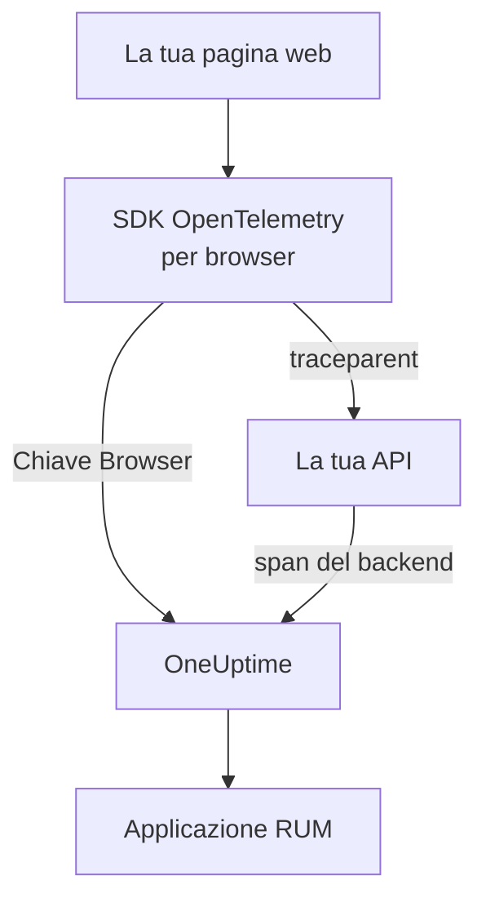

# Configurazione browser

Strumenta un'app web con l'SDK OpenTelemetry per browser in modo che si presenti a OneUptime come applicazione RUM. Caricamenti di pagina e richieste arrivano come tracce, e la stessa configurazione porta anche errori, log, metriche e Core Web Vitals.

:::cards
- [Configurazione](#configurazione): Sei passaggi da una chiave Browser al tuo primo caricamento di pagina.
- [Collegare il backend](#collegare-le-tracce-di-backend): Unire gli span del browser alle tracce di backend che avviano.
- [Segnalare gli errori](#segnalare-gli-errori-non-gestiti): Inviare gli errori non gestiti alla vista Eccezioni.
- [Risoluzione dei problemi](#risoluzione-dei-problemi): Cosa controllare quando non arriva nulla.
:::

## Come funziona

L'SDK viene eseguito nei browser dei tuoi visitatori. Registra uno span per ogni caricamento di pagina e ogni richiesta, e li esporta direttamente a OneUptime con una chiave di acquisizione **Browser**, senza collector o proxy tuoi nel mezzo.



## Prima di iniziare

- Un'app web di cui puoi modificare e ridistribuire il codice, con le dipendenze installate tramite npm.
- Le origini da cui vengono servite le tue pagine, per esempio `https://app.example.com`. Una chiave Browser accetta richieste solo dalle origini che vi elenchi.
- Un ruolo che può creare chiavi di acquisizione: possono farlo i proprietari e gli amministratori del progetto, e chiunque abbia il permesso **Create Telemetry Ingestion Key**.

## Configurazione

:::steps
### Creare una chiave di acquisizione Browser

1. Vai a **Prodotti → Impostazioni del progetto**.
2. Nel menu laterale, apri **Telemetria e APM** e seleziona **Chiavi di acquisizione**.
3. Fai clic su **Crea chiave di ingestione** e scegli **Browser** come **Tipo di chiave**.
4. Nel passaggio **Impostazioni del browser**, elenca le tue origini in **Allowed Origins** come array JSON, per esempio `["https://app.example.com"]`, poi crea la chiave. Nel piano gratuito di OneUptime Cloud, un ultimo passaggio **Fatturazione** mostra prima il prezzo della telemetria.


La nuova chiave si apre nella sua pagina. Copia la sua **Chiave segreta**: è il token che l'SDK invia come `x-oneuptime-token`.


### Installare i pacchetti

```bash
npm install @opentelemetry/api \
  @opentelemetry/sdk-trace-web \
  @opentelemetry/resources \
  @opentelemetry/semantic-conventions \
  @opentelemetry/opentelemetry-browser-detector \
  @opentelemetry/exporter-trace-otlp-http \
  @opentelemetry/context-zone \
  @opentelemetry/instrumentation \
  @opentelemetry/instrumentation-document-load \
  @opentelemetry/instrumentation-fetch \
  @opentelemetry/instrumentation-xml-http-request
```

### Creare il file di telemetria

Crea `src/telemetry.ts`. `browserDetector` aggiunge gli attributi `browser.*` che classificano la telemetria come RUM, e `service.name` dà il nome all'applicazione.

```ts title="src/telemetry.ts"
import {
  WebTracerProvider,
  BatchSpanProcessor,
} from "@opentelemetry/sdk-trace-web";
import { OTLPTraceExporter } from "@opentelemetry/exporter-trace-otlp-http";
import { ZoneContextManager } from "@opentelemetry/context-zone";
import { registerInstrumentations } from "@opentelemetry/instrumentation";
import { DocumentLoadInstrumentation } from "@opentelemetry/instrumentation-document-load";
import { FetchInstrumentation } from "@opentelemetry/instrumentation-fetch";
import { XMLHttpRequestInstrumentation } from "@opentelemetry/instrumentation-xml-http-request";
import {
  defaultResource,
  detectResources,
  resourceFromAttributes,
} from "@opentelemetry/resources";
import { browserDetector } from "@opentelemetry/opentelemetry-browser-detector";
import { ATTR_SERVICE_NAME } from "@opentelemetry/semantic-conventions";

const ONEUPTIME_URL = "https://oneuptime.com";
// Public: it ships in your page. It must be a Browser ingestion key.
const ONEUPTIME_TOKEN = "YOUR_TELEMETRY_INGESTION_TOKEN";

/*
 * browserDetector supplies the browser.* attributes. Without them this
 * telemetry is classified as a backend Service, not a RUM application.
 * The attributes set last win, so service.name here overrides the
 * "unknown_service" that defaultResource() provides.
 */
const resource = defaultResource()
  .merge(detectResources({ detectors: [browserDetector] }))
  .merge(
    resourceFromAttributes({
      [ATTR_SERVICE_NAME]: "storefront-web",
    }),
  );

const provider = new WebTracerProvider({
  resource: resource,
  spanProcessors: [
    new BatchSpanProcessor(
      new OTLPTraceExporter({
        url: `${ONEUPTIME_URL}/otlp/v1/traces`,
        headers: { "x-oneuptime-token": ONEUPTIME_TOKEN },
      }),
    ),
  ],
});

provider.register({
  contextManager: new ZoneContextManager(),
});

registerInstrumentations({
  instrumentations: [
    new DocumentLoadInstrumentation(),
    new FetchInstrumentation({
      // See "Linking to your backend traces" before widening this.
      propagateTraceHeaderCorsUrls: [/^https:\/\/api\.example\.com/],
    }),
    new XMLHttpRequestInstrumentation({
      propagateTraceHeaderCorsUrls: [/^https:\/\/api\.example\.com/],
    }),
  ],
});
```

### Importarlo per primo

Rendilo il primo import della tua app. Le strumentazioni modificano `fetch` e `XMLHttpRequest`, e una richiesta fatta prima della modifica non viene tracciata.

```ts
// src/index.tsx (React), src/main.ts (Vue / Angular), etc.
import "./telemetry";
import React from "react";
// ... the rest of your app
```

### Verificare la chiave

Chiedi a OneUptime se accetta la chiave prima di cercare altrove:

```bash
curl -i https://oneuptime.com/otlp/v1/validate \
  -H "x-oneuptime-token: YOUR_TELEMETRY_INGESTION_TOKEN"
```

`200` con `"valid": true` significa che la chiave è accettata; per una chiave Browser, il messaggio aggiunge che funziona solo da un browser e da una delle sue origini consentite. `401` significa che la chiave è sconosciuta, revocata, disattivata o scaduta.

### Caricare una pagina

Apri il tuo sito. Entro un minuto l'applicazione compare in **Prodotti → Risorse → Monitoraggio degli utenti reali**, con il nome del suo `service.name`.
:::

## Cosa consente una chiave Browser

Tutto ciò che è nello snippet arriva ai tuoi visitatori, quindi chiunque può copiare il token dalla tua pagina. Una chiave Browser limita ciò che una copia può fare:

| Impostazione | Cosa fa |
| --- | --- |
| **Allowed Origins** | Le richieste sono accettate solo da queste origini, ciascuna con il suo schema e l'eventuale porta. Un host può iniziare con un solo carattere jolly `*.`: `https://*.example.com` copre ogni sottodominio di `example.com`, ma non `example.com` stesso. |
| **Requests Per Minute Limit** | Un unico tetto per tutti i visitatori che usano la chiave: 6000 richieste al minuto, a meno che tu non ne imposti uno tuo. |
| **Pinned Service Name** | Impone `service.name` su tutto ciò che la chiave scrive, così una copia non può far passare la sua telemetria per uno dei tuoi servizi backend. |
| **Scade il** | Dopo questa data la chiave non viene più accettata. |
| **Abilitato** | Disattivalo per fermare subito una chiave trapelata. |

Una chiave Browser scrive tracce, log e metriche OTLP, oltre alle riproduzioni delle sessioni; ogni altra via di acquisizione la rifiuta. Queste impostazioni si cambiano nella pagina della chiave. Il tipo di chiave non si può cambiare dopo la creazione della chiave.

> [!WARNING]
> Non mettere mai una chiave **Server** in una pagina. Una chiave Server scrive qualsiasi tipo di telemetria da qualsiasi posto, senza controllo dell'origine, quindi chiunque legga la tua pagina potrebbe scrivere nel tuo progetto.

## Impostare `browser.*` senza il rilevatore

`browserDetector` legge l'[API UA Client Hints](https://wicg.github.io/ua-client-hints/), che solo i browser Chromium hanno. Su Safari e Firefox imposta `browser.language` e `user_agent.original`, ma non `browser.platform`, `browser.brands` o `browser.mobile`.

Basta comunque per classificare la telemetria come RUM, perché `browser.language` da solo contrassegna un lotto come RUM browser. La pagina **Client** però elenca le piattaforme da `browser.platform`, quindi le visite da Safari e Firefox non vi aggiungono alcuna riga.

Per fare a meno del rilevatore, o per dare una piattaforma a ogni browser, imposta tu gli attributi:

```ts
const resource = defaultResource().merge(
  resourceFromAttributes({
    [ATTR_SERVICE_NAME]: "storefront-web",
    // browser.language or browser.platform marks the telemetry as browser RUM.
    "browser.language": navigator.language,
    "browser.platform":
      (navigator as any).userAgentData?.platform ?? "unknown",
    "browser.mobile": (navigator as any).userAgentData?.mobile ?? false,
    "user_agent.original": navigator.userAgent,
  }),
);
```

Mantieni `browser.platform` generico. Ogni valore distinto diventa una riga della pagina **Client**, quindi una stringa user-agent completa o un valore per utente produce lì un elenco infinito, ed è anche un problema di privacy.

## Tracciare i cambi di route

`DocumentLoadInstrumentation` traccia solo il primo caricamento. In un'app a pagina singola, i cambi di route restano invisibili finché non li registri, il che richiede poche righe nel tuo router:

```ts
import { trace } from "@opentelemetry/api";

const tracer = trace.getTracer("app-router");

function onRouteChange(to: string): void {
  const span = tracer.startSpan("route-change", {
    attributes: { "app.route": to },
  });
  // End it when the route's data has loaded and the view has painted.
  requestAnimationFrame(() => {
    return span.end();
  });
}
```

Aggiungi `@opentelemetry/instrumentation-user-interaction` per tracciare anche i clic e gli altri eventi DOM. Per l'INP di ogni route, vedi [App a pagina singola](/docs/rum/web-vitals#app-a-pagina-singola).

## Collegare le tracce di backend

`propagateTraceHeaderCorsUrls` decide quali richieste cross-origin portano un'intestazione W3C `traceparent`, che collega lo span del browser alla traccia di backend che ha avviato. Le richieste all'origine della tua pagina la portano senza alcuna configurazione.

> [!WARNING]
> Non impostarlo su `/.*/`. L'intestazione trasforma una richiesta cross-origin semplice in una con preflight, quindi qualsiasi API di terze parti che non elenca `traceparent` nel suo `Access-Control-Allow-Headers` inizia a fallire.

Elenca solo le origini che controlli e che hai configurato:

```ts
new FetchInstrumentation({
  propagateTraceHeaderCorsUrls: [
    /^https:\/\/api\.example\.com/,
    /^https:\/\/auth\.example\.com/,
  ],
});
```

Con la [Session Replay](/docs/telemetry/session-replay) installata, le richieste verso la tua origine portano anche l'ID di sessione della riproduzione, che archivia la telemetria del backend sotto la registrazione: vedi [Unire le tracce alla riproduzione delle sessioni](#unire-le-tracce-alla-riproduzione-delle-sessioni).

## Unire le tracce alla riproduzione delle sessioni

Se usi anche la [Session Replay](/docs/telemetry/session-replay), la tua telemetria **backend** si unisce alla registrazione senza codice qui. Mentre una sessione viene caricata, il recorder aggiunge un membro `tracestate` con l'ID di sessione alle richieste che la tua pagina fa verso la sua origine, e lascia il `traceparent` alla tua `FetchInstrumentation` / `XMLHttpRequestInstrumentation`. Gli span del tuo backend ricevono l'ID di sessione all'acquisizione, in ogni servizio che prosegue il contesto di traccia W3C, e i suoi log ed eccezioni si uniscono alla registrazione tramite l'ID di traccia. Vedi [Correlare con il resto della telemetria](/docs/telemetry/session-replay#correlating-with-your-other-telemetry) per come funziona, cosa non copre e l'interruttore che lo disattiva.

Il recorder rilegge anche il `traceparent` impostato dalle tue strumentazioni, sia che la chiamata passi un URL (con o senza oggetto init) sia un oggetto `Request`, così ogni riga di richiesta nella riproduzione rimanda alla sua traccia di backend. Per un'API su un'altra origine, elencala sopra in `propagateTraceHeaderCorsUrls`; le sue richieste non portano un ID di sessione e si uniscono alla registrazione tramite l'ID di traccia. **Trace propagation origins** nella policy di riproduzione dell'applicazione fa lo stesso per le pagine *senza* questo SDK.

Ciò che le intestazioni non raggiungono sono gli span del browser di questo SDK: caricamenti di documento, cambi di route e gli errori che segnali. Per archiviare anche questi sotto la registrazione, imposta `session.id` su ogni span quando parte. Il recorder ti comunica l'ID tramite `onSessionChange`, che scatta subito se esiste già una sessione e di nuovo ogni volta che l'ID cambia: quando il visitatore torna dopo 30 minuti di inattività, al limite di 4 ore, quando `identify()` indica un altro utente, o quando un'altra scheda dello stesso visitatore l'ha cambiato per prima.

```ts title="src/replaySession.ts"
import type { Context } from "@opentelemetry/api";
import type {
  ReadableSpan,
  Span,
  SpanProcessor,
} from "@opentelemetry/sdk-trace-web";

declare global {
  interface Window {
    OneUptimeReplayQueue?: Array<Array<unknown>>;
  }
}

let replaySessionId: string | null = null;

// The recorder script loads asynchronously. The queue is applied the
// moment it starts and stays live afterwards, so this works either way.
(window.OneUptimeReplayQueue = window.OneUptimeReplayQueue || []).push([
  "onSessionChange",
  (sessionId: string): void => {
    replaySessionId = sessionId;
  },
]);

export class ReplaySessionSpanProcessor implements SpanProcessor {
  public onStart(span: Span, _parentContext: Context): void {
    if (replaySessionId) {
      span.setAttribute("session.id", replaySessionId);
    }
  }

  public onEnd(_span: ReadableSpan): void {}

  public forceFlush(): Promise<void> {
    return Promise.resolve();
  }

  public shutdown(): Promise<void> {
    return Promise.resolve();
  }
}
```

Poi mettilo per primo tra gli span processor del provider in `src/telemetry.ts`:

```ts
import { ReplaySessionSpanProcessor } from "./replaySession";

const provider = new WebTracerProvider({
  resource: resource,
  spanProcessors: [
    new ReplaySessionSpanProcessor(),
    new BatchSpanProcessor(
      new OTLPTraceExporter({
        url: `${ONEUPTIME_URL}/otlp/v1/traces`,
        headers: { "x-oneuptime-token": ONEUPTIME_TOKEN },
      }),
    ),
  ],
});
```

Gli span avviati da quel momento portano l'ID, la scheda **Tracce** del player li elenca sull'orologio della registrazione, e ognuno di essi nella dashboard rimanda al momento della riproduzione. Uno span processor marca ogni span con l'ID valido al suo avvio; scrivere l'ID in `resource.attributes` rietichetterebbe invece gli span ancora in attesa nel lotto di esportazione quando la sessione è cambiata. Il listener riceve l'ID non appena il recorder parte, prima di qualsiasi consenso o trigger di cattura, quindi, se per te conta, marca gli span solo quando la tua pagina ha il consenso.

## Content Security Policy

Se il tuo sito invia una Content Security Policy, il browser blocca le richieste dell'exporter finché non consenti OneUptime in `connect-src`. Nulla fallisce in modo visibile: la pagina semplicemente non segnala nulla.

```text
connect-src 'self' https://oneuptime.com;
```

Uniscilo alla tua direttiva `connect-src` esistente. Se ospiti OneUptime in proprio, usa il tuo host.

## Segnalare gli errori non gestiti

L'SDK OpenTelemetry per browser non cattura gli errori non gestiti. Segnalali tu, e compariranno in **Eccezioni** accanto agli errori del backend:

```ts
import { trace, SpanStatusCode } from "@opentelemetry/api";

const tracer = trace.getTracer("app-errors");

window.addEventListener("error", (event: ErrorEvent) => {
  const span = tracer.startSpan("window.onerror");
  span.recordException(event.error ?? new Error(event.message));
  span.setStatus({ code: SpanStatusCode.ERROR });
  span.end();
});

window.addEventListener("unhandledrejection", (event: PromiseRejectionEvent) => {
  const span = tracer.startSpan("unhandledrejection");
  span.recordException(
    event.reason instanceof Error ? event.reason : new Error(String(event.reason)),
  );
  span.setStatus({ code: SpanStatusCode.ERROR });
  span.end();
});
```

Con la [Session Replay](/docs/telemetry/session-replay), anche il recorder cattura gli errori non gestiti e li segna sulla timeline della riproduzione. La pagina dell'eccezione mostra allora una scheda **Watch what the user saw**, che apre la riproduzione dieci secondi prima dell'errore. Con la policy predefinita ogni sessione viene registrata, che qualcosa fallisca o no; l'errore decide solo dove si apre la scheda.

## Aggiungere log e metriche

Le tracce bastano a riempire la panoramica. Aggiungi le pipeline di log e di metriche quando vuoi i log del browser in OneUptime, oppure per inviare i [Core Web Vitals](/docs/rum/web-vitals):

```bash
npm install @opentelemetry/api-logs @opentelemetry/sdk-logs \
  @opentelemetry/exporter-logs-otlp-http \
  @opentelemetry/sdk-metrics @opentelemetry/exporter-metrics-otlp-http
```

```ts
import { LoggerProvider, BatchLogRecordProcessor } from "@opentelemetry/sdk-logs";
import { OTLPLogExporter } from "@opentelemetry/exporter-logs-otlp-http";
import { MeterProvider, PeriodicExportingMetricReader } from "@opentelemetry/sdk-metrics";
import { OTLPMetricExporter } from "@opentelemetry/exporter-metrics-otlp-http";
import { logs } from "@opentelemetry/api-logs";
import { metrics } from "@opentelemetry/api";

const headers = { "x-oneuptime-token": ONEUPTIME_TOKEN };

logs.setGlobalLoggerProvider(
  new LoggerProvider({
    resource: resource,
    processors: [
      new BatchLogRecordProcessor({
        exporter: new OTLPLogExporter({
          url: `${ONEUPTIME_URL}/otlp/v1/logs`,
          headers,
        }),
      }),
    ],
  }),
);

metrics.setGlobalMeterProvider(
  new MeterProvider({
    resource: resource,
    readers: [
      new PeriodicExportingMetricReader({
        exporter: new OTLPMetricExporter({
          url: `${ONEUPTIME_URL}/otlp/v1/metrics`,
          headers,
        }),
        exportIntervalMillis: 30000,
      }),
    ],
  }),
);
```

Costruiscile con lo stesso oggetto `resource`. Una pipeline di log o di metriche la cui risorsa non ha `browser.*` viene archiviata come servizio backend separato.

## Riferimento degli endpoint

| Segnale | Endpoint | Intestazione |
| --- | --- | --- |
| Tracce | `POST {host}/otlp/v1/traces` | `x-oneuptime-token: <token>` |
| Metriche | `POST {host}/otlp/v1/metrics` | `x-oneuptime-token: <token>` |
| Log | `POST {host}/otlp/v1/logs` | `x-oneuptime-token: <token>` |

`{host}` è `https://oneuptime.com`, oppure il tuo host se gestisci OneUptime in proprio; cambialo negli URL OTLP e nella voce della Content Security Policy. OneUptime accetta OTLP/JSON e OTLP/protobuf. Gli endpoint rispondono a richieste cross-origin da qualsiasi origine e consentono l'intestazione `x-oneuptime-token`, quindi un browser esporta direttamente verso di essi.

## Risoluzione dei problemi

:::details Nessuna richiesta a OneUptime nella scheda Rete
Apri gli strumenti per sviluppatori del browser, vai alla scheda Rete e filtra per `otlp`: cerchi `POST /otlp/v1/traces`. Nessuna richiesta significa che l'SDK non è mai partito:

- `telemetry.ts` non è il primo import, oppure il tuo bundler lo ha eliminato.
- Il batch processor non ha ancora esportato. Aspetta qualche secondo per riempire un lotto, quindi attendi, o passa a un'altra pagina, prima di concludere che non viene inviato nulla.
- Una variabile d'ambiente di build è risultata `undefined`, quindi l'URL dell'exporter è rotto. Registra l'URL una volta all'avvio.
:::

:::details Il browser blocca la richiesta
- Un errore della Content Security Policy nella console significa che `connect-src` non consente ancora OneUptime: vedi [Content Security Policy](#content-security-policy).
- Un errore CORS significa quasi sempre che la richiesta non ha mai raggiunto OneUptime, i cui endpoint consentono qualsiasi origine: cerca un proxy aziendale, un blocco della pubblicità o un errore di battitura nell'host.
:::

:::details OneUptime rifiuta la richiesta
- `422` con `Origin https://app.example.com is not allowed for this browser ingestion key.` significa che l'origine esatta della pagina (schema, host e porta) manca dalle **Allowed Origins** della chiave.
- `422` con `This telemetry ingestion key has been disabled.` significa che qualcuno ha disattivato la chiave. Riattivala o usa un'altra chiave.
- `401` significa che la chiave è sconosciuta, revocata o scaduta. Esegui la verifica della chiave in [Configurazione](#configurazione), poi crea una chiave Browser valida.
- `404` significa che l'URL è sbagliato. L'exporter delle tracce ha bisogno del percorso completo, `/otlp/v1/traces`.
:::

:::details L'app compare in Servizi invece che in Monitoraggio degli utenti reali
La risorsa non ha alcun attributo `browser.*`, quindi la telemetria è stata archiviata come servizio backend. Aggiungi `browserDetector`, oppure imposta gli attributi come in [Impostare `browser.*` senza il rilevatore](#impostare-browser-senza-il-rilevatore).

Controlla cosa invii nella scheda Rete, nel payload della richiesta: `resourceSpans[0].resource.attributes` è l'elenco che decide. Il servizio già creato non diventa un'applicazione RUM, quindi eliminalo in **Prodotti → Servizi** quando arriva la telemetria RUM.
:::

:::details La pagina Client è vuota su Safari o Firefox
Le righe dei client derivano da `browser.platform`, che `browserDetector` imposta solo sui browser Chromium. Impostalo tu per elencare le visite da Safari e Firefox: vedi [Impostare `browser.*` senza il rilevatore](#impostare-browser-senza-il-rilevatore).
:::

## Passaggi successivi

:::cards
- [Core Web Vitals](/docs/rum/web-vitals): Inviare LCP, INP, CLS, FCP e TTFB dalla stessa pagina.
- [Riproduzione delle sessioni](/docs/telemetry/session-replay): Registrare ciò che ha visto l'utente, accanto a queste tracce.
- [Gestire le applicazioni](/docs/rum/applications): Nomi, etichette, proprietari e conservazione.
- [Risoluzione dei problemi RUM](/docs/rum/troubleshooting): Ogni verifica, nell'ordine in cui di solito si presentano i problemi.
:::
