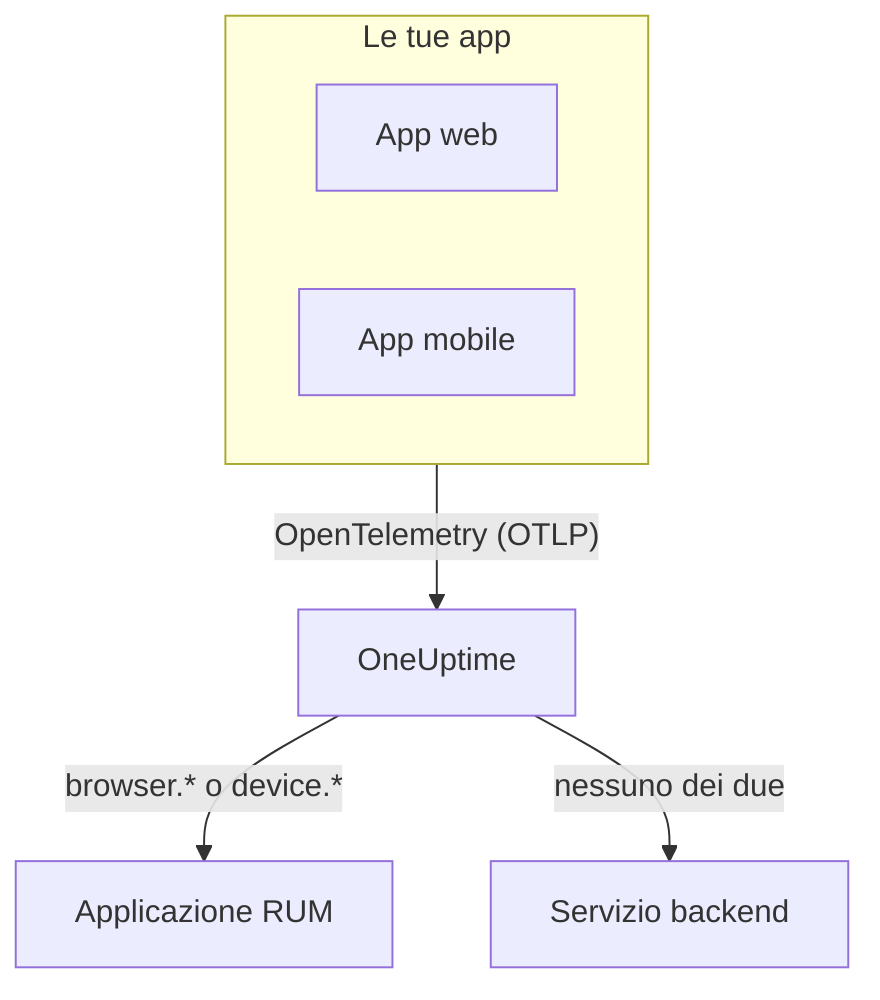

# Panoramica del RUM

Il Real User Monitoring (RUM) mostra ciò che vivono gli utenti reali nelle tue app web e mobili: caricamenti di pagina, richieste, errori e Core Web Vitals, segnalati dall'app stessa anziché da una sonda. OneUptime raccoglie questa telemetria in un'applicazione RUM che puoi rappresentare in grafici, cercare e sorvegliare con avvisi.

:::cards
- [Come funziona](#come-funziona): Un'unica pipeline OpenTelemetry, classificata come RUM all'arrivo.
- [Come OneUptime riconosce il RUM](#come-oneuptime-riconosce-il-rum): Gli attributi di risorsa che lo decidono.
- [Cosa ottieni](#cosa-ottieni): La panoramica, i vitals, gli explorer e le riproduzioni.
- [Per iniziare](#per-iniziare): Da una chiave di acquisizione al tuo primo caricamento di pagina.
:::

## Come funziona

Il RUM usa la stessa pipeline OpenTelemetry del resto di OneUptime. Non esiste un agente RUM né un formato di trasmissione proprio: punti un SDK OpenTelemetry per browser o mobile verso OneUptime, e la telemetria viene classificata come RUM al suo arrivo.

- **Un'applicazione per app.** La sua identità è il `service.name` che il tuo SDK segnala, e OneUptime crea l'applicazione al primo lotto di telemetria.
- **Mai contata due volte.** La telemetria del client appartiene solo alla sua applicazione RUM; non compare anche come servizio backend.
- **La Session Replay è un livello separato e facoltativo.** Ha un proprio snippet e propri controlli sulla privacy: vedi [Riproduzione delle sessioni](/docs/telemetry/session-replay).

## Dove trovarlo

Apri **Prodotti → Risorse → Monitoraggio degli utenti reali**. **Tutte le applicazioni** elenca le tue applicazioni con **Tipo di client**, **Stato** e **Visto l'ultima volta**. Altre due sezioni del menu laterale partono chiuse:

- **Impostazioni**: **Regole del proprietario**, **Regole etichette** e l'interruttore **Session Replay** dell'intero progetto.
- **Avanzato**: **Archiviato**, le applicazioni che hai archiviato.

Il menu laterale di un'applicazione raggruppa le sue pagine così; **Impostazioni**, **Sviluppatori** e **Avanzato** partono chiuse:

| Sezione | Pagine |
| --- | --- |
| **Base** | **Panoramica**, **Recommendations**, **Documentazione** |
| **Osservabilità** | **Metriche**, **Registri**, **Tracce**, **Client** |
| **Session Replay** | **Session Replay**, **User Flows**, **Replay Users**, **Health**, **Replay Policy**, **Replay Access Log**, **Documentazione** |
| **Impostazioni** | **Impostazioni** |
| **Sviluppatori** | **Terraform**, **API**, **Assistenti IA** |
| **Avanzato** | **Elimina applicazione** |

## Come OneUptime riconosce il RUM

La maggior parte delle domande del tipo «la mia app non compare» finisce qui. OneUptime decide, per ogni lotto di telemetria al suo arrivo, in base ai suoi **attributi di risorsa**:

1. Un lotto la cui risorsa ha `browser.platform`, `browser.language` o un `browser.brands` non vuoto è RUM **browser**.
2. Altrimenti, un lotto con `device.id` o `device.model.identifier` è RUM **mobile**.
3. Altrimenti, anche un lotto con `device.manufacturer` e senza identità di host (`host.name`, `host.id` o `k8s.node.name`) è RUM **mobile**.
4. Tutto il resto è un servizio backend.

Gli SDK di backend non impostano mai `browser.*`, `device.id` o `device.model.identifier`, quindi sono segnali netti. `device.manufacturer` è l'eccezione: l'inventario di un host lo usa anche per indicare il produttore di una macchina, perciò conta solo su una risorsa senza identità di host. Vedi [Attributi di inventario](/docs/telemetry/host-otel-collector#attributi-di-inventario-ip-mac-numero-di-serie-produttore-modello-firmware).

| Attributo | Obbligatorio | Cosa fa |
| --- | --- | --- |
| `service.name` | **Sì** | L'identità dell'applicazione, per esempio `storefront-web`. Senza di esso non viene creata alcuna applicazione RUM. |
| `browser.platform`, `browser.language`, `browser.brands` | Uno di questi, sul web | Contrassegna il lotto come RUM browser. `browser.platform` riempie anche la pagina **Client**. |
| `device.id`, `device.model.identifier` | Uno di questi, su mobile | Contrassegna il lotto come RUM mobile. `device.model.identifier` riempie anche la pagina **Client**. |
| `device.manufacturer` | No | Contrassegna il lotto come RUM mobile solo quando la risorsa non porta alcuna identità di host. |
| `telemetry.sdk.language` | No | Mostrato nella panoramica, per esempio `webjs` o `swift`. |
| `telemetry.sdk.version` | No | Mostrato come versione dell'SDK; se manca, viene letto `oneuptime.agent.version`. |
| `oneuptime.label.<name>` | No | Aggiunge all'applicazione l'etichetta di progetto `<name>:<value>`. |

OneUptime trova l'applicazione tramite `service.name`, senza distinguere maiuscole e minuscole, e la crea quando il progetto non ne ha una. Un nuovo `service.name` avvia una nuova applicazione: tienilo quindi stabile e distingui gli ambienti con un'etichetta anziché con un nuovo nome. [Gestire le applicazioni](/docs/rum/applications) tratta nomi, etichette, proprietari e conservazione.

> [!IMPORTANT]
> L'SDK OpenTelemetry per browser non aggiunge attributi `browser.*` finché non aggiungi il rilevatore di risorse del browser o li imposti tu. Con il solo `service.name`, la telemetria diventa un servizio backend, non un'applicazione RUM. [Configurazione browser](/docs/rum/browser-setup) mostra entrambi i modi.

## Cosa ottieni

| Dove | Cosa mostra |
| --- | --- |
| **Panoramica** | I riquadri **Page loads**, **Page load time (p95)**, **Eventi**, **Tasso di errore**, **Event duration (p95)**, **Eccezioni**, **Client** e **Sessions recorded**, e grafici di andamento sull'intervallo di tempo che scegli. |
| **Core Web Vitals** | Una scheda nella panoramica con LCP, INP, CLS, FCP e TTFB, ciascuno valutato secondo le soglie di Google, e l'INP di ogni route di un'app a pagina singola. Vedi [Core Web Vitals](/docs/rum/web-vitals) e [App a pagina singola](/docs/rum/web-vitals#app-a-pagina-singola). |
| **Metriche**, **Registri**, **Tracce** | Gli explorer della telemetria, limitati a questa applicazione. |
| **Client** | Le piattaforme browser e i modelli di dispositivo su cui l'applicazione è stata usata: un breve elenco per piattaforma, mai una riga per utente. |
| **Session Replay** | Registrazioni di sessioni reali, accanto ai loro errori, tracce e log: vedi [Riproduzione delle sessioni](/docs/telemetry/session-replay). |
| **Recommendations** | Monitor pronti all'uso per l'applicazione: Core Web Vitals scadenti, richieste fallite, eccezioni del browser e, appena registra, budget della Session Replay. |

I conteggi derivano dagli span che la tua strumentazione invia. **Page loads** conta lo span `documentLoad` che la strumentazione di caricamento pagina registra a ogni caricamento completo, quindi un cambio di route dentro un'app a pagina singola non è un caricamento di pagina.

Un'applicazione mostra **Connesso** finché arriva telemetria e **Disconnesso** dopo 15 minuti senza. Il tempo in cui OneUptime stesso era fermo o stava smaltendo la sua coda di acquisizione non conta in quei 15 minuti.

## Per iniziare

:::steps
### Creare una chiave di acquisizione

Apri **Impostazioni del progetto → Telemetria e APM → Chiavi di acquisizione** e fai clic su **Crea chiave di ingestione**. Un'app web ha bisogno di una chiave **Browser**, che funziona solo dalle origini che elenchi. Un'app mobile ha bisogno di una chiave **Server**, perché un SDK mobile non invia l'intestazione `Origin`.

### Strumentare la tua app

Segui [Configurazione browser](/docs/rum/browser-setup) per un'app web, oppure [Configurazione mobile](/docs/rum/mobile-setup) per Android, iOS, React Native e altre piattaforme.

### Aprire una pagina

Carica una pagina del tuo sito o avvia la tua app. L'applicazione compare in **Prodotti → Risorse → Monitoraggio degli utenti reali** al primo lotto di telemetria, con il nome del suo `service.name`. Non serve crearla prima.

### Aggiungere vitals e riproduzioni

Quando arrivano i dati di base, invia i [Core Web Vitals](/docs/rum/web-vitals) e aggiungi la [Riproduzione delle sessioni](/docs/telemetry/session-replay). Entrambi sono facoltativi.
:::

Se non compare nulla, [Risoluzione dei problemi RUM](/docs/rum/troubleshooting) passa in rassegna le cause nell'ordine in cui di solito si presentano.

## Passaggi successivi

:::cards
- [Configurazione browser](/docs/rum/browser-setup): Strumentare un'app web con l'SDK OpenTelemetry per browser.
- [Configurazione mobile](/docs/rum/mobile-setup): Android, iOS, React Native e qualsiasi altro SDK OpenTelemetry.
- [Core Web Vitals](/docs/rum/web-vitals): Inviare LCP, INP, CLS, FCP e TTFB, e leggere l'INP route per route.
- [Riproduzione delle sessioni](/docs/telemetry/session-replay): Vedere ciò che ha visto l'utente, accanto ai suoi errori e alle sue tracce.
:::
