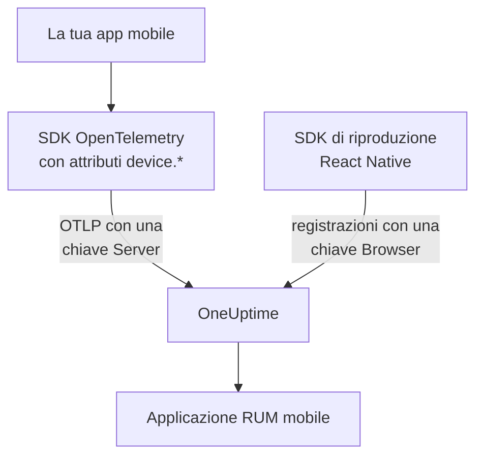

# Configurazione mobile

Strumenta un'app Android, iOS o React Native con OpenTelemetry in modo che si presenti a OneUptime come applicazione RUM mobile. Qualsiasi altra piattaforma con un SDK OpenTelemetry funziona allo stesso modo.

:::cards
- [Cosa serve a OneUptime](#cosa-serve-a-oneuptime): Due attributi di risorsa, inviati con una chiave Server.
- [Configurare la piattaforma](#configurare-la-piattaforma): Android, iOS, React Native e tutte le altre.
- [Crash e blocchi su iOS](#crash-e-blocchi-su-ios): I report di MetricKit e di KSCrash in Eccezioni, con i nomi dei tuoi dSYM.
- [Verificare che arrivi](#verificare-che-arrivi): Provare la chiave, poi trovare l'app.
- [Session Replay su mobile](#session-replay-su-mobile): Registrazioni per le app React Native.
:::

## Come funziona

La tua app esporta OTLP direttamente a OneUptime con una chiave di acquisizione **Server**. Sono gli attributi `device.*` sulla sua risorsa a classificarla come RUM mobile anziché come servizio backend.



## Cosa serve a OneUptime

Due attributi di risorsa, su ogni lotto che la tua app esporta:

| Attributo | Che cos'è |
| --- | --- |
| `service.name` | L'identità dell'applicazione, per esempio `storefront-android`. |
| `device.id` o `device.model.identifier` | Contrassegna la telemetria come RUM mobile. `device.model.identifier` riempie anche la pagina **Client**. |

Senza un attributo del dispositivo, la telemetria arriva comunque e puoi interrogarla, ma viene archiviata come servizio backend invece che come applicazione RUM.

Anche `device.manufacturer` contrassegna un lotto come mobile, ma solo su una risorsa senza identità di host, perché l'inventario di un host lo usa per indicare il produttore di una macchina. Imposta anche `device.id` o `device.model.identifier`, come fa ogni ricetta qui sotto, e la cosa non conta mai.

Fai di `device.id` un identificativo legato all'installazione, mai un ID pubblicitario o altro che identifichi una persona. OneUptime lo legge solo per riconoscere la telemetria mobile.

## Prima di iniziare

- Un'app con un SDK OpenTelemetry: l'SDK OpenTelemetry per Java o OpenTelemetry Android, opentelemetry-swift, oppure l'SDK OpenTelemetry per JavaScript in React Native.
- Una chiave di acquisizione **Server**, creata in **Impostazioni del progetto → Telemetria e APM → Chiavi di acquisizione** con **Crea chiave di acquisizione**. Una chiave **Browser** viene rifiutata da un'app mobile: è verificata rispetto all'intestazione `Origin`, che gli SDK mobili non inviano.
- Queste impostazioni OTLP. Se ospiti OneUptime in proprio, sostituisci `https://oneuptime.com` con il tuo host.

| Impostazione | Valore |
| --- | --- |
| Endpoint OTLP | `https://oneuptime.com/otlp` |
| Intestazione | `x-oneuptime-token: YOUR_TELEMETRY_INGESTION_TOKEN` |
| Tracce | `POST https://oneuptime.com/otlp/v1/traces` |
| Metriche | `POST https://oneuptime.com/otlp/v1/metrics` |
| Log | `POST https://oneuptime.com/otlp/v1/logs` |

> [!WARNING]
> La chiave viaggia dentro la tua app, e un'app si può spacchettare: dai quindi per scontato che qualcuno la copierà. Nella pagina della chiave, imposta un **Nome del servizio fissato** in modo che una copia non possa scrivere con i nomi dei tuoi servizi backend, aggiungi un **Requests Per Minute Limit** e una data in **Scade il**, e ruota la chiave a ogni rilascio.

## Configurare la piattaforma

Gli snippet mostrano la forma della configurazione. Gli SDK OpenTelemetry mobili cambiano le loro API da una versione all'altra, quindi verifica i nomi dei metodi sulla versione che fissi. Ciò che serve a OneUptime non cambia mai: l'endpoint, l'intestazione, `service.name` e un attributo `device.*`.

:::tabs
@tab Android
Usa l'SDK OpenTelemetry per Java e il suo exporter OTLP, che funzionano su Android:

```kotlin title="app/build.gradle.kts"
dependencies {
    implementation(platform("io.opentelemetry:opentelemetry-bom:<latest>"))
    implementation("io.opentelemetry:opentelemetry-sdk")
    implementation("io.opentelemetry:opentelemetry-exporter-otlp")
}
```

```kotlin title="StorefrontApplication.kt"
import android.app.Application
import android.os.Build
import io.opentelemetry.exporter.otlp.http.trace.OtlpHttpSpanExporter
import io.opentelemetry.sdk.OpenTelemetrySdk
import io.opentelemetry.sdk.resources.Resource
import io.opentelemetry.sdk.trace.SdkTracerProvider
import io.opentelemetry.sdk.trace.export.BatchSpanProcessor

class StorefrontApplication : Application() {
    override fun onCreate() {
        super.onCreate()

        val resource = Resource.getDefault().toBuilder()
            .put("service.name", "storefront-android")
            .put("device.manufacturer", Build.MANUFACTURER)
            .put("device.model.identifier", Build.MODEL)
            .build()

        val exporter = OtlpHttpSpanExporter.builder()
            .setEndpoint("https://oneuptime.com/otlp/v1/traces")
            .addHeader("x-oneuptime-token", BuildConfig.ONEUPTIME_TOKEN)
            .build()

        OpenTelemetrySdk.builder()
            .setTracerProvider(
                SdkTracerProvider.builder()
                    .setResource(resource)
                    .addSpanProcessor(BatchSpanProcessor.builder(exporter).build())
                    .build()
            )
            .buildAndRegisterGlobal()
    }
}
```

L'agente [OpenTelemetry Android](https://github.com/open-telemetry/opentelemetry-android) aggiunge sopra crash, ANR, frame lenti e bloccati e avvii dell'app, e imposta `device.model.identifier` e `device.manufacturer` sulla propria risorsa. [Configurazione Android](/docs/rum/android-setup) lo configura al posto del codice qui sopra.
@tab iOS
Usa [opentelemetry-swift](https://github.com/open-telemetry/opentelemetry-swift) e imposta tu gli attributi del dispositivo: la risorsa che ogni versione aggiunge da sé è cambiata da una versione all'altra.

```swift
let resource = Resource(attributes: [
    "service.name": .string("storefront-ios"),
    "device.model.identifier": .string(UIDevice.current.model),
    "device.manufacturer": .string("Apple"),
    "device.id": .string(UIDevice.current.identifierForVendor?.uuidString ?? ""),
    "telemetry.sdk.language": .string("swift"),
])

let exporter = OtlpHttpTraceExporter(
    endpoint: URL(string: "https://oneuptime.com/otlp/v1/traces")!,
    config: OtlpConfiguration(
        headers: [("x-oneuptime-token", oneUptimeToken)]
    )
)

OpenTelemetry.registerTracerProvider(
    tracerProvider: TracerProviderBuilder()
        .with(resource: resource)
        .add(spanProcessor: BatchSpanProcessor(spanExporter: exporter))
        .build()
)
```

`UIDevice.current.model` restituisce un nome breve come `iPhone`, che limita la pagina **Client** a una riga per tipo di dispositivo. `identifierForVendor` è l'installazione in base a cui OneUptime conta le installazioni senza crash, come spiega [Registrare le sessioni](#registrare-le-sessioni).
@tab React Native
React Native esegue l'SDK OpenTelemetry per JavaScript, quindi costruisci il provider, l'exporter OTLP e il batch processor come in [Configurazione browser](/docs/rum/browser-setup), con tre modifiche: invia con una chiave **Server**, togli `browserDetector` e `DocumentLoadInstrumentation`, e imposta tu gli attributi del dispositivo.

```ts
import { Platform } from "react-native";
import * as Device from "expo-device"; // or react-native-device-info
import {
  defaultResource,
  resourceFromAttributes,
} from "@opentelemetry/resources";

const resource = defaultResource().merge(
  resourceFromAttributes({
    "service.name": "storefront-mobile",
    "device.manufacturer": Device.manufacturer ?? Platform.OS,
    "device.model.identifier":
      Device.modelId ?? Device.modelName ?? "unknown",
    "telemetry.sdk.language": "webjs",
  }),
);
```

`Device.modelId` è impostato solo su iOS, quindi Android ripiega su `Device.modelName`.
@tab Altre piattaforme
Flutter, Unity, .NET MAUI, un client embedded o uno scrittore OTLP tuo funzionano tutti, purché la risorsa porti `service.name` e un attributo `device.*`. Un SDK che legge le variabili d'ambiente standard di OpenTelemetry le prende così come sono:

```bash
OTEL_EXPORTER_OTLP_ENDPOINT="https://oneuptime.com/otlp"
OTEL_EXPORTER_OTLP_HEADERS="x-oneuptime-token=YOUR_TELEMETRY_INGESTION_TOKEN"
OTEL_RESOURCE_ATTRIBUTES="service.name=storefront-mobile,device.manufacturer=Acme,device.model.identifier=AC-100"
```

L'SDK aggiunge da sé `/v1/traces`, `/v1/metrics` e `/v1/logs` all'endpoint.
:::

## Crash e blocchi su iOS

opentelemetry-swift 2.3 e successivi segnalano i crash e i blocchi di un'app iOS tramite la sua strumentazione MetricKit, che consegna ciascuno dei diagnostici di Apple a OpenTelemetry come record di log. OneUptime li archivia come archivia i crash e gli ANR di OpenTelemetry Android, quindi compaiono in **Eccezioni** e nella **Panoramica** dell'applicazione:

| Diagnostico di Apple | Nome dell'evento | In Eccezioni |
| --- | --- | --- |
| Un crash | `metrickit.diagnostic.crash` | Un'eccezione non gestita, il cui tipo è ciò che ha terminato l'app: l'eccezione Objective-C su iOS 17 e successivi, altrimenti l'eccezione Mach (`EXC_BAD_ACCESS`), altrimenti il segnale (`SIGSEGV`) |
| Un blocco | `metrickit.diagnostic.hang` | Un'eccezione non gestita di tipo **Hang**, l'equivalente iOS di un ANR, che conserva quanto è durato il blocco |

Il riquadro **Crash** della panoramica conta i crash, e il suo riquadro **ANR** conta i blocchi insieme agli ANR di Android. Ogni stack trace viene disegnato come i thread di un crash report, a partire dal thread che è andato in crash o si è bloccato. Un frame del codice della tua app prende il nome della sua funzione, come `CartViewController.checkout()`, una volta caricato il dSYM della sua build, come in [Caricare i dSYM](#caricare-i-dsym). Ogni altro frame nomina il suo binario e il punto al suo interno in cui si trovava il codice, e **Binary Images** elenca l'UUID di ogni binario, che indica di quale build è il dSYM che gli dà i nomi.

I crash e i blocchi vengono raggruppati in base ai frame della tua app sul thread che è andato in crash o si è bloccato: in base alle loro funzioni dove un dSYM ha dato loro un nome, così un crash resta un'unica eccezione da una versione alla successiva, e in base ai loro offset nel binario dove nessuno l'ha fatto, che cambiano a ogni build. Un report riceve i nomi al suo arrivo, quindi carica i dSYM di una build prima di distribuirla: un crash arrivato prima del suo dSYM mantiene i suoi offset.

:::steps
### Esportare i log oltre agli span

MetricKit segnala i diagnostici come record di log, quindi registra un provider dei logger accanto al provider dei tracer, con la stessa risorsa, lo stesso endpoint e la stessa intestazione:

```swift
let logExporter = OtlpHttpLogExporter(
    endpoint: URL(string: "https://oneuptime.com/otlp/v1/logs")!,
    config: OtlpConfiguration(
        headers: [("x-oneuptime-token", oneUptimeToken)]
    )
)

OpenTelemetry.registerLoggerProvider(
    loggerProvider: LoggerProviderBuilder()
        .with(resource: resource)
        .with(processors: [
            BatchLogRecordProcessor(logRecordExporter: logExporter),
        ])
        .build()
)
```

### Registrare la strumentazione MetricKit

Aggiungi il prodotto `MetricKitInstrumentation` di opentelemetry-swift e registralo presso MetricKit dopo aver registrato il provider dei logger:

```swift
import MetricKit
import MetricKitInstrumentation

// MXMetricManager keeps only a weak reference: hold this for the app's lifetime.
let metricKitInstrumentation = MetricKitInstrumentation()
MXMetricManager.shared.add(metricKitInstrumentation)
```

### Registrare le sessioni

I riquadri **Sessioni** e **Sessioni senza crash** contano il `session.id` dei tuoi span. Il prodotto `Sessions` di opentelemetry-swift lo imposta: aggiungi `SessionSpanProcessor` al provider dei tracer e racchiudi il processore dei log in `SessionLogRecordProcessor`, così anche i diagnostici portano una sessione.

La riga sotto **Sessioni senza crash** indica la quota delle installazioni che non sono andate in crash, e **Daily Crash Rate** e **Daily ANR Rate** avvisano in base alla quota di quelle che ci sono andate. Un'installazione è il `device.id` della risorsa qui sopra, l'identificativo dell'app per il fornitore: uno per dispositivo per tutte le tue app, che resta lo stesso finché una di esse rimane installata, quindi reinstallare la tua unica app crea una nuova installazione, mentre reinstallarne una su due no. Una versione di opentelemetry-swift che imposta `app.installation.id` viene contata invece in base a quello.

### Caricare i dSYM

Xcode scrive un dSYM per ciascun binario della tua app quando la archivia, e App Store Connect te li restituisce in **Download dSYMs**. Caricali dopo ogni archiviazione, dalla CI o da una fase di build di Xcode, con la [CLI di OneUptime](/docs/cli/index) e una chiave Server della tua build: una chiave con un **Nome del servizio fissato**, come quella con cui viene distribuita la tua app, viene rifiutata, perché un dSYM dà i nomi ai frame di ogni app del progetto che distribuisce il suo binario.

```bash
oneuptime dsym upload "$ARCHIVE_PATH/dSYMs" --app storefront-ios --url https://oneuptime.com --ingestion-key YOUR_TELEMETRY_INGESTION_TOKEN
```

La CLI legge i bundle `.dSYM`, le cartelle e gli zip che li contengono, e i file DWARF dove si trovano, e invia solo l'UUID, l'architettura e i nomi delle funzioni di ogni binario: i dSYM di un'app grande occupano centinaia di megabyte, i loro nomi pochi. Senza la CLI, invia il file DWARF di un dSYM, o uno zip di bundle `.dSYM`, così com'è, fino a 50 MB per file:

```bash
curl --fail -X POST "https://oneuptime.com/dsyms/v1/upload" \
  -H "x-oneuptime-token: YOUR_TELEMETRY_INGESTION_TOKEN" \
  -F "appName=storefront-ios" \
  -F "dsym=@MyApp.app.dSYM/Contents/Resources/DWARF/MyApp"
```

Ogni binario viene conservato in base al suo UUID per 400 giorni, così una versione ancora sui telefoni delle persone mesi dopo continua a ricevere i nomi, e caricare di nuovo una build sostituisce ciò che era conservato per essa. Un dSYM appartiene al progetto, non a una singola app: un framework incorporato da due delle tue app riceve i nomi in entrambe.
:::

> [!NOTE]
> Apple consegna i diagnostici di MetricKit all'app a un avvio successivo, subito su iOS 15 e successivi e una volta al giorno nelle versioni precedenti, quindi un crash o un blocco può arrivare minuti o un giorno dopo che è avvenuto, e viene contato quando arriva. «0 crash nell'ultima ora» nella panoramica di un'app iOS non è ancora una buona notizia. Un diagnostico porta la sessione che lo ha segnalato, non quella che ha interrotto.

opentelemetry-swift non registra alcuno span all'avvio dell'app, quindi i riquadri **Avvii dell'app** e **Avvio a freddo (p95)** restano vuoti finché la tua app non ne registra uno: uno span chiamato `AppStart`, con `start.type` impostato su `cold`, `warm` o `hot`, dall'avvio del processo a quando la prima schermata è pronta.

### Quando anche KSCrash segnala un crash

opentelemetry-swift può segnalare i crash anche tramite KSCrash, che invia il suo report come record di log `device.crash` alla successiva apertura dell'app, con l'ora in cui l'app è andata in crash. Un'app che li registra entrambi segnala ogni crash due volte: KSCrash all'avvio successivo, MetricKit all'avvio successivo o fino a un giorno dopo. OneUptime conta un crash del genere una sola volta: il primo report che arriva è l'occorrenza, e il secondo viene conservato accanto a essa, nella stessa eccezione, come prova dello stesso crash, senza essere contato in alcun riquadro, grafico o monitor. Nelle **Occorrenze** dell'eccezione, l'occorrenza riporta **Segnalato due volte**.

Due report vengono considerati un solo crash solo quando valgono tutte queste condizioni:

- Provengono dai due strumenti di segnalazione, KSCrash e MetricKit. Nessuno dei due segnala due volte lo stesso crash, quindi due report dallo stesso strumento sono due crash.
- Provengono dalla stessa installazione: lo stesso `app.installation.id`, o `device.id`.
- Sono a non più di 26 ore di distanza: MetricKit marca un crash con la fine del giorno di cui riferisce, KSCrash con il momento del crash.
- Concordano sul segnale, sull'eccezione Mach e sull'eccezione Objective-C, ovunque entrambi ne nominino una.
- I thread andati in crash concordano frame per frame da dove è partito il thread verso l'interno, per binario e offset, su ogni frame del codice della tua app nominato da uno dei due. Un crash interamente nel codice di Apple deve concordare su almeno tre frame, e su tutti.

Ogni report viene abbinato una sola volta, con il più vicino nel tempo, quindi due crash dello stesso bug su un'installazione, a pochi minuti di distanza, sono due occorrenze, ciascuna con il proprio secondo report. Quando OneUptime non riesce a confrontare un report con gli altri della sua installazione, lo conta, così un crash viene contato al massimo due volte, ma mai perso.

## Verificare che arrivi

:::steps
### Provare la chiave

Prima di passare in rassegna le impostazioni dell'SDK, chiedi a OneUptime se accetta la chiave:

```bash
curl -i https://oneuptime.com/otlp/v1/validate \
  -H "x-oneuptime-token: YOUR_TELEMETRY_INGESTION_TOKEN"
```

`200` con `"valid": true` significa che la chiave è accettata. Anche una chiave Browser risponde `200`, ma il suo messaggio dice che funziona solo da un browser: un'app mobile ha bisogno di una chiave Server. `401` significa che la chiave è sconosciuta, revocata, disattivata o scaduta, e nessuna impostazione dell'SDK lo risolverà.

### Avviare l'app

Avvia l'app e usala per un momento. Compare in **Prodotti → Risorse → Monitoraggio degli utenti reali** al primo lotto di telemetria, con il nome del suo `service.name`.

### Aprire la pagina Client

Apri la pagina **Client** dell'applicazione: ogni modello di dispositivo da `device.model.identifier` ha una riga. Se la pagina resta vuota mentre **Tracce** si riempie, gli attributi del dispositivo non raggiungono la risorsa.
:::

## Session Replay su mobile

Le app React Native possono registrare le sessioni con `@oneuptime/react-native-replay`. Registra l'albero delle viste native come wireframe, mai schermate né il testo a video, e le sue registrazioni si aprono nello stesso player di quelle web. Invia con una chiave **Browser** le cui **Origini consentite** elencano la tua app come `app://` seguito dal suo ID applicazione Android o dal suo bundle ID iOS: una chiave diversa dalla chiave Server usata dal tuo SDK OpenTelemetry. [Installare in React Native](/docs/telemetry/session-replay#installazione-in-react-native) ti guida passo per passo.

Le app Android e iOS native, e le altre piattaforme, non hanno un registratore di sessioni: la loro pagina **Riproduzione delle sessioni** resta vuota, mentre tracce, log, metriche, eccezioni e la pagina **Client** funzionano come sempre.

## Risoluzione dei problemi

:::details La verifica della chiave restituisce 401, o la chiave viene rifiutata
Un `401` significa che la chiave è sconosciuta, revocata, disattivata o scaduta: crea una chiave Server e ricompila l'app con essa.

Una chiave Browser supera la verifica, ma ogni esportazione da un'app mobile viene rifiutata con un `422` che dice `This request did not send an Origin header, so it cannot be checked against the allowed origins of this browser ingestion key. Use a server ingestion key for requests that are not sent by a browser.` Usa una chiave **Server**.
:::

:::details L'app compare in Servizi invece che in Monitoraggio degli utenti reali
La risorsa non ha né `device.id` né `device.model.identifier`, quindi la telemetria è stata archiviata come servizio backend. Impostali come in [Configurare la piattaforma](#configurare-la-piattaforma).

Il servizio già creato non diventa un'applicazione RUM, quindi eliminalo in **Prodotti → Servizi** quando arriva la telemetria RUM.
:::

:::details La pagina Client è vuota
Le righe dei client derivano solo da `device.model.identifier`. Un SDK che imposta solo `device.id` o `device.manufacturer` classifica l'app come RUM mobile, ma non elenca client: imposta anche `device.model.identifier`.
:::

:::details Lo stato dice Nessun traffico recente mentre le persone usano l'app
Lo stato passa a **Nessun traffico recente** dopo 15 minuti senza telemetria. Se le persone stanno usando l'app:

- Un sampler potrebbe scartare tutto: cerca un sampler always-off o un rapporto molto basso.
- L'app potrebbe inviare telemetria solo per azioni che nessuno ha compiuto in quel lasso di tempo.
- La chiave potrebbe essere stata revocata, o essere scaduta, dopo il rilascio: provala come in [Verificare che arrivi](#verificare-che-arrivi).
:::

## Passaggi successivi

:::cards
- [Riproduzione delle sessioni](/docs/telemetry/session-replay): Registrare le sessioni React Native, accanto alle loro tracce.
- [Gestire le applicazioni](/docs/rum/applications): Nomi, etichette, proprietari e conservazione.
- [OpenTelemetry](/docs/telemetry/open-telemetry): Gli endpoint, i limiti e gli errori OTLP nel dettaglio.
- [Risoluzione dei problemi RUM](/docs/rum/troubleshooting): Ogni verifica, nell'ordine in cui di solito si presentano i problemi.
:::
