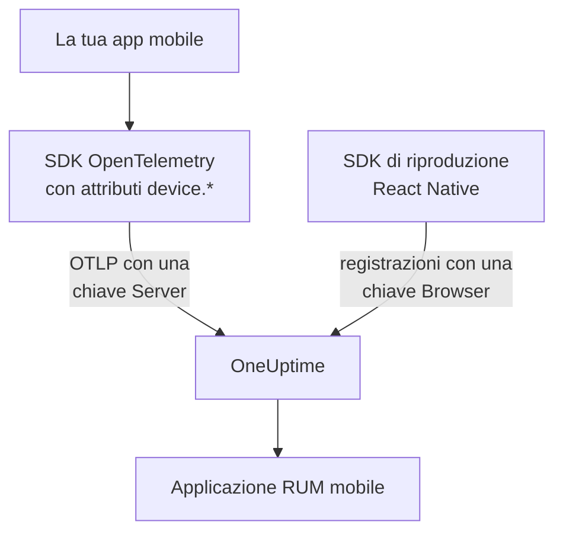

# Configurazione mobile

Strumenta un'app Android, iOS o React Native con OpenTelemetry in modo che si presenti a OneUptime come applicazione RUM mobile. Qualsiasi altra piattaforma con un SDK OpenTelemetry funziona allo stesso modo.

:::cards
- [Cosa serve a OneUptime](#cosa-serve-a-oneuptime): Due attributi di risorsa, inviati con una chiave Server.
- [Configurare la piattaforma](#configurare-la-piattaforma): Android, iOS, React Native e tutte le altre.
- [Verificare che arrivi](#verificare-che-arrivi): Provare la chiave, poi trovare l'app.
- [Session Replay su mobile](#session-replay-su-mobile): Registrazioni per le app React Native.
:::

## Come funziona

La tua app esporta OTLP direttamente a OneUptime con una chiave di acquisizione **Server**. Sono gli attributi `device.*` sulla sua risorsa a classificarla come RUM mobile anziché come servizio backend.



## Cosa serve a OneUptime

Due attributi di risorsa, su ogni lotto che la tua app esporta:

| Attributo | Che cos'è |
| --- | --- |
| `service.name` | L'identità dell'applicazione, per esempio `storefront-android`. |
| `device.id` o `device.model.identifier` | Contrassegna la telemetria come RUM mobile. `device.model.identifier` riempie anche la pagina **Client**. |

Senza un attributo del dispositivo, la telemetria arriva comunque e puoi interrogarla, ma viene archiviata come servizio backend invece che come applicazione RUM.

Anche `device.manufacturer` contrassegna un lotto come mobile, ma solo su una risorsa senza identità di host, perché l'inventario di un host lo usa per indicare il produttore di una macchina. Imposta anche `device.id` o `device.model.identifier`, come fa ogni ricetta qui sotto, e la cosa non conta mai.

Fai di `device.id` un identificativo legato all'installazione, mai un ID pubblicitario o altro che identifichi una persona. OneUptime lo legge solo per riconoscere la telemetria mobile.

## Prima di iniziare

- Un'app con un SDK OpenTelemetry: l'SDK OpenTelemetry per Java o OpenTelemetry Android, opentelemetry-swift, oppure l'SDK OpenTelemetry per JavaScript in React Native.
- Una chiave di acquisizione **Server**, creata in **Impostazioni del progetto → Telemetria e APM → Chiavi di acquisizione** con **Crea chiave di ingestione**. Una chiave **Browser** viene rifiutata da un'app mobile: è verificata rispetto all'intestazione `Origin`, che gli SDK mobili non inviano.
- Queste impostazioni OTLP. Se ospiti OneUptime in proprio, sostituisci `https://oneuptime.com` con il tuo host.

| Impostazione | Valore |
| --- | --- |
| Endpoint OTLP | `https://oneuptime.com/otlp` |
| Intestazione | `x-oneuptime-token: YOUR_TELEMETRY_INGESTION_TOKEN` |
| Tracce | `POST https://oneuptime.com/otlp/v1/traces` |
| Metriche | `POST https://oneuptime.com/otlp/v1/metrics` |
| Log | `POST https://oneuptime.com/otlp/v1/logs` |

> [!WARNING]
> La chiave viaggia dentro la tua app, e un'app si può spacchettare: dai quindi per scontato che qualcuno la copierà. Nella pagina della chiave, imposta un **Pinned Service Name** in modo che una copia non possa scrivere con i nomi dei tuoi servizi backend, aggiungi un **Requests Per Minute Limit** e una data in **Scade il**, e ruota la chiave a ogni rilascio.

## Configurare la piattaforma

Gli snippet mostrano la forma della configurazione. Gli SDK OpenTelemetry mobili cambiano le loro API da una versione all'altra, quindi verifica i nomi dei metodi sulla versione che fissi. Ciò che serve a OneUptime non cambia mai: l'endpoint, l'intestazione, `service.name` e un attributo `device.*`.

:::tabs
@tab Android
Usa l'SDK OpenTelemetry per Java e il suo exporter OTLP, che funzionano su Android:

```kotlin title="app/build.gradle.kts"
dependencies {
    implementation(platform("io.opentelemetry:opentelemetry-bom:<latest>"))
    implementation("io.opentelemetry:opentelemetry-sdk")
    implementation("io.opentelemetry:opentelemetry-exporter-otlp")
}
```

```kotlin title="StorefrontApplication.kt"
import android.app.Application
import android.os.Build
import io.opentelemetry.exporter.otlp.http.trace.OtlpHttpSpanExporter
import io.opentelemetry.sdk.OpenTelemetrySdk
import io.opentelemetry.sdk.resources.Resource
import io.opentelemetry.sdk.trace.SdkTracerProvider
import io.opentelemetry.sdk.trace.export.BatchSpanProcessor

class StorefrontApplication : Application() {
    override fun onCreate() {
        super.onCreate()

        val resource = Resource.getDefault().toBuilder()
            .put("service.name", "storefront-android")
            .put("device.manufacturer", Build.MANUFACTURER)
            .put("device.model.identifier", Build.MODEL)
            .build()

        val exporter = OtlpHttpSpanExporter.builder()
            .setEndpoint("https://oneuptime.com/otlp/v1/traces")
            .addHeader("x-oneuptime-token", BuildConfig.ONEUPTIME_TOKEN)
            .build()

        OpenTelemetrySdk.builder()
            .setTracerProvider(
                SdkTracerProvider.builder()
                    .setResource(resource)
                    .addSpanProcessor(BatchSpanProcessor.builder(exporter).build())
                    .build()
            )
            .buildAndRegisterGlobal()
    }
}
```

L'agente [OpenTelemetry Android](https://github.com/open-telemetry/opentelemetry-android) aggiunge sopra una strumentazione automatica e imposta attributi del dispositivo sulla propria risorsa. Se lo usi, punta il suo exporter allo stesso endpoint e alla stessa intestazione, e verifica che `device.model.identifier` arrivi sulla risorsa nella tua versione.
@tab iOS
Usa [opentelemetry-swift](https://github.com/open-telemetry/opentelemetry-swift) e imposta tu gli attributi del dispositivo: la risorsa che ogni versione aggiunge da sé è cambiata da una versione all'altra.

```swift
let resource = Resource(attributes: [
    "service.name": .string("storefront-ios"),
    "device.model.identifier": .string(UIDevice.current.model),
    "device.manufacturer": .string("Apple"),
    "telemetry.sdk.language": .string("swift"),
])

let exporter = OtlpHttpTraceExporter(
    endpoint: URL(string: "https://oneuptime.com/otlp/v1/traces")!,
    config: OtlpConfiguration(
        headers: [("x-oneuptime-token", oneUptimeToken)]
    )
)

OpenTelemetry.registerTracerProvider(
    tracerProvider: TracerProviderBuilder()
        .with(resource: resource)
        .add(spanProcessor: BatchSpanProcessor(spanExporter: exporter))
        .build()
)
```

`UIDevice.current.model` restituisce un nome breve come `iPhone`, che limita la pagina **Client** a una riga per tipo di dispositivo.
@tab React Native
React Native esegue l'SDK OpenTelemetry per JavaScript, quindi costruisci il provider, l'exporter OTLP e il batch processor come in [Configurazione browser](/docs/rum/browser-setup), con tre modifiche: invia con una chiave **Server**, togli `browserDetector` e `DocumentLoadInstrumentation`, e imposta tu gli attributi del dispositivo.

```ts
import { Platform } from "react-native";
import * as Device from "expo-device"; // or react-native-device-info
import {
  defaultResource,
  resourceFromAttributes,
} from "@opentelemetry/resources";

const resource = defaultResource().merge(
  resourceFromAttributes({
    "service.name": "storefront-mobile",
    "device.manufacturer": Device.manufacturer ?? Platform.OS,
    "device.model.identifier":
      Device.modelId ?? Device.modelName ?? "unknown",
    "telemetry.sdk.language": "webjs",
  }),
);
```

`Device.modelId` è impostato solo su iOS, quindi Android ripiega su `Device.modelName`.
@tab Altre piattaforme
Flutter, Unity, .NET MAUI, un client embedded o uno scrittore OTLP tuo funzionano tutti, purché la risorsa porti `service.name` e un attributo `device.*`. Un SDK che legge le variabili d'ambiente standard di OpenTelemetry le prende così come sono:

```bash
OTEL_EXPORTER_OTLP_ENDPOINT="https://oneuptime.com/otlp"
OTEL_EXPORTER_OTLP_HEADERS="x-oneuptime-token=YOUR_TELEMETRY_INGESTION_TOKEN"
OTEL_RESOURCE_ATTRIBUTES="service.name=storefront-mobile,device.manufacturer=Acme,device.model.identifier=AC-100"
```

L'SDK aggiunge da sé `/v1/traces`, `/v1/metrics` e `/v1/logs` all'endpoint.
:::

## Verificare che arrivi

:::steps
### Provare la chiave

Prima di passare in rassegna le impostazioni dell'SDK, chiedi a OneUptime se accetta la chiave:

```bash
curl -i https://oneuptime.com/otlp/v1/validate \
  -H "x-oneuptime-token: YOUR_TELEMETRY_INGESTION_TOKEN"
```

`200` con `"valid": true` significa che la chiave è accettata. Anche una chiave Browser risponde `200`, ma il suo messaggio dice che funziona solo da un browser: un'app mobile ha bisogno di una chiave Server. `401` significa che la chiave è sconosciuta, revocata, disattivata o scaduta, e nessuna impostazione dell'SDK lo risolverà.

### Avviare l'app

Avvia l'app e usala per un momento. Compare in **Prodotti → Risorse → Monitoraggio degli utenti reali** al primo lotto di telemetria, con il nome del suo `service.name`.

### Aprire la pagina Client

Apri la pagina **Client** dell'applicazione: ogni modello di dispositivo da `device.model.identifier` ha una riga. Se la pagina resta vuota mentre **Tracce** si riempie, gli attributi del dispositivo non raggiungono la risorsa.
:::

## Session Replay su mobile

Le app React Native possono registrare le sessioni con `@oneuptime/react-native-replay`. Registra l'albero delle viste native come wireframe, mai schermate né il testo a video, e le sue registrazioni si aprono nello stesso player di quelle web. Invia con una chiave **Browser** le cui **Allowed Origins** elencano la tua app come `app://` seguito dal suo ID applicazione Android o dal suo bundle ID iOS: una chiave diversa dalla chiave Server usata dal tuo SDK OpenTelemetry. [Installare in React Native](/docs/telemetry/session-replay#install-in-react-native) ti guida passo per passo.

Le app Android e iOS native, e le altre piattaforme, non hanno un registratore di sessioni: la loro pagina **Session Replay** resta vuota, mentre tracce, log, metriche, eccezioni e la pagina **Client** funzionano come sempre.

## Risoluzione dei problemi

:::details La verifica della chiave restituisce 401, o la chiave viene rifiutata
Un `401` significa che la chiave è sconosciuta, revocata, disattivata o scaduta: crea una chiave Server e ricompila l'app con essa.

Una chiave Browser supera la verifica, ma ogni esportazione da un'app mobile viene rifiutata con un `422` che dice `This request did not send an Origin header, so it cannot be checked against the allowed origins of this browser ingestion key. Use a server ingestion key for requests that are not sent by a browser.` Usa una chiave **Server**.
:::

:::details L'app compare in Servizi invece che in Monitoraggio degli utenti reali
La risorsa non ha né `device.id` né `device.model.identifier`, quindi la telemetria è stata archiviata come servizio backend. Impostali come in [Configurare la piattaforma](#configurare-la-piattaforma).

Il servizio già creato non diventa un'applicazione RUM, quindi eliminalo in **Prodotti → Servizi** quando arriva la telemetria RUM.
:::

:::details La pagina Client è vuota
Le righe dei client derivano solo da `device.model.identifier`. Un SDK che imposta solo `device.id` o `device.manufacturer` classifica l'app come RUM mobile, ma non elenca client: imposta anche `device.model.identifier`.
:::

:::details Lo stato dice Disconnesso mentre le persone usano l'app
Lo stato passa a **Disconnesso** dopo 15 minuti senza telemetria. Se le persone stanno usando l'app:

- Un sampler potrebbe scartare tutto: cerca un sampler always-off o un rapporto molto basso.
- L'app potrebbe inviare telemetria solo per azioni che nessuno ha compiuto in quel lasso di tempo.
- La chiave potrebbe essere stata revocata, o essere scaduta, dopo il rilascio: provala come in [Verificare che arrivi](#verificare-che-arrivi).
:::

## Passaggi successivi

:::cards
- [Riproduzione delle sessioni](/docs/telemetry/session-replay): Registrare le sessioni React Native, accanto alle loro tracce.
- [Gestire le applicazioni](/docs/rum/applications): Nomi, etichette, proprietari e conservazione.
- [OpenTelemetry](/docs/telemetry/open-telemetry): Gli endpoint, i limiti e gli errori OTLP nel dettaglio.
- [Risoluzione dei problemi RUM](/docs/rum/troubleshooting): Ogni verifica, nell'ordine in cui di solito si presentano i problemi.
:::
