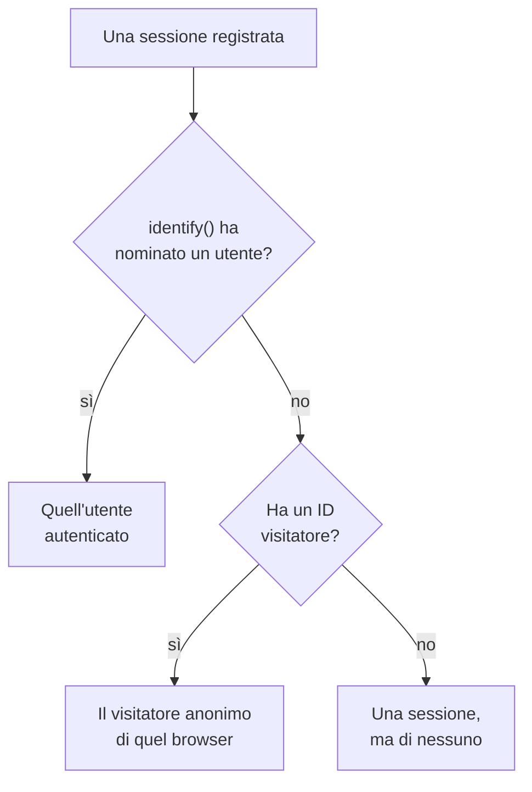

# Analisi del prodotto

L'analisi del prodotto conta le persone che usano un'applicazione RUM, come vanno le loro sessioni e che cosa fanno: utenti attivi, nuovi, di ritorno, autenticati e inattivi, sessioni per dispositivo, browser, paese e pagina, e gli eventi che la tua app invia, come andamenti, funnel e fidelizzazione. Conta le sessioni che la [Riproduzione delle sessioni](/docs/telemetry/session-replay) registra e gli eventi che il suo registratore invia, quindi non le serve uno snippet suo, e conserva i suoi numeri per 13 mesi, molto dopo la scadenza delle registrazioni.

:::cards
- [Utenti](#utenti): Utenti attivi, nuovi, di ritorno, autenticati, totali e inattivi.
- [Sessioni](#sessioni): Quante, quanto durano, e per dispositivo, browser, paese e pagina.
- [Inviare eventi e metriche](#inviare-eventi-e-metriche): Che cosa fanno le persone, e i numeri che la tua pagina misura.
- [Eventi](#eventi): Quanto spesso è successo qualcosa, chi l'ha fatto e dove.
- [Funnel](#funnel): Chi è andato avanti, passo dopo passo, e quanto ci ha messo.
- [Fidelizzazione degli utenti](#fidelizzazione-degli-utenti): Chi è tornato, coorte per coorte.
:::

## Come si contano le persone

Il menu laterale di un'applicazione ha una sezione **Analisi del prodotto**: **Utenti**, **Sessioni**, **Eventi**, **Funnel**, **Fidelizzazione degli utenti**, **Flussi utente** e **Impostazioni di analisi**. **Utenti** e **Sessioni** contano le sessioni che la Riproduzione delle sessioni registra, quindi iniziano quando inizia il registratore dell'applicazione, e una sessione che la policy di riproduzione non registra non viene contata. Ogni sessione conta per una persona, o per nessuno:



- **Un utente autenticato conta una volta**, su ogni browser e dispositivo che usa: viene riconosciuto dall'hash unidirezionale del riferimento che la tua pagina ha passato a `identify()` (vedi [Identificare i tuoi utenti](/docs/telemetry/session-replay#identificare-i-tuoi-utenti)).
- **Un browser anonimo conta una volta**, tramite il suo [ID visitatore anonimo](/docs/telemetry/session-replay#visitatori-anonimi). Due browser sono due visitatori, e le sessioni che un browser ha avuto prima che qualcuno vi si autenticasse restano del suo visitatore.
- **Una sessione di un registratore più vecchio**, che non inviava un ID visitatore, conta come sessione ma non come persona.

**Eventi**, **Funnel** e **Fidelizzazione degli utenti** contano le persone allo stesso modo, dagli eventi che il registratore invia da ogni sessione, registrata o no (vedi [Inviare eventi e metriche](#inviare-eventi-e-metriche)).

I giorni sono contati nel tuo fuso orario.

## Utenti

**Utenti** conta le persone dell'intervallo che scegli:

| Riquadro | Cosa conta |
| --- | --- |
| **Utenti attivi** | Tutti quelli che sono venuti nell'intervallo: ogni utente autenticato una volta e ogni browser anonimo una volta. |
| **Nuovi utenti** | Gli utenti attivi la cui prima visita è stata nell'intervallo. |
| **Utenti di ritorno** | Gli utenti attivi che erano già venuti prima dell'inizio dell'intervallo. |
| **Utenti autenticati** | Gli utenti attivi che la tua app ha autenticato con `identify()`, e la loro quota di tutti gli utenti attivi. |
| **Utenti totali** | Tutti quelli che l'applicazione ha visto negli ultimi 13 mesi. |
| **Utenti inattivi** | Le persone venute prima ma non negli ultimi 30 giorni, o nei 7, 14, 60 o 90 giorni che scegli. |

I primi tre dicono anche come sono cambiati rispetto al periodo precedente. Sotto i riquadri, **Utenti attivi** traccia, per ogni giorno, le persone venute quel giorno, quelle venute nei 7 giorni fino a quel giorno e quelle venute nei 30 giorni fino a quel giorno, e **Utenti nuovi e di ritorno** divide in due le persone di ogni giorno.

**Persone** elenca tutti quelli che i riquadri contano, una riga per persona, prima i visti più di recente, e il suo filtro mostra le persone di un riquadro, i visitatori anonimi o tutti. Apri una persona per vedere la sua prima e la sua ultima visita e ognuna delle sue sessioni degli ultimi 13 mesi, con **Guarda** su ognuna la cui registrazione è ancora conservata.

## Sessioni

**Sessioni** conta le sessioni iniziate nell'intervallo: **Sessioni**, **Sessioni autenticate**, **Durata mediana delle sessioni**, **Pagine per sessione**, **Sessioni con errori** e **Sessioni con frustrazione**. Sotto i riquadri:

- **Sessioni per dispositivo** traccia le sessioni di ogni giorno da desktop, telefoni e tablet. La sessione di un'app mobile su uno schermo il cui lato corto misura 600 punti o più conta come quella di un tablet.
- **Durata delle sessioni** ordina le sessioni concluse per quanto sono durate, da meno di 10 secondi a oltre 30 minuti. Una sessione che è ancora in registrazione non ha ancora una durata.
- **Dettaglio** classifica utenti e sessioni per tipo di dispositivo, browser, sistema operativo, paese, versione dell'app, pagina di ingresso o pagina, prima quelli con più utenti.

## Inviare eventi e metriche

Gli eventi vengono inviati finché **Invia eventi di analisi del prodotto** è attivo, nella pagina **Impostazioni di analisi** dell'applicazione. Parte attivo per un'applicazione nuova e disattivo per un'applicazione creata prima che esistesse, quindi attivalo lì. Anche la Riproduzione delle sessioni deve essere attiva per l'applicazione, perché è il suo registratore a inviare gli eventi; il registratore React Native non ne invia ancora.

Ogni sessione in cui è attivo il registratore del browser invia da sé il proprio inizio e ogni pagina che visualizza, compresi i cambi di rotta di un'app a pagina singola, che il campione e la policy di riproduzione registrino quella sessione o no. I tuoi eventi e numeri arrivano dal codice della tua pagina:

```js
OneUptimeReplay.track("Signed up", { plan: "pro" });
OneUptimeReplay.metric("cart.value", 42.5, { currency: "EUR" });
```

| Chiamata | Che cosa invia |
| --- | --- |
| `track(name, properties?)` | Un evento che **Eventi**, **Funnel** e **Fidelizzazione degli utenti** contano, e un indicatore sulla timeline della riproduzione quando la sessione viene registrata. `name` ≤ 64 caratteri; ≤ 20 proprietà con valori stringa, numero o booleano, chiave ≤ 40 caratteri, valore ≤ 200 caratteri. |
| `metric(name, value, attributes?)` | Un numero che la tua pagina ha misurato, come punto di una metrica dell'applicazione (vedi [Dashboard e avvisi](#dashboard-e-avvisi)). `name` ≤ 100 caratteri tra lettere, cifre, `_`, `.`, `-` e `/`, che inizia con una lettera e non con `oneuptime.`; `value` un numero finito; `attributes` come le proprietà di `track()`. |

Prima che il registratore sia caricato, aggiungi le stesse chiamate a `window.OneUptimeReplayQueue` come `["track", name, properties]` e `["metric", name, value, attributes]` (vedi [API JavaScript](/docs/telemetry/session-replay#api-javascript)).

- **Ogni sessione, registrata o no.** Il campione e la policy di caricamento della riproduzione decidono quali sessioni vengono registrate, non quali vengono contate. Non viene inviato nulla con Do Not Track o Global Privacy Control, e non viene conservato nulla da un'origine che l'applicazione non consente. Quando la policy richiede il consenso, gli eventi aspettano `grantConsent()`, al massimo 500, e `revokeConsent()` li scarta.
- **Mascherati come la registrazione.** Con _Mask all text_, i valori delle proprietà e degli attributi vengono mascherati prima di lasciare la pagina. Una pagina viene inviata come il suo percorso, senza query né frammento.
- **In piccoli lotti**, ogni 5 secondi e quando la scheda viene nascosta. Un evento che raggiunge OneUptime più di 3 giorni dopo essere accaduto viene scartato, e un progetto può inviare 60.000 eventi e punti di metrica al minuto, tutte le sue applicazioni insieme; oltre, il registratore aspetta e li invia di nuovo.

`metric()` non invia nulla finché gli eventi sono disattivati, e `getDiagnostics().productAnalytics` dice se sono attivi (vedi [`getDiagnostics()`](/docs/telemetry/session-replay#getdiagnostics)).

### Proprietà utente

Per suddividere e segmentare gli eventi in base a chi li ha fatti, elenca chiavi di tratti di `identify()` in **Proprietà utente per l'analisi** su **Impostazioni di analisi**, per esempio `["plan", "role"]`, al massimo 20, confrontate così come sono scritte. Ogni evento porta allora quei tratti dell'utente autenticato, così come la tua pagina li ha passati a `identify()`. Gli altri tratti non lasciano mai la pagina, e nessuno la lascia finché **Acquisisci l'identità dell'utente finale** è disattivato. Non elencare tratti che contengono dati personali, come un indirizzo email.

## Eventi

**Eventi** mostra un evento alla volta: l'evento più frequente della tua app finché non ne scegli un altro, o la pagina più vista finché non ne invia nessuno. Il selettore elenca anche **Sessione iniziata** e ogni pagina visualizzata, e **Tutti gli eventi**, sotto, elenca ogni evento dell'intervallo con quante volte è accaduto e quante persone l'hanno fatto; scegline uno per vederlo sopra.

- I riquadri contano gli **Eventi** dell'evento, con quanti ne ha fatti in media ogni persona, i suoi **Utenti** e le sue **Sessioni**.
- **Eventi e utenti** traccia per ogni giorno quante volte è accaduto l'evento, e quante persone l'hanno fatto quel giorno.
- **Dettaglio** ordina l'evento per tipo di dispositivo, browser, sistema operativo, paese, versione dell'app, pagina, proprietà dell'evento o proprietà utente, con gli eventi, gli utenti e la quota di ogni valore. Scegli un valore per mostrare solo quello.

**Segmento** restringe la pagina agli eventi i cui campi hanno i valori che scegli: **Aggiungi filtro**, poi un campo e un valore, confrontati esattamente. Un segmento contiene al massimo 5 filtri, e un evento deve rispettarli tutti. L'indirizzo della pagina conserva l'evento, l'intervallo, il segmento e il dettaglio, quindi un link apre la stessa vista.

## Funnel

**Funnel** segue le persone attraverso da 2 a 6 passaggi in ordine, ognuno un evento come li elenca **Eventi**. Delle persone che hanno fatto il primo passaggio nell'intervallo, conta quante hanno fatto dopo il secondo, poi il terzo, tutti entro il tempo che scegli dal loro primo passaggio: **Entro 1 ora**, **Entro 1 giorno**, **Entro 7 giorni**, **Entro 14 giorni** o **Entro 30 giorni**. **Aggiungi passaggio** ne aggiunge uno.

Sotto **Conversione** ci sono la quota di persone che hanno fatto tutti i passaggi e, per ogni passaggio, quante persone l'hanno raggiunto, che quota delle persone del primo passaggio rappresenta, quante hanno abbandonato dal passaggio precedente e il tempo mediano che ci hanno messo da quello. Chi ha provato più volte conta una volta, per il tentativo arrivato più lontano.

Il segmento di un funnel, e quello di una tabella di fidelizzazione, prende i campi che ogni evento porta e le proprietà utente, non le proprietà proprie di un evento, perché i suoi passaggi sono eventi diversi.

## Fidelizzazione degli utenti

**Fidelizzazione degli utenti** raggruppa le persone per giorno, settimana o mese dell'intervallo in cui hanno fatto per la prima volta un evento, **Persone che hanno fatto**, e mostra quale quota di ogni gruppo ne ha fatto un altro, **E sono tornate a fare**, in quel periodo e in ognuno dei successivi. Entrambi sono **Sessione iniziata** finché non ne scegli altri.

**Coorti** imposta il periodo: **Per giorno**, **Per settimana** o **Per mese**. Quando l'intervallo contiene più periodi di quanti ne mostri una tabella, 32 giorni, 26 settimane o 13 mesi, la pagina allunga le coorti e lo segnala.

Ogni riga è una coorte con quante persone contiene, e ogni cella la quota di loro tornata in quel periodo, più scura quante più sono tornate. Un periodo non ancora iniziato resta vuoto.

## Dashboard e avvisi

Ogni evento viene anche contato, minuto per minuto, come una metrica dell'applicazione, e ogni chiamata a `metric()` è un punto di una metrica a sé, con il nome che indica. Tracciale nella pagina **Metriche** dell'applicazione, aggiungile a una dashboard o invia avvisi su di esse con un monitor metriche; **Apri Metriche**, sotto **Tutti gli eventi**, apre la pagina.

| Metrica | Che cosa conta | Per |
| --- | --- | --- |
| `oneuptime.rum.product.events` | I tuoi eventi `track()`, al minuto | `event.name` |
| `oneuptime.rum.product.sessions` | Sessioni iniziate, al minuto | `device.type` |
| `oneuptime.rum.product.page.views` | Pagine visualizzate, al minuto | `device.type` |

Queste tre non vengono fatturate, e `metric()` rifiuta un nome che inizia con `oneuptime.`, quindi nulla di ciò che invia la tua pagina passa per una di esse. I tuoi punti `metric()` vengono conservati e fatturati come le altre metriche dell'applicazione.

## Privacy e conservazione

- **13 mesi.** I numeri di un mese vengono rimossi il primo giorno del 13° mese successivo, quindi gli ultimi 12 mesi completi ci sono sempre, qualunque sia la conservazione propria delle registrazioni (7 giorni per impostazione predefinita). Gli eventi vengono conservati allo stesso modo.
- **Nessun nome memorizzato.** I numeri conservano la chiave unidirezionale di un utente autenticato e l'ID visitatore di un browser, mai il riferimento o un indirizzo IP, e dei tratti solo le proprietà utente che elenchi. Una riga nomina un utente autenticato solo finché una delle sue registrazioni è ancora conservata, e solo per un ruolo che può leggere l'identità; altrimenti mostra **Utente autenticato** o **Visitatore anonimo** e l'inizio dell'ID.
- **Cancellati su richiesta.** Una richiesta di cancellazione rimuove anche qui i numeri e gli eventi corrispondenti (vedi [Cancellare le sessioni](/docs/telemetry/session-replay#cancellare-le-sessioni)).

## Chi può vederla

Leggere queste pagine richiede ciò che richiede la lista delle sessioni: `ReadRumSessionReplay` (_List Session Replays_) o `ReadRumSessionReplayPayload` (_Watch Session Replays_), che i proprietari e gli amministratori del progetto hanno. Vedere chi è un utente autenticato, e cercare persone per nome, richiede il permesso di identità descritto in [Chi può guardare una registrazione](/docs/telemetry/session-replay#chi-può-guardare-una-registrazione).

Attivare o disattivare gli eventi richiede `EditRumApplication` (_Edit RUM Application_) o il ruolo di proprietario, amministratore o membro del progetto. Elencare le proprietà utente richiede `EditRumApplication` o il ruolo di proprietario o amministratore, perché decide che cosa viene conservato sulle persone autenticate.

## Passaggi successivi

:::cards
- [Riproduzione delle sessioni](/docs/telemetry/session-replay): Registra le sessioni che queste pagine contano, e guardale.
- [Gestire le applicazioni](/docs/rum/applications): Nomi, etichette, proprietari e conservazione.
- [Panoramica del RUM](/docs/rum/index): Cos'altro mostra un'applicazione RUM.
:::
