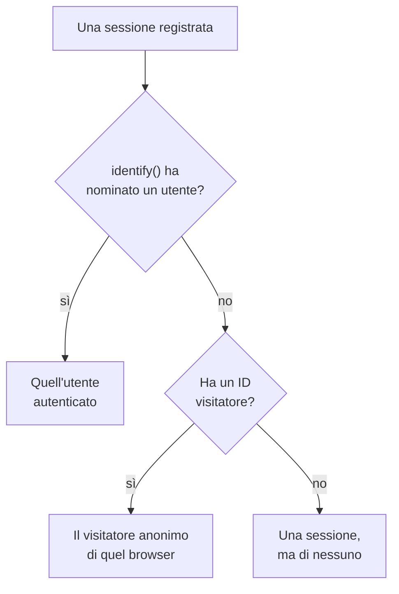

# Analisi del prodotto

L'analisi del prodotto conta le persone che usano un'applicazione RUM e come vanno le loro sessioni: utenti attivi, nuovi, di ritorno, autenticati e inattivi, e sessioni per dispositivo, browser, paese e pagina. Conta le sessioni che la [Riproduzione delle sessioni](/docs/telemetry/session-replay) registra, quindi non le serve uno snippet suo, e conserva i suoi numeri per 13 mesi, molto dopo la scadenza delle registrazioni.

:::cards
- [Come si contano le persone](#come-si-contano-le-persone): Un utente autenticato una volta, un browser anonimo una volta.
- [Utenti](#utenti): Utenti attivi, nuovi, di ritorno, autenticati, totali e inattivi.
- [Sessioni](#sessioni): Quante, quanto durano, e per dispositivo, browser, paese e pagina.
- [Privacy e conservazione](#privacy-e-conservazione): 13 mesi, nessun nome memorizzato, cancellati su richiesta.
:::

## Come si contano le persone

Il menu laterale di un'applicazione ha una sezione **Analisi del prodotto** con due pagine, **Utenti** e **Sessioni**. Entrambe contano le sessioni che la Riproduzione delle sessioni registra, quindi iniziano quando inizia il registratore dell'applicazione, e una sessione che la policy di riproduzione non registra non viene contata. Ogni sessione conta per una persona, o per nessuno:

- **Un utente autenticato conta una volta**, su ogni browser e dispositivo che usa: viene riconosciuto dall'hash unidirezionale del riferimento che la tua pagina ha passato a `identify()` (vedi [Identificare i tuoi utenti](/docs/telemetry/session-replay#identificare-i-tuoi-utenti)).
- **Un browser anonimo conta una volta**, tramite il suo [ID visitatore anonimo](/docs/telemetry/session-replay#visitatori-anonimi). Due browser sono due visitatori, e le sessioni che un browser ha avuto prima che qualcuno vi si autenticasse restano del suo visitatore.
- **Una sessione di un registratore più vecchio**, che non inviava un ID visitatore, conta come sessione ma non come persona.

I giorni sono contati nel tuo fuso orario.

## Utenti

**Utenti** conta le persone dell'intervallo che scegli:

| Riquadro | Cosa conta |
| --- | --- |
| **Utenti attivi** | Tutti quelli che sono venuti nell'intervallo: ogni utente autenticato una volta e ogni browser anonimo una volta. |
| **Nuovi utenti** | Gli utenti attivi la cui prima visita è stata nell'intervallo. |
| **Utenti di ritorno** | Gli utenti attivi che erano già venuti prima dell'inizio dell'intervallo. |
| **Utenti autenticati** | Gli utenti attivi che la tua app ha autenticato con `identify()`, e la loro quota di tutti gli utenti attivi. |
| **Utenti totali** | Tutti quelli che l'applicazione ha visto negli ultimi 13 mesi. |
| **Utenti inattivi** | Le persone venute prima ma non negli ultimi 30 giorni, o nei 7, 14, 60 o 90 giorni che scegli. |

I primi tre dicono anche come sono cambiati rispetto al periodo precedente. Sotto i riquadri, **Utenti attivi** traccia, per ogni giorno, le persone venute quel giorno, quelle venute nei 7 giorni fino a quel giorno e quelle venute nei 30 giorni fino a quel giorno, e **Utenti nuovi e di ritorno** divide in due le persone di ogni giorno.

**Persone** elenca tutti quelli che i riquadri contano, una riga per persona, prima i visti più di recente, e il suo filtro mostra le persone di un riquadro, i visitatori anonimi o tutti. Apri una persona per vedere la sua prima e la sua ultima visita e ognuna delle sue sessioni degli ultimi 13 mesi, con **Guarda** su ognuna la cui registrazione è ancora conservata.

## Sessioni

**Sessioni** conta le sessioni iniziate nell'intervallo: **Sessioni**, **Sessioni autenticate**, **Durata mediana delle sessioni**, **Pagine per sessione**, **Sessioni con errori** e **Sessioni con frustrazione**. Sotto i riquadri:

- **Sessioni per dispositivo** traccia le sessioni di ogni giorno da desktop, telefoni e tablet. La sessione di un'app mobile su uno schermo il cui lato corto misura 600 punti o più conta come quella di un tablet.
- **Durata delle sessioni** ordina le sessioni concluse per quanto sono durate, da meno di 10 secondi a oltre 30 minuti. Una sessione che è ancora in registrazione non ha ancora una durata.
- **Dettaglio** classifica utenti e sessioni per tipo di dispositivo, browser, sistema operativo, paese, versione dell'app, pagina di ingresso o pagina, prima quelli con più utenti.

## Privacy e conservazione

- **13 mesi.** I numeri di un mese vengono rimossi il primo giorno del 13° mese successivo, quindi gli ultimi 12 mesi completi ci sono sempre, qualunque sia la conservazione propria delle registrazioni (7 giorni per impostazione predefinita).
- **Nessun nome memorizzato.** I numeri conservano la chiave unidirezionale di un utente autenticato e l'ID visitatore di un browser, mai il riferimento, i tratti o un indirizzo IP. Una riga nomina un utente autenticato solo finché una delle sue registrazioni è ancora conservata, e solo per un ruolo che può leggere l'identità; altrimenti mostra **Utente autenticato** o **Visitatore anonimo** e l'inizio dell'ID.
- **Cancellati su richiesta.** Una richiesta di cancellazione rimuove anche qui i numeri corrispondenti (vedi [Cancellare le sessioni](/docs/telemetry/session-replay#cancellare-le-sessioni)).

## Chi può vederla

Leggere le due pagine richiede ciò che richiede la lista delle sessioni: `ReadRumSessionReplay` (_List Session Replays_) o `ReadRumSessionReplayPayload` (_Watch Session Replays_), che i proprietari e gli amministratori del progetto hanno. Vedere chi è un utente autenticato, e cercare persone per nome, richiede il permesso di identità descritto in [Chi può guardare una registrazione](/docs/telemetry/session-replay#chi-può-guardare-una-registrazione).

## Passaggi successivi

:::cards
- [Riproduzione delle sessioni](/docs/telemetry/session-replay): Registra le sessioni che queste pagine contano, e guardale.
- [Gestire le applicazioni](/docs/rum/applications): Nomi, etichette, proprietari e conservazione.
- [Panoramica del RUM](/docs/rum/index): Cos'altro mostra un'applicazione RUM.
:::
