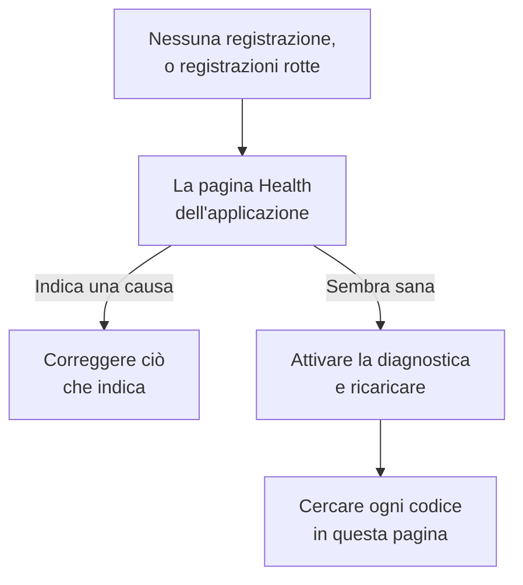

# Risoluzione dei problemi della riproduzione delle sessioni

Quando non arriva nessuna registrazione, o arrivano rotte, questa pagina trova il motivo. La riproduzione delle sessioni registra ogni sessione per impostazione predefinita e la invia man mano, quindi una pagina sana invia un frammento circa ogni 15 secondi mentre l'utente fa qualcosa. Una scheda inattiva non produce eventi e non invia nulla, e dopo cinque minuti senza input il registratore si mette direttamente in pausa (`recording-paused-idle`), quindi muovi il mouse o fai clic prima di giudicare un'installazione dalla scheda Rete. Se anche così non vedi alcuna richiesta verso OneUptime, una delle cause qui sotto è il motivo.

:::cards
- [Attivare la diagnostica](#attivare-la-diagnostica): Fai spiegare al registratore ogni decisione nella console.
- [Codici](#codici): Ogni riga che il registratore stampa, e cosa fare.
- [Un firewall davanti a OneUptime rifiuta i frammenti](#un-firewall-davanti-a-oneuptime-rifiuta-i-frammenti): Regole da controllare ed esclusioni da aggiungere.
- [Mancano immagini, icone o stili nella riproduzione](#mancano-immagini-icone-o-stili-nella-riproduzione): Registrazioni che si riproducono, ma non come le ha viste il tuo utente.
:::



L'unica impostazione in cui il silenzio è normale è l'invio _On error or frustration_ (`OnErrorOrFrustration`): il registratore mantiene allora un buffer circolare in memoria e invia solo quando qualcosa va storto, il che sembra esattamente un'installazione rotta finché non scatta un trigger. Controlla quale usi prima di cercare altro: la riga `config-accepted` più sotto lo stampa.

Se puoi, inizia dal lato server. La pagina **Integrità** dell'applicazione, nella sezione **Riproduzione delle sessioni** del suo menu laterale, indica la causa quando non arriva nulla: il registratore non si è mai caricato, si è caricato ma non ha inviato nulla e perché, gli invii vengono rifiutati e per quale motivo, oppure il budget è esaurito. Vedi [Stato della registrazione](/docs/telemetry/session-replay#stato-della-registrazione). Quello che segue è il lato browser: attiva la diagnostica, ricarica una volta e leggi la console.

Le registrazioni arrivano, ma si riproducono con immagini rotte, icone mancanti o zone senza stile? È una questione di riproduzione, a cui risponde [Mancano immagini, icone o stili nella riproduzione](#mancano-immagini-icone-o-stili-nella-riproduzione).

## Attivare la diagnostica

Scegli l'interruttore che hai a portata di mano. Fanno tutti la stessa cosa.

:::tabs
@tab Nel browser
Nel browser che ha il problema. Non richiede un nuovo deploy, funziona in produzione e sopravvive ai ricaricamenti:

```js
localStorage.setItem("oneuptime.sessionReplay.debug", "true");
// then reload the page
```

Disattivala di nuovo con:

```js
localStorage.removeItem("oneuptime.sessionReplay.debug");
```
@tab Con un link
Per una persona non tecnica, o una pagina su cui non puoi aprire una console, aggiungi `oneuptime_debug=1` all'URL. Funziona anche nel frammento dell'URL, che sopravvive a un server che rimuove i parametri di query che non conosce:

```text
https://your-app.example.com/checkout?oneuptime_debug=1
https://your-app.example.com/checkout#oneuptime_debug=1
```
@tab Sul tag script
Per un ambiente di staging, dove la vuoi attiva per tutti:

```html
<script
  src="https://oneuptime.com/telemetry/session-replay/v1/recorder.js"
  data-oneuptime-token="YOUR_TELEMETRY_INGESTION_KEY"
  data-oneuptime-app-identifier="YOUR_RUM_APP_IDENTIFIER"
  data-oneuptime-debug="true"
  crossorigin="anonymous"
  async
></script>
```
@tab Nel global di inizializzazione
Se configuri il registratore con il global di inizializzazione:

```js
window.__ONEUPTIME_SESSION_REPLAY__ = {
  host: "https://oneuptime.com",
  token: "YOUR_TELEMETRY_INGESTION_KEY",
  appIdentifier: "YOUR_RUM_APP_IDENTIFIER",
  debug: true,
};
```
@tab Nel deployment
Sul deployment di OneUptime, l'unico interruttore che non richiede qualcuno davanti al browser che ha il problema. Imposta `SESSION_REPLAY_DEBUG=true` e riavvia. Ogni registratore servito da questa istanza registra allora su ogni pagina in cui viene eseguito, quindi attivalo, raccogli un ricaricamento e disattivalo. Non cambia alcuna policy: né il campionamento, né il mascheramento, né il consenso. Vedi [Note per l'installazione self-hosted](/docs/telemetry/session-replay#note-per-linstallazione-self-hosted) per le altre impostazioni del deployment.
@tab In fase di esecuzione
Una volta caricato il registratore:

```js
OneUptimeReplay.setDebug(true);
```
:::

L'output ha questo aspetto:

```text
[OneUptime Session Replay] loader-start: Loader running.
[OneUptime Session Replay] init-options-read: Init options read. {host: "https://oneuptime.com", appIdentifier: "checkout-web", …}
[OneUptime Session Replay] config-fetch-start: Requesting the policy. {url: "https://oneuptime.com/telemetry/session-replay/v1/config", …}
[OneUptime Session Replay] config-accepted: Policy accepted. {captureTrigger: "Always", samplePercentage: 100, …}
[OneUptime Session Replay] recording: Recording and uploading …
```

## Ottenere la cronologia senza attivare nulla prima

Il registratore conserva le sue ultime 250 decisioni, che la diagnostica sia attiva o no. Se il problema si è già verificato, non devi riprodurlo con il logging attivo — chiedi invece questo:

```js
copy(JSON.stringify(OneUptimeReplay.getDiagnostics(), null, 2));
```

Restituisce la versione del registratore, l'id di sessione, il suo `state` (`recording`, `uploading`, `not-sampled`, `stopped`…), perché si è fermato se lo ha fatto, la `bootstrapDecision`, la risposta di ogni barriera in `decisions` (campionata o no, stato del consenso, se gli invii sono consentiti e cosa li blocca, l'ultima direttiva del server), le `capabilities` del registratore e l'elenco completo dei record — compresi quelli del loader, che viene eseguito prima che esista l'artefatto del registratore ed è dove si decide la maggior parte delle rinunce. Per costruzione non contiene alcun contenuto della pagina; vedi [Cosa la diagnostica non contiene mai](#cosa-la-diagnostica-non-contiene-mai). I campi sono descritti in [`getDiagnostics()`](/docs/telemetry/session-replay#getdiagnostics).

**Se ottieni `OneUptimeReplay is not defined`**, l'artefatto del registratore non si è mai caricato — il che è già di per sé la risposta a buona parte dei codici qui sotto, e proprio quando la cronologia ti serve di più. I record sono comunque lì, in un global in cui il loader scrive prima che l'artefatto esista:

```js
copy(JSON.stringify(window.__ONEUPTIME_SESSION_REPLAY_DEBUG__.records, null, 2));
```

Incolla l'uno o l'altro nel tuo ticket di supporto — oppure in **Ask the browser** nella pagina **Integrità** dell'applicazione, che spiega ogni codice che contiene. Spesso basta da solo.

## Quando il silenzio è normale: la policy attivata dagli errori

Questa sezione si applica solo se `config-accepted` ha stampato `captureTrigger: "OnErrorOrFrustration"`. Con la policy `Always` predefinita, il registratore invia man mano che registra, e il silenzio su una pagina con cui l'utente interagisce significa che qualcosa non va davvero — continua a leggere oltre questa sezione.

Se la console dice questo:

```text
[OneUptime Session Replay] recording: Recording into memory. Nothing uploads until a trigger fires - call OneUptimeReplay.captureSession() to force one.
```

…allora il registratore funziona. Con una policy attivata dagli errori, una pagina sana fa esattamente una richiesta a OneUptime per caricamento di pagina (il recupero della configurazione) e non invia nient'altro finché non si verifica un errore, un 5xx, un segnale di frustrazione o il superamento di un budget di prestazioni.

Per provare l'intero percorso da un capo all'altro, forza un invio:

```js
OneUptimeReplay.captureSession("installation test");
```

Dovresti vedere subito un `POST /telemetry/session-replay/v1/chunk` nella scheda Rete e una riga `chunk-accepted` nella console. Se è così, l'installazione è corretta e la riproduzione comparirà nella dashboard entro circa un minuto, con il tuo motivo indicato sulla sua cronologia.

Un `202` con `chunk-accepted` è quello da cercare. Un `204` registra invece `chunk-not-recorded`: la richiesta era corretta e il server ha deciso di non archiviarla — budget superato, non campionata o applicazione disattivata. È una risposta della policy, non un guasto dell'installazione, e la riga `server-directive` accanto dice quale.

Per tornare a registrare ogni sessione, imposta **Quando caricare una registrazione** su _Always_ e **Percentuale di campionamento** sopra 0 nella pagina **Replay Policy** dell'applicazione. È il valore predefinito di fabbrica.

## Codici

Ogni riga porta un `code` stabile. Cerca qui il tuo.

### Avvio

| code | cosa significa |
| --- | --- |
| `loader-start` | Lo script del registratore è stato eseguito. Se non lo vedi con la diagnostica attiva, lo script stesso non è mai stato eseguito — controlla la richiesta `<script>` nella scheda Rete e lo `script-src` della tua CSP. |
| `init-options-read` | Sono state trovate delle opzioni. Controlla `host` e `appIdentifier` nel dettaglio: `appIdentifier` deve corrispondere esattamente all'applicazione RUM, e `host` deve essere la tua origine OneUptime, non quella della tua app. |
| `init-options-incomplete` | Manca un'opzione obbligatoria. Il dettaglio dice quale tra `hasHost` / `hasToken` / `hasAppIdentifier` è false. Se `hasHost` è false, il tag script non ha un `src` da cui ricavare l'host — aggiungi `data-oneuptime-host`. |
| `privacy-signal` | Il browser invia Do Not Track o Global Privacy Control e viene rispettato — dalla pagina (nulla nel tag script dice il contrario) o dalla policy del server. Non viene registrato nulla; con `stage: "before-config-fetch"` non viene fatta nemmeno alcuna richiesta di configurazione. Non è un guasto. Imposta `data-oneuptime-respect-do-not-track="false"` solo se la tua base giuridica davvero non dipende dal segnale. |
| `init-options-missing` | Non c'è nulla da leggere sulla pagina: né un tag `script[data-oneuptime-token]` né `window.__ONEUPTIME_SESSION_REPLAY__`. L'attributo marcatore è scritto male, lo snippet è finito in un altro documento oppure un tag manager lo ha rimosso. |
| `loader-threw` | Un errore del registratore stesso, non della tua configurazione. Segnalalo con l'output della diagnostica. |

### Policy

| code | cosa significa |
| --- | --- |
| `config-fetch-start` | Sta per richiedere la policy. La `url` nel dettaglio è l'URL esatto — verifica che risponda da un browser. |
| `config-fetch-rejected` | L'endpoint ha risposto con qualcosa di diverso da 2xx. Vedi [Stati del recupero della configurazione](#stati-del-recupero-della-configurazione) più sotto. |
| `config-fetch-failed` | La richiesta non si è mai completata: `connect-src` della CSP, un blocco annunci, DNS, TLS, assenza di connessione o un timeout di 5 secondi. Il browser di solito registra una propria riga accanto a questa. |
| `config-body-unparseable` | L'endpoint ha risposto 2xx con un corpo che non è affatto JSON. Diverso da `config-fetch-failed`: la richiesta *si è* completata, quindi qualcosa lungo il percorso — un proxy, un captive portal, una pagina intermedia SSO — ha risposto al posto di OneUptime. |
| `config-unparseable` | Il corpo *era* JSON valido, ma non un oggetto — `null`, una stringa, un array. Un proxy che riscrive, o un server che risponde a un altro percorso. |
| `config-disabled` | Il server dice che la riproduzione è disattivata qui. Il `disabledReason` nel dettaglio è la risposta: vedi [disabledReason](#disabledreason) più sotto. |
| `config-recorder-version-invalid` | La policy non indicava esattamente `latest` in minuscolo, quindi non è stato possibile costruire alcun URL dell'artefatto. Un proxy che riscrive o una risposta manomessa — un deployment senza build segnala invece `config-disabled` con `recorder-not-built`. |
| `config-accepted` | La policy è stata accettata. Il dettaglio è l'intera policy — `captureTrigger`, `samplePercentage`, `consentMode`, `maskingMode`. |
| `config-field-defaulted` | Il server non ha inviato alcun valore per un campo della policy (indicato nel dettaglio), quindi questo registratore ha usato il valore predefinito del prodotto. Informativo: di solito un server più vecchio del registratore. Se la dashboard mostra un altro valore per quel campo, aggiorna OneUptime. |
| `config-value-unrecognised` | Il server ha inviato un valore che questa build del registratore non conosce, quindi è ripiegato su quello più sicuro — che potrebbe non essere quello mostrato dalla tua dashboard. Di solito una pagina che esegue ancora un registratore di un deployment precedente. |
| `directive-stop` | Il server ha detto a questo registratore di ritirarsi. Controlla lo stato della registrazione dell'applicazione per un budget, un limite di frequenza o un kill switch. |

#### Stati del recupero della configurazione

| stato | soluzione |
| --- | --- |
| `401` | Il token di acquisizione è errato, revocato, scaduto o di un altro progetto. Creane uno in **Impostazioni del progetto → Telemetria e APM → Chiavi di acquisizione** e confermalo con `GET /session-replay/v1/validate` — invia la chiave come fa il registratore e aggiungi l'intestazione `x-oneuptime-app-identifier`, e la risposta riporta anche `isSessionReplayEnabled` per quell'applicazione, `sessionReplayDisabledDetail` che indica l'interruttore spento quando non lo è, `isIngestEnabledOnThisInstance` e il `keyType`. |
| `400` | Manca `data-oneuptime-app-identifier`. |
| `403` | L'origine della pagina non è negli **Origini consentite** della chiave di acquisizione. Aggiungila, oppure usa una chiave il cui elenco delle origini consentite copra questa pagina. |
| `404` | Il percorso non è stato risolto sull'origine OneUptime. Quasi sempre un `data-oneuptime-host` errato — oppure un reverse proxy davanti a OneUptime che non inoltra `/telemetry/*`. |
| `5xx` | Un errore lato server; controlla i log dell'app OneUptime. |

#### disabledReason

| valore | cosa fare |
| --- | --- |
| `not-enabled-for-application` | La riproduzione delle sessioni è disattivata per questa applicazione RUM, l'identificatore non corrisponde a nessuna, oppure il progetto non è autorizzato alla riproduzione. `disabledDetail` dice quale: `application-not-enabled` (l'interruttore di questa applicazione), `project-not-allowed` (l'interruttore dell'intero progetto, in **Monitoraggio degli utenti reali → Impostazioni → Riproduzione delle sessioni**), `application-unknown` (nessuna applicazione ha questo `appIdentifier` — controlla l'ortografia nella pagina **Replay Policy** dell'applicazione) o `project-killed` (un kill switch dell'operatore su questo deployment). |
| `budget-exhausted` | Il budget giornaliero di byte del progetto o il budget mensile dell'applicazione è già esaurito, quindi ai registratori viene detto di non registrare invece di inviare frammenti che verrebbero rifiutati. `disabledDetail` è `project-daily-budget-exhausted` o `app-monthly-budget-exhausted`, e `budgetResetsAt` indica quando si libera. Aumenta il budget nella pagina **Replay Policy**, oppure attendi il reset. |
| `recorder-not-built` | **Il deployment non ha l'artefatto del registratore.** Nulla sulla pagina del cliente può risolverlo. La build che produce `packages/App/FeatureSet/BrowserRecorder/public/dist/manifest.json` non è stata eseguita, oppure il suo risultato non è arrivato nell'immagine in esecuzione. Ricompila e ridistribuisci l'app OneUptime. È la risposta tipica su un'installazione self-hosted in cui la riproduzione non ha mai funzionato. |
| `disabled-by-default` | `SESSION_REPLAY_ENABLED_BY_DEFAULT=false` su questo deployment. Impostalo su `true` — e prima imposta `SESSION_REPLAY_MAX_BYTES_PER_PROJECT_PER_DAY` se sei in self-hosting, perché la riproduzione è la tabella più pesante che hai. |
| `ingest-disabled` | `SESSION_REPLAY_INGEST_ENABLED=false` su questo deployment. |
| `policy-unavailable` | Il server non è riuscito a risolvere la policy — di solito Redis o Postgres. Fallisce in modo chiuso di proposito. Controlla i log dell'app OneUptime. |
| `not-reported` | Il server è più vecchio di questo campo. Usa invece il pannello **Test your installation** della dashboard, nella pagina **Replay Policy**. |

### L'artefatto

| code | cosa significa |
| --- | --- |
| `artifact-requested` | Si sta iniettando l'ultimo bundle del registratore. La `url` è quella esatta. |
| `artifact-load-failed` | Non si è caricato. In ordine di probabilità: uno `script-src` della CSP che non consente la tua origine OneUptime, una mancata corrispondenza SRI (un proxy che riscrive il bundle) o un 404 perché questo deployment non ha compilato il registratore. |
| `artifact-url-invalid` | La policy non indicava esattamente `latest` in minuscolo, quindi non è stato costruito alcun URL. Una risposta di configurazione manomessa o passata da un proxy. |
| `artifact-api-missing` | Il bundle si è caricato ma non ha pubblicato `window.OneUptimeReplay` — un altro script della pagina lo ha sovrascritto. |
| `bootstrap` | L'artefatto del registratore si sta avviando. |
| `bootstrap-already-started` | Due copie dello snippet sulla stessa pagina. Rimuovine una. |
| `bootstrap-already-running` | `bootstrap()` è stato chiamato di nuovo mentre un registratore era già in esecuzione. Innocuo; di solito un'integrazione duplicata. |
| `bootstrap-cancelled` | Un `revokeConsent()` o `stop()` in coda in `window.OneUptimeReplayQueue` è stato eseguito prima dell'avvio del registratore, quindi questa sessione non viene registrata. Corretto se il tuo banner era già stato rifiutato. |
| `prerender-wait` | Il browser ha pre-renderizzato questa pagina, come fa Chrome con una pagina che si aspetta venga aperta come successiva, e nessuno l'ha ancora aperta. Il registratore si avvia quando il visitatore apre la pagina, quindi una pagina che non viene mai aperta non registra nulla; le chiamate che la tua pagina fa nel frattempo vengono applicate allora. |
| `start-stopped` | `start()` non ha ricevuto alcuna policy utilizzabile nel percorso del bundle autonomo. Il motivo preciso è nella riga `config-*` subito sopra. |
| `rrweb-did-not-start` | Il registratore del DOM si è rifiutato di avviarsi. Segnalalo. |
| `rrweb-error` | Il registratore del DOM ha avuto un errore interno su questa pagina (il nome dell'errore è nel dettaglio; viene registrato una volta). La registrazione può saltare o bloccarsi intorno a quel punto, e dopo tre errori di questo tipo la sessione porta un avviso di fedeltà che lo dice. Segnalalo con il framework della pagina e il nome dell'errore. |

### Registrazione e invio

| code | cosa significa |
| --- | --- |
| `not-sampled` | Questa sessione ha perso l'estrazione del campionamento, quindi non viene registrato nulla. Il campionamento è deterministico in base all'id di sessione, quindi ricaricare non aiuterà questa sessione. Aumenta la percentuale di campionamento. |
| `recording` | In registrazione. Leggi il dettaglio: `uploading: true` è lo stato normale con il trigger predefinito `Always`. `uploading: false` con `captureTrigger: "OnErrorOrFrustration"` è l'altro stato sano, senza richieste. |
| `same-origin-propagation` | Registrato una volta all'avvio del registratore: se aggiunge il contesto di traccia (`traceparent`, e un `tracestate` che porta l'id di sessione) alle richieste verso l'origine propria della pagina. `enabled: true` con `reason: "on"` è il valore predefinito. `reason: "policy-off"` significa che **Propagazione delle tracce stessa origine** è disattivato nella pagina **Replay Policy** dell'applicazione; `reason: "opaque-origin"` significa che la pagina non ha un'origine propria (un iframe in sandbox, `about:blank`, `srcdoc` o `file:`), quindi nulla conta come stessa origine. Anche quando è attivo, le intestazioni vanno solo sulle richieste fatte mentre la sessione invia, e mai su un `POST` verso un percorso che termina con `/v1/traces`, `/v1/logs` o `/v1/metrics` (le esportazioni OpenTelemetry della pagina stessa). Registrato un'altra volta, con `reason: "agent-stand-down"` e un campo `agent` (`DD_RUM`, `NREUM` o `elasticApm`), la prima volta in un caricamento di pagina in cui il registratore lascia il `traceparent` di una richiesta della stessa origine a quell'agente perché è configurato per tracciare la richiesta (Datadog RUM solo in una sessione tracciata); la richiesta riceve comunque il membro `tracestate`, e si collega solo se l'agente invia davvero un `traceparent`, cosa che Datadog fa solo in una sessione Datadog tracciata e campionata per le tracce. New Relic (`NREUM`) invia il proprio `tracestate` al posto del membro, quindi le sue richieste si collegano solo tramite id di traccia (vedi [le schede Logs e Traces sono vuote](#le-schede-logs-e-traces-del-lettore-sono-vuote)). Vedi [Correlare con il resto della tua telemetria](/docs/telemetry/session-replay#correlare-con-il-resto-della-tua-telemetria). |
| `same-origin-propagation-tripped` | Una richiesta a cui il registratore aveva aggiunto il contesto di traccia è fallita a livello di rete, di solito una richiesta della stessa origine reindirizzata a un'altra origine che non consente `traceparent` e `tracestate`. Il registratore ha smesso di aggiungerle per il resto di questo caricamento di pagina. `retried: true` significa che era un `fetch` `GET` o `HEAD` senza corpo ed è stato inviato ancora una volta esattamente come lo aveva fatto la tua pagina; `false` significa che non poteva essere ritentato ed è fallito: nient'altro che un `fetch` `GET` o `HEAD` senza corpo (nessun XHR, nessun altro metodo, nessuna richiesta con corpo) viene ritentato. Annullamenti e timeout della tua pagina non lo attivano, e nemmeno un errore mentre il browser si dichiara offline; il caricamento di pagina successivo riparte da zero. Vedi [Download o reindirizzamenti falliscono dopo aver attivato la riproduzione delle sessioni](#download-o-reindirizzamenti-falliscono-dopo-aver-attivato-la-riproduzione-delle-sessioni). |
| `trigger` | È successo qualcosa che vale la pena conservare. La `reason` è una tra `error`, `frustration`, `performance`, `sampled` o `manual`. |
| `upload-started` | Si sta svuotando il pre-roll del buffer. I POST dei frammenti iniziano qui. |
| `upload-blocked-consent` | È scattato un trigger e non è stato inviato nulla perché il consenso non è mai stato dato. Con la modalità di consenso `RequireExplicit`, la tua pagina deve chiamare `OneUptimeReplay.grantConsent()` quando il tuo banner viene accettato. |
| `chunk-discarded-consent` | La stessa causa, un livello più in basso: un frammento completo è stato scartato. |
| `chunk-accepted` | Un frammento è arrivato ed è stato archiviato. L'installazione funziona. |
| `chunk-not-recorded` | Il server ha accettato la richiesta e ha deciso deliberatamente di non registrarla — budget superato, non campionata, applicazione disattivata o il limite di frammenti per sessione. La riga `server-directive` accanto riporta il motivo. L'installazione è corretta; la policy o il budget non sono quelli che ti aspetti. |
| `chunk-post-failed` | Il POST non ha mai raggiunto il server, prima che questa pagina avesse inviato qualcosa con successo. `connect-src` della CSP, un blocco annunci o CORS sull'origine di acquisizione — oppure una pagina che ha perso la connessione prima del suo primo invio. Conta per l'interruttore automatico. |
| `chunk-held-offline` | Modalità offline: il dispositivo non ha connessione (il browser si dichiara offline, oppure una richiesta non ha mai raggiunto un server che aveva già risposto prima). La registrazione continua e il frammento attende; `queueDepth` è quanti ne attendono e `retryInMs` quando avverrà il prossimo tentativo. Non conta come errore e non si perde nulla. |
| `back-online` | La prima richiesta dopo un'interruzione ha raggiunto il server. I frammenti in coda vengono inviati, dal più vecchio al più recente. |
| `browser-offline` | Il browser ha emesso il suo evento `offline`. La registrazione continua; il registratore apre il suo archivio offline in modo che i frammenti di una scheda chiusa ora vengano conservati. |
| `browser-online` | Il browser ha emesso il suo evento `online`, e i `queuedChunks` vengono inviati ora invece che con il timer dei tentativi. |
| `offline-queue-full` | L'interruzione è durata più della coda di invio (240 frammenti o 4 MB): i `dropped` frammenti più vecchi sono stati scartati per conservare i più recenti. La sessione mostra un vuoto dove si trovavano. |
| `offline-flush-stored` | La pagina è stata nascosta o chiusa mentre era offline, quindi i suoi ultimi frammenti sono stati scritti nell'IndexedDB del browser invece di essere inviati. `storeOpen: false` significa che l'archivio non aveva finito di aprirsi e una scheda che si chiude può ancora perderli. La pagina successiva dell'app li invia. |
| `final-flush-deferred` | La richiesta di chiusura non poteva trasportare tutti i frammenti, e il resto (`kept`) è stato scritto in IndexedDB per la pagina successiva invece di essere scartato. |
| `offline-chunks-restored` | Questa pagina ha trovato `chunks` che una pagina precedente ha registrato offline e non è riuscita a inviare, e li sta inviando prima dei propri. |
| `offline-chunk-claimed-elsewhere` | Un'altra scheda della stessa app ha già inviato un frammento che questa scheda aveva archiviato, quindi questa scheda l'ha saltato. Non manca nulla. |
| `chunk-post-server-error` | Il server ha risposto 5xx. Il registratore riprova; `consecutiveFailures` rispetto a `maxFlushFailures` nel dettaglio indica quanto è vicino ad arrendersi. |
| `chunk-retry-scheduled` | Un errore ritentabile (rete, 5xx o una limitazione del server) ha messo il frammento nella coda dei tentativi; `inMs` nel dettaglio è la pausa prima del tentativo successivo, e `queueDepth` quanti frammenti attendono. Non si è ancora perso nulla. |
| `chunk-retry` | La pausa è terminata e i frammenti in coda vengono inviati di nuovo. |
| `chunk-abandoned` | Un frammento è fallito troppe volte ed è stato scartato; l'invio continua con il successivo. La sessione mostrerà un vuoto dove si trovava. Guarda la riga `chunk-post-*` precedente per la causa. |
| `final-chunk-carried-queue` | La pagina è stata nascosta o chiusa mentre c'erano ancora frammenti in coda per un nuovo tentativo, e sono partiti come frame aggiuntivi dell'unica richiesta della pagina al momento di nascondersi: `frames` è quanti ne ha trasportati la richiesta, `bytes` la sua dimensione totale. Non si è perso nulla — ciò che non ci stava è riportato da `final-flush-partial`. |
| `final-flush-truncated` | Quando la pagina se n'è andata c'era nel buffer più di quanto possa trasportare una richiesta keepalive, quindi gli eventi più vecchi del frammento di chiusura sono stati scartati per farlo entrare; `droppedEvents` dice quanti. La fine della sessione — la parte che di solito cerchi — è ciò che sopravvive. |
| `final-flush-partial` | La richiesta di chiusura non ha potuto trasportare tutti i frammenti che le erano stati dati: sono partiti `sent` frame e `dropped` no. Il frammento di chiusura viene scelto per primo, quindi ciò che si perde sono frammenti più vecchi in coda, e la sessione mostra un vuoto dove si trovavano. |
| `chunk-too-large` | Un frammento superava ancora il limite per richiesta dopo la compressione — uno snapshot di pagina intera indivisibile di un DOM molto grande. Viene inviata solo la sua dimensione dichiarata, il server risponde 422, e la sessione porta un avviso di fedeltà al posto di quello snapshot invece di fallire. |
| `envelope-trimmed` | Il JSON di intestazione del frammento superava il limite di busta di 8 KB del server, quindi i campi facoltativi sono stati scartati in questo ordine finché non è entrato: id di traccia, route, attributi, tag, avvisi di fedeltà (`shed` elenca ciò che è stato tolto). Le immagini non sono interessate; alla sessione possono mancare alcuni dati di correlazione o di tag. Di solito 20 tag e 20 attributi alla lunghezza massima nella stessa sessione. |
| `final-chunk-too-large` | Un frammento inviato quando la pagina se n'è andata superava i 56 KB che il registratore si concede per uno svuotamento quando la pagina viene nascosta — deliberatamente sotto la quota keepalive combinata di 64 KB del browser. Con `sealed: true` era il frammento finale: i suoi eventi sono stati scartati, quindi la registrazione termina qualche secondo prima, e al suo posto parte un frammento finale vuoto, così la sessione termina comunque con la scheda e la sequenza dei frammenti non ha vuoti. Con `sealed: false` non era un frammento finale: è stato scartato per intero, nulla è stato chiuso, e la sessione resta aperta con un vuoto dove si trovava quel frammento. In entrambi i casi ciò che si perde sono gli eventi di quel frammento; un frammento in coda che non ha potuto viaggiare nella stessa richiesta è riportato a parte, da `final-flush-partial`. |
| `upload-blocked-transport` | È scattato un trigger quando l'invio era già disattivato per questa pagina. La riga `transport-disabled` sopra dice perché. |
| `chunk-rejected-terminal` | L'invio si è fermato definitivamente. `status: 401` è un token errato; `status: 403` è un'origine che non è nell'elenco delle origini consentite dell'applicazione o della chiave; `status: 404` è un host errato. Correggi e ricarica — il registratore non riprova da solo. Leggi prima `answeredBy`: `"not-oneuptime"` significa che il rifiuto non è venuto affatto da OneUptime — ha risposto un web application firewall, una CDN o un proxy davanti a esso, oppure l'host non è OneUptime. Vedi [Un firewall davanti a OneUptime rifiuta i frammenti](#un-firewall-davanti-a-oneuptime-rifiuta-i-frammenti). |
| `chunk-refused` | Un frammento è stato rifiutato (troppo grande, o illeggibile) e la registrazione è proseguita senza di esso. |
| `chunk-refused-terminal` | L'invio si è fermato perché il server rifiuterà ogni frammento di questo registratore: o l'`error` nel dettaglio è uno a cui il server risponde sempre allo stesso modo (`unsupported-wire-version` — un registratore che il server non accetta più; `app-identifier-mismatch` o `missing-app-identifier` — il frammento indica un'applicazione diversa da quella per cui è stata recuperata la policy; `malformed-body` / `malformed-envelope` / `missing-envelope` — un proxy che riscrive la richiesta), oppure ogni frammento recente è stato rifiutato come malformato. Aggiorna OneUptime in modo che il registratore pubblicato corrisponda al server, e segnalalo con la diagnostica se persiste. |
| `chunk-throttled` | Frequenza limitata. Gli invii si mettono in pausa e riprendono da soli. |
| `transport-disabled` | L'interruttore automatico è scattato dopo errori ripetuti. La `reason` dice quale. |
| `server-directive` | Il server ha cambiato ciò che il registratore deve fare a metà sessione. La `reason` è un vocabolario chiuso — vedi [Stati del POST dei frammenti](#stati-del-post-dei-frammenti) più sotto. |
| `recorder-stopped-by-server` | Il server ha detto al registratore di fermarsi. Di solito il budget giornaliero di byte. |
| `recorder-throttled-by-server` | Il server ha chiesto al registratore di rallentare. Gli invii riprendono da soli; non c'è nulla da fare. |
| `recorder-stopped-transport` | L'invio è fallito in modo permanente, quindi la registrazione si è fermata e il buffer è stato liberato. La `reason` è la stessa riportata da `transport-disabled`. |
| `recorder-stopped` | La registrazione è terminata, con i totali della sessione: `droppedEvents`, `droppedChunks`, `flushFailures`. Tutti e tre dovrebbero essere 0 in una sessione sana. |
| `session-ended-idle` | Non è successo nulla sulla pagina per 30 minuti, quindi la sessione è terminata — con la data dell'ultima attività, non del momento in cui il registratore se n'è accorto (`idleForMs` dice quanto tempo fa). Non viene inviato nient'altro, e le richieste verso la tua origine non portano alcun id di sessione, finché l'utente non torna; una scheda aperta senza nessuno davanti non avvia una nuova sessione ogni mezz'ora. |
| `recording-paused-idle` | Nessuno ha premuto un tasto, fatto clic, mosso il mouse, usato la rotella o toccato la pagina per 5 minuti, quindi la registrazione si è messa in pausa (`idleForMs` dice quanto tempo era passato). Non viene catturato né inviato nulla, e le richieste verso la tua origine non portano alcun id di sessione, finché l'input successivo non riprende la stessa sessione — vedi [Tempo di inattività](/docs/telemetry/session-replay#tempo-di-inattività). Normale in qualsiasi scheda lasciata da sola. |
| `recording-resumed` | L'utente è tornato mentre la registrazione era in pausa, quindi è ripresa nella stessa sessione su uno snapshot nuovo (`pausedForMs` dice quanto è durata la pausa). Il lettore salta il tratto intermedio. |
| `session-rotated` | È iniziata una nuova sessione (l'utente è tornato dopo 30 minuti di inattività, la sessione ha raggiunto 4 ore, `identify()` ha indicato un utente diverso da quello della sessione — `rotationReason: "identity-change"` — oppure un'altra scheda dello stesso visitatore ne ha avviata una prima — `rotationReason: "adopted"`). La registrazione continua con un nuovo id, i listener di `onSessionChange` vengono avvisati, e da quel momento le richieste verso la tua origine portano il nuovo id. |
| `command-queue-not-an-array` | `window.OneUptimeReplayQueue` non è un array, quindi tutti i comandi in coda sono stati ignorati. Deve essere un array di voci `[command, ...arguments]`. |
| `command-queue-unknown-command` | Il nome di un comando in coda non è stato riconosciuto — controlla l'ortografia con l'[API JavaScript](/docs/telemetry/session-replay#api-javascript). |
| `command-queue-command-failed` | Un comando in coda ha generato un'eccezione quando è stato applicato — il `command` e il `name` dell'errore sono nel dettaglio. Il resto della coda è stato eseguito comunque. Di solito un argomento con la forma sbagliata (una stringa dove è previsto un oggetto di attributi). |

#### Stati del POST dei frammenti

Ciò che l'endpoint di acquisizione risponde al `POST` di un frammento, come lo vedresti nella scheda Rete. Solo i 4xx diversi da 429 significano che l'installazione è sbagliata.

| stato | cosa significa |
| --- | --- |
| `202` | Accettato e in coda per l'archiviazione. Se porta anche `directive: "stop"` con il motivo `session-chunk-cap`, i frammenti di questa richiesta che erano sotto il limite per sessione sono arrivati e nulla di successivo arriverà mai — una scheda aperta a lungo che raggiunge la fine di ciò che una sessione può contenere, non un guasto. |
| `204` | Ricevuto e deliberatamente non archiviato. Un 204 non ha corpo, quindi la direttiva viaggia nelle intestazioni: `x-oneuptime-replay-directive` è `stop` quando il registratore deve ritirarsi (riproduzione disattivata, non campionata, budget superato, al limite) o `continue` quando è stata rifiutata solo questa richiesta, e `x-oneuptime-replay-reason` porta il motivo. `consent-required` è quello che torna con `continue`: la modalità di consenso è _Require explicit_ e la pagina non ha ancora chiamato `grantConsent()`, quindi il registratore continua a registrare e riprova. Il vocabolario dei motivi è `ingest-disabled`, `instance-not-offering-replay`, `policy-unavailable`, `not-enabled`, `origin-not-allowed`, `session-chunk-cap`, `not-sampled`, `rate-limited`, `rate-counter-unavailable`, `budget-exhausted`, `budget-counter-unavailable`, `app-monthly-budget-exhausted` e `consent-required`, e la pagina **Integrità** li conta per nome. |
| `400` | Non è stato possibile servire il frame, e nemmeno il successivo della stessa build potrebbe esserlo, quindi il corpo porta `directive: "stop"` e un codice `error` stabile: `empty-body`, `missing-envelope`, `envelope-too-large`, `malformed-envelope`, `malformed-body`, `unsupported-wire-version`, `truncated-payload`, `too-many-frames`, `app-identifier-mismatch`, `missing-app-identifier` o `chunk-index-malformed` (un `chunkIndex` mancante, negativo, frazionario o assurdo). Sei di questi — `unsupported-wire-version`, `app-identifier-mismatch`, `missing-app-identifier`, `malformed-body`, `malformed-envelope`, `missing-envelope` — fermano subito l'invio (`chunk-refused-terminal`); qualsiasi altro 400 viene perdonato una volta e ferma l'invio dopo tre di fila. Quasi sempre un proxy che riscrive la richiesta, oppure un registratore e un server di versioni diverse. |
| `401` | La chiave di acquisizione è errata, revocata, scaduta o di un altro progetto. |
| `403` | L'origine della pagina non è nell'elenco delle origini consentite della chiave di acquisizione né dell'applicazione. Terminale — il registratore non riprova. Un 403 il cui corpo è una pagina HTML, o è vuoto, non è venuto da OneUptime: un web application firewall ha rifiutato la richiesta — vedi [Un firewall davanti a OneUptime rifiuta i frammenti](#un-firewall-davanti-a-oneuptime-rifiuta-i-frammenti). |
| `413` | Il corpo superava il limite per richiesta. Il registratore divide i frammenti ben al di sotto di esso, quindi si tratta di un proxy che ha ri-espanso un corpo compresso. Quel frammento viene scartato; la sessione continua. |
| `422` | `snapshot-too-large`: un frame ha dichiarato un payload oltre il limite — uno snapshot di pagina intera indivisibile che non entra. Per frammento, non terminale: la sessione sopravvive con un avviso di fedeltà che dice che manca quello snapshot, e la riproduzione riprende dal successivo. Alleggerisci il DOM, oppure attendi un vuoto su quel caricamento di pagina. |
| `429` | Frequenza limitata. `Retry-After` dice per quanto tempo; gli invii si mettono in pausa e riprendono da soli. |
| `503` | L'archivio dei frammenti non era raggiungibile. Il registratore riprova. |

### Chiamate fatte dalla tua pagina

Questi registrano ciò che il tuo codice ha chiesto al registratore. Servono a confermare che un banner di consenso o una cattura manuale abbiano davvero raggiunto il registratore, e quando.

| code | cosa significa |
| --- | --- |
| `api-capture-session` | È stato chiamato `captureSession()`. `hasReason` dice se portava un motivo per la cronologia. |
| `api-grant-consent` | È stato chiamato `grantConsent()`. |
| `api-revoke-consent` | È stato chiamato `revokeConsent()`. Tutto ciò che era nel buffer è stato scartato e l'invio si è fermato; il registratore continua a funzionare solo in memoria, quindi un `grantConsent()` successivo prosegue con una nuova sessione. |
| `api-stop` | È stato chiamato `stop()`. L'ultimo frammento è stato inviato e la sessione è stata chiusa; non viene registrato nulla per il resto della vita della pagina. |
| `api-no-recorder` | Una delle chiamate sopra è stata eseguita senza alcun registratore attivo — di solito perché è stata eseguita prima che l'artefatto del registratore si caricasse. Inserisci invece voci `[command, ...arguments]` in `window.OneUptimeReplayQueue`, e vengono applicate non appena arriva. |

## Nessuna richiesta nella scheda Rete

Segui questo elenco; è ordinato in base a quanto spesso ogni causa è la risposta.

1. **Filtra per `session-replay`, non per l'identificatore dell'applicazione.** La richiesta di configurazione è un `GET`, ed è l'unica richiesta che una sessione sana fa senza che scatti un trigger.
2. **C'è un `GET .../session-replay/v1/config`?**
   - **No, e nemmeno `loader-start` nella console** → lo script non è mai stato eseguito. Verifica che l'elemento `<script>` sia nel DOM, che la sua richiesta sia andata a buon fine e lo `script-src` della tua CSP.
   - **No, ma `privacy-signal` è nella console** → Do Not Track o GPC. Funziona come previsto.
   - **Sì, diverso da 2xx** → vedi [Stati del recupero della configurazione](#stati-del-recupero-della-configurazione).
3. **Nessun `POST` di frammenti?** Interagisci prima con la pagina — una scheda inattiva non ha nulla da inviare. Poi leggi la riga `recording`. Con il trigger predefinito `Always`, `uploading` dovrebbe essere `true` e i frammenti dovrebbero partire circa ogni 15 secondi di attività; `uploading: false` con `OnErrorOrFrustration` è normale — chiama `OneUptimeReplay.captureSession()` per forzarne uno e confermare che il percorso funziona.
4. **Ancora niente dopo `captureSession()`?** Cerca `upload-blocked-consent` (chiama `grantConsent()`), `not-sampled` o `transport-disabled`.

## Un firewall davanti a OneUptime rifiuta i frammenti

Se il registratore raggiunge OneUptime attraverso il tuo edge — un web application firewall come Azure Front Door o Application Gateway, Cloudflare, oppure un proxy ModSecurity o Coraza — quel firewall ispeziona ogni frammento prima che OneUptime lo veda. Quando ne rifiuta uno vedrai:

- `POST` di frammenti che rispondono `403` (a volte `400` o `406`) con una pagina HTML o un corpo vuoto, invece del JSON di OneUptime;
- `chunk-rejected-terminal` nella console con `answeredBy: "not-oneuptime"`, e l'invio fermo per il resto della pagina;
- nel log del firewall, un id di regola come `920420` (_Request content type is not allowed by policy_), `921110` (_HTTP Request Smuggling Attack_) e poi `949110` (_Inbound Anomaly Score Exceeded_).

La verifica più rapida è dove vanno le richieste. Se l'host del registratore è il tuo dominio (per esempio `https://app.example.com/telemetry/...`, inoltrato a OneUptime), il tuo firewall è sul percorso. Caricare il registratore direttamente dal tuo host OneUptime toglie del tutto il firewall dal percorso.

### Cosa invia il registratore

Scrivi ogni esclusione esattamente per questo, e niente di più ampio:

| Cosa | Che aspetto ha |
| --- | --- |
| Richieste | `GET /telemetry/session-replay/v1/config`, `POST /telemetry/session-replay/v1/chunk` e la richiesta preliminare CORS `OPTIONS` del browser per ciascuna. Sono attivi anche gli stessi percorsi senza il prefisso `/telemetry`. |
| `Content-Type` | `application/octet-stream`. I registratori compilati prima di questa modifica inviavano `application/vnd.oneuptime.session-replay.v1`, che la regola 920420 rifiuta. |
| Intestazioni | `x-oneuptime-token` e `x-oneuptime-app-identifier` su entrambe le richieste; `x-oneuptime-user-ref` sulla richiesta di configurazione quando la tua pagina ha identificato un utente. Nessun `Content-Encoding`. |
| Corpo | Né JSON, né form, né XML: uno o più frame di `<envelope JSON>` seguiti dalla registrazione, di solito compressa con gzip. Un firewall lo legge come byte opachi. |

Oltre a questo, il registratore aggiunge le intestazioni `traceparent` e `tracestate` alle richieste della tua pagina verso la sua origine (vedi [Correlare con il resto della tua telemetria](/docs/telemetry/session-replay#correlare-con-il-resto-della-tua-telemetria)). Quelle vanno al tuo backend, non a OneUptime, quindi qui contano solo se il firewall davanti al tuo sito rifiuta o rimuove intestazioni sconosciute.

### OWASP Core Rule Set 3.3 e Azure DRS 2.x

Non c'è nulla da configurare. `application/octet-stream` è nell'elenco dei content type consentiti per impostazione predefinita del rule set, quindi la 920420 lo lascia passare, e un corpo di quel tipo non viene mai scomposto in argomenti, quindi le regole di injection non vedono mai gli URL di pagina né i valori degli attributi che contiene. L'unica regola che legge quel corpo grezzo, la 921110, cerca testo con la forma di una riga di richiesta HTTP: un nome di metodo come `get`, uno spazio e poi un a capo o `HTTP/1.1`. Il registratore scrive ogni frammento in modo che quello schema non possa comparire — `%`, `&` e `http/` escono come escape JSON, il che non lascia nulla che la decodifica URL e delle entità del firewall possa trasformare in un a capo, e l'a capo proprio di ogni frame è preceduto da uno spazio. OneUptime legge il frammento esattamente come prima.

I DRS 2.1 e 2.2 di Azure Front Door sono basati su CRS 3.3.2 e 3.3.4, quindi anche questi sono coperti.

Se una pagina esegue ancora un registratore precedente a questa modifica — una scheda aperta da molto tempo, o una build di un'app mobile che non è stata aggiornata — i suoi frammenti portano il vecchio content type e vengono rifiutati finché non si ricarica o si aggiorna. Per coprire quel periodo su Azure Front Door, aggiungi una regola personalizzata che corrisponda a `RequestUri` contenente `/session-replay/v1/chunk` e all'intestazione di richiesta `Content-Type` uguale a `application/vnd.oneuptime.session-replay.v1`, con l'azione _Allow_. Rimuovila quando quei client non ci sono più.

### OWASP Core Rule Set 4

CRS 4 ha tolto `application/octet-stream` dal suo elenco predefinito di tipi consentiti, quindi la 920420 rifiuta i frammenti finché non consenti quel tipo — solo per il percorso dei frammenti, non per l'intero sito:

```apache
# REQUEST-900-EXCLUSION-RULES-BEFORE-CRS.conf
SecRule REQUEST_FILENAME "@endsWith /session-replay/v1/chunk" \
    "id:1000100,phase:1,pass,nolog,ctl:ruleRemoveById=920420"
```

Il corpo del frammento non ha bisogno d'altro: la stessa codifica tiene in silenzio la 921110 con CRS 4.

### Anche le tue richieste OpenTelemetry vengono bloccate

L'exporter OTLP/HTTP dell'SDK OpenTelemetry per browser invia `application/json`, che un firewall analizza — e allora ogni attributo di span è un argomento per le regole di injection. Un `http.url` di uno span con una query string basta per attivarne una; una riga del log del firewall che indica `JsonValue:resourceSpans.scopeSpans.spans.attributes.value.stringValue` è questo caso. OneUptime non può cambiare ciò che quell'SDK invia, quindi la soluzione è nel firewall: escludi dall'ispezione i valori del payload OTLP solo sui percorsi OTLP (`/otlp/v1/traces`, `/otlp/v1/logs`, `/otlp/v1/metrics`). Su Azure Front Door, associa una policy WAF separata alla route che serve quei percorsi, e aggiungi in essa esclusioni delle regole gestite con la variabile di corrispondenza _Request body JSON arg names_, l'operatore _Starts with_ e i selettori `resourceSpans`, `resourceLogs` e `resourceMetrics`, limitate alle regole o ai gruppi di regole che il tuo log mostra attivarsi.

## L'elenco delle sessioni dice «N chunks missing», o il lettore disegna dei vuoti

Una registrazione viene inviata come una sequenza numerata di frammenti per scheda. Il finalizzatore segnala ogni indice che non è mai arrivato come frammento mancante, l'elenco mostra la sessione come **Parziale** con i secondi mancanti, e il lettore disegna un vuoto etichettato dove la sequenza salta, e lo scavalca — di proposito, perché l'alternativa sarebbe riprodurre mutazioni sopra un buco e mostrare un DOM che l'utente non ha mai visto.

Quindi il numero dice sempre la verità. Cosa significa dipende da dove si trova il buco:

- **Un buco proprio alla fine** è il caso comune e innocuo: il browser si è chiuso o è passato a un'altra pagina a metà di uno svuotamento. Cerca `final-flush-partial` o `final-chunk-carried-queue` nella console. Un `final-chunk-too-large` con `sealed: true` perde gli ultimi secondi senza lasciare un vuoto nella sequenza dei frammenti.
- **Un buco nel mezzo** è un frammento che il server ha rifiutato o non ha mai ricevuto. `chunk-refused`, `chunk-abandoned`, `chunk-post-failed`, `chunk-not-recorded` e `final-chunk-too-large` con `sealed: false` nella console indicano ciascuno una causa diversa, e la riga `server-directive` accanto porta il motivo del server.
- **Lo stesso vuoto nello stesso punto in ogni sessione, su una pagina con un DOM grande**, era un difetto dei vecchi registratori, corretto nel registratore pubblicato da questa versione di OneUptime. Quelle build dividevano uno snapshot di pagina intera di rrweb più grande della soglia di svuotamento di 256 KB in pezzi etichettati `snapshotPart`, che nulla dal lato ricevente riuniva mai, quindi lo snapshot — e ogni indice di frammento che occupava — veniva scartato a ogni caricamento di pagina, e nulla sulla pagina del cliente poteva evitarlo. Il registratore attuale non divide mai uno snapshot. Il server conta ciò che rifiuta, quindi un vecchio registratore compare nella pagina **Integrità** come scarti con il motivo `snapshot-fragment-unsupported`. Ricarica la pagina interessata per ottenere `latest` senza la cache del browser; le registrazioni già fatte restano come sono.

I vuoti non sono la stessa cosa dei tratti inattivi: un tratto inattivo è registrazione in cui non è successo nulla, disegnata in grigio sulla cronologia e che si può saltare; un vuoto è registrazione che non è mai arrivata, disegnata in ambra.

## Il lettore dice Buffering, o un frammento non è stato caricato

Il lettore recupera la registrazione in segmenti di 15 secondi man mano che la testina si avvicina. _Buffering_ significa che il segmento successivo non è ancora arrivato; dopo otto secondi offre **Riprova**. Un segmento che fallisce definitivamente mostra un errore con **Riprova** e **Copy diagnostic** — quest'ultimo porta l'id di sessione, la scheda, il segmento e la generazione, che è ciò che serve al supporto. Una sessione la cui registrazione è scaduta mostra una spiegazione al posto della scena, mentre le schede Logs, Traces ed Errors continuano a funzionare sulla tua telemetria.

## Mancano immagini, icone o stili nella riproduzione

Una registrazione conserva l'indirizzo di ogni immagine, e di ogni foglio di stile che il registratore non è riuscito a leggere, invece del file, e il lettore li carica da quegli indirizzi nel tuo browser mentre guardi; vedi [Immagini, stili e font durante la riproduzione](/docs/telemetry/session-replay#immagini-stili-e-font-durante-la-riproduzione). Quando uno non si carica, la riproduzione appare diversa da ciò che ha visto il tuo utente:

- icone di immagine rotta, a volte con accanto il testo alternativo dell'immagine, come «web» o «close»;
- un logo o una foto di prodotto mancante;
- zone che hanno perso i loro stili: testo semplice, layout impilati, controlli con l'aspetto predefinito del browser;
- un banner o una finestra di dialogo che il tuo sito di solito nasconde e che compare, perché la regola che lo nasconde è in un foglio di stile che non si è caricato. La barra _You're offline. This is a read only version of the page._ di un portale Power Pages è uno di questi: è su ogni pagina del portale, nascosta da un foglio di stile di `content.powerapps.com`. È un elemento del portale stesso, non la [modalità offline](/docs/telemetry/session-replay#modalità-offline) di OneUptime, e non dice nulla della connessione del tuo utente;
- testo in un altro font, che può spostare gli a capo;
- font di icone disegnati come quadrati vuoti, o come le parole che rappresentano.

### Controlla prima questo

1. **Leggi le note di cattura sotto il lettore.** Quando immagini o fogli di stile non si sono potuti caricare nel tuo browser, la prima nota lo dice — per esempio _2 images didn't load in this replay_ — e indica i siti da cui provenivano. Copre ogni scheda che il lettore ha riprodotto da quando hai aperto la sessione. **Dettagli della sessione** (`I`) → **Fidelity** → **Missing assets** elenca ogni indirizzo, fino ai primi 200. I font web, le immagini di sfondo CSS e le immagini che la tua pagina ha creato nel browser (indirizzi `blob:`) non sono in quell'elenco; cercali nei DevTools (sotto).
2. **Controlla la modalità di mascheramento.** Una sessione registrata con _Mask all text_ non carica né le sue immagini né i suoi font web, per progettazione (un'immagine che la pagina conteneva come URL `data:` fa parte della registrazione, e viene comunque mostrata), e le sue note di cattura dicono _Images and web fonts are not loaded_. Lo stesso vale per una sessione la cui modalità di mascheramento non è stata segnalata, o non è una che la dashboard riconosce. I fogli di stile si caricano comunque in entrambi i casi. **Dettagli della sessione** → **Privacy** mostra la modalità segnalata dalla sessione, che è quella del suo caricamento di pagina più recente.
3. **Controlla se è fallito anche per il tuo utente.** Apri la scheda **Errori** del pannello eventi in quel momento: una riga _Resource failed to load_ per lo stesso file significa che era rotto anche sullo schermo del tuo utente, e che la riproduzione lo mostra fedelmente.

### Trovare la causa nei DevTools

Apri gli strumenti per sviluppatori del browser nella scheda della dashboard (F12, o Cmd+Option+I su un Mac), seleziona **Network**, ricarica la pagina e riproduci fino al punto in cui manca qualcosa. Filtra per l'host indicato dalla nota di cattura, o per tipo (**Img**, **CSS**, **Font**), e leggi lo stato del file che è fallito; la **Console** dice a parole perché il browser lo ha rifiutato. Le stringhe qui sotto sono quelle che mostrano Chrome ed Edge; Firefox e Safari le formulano diversamente.

| Cosa vedi | Perché il file non si è caricato | Cosa cambiare |
| --- | --- | --- |
| `401` o `403` | Il file richiede l'accesso del tuo utente, oppure il suo server lo rifiuta: un elenco di IP consentiti, una regola del firewall o una protezione contro l'hotlinking che richiede un `Referer` dal tuo sito. Anche un link firmato scaduto di solito risponde `403`. | Servi i file statici come loghi, icone e fogli di stile senza accesso, e fai accettare alla protezione contro l'hotlinking le richieste senza `Referer` e quelle il cui `Referer` è la tua origine OneUptime: le richieste fatte dal CSS, come immagini di sfondo e font, la inviano in Chrome ed Edge. Un file che solo un utente con accesso può recuperare non può essere mostrato in una riproduzione. |
| `404` o `410` | Il file non esiste più: un deploy ha cambiato il suo nome con hash, oppure è stato eliminato. La riproduzione chiede il file com'è adesso, non com'era quando il tuo utente lo ha visto. | Mantieni online i file dei deploy precedenti per tutto il tempo in cui conservi le registrazioni. Un file che non esiste più non si può recuperare. |
| _CORS error_, e nella console _No 'Access-Control-Allow-Origin' header is present on the requested resource_ | Un font web, o un'immagine che la tua pagina carica con `crossorigin`. Il browser li usa su un altro sito solo con il permesso del server, e la riproduzione viene eseguita sull'origine OneUptime. | Invia `Access-Control-Allow-Origin: *`, o la tua origine OneUptime, con quei file. |
| `ERR_BLOCKED_BY_RESPONSE.NotSameOrigin` o `ERR_BLOCKED_BY_RESPONSE.NotSameSite` nella console, e `(blocked:CORP not "same-origin")` o `(blocked:CORP not "same-site")` nel pannello Network | Il server invia `Cross-Origin-Resource-Policy: same-origin` o `same-site`, che nega il file a qualsiasi altro sito. | Invia `Cross-Origin-Resource-Policy: cross-origin` sui file statici, oppure non inviare quell'intestazione. |
| `(blocked:mixed-content)`, e un errore della console che termina con _This request has been blocked; the content must be served over HTTPS_ | Un foglio di stile, un font, un candidato `srcset` o un'immagine dentro `<picture>` in `http://` su una dashboard in `https`. Le altre immagini `http://` (un semplice ``, un poster video, uno sfondo CSS) vengono invece promosse a `https://`, con un avviso _Mixed Content_, e falliscono dove l'host non ha `https`. | Servi i file in `https`. |
| `(blocked:csp)`, e una riga della console che dice che il file _violates the following Content Security Policy directive_ | La riga indica la direttiva che lo ha rifiutato. `img-src data: blob:` o `font-src data:` è la policy della riproduzione stessa per una sessione che si riproduce senza le sue immagini né i suoi font web (_Mask all text_, o una modalità di mascheramento non segnalata o non riconosciuta), e `object-src 'none'` o `media-src 'none'` è la sua policy per incorporamenti, video e audio in ogni registrazione: entrambe sono volute. Qualsiasi altra direttiva viene da una `Content-Security-Policy` sulla dashboard OneUptime stessa, che si applica anche dentro la riproduzione; su un'installazione self-hosted di solito la aggiunge un reverse proxy. | Nulla, per la policy della riproduzione. Per quella della dashboard, consenti `https:`, o gli host che usano le tue pagine, nei suoi `img-src`, `style-src` e `font-src`. |
| Un errore di rete come `ERR_NAME_NOT_RESOLVED` o `ERR_CONNECTION_TIMED_OUT` | Il tuo browser non riesce a raggiungere l'host: un nome di intranet, un host raggiungibile solo via VPN, un elenco di IP consentiti che non ti include. | Guarda la riproduzione da una rete che può raggiungerlo. |
| `ERR_BLOCKED_BY_CLIENT` nella console, e `(blocked:other)` nel pannello Network | Un'estensione del tuo browser, come un blocco annunci o tracker, ha rifiutato il file. Il tuo utente potrebbe averlo visto; anche la nota di cattura indica questa causa. | Consenti il sito in quell'estensione, oppure guarda la riproduzione in un profilo del browser senza di essa. Non c'è nulla da cambiare sul tuo sito. |
| `(blocked:origin)` sul file sprite, che è di tipo **Other**, quindi il filtro **Img** lo nasconde, e nella console _Unsafe attempt to load URL … Domains, protocols and ports must match._ | L'icona è disegnata da un file sprite SVG (`<use href="/icons.svg#close">`). I browser consentono a `<use>` di puntare solo a un file dell'origine propria della pagina, e la riproduzione viene eseguita su quella di OneUptime, quindi queste non vengono mai mostrate, nemmeno dal tuo dominio. | Incorpora lo sprite nella pagina (`<use href="#close">`), oppure disegna l'icona con `` o con un `<svg>` inline. |
| `(blocked:other)` su un indirizzo `blob:`, e nella console _Not allowed to load local resource: blob:…_ | Un'immagine che la tua pagina ha creato nel browser con `URL.createObjectURL`: un'anteprima di caricamento, o un'immagine recuperata con un token. Un indirizzo `blob:` ha senso solo dentro la scheda che lo ha creato, quindi queste non si caricano mai in una riproduzione, e le note di cattura non le elencano. | Nulla: una riproduzione non può mostrarle. |

### Portali Power Pages

- Il foglio di stile della barra offline e le sue icone `web.png` e `close.png` vengono da `content.powerapps.com`, che li serve a qualsiasi sito, quindi il lettore li carica e la barra resta nascosta, come lo era per il tuo utente. Se compare comunque, le note di cattura indicano il foglio di stile di `content.powerapps.com` che non si è caricato nel tuo browser. Verifica che la tua rete, o una policy su una dashboard self-hosted, ti consenta di raggiungere quell'host; un `404` significa che quella versione del file non viene più servita.
- I font di icone che il portale serve dal proprio dominio, come Glyphicons (`/fonts/glyphicons-halflings-regular.woff2`), si caricano solo quando il portale consente la tua origine OneUptime tramite CORS. Aggiungila (per esempio `https://oneuptime.com`) all'impostazione del sito `HTTP/Access-Control-Allow-Origin` nell'app Portal Management, oppure in **Security** → **Advanced settings** → **CORS** nello studio di progettazione di Power Pages.
- Le pagine, i file web e le immagini che richiedono l'accesso al portale — dietro autorizzazioni di pagina o di tabella, o su un sito privato — restano rotti nella riproduzione, perché il tuo browser non ha la sessione del portale del tuo utente.

Le registrazioni di un portale fatte prima che OneUptime caricasse questi file durante la riproduzione, quelle che mostravano la barra offline a ogni riproduzione, ora si riproducono anch'esse con la barra nascosta, purché il foglio di stile che indicano sia ancora servito: non c'è nulla da cambiare in una registrazione.

## L'app RUM dice «Disconnesso»

L'etichetta di stato e **Visto l'ultima volta** nella pagina dell'applicazione riportano quando è arrivata l'ultima volta telemetria per quell'applicazione. La riproduzione delle sessioni conta: sia un registratore che recupera la sua policy sia un frammento accettato li aggiornano, quindi un'applicazione strumentata solo con lo snippet della riproduzione resta Connesso. Nelle versioni precedenti contava solo la telemetria RUM di OpenTelemetry, quindi un'applicazione solo con la riproduzione mostrava «Disconnesso» con un Visto l'ultima volta di giorni prima mentre i suoi registratori funzionavano perfettamente.

Quindi «Connesso» significa che *qualcosa* sta riportando dati — non che lo stia facendo tutto. Le visualizzazioni di pagina, il tasso di errori, la durata p95 e i client vengono dall'SDK OpenTelemetry per browser, che si installa a parte; quando segnano zero mentre arrivano registrazioni, la pagina Panoramica dell'applicazione lo dice chiaramente.

## La telemetria RUM è separata

La riproduzione delle sessioni e le tracce RUM sono due pipeline indipendenti con due modalità di errore indipendenti. Un registratore funzionante non implica che arrivi telemetria RUM, e un'applicazione RUM funzionante non è un prerequisito perché il registratore si carichi.

Se le tue richieste OTLP mancano dalla scheda Rete, si tratta dell'SDK OpenTelemetry per browser della tua pagina, non di questo registratore — vedi [Risoluzione dei problemi RUM](/docs/rum/troubleshooting), che copre in ordine le cause lato SDK.

## Le schede Logs e Traces del lettore sono vuote

Quelle schede mostrano la telemetria del tuo backend collegata alla registrazione, senza codice da parte tua: gli span marcati con l'id di sessione all'acquisizione, a partire dal `tracestate` che il registratore aggiunge alle richieste della tua pagina verso la sua origine, e i log e le eccezioni di quelle stesse tracce, uniti per id di traccia. Vedi [Correlare con il resto della tua telemetria](/docs/telemetry/session-replay#correlare-con-il-resto-della-tua-telemetria). Quando restano vuote, segui questo elenco:

1. **Il registratore ha aggiunto le intestazioni?** Con la diagnostica attiva, `same-origin-propagation` dovrebbe dire `enabled: true`. `reason: "policy-off"` significa che **Propagazione delle tracce stessa origine** è disattivato per l'applicazione; `"opaque-origin"` significa che la pagina non ha un'origine propria. Una riga `same-origin-propagation-tripped` significa che una richiesta è fallita e il registratore ha smesso di aggiungerle per il resto del caricamento di pagina (vedi [più sotto](#download-o-reindirizzamenti-falliscono-dopo-aver-attivato-la-riproduzione-delle-sessioni)). Nei DevTools, un `fetch` della stessa origine fatto mentre la sessione invia porta `tracestate: oneuptime=sid:…`. Non viene aggiunto nulla prima del consenso con _Require explicit_, né prima di un trigger con _On error or frustration_.
2. **C'è `tracestate` ma non `traceparent`?** Una richiesta della stessa origine che mostra `tracestate: oneuptime=…` nei DevTools ma nessun `traceparent` significa che un altro agente di tracciamento sulla pagina ha fatto ritirare il registratore, e poi non ha aggiunto lui stesso un `traceparent`. Il tuo backend scarta un `tracestate` che arriva senza di esso, quindi non viene collegato nulla. Con la diagnostica attiva, cerca `same-origin-propagation` con `reason: "agent-stand-down"`: il suo `agent` indica Datadog RUM (`DD_RUM`) o Elastic APM (`elasticApm`). Con Datadog, di solito è una sessione che Datadog non campiona per le tracce: con un `traceSampleRate` sotto 100 e il `traceContextInjection: "sampled"` predefinito, non invia alcun `traceparent` nelle sue altre sessioni. Imposta `traceSampleRate: 100` per collegare ogni sessione che traccia; `traceContextInjection: "all"` invia un `traceparent` anche in quelle sessioni, ma marcato come non campionato, quindi il campionatore `ParentBased` predefinito del tuo backend scarta comunque le loro tracce. Con Elastic APM, verifica che il suo `disableInstrumentations` non includa `fetch` né `xmlhttprequest`. Altrimenti, configura quell'agente perché propaghi un `traceparent` W3C verso la tua origine. Con l'SDK OpenTelemetry per browser, verifica che l'URL non sia negli `ignoreUrls` della sua strumentazione. New Relic (`NREUM`) mostra un altro sintomo, trattato al punto 5.
3. **La tua API è su un'altra origine?** Le sue richieste non ricevono nulla a meno che l'origine non sia in **Origini di propagazione delle tracce**, e allora solo un `traceparent`, che viene associato per id di traccia. Se anche la riga della richiesta nella scheda Rete non ha un link a una traccia, l'origine non è nell'elenco e la tua pagina non imposta `traceparent` da sola.
4. **Il tuo backend prosegue il contesto di traccia W3C?** I suoi propagatori OpenTelemetry devono includere `tracecontext` (l'SDK Go non propaga nulla fino a `otel.SetTextMapPropagator(propagation.TraceContext{})`), e nessun proxy o CDN davanti a esso può rimuovere `traceparent` e `tracestate`. Una traccia del backend il cui id corrisponde all'id di traccia della riga di Rete, ma i cui span mancano dalla scheda, indica questo punto.
5. **La richiesta portava già un `tracestate`?** Datadog RUM, Elastic RUM e alcune configurazioni OpenTelemetry inviano il proprio. Il registratore non scrive nell'intestazione di un altro fornitore, quindi quegli span non vengono marcati e si collegano solo per id di traccia. New Relic con il tracciamento distribuito attivo (`agent-stand-down` indica `NREUM`) invia il proprio `tracestate` con ogni `traceparent` che aggiunge, al posto del membro: i DevTools mostrano un `traceparent` e un `tracestate` senza alcuna voce `oneuptime=`. Le sue chiamate `XMLHttpRequest` e le sue chiamate `fetch` fatte con un oggetto `Request` si collegano per id di traccia; un `fetch` chiamato con un URL non si collega affatto quando New Relic si carica per primo, perché New Relic invia una copia delle opzioni della richiesta che il registratore non vede mai. Nessuna impostazione di New Relic riporta il membro; solo disattivare il suo tracciamento distribuito lo fa, e allora il registratore crea il `traceparent` da solo.
6. **Ci sono tracce ma i log sono vuoti?** I log vengono uniti per id di traccia, quindi il tuo backend deve scriverli dentro lo span della richiesta, con un logger OpenTelemetry che registri l'id della traccia attiva.
7. **L'ha scartato il campionamento?** Una traccia che il tuo backend scarta non arriva mai a OneUptime; vedi [Campionamento delle tracce avviate nel browser](/docs/telemetry/session-replay#campionamento-delle-tracce-avviate-nel-browser).

Una scheda bloccata che indica un'autorizzazione significa che il tuo ruolo non può leggere Logs né Traces. Le registrazioni React Native non collegano nulla da sole: l'SDK non strumenta la rete, quindi allega tu stesso `session.id` da `onSessionChange()`.

## Download o reindirizzamenti falliscono dopo aver attivato la riproduzione delle sessioni

Una richiesta verso la tua origine che il server reindirizza a un'altra origine (un download inviato a un URL prefirmato di S3, GCS o Azure Blob, un avatar servito da una CDN) si porta dietro le intestazioni `traceparent` e `tracestate` aggiunte dal registratore. Il browser deve allora chiedere il permesso all'altra origine con una richiesta preliminare CORS, e se quell'origine non consente quelle intestazioni, la richiesta fallisce con un errore CORS nella console.

Il registratore fa scattare un interruttore automatico al primo errore di questo tipo. Registra `same-origin-propagation-tripped`, smette di aggiungere intestazioni per il resto del caricamento di pagina e ritenta una volta un `fetch` `GET` o `HEAD` senza corpo, esattamente come lo aveva fatto la tua pagina (`retried: true` nel dettaglio), quindi la tua pagina riceve il risultato del nuovo tentativo. Nient'altro che un `fetch` `GET` o `HEAD` senza corpo (nessun `XMLHttpRequest`, nessun altro metodo, nessuna richiesta con corpo) viene ritentato, quindi quella richiesta continua a fallire, e il caricamento di pagina successivo aggiunge di nuovo le intestazioni. Per risolvere in modo definitivo, puoi:

- consentire `traceparent` e `tracestate` nella configurazione CORS dell'altra origine (su S3, gli `AllowedHeaders` del CORS del bucket), oppure
- disattivare **Propagazione delle tracce stessa origine** nella pagina **Replay Policy** dell'applicazione, e togliere la tua origine da **Origini di propagazione delle tracce** se l'avevi inserita lì, altrimenti le sue richieste continueranno a ricevere un `traceparent`. La telemetria del backend viene allora collegata solo per le origini in **Origini di propagazione delle tracce** e per le richieste che la tua pagina traccia da sola.

Vedi [Reindirizzamenti verso un'altra origine](/docs/telemetry/session-replay#reindirizzamenti-verso-unaltra-origine).

## Ogni sessione nell'elenco dice Anonymous o Visitor

Il registratore non sa chi è il tuo utente finché la tua pagina non glielo dice. Chiama `OneUptimeReplay.identify(userRef, traits)` non appena lo sai, oppure mettilo in coda in `window.OneUptimeReplayQueue` prima che lo script si carichi — vedi [Identificare i tuoi utenti](/docs/telemetry/session-replay#identificare-i-tuoi-utenti). Fino ad allora, l'elenco raggruppa le sessioni di un browser sotto _Visitor a1b2c3_, l'[id visitatore](/docs/telemetry/session-replay#visitatori-anonimi) casuale che il registratore crea per ogni browser, che segue un browser e mai una persona tra dispositivi; la pagina **Replay Users** e il menu delle altre sessioni del lettore funzionano con esso, la ricerca `user:` no.

Cinque cose che le righe ti dicono:

- **_Visitor_ su ogni riga** — il registratore è aggiornato e la tua pagina non chiama `identify()`, oppure lo chiama dopo la fine della sessione. `hasTraits` in `getDiagnostics()` è `true` non appena un `identify()` con attributi ha raggiunto il registratore.
- **_Anonymous_ invece di _Visitor_** — quelle sessioni provengono da un registratore compilato prima che esistessero gli id visitatore. Controlla se `visitor-id` compare in `getDiagnostics().capabilities`; se no, ricarica la pagina per ottenere il registratore `latest` attuale.
- **Un id _Visitor_ diverso a ogni caricamento di pagina dallo stesso browser** — il registratore non è riuscito a scrivere in `localStorage` (navigazione privata, dati del sito bloccati), quindi ha creato un nuovo id a ogni caricamento. La registrazione funziona comunque; si perde solo il raggruppamento tra le visite.
- **_Visitor_ anche se la tua pagina chiama `identify()`** — verifica che **Acquisisci l'identità dell'utente finale** sia attivo per l'applicazione. Se è disattivato, il riferimento non lascia mai il browser, per progettazione, e la sessione resta quella di un visitatore. Una riga che dice _Hidden_ è un'altra cosa: la pagina ha identificato qualcuno e il tuo ruolo non può leggere chi.
- **Alcune sessioni di un utente con accesso dicono _Visitor_ e altre lo nominano** — una sessione prende il nome dell'utente non appena una qualsiasi delle sue pagine chiama `identify()`, e da allora ogni pagina e scheda di quella sessione porta l'utente, comprese le pagine che non lo chiamano mai da sole (vedi [Identificare i tuoi utenti](/docs/telemetry/session-replay#identificare-i-tuoi-utenti)). Una riga _Visitor_ è una sessione in cui nessuna pagina ha identificato nessuno: di solito una pagina di accesso rimasta aperta, una visita terminata prima che l'utente accedesse, oppure una nuova sessione — dopo 30 minuti di inattività o il limite di 4 ore — su una pagina che non aveva chiamato `identify()` da sola. Chiamare `identify()` a ogni caricamento di pagina in cui la tua app conosce l'utente, non solo subito dopo l'accesso, copre l'ultimo caso. Un utente che esce e un altro che accede nello stesso browser ottengono ciascuno la propria sessione: `identify()` con un riferimento diverso termina la sessione corrente e ne avvia una nuova.

## Cosa la diagnostica non contiene mai

La diagnostica non porta alcun contenuto della pagina, e questo è imposto invece che promesso:

- Il dettaglio di ogni record è limitato, a livello di tipi, a stringhe, numeri, booleani e null. Un nodo del DOM, una Response o qualsiasi altro oggetto passato da JavaScript senza tipi viene sostituito da `<object omitted>` prima che il record venga creato, non solo prima che venga stampato.
- I valori stringa vengono troncati.
- Gli URL che compaiono nei record sono o gli endpoint di OneUptime stessi oppure URL già ripuliti da query string e frammenti dallo stesso pulitore usato dalla registrazione stessa.

Quindi l'output di `getDiagnostics()` si può incollare senza rischi in un ticket di supporto. Ciò che non è una buona idea è lasciare la diagnostica attiva per ogni visitatore di un sito in produzione — non per motivi di privacy, ma perché è rumore nelle console dei tuoi utenti finali.

## Ancora bloccato?

Raccogli queste informazioni prima di chiedere aiuto:

- L'output di `OneUptimeReplay.getDiagnostics()`.
- Lo stato della richiesta `session-replay/v1/config`.
- Cosa dicono la pagina **Integrità** dell'applicazione e il pannello **Test your installation** di **Replay Policy**. Rispondono dal lato server, che è la metà che un browser non può vedere.
- Per immagini, icone o stili mancanti: l'indirizzo di un file che non si è caricato (**Missing assets** li elenca) e la riga che la console del browser ha stampato per esso.

Poi scrivi a support@oneuptime.com o apri una issue su [GitHub](https://github.com/OneUptime/oneuptime).

## Passaggi successivi

:::cards
- [Riproduzione delle sessioni](/docs/telemetry/session-replay): L'installazione, la policy e ogni impostazione citata in questa pagina.
- [Risoluzione dei problemi RUM](/docs/rum/troubleshooting): Quando a mancare è la telemetria OpenTelemetry e non le registrazioni.
- [Configurazione browser](/docs/rum/browser-setup): Chiavi di acquisizione, origini consentite e la Content Security Policy.
:::
