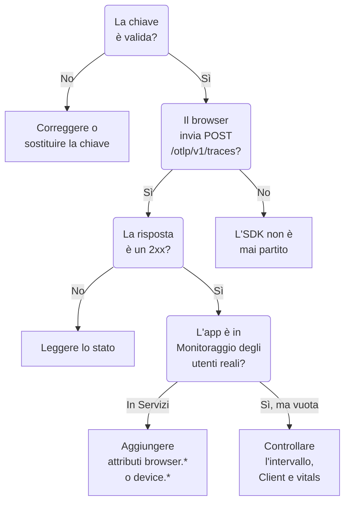

# Risoluzione dei problemi RUM

Quando un'applicazione RUM manca, è vuota o mostra **Disconnesso**, segui questa pagina in ordine. Ogni verifica esclude una parte del percorso tra la tua app e OneUptime, nell'ordine in cui questi problemi si presentano di solito.

:::cards
- [Verificare la chiave](#verificare-la-chiave): La verifica più rapida, e tutto il resto dipende da essa.
- [Verificare cosa esce dal browser](#verificare-cosa-esce-dal-browser): La richiesta di esportazione negli strumenti per sviluppatori del browser.
- [Verificare dove arriva la telemetria](#verificare-dove-arriva-la-telemetria): Un'applicazione RUM o un servizio di backend.
- [Problemi della riproduzione delle sessioni](#problemi-della-riproduzione-delle-sessioni): Una pipeline separata, con una pagina propria.
:::

## Dove si ferma la telemetria RUM

La telemetria supera tre verifiche lungo il percorso verso un'applicazione RUM. Trova la prima che fallisce:



## Verificare la chiave

Verifica prima la chiave. È la verifica più rapida, e niente di ciò che segue funziona senza una chiave che OneUptime accetti:

```bash
curl -i https://oneuptime.com/otlp/v1/validate \
  -H "x-oneuptime-token: YOUR_TELEMETRY_INGESTION_TOKEN"
```

| Risposta | Cosa significa |
| --- | --- |
| `200` con `"valid": true` | OneUptime accetta la chiave. La risposta indica anche il suo `keyType` e il suo `projectId`. Passa alla verifica successiva. |
| `401` con `"valid": false` | La chiave manca, è sconosciuta, revocata, disattivata o scaduta, e il `message` dice quale. Crea una chiave attiva in **Impostazioni del progetto → Telemetria e APM → Chiavi di acquisizione**. |

Un'app web ha bisogno di una chiave **Browser**, e un'app mobile di una chiave **Server**: vedi [Configurazione browser](/docs/rum/browser-setup) e [Configurazione mobile](/docs/rum/mobile-setup). Anche gli endpoint di esportazione rifiutano una chiave errata con `401`, come richiede la specifica OTLP, quindi un SDK ben fatto registra il rifiuto invece di riprovare. Quella riga passa facilmente inosservata nella console del browser, e questa verifica risponde direttamente.

## Verificare cosa esce dal browser

Apri gli strumenti per sviluppatori del browser sulla pagina dell'app, seleziona la scheda Rete e filtra per `otlp`. Cerchi `POST /otlp/v1/traces` con una risposta di stato `2xx`.

### Nessuna richiesta

L'SDK non è mai partito. È quasi sempre una di queste cause:

- `telemetry.ts` non è il primo import della tua app, oppure il bundler l'ha eliminato. Le strumentazioni modificano `fetch` e `XMLHttpRequest`, quindi una richiesta fatta prima di quella modifica non viene tracciata, e un file che il bundler ha rimosso non esegue nulla.
- Il processore a batch non ha ancora esportato. `BatchSpanProcessor` attende qualche secondo per riempire un batch, quindi aspetta, o passa a un'altra pagina, prima di concludere che non viene inviato nulla.
- Una variabile d'ambiente di build è rimasta `undefined`, e l'URL dell'exporter è rotto. Registra l'URL una volta all'avvio.

### Il browser blocca la richiesta

- **Un errore di Content Security Policy nella console.** La policy della tua pagina non consente ancora OneUptime. Aggiungilo alla tua direttiva `connect-src` esistente, oppure usa il tuo host se ospiti OneUptime in autonomia:

  ```text
  connect-src 'self' https://oneuptime.com;
  ```

- **Un errore CORS.** Gli endpoint OTLP accettano richieste da qualsiasi origine e consentono l'intestazione `x-oneuptime-token`, quindi un vero errore CORS significa quasi sempre che la richiesta non ha mai raggiunto OneUptime: cerca un proxy aziendale, un blocco annunci o un errore di battitura nell'host. Controlla l'URL della richiesta nella scheda Rete.

### La richiesta riceve uno stato di errore

**`401`.** La chiave è sconosciuta, revocata o scaduta. Esegui la [verifica della chiave](#verificare-la-chiave), poi usa una chiave attiva.

**`404`.** L'URL è sbagliato. L'exporter delle tracce ha bisogno del percorso completo, `/otlp/v1/traces`. Un errore comune è dare l'indirizzo di base (`https://oneuptime.com/otlp`) a un exporter che si aspetta l'URL completo, oppure l'URL completo a uno che aggiunge il percorso da solo e finisce su `/otlp/v1/traces/v1/traces`.

**`413`.** Il batch superava ciò che un proxy accetta. L'ingress di OneUptime accetta fino a 4 MB su `/otlp`, ma un proxy che metti davanti a OneUptime può essere più rigido — ingress-nginx, per esempio, imposta `proxy-body-size` a 1 MB per impostazione predefinita — quindi, se ne hai uno, alza anche il suo limite per `/otlp`. In ogni caso, un `maxExportBatchSize` più piccolo nel `BatchSpanProcessor` riduce ogni esportazione:

```ts
new BatchSpanProcessor(exporter, { maxExportBatchSize: 100 });
```

Un browser invia raramente batch così grandi, a meno che gli span non portino attributi grandi, come un intero stack di chiamate o un corpo di risposta. Ridurli è la soluzione migliore.

**`422`.** OneUptime ha rifiutato qui la chiave, e il messaggio dice perché. `Origin https://app.example.com is not allowed for this browser ingestion key.` significa che l'origine esatta della pagina, con il suo schema e la sua porta se presente, manca negli **Origini consentite** della chiave. `This telemetry ingestion key has been disabled.` significa che qualcuno ha disattivato la chiave.

**`429`.** Il **Requests Per Minute Limit** della chiave è esaurito: `Too many telemetry requests for this ingestion key. Please retry later.` Una chiave Browser consente 6000 richieste al minuto per tutti i tuoi visitatori insieme, a meno che tu non imposti un limite tuo sulla chiave.

**`403` con una pagina HTML, o un corpo vuoto.** OneUptime risponde a ogni rifiuto in JSON, quindi questo è arrivato da qualcosa che sta davanti, di solito un web application firewall sul tuo dominio, se fai passare OneUptime da lì. Il firewall analizza OTLP/JSON e confronta ogni attributo di span con le sue regole di injection, quindi un URL con una query string su uno span basta perché lo blocchi, e il log del firewall indica la regola. Escludi il payload OTLP dall'ispezione solo sui percorsi OTLP: [Anche le tue richieste OpenTelemetry vengono bloccate](/docs/rum/session-replay-troubleshooting#anche-le-tue-richieste-opentelemetry-vengono-bloccate) mostra come, e copre il registratore delle riproduzioni dietro lo stesso firewall.

## Verificare dove arriva la telemetria

La richiesta funziona, ma l'app compare in **Prodotti → Servizi** invece che in **Prodotti → Risorse → Monitoraggio degli utenti reali**. È la segnalazione più comune, e la causa è quasi sempre una risorsa senza attributi del client. OneUptime archivia un batch come RUM solo quando la sua risorsa ne porta uno di questi:

| Tipo | Attributi |
| --- | --- |
| Browser | `browser.platform`, `browser.language` o un `browser.brands` non vuoto |
| Mobile | `device.id` o `device.model.identifier`, oppure `device.manufacturer` su una risorsa senza identità host (`host.name`, `host.id` o `k8s.node.name`) |

Un `service.name` da solo crea un servizio di backend. L'SDK OpenTelemetry per browser non aggiunge alcun attributo `browser.*` a meno che tu non aggiunga il rilevatore di risorse del browser o li imposti tu stesso: vedi [Configurazione browser](/docs/rum/browser-setup).

Per vedere cosa invii davvero, apri la richiesta OTLP nella scheda Rete e guarda il suo payload: `resourceSpans[0].resource.attributes` è l'elenco che decide. Se non c'è alcun attributo `browser.*`, l'SDK non lo sta aggiungendo, qualunque cosa dica la sua documentazione.

Aggiungi gli attributi, e il batch successivo crea l'applicazione RUM. Il servizio creato per primo non diventa un'applicazione RUM, perché sono record separati, quindi eliminalo da **Prodotti → Servizi** quando arriva la telemetria RUM.

> [!NOTE]
> Una risorsa il cui unico attributo del client è `device.manufacturer`, e che ha anche un'identità host, viene letta come una macchina e non come un telefono, perché l'inventario di un host riporta il suo produttore con lo stesso attributo. Aggiungi `device.id` o `device.model.identifier`, e il batch viene archiviato come RUM mobile qualunque altra cosa porti.

## L'applicazione è vuota

L'applicazione esiste, ma le sue pagine non mostrano nulla.

- **Controlla l'intervallo di tempo.** La panoramica mostra l'ultima ora per impostazione predefinita, quindi un batch di prova di stamattina resta fuori.
- **Attendi qualche minuto.** L'acquisizione passa da una coda, e **Visto l'ultima volta** si aggiorna ogni pochi minuti anziché a ogni batch.
- **Controlla il progetto.** Una chiave scrive nel proprio progetto, quindi la telemetria inviata con la chiave di un altro progetto si trova lì, non qui.

## La pagina Client è vuota

La pagina **Client** elenca `browser.platform` sul web e `device.model.identifier` su mobile. Due motivi per cui resta vuota anche quando tutto il resto funziona:

- **Safari e Firefox.** `browserDetector` legge l'API UA Client Hints, che hanno solo i browser Chromium. Sugli altri imposta `browser.language`, che basta per archiviare la telemetria come RUM, ma non `browser.platform`. Imposta `browser.platform` tu stesso perché quei client compaiano.
- **Un SDK mobile che imposta solo `device.manufacturer`.** Questo archivia la telemetria come RUM mobile, ma la pagina **Client** ha bisogno di `device.model.identifier`.

## Core Web Vitals mostra «No web vitals reported yet»

La scheda si riempie solo con le metriche che la tua app invia, quindi le tracce da sole non la riempiono mai. Verifica di esportare metriche, che i loro nomi siano tra quelli che OneUptime legge e che compaiano nella pagina **Metriche** dell'applicazione. [La scheda dice «No web vitals reported yet»](/docs/rum/web-vitals#risoluzione-dei-problemi) ripercorre ogni verifica, compresi i valori persi quando un visitatore chiude la scheda prima dell'esportazione successiva.

## Lo stato dice Disconnesso mentre le persone usano l'app

Un'applicazione passa a **Disconnesso** dopo 15 minuti senza telemetria. Se le persone stanno usando l'app:

- **Un campionatore potrebbe scartare tutto.** Verifica di non aver impostato un campionatore sempre spento, né una proporzione molto bassa.
- **L'app potrebbe inviare telemetria solo per alcune interazioni**, e nessuno le ha usate in quel periodo.
- **La chiave potrebbe essere stata revocata o disattivata** dopo il deploy: esegui di nuovo la [verifica della chiave](#verificare-la-chiave).

Un'app interna o a basso traffico senza visitatori di notte è davvero disconnessa. Non è un guasto.

## Problemi della riproduzione delle sessioni

La riproduzione delle sessioni è una pipeline separata con problemi propri: lo script del registratore, gli elenchi delle origini consentite, il consenso, la Content Security Policy e il mascheramento. [Risoluzione dei problemi della riproduzione delle sessioni](/docs/rum/session-replay-troubleshooting) li copre. Inizia da lì, e inizia attivando la diagnostica del registratore, perché la maggior parte dei suoi errori è silenziosa di proposito:

```js
localStorage.setItem("oneuptime.sessionReplay.debug", "true");
// then reload the page
```

La pagina **Integrità** dell'applicazione, nella sua sezione **Riproduzione delle sessioni**, e il pannello **Test your installation** di **Replay Policy** verificano la chiave, gli elenchi delle origini consentite e la policy dal lato server, e dicono perché non arriva nulla. La console del browser ti dà la metà che il server non può vedere.

Con la policy predefinita, un registratore invia un frammento circa ogni 15 secondi mentre l'utente interagisce con la pagina. Una scheda inattiva non ha nulla da inviare, quindi prima fai clic o muovi il mouse; poi, se non c'è alcuna richiesta di frammento, qualcosa non va. Se l'app carica solo _On error or frustration_, il silenzio è previsto finché qualcosa non fallisce. Chiama `OneUptimeReplay.captureSession()` per forzare un caricamento e provare il percorso in ogni caso.

Le due pipeline sono indipendenti. Non serve un'applicazione RUM funzionante perché il registratore si carichi, e un registratore funzionante non significa che arrivi telemetria RUM: ciascuna può fallire per conto suo.

## Ancora bloccato?

Raccogli queste informazioni prima di chiedere aiuto. Ti risparmiano un botta e risposta:

- L'elenco `resource.attributes` dal payload di una vera richiesta OTLP.
- Lo stato HTTP di quella richiesta.
- Il `service.name` esatto che invii, e se il progetto ha un'applicazione o un servizio con quel nome.
- Se `/otlp/v1/validate` risponde `200` per la chiave nella build distribuita.

Poi scrivi a support@oneuptime.com o apri una issue su [GitHub](https://github.com/OneUptime/oneuptime).

## Passaggi successivi

:::cards
- [Configurazione browser](/docs/rum/browser-setup): La configurazione che queste verifiche danno per scontata, passo dopo passo.
- [Configurazione mobile](/docs/rum/mobile-setup): La chiave e gli attributi di cui ha bisogno un'app mobile.
- [Gestire le applicazioni](/docs/rum/applications): Nomi, etichette, conservazione e stato.
- [Risoluzione dei problemi della riproduzione delle sessioni](/docs/rum/session-replay-troubleshooting): Ogni codice del registratore, e cosa fare.
:::
