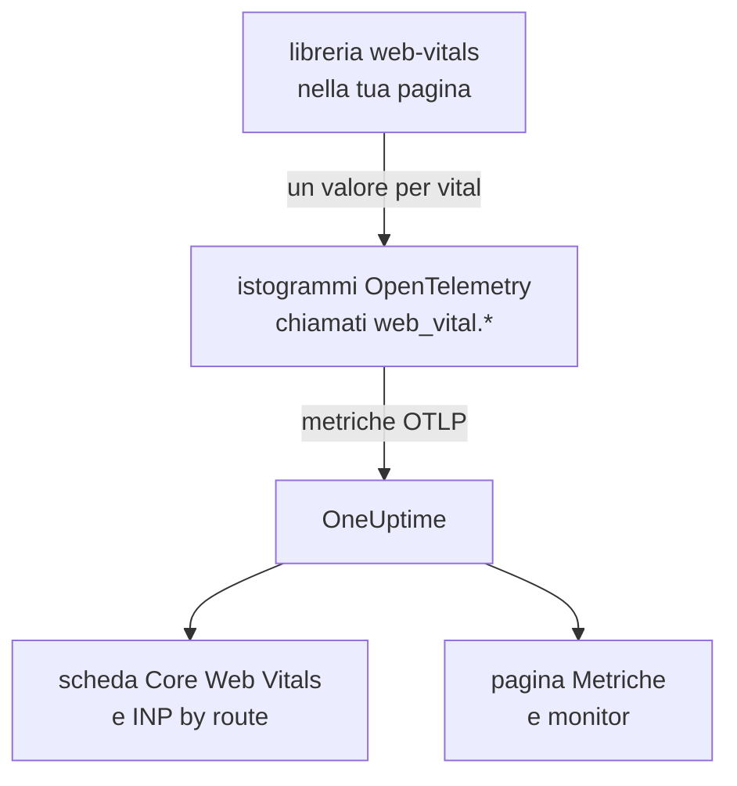
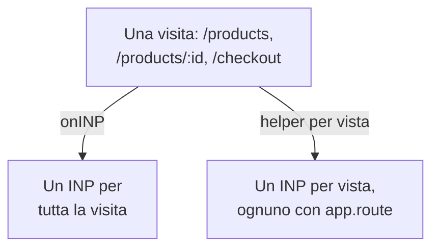

# Core Web Vitals

La scheda **Core Web Vitals** nella panoramica di un'applicazione RUM mostra LCP, INP, CLS, FCP e TTFB, ciascuno valutato secondo le soglie di Google. OneUptime non misura nessuno di questi valori da sé: la scheda si riempie solo con le metriche che la tua strumentazione del browser segnala, e questa pagina mostra come inviarle.

:::cards
- [Inviarli](#inviarli-dalla-tua-app): Inoltrare i valori della libreria web-vitals come metriche OpenTelemetry.
- [Nomi che OneUptime legge](#nomi-di-metrica-che-oneuptime-riconosce): I nomi di metrica con cui ogni vital può arrivare.
- [App a pagina singola](#app-a-pagina-singola): L'INP di ogni vista, non un valore per caricamento di pagina.
- [Avvisi su un vital](#avvisi-su-un-vital): Monitor pronti all'uso per i vitals scadenti.
:::

## Come funziona

La libreria [`web-vitals`](https://github.com/GoogleChrome/web-vitals) misura ogni vital nella pagina; è la stessa libreria usata dagli strumenti di Chrome. Il tuo codice registra ogni valore in un istogramma OpenTelemetry, e la pipeline di metriche del browser lo esporta a OneUptime.



OpenTelemetry non ha ancora una convenzione definitiva per i nomi dei web vitals, quindi OneUptime cerca ogni vital con diversi nomi e usa il primo che ha dati. Usa i nomi `web_vital.*` per la nuova strumentazione.

## Prima di iniziare

- Un'app web configurata come in [Configurazione browser](/docs/rum/browser-setup), con la sua pipeline di metriche: è il `MeterProvider` di [Aggiungere log e metriche](/docs/rum/browser-setup#aggiungere-log-e-metriche) a esportare questi valori.

## Inviarli dalla tua app

:::steps
### Installare la libreria

```bash
npm install web-vitals
```

### Registrare ogni vital in un istogramma

Crea `src/web-vitals.ts`. Ogni vital è un istogramma, così la pagina **Metriche** può calcolare i percentili in seguito, con i limiti dei bucket posti sulle soglie di buono e scadente di Google.

```ts title="src/web-vitals.ts"
// Import after ./telemetry
import { metrics } from "@opentelemetry/api";
import { onCLS, onFCP, onINP, onLCP, onTTFB, type Metric } from "web-vitals";

const meter = metrics.getMeter("web-vitals");

// Histograms, so the Metrics tab can compute percentiles later. The bucket
// edges sit on each vital's good / poor limits: a percentile is read from
// the buckets, and the defaults are far too coarse for these ranges.
const buckets = (...edges: number[]) => ({ advice: { explicitBucketBoundaries: edges } });

const lcp = meter.createHistogram("web_vital.lcp", { unit: "ms", ...buckets(0, 1000, 1500, 2000, 2500, 3000, 3500, 4000, 5000, 7500, 10000) });
const inp = meter.createHistogram("web_vital.inp", { unit: "ms", ...buckets(0, 50, 100, 150, 200, 250, 300, 400, 500, 750, 1000, 2000) });
const fcp = meter.createHistogram("web_vital.fcp", { unit: "ms", ...buckets(0, 600, 1200, 1800, 2400, 3000, 4000, 6000, 10000) });
const ttfb = meter.createHistogram("web_vital.ttfb", { unit: "ms", ...buckets(0, 200, 400, 600, 800, 1200, 1800, 2500, 4000) });
const cls = meter.createHistogram("web_vital.cls", { unit: "1", ...buckets(0, 0.025, 0.05, 0.1, 0.15, 0.2, 0.25, 0.4, 0.6, 1) });

function record(
  histogram: { record: (v: number, a?: Record<string, string>) => void },
) {
  return (metric: Metric): void => {
    histogram.record(metric.value, {
      // Keep attributes low-cardinality. Never put a full URL or a user id here.
      "web_vital.rating": metric.rating,
    });
  };
}

onLCP(record(lcp));
onINP(record(inp));
onCLS(record(cls));
onFCP(record(fcp));
onTTFB(record(ttfb));
```

### Importarlo dopo la configurazione della telemetria

```ts
import "./telemetry";
import "./web-vitals";
```

### Controllare la pagina Metriche

Carica qualche pagina, poi cerca `web_vital.lcp` nella pagina **Metriche** dell'applicazione. Quando le metriche ci sono, la scheda **Core Web Vitals** si riempie per l'intervallo che scegli.
:::

## Inviare gli ultimi valori prima che la pagina si chiuda

`onINP` e `onCLS` segnalano quando la pagina viene nascosta, non durante la visita. Con l'intervallo di esportazione di 30 secondi di [Configurazione browser](/docs/rum/browser-setup), un visitatore che chiude la scheda subito dopo l'ultimo valore può andarsene prima che venga esportato. Se la completezza conta, accorcia `exportIntervalMillis`, oppure tieni il `MeterProvider` creato in `telemetry.ts` e svuotalo quando la pagina viene nascosta:

```ts
// In telemetry.ts, export the provider you created:
export const meterProvider = new MeterProvider({ /* ... */ });

// Anywhere after setup:
import { meterProvider } from "./telemetry";

document.addEventListener("visibilitychange", () => {
  if (document.visibilityState === "hidden") {
    void meterProvider.forceFlush();
  }
});
```

## Nomi di metrica che OneUptime riconosce

OneUptime prova i nomi in questo ordine, e vince il primo che ha dati nell'intervallo selezionato.

| Vital | Nomi di metrica, uno qualsiasi | Unità |
| --- | --- | --- |
| LCP: Largest Contentful Paint | `web_vital.lcp`, `browser.largest_contentful_paint`, `largest_contentful_paint`, `web.vitals.lcp` | ms |
| INP: Interaction to Next Paint | `web_vital.inp`, `browser.interaction_to_next_paint`, `interaction_to_next_paint`, `web.vitals.inp` | ms |
| CLS: Cumulative Layout Shift | `web_vital.cls`, `browser.cumulative_layout_shift`, `cumulative_layout_shift`, `web.vitals.cls` | punteggio |
| FCP: First Contentful Paint | `web_vital.fcp`, `browser.first_contentful_paint`, `first_contentful_paint`, `web.vitals.fcp` | ms |
| TTFB: Time to First Byte | `web_vital.ttfb`, `browser.time_to_first_byte`, `time_to_first_byte`, `web.vitals.ttfb` | ms |

Gli altri nomi esistono perché un'app che invia già secondo una convenzione della community compaia senza modifiche.

## Soglie di valutazione

La scheda valuta ogni valore con le soglie Core Web Vitals pubblicate da Google:

| Vital | **Good** | **Needs work** | **Poor** |
| --- | --- | --- | --- |
| LCP | sotto 2500 ms | da 2500 a 4000 ms | 4000 ms o più |
| INP | sotto 200 ms | da 200 a 500 ms | 500 ms o più |
| CLS | sotto 0,1 | da 0,1 a 0,25 | 0,25 o più |
| FCP | sotto 1800 ms | da 1800 a 3000 ms | 3000 ms o più |
| TTFB | sotto 800 ms | da 800 a 1800 ms | 1800 ms o più |

La scheda mostra la **media** sull'intervallo selezionato, non il 75° percentile che riportano gli strumenti sul campo di Google. È voluto: OneUptime legge i percentili di un istogramma dai suoi bucket, quindi un percentile è preciso solo quanto i bucket, mentre la media deriva dalla somma e dal conteggio esatti dell'istogramma. Con i bucket predefiniti di OpenTelemetry (`0, 5, 10, 25, 50, …`) ogni valore di CLS finisce nel primo bucket, e un 75° percentile segnerebbe 2,5 per una pagina che quasi non si muove.

> [!TIP]
> Leggi la scheda come un andamento. Per il 75° percentile, registra con i limiti dei bucket indicati sopra, poi traccia la metrica nella pagina **Metriche** con l'aggregazione **P75**. Un monitor di metriche offre la stessa scelta.

## App a pagina singola

`onINP` misura l'INP come lo definisce il browser: **un valore per caricamento di pagina**. Un'app a pagina singola si carica una volta e poi cambia route con `history.pushState`, quindi una visita a `/products`, `/products/42` e `/checkout` produce un solo INP per tutta la visita. Le interazioni di ogni vista si contendono quell'unico numero, e un attributo di route su di esso indica la pagina mostrata al momento della segnalazione, non quella che era lenta.



Per vedere l'INP per vista, misuralo per vista: ogni cambio di route chiude la vista corrente e ne apre una nuova, e ogni vista segnala il proprio INP. L'helper qui sotto lo fa con l'API Event Timing del browser, gli stessi dati che usa `onINP`, e gestisce la parte facile da sbagliare: il clic che ha **causato** una navigazione arriva dopo che la route è già cambiata, ma appartiene alla pagina su cui è stato fatto.

```ts title="src/inp-per-route.ts"
// INP for each view of a single-page app.
type Report = (inpMs: number, route: string) => void;

interface View {
  route: string;
  path: string; // the URL path it was opened for
  start: number; // performance.now() when the view began
  latencies: Map<number, number>; // interactionId -> its slowest entry
}

// Long enough for the click that navigated to be delivered: its entry
// arrives after the next paint, i.e. after the route has changed.
const SETTLE_MS = 1000;

let views: Array<View> = [];
let report: Report = () => {};

// The path, plus the hash when a hash router keeps the route there.
const currentPath = (): string =>
  location.pathname + (location.hash.startsWith("#/") ? location.hash : "");

function close(view: View): void {
  if (!views.includes(view)) return; // already reported
  views = views.filter((v) => v !== view);

  const sorted = [...view.latencies.values()].sort((a, b) => b - a);
  if (sorted.length === 0) return; // nobody interacted: no INP, not 0

  // web-vitals' p98: skip one outlier for every 50 interactions.
  report(sorted[Math.min(sorted.length - 1, Math.floor(sorted.length / 50))]!, view.route);
}

function record(entries: PerformanceEntryList): void {
  for (const entry of entries as Array<PerformanceEventTiming & { interactionId?: number }>) {
    if (!entry.interactionId) continue; // hovers, scrolls: not interactions

    // The view the interaction STARTED in, so the click that navigated
    // counts towards the page it was clicked on.
    const view = [...views].reverse().find((v) => entry.startTime >= v.start);
    if (!view) continue;

    const slowest = view.latencies.get(entry.interactionId) ?? 0;
    view.latencies.set(entry.interactionId, Math.max(slowest, entry.duration));
  }
}

export function observeInpPerRoute(route: string, onReport: Report): void {
  if (typeof PerformanceObserver === "undefined" || !PerformanceObserver.supportedEntryTypes?.includes("event")) return;

  report = onReport;
  views = [{ route, path: currentPath(), start: 0, latencies: new Map() }];

  const observer = new PerformanceObserver((list) => record(list.getEntries()));
  observer.observe({ type: "event", durationThreshold: 40, buffered: true } as PerformanceObserverInit);

  // The tab may never come back: report every view now, then keep
  // measuring the current route as a fresh view.
  document.addEventListener("visibilitychange", () => {
    if (document.visibilityState !== "hidden") return;
    record(observer.takeRecords());
    const current = views[views.length - 1]?.route ?? route;
    [...views].forEach(close);
    views = [{ route: current, path: currentPath(), start: performance.now(), latencies: new Map() }];
  });
}

// Call after every navigation, with the route PATTERN ("/products/:id").
// Safe to call when nothing changed (a router's initial navigation, a
// query-string update): the view only ends when the path does.
export function startView(route: string): void {
  const closing = views[views.length - 1];
  if (!closing || closing.path === currentPath()) return;

  views.push({ route, path: currentPath(), start: performance.now(), latencies: new Map() });
  setTimeout(() => close(closing), SETTLE_MS);
}
```

Entrambe le funzioni prendono il **modello** della route, mai l'URL: `/products/42` e `/products/7` devono essere una sola route, altrimenti ogni prodotto diventa una serie a sé. Usa il modello del tuo router dove esiste; altrimenti raggruppa tu gli ID:

```ts
// "/products/42" -> "/products/:id", also for UUIDs.
export const toRoutePattern = (path: string): string =>
  path.replace(/\/(\d+|[0-9a-f]{8}-[0-9a-f-]{27})(?=\/|$)/gi, "/:id");
```

Registra ciò che l'helper segnala nello stesso istogramma `web_vital.inp`, con la route in `app.route`, e **rimuovi `onINP`** dallo snippet sopra: tenerli entrambi conterebbe ogni interazione due volte.

```ts
// src/web-vitals.ts, in place of onINP(record(inp))
import { observeInpPerRoute } from "./inp-per-route";

observeInpPerRoute(toRoutePattern(location.pathname), (inpMs, route) => {
  inp.record(inpMs, {
    "app.route": route,
    "web_vital.rating": inpMs <= 200 ? "good" : inpMs <= 500 ? "needs-improvement" : "poor",
  });
});
```

Poi chiama `startView` dove il tuo router annuncia una navigazione conclusa. La chiamata viene ignorata se il percorso dell'URL non è cambiato, quindi un router che segnala anche il primo caricamento, o una modifica della query string, non spezza la vista:

:::tabs
@tab Vue Router
```ts
router.afterEach((to) => startView(to.matched[to.matched.length - 1]?.path ?? toRoutePattern(to.path)));
```
@tab React Router
```tsx
// In a component that stays mounted inside the router
const { pathname } = useLocation();
useEffect(() => startView(toRoutePattern(pathname)), [pathname]);
```
:::

Cosa ottieni:

- **INP by route** nella panoramica, dalla più lenta, a partire da `app.route`; OneUptime legge anche l'attributo OpenTelemetry `url.template`.
- Un filtro di route per gli avvisi: filtra un monitor di metriche su `web_vital.inp` per `app.route` per sorvegliare da solo un flusso come `/checkout`.
- L'INP complessivo dell'app nella scheda **Core Web Vitals** continua a funzionare: è la stessa metrica, ora con un valore per vista invece che uno per caricamento di pagina.

I browser Chromium segnalano gli ID di interazione necessari. Safari non ne segnala nessuno, ed è anche per questo che `onINP` lì non segnala nulla. L'API sperimentale Soft Navigations di Chrome punta a farlo in modo nativo, ma non è disponibile per tutti; questo helper funziona già oggi.

> [!NOTE]
> Il recorder della [Session Replay](/docs/telemetry/session-replay) misura già l'INP per vista, senza codice: ogni registrazione mostra una riga INP per ogni route su cui l'utente ha interagito, con l'elemento lento e come il suo tempo si è diviso tra ritardo dell'input, elaborazione e presentazione.

## Tenere sotto controllo la cardinalità

Gli attributi delle metriche si moltiplicano. `web_vital.rating` ha tre valori possibili, il che va bene, e un attributo di route o di tipo di pagina di solito vale la pena:

```ts
histogram.record(metric.value, {
  "web_vital.rating": metric.rating,
  "app.route": routePattern, // "/product/:id" — the PATTERN, not "/product/8842"
});
```

Registrare l'URL concreto invece del modello di route crea una serie temporale per ogni pagina prodotto, il che rende lenta la pagina **Metriche** e alta la bolletta dello storage. Lo stesso vale per ID utente, ID di sessione e dimensioni dello schermo.

## Avvisi su un vital

La pagina **Recommendations** dell'applicazione offre un monitor pronto all'uso per ogni vital. Ognuno legge la media su cinque minuti della sua metrica e scatta quando raggiunge la soglia di scadente di Google:

| Raccomandazione | Metrica | Scatta a | Gravità |
| --- | --- | --- | --- |
| **Poor Largest Contentful Paint** | `web_vital.lcp` | 4000 ms | **Critico** |
| **Poor Interaction to Next Paint** | `web_vital.inp` | 500 ms | **Critico** |
| **Poor Cumulative Layout Shift** | `web_vital.cls` | 0,25 | **Critico** |
| **Slow First Contentful Paint** | `web_vital.fcp` | 3000 ms | **Warning** |
| **Slow Time to First Byte** | `web_vital.ttfb` | 1800 ms | **Warning** |

Questi monitor leggono solo i nomi `web_vital.*`. Se la tua app invia un vital con un altro nome, modifica la metrica del monitor creato. Per gli avvisi su una sola route, aggiungi al monitor un filtro `app.route`. Puoi anche costruire un tuo monitor su una qualsiasi di queste metriche: vedi [Monitor metriche](/docs/monitor/metrics-monitor).

## Risoluzione dei problemi

:::details La scheda dice «No web vitals reported yet»
La scheda si riempie solo con le metriche che la tua app invia. Controlla, nell'ordine:

1. Di avere una pipeline di metriche: le tracce da sole non riempiono mai questa scheda.
2. Che i nomi di metrica siano tra quelli che OneUptime legge: vedi [Nomi di metrica che OneUptime riconosce](#nomi-di-metrica-che-oneuptime-riconosce).
3. Che le metriche siano nella pagina **Metriche** dell'applicazione. Se ci sono, l'esportazione funziona e il problema è il nome o l'intervallo di tempo.
4. Che INP e CLS vengano segnalati quando la pagina è nascosta, quindi una visita breve può finire prima della prossima esportazione: vedi [Inviare gli ultimi valori prima che la pagina si chiuda](#inviare-gli-ultimi-valori-prima-che-la-pagina-si-chiuda).

Se nulla di tutto ciò aiuta, [Risoluzione dei problemi RUM](/docs/rum/troubleshooting) controlla l'intera pipeline.
:::

:::details L'INP viene segnalato, ma non per route
La scheda **INP by route** ha bisogno dell'attributo `app.route`, o di `url.template`, su `web_vital.inp`. Registra il modello di route con ogni valore come in [App a pagina singola](#app-a-pagina-singola).
:::

:::details I valori differiscono dal report di Google
La scheda mostra la media sull'intervallo che hai scelto, mentre Google riporta il 75° percentile dei suoi visitatori. Traccia il **P75** nella pagina **Metriche** per confrontare dati omogenei.
:::

## Passaggi successivi

:::cards
- [Configurazione browser](/docs/rum/browser-setup): La pipeline di tracce, log e metriche su cui viaggiano questi vitals.
- [Monitor metriche](/docs/monitor/metrics-monitor): Avvisi su qualsiasi vital, per tutta l'app o per una sola route.
- [Riproduzione delle sessioni](/docs/telemetry/session-replay): Vedere l'INP per vista nelle registrazioni, senza codice.
- [Risoluzione dei problemi RUM](/docs/rum/troubleshooting): Ogni verifica, nell'ordine in cui di solito si presentano i problemi.
:::
