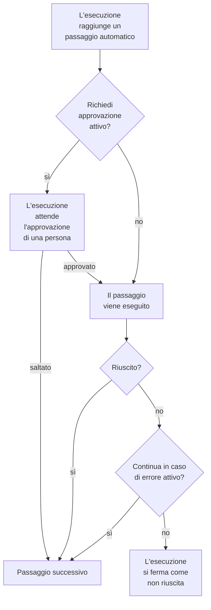

# Scrivere un runbook

Un runbook si scrive come elenco ordinato di passaggi nella sua pagina **Passaggi**. Questa pagina mostra come creare un runbook, come configurare ciascuno dei sette tipi di passaggio e come errori e approvazioni cambiano il corso di un'esecuzione.

:::cards
- [Creare un runbook](#creare-un-runbook): Da un runbook vuoto ai passaggi salvati.
- [Tipi di passaggio](#tipi-di-passaggio): Manual, JavaScript, HTTP request, Bash, SSH, kubectl e AI.
- [Gestione degli errori e approvazioni](#gestione-degli-errori-e-approvazioni): Cosa succede quando un passaggio fallisce o attende un'approvazione.
- [Un esempio completo](#un-esempio-completo): Un failover del database in cinque passaggi.
:::

## Prima di iniziare

- **Un ruolo che scrive runbook.** Project Owner, Project Admin e Runbook Admin creano runbook e ne salvano i passaggi. Con autorizzazioni granulari ti servono **Create Runbook** e **Edit Runbook**. Vedi [Autorizzazioni](/docs/runbooks/configuration#autorizzazioni).
- **Un Runner, per i passaggi Bash, SSH e kubectl.** Questi passaggi vengono eseguiti su un [Runner](/docs/runbooks/agents) nella tua infrastruttura, mai sul Worker di OneUptime. Installane uno prima. Un passaggio che non sceglie alcun Runner viene eseguito sul [Runner predefinito del progetto](/docs/runbooks/agents#il-runner-predefinito-del-progetto), se ne hai impostato uno; altrimenti un passaggio JavaScript viene eseguito su un [Runner globale](/docs/runbooks/agents#runner-globali).
- **Una variabile segreta, per i passaggi SSH e kubectl.** La chiave, la password o il kubeconfig con cui un passaggio accede è una [variabile di runbook](/docs/runbooks/variables) segreta. Project Owner e Project Admin creano le variabili, e Runbook Admin le sceglie nei passaggi che scrive. Un passaggio kubectl può usare invece l'accesso proprio del Runner.
- **Un provider LLM, per i passaggi IA.** Vedi [Provider LLM](/docs/ai/llm-provider).

## Creare un runbook

:::steps
### Apri i runbook

Apri **Prodotti → Runbook**. Runbook si trova nel gruppo **Dashboard e automazione**.

### Crea il runbook

Fai clic su **Crea: Runbook**, inserisci un **Nome** e, se vuoi, una **Descrizione** di cosa fa il runbook. In **Altri campi** trovi l'interruttore **Abilitato**, attivo per impostazione predefinita, e le **Etichette**. Il nuovo runbook si apre sulla sua pagina **Passaggi**.

### Aggiungi i passaggi

In **Inizia il tuo runbook**, scegli il tipo del primo passaggio; sotto l'ultimo passaggio, **Aggiungi un altro passaggio** offre gli stessi sette tipi. Ogni passaggio si apre con il suo **Titolo** e ciò che serve al suo tipo; il resto, come la sua **Descrizione** e i timeout, è raccolto in **Altri campi**. Quando il runbook ha almeno un passaggio, **Aggiungi passaggio**, in alto nella scheda, aggiunge un passaggio Manual.

### Metti in ordine i passaggi

I passaggi vengono eseguiti **in ordine**. Per cambiare l'ordine, trascina un passaggio dalla maniglia a sinistra della sua intestazione; da tastiera, porta il focus sulla maniglia, premi Spazio, sposta il passaggio con le frecce e premi di nuovo Spazio.

### Salva i passaggi

Fai clic su **Salva passaggi**. Finché non lo fai, l'editor mostra **Modifiche non salvate**. Una volta salvato, vedi **Salvato** e il runbook è pronto per essere [eseguito](/docs/runbooks/running).
:::

## Anatomia di un passaggio

Ogni passaggio ha questi campi. Un passaggio automatico mostra il suo **Titolo** e le impostazioni del suo tipo, e raccoglie il resto in **Altri campi**, che indica cosa è impostato:

| Campo | Scopo |
| --- | --- |
| **Titolo** | Un'etichetta breve, mostrata nell'elenco dei passaggi e in ogni esecuzione. |
| **Descrizione** | Contesto facoltativo per chi interviene, in Markdown, in **Altri campi**. In un passaggio Manual sono le **Istruzioni** che quella persona legge e segue, mostrate sotto il titolo. |
| **Continua in caso di errore** | Solo passaggi automatici. Se attivo, un passaggio che fallisce non ferma l'esecuzione: il passaggio successivo viene eseguito comunque. |
| **Richiedi approvazione** | Solo passaggi automatici. Se attivo, l'esecuzione si ferma prima di questo passaggio finché qualcuno non lo approva, e solo allora lo esegue. L'interruttore si chiama **Richiedi approvazione prima di eseguire questo passaggio**, e l'intestazione del passaggio mostra **Richiede approvazione**. |
| Impostazioni specifiche del tipo | Lo script, l'URL, il Runner, una variabile segreta o il prompt. Vedi [Tipi di passaggio](#tipi-di-passaggio). |

## Tipi di passaggio

| Tipo | Viene eseguito su | Richiede |
| --- | --- | --- |
| [Manual](#manual) | Una persona | Niente |
| [JavaScript](#javascript) | Un Runner | Un Runner |
| [HTTP request](#http-request) | Il Worker di OneUptime | Niente |
| [Bash](#bash) | Un Runner | Un Runner |
| [SSH](#ssh) | Un Runner | Un Runner e una variabile segreta per accedere |
| [kubectl](#kubectl) | Un Runner | Un Runner, e una variabile kubeconfig o l'accesso proprio del Runner |
| [AI](#ai) | Il Worker di OneUptime | Un provider LLM |

In ogni passaggio automatico qui sotto, **Altri campi** del passaggio contiene prima il suo **Runner**, per un passaggio che viene eseguito su uno, poi **Richiedi approvazione** e **Continua in caso di errore**, poi le impostazioni proprie del passaggio - gli header di una chiamata HTTP, la porta e la passphrase della chiave di un passaggio SSH, il provider e gli interruttori di contesto di un passaggio di IA - e infine la **Descrizione** e i timeout. Chiuso, indica il Runner del passaggio, così vedi dove viene eseguito un passaggio senza aprirlo.

### Manual

Una voce di checklist per una persona: le sue **Istruzioni** dicono cosa fare o verificare. L'esecuzione si mette in pausa quando raggiunge un passaggio Manual e resta in `WaitingForManualStep` (**In attesa di te**) finché qualcuno non fa clic su **Segna come completato** o **Salta**. Un'esecuzione che attende una persona non scade mai. Un passaggio Manual non ha un interruttore di approvazione: ferma già l'esecuzione per una persona.

Usalo per ciò che solo una persona può verificare o fare: «Conferma nella dashboard del bilanciatore di carico che il traffico è passato alla regione secondaria.»

### JavaScript

Un frammento di JavaScript, eseguito in una sandbox `isolated-vm` su un [agente di runbook](/docs/runbooks/agents), non sul Worker di OneUptime: su uno dei tuoi, oppure su un [Runner globale](/docs/runbooks/agents#runner-globali) quando il passaggio non ne sceglie nessuno.

| Campo | Cosa fa | Predefinito |
| --- | --- | --- |
| **Runner** | Sotto **Altri campi**. Il Runner che esegue il passaggio: **Runner globale**, oppure uno dei tuoi. Solo il Runner che scegli può prendere in carico il lavoro; qualsiasi Runner globale può prendere in carico un passaggio su **Runner globale**. | Il [Runner predefinito del progetto](/docs/runbooks/agents#il-runner-predefinito-del-progetto), se ne hai impostato uno; altrimenti **Runner globale**, se ce n'è uno |
| **Script** | Il JavaScript da eseguire. Restituisci un valore con `return` per acquisirlo; anche ogni riga di `console.log` viene acquisita. Lanciare un errore fa fallire il passaggio. | — |
| **Timeout di esecuzione** | Quanto tempo il Runner lascia girare il frammento prima di distruggere la sandbox. Un Runner globale lo lascia girare al massimo 5 minuti. | 30 secondi |
| **Timeout di presa in carico** | Quanto tempo il Worker attende che il Runner prenda in carico il lavoro. | 2 minuti |

```javascript
const start = Date.now();
// ... your logic ...
console.log("replica lag checked");
return { durationMs: Date.now() - start };
```

La sandbox ha 128 MB di memoria e nessun accesso al file system o ai processi. Può fare richieste HTTP con `axios`, ma solo verso indirizzi pubblici: una richiesta verso una rete privata, verso l'host stesso del Runner o verso un endpoint di metadati cloud viene rifiutata. Per raggiungere un servizio della tua rete, usa un passaggio [Bash](#bash) con `curl`.

### HTTP request

Una chiamata HTTP in uscita, effettuata dal Worker di OneUptime. Non serve alcun Runner.

| Campo | Cosa fa | Predefinito |
| --- | --- | --- |
| **Metodo** | `GET`, `POST`, `PUT`, `PATCH`, `DELETE` o `HEAD`. | `GET` |
| **URL** | L'endpoint da chiamare. | Vuoto |
| **Intestazioni (JSON)** | In **Altri campi**. Un oggetto JSON, ad esempio `{ "Authorization": "Bearer ..." }`. Header che non sono JSON valido fanno fallire il passaggio. | Nessuno |
| **Corpo** | Mostrato per `POST`, `PUT`, `PATCH` e `DELETE`. Inviato come JSON se è interpretabile come JSON, altrimenti come testo. | Nessuno |
| **Timeout della richiesta** | Quanto attendere la risposta dell'endpoint prima di far fallire il passaggio. | 30 secondi |

Il passaggio riesce con una risposta `2xx` o `3xx` e fallisce con qualsiasi altra, con `HTTP <status>` come errore. I reindirizzamenti non vengono seguiti. Stato, header e corpo della risposta vengono acquisiti, fino a 50 KB.

> [!NOTE]
> Il Worker non chiama mai indirizzi di loopback o link-local, come un endpoint di metadati cloud. Su OneUptime Cloud chiama solo indirizzi pubblici. Un OneUptime self-hosted raggiunge anche le reti private, a meno che `DATA_SOURCE_BLOCK_PRIVATE_ADDRESSES` non sia `true`. Per chiamare un servizio della tua rete da OneUptime Cloud, usa un passaggio [Bash](#bash) con `curl`.

Utile per: aprire un incidente PagerDuty, pubblicare su un webhook Slack, chiamare l'API pubblica del tuo provider cloud o la tua.

### Bash

Uno script bash, eseguito con `bash -c <script>` su un [agente di runbook](/docs/runbooks/agents) nella tua infrastruttura. Bash non viene mai eseguito sul Worker di OneUptime.

| Campo | Cosa fa | Predefinito |
| --- | --- | --- |
| **Runner** | Sotto **Altri campi**. Il Runner che esegue il passaggio. Solo quel Runner può prendere in carico il lavoro. I Runner globali eseguono solo passaggi JavaScript. | Il Runner predefinito del progetto, se ne hai impostato uno |
| **Script Bash** | Lo script. L'output (stdout e stderr) viene acquisito fino a 50 KB, e un codice di uscita diverso da zero fa fallire il passaggio. | — |
| **Timeout di esecuzione** | Quanto tempo il Runner lascia girare lo script prima di terminarlo con `SIGKILL`. Aumentalo per i passaggi che richiedono legittimamente minuti. | 30 secondi |
| **Timeout di presa in carico** | Quanto tempo il Worker attende che il Runner prenda in carico il lavoro. | 2 minuti |

Lo script viene eseguito nel container del Runner, con gli strumenti forniti dalla sua immagine, come `curl`, `wget` e il client `ssh`, e con l'accesso di rete dell'host su cui gira. Ad esempio, per controllare un servizio raggiungibile solo dalla tua rete:

```bash
set -euo pipefail
HTTP_CODE=$(curl -s -o /tmp/resp.txt -w "%{http_code}" "http://payments.internal:8080/health")
echo "HTTP $HTTP_CODE"
cat /tmp/resp.txt
if [[ "$HTTP_CODE" != "200" ]]; then
  echo "Health check failed"
  exit 1
fi
```

Se il Runner scelto è offline quando l'esecuzione raggiunge questo passaggio, il passaggio attende fino al **claim timeout** (2 minuti per impostazione predefinita) e poi fallisce per timeout. Aggiungi un agente in **Runbook → Agenti di runbook** prima di contare su un passaggio Bash.

> [!TIP]
> Tieni password e token fuori dallo script. Salvali come [variabili di runbook](/docs/runbooks/variables) segrete e scrivi `{{global.variables.NAME}}` dove va il valore: il Runner riceve lo script con il valore inserito, e l'output del passaggio mostra `[REDACTED]` al suo posto.

### SSH

Accedere a una macchina via SSH ed eseguirvi uno script bash. Il Runner apre la connessione, quindi la macchina deve solo essere raggiungibile dal Runner, e la chiave o la password con cui il passaggio accede è una [variabile di runbook](/docs/runbooks/variables) segreta, mai scritta nel passaggio.

| Campo | Cosa fa |
| --- | --- |
| **Runner** | Sotto **Altri campi**. Il Runner che apre la connessione. Deve poter raggiungere la macchina sulla rete. Un passaggio che non ne sceglie nessuno viene eseguito sul Runner predefinito del progetto. |
| **SSH verso** | L'utente e la macchina, come li scriveresti dopo `ssh`: `deploy@10.0.4.21`. |
| **Accedi con** | La variabile segreta che contiene la chiave privata o la password; il valore indica quale delle due. Vengono offerte solo variabili segrete, e il passaggio segnala quando il suo Runner non può usare quella scelta. |
| **Script Bash** | Viene eseguito con `bash` sulla macchina, come l'utente con cui accede. L'output viene acquisito fino a 50 KB, e un codice di uscita diverso da zero fa fallire il passaggio. |
| **Porta** | In **Altri campi**. 22 se lasciata vuota. |
| **Passphrase della chiave** | In **Altri campi**. La variabile segreta che contiene la passphrase di una chiave che ne ha una. |
| **Timeout di esecuzione** | Copre insieme connessione, accesso ed esecuzione dello script, così uno script bloccato non può tenere aperto il passaggio. Predefinito 30 secondi. |
| **Timeout di presa in carico** | Quanto tempo il Worker attende che il Runner prenda in carico il lavoro. 2 minuti per impostazione predefinita. |

Ad esempio, per riavviare un servizio e mostrare che è tornato attivo:

```bash
sudo systemctl restart nginx
systemctl status nginx --no-pager
```

### kubectl

Eseguire comandi kubectl su un cluster. Lo script viene eseguito con bash sul Runner, che include `kubectl`, con `KUBECONFIG` che punta al cluster: funziona qualsiasi comando kubectl, e anche qualsiasi bash intorno.

| Campo | Cosa fa |
| --- | --- |
| **Runner** | Sotto **Altri campi**. Il Runner che esegue kubectl. Deve poter raggiungere il server API del cluster. Un passaggio che non ne sceglie nessuno viene eseguito sul Runner predefinito del progetto. |
| **Kubeconfig** | La variabile segreta che contiene il kubeconfig del cluster, oppure **L'accesso proprio del Runner**: il kubeconfig del Runner, o il suo service account quando gira nel cluster. Il Runner scrive un kubeconfig in un file che solo lui può leggere, e lo rimuove quando lo script termina. |
| **Script** | I comandi kubectl. L'output viene acquisito fino a 50 KB, e un codice di uscita diverso da zero fa fallire il passaggio. |
| **Timeout di esecuzione** | Per quanto tempo il Runner lascia girare lo script prima di fermarlo con `SIGKILL`. Predefinito 30 secondi. |
| **Timeout di presa in carico** | Quanto tempo il Worker attende che il Runner prenda in carico il lavoro. 2 minuti per impostazione predefinita. |

Ad esempio, per riavviare un deployment e attendere che i suoi nuovi pod siano pronti:

```bash
kubectl rollout restart deployment/checkout-api --namespace checkout
kubectl rollout status deployment/checkout-api --namespace checkout --timeout=120s
```

**Esempi — clicca per inserire**, sotto ogni script, inserisce script comuni come questi. Dai all'utente del kubeconfig solo ciò che fanno i tuoi script: un Role nei namespace in cui agiscono, con i verbi che usano. Se il server API rifiuta un comando, il messaggio di kubectl compare nell'output del passaggio, così un errore di autorizzazione ti dice quale role binding ampliare.

### AI

Chiedi all'IA di analizzare, riassumere o decidere qualcosa durante l'esecuzione. La risposta diventa l'output del passaggio sull'esecuzione. I passaggi IA vengono eseguiti sul Worker di OneUptime; non serve alcun Runner.

| Campo | Cosa fa |
| --- | --- |
| **Prompt** | Cosa deve fare l'IA. Ad esempio: «Esamina l'output dei passaggi precedenti e di' se è sicuro procedere con il rimedio.» |
| **Provider LLM** | Facoltativo. **Predefinito del progetto** usa il provider predefinito del progetto. Fissa un provider quando il passaggio ha bisogno di un modello specifico, ad esempio uno self-hosted per dati che non devono lasciare la tua rete. Vedi [Provider LLM](/docs/ai/llm-provider). |
| **Includi il contesto del passaggio precedente** | Se attivo, l'IA vede tutto dei passaggi eseguiti prima di questo: titolo, tipo, stato, output e messaggi di errore. Riceve fino a 4.000 caratteri dell'output di ogni passaggio. |
| **Includi il contesto del trigger** | Se attivo, l'IA vede cosa ha avviato l'esecuzione: l'incidente, l'avviso o l'evento di manutenzione programmata collegato (descrizione, gravità, stato attuale, monitor coinvolti, causa principale, cronologia degli stati e note pubbliche), oppure chi ha avviato il runbook a mano. |

Per tenere una persona nel processo, attiva **Richiedi approvazione** sul passaggio che segue un passaggio IA: l'IA analizza, qualcuno legge la risposta, e il passaggio di rimedio viene eseguito solo dopo che quella persona lo ha approvato.

**Cosa l'IA non vede mai.** La risposta di un passaggio IA viene salvata come output del passaggio sull'esecuzione, e le esecuzioni sono leggibili da chiunque abbia il permesso di leggere i runbook, un pubblico più ampio di quello dell'incidente. Per questo il contesto del trigger esclude le **note interne private** e i **messaggi dei canali Slack e Microsoft Teams**. L'output dei passaggi precedenti viene analizzato alla ricerca di segreti (token, chiavi, credenziali), che vengono oscurati prima dell'invio al modello. Anche le immagini incorporate e i dati codificati lunghi, come uno screenshot incollato nella descrizione di un incidente, vengono esclusi, con una breve nota al loro posto.

I passaggi IA vengono misurati e fatturati come qualsiasi altra funzione di IA. Il passaggio fallisce, con un messaggio che ne spiega il motivo, quando non ha un prompt, quando le funzioni di IA sono disattivate per il progetto, quando non è disponibile alcun provider LLM o quando il provider fissato non è più disponibile per il progetto. Attiva **Continua in caso di errore** se il resto del runbook deve comunque essere eseguito.

## Gestione degli errori e approvazioni



Per impostazione predefinita, un passaggio che fallisce interrompe l'esecuzione e la segna come `Failed`, con l'errore del passaggio come motivo. Con **Continua in caso di errore** attivo, l'errore viene registrato e il passaggio successivo viene eseguito, il che si addice ai runbook del tipo «prova queste tre cose, poi avvisa».

**Richiedi approvazione** si applica prima che un passaggio venga eseguito, qualunque cosa sia successa prima: l'esecuzione attende finché qualcuno non fa clic su **Approva ed esegui**, e il passaggio viene eseguito, o su **Salta**, e non viene mai eseguito. Attivalo sul passaggio che cambia qualcosa - il riavvio, il failover, la riduzione delle risorse - così che una persona guardi prima cosa hanno trovato i passaggi precedenti. L'approvazione appartiene al passaggio, quindi spostando il passaggio si sposta anche lei.

:::note
Tramite l'API e Terraform, l'interruttore è il campo `requireApprovalBeforeRunning` di un passaggio. Il campo `requireApproval` di un passaggio, che i runbook scrivevano prima che le approvazioni passassero al passaggio che proteggono, funziona ancora e significa ciò che significava: un'approvazione dopo quel passaggio. OneUptime lo legge come un'approvazione prima del passaggio successivo o, dopo l'ultimo passaggio, come un passaggio Manual alla fine, intitolato **Approve the result**.
:::

## Salvare e modificare

Le modifiche ai passaggi hanno effetto quando fai clic su **Salva passaggi**. Ogni esecuzione lavora sull'istantanea presa al suo avvio, quindi le esecuzioni già in corso mantengono i passaggi con cui sono partite e una modifica non riscrive mai la storia delle esecuzioni passate.

## Un esempio completo

Un runbook per «DB primary unreachable»:

| # | Tipo | Cosa fa |
| --- | --- | --- |
| 1 | JavaScript | Recuperare l'host primario attuale dal tuo servizio di configurazione e registrarlo. |
| 2 | Manual | «Conferma che il ritardo di replica sul secondario è sotto i 5 secondi.» |
| 3 | HTTP request | `POST` all'API del tuo orchestratore di failover. |
| 4 | Manual | «Verifica che le scritture vadano ora al nuovo primario.» |
| 5 | HTTP request | `POST` di un messaggio di cessato allarme a un webhook Slack. |

Chi interviene guarda eseguire il passaggio 1, spunta il passaggio 2, guarda eseguire il passaggio 3, spunta il passaggio 4, e l'esecuzione termina con il passaggio 5. L'output di ogni passaggio viene acquisito per il postmortem.

## Prossimi passi

:::cards
- [Eseguire un runbook](/docs/runbooks/running): Avviare un'esecuzione e completarne, approvarne o saltarne i passaggi.
- [Regole di runbook](/docs/runbooks/rules): Avviare questo runbook automaticamente sugli incidenti corrispondenti.
- [Agenti di runbook](/docs/runbooks/agents): Installare il Runner di cui hanno bisogno i tuoi passaggi di script.
- [Variabili dei runbook](/docs/runbooks/variables): Tenere host, chiavi, password e kubeconfig fuori dai tuoi passaggi.
:::
