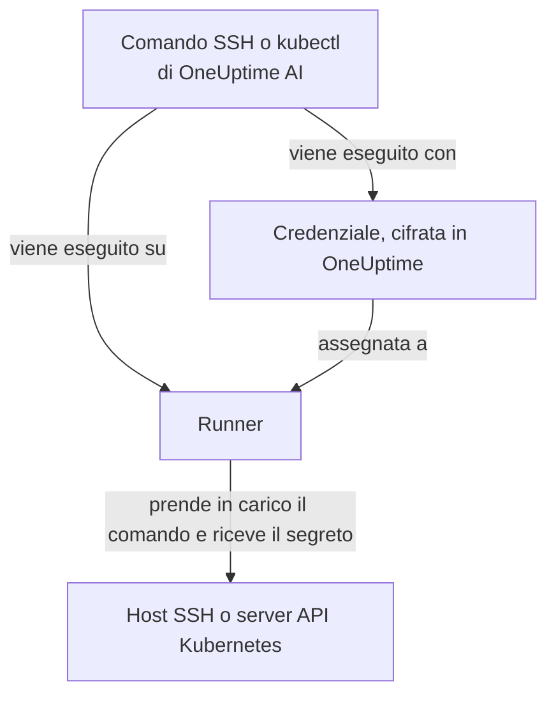

# Accesso dell'IA

L'accesso dell'IA è il modo in cui i comandi di OneUptime AI raggiungono qualcosa che **non** è l'host del Runner stesso: un server via SSH, o il server API di un cluster Kubernetes che non esegue il chart dell'agente Kubernetes. Ogni accesso è una credenziale: quell'accesso come oggetto gestito, cifrato a riposo, assegnato a Runner specifici e scelto da OneUptime AI invece che scritto in un comando. I passaggi dei runbook non le usano: un passaggio SSH o kubectl accede con una [variabile di runbook](/docs/runbooks/variables) segreta.

Gestiscile in **Runbook → Agenti di runbook → Accesso dell'IA**.

:::cards
- [Creare una credenziale](#creare-una-credenziale): Il suo accesso e i Runner che possono usarla.
- [Privilegio minimo dall'altra parte](#privilegio-minimo-dallaltra-parte): Limitare ciò che può fare la chiave o il token.
- [Runner che eseguono i comandi di OneUptime AI](#runner-che-eseguono-i-comandi-di-oneuptime-ai): Chi può dare una credenziale SSH a un Runner del genere.
:::

## Come viene usata una credenziale

OneUptime AI esegue un comando SSH con una delle credenziali SSH assegnate al Runner su cui viene eseguito, e un comando kubectl per un cluster che non esegue il chart dell'agente Kubernetes con la credenziale Kubernetes associata a quel cluster, come mostra [SRE con IA](/docs/ai/ai-sre). Quando il Runner prende in carico il comando, OneUptime verifica che la credenziale gli sia assegnata, decifra il segreto e lo consegna solo nella risposta a quella presa in carico. Il segreto non viene mai salvato sul job e non è mai leggibile tramite l'API.

## Prima di iniziare

- **Un ruolo che gestisce le credenziali.** Project Owner e Project Admin, oppure chiunque abbia l'autorizzazione **Create Runbook Credential**. Il ruolo Runbook Admin non la include. Assegnare una credenziale SSH a un Runner che esegue i comandi di OneUptime AI richiede anche **Read Runbook Credential**; vedi [Runner che eseguono i comandi di OneUptime AI](#runner-che-eseguono-i-comandi-di-oneuptime-ai).
- **Un piano che le includa.** Su OneUptime Cloud, le credenziali dei runbook richiedono il piano **Growth** o superiore.
- **Un [Runner](/docs/runbooks/agents)** che raggiunga in rete l'host o il server API del cluster.

## Creare una credenziale

:::steps
### Aprire l'accesso dell'IA

Apri **Runbook → Agenti di runbook → Accesso dell'IA** e fai clic su **Crea: Credential**.

### Dagli un nome e scegli il tipo

Nel passaggio **Credential**, inserisci un **Nome**, ad esempio `prod-cluster`, una **Descrizione** facoltativa e il **Tipo**: **SSH** o **Kubernetes**. Il tipo non può essere cambiato in seguito; crea invece una nuova credenziale.

### Inserisci l'accesso

:::tabs
@tab SSH
In **Host SSH**, inserisci **Hostname**, **Porta** (22 se vuota) e **Nome utente**. In **Autenticazione SSH**, scegli come **Accedi con**: una **Chiave privata**, l'opzione migliore quando puoi scegliere, poi incolla la **Private Key (PEM)**, con la sua **Private Key Passphrase** se ne ha una; oppure una **Password**, per un host senza accesso tramite chiave, poi inserisci la **Password**.
@tab Kubernetes
In **Kubernetes**, inserisci l'**API Server URL**, ad esempio `https://10.0.0.1:6443`, il **Service Account Token** e il **CA Certificate (PEM)** perché il Runner possa verificare il server API. Lascia vuota la CA solo se il server API presenta un certificato di cui il Runner si fida già.
:::

### Assegnala ai Runner

Nel passaggio **Agenti di runbook**, scegli i Runner che possono usare la credenziale, poi fai clic su **Crea: Credential**. Una credenziale non assegnata ad alcun Runner non può essere usata da alcun comando.

### Lasciare che OneUptime AI la usi

OneUptime AI esegue i suoi comandi SSH su un Runner con **Esegue i comandi di rimedio AI** attivo, con una delle credenziali SSH assegnate a esso. Una credenziale Kubernetes viene usata non appena è associata, con uno dei suoi Runner, a un cluster: vedi [SRE con IA](/docs/ai/ai-sre).
:::

## Cosa viene salvato

| Tipo | Campi |
| --- | --- |
| SSH | Hostname, porta (22 per impostazione predefinita), nome utente e una chiave privata PEM (con passphrase facoltativa) oppure una password. |
| Kubernetes | URL del server API, un token di service account e il certificato della CA del cluster. |

## I valori segreti sono in sola scrittura

Chiavi private, passphrase, password e token di service account sono cifrati a riposo e l'API **non li restituisce mai**: né alla dashboard, né a un workflow, né a un'esportazione. La tabella può mostrarti cosa *è* una credenziale senza mai mostrare cosa contiene.

Per questo non esiste un «visualizza» per un valore segreto, solo «sostituisci»: inserire di nuovo un valore è il modo per ruotarlo. Se perdi l'originale, emetti una nuova chiave sul sistema di destinazione e aggiorna la credenziale.

## Assegnare una credenziale ai Runner

Una credenziale è utilizzabile solo dai Runner a cui la assegni. Un comando che indica una credenziale non assegnata al suo Runner **fallisce invece di essere eseguito**: un Runner che in silenzio non fa nulla sembra esattamente uno che ha funzionato.

L'assegnazione è il confine di accesso, quindi tienila stretta: un Runner che riavvia sempre e solo un cluster non ha bisogno della chiave SSH dei tuoi host di database.

### Runner che eseguono i comandi di OneUptime AI

Su un Runner con **Esegue i comandi di rimedio AI** attivo, OneUptime AI sceglie tra le credenziali SSH assegnate al Runner per i comandi che vi esegue. Per questo una credenziale SSH raggiunge un Runner del genere solo tramite qualcuno che può leggere le credenziali dei runbook (**Read Runbook Credential**, oppure un Project Owner o un Project Admin), qualunque cosa venga salvata per prima:

- **Assegnare la credenziale.** Creare una credenziale SSH con un Runner del genere, o aggiungere un Runner del genere a una credenziale, richiede quell'autorizzazione. Senza, il salvataggio viene rifiutato e indica il Runner: assegna la credenziale a Runner che non eseguono comandi di rimedio con IA, oppure chiedi a qualcuno che ha l'autorizzazione di assegnarla.
- **Attivare l'interruttore.** Attivare **Esegue i comandi di rimedio AI** su un Runner che ha credenziali SSH richiede la stessa autorizzazione.

Rimuovere Runner da una credenziale, salvare una credenziale con i Runner che ha già e le credenziali Kubernetes non chiedono altro: i comandi kubectl di OneUptime AI vengono eseguiti con la credenziale associata al loro cluster. Le assegnazioni di credenziali e l'attivazione dell'interruttore da parte di chi non ha quell'autorizzazione vengono salvate una alla volta in un progetto, così le due non possono superare insieme i loro controlli; un salvataggio che arriva mentre un altro è in corso lo attende, e se ci vuole troppo viene rifiutato con *Try again in a moment*. Salva di nuovo.

I passaggi di un workflow agiscono come Project Admin, ma non ricevono in prestito la lettura delle credenziali dei runbook di un Project Admin: un passaggio la ha solo se ce l'ha la persona che ha salvato per ultima i passaggi del workflow. Vedi [Cosa possono fare i passaggi di un workflow](/docs/workflows/configuration#cosa-possono-fare-i-passaggi-di-un-workflow).

## Privilegio minimo dall'altra parte

OneUptime non può limitare ciò che la tua credenziale può fare sul sistema di destinazione: è compito del sistema di destinazione, e vale la pena farlo:

- **SSH** — preferisci una chiave a una password, dai all'utente solo i comandi di cui ha bisogno (un comando forzato o una shell ristretta dove possibile) e non riutilizzare la chiave personale di un amministratore.
- **Kubernetes** — associa il service account a un Role che consenta solo ciò che lasci fare a OneUptime AI, nei namespace in cui può agire. Un service account che può solo leggere lascia indagare OneUptime AI e rifiuta ogni correzione.

## Chi può vederle

Creare, modificare ed eliminare credenziali richiede le autorizzazioni sulle credenziali dei runbook (o Project Owner/Admin). Leggere una credenziale mostra solo i suoi campi non segreti.

Tieni presente che la **chiave dell'agente** di un Runner equivale alle credenziali assegnate a quel Runner: chiunque abbia la chiave può prendere in carico lavoro come quel Runner e ricevere materiale delle credenziali. Per questo le chiavi degli agenti sono leggibili solo da Project Owner, Project Admin e Runbook Admin: trattale come tratteresti le credenziali stesse.

## Prossimi passi

:::cards
- [Variabili dei runbook](/docs/runbooks/variables): I segreti con cui accedono i passaggi SSH e kubectl.
- [Agenti di runbook](/docs/runbooks/agents): Installare il Runner a cui viene assegnata una credenziale.
- [Configurazione e sicurezza dei runbook](/docs/runbooks/configuration): Autorizzazioni e protezione per l'intero sistema dei runbook.
:::
