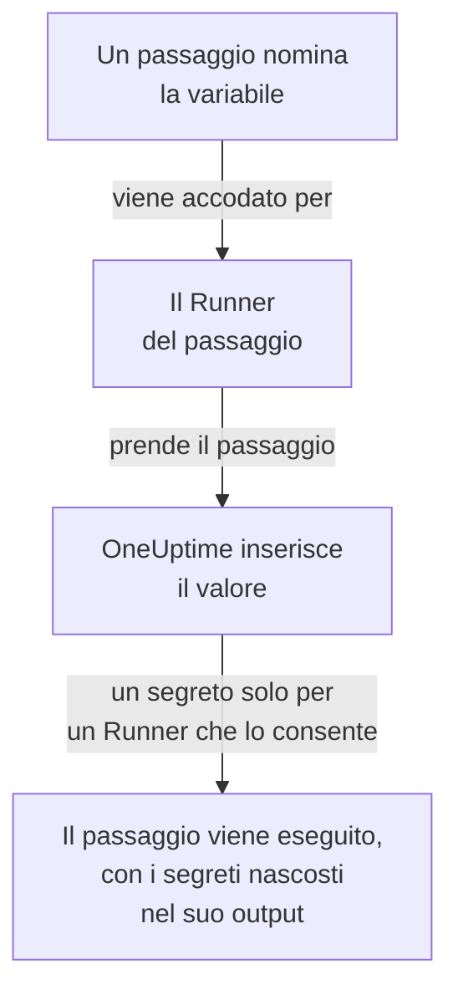

# Variabili dei runbook

Una variabile di runbook è un valore che i tuoi passaggi usano per nome invece di contenerlo: un host, un namespace o un URL, oppure un segreto come una chiave SSH, una password, un kubeconfig o un token API. Cambia il valore una volta, e ogni passaggio che lo nomina usa quello nuovo alla prossima esecuzione. Un segreto è cifrato, non viene mai più mostrato ed è nascosto in ciò che i passaggi stampano.

:::cards
- [Creare una variabile](#creare-una-variabile): Un valore semplice, oppure un segreto e i Runner che possono usarlo.
- [Usare una variabile in un passaggio](#usare-una-variabile-in-un-passaggio): In uno script o in una richiesta HTTP, oppure come accesso di un passaggio SSH e kubeconfig di un passaggio kubectl.
- [Chi riceve un segreto](#chi-riceve-un-segreto): I tuoi Runner, i Runner globali quando lo consenti, e OneUptime per un passaggio di richiesta HTTP.
:::

## Come una variabile raggiunge un passaggio



Un passaggio contiene il nome della variabile, mai il suo valore. Quando il Runner del passaggio lo prende, OneUptime inserisce il valore - nello script, nella macchina e nell'accesso di un passaggio SSH, o nel kubeconfig di un passaggio kubectl - e lo consegna solo a quel Runner. Un passaggio che nomina una variabile che non può avere fallisce indicandone il motivo, invece di essere eseguito con il nome al posto del valore.

I passaggi Bash, JavaScript, SSH, kubectl e di richiesta HTTP usano le variabili. I passaggi di IA non le inseriscono. OneUptime invia da sé un passaggio di richiesta HTTP, senza Runner, quindi il passaggio riceve ogni variabile che nomina, anche i segreti, e li nasconde nella risposta che registra.

## Variabili globali e variabili di runbook

| | Variabili globali | Le variabili proprie di un runbook |
| --- | --- | --- |
| Gestite in | **Runbook → Impostazioni → Variabili globali** | **Impostazioni → Variabili** del runbook |
| Usate da | Ogni runbook del progetto | Solo i passaggi di quel runbook |
| Scritte in un passaggio come | `{{global.variables.NAME}}` | `{{local.variables.NAME}}` |

Un nome si usa una sola volta, senza distinzione tra maiuscole e minuscole, tra le variabili globali del progetto, e una volta tra quelle proprie di un runbook. Una variabile di un runbook può avere lo stesso nome di una globale: ciascuna si scrive a modo suo.

## Prima di iniziare

- **Un ruolo che gestisce le variabili.** Project Owner e Project Admin, oppure il permesso **Create Runbook Variable**. Runbook Admin legge le variabili, per sceglierle nei passaggi che scrive, ma non le modifica.
- **Un piano che le includa.** Su OneUptime Cloud, le variabili dei runbook richiedono il piano **Growth** o superiore.

## Creare una variabile

:::steps
### Aprire le variabili

Apri **Runbook → Impostazioni → Variabili globali**, oppure **Impostazioni → Variabili** di un runbook, e fai clic su **Crea: Variabile**.

### Darle un nome e inserire il valore

Nel passaggio **Variabile**, inserisci un **Nome**: lettere, numeri, trattini e trattini bassi, fino a 100 caratteri, ad esempio `PROD_DB_SSH_KEY`. **Segreto** parte attivo: incolla la chiave, la password, il token o il kubeconfig in **Valore del segreto** e fai clic su **Avanti**. Per un valore che chiunque può leggere, come un host, disattiva **Segreto**, inseriscilo in **Valore** e fai clic su **Crea: Variabile**. Una **Descrizione** facoltativa attende in **Altri campi**.

### Scegliere chi può usare un segreto

Nel passaggio **Chi può usarlo**, scegli i tuoi Runner in **I tuoi Runner che possono usarlo**. Su un server con [Runner globali](/docs/runbooks/agents#runner-globali), **I Runner globali possono usarlo** consente anche ai passaggi di questo progetto eseguiti su un Runner globale di usare il segreto: parte attivo finché il progetto usa i Runner globali. Un segreto ha bisogno dell'uno o dell'altro. Fai clic su **Crea: Variabile**.
:::

Se una variabile è un segreto non si può cambiare in seguito. Eliminala invece e ricreala con lo stesso nome: i passaggi nominano le variabili per nome, quindi continuano a funzionare. Il Runner interno di un cluster, quello installato dal chart dell'agente Kubernetes, non riceve mai un segreto.

## I valori segreti sono di sola scrittura

Il valore di un segreto è cifrato a riposo e l'API **non lo restituisce mai**: né alla dashboard, né a un workflow, né a un'esportazione. L'elenco mostra **Segreto** dove una variabile semplice mostra il suo valore, e la sua colonna **Agenti di runbook** dice quali Runner ricevono ogni segreto. Per cambiarlo, fai clic su **Sostituisci valore** nella sua riga: il nuovo valore viene cifrato, quello vecchio sparisce per sempre e i passaggi ricevono quello nuovo alla prossima esecuzione.

Quando un passaggio stampa un segreto ricevuto, il Runner lo sostituisce con `[REDACTED]` prima che l'output lasci il suo host, e OneUptime lo fa di nuovo prima di salvare l'output. Anche una riga di una chiave privata, o il token di un kubeconfig, viene nascosta. Un segreto più corto di 4 caratteri non viene cercato.

## Usare una variabile in un passaggio

:::tabs
@tab In uno script
Scrivi il riferimento dove va il valore, in uno script Bash, JavaScript, SSH o kubectl:

```bash
curl -s -X POST \
  -H "Authorization: Bearer {{global.variables.CDN_API_TOKEN}}" \
  "https://api.cdn.example.com/v1/purge"
```
@tab In una richiesta HTTP
Scrivi il riferimento nell'URL, negli header o nel corpo di un [passaggio di richiesta HTTP](/docs/runbooks/authoring#http-request):

```json
{ "Authorization": "Bearer {{global.variables.API_TOKEN}}" }
```
@tab Accesso SSH
Un [passaggio SSH](/docs/runbooks/authoring#ssh) sceglie in **Accedi con** la variabile segreta che contiene la sua chiave privata o la sua password, e in **Altri campi → Passphrase della chiave** la passphrase della sua chiave. Il valore indica se si tratta di una chiave o di una password.
@tab Kubeconfig
Un [passaggio kubectl](/docs/runbooks/authoring#kubectl) sceglie in **Kubeconfig** la variabile segreta che contiene il kubeconfig del cluster, oppure **L'accesso proprio del Runner** per usare quello del Runner.
:::

Nella pagina **Passaggi** di un runbook, ogni script e ogni richiesta HTTP elencano in **Variabili — clicca per copiare** le variabili che il loro passaggio può usare, e l'editor segnala quando un passaggio nomina una variabile che non esiste, o un segreto che il suo Runner non può usare.

## Chi riceve un segreto

| Chi esegue il passaggio | Una variabile semplice | Un segreto |
| --- | --- | --- |
| Uno dei tuoi Runner | Sempre | Quando il segreto lo elenca in **I tuoi Runner che possono usarlo** |
| Un Runner globale | Sempre | Quando **I Runner globali possono usarlo** è attivo, per un passaggio del progetto del segreto |
| OneUptime stesso, per un passaggio di richiesta HTTP | Sempre | Sempre |

Un passaggio che nomina un segreto che il suo Runner non può usare fallisce, indicando il segreto e cosa cambiare, e non viene consegnato nulla.

## I segreti e le credenziali dei runbook sono diventati variabili

Le variabili dei runbook hanno preso il posto dei segreti dei runbook e delle credenziali nominate dai passaggi SSH e Kubernetes. Quando OneUptime è stato aggiornato, ciò che ogni progetto aveva è stato spostato una volta, così ogni runbook viene eseguito come prima:

- ogni segreto di runbook è diventato una variabile globale segreta con lo stesso nome, lo stesso valore, gli stessi Runner e lo stesso interruttore per i Runner globali;
- `{{runbookSecrets.NAME}}` in uno script è stato riscritto come `{{global.variables.NAME}}`, e la vecchia forma legge ancora la variabile globale `NAME`;
- ogni credenziale nominata da un passaggio è diventata variabili globali segrete con gli stessi Runner, chiamate come lei: `<name>-ssh-key` (e `<name>-ssh-key-passphrase`, per una chiave che ne aveva una), `<name>-ssh-password` o `<name>-kubeconfig`;
- ogni passaggio SSH che nominava una credenziale accede alla sua macchina con esse ed esegue il suo comando come script, e ogni passaggio Kubernetes è diventato un passaggio kubectl che esegue il `kubectl patch` della sua azione, senza bisogno di più accesso di quanto ne avesse il passaggio.

Un Runner precedente a questa versione (14.0.79) non può eseguire uno script kubectl: fa fallire un passaggio kubectl e dice di aggiornare il Runner. Ogni passaggio Kubernetes portato in questa forma ha prima conservato la sua credenziale e la sua azione accanto al suo script, per un Runner così; sono andate via con le credenziali dei runbook, quindi ogni passaggio kubectl richiede un Runner della 14.0.79 o successiva.

Le credenziali dei runbook sono state poi rimosse, e un passaggio che ne nominava ancora una è stato prima portato nella stessa forma. Un passaggio che nomina una credenziale non viene più eseguito, e la sua pagina dei passaggi offre **Trasforma in passaggio di script**; un salvataggio tramite l'API o Terraform che ne dà una a un passaggio viene rifiutato. Vedi [Le credenziali dei runbook sono rimosse](/docs/installation/upgrading#le-credenziali-dei-runbook-sono-rimosse).

## Passi successivi

:::cards
- [Scrivere un runbook](/docs/runbooks/authoring): Scrivi i passaggi SSH e kubectl che usano una variabile.
- [Agenti di runbook](/docs/runbooks/agents): Installa il Runner a cui viene consegnato un segreto.
- [Configurazione e sicurezza dei runbook](/docs/runbooks/configuration): Permessi e protezione per l'intero stack dei runbook.
:::
