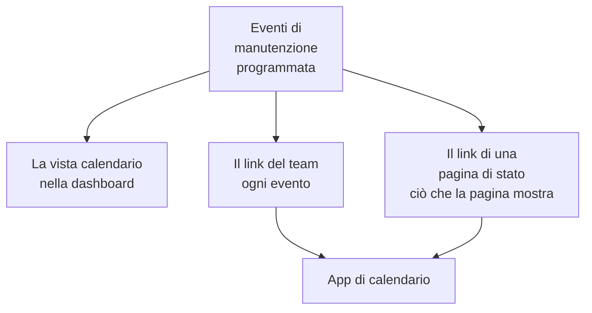

# Calendario della manutenzione

Il calendario della manutenzione mostra la vostra manutenzione programmata per data: come calendario nella dashboard, nelle app di calendario del vostro team tramite un link segreto e nei calendari delle persone che seguono le vostre pagine di stato. Questa pagina spiega la vista calendario, il link del calendario del team, il calendario di una pagina di stato e che cosa contiene ogni evento del calendario.

:::cards
- [La vista calendario](#la-vista-calendario): Ogni evento su un mese, una settimana o un giorno, nel colore del suo stato.
- [Il link del calendario del team](#il-link-del-calendario-del-team): Ogni evento del progetto in Google Calendar, Outlook o Calendario Apple.
- [Il calendario di una pagina di stato](#il-calendario-di-una-pagina-di-stato): Ciò che una pagina di stato mostra, nei calendari dei suoi visitatori.
- [Che cosa contiene un evento del calendario](#che-cosa-contiene-un-evento-del-calendario): Il titolo, la finestra, lo stato e un link per tornare indietro.
:::



## La vista calendario

Aprite **Manutenzione programmata → Tutti gli eventi**. All'estremità destra della barra dei filtri, **Elenco** e **Calendario** passano dalla tabella degli eventi a un calendario degli stessi. Il browser ricorda la scelta, quindi la volta successiva la pagina si apre sul calendario.

- Il calendario si apre sul mese corrente, con il giorno di oggi evidenziato. **Mese**, **Settimana** e **Giorno** cambiano quanto ne mostra, e **Indietro**, **Avanti** e **Oggi** vi fanno muovere al suo interno. Gli orari sono nel vostro fuso orario.
- Ogni evento è un blocco nel colore del suo stato, e i colori degli stati sono indicati sotto il calendario. Fate clic su un evento per aprirlo.
- I filtri sopra il calendario funzionano come nell'elenco: scegliete uno stato, un'etichetta o un proprietario per vedere solo quegli eventi.
- Un giorno ancora da venire mostra un **+** quando puntate sulla sua settimana. Apre **Crea evento di manutenzione programmata** con **Inizia il** in quel giorno, all'ora che il modulo sceglierebbe oggi. Lo vedete solo se potete creare eventi.
- Una vista mostra fino a 500 eventi. Un mese più affollato lo segnala: restringetelo con i filtri o guardate una settimana.

## Il link del calendario del team

**Iscriviti al calendario**, sotto il calendario o nel menu **⋯** dell'elenco, apre il link del calendario del progetto: un unico link iCalendar (`.ics`) segreto che porta ogni evento di manutenzione programmata del progetto in Google Calendar, Outlook, Calendario Apple o in qualsiasi app che si iscrive a un calendario tramite URL.

:::steps
### Pubblicate il link

Fate clic su **Pubblica link**. Un progetto ha un solo link, per tutto il team, quindi serve una volta sola.

### Aggiungetelo alla vostra app di calendario

**Google Calendar** apre Google Calendar, che chiede se aggiungere il calendario. **Calendario Apple / Outlook** apre il link nell'app di calendario del vostro computer o telefono. **Copia link** lo copia per qualsiasi altra app.

### Verificate che funzioni

Il pannello **Stato** dice quando un'app di calendario ha letto il link l'ultima volta, e quale. Un link nuovo mostra **In attesa della prima sincronizzazione** finché un'app non lo legge.
:::

Il link ha questo aspetto:

```text
https://<your host>/api/scheduled-maintenance-calendar/project/<token>/maintenance.ics
```

> [!WARNING]
> Chiunque abbia il link vede ogni evento di manutenzione programmata del progetto, senza accedere. Trattatelo come una password e rigeneratelo se viene condiviso per errore.

### Chi può vedere il link

Il link mostra ogni evento del progetto, quindi la finestra di dialogo lo mostra solo alle persone che possono leggere ogni evento. Chi ha un ruolo limitato ad alcuni eventi, per etichetta o agli eventi di cui è proprietario, viene invece informato del perché.

| Azione | Chi può farla |
| --- | --- |
| Copiare il link | Chiunque possa leggere ogni evento di manutenzione programmata del progetto |
| **Pubblica link** | Chiunque possa anche creare eventi di manutenzione programmata |
| **Rigenera link**, **Disattiva link** | Chiunque possa anche modificare eventi di manutenzione programmata |

### Gestire il link

**Rigenera link** e **Disattiva link** si trovano nel menu **⋯** in alto nella finestra di dialogo.

| Azione | Che cosa succede |
| --- | --- |
| **Rigenera link** | Crea un nuovo link. Per 30 giorni il vecchio fornisce un calendario vuoto, così le app che lo usano svuotano la loro copia; dopo non viene più trovato. Iscrivetevi di nuovo con il nuovo link. |
| **Disattiva link** | Mantiene il link, ma fornisce un calendario vuoto fino a **Attiva link**. |

Il calendario contiene ogni evento da 90 giorni fa a un anno avanti, fino a 1.000 eventi.

## Il calendario di una pagina di stato

Le persone che seguono una pagina di stato possono portare la sua manutenzione programmata nel proprio calendario. Nella pagina degli eventi programmati della pagina di stato, **Iscriviti al calendario** offre Google Calendar, l'app di calendario del loro dispositivo o il link da copiare. Il link è l'indirizzo della pagina seguito da `/maintenance.ics`, ad esempio `https://status.example.com/maintenance.ics`.

- **Che cosa contiene.** Esattamente ciò che la pagina mostra: gli eventi della finestra cronologica della pagina, ogni evento ancora da iniziare e ogni evento in corso, finché **Visibile sulla pagina di stato** è attivo. Ciò che ogni evento riguarda viene indicato come la pagina chiama le sue risorse, mai con i nomi propri dei vostri monitor.
- **Una pagina privata.** Un'app di calendario non può accedere, quindi una pagina privata non offre **Iscriviti al calendario**, e il suo link fornisce un calendario vuoto che dice che la pagina è privata.
- **Un solo evento.** **Aggiungi al calendario** nella pagina di un evento aggiunge solo quell'evento: Google Calendar si apre con l'evento già compilato, oppure viene scaricato come file che l'app di calendario del dispositivo apre. Funziona anche su una pagina privata, per un visitatore che ha effettuato l'accesso, e non viene più offerto quando l'evento è finito.

## Che cosa contiene un evento del calendario

Ogni calendario, quello del team e quello di una pagina di stato, scrive un evento allo stesso modo.

| Parte | Che cosa contiene |
| --- | --- |
| Titolo | Il titolo dell'evento |
| Inizio e fine | La finestra pianificata, in UTC; l'app di calendario la mostra nel vostro fuso orario |
| Descrizione | La descrizione come testo semplice, lo stato, ciò che riguarda e un link all'evento; il link del team nomina anche le sue pagine di stato |
| Stato | Annullato quando l'evento è stato annullato: completato senza essere mai stato in corso |
| Libero o occupato | Libero, così una finestra di manutenzione non blocca mai la vostra disponibilità |
| Categorie | Le sue etichette; il calendario di una pagina di stato le mostra solo quando la pagina mostra le etichette |

Un evento modificato in OneUptime viene aggiornato sul posto in ogni calendario che lo contiene, e uno eliminato, o tolto da una pagina di stato, esce dal calendario al successivo aggiornamento.

## Ogni quanto si aggiornano i calendari

Le app di calendario leggono un link sottoscritto secondo il proprio ritmo. Google Calendar lo fa ogni poche ore, a volte solo una volta al giorno; Calendario Apple e Outlook di solito ogni ora. OneUptime conserva un calendario per al massimo cinque minuti, quindi l'attesa che vedete è quella dell'app di calendario. I passaggi per ogni app sono in [Feed calendario](/docs/on-call/calendar-feeds#sottoscrivere-nella-tua-app-di-calendario), che funzionano allo stesso modo per i turni di reperibilità.

## Risoluzione dei problemi

:::details L'app di calendario non mostra più i nuovi eventi
Il link è stato rigenerato o disattivato: aprite **Iscriviti al calendario** per vederne lo stato. Un link rigenerato richiede una nuova iscrizione con il nuovo link; un link disattivato torna con **Attiva link**.
:::

:::details Google Calendar non riesce ad aggiungere il link
Google Calendar legge il link dai server di Google, quindi il server OneUptime deve essere raggiungibile da Internet. Vedete [Feed calendario](/docs/on-call/calendar-feeds#risoluzione-dei-problemi) per un server self-hosted.
:::

:::details Un evento manca dal calendario di una pagina di stato
Il calendario della pagina contiene ciò che la pagina mostra. Verificate che l'evento indichi la pagina, che **Visibile sulla pagina di stato** sia attivo nelle sue **Impostazioni** e che sia iniziato entro la finestra cronologica della pagina.
:::

## Passaggi successivi

:::cards
- [Creare eventi di manutenzione](/docs/scheduled-maintenance/creating-events): Il modulo, campo per campo, e che cosa succede dopo.
- [Iscritti e annunci](/docs/status-pages/subscribers#eventi-di-manutenzione-programmata): Che cosa viene detto agli iscritti di una pagina di stato sulla manutenzione.
- [Feed calendario](/docs/on-call/calendar-feeds): Lo stesso tipo di link, per i turni di reperibilità.
:::
