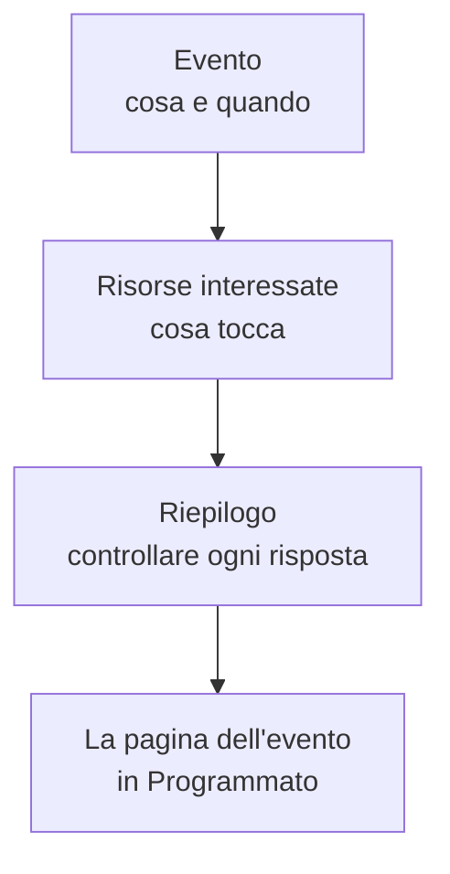

# Creare eventi di manutenzione

Pianificate una manutenzione in due brevi passi: dite cosa succede e quando, poi cosa interessa e chi deve saperlo. Va scritto solo il titolo; tutto il resto parte con un valore predefinito sensato. Questa pagina percorre il modulo, cosa succede nel momento in cui create un evento, come modificarlo in seguito e come creare eventi dal codice.

:::cards
- [Creare un evento](#creare-un-evento): Due passi e un riepilogo.
- [Cosa succede quando lo create](#cosa-succede-quando-lo-create): Il suo numero, le regole, i proprietari e i primi messaggi.
- [Modificare un evento in seguito](#modificare-un-evento-in-seguito): La sua finestra, le risorse, le pagine di stato e le note.
- [Creare eventi dal codice](#creare-eventi-dal-codice): L'API, Terraform, i workflow e la chat.
:::

## Come funziona

Il modulo fa due domande, una per passo, poi mostra tutto in un riepilogo prima di creare l'evento. L'evento parte nel vostro stato programmato, e si apre la sua pagina.



## Prima di iniziare

- **Il vostro ruolo.** Creare un evento richiede **Proprietario del progetto**, **Amministratore del progetto**, **Membro del progetto**, **Amministratore della manutenzione programmata** o **Membro della manutenzione programmata**, oppure un ruolo personalizzato con **Create Scheduled Maintenance**.
- **Le vostre pagine di stato.** Per avvisare i clienti vi serve una pagina di stato che mostri gli eventi di manutenzione programmata. Vedere [Panoramica delle pagine di stato](/docs/status-pages/index).

## Creare un evento

:::steps
### Aprire il modulo

Andate in **Manutenzione programmata → Tutti gli eventi** e fate clic su **Crea evento di manutenzione programmata**. Il modulo si apre sul suo primo passo, **Evento**.

### Dire cosa succede e quando

Scrivete un **Titolo** e aggiungete una **Descrizione** se serve: è in Markdown e viene mostrata sulle vostre pagine di stato. **Inizia il** è già impostato sulla prossima ora piena del vostro orologio, e **Termina il** un'ora dopo; cambiateli solo se sono sbagliati. Spostando **Inizia il** si sposta anche **Termina il**, così la finestra mantiene la sua durata. **Proprietari** ed **Etichette** attendono chiusi in **Altri campi**.

### Scegliere cosa interessa

Fate clic su **Avanti** per arrivare a **Risorse interessate**. Scegliete i **Monitor** che il lavoro tocca. Appena ne scegliete uno, sotto compare **Cambia lo stato del monitor in**: lo stato in cui passano i monitor quando l'evento inizia. Poi scegliete eventuali **Altre risorse interessate**, come host, cluster, database, siti di rete o servizi.

### Scegliere chi lo viene a sapere

Scegliete le pagine di stato in **Mostra evento su queste pagine di stato**. **Notifiche agli iscritti**, chiuso, dice in una riga chi viene avvisato e quando; apritelo per cambiare **Quando l'evento viene pianificato**, **Quando l'evento inizia**, **Quando l'evento termina** o **Promemoria prima dell'evento**.

### Crearlo

Fate clic su **Avanti** per vedere il riepilogo, controllatelo, poi fate clic su **Crea evento di manutenzione programmata**. Si apre la pagina dell'evento.
:::

Non viene inviato nulla finché non scegliete una pagina di stato: un evento mostrato su nessuna pagina di stato non avvisa nessun iscritto.

## I campi del modulo

| Campo                                | Passo              | Parte come                      | Cosa fa                                                                          |
| ------------------------------------ | ------------------ | ------------------------------- | -------------------------------------------------------------------------------- |
| **Titolo**                           | **Evento**         | Vuoto, e obbligatorio           | Dà il nome all'evento ovunque, anche sulle vostre pagine di stato.               |
| **Descrizione**                      | **Evento**         | Vuota                           | Spiega il lavoro ai vostri clienti, in Markdown.                                 |
| **Inizia il**                        | **Evento**         | La prossima ora piena           | Quando l'evento inizia, da solo.                                                 |
| **Termina il**                       | **Evento**         | Un'ora dopo **Inizia il**       | Quando l'evento termina, da solo. Deve venire dopo **Inizia il**.                |
| **Proprietari**                      | **Evento**         | Nessuno                         | Persone e team a cui appartiene l'evento e che ne vengono avvisati.              |
| **Etichette**                        | **Evento**         | Nessuna                         | Etichette su cui regole e filtri possono basarsi.                                |
| **Monitor**                          | **Risorse interessate** | Nessuno                    | I monitor che non vengono controllati mentre l'evento è in corso.                |
| **Cambia lo stato del monitor in**   | **Risorse interessate** | Nessun cambio              | Lo stato che questi monitor mostrano durante l'evento. Viene chiesto appena si sceglie un monitor. |
| **Altre risorse interessate**        | **Risorse interessate** | Nessuna                    | Host, cluster, database, siti di rete, servizi e altro.                          |
| **Mostra evento su queste pagine di stato** | **Risorse interessate** | Nessuna           | Le pagine di stato che mostrano l'evento e avvisano i loro iscritti.             |
| **Notifiche agli iscritti**          | **Risorse interessate** | Tutti e tre i momenti attivi, nessun promemoria | Quando vengono avvisati gli iscritti di quelle pagine. |

Due cose compilano il modulo per voi strada facendo:

- **Risorse collegate.** Quando scegliete un monitor, gli host, i cluster, i servizi e le altre risorse a cui è collegato vengono aggiunti in **Altre risorse interessate**, e una riga sotto il campo li nomina. Togliete quelli che non volete.
- **Pagine di stato suggerite.** In **Mostra evento su queste pagine di stato** vengono suggerite le pagine che mostrano i vostri monitor: fate clic sul nome di una pagina per aggiungerla, oppure su **Aggiungi tutte**. Non viene scelto nulla per voi. Vedere [Eventi di manutenzione programmata](/docs/status-pages/subscribers#eventi-di-manutenzione-programmata).

## Partire da una risorsa o da un modello

Nella scheda **Manutenzione programmata** di un host, un cluster Kubernetes, Proxmox, Ceph o Docker Swarm, un host Docker o Podman, un vCenter, uno storage array, una flotta IoT, un database, un servizio o un sito di rete, **Crea evento di manutenzione programmata** apre lo stesso modulo con quella risorsa già scelta in **Altre risorse interessate**, e la scheda elenca gli eventi che la riguardano. La scheda di un elemento dell'inventario sceglie l'host, il servizio o il cluster Kubernetes a cui punta l'elemento.

**Crea da modello**, accanto al pulsante di creazione, vi chiede di **Seleziona modello di manutenzione programmata**, poi apre il modulo compilato dal modello. Vedere [Modelli ed eventi ricorrenti](/docs/scheduled-maintenance/templates).

## Cosa succede quando lo create

Nel momento in cui fate clic su **Crea evento di manutenzione programmata**, OneUptime esegue questi passi, in quest'ordine:

1. **Riceve un numero e uno stato.** Il numero viene da un contatore per progetto, mostrato con il vostro prefisso (`SM-42`). L'evento parte nel vostro stato programmato, qualunque stato indichi una richiesta.
2. **I vostri strumenti di chat lo vengono a sapere.** Le regole Slack e Microsoft Teams in **Area di lavoro** lo pubblicano nei loro canali, e una regola può creare un canale per l'evento. Il suo feed registra che è stato creato.
3. **Inizia la sua cronologia di stato.** La prima riga della sua **Cronologia stato** è il vostro stato programmato.
4. **Vengono aggiunti proprietari ed etichette**: quelli che avete scelto, poi quelli delle regole del proprietario e delle etichette che corrispondono.
5. **Le regole di runbook avviano** i runbook che corrispondono all'evento.
6. **Vengono pianificati i promemoria**, quando corrisponde una regola di promemoria, per i suoi proprietari.

Entro un minuto gli iscritti delle sue pagine di stato vengono avvisati che è stato pianificato, a meno che abbiate disattivato **Quando l'evento viene pianificato**. Il trigger di workflow **On Create Scheduled Maintenance Event** avvia qualsiasi workflow costruito su di esso, e i suoi proprietari lo vengono a sapere se hanno attivato quella notifica: vedere [Impostazioni notifiche](/docs/notifications/notification-settings).

## Modificare un evento in seguito

Tutto ciò che c'è nel modulo si può cambiare sulle pagine dell'evento, tranne i tre momenti degli iscritti, fissati una volta sola, alla creazione dell'evento.

| Per cambiare                                | Andate a                                                                       |
| ------------------------------------------- | ------------------------------------------------------------------------------ |
| Il titolo, la finestra o le etichette       | **Modifica** sulla scheda **Maintenance Details** della sua **Panoramica**, passo **Evento** |
| Le pagine di stato o i promemoria           | Lo stesso **Modifica**, passo **Pagine di stato**                               |
| I monitor, il loro stato o le altre risorse | **Modifica** sulla scheda **Risorse interessate**                               |
| La descrizione                              | **Descrizione** nel suo menu laterale                                          |
| I proprietari                               | **Proprietari** nel suo menu laterale                                          |

**Cambia lo stato del monitor in** si può cambiare finché l'evento non inizia. Dopo, la scheda lo mostra in sola lettura, perché i monitor sono già in quello stato. Una modifica aggiunge al **Pianificato Manutenzione Feed** una voce che nomina ciò che ha cambiato; salvare senza cambiare nulla non ne aggiunge.

## Pubblicare note mentre il lavoro procede

- Le **Note pubbliche** sono aggiornamenti per i vostri clienti: vengono mostrate sulle pagine di stato dell'evento, e ognuna può avvisare i loro iscritti con **Notify status page subscribers**.
- Le **Note private** sono solo per il vostro team.

Scrivetene una sulla pagina **Note pubbliche** o **Note private** dell'evento, oppure dal menu **Azioni** del **Pianificato Manutenzione Feed** con **Add Public Note** o **Aggiungi nota privata**. Lo stesso menu esegue un runbook con **Execute Runbook**. Un modello di nota compila un testo che il vostro team scrive spesso: vedere [Regole e impostazioni della manutenzione](/docs/scheduled-maintenance/settings#modelli-di-note).

## Creare eventi dal codice

Il modello di evento ha un'API standard, quindi `POST /api/scheduled-maintenance` crea un evento. Autenticatevi con una chiave API da **Impostazioni del progetto → Avanzato → Chiavi API**, inviata nell'intestazione `apikey`; la chiave indica il progetto.

```bash
curl -X POST https://oneuptime.com/api/scheduled-maintenance \
  -H "apikey: $ONEUPTIME_API_KEY" \
  -H "Content-Type: application/json" \
  -d '{
    "data": {
      "title": "Database upgrade",
      "description": "Writes pause for a few minutes while the primary restarts.",
      "startsAt": "2030-06-01T02:00:00Z",
      "endsAt": "2030-06-01T04:00:00Z"
    }
  }'
```

| Campo                                                 | Note                                                                                      |
| ----------------------------------------------------- | ----------------------------------------------------------------------------------------- |
| `title`, `startsAt`, `endsAt`                          | Obbligatori, come nel modulo.                                                             |
| `monitors`, `statusPages`, `labels`                   | I monitor, le pagine di stato e le etichette dell'evento, tutti del progetto della chiave API. |
| `changeMonitorStatusToId`                             | Lo stato del monitor in cui passano i suoi monitor quando inizia.                         |
| `currentScheduledMaintenanceStateId`                  | Ignorato: ogni evento parte nel vostro stato programmato.                                 |
| `shouldStatusPageSubscribersBeNotifiedOnEventCreated` | L'interruttore **Quando l'evento viene pianificato**. Gli altri due momenti hanno campi propri. |

Lo stesso evento come codice è la risorsa Terraform `oneuptime_scheduled_maintenance_event`: vedere [Esempi](/docs/terraform/examples#manutenzione-programmata). Un workflow ne crea uno con il suo passo **Create One Scheduled Maintenance Event**, e `/oneuptime maintenance` apre il modulo in Slack: vedere [Slack](/docs/workspace-connections/slack#creare-incidenti-e-manutenzioni-da-slack).

## Risoluzione dei problemi

:::details Termina il dice che deve venire dopo Inizia il
La finestra deve essere in ordine: l'evento termina dopo essere iniziato. Spostate prima **Inizia il**, perché **Termina il** lo segue, poi impostate **Termina il**.
:::

:::details Cambia lo stato del monitor in manca nel modulo
Viene chiesto solo quando l'evento ha un monitor. Sceglietene uno in **Monitor**, e compare subito sotto.
:::

:::details Cambia lo stato del monitor in non si può più cambiare
L'evento è iniziato, e i suoi monitor sono già in quello stato. Lo stato vale dal momento in cui l'evento inizia finché non termina.
:::

## Passi successivi

:::cards
- [Stati della manutenzione](/docs/scheduled-maintenance/states): Cosa avvia e chiude un evento, e come farlo avanzare a mano.
- [Modelli ed eventi ricorrenti](/docs/scheduled-maintenance/templates): Salvate le risposte del modulo per la prossima volta.
- [Iscritti e annunci](/docs/status-pages/subscribers#eventi-di-manutenzione-programmata): Esattamente chi viene avvisato, e quando.
- [Regole e impostazioni della manutenzione](/docs/scheduled-maintenance/settings): Aggiungete proprietari, etichette e promemoria automaticamente.
:::
