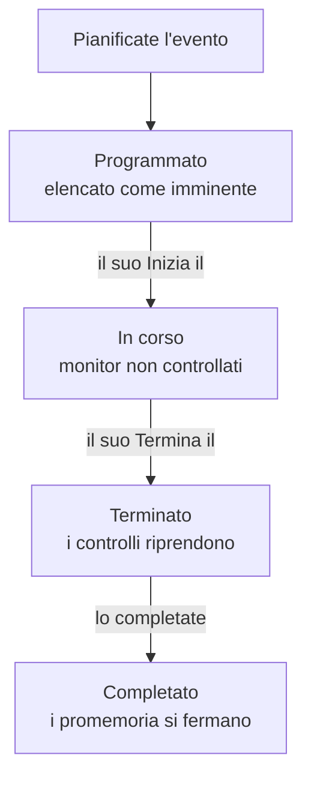

# Panoramica della manutenzione programmata

Un evento di manutenzione programmata annuncia a tutti un lavoro pianificato prima che avvenga: un aggiornamento del database, una modifica della rete, un trasloco su nuovi server. OneUptime avvia e chiude l'evento in orario, smette di controllare i monitor interessati mentre il lavoro è in corso e lo mostra sulle vostre pagine di stato, così un fermo pianificato non sembra mai un guasto. Questa pagina spiega come si svolge un evento, dove si trova tutto nella dashboard e cosa cambia un evento nel resto di OneUptime.

:::cards
- [Come si svolge un evento](#come-si-svolge-un-evento): Da programmato a completato, per lo più da solo.
- [Da dove arrivano gli eventi](#da-dove-arrivano-gli-eventi): Il modulo, i modelli, una pianificazione, i moduli, la chat e il codice.
- [Cosa influenza un evento](#cosa-influenza-un-evento): Monitor, pagine di stato, iscritti e avvisi.
- [Le pagine di un evento](#le-pagine-di-un-evento): La sua panoramica, cronologia, note e impostazioni.
:::

## Come si svolge un evento

Ogni evento ha una finestra pianificata, il suo **Inizia il** e il suo **Termina il**, e scende lungo il vostro elenco di stati di manutenzione. Un processo che gira ogni minuto lo fa avanzare a entrambi gli estremi della finestra, così pianificate il lavoro una volta e OneUptime fa il resto.

Un nuovo evento parte in **Programmato**. Al suo **Inizia il** passa a **In corso**: OneUptime smette di controllare i suoi monitor e, se avete scelto uno stato per loro, li mostra in quello stato. Al suo **Termina il** passa a **Terminato**: i controlli riprendono e ogni monitor torna «operativo». **Completato** è l'ultimo passo, e niente lo compie da solo: una persona, un pulsante della chat o l'API segna il lavoro come approvato, il che ferma anche i promemoria ai proprietari.

Potete avviare o chiudere un evento in anticipo, o aggiungere stati vostri tra questi quattro. Vedere [Stati della manutenzione](/docs/scheduled-maintenance/states).

## Manutenzione e annunci

Entrambi informano i visitatori delle vostre pagine di stato. Usate un evento di manutenzione per un lavoro con un inizio e una fine, e un annuncio per qualsiasi altra cosa debbano leggere.

|                              | Manutenzione programmata                                                | Annuncio                                       |
| ---------------------------- | ----------------------------------------------------------------------- | ---------------------------------------------- |
| **Che cos'è**                | Un lavoro pianificato, con una finestra                                 | Un messaggio per i visitatori delle vostre pagine di stato |
| **I suoi monitor**           | Non controllati mentre è in corso, e mostrati nello stato scelto       | Invariati                                      |
| **Come avanza**              | Attraverso i vostri stati di manutenzione, in orario                    | Viene mostrato dall'ora di inizio fino all'ora di fine, se ne ha una |
| **Quando gli iscritti vengono avvisati** | Quando viene pianificato, inizia e termina, e prima dell'inizio se lo chiedete | Una volta, quando inizia a essere mostrato |
| **Numeri in un nuovo progetto** | `SM-42`                                                              | Nessuno                                        |

Gli annunci sono trattati in [Iscritti e annunci](/docs/status-pages/subscribers#annunci).

## Da dove arrivano gli eventi

- **Il modulo.** Fate clic su **Crea evento di manutenzione programmata** nell'elenco degli eventi, oppure nella scheda **Manutenzione programmata** di un host, un cluster, un servizio, un sito di rete o un'altra risorsa, che seleziona quella risorsa per voi. Vedere [Creare eventi di manutenzione](/docs/scheduled-maintenance/creating-events).
- **Un modello.** **Crea da modello** compila il modulo partendo da un modello che avete salvato per i lavori frequenti. Vedere [Modelli ed eventi ricorrenti](/docs/scheduled-maintenance/templates).
- **Una pianificazione.** Un modello ricorrente crea un nuovo evento secondo una pianificazione, per esempio ogni settimana o ogni mese, senza che nessuno apra il modulo.
- **Un modulo.** Un modulo i cui invii creano eventi di manutenzione trasforma una richiesta di modifica in un evento. Vedere [Cosa crea un invio](/docs/forms/on-submit#come-un-invio-diventa-un-evento-di-manutenzione-programmata).
- **La chat.** `/oneuptime maintenance` in Slack, oppure `maintenance` scritto al bot di OneUptime in Microsoft Teams, apre il modulo nel vostro strumento di chat. Vedere [Slack](/docs/workspace-connections/slack#creare-incidenti-e-manutenzioni-da-slack).
- **Il codice.** L'API in `/api/scheduled-maintenance`, la risorsa Terraform `oneuptime_scheduled_maintenance_event` e il passo **Create One Scheduled Maintenance Event** di un workflow.

## Dove si trova la manutenzione nella dashboard

Aprite **Manutenzione programmata** dal menu **Prodotti** nella barra superiore. L'elenco degli eventi si trova in `/dashboard/{projectId}/scheduled-maintenance-events`, e il suo menu laterale contiene tutto ciò che riguarda la manutenzione:

| Sezione       | Cosa ci fate                                                                                                               |
| ------------- | -------------------------------------------------------------------------------------------------------------------------- |
| **Panoramica** | **Tutti gli eventi** ed **Eventi in corso**, il cui badge conta gli eventi in corso in questo momento.                    |
| **Calendario** | **Calendario della manutenzione**: ogni evento su un mese, una settimana o un giorno, accanto ai calendari esterni al progetto che aggiungete. |
| **Area di lavoro** | **Slack** e **Microsoft Teams**, a seconda di quale il progetto ha collegato, oppure **Collega Slack o Teams** se non ne ha nessuno. |
| **Regole**    | **Regole del proprietario**, **Regole di runbook**, **Regole etichette**, **Reminder Rules**.                               |
| **Impostazioni** | **Stato evento**, **Modelli di eventi**, **Modelli di note**, **Campi personalizzati**, **Misurazioni**, **Impostazioni del calendario**, **Numerazione**. |

**Panoramica** e **Calendario** sono aperte; **Area di lavoro**, **Regole**, **Impostazioni** e **Sviluppatori** partono chiuse, e una sezione si apre da sola quando siete su una delle sue pagine. **Sviluppatori** contiene **Terraform**, **API** e **Assistenti IA**, per gestire la manutenzione dal codice. Tutto ciò che riguarda la manutenzione si trova qui, non nelle **Impostazioni del progetto**.

L'elenco mostra **Numero della manutenzione programmata**, **Titolo**, **Stato attuale**, **Risorse interessate**, **Mostrato sulla pagina di stato**, **Inizia il**, **Durata**, **Termina il**, **Etichette** e **Proprietari**. Selezionate degli eventi per agire su più eventi alla volta: **Segna come {{state}}**, **Cambia stato**, **Assegna a me**, **Aggiungi proprietario**, **Rimuovi proprietario**, **Aggiungi etichette**, **Rimuovi etichette** o **Elimina**. Il menu **⋯** in fondo alla riga di ogni evento fa lo stesso per quel solo evento: i passi **Segna come {{state}}** finché l'evento può farli, **Cambia stato**, **Assegna a me** finché non ne siete proprietari e **Aggiungi proprietario**.

**Calendario della manutenzione**, nella sezione **Calendario**, mostra gli stessi eventi su un mese, una settimana o un giorno, e può mostrare accanto calendari esterni al progetto. Vedete [Calendario della manutenzione](/docs/scheduled-maintenance/calendar).

## Cosa influenza un evento

Mentre un evento è in corso, OneUptime tratta come previsto il fermo che pianifica:

- **I suoi monitor non vengono controllati.** Ogni monitor in **Monitor** smette di essere controllato, e le sue pagine indicano **Questo monitor è disabilitato**. Se avete scelto un **Cambia lo stato del monitor in**, i monitor mostrano quello stato, anche sulle vostre pagine di stato. Quando l'evento termina, o viene eliminato, i controlli riprendono e ogni monitor torna «operativo», a meno che un altro evento in corso lo trattenga ancora.
- **Le sue altre risorse restano in silenzio.** Un monitor di telemetria che sorveglia molti host, cluster, database o servizi, una serie ciascuno, non crea incidenti né avvisi per una serie la cui risorsa è coperta dall'evento, mentre le altre serie continuano ad avvisare.
- **Siti di rete e SLO si trattengono.** Un sito di rete coperto dall'evento smette di contare il suo fermo pianificato a carico dei siti sopra di lui, e le regole del tasso di consumo di uno SLO non fanno scattare nulla finché uno dei suoi monitor è in manutenzione. Vedere [Siti di rete](/docs/monitor/network-sites#manutenzione-programmata-per-i-siti-di-rete) e [Avvisi e incidenti di tasso di consumo](/docs/slo/burn-rate-alerts#manutenzione-pianificata).
- **Le vostre pagine di stato lo mostrano.** L'evento compare sulle pagine di stato scelte, prima come imminente, poi in corso, poi concluso, finché **Visibile sulla pagina di stato** è attivo nelle sue **Impostazioni**. Una volta iniziato, su quelle pagine la cronologia del tempo di attività di ogni risorsa dei suoi monitor lo riporta in ogni giorno toccato dalla sua finestra, e quelle risorse mostrano «In manutenzione» finché è in corso; la cronologia del tempo di attività del monitor nella dashboard lo mostra allo stesso modo. Vedi [Percentuali di tempo di attività e grafici della cronologia](/docs/status-pages/resources-and-groups#percentuali-di-tempo-di-attività-e-grafici-della-cronologia).
- **Gli iscritti ne vengono a conoscenza.** Per impostazione predefinita, gli iscritti di quelle pagine vengono avvisati quando viene pianificato, quando inizia e quando termina, e ricevono un promemoria prima dell'inizio se impostate dei promemoria. Vedere [Eventi di manutenzione programmata](/docs/status-pages/subscribers#eventi-di-manutenzione-programmata).
- **Il vostro team ne viene a conoscenza.** I suoi proprietari vengono avvisati come prevedono le loro [impostazioni notifiche](/docs/notifications/notification-settings), e le regole Slack e Microsoft Teams in **Area di lavoro** lo pubblicano nei vostri canali.

## Le pagine di un evento

Aprite un evento dall'elenco per vedere le sue pagine. Il suo menu laterale contiene:

| Sezione del menu laterale | Pagine                                                                               |
| ----------------- | --------------------------------------------------------------------------------------------- |
| **Panoramica** | **Panoramica**, **Cronologia stato**, **Descrizione**, **Runbook** |
| **Team** | **Proprietari** |
| **Notifiche**      | **Registri di notifica** e **Registri IA**: ogni messaggio inviato sull'evento, e ciò che l'IA ha fatto per lui |
| **Note**          | **Note private** e **Note pubbliche**                                                          |
| **Sviluppatori**  | **Terraform**, **API** e **Assistenti IA**: l'evento gestito dal codice                        |
| **Avanzato**      | **Campi personalizzati**, **Impostazioni**, **Registri di audit**, **Elimina evento**          |

**Panoramica**, **Team** e **Note** sono aperte; le altre sezioni restano chiuse finché non ci fate clic.

- **Panoramica** — l'intestazione mostra il numero, il titolo e lo stato dell'evento, quanto manca all'inizio o da quanto è in corso, i suoi proprietari, le pagine di stato in cui compare e chi lo ha creato, e i pulsanti che lo fanno avanzare. Sotto, **Inizia**, **Termina** e **Durata** mostrano la finestra pianificata nel vostro fuso orario. Il **Pianificato Manutenzione Feed** registra tutto ciò che è successo all'evento, accanto alle schede **Maintenance Details** e **Risorse interessate**, e alle schede **Misurazioni** e **Campi personalizzati** quando il vostro progetto ne ha.
- **Cronologia stato** — ogni stato in cui l'evento è stato, quando e per quanto tempo. Vedere [Stati della manutenzione](/docs/scheduled-maintenance/states#la-cronologia-di-stato).
- **Note pubbliche** — aggiornamenti per le vostre pagine di stato e i loro iscritti. Le **Note private** sono solo per il vostro team.
- **Impostazioni** — **Visibile sulla pagina di stato**, che mostra o nasconde l'evento sulle sue pagine di stato, e **Invia promemoria**, che ricorda l'evento ai suoi proprietari finché non è completato. Ogni interruttore salva nel momento in cui lo spostate.

## Risoluzione dei problemi

:::details Un evento non è iniziato al suo Inizia il
Il processo che avvia gli eventi gira ogni minuto, quindi lasciate passare un minuto. Se l'intestazione indica **Inizio in ritardo**, l'evento ha mancato il suo inizio di oltre due minuti: avviatelo con il pulsante dell'intestazione, che fa tutto ciò che fa il processo, e aprite la sua **Cronologia stato** per vedere dov'era.
:::

:::details Un monitor è stato ancora controllato durante la manutenzione
Solo i monitor che l'evento indica in **Monitor** smettono di essere controllati, e solo mentre l'evento è in corso. Un monitor di un host o di un servizio che l'evento indica in **Altre risorse interessate** viene ancora controllato. Modificate la scheda **Risorse interessate** dell'evento per aggiungere il monitor.
:::

:::details L'evento non compare sulla mia pagina di stato
Controllate che l'evento indichi la pagina in **Mostra evento su queste pagine di stato** e che **Visibile sulla pagina di stato** sia attivo nelle **Impostazioni** dell'evento. Poi controllate la pagina di stato stessa: deve mostrare gli eventi di manutenzione programmata, e un evento iniziato da più tempo della finestra della cronologia della pagina, 14 giorni se non l'avete cambiata, non viene più elencato.
:::

## Passi successivi

:::cards
- [Creare eventi di manutenzione](/docs/scheduled-maintenance/creating-events): Il modulo, campo per campo, e cosa succede dopo.
- [Stati della manutenzione](/docs/scheduled-maintenance/states): Cosa avvia e chiude un evento, e gli stati vostri.
- [Modelli ed eventi ricorrenti](/docs/scheduled-maintenance/templates): Riutilizzate un evento, o pianificatelo ogni settimana.
- [Regole e impostazioni della manutenzione](/docs/scheduled-maintenance/settings): Proprietari, etichette, runbook e promemoria, automaticamente.
:::
