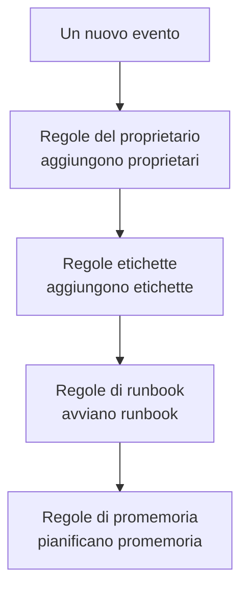

# Regole e impostazioni della manutenzione

La configurazione della manutenzione si trova dentro **Manutenzione programmata**, non nelle **Impostazioni del progetto**: le regole che agiscono su ogni nuovo evento e le impostazioni che danno forma a ogni evento del progetto. Questa pagina è il riferimento per ciascuna di esse, e per chi può modificarle.

:::cards
- [Le regole che un nuovo evento attraversa](#le-regole-che-un-nuovo-evento-attraversa): In ordine, e cosa fa ciascuna.
- [Regole di promemoria](#regole-di-promemoria): Ricordare l'evento ai proprietari finché non è completato.
- [Impostazioni](#impostazioni): Modelli di note, campi personalizzati, misurazioni e numerazione.
- [Chi può modificarle](#chi-può-modificarle): I ruoli della manutenzione, e i piani.
:::

## Dove si trovano le impostazioni della manutenzione

Aprite **Manutenzione programmata** dal menu **Prodotti** nella barra superiore. Le sezioni **Regole** e **Impostazioni** del suo menu laterale partono chiuse, quindi apritele prima. Ogni pagina qui vale per tutto il progetto, a un indirizzo che inizia con `/dashboard/{projectId}/scheduled-maintenance-events/settings/`.

| Pagina delle regole | Cosa fa                                                            |
| ------------------ | ------------------------------------------------------------------- |
| **Regole del proprietario** | Aggiunge proprietari agli eventi che corrispondono.        |
| **Regole di runbook** | Avvia runbook per gli eventi che corrispondono.                  |
| **Regole etichette** | Aggiunge etichette agli eventi che corrispondono.                 |
| **Reminder Rules** | Ricorda l'evento ai proprietari a intervalli finché non è completato. |

La sezione **Impostazioni** contiene **Stato evento**, trattato in [Stati della manutenzione](/docs/scheduled-maintenance/states), **Modelli di eventi**, trattato in [Modelli ed eventi ricorrenti](/docs/scheduled-maintenance/templates), poi **Modelli di note**, **Campi personalizzati**, **Misurazioni**, **Impostazioni del calendario** e **Numerazione**. **Impostazioni del calendario** è trattato in [Calendario della manutenzione](/docs/scheduled-maintenance/calendar#calendari-esterni), il resto più sotto.

La sezione **Area di lavoro** contiene le regole Slack e Microsoft Teams che pubblicano gli eventi nei canali. Vedere [Slack](/docs/workspace-connections/slack#regole-di-notifica) e [Microsoft Teams](/docs/workspace-connections/microsoft-teams#regole-di-notifica).

## Le regole che un nuovo evento attraversa

Le regole differiscono nel modo in cui si risolvono più corrispondenze:

- **Regole del proprietario**, **Regole etichette** e **Regole di runbook** agiscono tutte quando corrispondono. Proprietari ed etichette aggiunti da più regole vengono aggiunti una volta sola.
- **Reminder Rules** vengono controllate dall'alto verso il basso nel loro elenco, e vince la prima che corrisponde. Trascinate una regola per cambiarne la posizione; una nuova regola va in fondo.

Una nuova regola parte abilitata; disattivate **Abilitato** nel suo modulo di modifica per metterla in pausa, e l'elenco mostra per ogni regola un **Abilitato** verde o un **Disabilitato** rosso. Le regole del proprietario, delle etichette e di runbook agiscono sugli eventi creati dopo averle salvate. Per applicare una regola del proprietario o delle etichette agli eventi che avete già, usate **Run Now**: vedere [Eseguire le regole sulle risorse esistenti](/docs/configuration/run-rules-now).

## Regole del proprietario e delle etichette

Le **Regole del proprietario** aggiungono utenti e team proprietari ai nuovi eventi che corrispondono, e le **Regole etichette** aggiungono etichette. Crearne una richiede due passi: **Corrispondenza**, le condizioni, poi **Proprietari** o **Etichette**, ciò che la regola aggiunge.

| Condizione                                                      | Corrisponde a                                                              |
| --------------------------------------------------------------- | -------------------------------------------------------------------------- |
| **Monitor**, **Etichette evento**, **Etichette del monitor**    | Eventi con uno qualsiasi dei monitor o delle etichette che scegliete.      |
| **Titolo evento**, **Descrizione dell'evento**, **Nome del monitor**, **Descrizione del monitor** | Un modello, come espressione regolare, senza distinguere maiuscole e minuscole. |

Una regola corrisponde solo quando ogni condizione compilata è vera; una condizione lasciata vuota viene saltata.

- **Una regola può ereditare.** Chiusi in **Eredita proprietari** o **Eredita etichette**, sei interruttori trasmettono i proprietari o le etichette dei monitor, degli host, dei cluster Kubernetes, degli host Docker, degli host Podman e dei servizi dell'evento.
- **Una nuova regola deve aggiungere qualcosa**: scegliete almeno un proprietario o un'etichetta, oppure attivate un interruttore.
- **Notifica ai proprietari**, in **Altri campi** di una regola del proprietario, decide se le persone aggiunte vengono avvisate.

[Regole per etichette e proprietari](/docs/configuration/label-and-owner-rules) descrive il modulo passo per passo, per ogni tipo di risorsa.

## Regole di runbook

Le **Regole di runbook** avviano un runbook quando un nuovo evento corrisponde, come una checklist prima di ogni aggiornamento del database. Corrispondono alle stesse cose delle regole del proprietario e delle etichette; gli eventi non hanno gravità, quindi le regole di runbook della manutenzione non la offrono. L'esecuzione viene collegata all'evento, nella sua pagina **Runbook**. Vedere [Regole di runbook](/docs/runbooks/rules).

## Regole di promemoria

**Manutenzione programmata → Regole → Reminder Rules** ricorda l'evento ai suoi proprietari finché il lavoro non viene approvato. Ogni evento riceve la prima regola che gli corrisponde, dall'alto verso il basso nell'elenco.

:::steps
### Scegliere su quali eventi ricordare

Fate clic su **Crea: Scheduled Maintenance Reminder Rule**. In **Corrispondenza**, lasciate selezionato **Tutti gli eventi di manutenzione programmata** per ricordare ogni evento, oppure scegliete **Solo gli eventi di manutenzione programmata che soddisfano le condizioni** e poi le **Etichette** a cui si applica.

### Impostare l'intervallo

In **Promemoria**, impostate **Intervallo del promemoria (minuti)**, ogni quanto vengono ricordati i proprietari, e scegliete quando inviare i promemoria in **Promemoria ai proprietari**. Il suo **Nome** segue entrambi, per esempio «Promemoria ogni 30 minuti mentre è in corso», finché non ne digitate uno vostro, e una **Descrizione** attende sotto **Altri campi**. Poi create la regola.
:::

| Risposta | Quando i proprietari ricevono i promemoria |
| --- | --- |
| **Mentre è in corso** | Dall'inizio dell'evento fino alla sua fine. Una nuova regola parte da questa risposta. |
| **Prima che inizi** | Da quando l'evento viene programmato fino al suo inizio. |
| **Prima che inizi e mentre è in corso** | Da quando l'evento viene programmato fino alla sua fine. |

L'API e Terraform rifiutano una regola che attenderebbe l'inizio dell'evento e si fermerebbe quando inizia: non invierebbe mai un promemoria. Una regola più vecchia salvata così è contrassegnata nell'elenco con **Non invia mai promemoria**, e il suo modulo vi chiede di scegliere quando ricordare.

I proprietari ricevono ogni promemoria come **Maintenance reminder**, attivo via e-mail per ogni nuovo membro. Salvare, modificare o eliminare una regola di promemoria riassegna la regola a ogni evento non ancora completato. Per fermare i promemoria di un evento, disattivate **Invia promemoria** nella sua pagina **Impostazioni**; salva nel momento in cui lo spostate.

Questi promemoria sono per il vostro team. I promemoria che gli iscritti delle vostre pagine di stato ricevono prima dell'inizio di un evento si impostano sull'evento stesso, in **Promemoria prima dell'evento**.

## Impostazioni

### Modelli di note

**Manutenzione programmata → Impostazioni → Modelli di note** contiene testi pronti per gli aggiornamenti sulla manutenzione. La scheda **Modelli di nota pubblica o privata per gli eventi di manutenzione programmata** li elenca; **Crea: Pianificato Manutenzione Nota Modello** chiede un **Nome del modello**, una **Descrizione del modello** e la **Nota**. Un modello viene offerto quando qualcuno scrive una nota pubblica o privata su un evento e quando ne cambia lo stato, e il suo testo si può modificare prima della pubblicazione. A differenza dei modelli di nota degli incidenti, i modelli di nota della manutenzione non compilano variabili.

### Campi personalizzati

**Manutenzione programmata → Impostazioni → Campi personalizzati** aggiunge campi vostri a ogni evento, come un ticket di modifica o un livello del cliente. Compilateli nella pagina **Campi personalizzati** di un evento, oppure tramite l'API come `customFields`. Un campo può copiare il suo valore da un campo personalizzato di un monitor invece di essere digitato: vedere [Campi copiati da un monitor](/docs/incidents/settings#campi-copiati-da-un-monitor), che funziona allo stesso modo per gli eventi.

### Misurazioni

**Manutenzione programmata → Impostazioni → Misurazioni** misura quanto durano le cose in ogni evento. Scegliete **Ritardo di inizio**, dall'inizio pianificato a quando inizia, **Sforamento**, dalla fine pianificata a quando termina, oppure **Durata della manutenzione**, da quando inizia a quando termina; oppure due momenti vostri con **Qualcos'altro**. Ogni misurazione viene mostrata sulla pagina dell'evento e rappresentata come `oneuptime.scheduled-maintenance.measurement.<key>`. Vedere [Misurazioni](/docs/incidents/settings#misurazioni), che funziona allo stesso modo per gli eventi.

### Numerazione

**Manutenzione programmata → Impostazioni → Numerazione** imposta il testo davanti ai numeri degli eventi: `SM-` in un nuovo progetto, oppure `#` senza prefisso. **Aggiorna** chiede il **Prefisso del numero della manutenzione programmata** e mostra un'anteprima del numero mentre scrivete. Solo gli eventi creati dopo ricevono il nuovo prefisso; quelli esistenti mantengono i loro numeri. Le regole per un prefisso sono in [Prefissi del numero](/docs/incidents/settings#prefissi-dei-numeri).

La scheda **Numero successivo** sotto imposta il numero che riceve il prossimo evento, per proseguire i numeri di un altro strumento: **Aggiorna** apre **Numero successivo della manutenzione programmata**, che deve essere maggiore del più alto usato finora. Vedete [Numeri successivi](/docs/incidents/settings#numeri-successivi).

> [!NOTE]
> Su OneUptime Cloud, i campi personalizzati richiedono il piano **Growth** o superiore, così come aggiungere e modificare stati di manutenzione e modelli.

## Workflow

Ogni modello della manutenzione ha trigger e azioni di workflow, con il suo nome: **On Create Scheduled Maintenance Event**, **On Update Scheduled Maintenance Event**, **On Create or Update Scheduled Maintenance Event** e **On Delete Scheduled Maintenance Event**, lo stesso per **Scheduled Maintenance State Timeline** e gli altri, e azioni come **Create One Scheduled Maintenance Event** e **Update One Scheduled Maintenance Event**. Le definizioni dei campi personalizzati e i valori delle misurazioni sono le eccezioni: non hanno passi di workflow. Vedere [Panoramica dei workflow](/docs/workflows/index).

## Chi può modificarle

| Ruolo                             | Cosa può fare                                                                                        |
| --------------------------------- | ---------------------------------------------------------------------------------------------------- |
| **Scheduled Maintenance Viewer**  | Legge gli eventi, e non modifica nulla.                                                              |
| **Scheduled Maintenance Member**  | Crea, modifica ed elimina eventi con le loro note, cronologie di stato e proprietari, e entrambi i tipi di modelli. |
| **Scheduled Maintenance Admin**   | Tutto ciò che fa un membro, e in più crea, modifica ed elimina gli stati di manutenzione.            |

Regole, campi personalizzati e misurazioni richiedono **Project Owner** o **Project Admin**, oppure un ruolo personalizzato con il permesso proprio di quella pagina, come **Create Scheduled Maintenance Owner Rule**. Le regole di runbook accettano anche **Runbook Admin**. **Project Member** lavora con eventi e modelli, come **Scheduled Maintenance Member**. Vedere [Utenti, team e autorizzazioni](/docs/permissions/index).

## Risoluzione dei problemi

:::details Una regola del proprietario non ha aggiunto nessuno a un nuovo evento
Aprite la regola e controllate le sue condizioni: ogni condizione compilata deve essere vera. Un modello del titolo è un'espressione regolare, quindi `db upgrade` non corrisponde a «DB-Upgrade»; scrivete `db.upgrade`. Inoltre una regola agisce solo sugli eventi creati dopo il suo salvataggio: usate **Run Now** per quelli che avete già.
:::

:::details I proprietari non hanno ricevuto nessun promemoria
Controllate che una regola di promemoria corrisponda alle etichette dell'evento, che **Invia promemoria** dell'evento sia attivo e che **Maintenance reminder** sia attivo nelle impostazioni delle notifiche dei proprietari. Una regola impostata su **Mentre è in corso** non invia nulla prima che l'evento inizi.
:::

## Passi successivi

:::cards
- [Stati della manutenzione](/docs/scheduled-maintenance/states): La pagina Stato evento, e cosa fa ogni stato.
- [Modelli ed eventi ricorrenti](/docs/scheduled-maintenance/templates): La pagina Modelli di eventi, nel dettaglio.
- [Regole per etichette e proprietari](/docs/configuration/label-and-owner-rules): Il modulo delle regole, passo per passo.
- [Impostazioni notifiche](/docs/notifications/notification-settings): Come ogni proprietario sceglie cosa gli arriva.
:::
