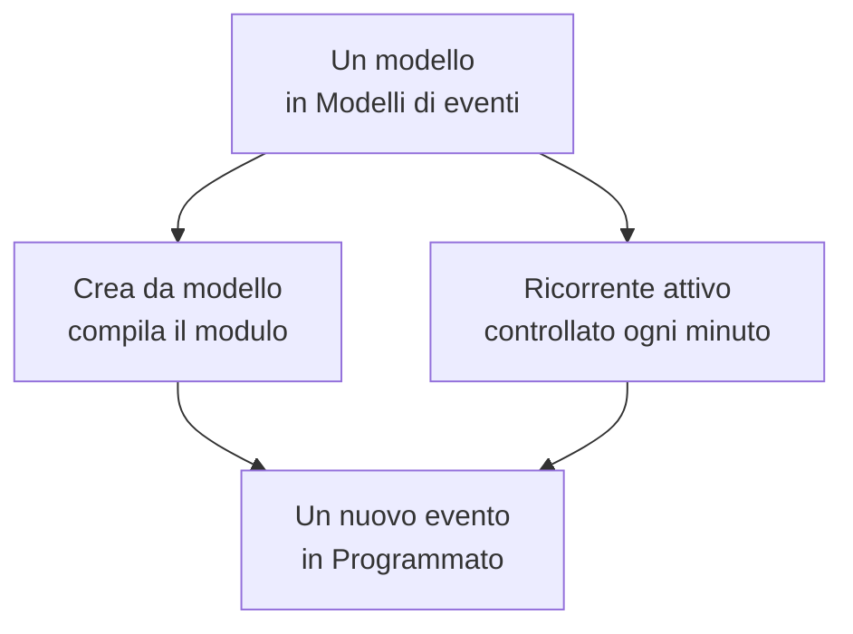

# Modelli ed eventi ricorrenti

Un modello di manutenzione programmata salva un evento che pianificate spesso: il suo titolo e la sua descrizione, i monitor che mette in pausa, le pagine di stato su cui compare e chi viene avvisato. Usatene uno per compilare il modulo con un clic, oppure rendetelo ricorrente, così OneUptime pianifica l'evento al posto vostro, ogni settimana, ogni mese o a qualunque intervallo scegliate.

:::cards
- [Creare un modello](#creare-un-modello): I passi del modulo, con un nome all'inizio e una pianificazione alla fine.
- [Usare un modello](#usare-un-modello): Compilare un nuovo evento partendo da esso.
- [Eventi ricorrenti](#eventi-ricorrenti): Lasciate che OneUptime pianifichi l'evento da solo.
- [Modificare o fermare un modello](#modificare-o-fermare-un-modello): Modificarlo, sospenderne la pianificazione o eliminarlo.
:::

## Come funziona

Un modello è un punto di partenza. Un evento creato da esso è una copia con valori propri: modificare il modello in seguito cambia solo gli eventi creati dopo.

## Prima di iniziare

- **Il vostro piano.** Su OneUptime Cloud, i modelli richiedono il piano **Growth** o superiore.
- **Il vostro ruolo.** Creare un modello richiede **Proprietario del progetto**, **Amministratore del progetto**, **Membro del progetto**, **Amministratore della manutenzione programmata** o **Membro della manutenzione programmata**, oppure un ruolo personalizzato che possa creare modelli di manutenzione programmata.

## Creare un modello

:::steps
### Aprire i modelli

Andate in **Manutenzione programmata → Impostazioni → Modelli di eventi**. **Impostazioni** parte chiusa nel menu laterale: apritela prima. Fate clic su **Crea: Pianificato Manutenzione Modello**.

### Dare un nome al modello

In **Informazioni del modello**, dategli un **Nome del modello** e una **Descrizione del modello**, così il vostro team sa quando usarlo. Sono entrambi obbligatori.

### Descrivere l'evento

In **Evento**, compilate il **Titolo** e la **Descrizione** con cui parte ogni evento creato da esso. **Proprietari** ed **Etichette** attendono in **Altri campi**.

### Scegliere cosa interessa

In **Risorse interessate**, scegliete i **Monitor**, il **Cambia lo stato del monitor in** per loro, eventuali **Altre risorse interessate**, le pagine di stato in **Mostra evento su queste pagine di stato** e le **Notifiche agli iscritti**.

### Decidere se si ripete

In **Ricorrente**, lasciate **Evento ricorrente** disattivato per un modello che usate a mano, oppure attivatelo e compilate la sua pianificazione. Fate clic su **Avanti** per controllare il riepilogo, poi create il modello.
:::

Un modello chiede **Cambia lo stato del monitor in** anche quando non nomina alcun monitor: lo stato vale anche per i monitor che aggiungete quando pianificate un evento da esso. In **Altre risorse interessate**, un modello accetta host, cluster Kubernetes, host Docker, host Podman e servizi.

## Cosa compila un modello

| Parte dell'evento                                 | Crea da modello                      | Un evento ricorrente            |
| ------------------------------------------------- | ------------------------------------ | ------------------------------- |
| **Titolo** e **Descrizione**                      | Compilati, e potete cambiarli        | Copiati                         |
| **Monitor** e **Cambia lo stato del monitor in**  | Compilati                            | Copiati                         |
| **Altre risorse interessate**                     | Compilate                            | Copiate                         |
| Le pagine di stato e **Notifiche agli iscritti**  | Compilate                            | Copiate                         |
| **Proprietari** ed **Etichette**                  | Compilati                            | Copiati                         |
| **Inizia il** e **Termina il**                    | La prossima ora piena, per un'ora    | Calcolati dalla pianificazione  |

## Usare un modello

:::steps
### Scegliere il modello

In **Manutenzione programmata → Tutti gli eventi**, fate clic su **Crea da modello** e scegliete un modello in **Seleziona modello di manutenzione programmata**.

### Controllare il modulo

Fate clic su **Crea da modello**. Il modulo di creazione si apre con le risposte del modello già compilate. Impostate la finestra e cambiate ciò che serve a questo evento.

### Creare l'evento

Percorrete i passi con **Avanti**, poi fate clic su **Crea evento di manutenzione programmata** nel riepilogo.
:::

Quando il progetto non ha ancora nessun modello, **Crea da modello** lo dice e rimanda a **Modelli di eventi**.

## Eventi ricorrenti

Un modello ricorrente crea l'evento secondo una pianificazione. Stabilite quando viene creato il primo evento, quando inizia e quando termina; ogni evento successivo mantiene le stesse distanze, un intervallo dopo.

| Campo                                    | Cosa significa                                                                                      |
| ---------------------------------------- | --------------------------------------------------------------------------------------------------- |
| **Evento ricorrente**                    | Attiva la pianificazione.                                                                           |
| **Primo evento pianificato alle**        | Quando OneUptime crea il primo evento, cioè quando i suoi iscritti vengono a sapere che è pianificato. |
| **Il primo evento inizia alle**          | Quando inizia il primo evento.                                                                      |
| **Il primo evento termina alle**         | Quando termina il primo evento.                                                                     |
| **Con quale frequenza desideri che questo evento si ripeta?** | Un numero e un'unità: ore, giorni, settimane, mesi o anni.                     |

Per esempio, una finestra settimanale il cui primo evento viene creato un lunedì per il sabato successivo:

| Evento       | Creato             | Inizia             | Termina            |
| ------------ | ------------------ | ------------------ | ------------------ |
| Il primo     | `2030-06-03 09:00` | `2030-06-08 02:00` | `2030-06-08 04:00` |
| Il secondo   | `2030-06-10 09:00` | `2030-06-15 02:00` | `2030-06-15 04:00` |

Impostate **Primo evento pianificato alle** con tutto l'anticipo con cui volete che i vostri clienti vengano a sapere del lavoro. Tutte e tre le ore devono essere nel futuro quando create il modello, l'evento deve essere creato prima di iniziare e di terminare, e deve iniziare prima di terminare; il modulo dice quale regola viola un'ora.

Un processo controlla i modelli ricorrenti ogni minuto. Quando arriva la prossima ora di un modello, sposta quell'ora avanti di un intervallo e crea l'evento. L'elenco dei modelli mostra quell'ora nella sua colonna **Evento ricorrente**, e **No** per un modello che non si ripete. Un evento creato dalla pianificazione è come qualsiasi altro: le sue regole vengono eseguite, i suoi proprietari vengono aggiunti e i suoi iscritti vengono a sapere che è pianificato.

## Modificare o fermare un modello

Aprite un modello dall'elenco per vedere la sua pagina:

- **Dettagli del modello di manutenzione programmata** mostra con cosa partono i nuovi eventi. Il suo **Modifica** percorre **Informazioni del modello**, **Evento**, **Pagine di stato** e **Ricorrente**.
- **Risorse interessate** contiene i suoi **Monitor**, il loro **Cambia lo stato del monitor in** e le sue **Altre risorse interessate**, con un proprio **Modifica**.
- **Proprietari** elenca le persone e i team a cui appartiene ogni evento pianificato da esso.

Le modifiche valgono per gli eventi creati dopo averle salvate; gli eventi già creati conservano i propri valori. Per fermare una pianificazione, disattivate **Evento ricorrente** in **Modifica**, oppure eliminate il modello. Un modello disattivato conserva la sua pianificazione: riattivatelo, e riprende dalla prossima ora della pianificazione, saltando le ore in cui era disattivato. Eliminare un modello lascia gli eventi che ha creato.

## Risoluzione dei problemi

:::details Creando un modello ricorrente compare che un'ora dovrebbe essere nel futuro
Tutte e tre le prime ore devono essere successive al momento attuale quando create il modello. Spostatele in avanti: la pianificazione prosegue poi dal primo evento.
:::

:::details Un modello ricorrente non ha creato nessun evento
Controllate che **Evento ricorrente** sia ancora attivo, e guardate l'ora nella colonna **Evento ricorrente** dell'elenco: l'evento viene creato in quel momento, non al suo inizio. Il processo gira ogni minuto, quindi lasciate passare un minuto.
:::

:::details A un evento creato da un modello manca una risorsa che avevo scelto
In **Altre risorse interessate**, un modello accetta host, cluster Kubernetes, host Docker, host Podman e servizi. Aggiungete gli altri tipi di risorse all'evento stesso, con **Modifica** sulla sua scheda **Risorse interessate**.
:::

## Passi successivi

:::cards
- [Creare eventi di manutenzione](/docs/scheduled-maintenance/creating-events): Il modulo che un modello compila.
- [Stati della manutenzione](/docs/scheduled-maintenance/states): Come avanza ogni evento una volta creato.
- [Regole e impostazioni della manutenzione](/docs/scheduled-maintenance/settings): Aggiungete automaticamente proprietari ed etichette a ogni nuovo evento.
- [Panoramica della manutenzione programmata](/docs/scheduled-maintenance/index): Dove si collocano i modelli nel resto della manutenzione.
:::
