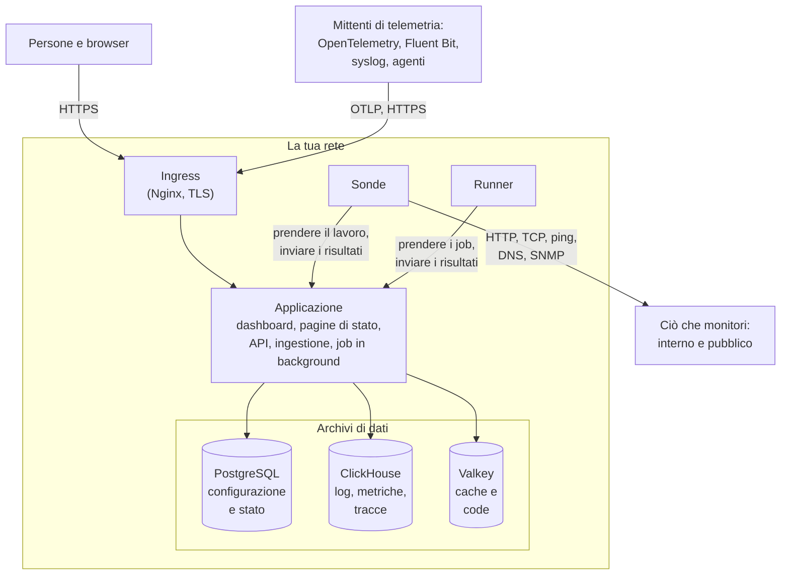

# Architettura

Un'installazione self-hosted di OneUptime è una manciata di container: un ingress da cui entra ogni richiesta, un'immagine dell'applicazione che fa il lavoro, le sonde che eseguono i controlli dei tuoi monitor e tre archivi di dati. Questa pagina mostra come si incastrano, che cosa fa ciascuno e quali connessioni attraversano la tua rete.

## Cosa mostra

- Le persone raggiungono OneUptime attraverso l'**ingress**, che termina TLS e instrada ogni richiesta all'applicazione: la Dashboard, le pagine di stato, l'API e ogni endpoint di ingestione a cui viene inviata la telemetria.
- L'**applicazione** legge e scrive il proprio stato in PostgreSQL, conserva la telemetria in ClickHouse e usa Valkey (il fork con licenza BSD di Redis 7.2) come cache e per le code su cui lavorano i suoi job in background.
- Le **sonde** possono girare dentro il tuo cluster (consigliato) e/o altrove nella tua rete. Possono monitorare:
  - Servizi interni/privati dietro il tuo firewall.
  - Risorse esterne/pubbliche su internet.
- I risultati delle sonde vengono inviati all'applicazione, accodati in Valkey ed elaborati dai job in background nei tuoi archivi di dati. Una sonda che si trova altrove nella tua rete raggiunge l'applicazione attraverso l'ingress, al tuo URL di OneUptime.
- La telemetria (metriche, tracce, log e altro) viene acquisita dalla stessa applicazione e memorizzata in ClickHouse.

> [!NOTE]
> Se usi PostgreSQL, Valkey (o Redis) o ClickHouse esterni invece di quelli inclusi, l'applicazione si collega invece ai tuoi endpoint esterni. Il flusso logico resta lo stesso.

## I componenti

| Componente | Servizio Docker Compose | Chart Helm | Che cosa fa |
| --- | --- | --- | --- |
| Ingress | `ingress` | `nginx` | Termina TLS, serve il tuo nome host e i domini delle tue pagine di stato e instrada ogni richiesta all'applicazione. |
| Applicazione | `app` | `app` | La Dashboard, le pagine di stato, gli endpoint di API e di ingestione e, a meno che non li separi, i job in background. |
| Worker | Parte di `app` | `worker` (disattivato per impostazione predefinita) | I job in background, in pod propri, così che l'elaborazione pesante delle code non entri mai in competizione con le richieste API. |
| Telemetry writer | Parte di `app` | `telemetryWriter` (disattivato per impostazione predefinita) | Un livello di dimensione fissa che esegue ogni inserimento in ClickHouse, così che gli inserimenti restino limitati per quanto scalino i worker. |
| Sonda | `probe-1` | `probes` | Esegue i controlli dei monitor e invia indietro i risultati. Ogni sonda inclusa è una sonda globale che tutti i progetti possono usare. |
| Runner | `runner` | `runner` | Il Runner proprio dell'istanza, che può eseguire correzioni del codice con l'IA per ogni progetto. I passaggi dei runbook vengono eseguiti sui [Runner](/docs/runbooks/agents) che installi dove devono essere eseguiti. |
| PostgreSQL | `postgres` | `postgresql`, oppure `postgresOperator.cnpg` | Progetti, monitor, incidenti, utenti e ogni altra impostazione e stato. |
| ClickHouse | `clickhouse` | `clickhouse`, oppure `clickhouseOperator.altinity` | Log, metriche, tracce, eccezioni, profili e log dei monitor. |
| Valkey | `valkey` | `valkey` | La cache, le code dei job e lo stato di breve durata, come le ricevute push in attesa. |

Tutti i ruoli dell'applicazione sono la stessa immagine: Docker Compose li esegue in un unico container `app`, e il chart Helm può eseguire il worker e il telemetry writer come deployment propri. Per dimensionare ogni livello, consulta [Dimensionamento e pianificazione della capacità](/docs/installation/sizing).

## Connessioni in uscita dalla tua rete

L'applicazione si collega all'esterno solo per ciò che attivi. Ciascuna di queste connessioni è facoltativa, e ognuna ha una pagina che indica gli indirizzi esatti da consentire:

| Connessione in uscita | Usata per | Dove approfondire |
| --- | --- | --- |
| Email (SMTP, oppure l'API di SendGrid) | Notifiche e inviti | [SMTP](/docs/emails/smtp) |
| Twilio | SMS e chiamate telefoniche | [Integrazione Twilio](/docs/self-hosted/twilio-integration) |
| Il relay push di OneUptime, oppure Expo | Notifiche push mobili | [Notifiche push](/docs/self-hosted/push-notifications) |
| Slack e Microsoft Teams | Notifiche e azioni nello spazio di lavoro | [Integrazione Slack](/docs/self-hosted/slack-integration) |
| Un provider di LLM, come OpenAI, Anthropic, Microsoft Foundry o un modello che esegui tu stesso | OneUptime AI | [Provider di LLM](/docs/ai/llm-provider) |
| `oneuptime.com` | Attivare online una licenza Enterprise | [Edizione Enterprise](/docs/self-hosted/enterprise) |

Le connessioni nell'altra direzione – SendGrid che consegna le email in arrivo, Slack e Microsoft Teams che richiamano – richiedono che l'ingress sia raggiungibile da internet. Quali indirizzi privati possano raggiungere l'applicazione e le sonde lo decidi tu: vedi [Accesso alla rete privata](/docs/self-hosted/private-network-access).

## Passaggi successivi

:::cards
- [Docker Compose](/docs/installation/docker-compose): Installa tutti i componenti su una sola macchina.
- [Dimensionamento e pianificazione della capacità](/docs/installation/sizing): Quanta CPU, memoria e disco serve a ogni livello.
- [Sonde personalizzate](/docs/probe/custom-probe): Esegui una sonda dentro un'altra rete.
- [Edizione Enterprise](/docs/self-hosted/enterprise): Che cosa aggiungono le immagini Enterprise e come funzionano le licenze.
:::
