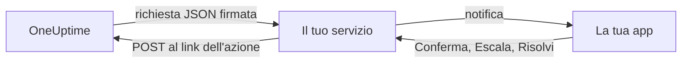

# Canali di notifica personalizzati

Un canale personalizzato invia gli avvisi di reperibilità a un servizio che gestisci tu: l'app della tua azienda, un sistema di cercapersone o un gateway che controlla ciò che esce dalla tua rete. Lo aggiungi una sola volta, per l'intero server, e chiunque può essere avvisato tramite esso senza configurare nulla. Nell'Admin Dashboard si chiamano **Custom Channels**.

> [!NOTE]
> I canali personalizzati fanno parte della [Enterprise Edition di OneUptime](/docs/self-hosted/enterprise) e richiedono una licenza Enterprise che li includa. La Community Edition non ha la pagina **Custom Channels** e non invia nulla a nessun canale. Vedi [Senza licenza](#senza-licenza).

:::cards
- [Aggiungere un canale](#aggiungere-un-canale): Un nome, un URL e un segreto di firma.
- [Cosa riceve il tuo servizio](#cosa-riceve-il-tuo-servizio): Una richiesta JSON firmata per persona e per avviso.
- [Agire su un avviso](#agire-su-un-avviso): Confermarlo, escalarlo o risolverlo dalla tua app.
- [Consegna e nuovi tentativi](#consegna-e-nuovi-tentativi): Cosa succede quando il tuo servizio non risponde.
- [Altre notifiche](#altre-notifiche): Notifiche ai proprietari, note e turni, per chi le vuole.
- [Senza licenza](#senza-licenza): Cosa si ferma e cosa viene conservato.
:::

## Come funziona



Quando una policy di reperibilità avvisa qualcuno e la sua regola di reperibilità usa il canale, OneUptime invia una richiesta all'URL del canale. La richiesta dice per chi è l'avviso (nome ed e-mail) e di cosa si tratta, e contiene i link che il tuo servizio chiama quando la persona lo conferma, lo escala o lo risolve nella tua app.

## Aggiungere un canale

1. Nell'Admin Dashboard apri **Impostazioni**, poi **Custom Channels**, e seleziona **Add**.
2. Nel passaggio **Channel**, compila:
   - **Nome**: ciò che le persone vedono nei loro metodi di notifica e nelle regole di reperibilità, per esempio `CorpoApp`.
   - **Webhook URL**: dove OneUptime invia ogni avviso. Può trovarsi nella tua rete privata.
   - **Signing Secret**: OneUptime ne crea uno per te. Copialo nel tuo servizio, che controlla ogni richiesta con questo segreto. Puoi rivederlo modificando il canale.
3. Nel passaggio **Delivery**, salva, poi seleziona **Send test** per inviare al tuo servizio una [richiesta di test](#richieste-di-test).

Nel passaggio **Delivery**, **Page everyone through this channel** è attivo. OneUptime aggiunge allora il canale alle regole di reperibilità di tutti in ogni progetto, e alle regole di chiunque entri in un progetto in seguito, e lo usa per raggiungere un reperibile che non ha alcuna regola per ciò che è scattato. Disattivalo per lasciare che ognuno aggiunga il canale alle proprie regole.

Le persone vedono il canale in **Impostazioni utente**, poi **Metodi di notifica**, poi **Custom Channels**, con un pulsante **Send test**, e lo scelgono nelle loro regole di reperibilità come `Custom Channel: CorpoApp`. Non devono configurare nulla: il tuo servizio sa per chi è ogni avviso.

Per smettere di inviare senza cambiare le regole di nessuno, modifica il canale e disattiva **Attivato**. Gli avvisi che sarebbero andati al canale vengono annotati nel registro di reperibilità come non inviati. Eliminare un canale elimina tutte le regole di reperibilità che lo usano.

## Cosa riceve il tuo servizio

Ogni avviso è una richiesta `POST` con un corpo JSON:

| Intestazione | Cosa contiene |
| --- | --- |
| `Content-Type` | `application/json` |
| `X-OneUptime-Event` | L'evento, per esempio `on-call.incident.created` |
| `X-OneUptime-Signature` | `sha256=` seguito dall'HMAC-SHA256 esadecimale del corpo grezzo, calcolato con il segreto di firma del canale |

```json title="An incident page"
{
  "version": 1,
  "event": "on-call.incident.created",
  "notificationId": "5f2c8a1e-6b1d-4c3a-9e7f-2a4b6c8d0e1f",
  "sentAt": "2026-10-27T03:14:15.000Z",
  "channel": { "id": "0b7e…", "name": "CorpoApp" },
  "title": "New Incident INC-42: API latency high",
  "message": "A new incident has been created: INC-42 (API latency high) in Agency A. Click to view details.",
  "project": { "id": "8d1f…", "name": "Agency A" },
  "team": { "id": "2c9a…", "name": "SRE" },
  "user": { "id": "4e6b…", "name": "Jane Tan", "email": "jane@example.com" },
  "recordType": "incident",
  "record": {
    "id": "9a3c…",
    "number": "INC-42",
    "title": "API latency high",
    "description": "p95 latency above 2 seconds for 5 minutes.",
    "severity": "Critical",
    "state": "Created",
    "url": "https://oneuptime.example.com/dashboard/8d1f…/incidents/9a3c…"
  },
  "onCallPolicy": { "id": "1d4e…", "name": "Primary" },
  "escalationRule": { "id": "7b2f…", "name": "Level 1" },
  "isPageAgain": false,
  "actions": {
    "acknowledge": "https://oneuptime.example.com/api/custom-notification-channel/page/5f2c…/acknowledge?token=…",
    "escalate": "https://oneuptime.example.com/api/custom-notification-channel/page/5f2c…/escalate?token=…",
    "resolve": "https://oneuptime.example.com/api/custom-notification-channel/page/5f2c…/resolve?token=…"
  }
}
```

| Campo | Cos'è |
| --- | --- |
| `version` | `1`. A questa versione si aggiungono soltanto campi. |
| `event` | `on-call.incident.created`, `on-call.alert.created`, `on-call.incidentEpisode.created`, `on-call.alertEpisode.created`, `notification` per le [altre notifiche](#altre-notifiche), oppure `test` |
| `notificationId` | Uno per persona e per avviso. Usalo per scartare una richiesta già gestita. |
| `title`, `message` | Pronti da mostrare, come li mostrerebbe una notifica push |
| `user` | Per chi è l'avviso. Trova il suo account nella tua app tramite `email` o `id`. |
| `team` | Il team tramite cui la persona è stata avvisata, oppure `null` se è stata avvisata direttamente |
| `recordType`, `record` | Di cosa tratta l'avviso: un `incident`, `alert`, `incidentEpisode` o `alertEpisode` |
| `onCallPolicy`, `escalationRule` | La policy e il livello che l'hanno avvisata |
| `isPageAgain` | `true` quando l'elemento è stato confermato tempo fa e non è ancora risolto |
| `actions` | I link che il tuo servizio chiama per [agire sull'avviso](#agire-su-un-avviso) |

Un avviso a più persone è una richiesta per persona, ognuna con i link propri di quella persona, così OneUptime sa chi ha risposto. Titolo, messaggio e descrizione insieme sono limitati a 16.384 caratteri; una descrizione più lunga viene tagliata e termina con «… (truncated — see OneUptime for the full text)».

### Verificare la firma

Calcola l'HMAC del corpo grezzo della richiesta, prima di analizzarlo, e confrontalo con l'intestazione:

```javascript title="Node.js"
const crypto = require("crypto");

function isFromOneUptime(rawBody, signatureHeader, secret) {
  const expected =
    "sha256=" + crypto.createHmac("sha256", secret).update(rawBody).digest("hex");
  const received = String(signatureHeader || "");

  return (
    received.length === expected.length &&
    crypto.timingSafeEqual(Buffer.from(received), Buffer.from(expected))
  );
}
```

## Agire su un avviso

Quando la persona preme un pulsante nella tua app, il tuo servizio invia una richiesta `POST` al link corrispondente in `actions`. Non serve alcuna chiave API: ogni link porta un token per quel solo avviso, valido 7 giorni, e l'azione viene registrata come eseguita dalla persona avvisata.

| Azione | Cosa fa |
| --- | --- |
| `acknowledge` | Conferma il suo avviso e, con esso, l'incidente, l'avviso o l'episodio |
| `escalate` | La persona non può occuparsene: avvisa subito il livello successivo della policy di reperibilità e smette di avvisarla |
| `resolve` | Risolve l'incidente, l'avviso o l'episodio, se i permessi della persona lo consentono |

```bash title="Acknowledge a page"
curl -X POST "https://oneuptime.example.com/api/custom-notification-channel/page/5f2c…/acknowledge?token=…"
```

La risposta dice cosa è successo, con parole che la tua app può mostrare così come sono:

```json title="The answer"
{
  "action": "acknowledge",
  "result": "acknowledged",
  "message": "Acknowledged."
}
```

`result` è uno tra `acknowledged`, `alreadyAcknowledged`, `escalated`, `notEscalated`, `resolved` e `alreadyResolved`. Un link scaduto o errato viene rifiutato con uno stato 4xx e un messaggio.

## Altre notifiche

Gli avvisi non sono le uniche notifiche che le persone ricevono: OneUptime le informa anche quando un incidente di cui sono proprietarie cambia stato, quando viene pubblicata una nota, quando inizia il loro turno di reperibilità, e altro ancora. Ognuno sceglie dove va ciascuna di queste in **Impostazioni utente > Impostazioni notifiche**, che ha una colonna **Custom Channels** finché un canale è attivo. È disattivata per tutti finché ognuno non la attiva.

Una notifica va a ogni canale attivo, come una richiesta per canale, con `event` impostato a `notification`:

```json title="A notification"
{
  "version": 1,
  "event": "notification",
  "notificationId": null,
  "sentAt": "2026-10-27T03:20:00.000Z",
  "channel": { "id": "0b7e…", "name": "CorpoApp" },
  "title": "Incident INC-42 acknowledged",
  "message": "Incident INC-42 (API latency high) was acknowledged in Agency A.",
  "project": { "id": "8d1f…", "name": "Agency A" },
  "team": null,
  "user": { "id": "4e6b…", "name": "Jane Tan", "email": "jane@example.com" },
  "recordType": null,
  "record": null,
  "onCallPolicy": null,
  "escalationRule": null,
  "isPageAgain": false,
  "actions": null,
  "notificationType": "Send incident state changed notification when I am the owner of the incident",
  "url": "https://oneuptime.example.com/dashboard/8d1f…/incidents/9a3c…"
}
```

`title` e `message` sono ciò che direbbe la notifica push della persona. `notificationType` indica l'impostazione per cui è stata inviata, e `url` rimanda a ciò di cui si tratta, oppure è `null`. Non c'è nulla su cui agire, quindi `actions` è `null`.

## Consegna e nuovi tentativi

Una richiesta conta come consegnata quando il tuo servizio risponde con uno stato 2xx entro 10 secondi. Una richiesta senza risposta, o a cui ha risposto con 408, 429 o uno stato 5xx, viene inviata di nuovo dopo 1 secondo e dopo altri 4 secondi: tre tentativi in tutto. Con qualsiasi altro stato 4xx non viene inviata di nuovo.

L'esito di ogni tentativo compare nel registro di reperibilità della persona, con il nome del canale e lo stato con cui ha risposto il tuo servizio, mai l'URL. Un avviso non consegnato non ferma la policy di reperibilità: se nessuno conferma, viene escalato come di consueto. Tieni una regola e-mail o SMS più avanti nelle tue regole se il tuo servizio è l'unico modo per raggiungere le persone.

## Richieste di test

**Send test**, nella pagina dell'Admin Dashboard o nei metodi di notifica di una persona, invia una richiesta con `event` impostato a `test`, la persona che l'ha premuto come `user`, e `notificationId`, `record` e `actions` impostati a `null`. Usalo per provare il tuo servizio prima che arrivi un avviso vero.

## Senza licenza

I canali personalizzati funzionano durante la prova di 14 giorni della Enterprise Edition e il periodo di tolleranza di 30 giorni dopo la scadenza di una licenza. Dopo, o con una licenza che non li include:

- **Non viene inviato nulla a nessun canale personalizzato.** Un avviso che sarebbe andato a un canale viene annotato nel registro di reperibilità della persona come non inviato, e così anche un test.
- **I canali non vengono più proposti.** Spariscono dai metodi di notifica, dalle regole di reperibilità e dalle impostazioni delle notifiche delle persone, e la prontezza e il ripiego smettono di contarli.
- **La pagina è di sola lettura.** Puoi vedere ed eliminare i canali, ma non aggiungerli né modificarli, e nessuno può indirizzare una regola o un'impostazione delle notifiche verso uno di essi.
- **Non viene eliminato nulla.** I canali, e le regole di reperibilità e le impostazioni che li usano, vengono conservati.

Tutto riprende appena una licenza viene attivata, senza riavvio. Chi è entrato in un progetto mentre i canali personalizzati erano fermi non riceve nelle sue regole un canale che avvisa tutti: può aggiungerlo da sé.
