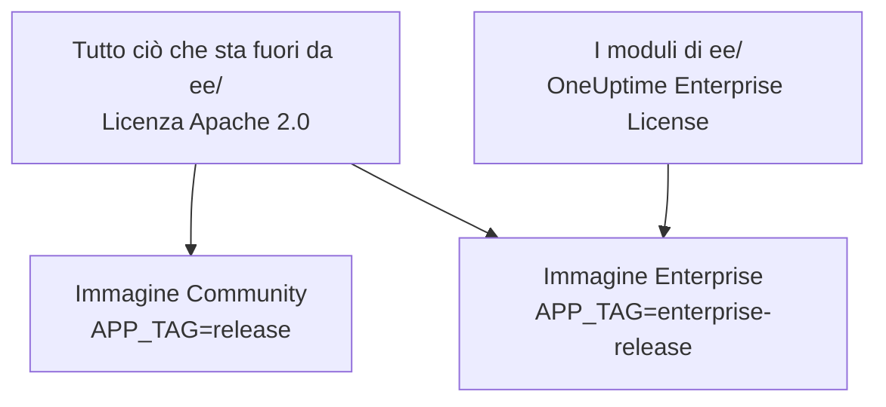
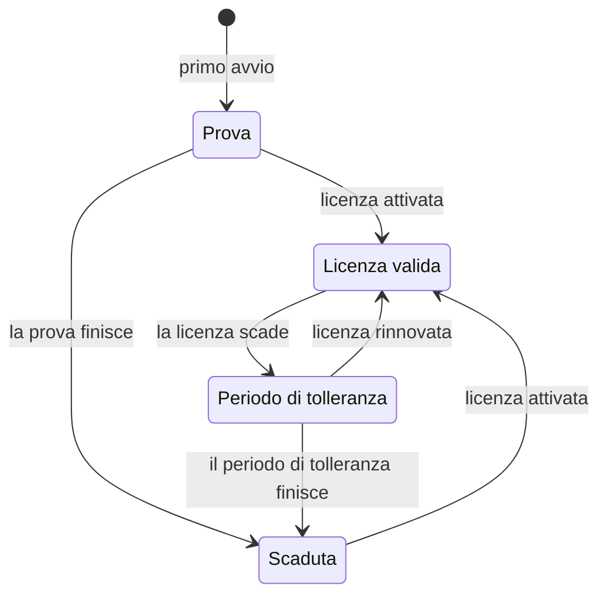

# Edizione Enterprise

OneUptime è costruito da un unico repository e viene distribuito in due edizioni:

- **Community Edition**: tutta la piattaforma di monitoraggio, incidenti e osservabilità, compreso il single sign-on SAML e OpenID Connect, open source sotto licenza Apache 2.0 e gratuita da ospitare in proprio a qualsiasi scala.
- **Enterprise Edition**: la Community Edition più i moduli enterprise della directory [`ee/`](https://github.com/OneUptime/oneuptime/tree/master/ee) del repository. Questi moduli aggiungono il provisioning SCIM e funzionalità di governance e di amministrazione dell'istanza. Sono rilasciati sotto la [OneUptime Enterprise License](https://github.com/OneUptime/oneuptime/blob/master/ee/LICENSE), e l'uso in produzione richiede una licenza Enterprise per il vostro numero di utenti.

Le due edizioni sono immagini container separate. L'immagine Community non contiene codice di `ee/`. OneUptime Cloud esegue la Enterprise Edition, e nel cloud è il vostro piano a decidere quali di queste funzionalità ottenete.



> [!NOTE]
> **Il single sign-on è presente in ogni edizione.** L'accesso SAML e OIDC per progetti e pagine di stato, l'SSO globale e «Require SSO for login» fanno parte della Community Edition, e nessuno stato della licenza li disattiva.

Questa pagina spiega cosa include ogni edizione, come eseguire la Enterprise Edition, come funzionano le licenze e cosa succede quando cambiate edizione.

:::cards
- [Confrontare le edizioni](#cosa-include-ogni-edizione): Cosa aggiunge la Enterprise Edition.
- [Eseguire l'immagine Enterprise](#eseguire-la-enterprise-edition): Un'unica impostazione, su Kubernetes o Docker Compose.
- [Attivare una licenza](#licenze): Online con una chiave, oppure offline con un token firmato.
- [Quando una licenza scade](#quando-una-licenza-scade-o-manca): Cosa si ferma, cosa non si ferma mai e come tutto riprende.
:::

## Cosa include ogni edizione

| Funzionalità | Community | Enterprise | OneUptime Cloud |
| --- | --- | --- | --- |
| Monitoraggio, avvisi, incidenti, reperibilità, pagine di stato, log, metriche, trace, eccezioni, dashboard, workflow, funzionalità di IA, API e Terraform | Sì | Sì | Tutti i piani |
| Accesso con password, autenticazione a due fattori, team, ruoli e chiavi API | Sì | Sì | Tutti i piani |
| [SSO SAML e OpenID Connect](/docs/identity/sso) per l'accesso ai progetti | Sì | Sì | Piano Scale e superiori |
| SSO SAML e OpenID Connect per l'accesso alle pagine di stato private | Sì | Sì | Piano Scale e superiori |
| [SSO e OIDC globali (per tutta l'istanza)](/docs/identity/global-sso) | Sì | Sì | Non applicabile |
| [Provisioning SCIM](/docs/identity/scim) per progetti e pagine di stato | No | Sì | Piano Scale e superiori |
| Impostazioni di conformità dei team | No | Sì | Piano Scale e superiori |
| Log di audit | No | Sì | Piano Enterprise |
| Sostituzioni della conservazione: conservazione per tipo di telemetria (log, trace, metriche, profili, con regole per gravità del log e stato della trace) e conservazione per servizio e per risorsa | No | Sì | Piano Scale e superiori |
| Dashboard **Health** dell'amministrazione: panoramica dell'istanza, code in background, log dell'istanza, PostgreSQL, Valkey, cluster ClickHouse, log di diagnostica e ingestione della telemetria | No | Sì | Non applicabile |
| **Query Console** dell'amministrazione | No | Sì | Non disponibile |
| Avvisi sullo stato di salute di PostgreSQL e Valkey (Redis) | No | Sì | Non applicabile |
| Vista della capacità di ClickHouse, avvisi sulla capacità e pulizia automatica del disco | Sì | Sì | Non applicabile |
| Stato delle migrazioni, pacchetto di supporto e probe globali nel pannello amministratore | Sì | Sì | Non applicabile |
| Gestione della licenza Enterprise, dei posti e delle istanze | No | Sì | Non applicabile |

Il single sign-on comprende «Require SSO for login» per i progetti, le pagine di stato private e l'intera istanza, in entrambe le edizioni.

Ogni edizione ha la conservazione predefinita della telemetria del progetto, in **Impostazioni del progetto > Telemetria e APM > Conservazione dei dati**. Le sostituzioni della conservazione sono ciò che la Enterprise Edition aggiunge in più.

Su OneUptime Cloud una funzionalità a pagamento si può sempre disattivare, con qualsiasi piano. Una sostituzione della conservazione che una prova (o il passaggio a un piano inferiore) ha lasciato impostata continua ad applicarsi alla nuova telemetria, quindi sotto il piano Scale le pagine della conservazione la mostrano sotto la scheda di aggiornamento con un pulsante **Rimuovi sostituzione**. La rimozione funziona con ogni piano; impostarne di nuovo una richiede il piano Scale. La telemetria già memorizzata mantiene la conservazione con cui è stata memorizzata. Allo stesso modo, **Impostazioni del progetto > Sicurezza > SSO** mostra l'interruttore **Richiedi l'SSO per l'accesso** sotto la sua scheda di aggiornamento finché il progetto richiede ancora l'SSO, così da poterlo disattivare.

Le righe «Non applicabile» riguardano funzionalità di amministrazione dell'istanza. Su OneUptime Cloud è OneUptime a gestire l'istanza per voi.

## Eseguire la Enterprise Edition

Entrambe le edizioni usano la stessa configurazione, gli stessi database e gli stessi dati. Cambiare edizione cambia l'immagine che eseguite e nient'altro. Non serve alcuna migrazione, in nessuna delle due direzioni.

:::tabs
@tab Kubernetes
Impostate il tipo di immagine nel vostro `values.yaml`:

```yaml title="values.yaml"
image:
  type: enterprise-edition
```

Poi aggiornate come di consueto:

```bash
helm upgrade my-oneuptime oneuptime/oneuptime -f values.yaml
```

Il chart scarica quindi la variante `enterprise-` di ogni tag di immagine, per esempio `oneuptime/app:enterprise-release`, oppure `enterprise-<version>` quando fissate `image.tag`. Impostate `image.type: community-edition` (il valore predefinito) per eseguire la Community Edition.
@tab Docker Compose
Impostate `APP_TAG` nel vostro `config.env`:

```bash title="config.env"
APP_TAG=enterprise-release
```

Usate `enterprise-<version>` per fissare una release. Poi scaricate le immagini e riavviate:

```bash
npm run update
```

Per tornare alla Community Edition, impostate `APP_TAG=release` **e** `IS_ENTERPRISE_EDITION=false`. Finché `IS_ENTERPRISE_EDITION=true` è impostato, `npm run update` riporta `APP_TAG` a `enterprise-release`, e l'immagine Community si rifiuta di avviarsi.
:::

### `IS_ENTERPRISE_EDITION` è deprecata

È l'immagine che eseguite a decidere l'edizione. `IS_ENTERPRISE_EDITION` non attiva più le funzionalità enterprise e verrà rimossa in una release futura. Potete lasciarla non impostata.

Impostare `IS_ENTERPRISE_EDITION=true` sull'immagine Community **non** attiva le funzionalità enterprise. L'app invece **si rifiuta di avviarsi**, così un aggiornamento che finisce sull'immagine Community non può mai fermare in silenzio il provisioning SCIM (deprovisioning compreso) e la registrazione di audit. L'errore vi dice cosa impostare: `APP_TAG=enterprise-<version>` per mantenere la Enterprise Edition, oppure `IS_ENTERPRISE_EDITION=false` per eseguire la Community Edition. Con Helm questo non può succedere: il chart ricava la variabile da `image.type`.

`ONEUPTIME_EDITION=community` fa funzionare l'immagine Enterprise come la Community Edition. È utile per provare un passaggio all'edizione inferiore prima di farlo. L'immagine Enterprise imposta da sé `ONEUPTIME_EDITION=enterprise`; non sostituitela con nient'altro che `community`.

## Licenze

Il file [`LICENSE`](https://github.com/OneUptime/oneuptime/blob/master/LICENSE) nella radice del repository stabilisce quale licenza copre cosa: tutto ciò che si trova nella directory `ee/` è sotto la [OneUptime Enterprise License](https://github.com/OneUptime/oneuptime/blob/master/ee/LICENSE), i componenti di terze parti mantengono le licenze con cui i loro proprietari li forniscono, e tutto il resto è sotto la licenza Apache 2.0.

Una nuova installazione della Enterprise Edition funziona come **prova di 14 giorni**, contata dal primo avvio della Enterprise Edition da parte dell'installazione. La prova serve alla valutazione: l'uso in produzione della Enterprise Edition richiede un abbonamento sotto la OneUptime Enterprise License. Attivate una licenza prima che la prova finisca: dopo, SCIM, la registrazione di audit e le sostituzioni della conservazione si fermano e la configurazione enterprise diventa di sola lettura (vedi [Quando una licenza scade o manca](#quando-una-licenza-scade-o-manca)). Per ottenere una licenza, scrivete a [sales@oneuptime.com](mailto:sales@oneuptime.com).

La licenza si gestisce dall'**etichetta dell'edizione**, che i master admin vedono nell'intestazione del pannello amministratore e nel piè di pagina della Dashboard. Mostra lo stato della licenza, l'uso dei posti e, per i master admin, l'ID dell'istanza.

### Attivazione online (chiave di licenza)

:::steps
1. Accedete come master admin e aprite l'etichetta dell'edizione.
2. Inserite la vostra chiave di licenza e convalidatela.
:::

L'installazione verifica la chiave con OneUptime e memorizza la licenza che riceve. Da quel momento mantiene la licenza aggiornata con una sincronizzazione giornaliera. Usate **Refresh license** nell'etichetta dell'edizione per ricevere subito le modifiche, come posti aggiuntivi o un rinnovo.

L'attivazione online richiede HTTPS in uscita dal server OneUptime verso `https://oneuptime.com`. Se il server raggiunge Internet solo tramite un relay, impostate `ENTERPRISE_LICENSE_SERVER_URL` sull'indirizzo `https://` del relay. Il relay deve inoltrare `/api/enterprise-license/` a oneuptime.com.

### Attivazione offline (installazioni isolate dalla rete)

Un'installazione senza una rotta verso Internet può usare un **token di licenza firmato** invece di una chiave:

:::steps
1. Accedete come master admin, aprite l'etichetta dell'edizione e annotate l'**ID dell'istanza**.
2. Chiedete a OneUptime ([sales@oneuptime.com](mailto:sales@oneuptime.com)) un token di licenza offline per quell'ID dell'istanza.
3. Incollate il token nel campo del token dell'etichetta dell'edizione e attivatelo.
:::

L'installazione verifica il token da sé, con le chiavi di firma di OneUptime incluse nella vostra release. Non contatta mai OneUptime. Un token emesso per un ID dell'istanza viene rifiutato da ogni altra installazione, e anche un token emesso senza ID dell'istanza (come quello che riceve un'installazione attivata online) viene rifiutato. Per rinnovare o aggiungere posti, attivate un nuovo token prima che quello attuale scada.

> [!IMPORTANT]
> **L'attivazione offline richiede una release che si fidi della chiave di firma delle licenze di OneUptime.** Se la vostra release non include ancora quella chiave, l'attivazione fallisce con «this build does not trust the key that signed this token». In tal caso attivate online, oppure aggiornate a una release che includa la chiave.

### Cosa invia la sincronizzazione giornaliera della licenza

Un'installazione attivata online invia a OneUptime un rapporto al giorno. Contiene:

- la chiave di licenza;
- l'ID dell'istanza (un identificativo casuale generato dall'installazione) e il nome host con cui l'installazione è configurata (`HOST`);
- la versione di OneUptime eseguita dall'installazione;
- il numero di utenti dell'installazione;
- un **hash SHA-256** dell'indirizzo email di ogni utente, in minuscolo. OneUptime usa gli hash per contare come un solo posto una persona che ha account su più installazioni vostre. Gli indirizzi email in chiaro degli utenti normali non vengono mai inviati;
- gli indirizzi email dei **master admin** dell'installazione, così che OneUptime possa contattarvi per rinnovi e limiti di posti.

La risposta contiene la licenza come OneUptime la conosce quel giorno: nome dell'azienda, scadenza, limite di posti, numero complessivo di utenti su tutte le vostre installazioni e installazioni registrate sulla licenza. Le altre repliche dell'installazione recepiscono una modifica entro circa un minuto.

Quando attivate o aggiornate la licenza, l'installazione invia soltanto la chiave di licenza, l'ID dell'istanza, il nome host e la versione.

Non viene inviato nient'altro. Nessun dato di monitoraggio, telemetria, log o configurazione lascia l'installazione. La Community Edition non invia nulla di tutto ciò, e nemmeno un'installazione attivata offline.

### Quando una licenza scade o manca

Ogni funzionalità enterprise funziona durante la prova di 14 giorni e per 30 giorni dopo la scadenza di una licenza (il periodo di tolleranza). L'etichetta dell'edizione avvisa prima che finisca l'uno o l'altro. Dopo, **SCIM, la registrazione di audit e le sostituzioni della conservazione si fermano** finché non viene attivata una licenza, come sulla Community Edition, e la configurazione enterprise diventa di sola lettura. Il single sign-on non è una funzionalità enterprise: l'accesso SAML e OIDC, l'SSO globale e «Require SSO for login» funzionano allo stesso modo in ogni stato della licenza.



| Stato | Cosa succede |
| --- | --- |
| **Licenza valida** | Ogni funzionalità enterprise funziona. Non si possono aggiungere nuovi utenti oltre il numero di posti in licenza. Gli utenti esistenti non vengono mai rimossi. |
| **Prova o periodo di tolleranza** (i primi 14 giorni di un'installazione senza licenza, o 30 giorni dopo la scadenza di una licenza), oppure un'installazione con una licenza la cui scadenza non è mai stata registrata | Ogni funzionalità enterprise funziona, e l'etichetta dell'edizione mostra un avviso. Durante il periodo di tolleranza dopo una scadenza, il limite di posti continua ad applicarsi. Un'installazione con una licenza senza scadenza registrata segue la stessa prova di 14 giorni di un'installazione senza licenza, e il limite di posti non viene applicato, perché il record di licenza che contiene è già incompleto. |
| **Dopo la prova o il periodo di tolleranza** (licenza scaduta, mancante o non valida, oppure una licenza che non include la funzionalità) | Il provisioning SCIM, la registrazione di audit e le sostituzioni della conservazione **si fermano** (vedi sotto). La configurazione enterprise diventa di **sola lettura**: potete vederla ed eliminarla, ma non crearla né modificarla. Una modifica funziona sempre, così potete reagire a un incidente: sostituire un token bearer SCIM. Le pagine delle impostazioni SCIM la offrono mentre tutto il resto è di sola lettura: **Reimposta il token Bearer** su una configurazione SCIM, che mostra il nuovo token una sola volta. Tramite l'API, inviate solo `bearerToken` (almeno 32 caratteri). La registrazione di audit non può essere attivata né estesa. Le dashboard Health enterprise e la Query Console sono bloccate. Il limite di posti non viene più applicato. |

Cosa si ferma quando una licenza scade:

- **Il provisioning SCIM si ferma.** Le richieste SCIM del vostro provider di identità vengono rifiutate, deprovisioning compreso, e i blocchi dei team SCIM vengono rimossi, così i team gestiti dai gruppi push di SCIM possono essere modificati a mano.
- **La registrazione di audit smette di registrare.** I log di audit registrati finora vengono conservati.
- **Le sostituzioni della conservazione smettono di applicarsi.** La nuova telemetria viene conservata per la conservazione predefinita del progetto. La telemetria già memorizzata mantiene la conservazione con cui è stata scritta. Potete ancora cancellare una sostituzione tramite l'API, ma non impostarne una.

Cosa **non** si ferma:

- **Il single sign-on.** L'accesso SAML e OIDC per progetti, pagine di stato private, l'intera istanza (SSO globale) e le app mobili, e «Require SSO for login», fanno parte di ogni edizione. Una licenza scaduta non cambia nulla di tutto ciò, e la configurazione del single sign-on resta modificabile.
- **Il monitoraggio di base non è mai interessato**: monitor, avvisi, incidenti, reperibilità, pagine di stato e telemetria continuano tutti a funzionare.
- **I master admin possono sempre accedere con la propria password.**
- **Non viene eliminato nulla.** La configurazione SCIM, i log di audit e le sostituzioni della conservazione restano come sono.

**Tutto riprende non appena viene attivata una licenza**, senza riavvio: il provisioning SCIM, la registrazione di audit e le sostituzioni della conservazione tornano con la configurazione che avete. OneUptime li spegne solo quando sa che la licenza è scaduta. Finché non riesce a leggere lo stato della licenza, per esempio per un momento mentre il server si avvia, SCIM, la registrazione di audit e le sostituzioni della conservazione restano attivi.

> [!WARNING]
> **Se il vostro provider di identità esegue il deprovisioning degli utenti tramite SCIM, attivate una licenza prima che finisca la prova o il periodo di tolleranza.** Dopo, SCIM non esegue più il deprovisioning delle persone che rimuovete dal vostro provider di identità: i loro account OneUptime restano e, a meno che «Require SSO for login» si applichi a loro, chiunque possa ancora raggiungere la casella email di uno di quegli account può impostare una password e accedere. Se lasciate scadere la licenza, rimuovete voi stessi quegli utenti in OneUptime.

## Passare da Enterprise a Community

La vostra configurazione resta nel database. Tornare all'immagine Enterprise ripristina tutto com'era, purché l'installazione abbia una licenza valida o sia ancora nella prova o nel periodo di tolleranza. Il single sign-on non cambia: l'accesso SAML e OIDC, l'SSO globale e «Require SSO for login» funzionano allo stesso modo su entrambe le immagini. Sull'immagine Community:

- **SCIM si ferma.** I suoi endpoint di provisioning non esistono più, quindi le chiamate SCIM avviate dall'IdP falliscono. Questo include il deprovisioning SCIM.
- **I blocchi dei team SCIM vengono rimossi**, così i team che erano gestiti dai gruppi push di SCIM possono essere modificati a mano. All'avvio il server registra in quali progetti sono stati rimossi i blocchi dei team SCIM.
- **La registrazione di audit si ferma.** I log di audit registrati finora vengono conservati, ma le pagine dei log di audit mostrano un invito all'aggiornamento.
- **Le sostituzioni della conservazione smettono di applicarsi.** La nuova telemetria viene conservata per la conservazione predefinita del progetto, e le schede della conservazione in **Impostazioni del progetto > Telemetria e APM > Conservazione dei dati** e nella pagina delle impostazioni di ogni servizio e di ogni risorsa mostrano un invito all'aggiornamento. Le sostituzioni restano nel database e tornano ad applicarsi quando ritornate.
- **Le pagine delle impostazioni enterprise mostrano un invito all'aggiornamento.** Tramite l'API potete ancora leggere ed eliminare la configurazione enterprise e reimpostare un token bearer SCIM, ma non creare né modificare nient'altro. La registrazione di audit non può essere attivata.
- **Le dashboard Health enterprise, la Query Console e gli avvisi sullo stato di salute di PostgreSQL e Valkey si fermano.** Il monitoraggio della capacità e la pulizia di ClickHouse, lo stato delle migrazioni e il pacchetto di supporto continuano a funzionare.

> [!CAUTION]
> **Prima di passare all'immagine Community un'installazione il cui provider di identità esegue il deprovisioning degli utenti tramite SCIM, verificate chi ha accesso.** Senza SCIM, le persone che rimuovete dal vostro provider di identità mantengono i loro account OneUptime e, a meno che «Require SSO for login» si applichi a loro, chiunque possa ancora raggiungere la casella email di uno di quegli account può impostare una password e accedere. Rimuovete prima quegli utenti.

## Risoluzione dei problemi

:::details L'app si rifiuta di avviarsi dopo un aggiornamento
`IS_ENTERPRISE_EDITION=true` è impostato sull'immagine Community. Impostate `APP_TAG=enterprise-<version>` per mantenere la Enterprise Edition, oppure `IS_ENTERPRISE_EDITION=false` per eseguire la Community Edition, poi eseguite di nuovo `npm run update`.
:::

:::details L'attivazione offline fallisce con «this build does not trust the key that signed this token»
La vostra release è stata compilata prima di fidarsi della chiave di firma delle licenze di OneUptime. Attivate online, oppure aggiornate a una release che includa la chiave.
:::

:::details Le richieste SCIM del vostro provider di identità vengono rifiutate
Sull'immagine Enterprise la licenza è scaduta: attivatene una, e il provisioning riprende senza riavvio. Sull'immagine Community gli endpoint SCIM non esistono affatto.
:::

## Passaggi successivi

:::cards
- [Aggiornamento](/docs/installation/upgrading): Passare a una nuova release, e tra le immagini delle edizioni.
- [SSO](/docs/identity/sso): Il single sign-on, in ogni edizione.
- [SSO globale](/docs/identity/global-sso): Un unico provider di identità per tutta l'istanza.
- [SCIM](/docs/identity/scim): Fornite utenti e team dal vostro provider di identità.
:::
