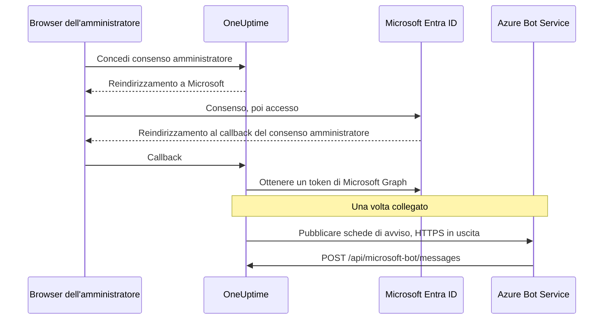

# Integrazione Microsoft Teams

Collega il tuo OneUptime self-hosted a Microsoft Teams. Registri un'app in Microsoft Entra ID, crei un Azure Bot per l'app, fornisci a OneUptime le credenziali dell'app e installi il pacchetto dell'app Teams generato dal tuo server. Da quel momento OneUptime pubblica avvisi e incidenti nei tuoi canali e nelle tue chat, e il tuo team interviene direttamente da Teams.

Questa pagina è per chi gestisce il server OneUptime. Una volta collegato Teams, le regole di notifica si configurano per progetto: vedi [Microsoft Teams](/docs/workspace-connections/microsoft-teams).

:::cards
- [Configura l'integrazione](#configura-lintegrazione): Nove passaggi, dal portale di Azure al tuo primo team.
- [Variabili d'ambiente](#variabili-dambiente): I tre valori che OneUptime prende dalla registrazione dell'app.
- [Accesso di rete](#accesso-di-rete): L'endpoint del bot che Microsoft deve poter raggiungere.
- [Risoluzione dei problemi](#risoluzione-dei-problemi): Endpoint irraggiungibili, installazioni mancanti e connessioni non riuscite.
:::

## Come funziona

OneUptime usa un Azure Bot per l'integrazione con Teams. Il traffico va in entrambe le direzioni, e le due direzioni sono indipendenti: OneUptime chiama Microsoft per pubblicare i messaggi, e Azure Bot Service chiama il tuo server quando qualcuno preme un pulsante, scrive al bot o lo aggiunge a una chat.



Un Incoming Webhook o un URL di flusso di lavoro di Teams non sostituisce l'endpoint di messaggistica di questo bot.

Le videochiamate (una riunione Teams per un incidente) non usano questo bot: richiedono una propria registrazione dell'app, descritta in [Videochiamate](/docs/workspace-connections/video-calls#one-click-connect-on-a-self-hosted-server).

## Prima di iniziare

- Una sottoscrizione Azure, per la risorsa Azure Bot.
- Un account che possa creare registrazioni di app in Microsoft Entra ID, e un amministratore di Microsoft 365 che conceda il consenso amministratore.
- Un nome host HTTPS pubblico per OneUptime raggiungibile da Azure Bot Service. Vedi [Accesso di rete](#accesso-di-rete).
- Accesso alla configurazione del server: `config.env` con Docker Compose, oppure i tuoi values di Helm su Kubernetes.
- Per collegare un progetto, il ruolo **Project Owner**, **Project Admin** o **Project Member** su quel progetto.

## Configura l'integrazione

:::steps
### Passaggio 1: crea la registrazione dell'app di Azure

Nel [portale di Azure](https://portal.azure.com), apri **App registrations** e seleziona **New registration**. Compila il modulo:

- **Name:** oneuptime
- **Supported account types:** Accounts in this organizational directory only (Single tenant)
- **Redirect URI:** Web - `https://your-oneuptime-domain.com/api/microsoft-teams/auth`

Seleziona **Register**, poi aggiungi un secondo URI di reindirizzamento Web, `https://your-oneuptime-domain.com/api/microsoft-teams/admin-consent/callback`. Annota l'**Application (client) ID** e il **Directory (tenant) ID**: ti serviranno entrambi più avanti.

> [!NOTE]
> **Perché un solo tenant:** un'istanza self-hosted di OneUptime serve una sola organizzazione, e il suo bot è registrato per l'unico tenant che imposti in `MICROSOFT_TEAMS_APP_TENANT_ID` (passaggio 6). Registrare l'app come multi-tenant non estende questa portata e introduce una modalità di errore: gli utenti guest / B2B il cui tenant Microsoft di origine è diverso dal tuo raggiungono il bot con il proprio ID tenant, che OneUptime non può associare al tuo progetto. Se hai già registrato un'app multi-tenant, continua a funzionare; assicurati solo che `MICROSOFT_TEAMS_APP_TENANT_ID` sia il tuo tenant, e tieni presente che gli account guest avranno bisogno di un account nel tuo tenant per usare il bot.

### Passaggio 2: configura le autorizzazioni dell'app

Nella registrazione dell'app, apri **API permissions**, seleziona **Add a permission** e scegli **Microsoft Graph**.

**Aggiungi le autorizzazioni delegate** (quando l'app agisce per conto di un utente che ha effettuato l'accesso):

- **User.Read** - Necessaria per ottenere le informazioni del profilo dell'utente autenticato (nome visualizzato, email) durante il flusso OAuth
- **Team.ReadBasic.All** - Necessaria per elencare i team di cui l'utente è membro quando sceglie quale team collegare
- **Channel.ReadBasic.All** - Necessaria per leggere le informazioni dei canali ed elencare i canali dei team per l'invio delle notifiche
- **ChannelMessage.Send** - Necessaria per inviare le notifiche di avvisi e incidenti ai canali di Teams

**Aggiungi le autorizzazioni dell'applicazione** (quando l'app agisce per conto proprio, senza un utente che ha effettuato l'accesso):

- **Team.ReadBasic.All** - Necessaria per elencare tutti i team dell'organizzazione dopo la concessione del consenso amministratore
- **Channel.ReadBasic.All** - Necessaria per verificare che i canali esistano e ottenerne i dettagli
- **TeamsAppInstallation.ReadForTeam.All** - Necessaria per la diagnostica. Permette a OneUptime di leggere quale pacchetto dell'app è davvero installato in un team e di confrontarlo con l'ID client di questa istanza, così un invio non riuscito può dirti *quale* delle possibili cause si è verificata. Senza di essa, OneUptime non riesce a distinguere «non installata» da «installata, ma è il pacchetto di qualcun altro», e può solo riportare ciò che ha detto Microsoft: è il motivo principale per cui il debug di questa integrazione richiede giorni anziché minuti. Concedila.
- **Chat.ReadBasic.WhereInstalled** - Facoltativa. Permette a OneUptime di leggere il nome di ogni chat in cui si trova l'app OneUptime. Senza di essa, ogni chat lo concede tramite l'autorizzazione **ChatSettings.Read.Chat** del manifest (sotto), che una chat aggiunta con un manifest precedente ha solo dopo che l'app è stata aggiornata in quella chat.

`ChannelMessage.Send` è solo un'autorizzazione delegata; non esiste una variante come autorizzazione dell'applicazione nel [riferimento delle autorizzazioni di Microsoft Graph](https://learn.microsoft.com/en-us/graph/permissions-reference#channelmessagesend). Lasciala nell'elenco delle autorizzazioni delegate qui sopra.

Poi seleziona **Grant admin consent** per la tua organizzazione.

Il bot stesso usa autorizzazioni di consenso specifico per la risorsa (RSC) definite nel manifest dell'app Teams. Vengono concesse quando l'app viene installata o aggiornata in un team o in una chat, non in Entra ID:

- **ChannelMessage.Send.Group** - Permette al bot di inviare messaggi ai canali dei team
- **ChannelMessage.Read.Group** - Permette al bot di leggere i messaggi dei canali per i comandi interattivi
- **Channel.Create.Group** - Permette al bot di creare canali quando serve
- **ChatMessage.Read.Chat** - Permette al bot di leggere i messaggi delle chat a cui è stato aggiunto (per i comandi interattivi)
- **ChatMember.Read.Chat** - Permette al bot di leggere i membri delle chat a cui è stato aggiunto (per dare un nome alle chat in OneUptime)
- **ChatSettings.Read.Chat** - Permette a OneUptime di leggere il nome delle chat di gruppo a cui è stata aggiunta l'app. Teams non invia in modo affidabile al bot il nome di una chat di gruppo, quindi senza questa autorizzazione una chat di gruppo con un nome viene elencata con i nomi dei suoi membri
- **TeamsAppInstallation.Read.Group** - Permette a OneUptime di confermare che l'app è installata in un team in cui sta per pubblicare

Se hai caricato il manifest dell'app prima che esistessero queste autorizzazioni, scaricalo di nuovo da **Impostazioni del progetto > Area di lavoro > Microsoft Teams** e caricalo in Teams come aggiornamento dell'app OneUptime. Teams concede le autorizzazioni di team e di chat quando l'app viene installata o aggiornata in quel team o in quella chat, quindi accetta l'aggiornamento in ogni team e in ogni chat che ha già l'app. Per le chat, vedi [Una chat di gruppo è elencata con i nomi dei suoi membri](#una-chat-di-gruppo-è-elencata-con-i-nomi-dei-suoi-membri).

### Passaggio 3: crea un segreto client

Nella registrazione dell'app, apri **Certificates & secrets** e seleziona **New client secret**. Aggiungi una descrizione, scegli una scadenza (24 mesi è una scelta ragionevole) e seleziona **Add**. Copia subito il valore del segreto: Azure lo mostra una sola volta.

> [!IMPORTANT]
> Copia il **Value** del segreto, non il suo **Secret ID**. Il valore è la stringa più lunga.

### Passaggio 4: crea un Bot Service

Nel portale di Azure, crea una risorsa **Azure Bot**:

- **Bot handle:** oneuptime-bot
- **Subscription** e **Resource group:** i tuoi
- **Pricing tier:** F0 (Free) basta per i test
- **Type of App:** Single Tenant, con la registrazione dell'app esistente: il suo **Application (client) ID** e il suo **Directory (tenant) ID** del passaggio 1

Seleziona **Review + create**, poi **Create**. Quando il bot è distribuito, apri la sua pagina **Configuration**, imposta **Messaging endpoint** su `https://your-oneuptime-domain.com/api/microsoft-bot/messages` e salva.

**Verifica l'endpoint prima di andare avanti.** Azure Bot Service chiama questo URL dall'Internet pubblico, quindi controllalo da un punto esterno alla tua rete: non dall'interno del cluster, né da una VPN che vede l'host quando Azure non può vederlo:

```bash
curl -sS -i https://your-oneuptime-domain.com/api/microsoft-bot/messages
```

Usa `-i` invece di guardare solo il codice di stato: su un 404, **il corpo è l'unica cosa che ti dice chi l'ha generato**, e questa distinzione è l'intera diagnosi.

- **405** è corretto e significa che hai finito. L'endpoint accetta solo POST, quindi un GET riceve `405 Method Not Allowed`, con `Allow: POST` e una descrizione dell'endpoint. Raggiungerlo è proprio ciò che si sta verificando.
- **Un 404 con il corpo JSON `{"message":"Page not found - /api/microsoft-bot/messages"}`** proviene da OneUptime, quindi la richiesta *è* arrivata. O questa istanza è precedente alla risposta 405 descritta sopra (le versioni più vecchie servivano questo percorso solo per POST, quindi un GET finiva nel gestore generico «not found»), oppure qualcosa davanti a OneUptime riscrive il percorso, togliendo il prefisso `/api` prima che l'app lo veda (il colpevole tipico è un ingress Kubernetes con `rewrite-target: /`).
- **Un 404 con una pagina di errore HTML** di nginx, del tuo ingress o di un bilanciatore di carico significa il contrario: la richiesta non ha mai raggiunto OneUptime, e ciò che sta davanti non instrada `/api` verso l'app.
- **Un errore TLS, un timeout o una connessione rifiutata** significa che nemmeno Azure ci arriverà. Vedi [la sezione sulla risoluzione dei problemi dell'endpoint di messaggistica](#i-pulsanti-delle-schede-dicono-unable-to-reach-app-e-le-chat-non-compaiono-mai) più sotto.

### Passaggio 5: aggiungi il canale Microsoft Teams al bot

Nella risorsa Azure Bot, apri **Channels** e aggiungi **Microsoft Teams**. Mantieni le opzioni di messaggistica predefinite, salvo esigenze particolari, e salva. Senza questo canale, il provisioning del bot nelle conversazioni di Teams non avviene mai.

### Passaggio 6: configura le variabili d'ambiente di OneUptime

Fornisci a OneUptime le credenziali dell'app:

:::tabs
@tab Docker Compose
```bash title="config.env"
MICROSOFT_TEAMS_APP_CLIENT_ID=YOUR_TEAMS_APP_CLIENT_ID
MICROSOFT_TEAMS_APP_CLIENT_SECRET=YOUR_TEAMS_APP_CLIENT_SECRET
MICROSOFT_TEAMS_APP_TENANT_ID=YOUR_MICROSOFT_TENANT_ID
```

Applica la modifica con `npm run start`, che ricrea i container. `docker compose restart` non rilegge `config.env`.
@tab Kubernetes
```yaml title="values.yaml"
microsoftTeamsApp:
  clientId: YOUR_TEAMS_APP_CLIENT_ID
  clientSecret: YOUR_TEAMS_APP_CLIENT_SECRET
  tenantId: YOUR_MICROSOFT_TENANT_ID
```

Per conservare i valori in un Secret di Kubernetes gestito da te, imposta invece `microsoftTeamsApp.existingSecret`: il suo `name` e le chiavi `clientIdKey`, `clientSecretKey` e `tenantIdKey`. Applica la modifica con `helm upgrade`.
:::

Quando OneUptime è di nuovo attivo, **Impostazioni del progetto > Area di lavoro > Microsoft Teams** mostra la scheda **Concedi consenso amministratore** al posto della guida alla configurazione.

### Passaggio 7: concedi il consenso amministratore in OneUptime

Apri **Impostazioni del progetto > Area di lavoro > Microsoft Teams** e seleziona **Concedi consenso amministratore**. Accedi a Microsoft come amministratore di Microsoft 365 e accetta le autorizzazioni. Microsoft ti riporta alla stessa pagina, e la scheda mostra **Admin Consent Completed**: il progetto è ora collegato al tuo tenant.

Poi seleziona **Connect my account with Microsoft Teams** per collegare il tuo account. Gli altri membri del progetto fanno lo stesso da **Impostazioni utente > Area di lavoro > Microsoft Teams**.

### Passaggio 8: carica il manifest dell'app Teams

Dopo il consenso amministratore, **Impostazioni del progetto > Area di lavoro > Microsoft Teams** mostra la scheda **Action Required: Install This Deployment's App on Microsoft Teams**. Seleziona **Scarica lo zip del manifest dell'app**: il pacchetto contiene l'ID bot di questa istanza.

In Microsoft Teams, apri **Apps > Manage your apps**, seleziona **Upload an app**, poi **Upload a custom app**, e scegli lo zip che hai scaricato.

> [!WARNING]
> Non installare «OneUptime» dallo store di Microsoft Teams per un'istanza self-hosted. L'app dello store punta al bot di OneUptime Cloud, quindi Teams la accetta e poi rifiuta ogni messaggio inviato da questa istanza.

### Passaggio 9: aggiungi OneUptime a ogni team (obbligatorio)

Caricare il manifest installa l'app per **te**. **Non** dà al bot accesso ai canali di alcun team. Microsoft accetta messaggi solo in un team a cui è stata aggiunta l'app, quindi devi farlo in ogni team in cui vuoi ricevere notifiche:

1. In Microsoft Teams, fai clic su «...» accanto al **nome del team** (non a quello del canale)
2. Scegli **Manage team** > **Apps** > **More apps**
3. Cerca **OneUptime** e fai clic su **Add**

Note:

- Installare OneUptime per te, o aggiungerlo a una chat, è un'installazione **diversa**. Nessuna delle due gli permette di pubblicare nei canali di un team.
- **I canali privati** richiedono l'app installata nel canale stesso: apri il canale > «...» > **Manage channel** > **Apps** > **Add an app**. Un'installazione a livello di team non copre i canali privati.
- **I canali condivisi** non possono ricevere notifiche in alcun modo: Microsoft Teams non supporta i bot nei canali condivisi. OneUptime li nasconde nel selettore dei canali.
- Se **Manage team > Apps > More apps** è vuoto o disattivato, i criteri di configurazione delle app di Teams bloccano le app personalizzate. Correggilo nell'interfaccia di amministrazione di Teams, in **Teams apps > Manage apps** e **Setup policies**.
:::

## Variabili d'ambiente

| Docker Compose (`config.env`) | Helm (`values.yaml`) | Valore |
| --- | --- | --- |
| `MICROSOFT_TEAMS_APP_CLIENT_ID` | `microsoftTeamsApp.clientId` | L'**Application (client) ID**. È anche l'ID del bot nel pacchetto dell'app Teams, quindi deve essere un GUID. |
| `MICROSOFT_TEAMS_APP_CLIENT_SECRET` | `microsoftTeamsApp.clientSecret` | Il **Value** del segreto client, non il suo ID. |
| `MICROSOFT_TEAMS_APP_TENANT_ID` | `microsoftTeamsApp.tenantId` | Il **Directory (tenant) ID**. Il bot si autentica come app a tenant singolo in questo tenant. |
| `HOST` | `host` | Il tuo nome host pubblico. Gli URI di reindirizzamento, l'endpoint di messaggistica e il pacchetto dell'app Teams sono costruiti a partire da esso. |
| `HTTP_PROTOCOL` | `httpProtocol` | `https`. Azure Bot Service chiama solo endpoint HTTPS. |

Tutti e tre i valori `MICROSOFT_TEAMS_APP_*` sono obbligatori:

- Senza l'ID client, la pagina Microsoft Teams mostra la guida alla configurazione invece di **Concedi consenso amministratore**.
- Senza l'ID client o il segreto, la connessione termina con **"Microsoft Teams non è configurato su questo server OneUptime."**
- Senza l'ID tenant, il bot non può autenticarsi, quindi la pubblicazione e l'endpoint del bot non funzionano.

## Accesso di rete

Microsoft richiede un [endpoint HTTPS raggiungibile pubblicamente per un bot self-hosted](https://learn.microsoft.com/en-us/azure/bot-service/bot-service-resources-faq-security?view=azure-bot-service-4.0). Un indirizzo IP privato, un nome DNS interno o la connessione VPN di un dipendente non danno ad Azure Bot Service accesso a OneUptime.

| Direzione | Destinazione | Scopo |
| --- | --- | --- |
| Da OneUptime a Microsoft | HTTPS su TCP 443 verso Microsoft Graph, l'identità Microsoft e i servizi Bot Framework | Scambio di token, ricerca di team e canali, e invio delle notifiche |
| Da Microsoft a OneUptime | `POST /api/microsoft-bot/messages` | Messaggi del bot, eventi di installazione nelle conversazioni e azioni delle schede |
| Dal browser dell'utente a OneUptime | `/api/microsoft-teams/auth` e `/api/microsoft-teams/admin-consent/callback` | Reindirizzamenti di accesso e di consenso amministratore |

I reindirizzamenti della registrazione dell'app verso `/api/microsoft-teams/auth` e `/api/microsoft-teams/admin-consent/callback` tornano indietro attraverso il browser dell'utente. Quel browser deve raggiungere OneUptime, per esempio tramite la rete aziendale o la VPN. I messaggi del bot e le azioni delle schede arrivano dai server di Microsoft e richiedono un proprio ingress raggiungibile. L'invio di avvisi in uscita, da solo, non verifica la connettività in ingresso.

### Pubblicare l'endpoint del bot da una distribuzione privata

```mermaid title="Pubblicare l'endpoint del bot da una distribuzione privata"
flowchart LR
    Azure["Azure Bot Service"] -->|HTTPS 443| GW["Gateway pubblico"]
    GW -->|"POST /api/microsoft-bot/messages"| ING["Ingress di OneUptime"]
    Users["Dipendenti sulla VPN"] --> ING
    ING --> App["App OneUptime"]
```

:::steps
1. Fai puntare il DNS pubblico del nome host di OneUptime a un reverse proxy o a un bilanciatore di carico esposto su Internet. Consenti TCP 443 in ingresso e servi un certificato TLS pubblicamente attendibile con la catena completa.
2. Collega il gateway all'ingress privato di OneUptime, direttamente o tramite una tua VPN site-to-site / un tuo collegamento privato, e consenti la sua porta di servizio di origine. Un servizio Kubernetes `ClusterIP` richiede un ingress raggiungibile o un altro percorso dal gateway. Mantieni private le basi di dati e gli altri servizi interni.
3. Pubblica `/api/microsoft-bot/messages` tramite quel gateway e imposta il **Messaging endpoint** dell'Azure Bot del passaggio 4 sull'URL HTTPS pubblico completo. Conserva il metodo, il prefisso `/api`, la stringa di query, il corpo e l'intestazione `Authorization`. Conserva l'`Host` pubblico e imposta intestazioni di inoltro attendibili per l'host pubblico e lo schema HTTPS. Non aggiungere a questo percorso reindirizzamenti, SSO del browser, CAPTCHA o accesso al proxy; l'adattatore Bot Framework di OneUptime deve ricevere e autenticare la richiesta.
4. Mantieni private le altre rotte, se necessario. Con il DNS split, i dipendenti possono risolvere lo stesso nome host verso l'ingress privato tramite la rete aziendale o la VPN. Anche quell'ingress deve servire HTTPS con un certificato valido per il nome host e consentire i reindirizzamenti del browser della tabella qui sopra. Limita l'accesso all'origine al gateway e ai client interni autorizzati.
5. Imposta `HOST=oneuptime.example.com` e `HTTP_PROTOCOL=https` nel `config.env` di Docker Compose, oppure `host: oneuptime.example.com` e `httpProtocol: https` nei values di Helm. Sostituisci l'esempio con il tuo dominio, applica l'aggiornamento della distribuzione e attendi il riavvio dell'app. Questi valori generano URL; non effettuano il provisioning di DNS, TLS o accesso di rete. Se il nome host cambia, aggiorna l'endpoint dell'Azure Bot e i reindirizzamenti della registrazione dell'app, poi scarica e carica di nuovo il manifest di Teams.
:::

Le [impostazioni di accesso alla rete privata](/docs/self-hosted/private-network-access) di OneUptime regolano le richieste in uscita verso i servizi interni. Abilitare `ALLOW_PRIVATE_NETWORK_WEBHOOKS` non rende l'endpoint del bot raggiungibile da Microsoft.

### Accesso in uscita e restrizioni IP

Consenti la risoluzione DNS e l'HTTPS in uscita dall'app OneUptime. Usa `graph.microsoft.com`, `login.microsoftonline.com`, gli endpoint di autenticazione e di canale di Bot Framework, e l'URL del servizio connettore fornito per una conversazione. Il connettore di riserva del cloud commerciale è `https://smba.trafficmanager.net/teams/`; gli URL di servizio delle conversazioni possono essere diversi. Applica le [indicazioni di Microsoft sui firewall](https://learn.microsoft.com/en-us/azure/bot-service/bot-service-resources-faq-security?view=azure-bot-service-4.0) ed esamina il traffico bloccato durante i test; questo non è un elenco esaustivo di nomi host.

Microsoft non supporta elenchi fissi di IP consentiti per il traffico in ingresso di Bot Framework, perché i suoi indirizzi di origine cambiano. Gli intervalli IP per i contenuti multimediali dei client Teams non descrivono le origini dei webhook dei bot. Mantieni attiva l'autenticazione di Bot Framework invece di considerare un IP di origine come prova d'identità.

### Test e distribuzioni senza accesso in ingresso

Usa il passaggio 4 per verificare DNS pubblico, TLS e instradamento dall'esterno della tua rete e della tua VPN. Poi collega Teams, invia una notifica di prova, scrivi al bot e premi un pulsante di una scheda. Conferma l'azione in OneUptime e confronta la diagnostica di consegna di Microsoft con i log del gateway e dell'app. Un percorso GET raggiungibile o una notifica consegnata non verificano da soli un POST del bot autenticato in ingresso.

Per lo sviluppo, la [guida di Microsoft ai test locali dei bot di Teams](https://learn.microsoft.com/en-us/microsoftteams/platform/bots/how-to/authentication/add-authentication#testing-the-bot-locally-in-teams) descrive come esporre un servizio locale con un tunnel. Inoltra a un proxy che consenta l'endpoint del bot e usa `/api/microsoft-bot/messages`, invece del percorso di esempio `/api/messages` di Microsoft. Aggiorna il nome host configurato e l'endpoint dell'Azure Bot ogni volta che cambia l'URL pubblico del tunnel, ferma il tunnel dopo i test e usa un ingress stabile in produzione. Anche un tunnel apre un accesso in ingresso.

> [!WARNING]
> Se un criterio vieta la connettività in ingresso, l'integrazione completa del bot di Teams non può funzionare: comandi, azioni delle schede e rilevamento delle conversazioni dipendono dal fatto che Microsoft raggiunga OneUptime. Azure Bot Private Endpoint non risolve questo requisito. Le [istruzioni di Microsoft sull'isolamento di rete](https://learn.microsoft.com/en-us/azure/bot-service/dl-network-isolation-how-to?view=azure-bot-service-4.0) descrivono l'isolamento di Direct Line e indicano che disattivare l'accesso alla rete pubblica rompe la configurazione dei canali di Teams. Un'installazione completamente disconnessa non può usare Teams.

## Risoluzione dei problemi

Inizia da questi controlli:

- La registrazione dell'app ha le autorizzazioni indicate sopra e il consenso amministratore è stato concesso.
- Gli URI di reindirizzamento corrispondono esattamente (sostituisci `your-oneuptime-domain.com` con il tuo dominio reale).
- Le variabili d'ambiente sono impostate e OneUptime è stato riavviato dopo averle impostate.
- L'endpoint di messaggistica del bot è raggiungibile da Internet e il bot ha il canale Microsoft Teams.
- Il pacchetto dell'app Teams che hai caricato è quello scaricato da questa istanza.

### I pulsanti delle schede dicono "Unable to reach app" e le chat non compaiono mai

Di solito questi sintomi indicano che **Azure Bot Service non riesce a consegnare attività autenticate al tuo endpoint di messaggistica**. Controlla l'instradamento, l'autenticazione del bot e la configurazione del progetto.

La parte che confonde è che le schede di avviso continuano ad arrivare in Teams, e così l'integrazione sembra quasi a posto. Non lo è: le due direzioni sono indipendenti e ne funziona solo una:

| Direzione | Come viaggia | Azure deve raggiungerti? |
| --- | --- | --- |
| OneUptime pubblica una scheda di avviso in un canale | OneUptime chiama Microsoft, autenticandosi con il tuo segreto client | **No** |
| Premi un pulsante su quella scheda | Azure Bot Service invia un POST a `/api/microsoft-bot/messages` | **Sì** |
| Scrivi `help` al bot | Azure Bot Service invia un POST a `/api/microsoft-bot/messages` | **Sì** |
| Una chat viene registrata in **Microsoft Teams Chats** | Azure Bot Service invia con un POST un'attività del bot a `/api/microsoft-bot/messages` | **Sì** |

Quindi un avviso che funziona verifica quell'invio in uscita; non verifica ogni autorizzazione di Graph né l'endpoint del bot in ingresso. Le funzioni interattive richiedono che le attività del bot in ingresso vengano elaborate correttamente.

OneUptime registra le chat a partire dalle attività del bot, come l'installazione dell'app, l'aggiunta del bot alla conversazione o un messaggio inviato al bot in quella chat. Arrivano tutte dallo stesso endpoint in ingresso. Un elenco **Microsoft Teams Chats** vuoto dopo aver aggiunto l'app e averle scritto significa che non è stata registrata alcuna chat per quel progetto; controlla le richieste in ingresso, gli errori di autenticazione e l'associazione tra tenant e progetto. Facendo clic su **Refresh Chats** si rileggono le chat che OneUptime ha salvato, e si rilegge da Microsoft il nome di ogni chat di gruppo salvata.

**Diagnosticalo in questo ordine:**

1. **Cerca il POST, non i 404.** È qui che la maggior parte delle indagini prende la strada sbagliata:

   ```bash
   grep 'POST /api/microsoft-bot/messages' <your access log>
   ```

   Se non ci sono righe POST, conferma che il log di accesso giusto stia registrando le richieste, poi controlla l'endpoint configurato in Azure e il percorso di rete. Se i POST arrivano, esamina le loro risposte e gli errori di autenticazione o di associazione del progetto di OneUptime. Le righe `GET` che restituiscono 404 sono un controllo separato; vedi la nota qui sotto.

2. **Chiama l'endpoint dall'esterno della tua rete,** come nel passaggio 4, con `curl -i` per vedere il corpo. Un `405` dimostra che il percorso è attivo e raggiungibile dal punto in cui hai eseguito il comando. Un errore TLS, un timeout o una connessione rifiutata è la tua risposta.

3. **Controlla la catena dei certificati.** Azure richiede HTTPS con un certificato pubblicamente attendibile servito con la catena completa. Un certificato autofirmato, una CA interna o un certificato intermedio mancante fanno fallire l'handshake TLS prima che OneUptime veda la richiesta, quindi il log di accesso resta vuoto e sembra che Azure non ci abbia mai provato:

   ```bash
   openssl s_client -connect your-oneuptime-domain.com:443 -servername your-oneuptime-domain.com -verify_return_error </dev/null
   ```

4. **Controlla che l'host sia risolvibile pubblicamente.** Un nome DNS privato, un record split-horizon o un ingress solo interno raggiungono te e la tua VPN, ma restano invisibili ad Azure. Risolvilo da una rete senza accesso alla tua.

5. **Conferma l'endpoint nella risorsa Azure Bot**: deve corrispondere esattamente a questa istanza, inclusi schema e percorso: `https://your-oneuptime-domain.com/api/microsoft-bot/messages`.

**Un 404 su `GET /api/microsoft-bot/messages` non è il guasto, né la prova che Azure non riesca a raggiungerti.** L'endpoint ha sempre accettato solo POST, quindi nelle versioni precedenti a questa un GET dal browser finiva nel gestore generico «not found» di OneUptime e tornava come `{"message":"Page not found - /api/microsoft-bot/messages"}`. Sembra un percorso mancante e ha spinto più di un amministratore a cercare una regressione che non esisteva; ma guarda cosa dimostra davvero: è stato OneUptime a generare quella risposta, quindi la richiesta ha raggiunto l'app. È lunga 58 byte, per questo compare in un log di accesso come `"GET /api/microsoft-bot/messages HTTP/1.1" 404 58`.

Questa versione risponde a un GET con `405 Method Not Allowed` e una descrizione di sé, quindi la distinzione non ha più bisogno di spiegazioni. Se sei ancora su una versione precedente, giudica un 404 dal suo corpo: il JSON di OneUptime significa che la richiesta è arrivata; una pagina di errore HTML del tuo proxy significa che non è arrivata.

### Una chat di gruppo è elencata con i nomi dei suoi membri

Teams non invia in modo affidabile al bot il nome di una chat di gruppo, quindi OneUptime lo legge da Microsoft Graph. Serve l'autorizzazione **ChatSettings.Read.Chat** del manifest, che ogni chat concede quando l'app OneUptime viene installata o aggiornata in essa. Le chat a cui l'app è stata aggiunta con un manifest precedente non la hanno, e **Refresh Chats** le segnala. Correggilo in uno di questi due modi:

1. Scarica di nuovo il manifest da **Impostazioni del progetto > Area di lavoro > Microsoft Teams**, caricalo in Teams come aggiornamento dell'app OneUptime, accetta l'aggiornamento in ognuna di quelle chat, poi fai clic su **Refresh Chats**.
   - Teams accetta il caricamento come aggiornamento solo se la sua versione è superiore a quella installata. Le immagini di rilascio la impostano a partire da `APP_VERSION`. Una build senza `APP_VERSION` usa un valore di riserva fisso che cambia solo quando OneUptime modifica il manifest; se Teams dice che il pacchetto non è più recente, aumenta la `version` del manifest prima di caricarlo.
   - Se il tuo tenant consente le autorizzazioni di chat solo alle app pre-approvate, aggiungi prima **ChatSettings.Read.Chat** ai criteri di pre-approvazione di OneUptime (per esempio `Update-MgBetaTeamAppPreapproval -TeamsAppId <app id> -ResourceSpecificApplicationPermissionsAllowedForChats @('ChatMember.Read.Chat','ChatMessage.Read.Chat','ChatSettings.Read.Chat')`), altrimenti l'app aggiornata non potrà essere aggiunta alle chat.
2. Oppure concedi alla registrazione dell'app l'autorizzazione dell'applicazione **Chat.ReadBasic.WhereInstalled** (passaggio 2) con il consenso amministratore, poi fai clic su **Refresh Chats**. Questo copre in una volta ogni chat in cui si trova l'app, senza aggiornarla chat per chat. OneUptime continua a usare il suo token Microsoft Graph attuale fino alla scadenza, quindi un'autorizzazione appena concessa può richiedere fino a un'ora per avere effetto.

Una chat di gruppo senza nome in Teams viene elencata con i nomi dei suoi membri, per scelta progettuale. Una chat rinominata in Teams prende il nuovo nome la prossima volta che qualcuno fa clic su **Refresh Chats**.

### Verificare la configurazione del bot di questa istanza

```bash
curl -sS https://your-oneuptime-domain.com/api/microsoft-bot/test | jq
```

Riporta ciò che OneUptime può vedere localmente: se `MICROSOFT_TEAMS_APP_CLIENT_ID` e `MICROSOFT_TEAMS_APP_CLIENT_SECRET` sono impostati, l'endpoint di messaggistica che questa istanza si aspetta e, cosa più utile, l'**ID bot** che il tuo pacchetto dell'app Teams deve contenere.

Legge le variabili d'ambiente e nient'altro. Non chiama Azure, quindi non può dirti se la risorsa Azure Bot esiste, se il suo endpoint di messaggistica punta qui, se il canale Teams è abilitato, se il segreto è ancora valido o se Azure riesce a raggiungerti. La risposta lo dice da sé, elencando ciò che ha controllato e ciò che non ha controllato, così non viene mai scambiata per un via libera.

L'unico controllo decisivo che permette: confronta il `botId` restituito con l'ID bot dell'app OneUptime installata in Teams. Se non corrispondono, quel pacchetto non può ricevere messaggi da questa istanza; vedi il passaggio 8.

### "The OneUptime app is not installed in the Microsoft Teams team ..."

OneUptime lo ha verificato con Microsoft Graph e l'app manca davvero da quel team (o, per un canale privato, da quel canale). Completa il **passaggio 9** qui sopra. OneUptime può elencare ogni canale del tuo tenant con le autorizzazioni dell'applicazione di Graph, ma può *pubblicare* solo nei team di cui l'app è membro.

### "Microsoft Teams refused the message ... because the OneUptime bot is not a member of that conversation"

Microsoft ha rifiutato la pubblicazione (con parole sue, `BotNotInConversationRoster`) e OneUptime **non** è riuscito a confermare che l'app manchi, quindi non darlo per scontato. Esamina le cause nell'ordine seguente; le prime due, viste da Teams, sono identiche a una configurazione corretta.

1. **L'app nel team è un altro pacchetto.** Vedere un'icona chiamata «OneUptime» in **Manage team > Apps** non basta: conta se l'ID bot di quel pacchetto è il `MICROSOFT_TEAMS_APP_CLIENT_ID` di *questa* istanza. L'app pubblica OneUptime dello store di Teams punta al bot di OneUptime Cloud e non accetterà mai pubblicazioni dalla tua istanza self-hosted. Solo il manifest scaricato da **Impostazioni del progetto > Area di lavoro > Microsoft Teams** (passaggio 8) è fatto per la tua istanza. Se hai dubbi, rimuovi l'app dal team, carica di nuovo il tuo manifest e aggiungi quello.
2. **L'Azure Bot non ha il canale Microsoft Teams.** Completa il **passaggio 5**. Senza di esso, il provisioning del bot nelle conversazioni di Teams non avviene mai, quindi il bot non è nell'elenco dei membri di alcun canale, anche se l'app si installa senza problemi e l'elenco delle app sembra corretto.
3. **L'app è installata per te, o in una chat, ma non nel team.** Completa il **passaggio 9**.
4. **Il canale è privato.** Un'installazione a livello di team non copre i canali privati; vedi le note del passaggio 9.

Concedi **TeamsAppInstallation.ReadForTeam.All** (passaggio 2) così OneUptime ti dice quale di queste è, invece di elencarle tutte.

### Le notifiche funzionano in un team ma non in un altro

L'installazione è per team. Aggiungere OneUptime a un team non fa nulla per gli altri, e nemmeno collegare l'integrazione: quello concede un accesso Graph in *lettura* a tutto il tenant, ed è per questo che il selettore dei canali può mostrarti canali di team in cui il bot non può pubblicare. Completa il **passaggio 9** in ogni team in cui vuoi ricevere notifiche.

### "Regola di test" funziona ma le notifiche reali non arrivano mai

Controlla quali destinazioni ha davvero attive la regola. Una regola mette alla prova solo ciò per cui è configurata: con **Create Microsoft Teams Channel** attivo, il test crea un canale e vi pubblica, il che dimostra che il bot può pubblicare *nel team in cui quel canale è stato creato*, e nulla su qualsiasi altro team. **Impostazioni del progetto > Notifiche > Registri di notifica** registra ogni invio di prova, compreso l'errore esatto di Microsoft quando uno fallisce.

### "Sorry, I couldn't find your project configuration"

Il tenant Microsoft da cui proviene l'attività del bot non è il tenant collegato ad alcun progetto OneUptime. Controlla l'ID tenant nei log del server:

```bash
grep "Project auth not found for tenant ID" <your app logs>
```

Confrontalo con il tenant salvato per il progetto:

```sql
SELECT "projectId", "workspaceProjectId"
FROM "WorkspaceProjectAuthToken"
WHERE "workspaceType" = 'MicrosoftTeams';
```

Se non corrispondono, l'utente che scrive al bot ha effettuato l'accesso a un altro tenant Microsoft (spesso un account guest / B2B il cui tenant di origine non è il tuo). Chiedigli di usare un account del tenant collegato, oppure di menzionare il bot con @ in un canale del team collegato invece che in una chat 1:1.

### "This Microsoft 365 organization is connected to more than one OneUptime project"

Due o più progetti OneUptime hanno collegato lo stesso tenant Microsoft. Un messaggio del bot contiene solo un ID tenant, quindi OneUptime non può sapere quale progetto intendi e rifiuta invece di tirare a indovinare. Scollega Microsoft Teams da tutti i progetti tranne uno.

### "Microsoft Teams App Client ID must be a valid GUID"

**Scarica lo zip del manifest dell'app** si rifiuta di generare un pacchetto quando `MICROSOFT_TEAMS_APP_CLIENT_ID` non è un GUID, perché Teams ne richiede uno per l'ID dell'app e del bot. Copia di nuovo l'**Application (client) ID** dalla pagina di panoramica della registrazione dell'app, impostalo e applica la configurazione.

### La connessione non è stata completata

Quando Microsoft ti riporta indietro e la connessione non è avvenuta (concedendo il consenso amministratore o accedendo con Microsoft), la pagina Microsoft Teams da cui sei partito (**Impostazioni del progetto > Area di lavoro > Microsoft Teams**, oppure le tue **Impostazioni utente > Area di lavoro > Microsoft Teams** se stavi collegando il tuo account) mostra **Microsoft Teams non è stato connesso**, con una frase nella tua lingua che ne spiega il motivo. Il resto della pagina si carica normalmente, quindi puoi riprovare subito lì. Non mostra mai ciò che Microsoft stesso ha risposto (un codice `AADSTS`, per esempio): quello si trova nel log del server OneUptime, insieme al motivo.

| La pagina dice | Cosa fare |
| --- | --- |
| **"Questo link di connessione non è valido, è scaduto o è già stato usato. Ricomincia."** | Il link funziona una volta, per 15 minuti, nel browser che l'ha avviato. Ricomincia dalla pagina Microsoft Teams e termina entro 15 minuti, nello stesso browser. |
| **"Non hai l'autorizzazione per connettere questo progetto a Microsoft Teams."** | Concedere il consenso amministratore per il progetto richiede **Project Owner**, **Project Admin** o **Project Member**. Viene verificato di nuovo quando Microsoft ti riporta indietro. |
| **"Non sei più membro di questo progetto."** | Per collegare il tuo account Microsoft devi essere membro del progetto quando Microsoft ti riporta indietro. |
| **"Hai effettuato l'accesso a un'organizzazione Microsoft 365 diversa da quella a cui è destinata questa connessione."** | Accedi con un account dell'organizzazione Microsoft 365 che ha concesso il consenso amministratore, o a cui è collegato il progetto. |
| **"La tua organizzazione Microsoft 365 non ha ancora team."** | Crea un team in Microsoft Teams, poi concedi di nuovo il consenso amministratore. |
| **"La connessione è stata annullata, quindi non è stato modificato nulla."** | Il consenso non è stato concesso in Microsoft. Ricomincia e accettalo. |
| **"Microsoft Teams non è configurato su questo server OneUptime."** | Imposta l'ID client e il segreto dell'app Microsoft Teams (vedi il [passaggio 6](#passaggio-6-configura-le-variabili-dambiente-di-oneuptime)) e riavvia OneUptime. |
| **"OneUptime non è riuscito a completare la connessione. Riprova."** | Microsoft ha risposto con un errore, oppure una richiesta o una scrittura non è riuscita durante il completamento. Il log del server OneUptime dice quale. Riprova; se continua a succedere, controlla il log e le impostazioni della registrazione dell'app. |

Vogliamo migliorare questa integrazione, quindi i tuoi commenti sono benvenuti a [hello@oneuptime.com](mailto:hello@oneuptime.com).

## Passaggi successivi

:::cards
- [Microsoft Teams](/docs/workspace-connections/microsoft-teams): Crea le regole di notifica e i riepiloghi del progetto.
- [Integrazione Slack](/docs/self-hosted/slack-integration): Configura anche l'app Slack sul tuo server.
- [Accesso alla rete privata](/docs/self-hosted/private-network-access): Permetti a flussi di lavoro e webhook di raggiungere gli strumenti interni.
:::
