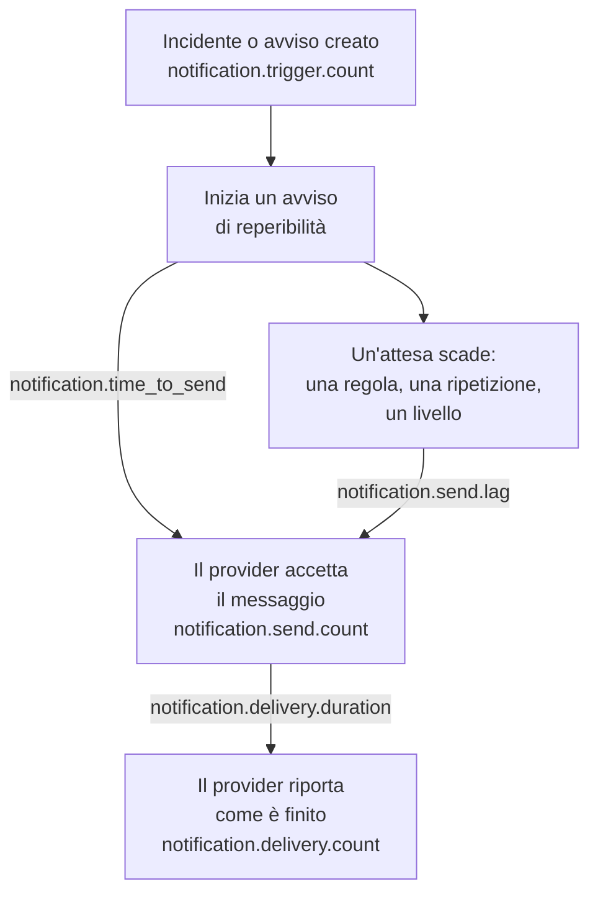

# Metriche di consegna delle notifiche

OneUptime registra come vanno le notifiche che invia: quanti incidenti e avvisi le richiedono, se ogni messaggio ha raggiunto il suo provider, quanto ci ha messo a partire un avviso di reperibilità e se ha raggiunto il telefono. Invia la telemetria di OneUptime stesso a un progetto OneUptime, o a qualsiasi backend OpenTelemetry, per fissare obiettivi di consegna verso le persone che la tua installazione serve e verificare di rispettarli.

:::cards
- [Attivarle](#attivarle): Due impostazioni, e senza di esse non viene registrato nulla.
- [Le metriche](#le-metriche): Sette metriche, dall'attivazione al telefono.
- [Come si cronometra un avviso](#come-si-cronometra-un-avviso): Da dove partono il tempo di invio e il ritardo di invio.
- [SLO da cui partire](#slo-da-cui-partire): Quattro obiettivi, query per query.
:::

## Come funziona



Ogni messaggio conta in `notification.send.count`, su ogni canale, non solo gli avvisi di reperibilità. I due tempi, `notification.time_to_send` e `notification.send.lag`, riguardano solo gli avvisi di reperibilità.

## Attivarle

Non viene registrato nulla finché OneUptime non ha un esportatore OpenTelemetry: senza, le metriche non costano nulla e non vengono conservate da nessuna parte. Puntalo a un progetto OneUptime, con una [chiave di acquisizione](/docs/telemetry/ingestion-keys) di tipo Server di quel progetto, o a qualsiasi backend che accetti OTLP su HTTP.

:::tabs
@tab Kubernetes
```yaml
openTelemetryExporter:
  endpoint: https://oneuptime.example.com/otlp
  headers: x-oneuptime-token=YOUR_INGESTION_KEY
```
I deployment `app` e `worker` le inviano: lascia `app.disableTelemetryCollection` e `worker.disableTelemetryCollection` a `false`, il loro valore predefinito.
@tab Docker Compose
```bash
OPENTELEMETRY_EXPORTER_OTLP_ENDPOINT=https://oneuptime.example.com/otlp
OPENTELEMETRY_EXPORTER_OTLP_HEADERS=x-oneuptime-token=YOUR_INGESTION_KEY
DISABLE_TELEMETRY_FOR_APP=false
```
Impostale in `config.env`, poi esegui `npm start`. `DISABLE_TELEMETRY_FOR_APP` è `true` per impostazione predefinita, e in quel caso non viene inviato nulla.
:::

OneUptime ha bisogno sia dell'endpoint sia delle intestazioni: senza un'intestazione non invia nulla. Scrivi ogni intestazione come `name=value` e separane più d'una con `;`. Un valore può contenere `=`. OneUptime aggiunge da sé `/v1/metrics` all'endpoint, e le stesse impostazioni inviano anche le sue tracce e i suoi log. Ogni metrica compare non appena OneUptime la registra per la prima volta: `notification.send.count` con il primo messaggio inviato.

### Inviare delta a un progetto OneUptime

OneUptime invia contatori e istogrammi come fa OpenTelemetry per impostazione predefinita: ogni punto contiene il totale progressivo dall'avvio di quel processo del server. L'esploratore di metriche somma i punti di ogni passo di un grafico, quindi legge con esattezza i conteggi e i percentili di un intervallo di tempo solo dai delta, punti che contengono ciò che è successo dal precedente. Quando le metriche vanno a un progetto OneUptime, invia delta:

:::tabs
@tab Kubernetes
```yaml
extraEnv:
  - name: OTEL_EXPORTER_OTLP_METRICS_TEMPORALITY_PREFERENCE
    value: delta
```
La lista propria di un servizio sostituisce quella dell'intero chart: se imposti `app.extraEnv` o `worker.extraEnv`, aggiungila anche lì.
@tab Docker Compose
```yaml title="docker-compose.override.yml"
services:
  app:
    environment:
      OTEL_EXPORTER_OTLP_METRICS_TEMPORALITY_PREFERENCE: delta
```
Crealo accanto a `docker-compose.yml`, o aggiungi questo a quello che hai già, poi esegui `npm start`.
:::

Questo vale per ogni metrica che OneUptime invia su se stesso. Un backend che interpreta da sé i totali progressivi, come Prometheus, non ha bisogno di modifiche.

## Le metriche

| Metrica | Tipo | Unità | A che cosa risponde |
| --- | --- | --- | --- |
| `notification.trigger.count` | Contatore | `1` | Quanti record hanno richiesto notifiche |
| `notification.send.count` | Contatore | `1` | Come è andato ogni messaggio consegnato a un provider |
| `notification.send.duration` | Istogramma | `ms` | Quanto ci ha messo il provider ad accettarlo |
| `notification.time_to_send` | Istogramma | `ms` | Quanto dopo la sua attivazione un avviso ha raggiunto il suo provider |
| `notification.send.lag` | Istogramma | `ms` | Quanto dopo la sua scadenza una notifica inviata più tardi ha raggiunto il suo provider |
| `notification.delivery.count` | Contatore | `1` | Come sono finiti i messaggi che i provider hanno accettato |
| `notification.delivery.duration` | Istogramma | `ms` | Quanto dopo l'accettazione da parte del suo provider è finito un messaggio |

Ogni attributo assume uno di pochi valori fissi, mai un progetto, una persona, un numero di telefono o un record. L'unica eccezione sono l'ID e il nome di un canale personalizzato: un'installazione ne ha una manciata, e distinguerli è proprio lo scopo.

### Record che notificano le persone

`notification.trigger.count` conta ogni incidente, avviso, episodio di incidenti ed episodio di avvisi nel momento in cui viene creato.

| Attributo | Valori |
| --- | --- |
| `notification.trigger.type` | `incident`, `alert`, `incident_episode`, `alert_episode` |
| `notification.trigger.source` | `automatic` quando l'ha creato OneUptime, da un monitor o da una regola; `manual` quando l'ha fatto una persona o l'API |
| `monitor.type` | Il tipo del monitor che ha creato un incidente o un avviso, come `Incoming Request`, `Logs` o `Metrics`; assente quando non l'ha creato alcun monitor |

### Messaggi consegnati a un provider

`notification.send.count` conta ogni messaggio consegnato a un provider, e `notification.send.duration` cronometra la chiamata al provider. Entrambe portano questi attributi:

| Attributo | Valori |
| --- | --- |
| `notification.channel` | `email`, `sms`, `call`, `whatsapp`, `telegram`, `push`, `webhook`, `slack`, `microsoft_teams`, `mattermost`, `custom_channel` |
| `notification.provider` | `twilio`, `sms_and_call_gateway`, `smtp`, `sendgrid`, `amazon_ses`, `mailgun`, `postmark`, `resend`, `microsoft_graph`, `expo`, `push_relay`, `web_push`, `meta_whatsapp`, `telegram_bot_api`, `slack`, `microsoft_teams`, `mattermost`, `webhook`, `custom_channel`, oppure `none` quando non è stato consegnato nulla a nessuno |
| `notification.provider.config` | `global` per l'account e le impostazioni dell'installazione; `project` per l'account Twilio, il server SMTP, il webhook o la connessione all'area di lavoro propri di un progetto, i cui errori spetta al progetto risolvere |
| `notification.on_call_page` | `true` per una notifica di un avviso di reperibilità, altrimenti `false` |
| `outcome` | `success`, `failure` o `not_sent`, come sotto |
| `notification.destination` | Slack, Microsoft Teams e Mattermost: `direct_message` a una persona, `channel` per un post in un canale o in una chat di gruppo di Teams, `incoming_webhook` per un webhook in ingresso, come quello di un iscritto a una pagina di stato. Webhook: `status_page_subscriber` per il webhook proprio di un iscritto a una pagina di stato. Assente per il webhook di una persona e per tutti gli altri canali |
| `notification.custom_channel.id`, `notification.custom_channel.name` | Solo canali personalizzati: l'ID del canale, e il suo nome troncato a 100 caratteri |

- `success`: il provider ha accettato il messaggio.
- `failure`: il provider l'ha rifiutato o non era raggiungibile, oppure l'invio è fallito. Un canale di chat che non è stato trovato è un errore senza durata.
- `not_sent`: non inviato di proposito. Il progetto ha disattivato il canale, ha un saldo insufficiente o è bloccato, il push è disattivato su questo server, oppure un canale personalizzato è disattivato, eliminato o non coperto dalla licenza. Un tasso di successo li esclude: sono impostazioni all'opera, non la piattaforma che fallisce.

Un messaggio al webhook proprio di un iscritto a una pagina di stato conta una volta, per quante volte sia stato tentato: `success` quando l'endpoint ha risposto con uno stato 2xx, e `failure` quando ha risposto con un altro stato, non è stato raggiungibile o il suo indirizzo non è consentito.

### Che cosa ha raggiunto il telefono

`notification.delivery.count` conta come è finito ogni messaggio che un provider ha accettato, come il provider lo riporta più tardi, una volta per messaggio. `notification.delivery.duration` cronometra quanto dopo l'accettazione da parte del provider. Entrambe portano `notification.channel`, `notification.provider`, `notification.provider.config`, `notification.on_call_page` e `outcome`, lo stato finale:

| Canale | Provider | `outcome` | Durata |
| --- | --- | --- | --- |
| `sms` | `twilio` | `delivered`, `undelivered`, `failed` | Finché Twilio non riporta lo stato |
| `call` | `twilio` | `answered`, `not_answered`, `failed` | Finché la chiamata non ha ricevuto risposta, o altrimenti non è terminata |
| `push` | `expo`, `push_relay` | `delivered`, `undelivered`, `failed` | Non cronometrato: una ricevuta dice se Apple o Google ha preso il push, non quando |
| `whatsapp` | `meta_whatsapp` | `delivered`, `failed` | Finché Meta non riporta lo stato |

Una chiamata che ha squillato a vuoto, ha trovato occupato o è stata rifiutata è `not_answered`. Un push verso un'app che non c'è più è `undelivered`, e un messaggio WhatsApp letto conta come consegnato. `notification.provider.config` è `project` solo per SMS e chiamate sull'account Twilio proprio di un progetto.

Gli stati arrivano solo dove il provider può riportarli:

- SMS e chiamate: tramite Twilio, quando Twilio può raggiungere il tuo server al suo `HOST` (vedi [Integrazione Twilio](/docs/self-hosted/twilio-integration#3-configurare-laccesso-alla-rete)). Il gateway per SMS e chiamate non ne riporta nessuno.
- WhatsApp: quando il webhook di Meta è configurato per la tua installazione.
- Push: dalle ricevute di Expo, che OneUptime legge circa 15 minuti dopo il push, anche tramite il relay push. Lo conta l'installazione che ha inviato il push.
- Email, Telegram, webhook, chat e canali personalizzati non riportano alcuno stato finale.

## Come si cronometra un avviso

### Tempo di invio

`notification.time_to_send` va dall'attivazione di un avviso all'accettazione della notifica da parte del suo provider. Cronometra solo le notifiche dovute all'inizio dell'avviso: le persone della prima regola di escalation, secondo le loro regole di reperibilità che non aspettano nulla, e qualsiasi livello a cui l'avviso passa subito perché non ha raggiunto nessuno. Le attese richieste dalla configurazione di reperibilità non sono un ritardo della piattaforma, quindi sono escluse: si trovano nel [ritardo di invio](#ritardo-di-invio). Vengono cronometrate solo le notifiche che il provider ha accettato; un errore compare in `notification.send.count`.

| Attributo | Valori |
| --- | --- |
| `notification.channel` | Come in `notification.send.count` |
| `notification.page.start` | Da dove parte il tempo, come sotto |
| `notification.trigger.type` | Il record a cui si riferisce l'avviso: `incident`, `alert`, `incident_episode`, `alert_episode` |
| `notification.custom_channel.id`, `notification.custom_channel.name` | Solo canali personalizzati |

| `notification.page.start` | Il tempo parte da |
| --- | --- |
| `monitor_data_received` | Quando OneUptime ha ricevuto i dati che hanno attivato il monitor: una richiesta in ingresso, il report di un agente server, un'email in ingresso, il controllo di una sonda, un trap SNMP o l'interrogazione di un dispositivo di rete. Include il tempo che i dati hanno atteso in coda per essere valutati. |
| `record_created` | Quando è stato creato l'incidente, l'avviso o l'episodio: da un monitor di telemetria, una regola o una persona, e per un controllo di assenza, come un heartbeat che si è fermato. |
| `page_started` | Quando un avviso è iniziato più tardi: l'ha avviato una persona, un flusso di lavoro o una regola che ora corrisponde, oppure è un avviso diretto. Per un avviso trattenuto dalla sua regola di reperibilità o da OneUptime AI, quando è finita la sospensione, o quando è iniziato se è stato prima. Per un nuovo avviso, quando è scaduto il timeout dopo il riconoscimento. Così un worker arrivato in ritardo a uno dei due si vede nel tempo. |

Per una richiesta in ingresso, il tempo parte dall'ultima richiesta ricevuta dall'endpoint, quindi può risultare un po' corto.

### Ritardo di invio

`notification.send.lag` va dal momento in cui era dovuta una notifica inviata più tardi all'accettazione da parte del suo provider. Due worker le inviano, una volta al minuto ciascuno, quindi un worker puntuale mostra fino a circa un minuto, e uno rimasto indietro mostra di quanto.

| `notification.schedule` | Dovuta quando |
| --- | --- |
| `rule_wait` | La regola di reperibilità di una persona che aspetta, come "chiamami dopo 10 minuti": quel tempo dopo che la persona è stata avvisata. Mai prima dell'ultimo passaggio del worker sulle sue regole, quindi una regola aggiunta o modificata più tardi è dovuta da quel momento. |
| `repeat` | Un push ripetuto finché qualcuno non conferma: ogni volta che scade il suo intervallo. |
| `escalation` | Un livello di escalation successivo: quando il livello precedente ha finito la sua attesa, o subito quando una persona passa l'avviso. |
| `policy_repeat` | La policy che ricomincia dal suo primo livello: quando è scaduta l'attesa del suo ultimo livello. |

Porta anche `notification.channel`, `notification.trigger.type` e, per i canali personalizzati, `notification.custom_channel.id` e `notification.custom_channel.name`. Una notifica dovuta all'inizio del suo avviso non vi compare mai, nemmeno quando un worker ha avviato l'avviso in ritardo, dopo una sospensione o come nuovo avviso: è nel tempo di invio.

### Bucket degli istogrammi

Ogni istogramma ha i propri limiti dei bucket, in millisecondi, scelti in modo che un obiettivo si possa leggere a un limite:

| Istogramma | Limiti dei bucket, in millisecondi |
| --- | --- |
| `notification.send.duration` | `5, 10, 25, 50, 100, 250, 500, 1000, 2500, 5000, 10000, 30000, 60000, 120000` |
| `notification.time_to_send` | `250, 500, 1000, 2000, 5000, 10000, 15000, 30000, 60000, 120000, 300000, 600000, 1800000, 3600000` |
| `notification.send.lag` | `1000, 5000, 10000, 15000, 30000, 45000, 60000, 75000, 90000, 120000, 180000, 300000, 600000, 1800000, 3600000` |
| `notification.delivery.duration` | `500, 1000, 2000, 5000, 10000, 15000, 30000, 60000, 120000, 300000, 600000, 1800000, 3600000, 14400000, 86400000` |

Un percentile viene calcolato dai bucket, e disegnato come il centro del bucket in cui cade. Confrontalo quindi con il limite di un bucket: un P95 di `notification.time_to_send` pari o inferiore a 30000 significa che il 95% degli avvisi ha impiegato 30 secondi o meno.

## SLO da cui partire

Quattro obiettivi che la maggior parte delle installazioni può promettere, ciascuno costruito con una o due query nell'esploratore di metriche del progetto che riceve le metriche. Leggono un intervallo di tempo con esattezza una volta che le metriche arrivano come delta: vedi [Inviare delta a un progetto OneUptime](#inviare-delta-a-un-progetto-oneuptime).

### Costruirne uno nell'esploratore di metriche

:::steps
1. Apri l'[Esploratore metriche](/docs/telemetry/metrics-explorer) del progetto, e fai clic sulla prima metrica dell'obiettivo. La sua query è `a`.
2. Scegli la sua aggregazione in **Aggregate by**. Poi apri **Filters & grouping**, e aggiungi ciascuna delle sue condizioni in **Filter by attributes**.
3. Per una seconda query, fai clic su **Aggiungi metrica**, e configura `b` allo stesso modo.
4. Per una formula, fai clic su **Aggiungi formula**, e scrivila in **Formula**.
5. Per essere avvisato quando l'obiettivo non viene rispettato, fai clic su **Azioni → Crea monitor da questa vista**, e invia un avviso quando il valore supera l'obiettivo: vedi [Monitor metriche](/docs/monitor/metrics-monitor).
:::

Per seguire un obiettivo su 30 giorni con un budget di errore, collega quel monitor a uno [SLO](/docs/slo/introduction): conta il tempo in cui l'obiettivo non è stato rispettato.

### Gli SMS di reperibilità raggiungono Twilio

Al massimo l'1% degli SMS di reperibilità inviati tramite l'account Twilio proprio dell'installazione fallisce, quindi il 99% viene accettato.

| Query | Metrica | Aggregazione | Condizioni |
| --- | --- | --- | --- |
| `a` | `notification.send.count` | **Somma** | `notification.channel = sms`, `notification.on_call_page = true`, `notification.provider.config = global`, `outcome != not_sent` |
| `b` | `notification.send.count` | **Somma** | Le stesse, con `outcome = failure` |

La formula `$b / $a * 100` è la quota che è fallita, e l'obiettivo regge finché resta pari o inferiore a 1. Un passo senza errori non disegna alcun punto, perché `b` non ne ha. `outcome != not_sent` esclude ciò che le impostazioni proprie dei progetti hanno trattenuto, e `global` gli account Twilio propri dei progetti. Su un'installazione che invia gli SMS tramite il proprio gateway per SMS e chiamate, le stesse query misurano il gateway. Per un altro canale, cambia `sms`: `call`, `push` o `email`.

### Gli avvisi di reperibilità partono entro 30 secondi

Il 95% degli avvisi di reperibilità raggiunge il suo provider entro 30 secondi dalla sua attivazione.

| Query | Metrica | Aggregazione | Condizioni |
| --- | --- | --- | --- |
| `a` | `notification.time_to_send` | **P95** | `notification.page.start != page_started` |

L'obiettivo regge finché `a` resta pari o inferiore a 30000. Gli avvisi avviati più tardi sono cronometrati dal loro avvio o dalla loro scadenza, non da un'attivazione, quindi sono esclusi. Raggruppa per `notification.page.start` per vedere la coda dei monitor (`monitor_data_received`) separata dal resto, o per `notification.channel` per trovare un canale lento.

### Le notifiche inviate più tardi partono entro 90 secondi

Il 99% delle notifiche inviate dopo un'attesa raggiunge il suo provider entro 90 secondi dalla sua scadenza.

| Query | Metrica | Aggregazione | Condizioni |
| --- | --- | --- | --- |
| `a` | `notification.send.lag` | **P99** | — |

L'obiettivo regge finché `a` resta pari o inferiore a 90000. Raggruppa per `notification.schedule` per vedere quale worker è rimasto indietro: `rule_wait` e `repeat` sono di un worker, `escalation` e `policy_repeat` dell'altro.

### Gli SMS di reperibilità raggiungono il telefono

Al massimo il 5% degli SMS di reperibilità che Twilio ha accettato per l'account proprio dell'installazione non viene consegnato.

| Query | Metrica | Aggregazione | Condizioni |
| --- | --- | --- | --- |
| `a` | `notification.delivery.count` | **Somma** | `notification.channel = sms`, `notification.on_call_page = true`, `notification.provider.config = global` |
| `b` | `notification.delivery.count` | **Somma** | Le stesse, con `outcome != delivered` |

La formula `$b / $a * 100` è la quota non consegnata. Gli operatori e i telefoni spenti ne decidono una parte, quindi fissa l'obiettivo in base a ciò che vedi nell'arco di alcune settimane. Per le chiamate, usa `call` e `outcome != answered`. Twilio deve poter raggiungere il tuo server: vedi [Che cosa ha raggiunto il telefono](#che-cosa-ha-raggiunto-il-telefono).

## Risoluzione dei problemi

:::details Non arriva alcuna metrica delle notifiche
Controlla che `OPENTELEMETRY_EXPORTER_OTLP_ENDPOINT` e `OPENTELEMETRY_EXPORTER_OTLP_HEADERS` siano entrambe impostate, e in Docker Compose che `DISABLE_TELEMETRY_FOR_APP` sia `false`, poi riavvia OneUptime. All'avvio, OneUptime registra un avviso quando non riesce a leggere un'intestazione o quando non invia nulla. Una metrica compare solo dopo che qualcosa è stato registrato, quindi invia prima una notifica.
:::

:::details Un conteggio cresce soltanto, o un percentile si muove appena
Le metriche arrivano come totali progressivi. Invia delta: vedi [Inviare delta a un progetto OneUptime](#inviare-delta-a-un-progetto-oneuptime).
:::

:::details Non arriva alcuno stato finale
Gli stati finali arrivano dai provider, più tardi, e solo dove possono riportarli: vedi [Che cosa ha raggiunto il telefono](#che-cosa-ha-raggiunto-il-telefono). In un'installazione che Twilio non può raggiungere, SMS e chiamate vengono contati come inviati, ma mai come consegnati.
:::

## Passaggi successivi

:::cards
- [Esploratore metriche](/docs/telemetry/metrics-explorer): Tracciare, combinare e confrontare qualsiasi metrica.
- [Monitor metriche](/docs/monitor/metrics-monitor): Avvisare quando un obiettivo non viene rispettato.
- [Integrazione Twilio](/docs/self-hosted/twilio-integration): Lasciare che Twilio riporti che cosa ha raggiunto il telefono.
- [Regole di escalation](/docs/on-call/escalation-rules): Le attese da cui parte il ritardo di invio.
:::
